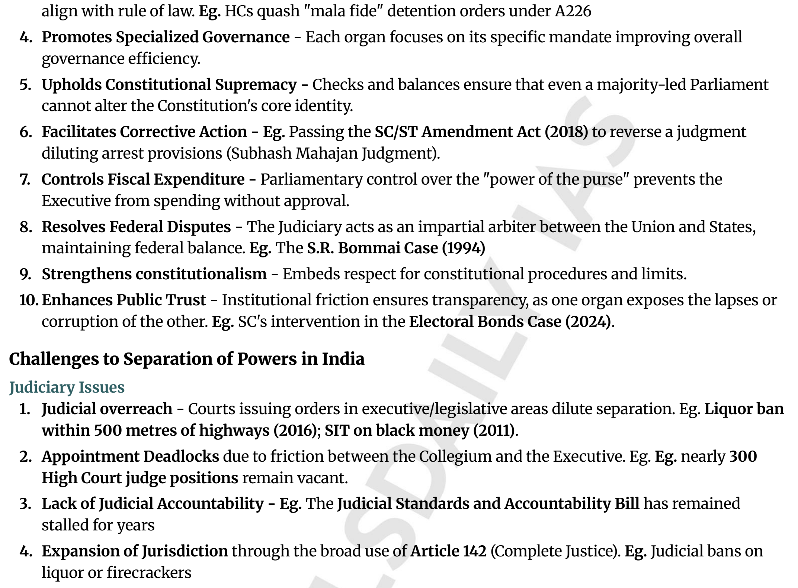

# Making of the Constitution, Nature & Salient Features — Smash Mains Notes (X-Factor Mains'27)

---

### [Smash Mains Source Page 3](../pages/mains/mains_page_003.pdf)

## Chapter 1: Nature Of Constitution

### PYQs

- **[2025]** "Constitutional morality is the fulcrum which acts as an essential check upon the high functionaries and citizens alike..." In view of the above observation of the Supreme Court, explain the concept of constitutional morality and its application to ensure balance between judicial independence and judicial accountability in India. (15)

- **[2023]** Explain the constitutional perspectives of Gender Justice with the help of relevant Constitutional Provisions and case laws. (15)

- **[2022]** "The most significant achievement of modern law in India is the constitutionalization of environmental problems by the Supreme Court." Discuss this statement with the help of relevant case laws. (10)

- **[2021]** 'Constitutional Morality' is rooted in the Constitution itself and is founded on its essential facets. Explain the doctrine of 'Constitutional Morality' with the help of relevant judicial decisions. (10)

### Quotes

> **On the significance of the Constitution:** "Constitution is not a mere lawyers' document, it is a vehicle of Life, and its spirit is always the spirit of Age." — B.R. Ambedkar
> 
> **On the nature of the Constitution:** "So long as you do not achieve social justice, whatever freedom is provided by the law to you will be of no avail" — B.R. Ambedkar
> 
> **On Constitutional Morality and constitutionalism:** "However good a Constitution may be, if those who are implementing it are not good, it will prove to be bad. However bad a Constitution may be, if those implementing it are good, it will prove to be good" — B.R. Ambedkar

### Constitution

The Constitution serves as the foundational law on which other laws are constructed and enforced. A Constitution is a set of fundamental legal-political rules that:

- **1.** Bind all state actors and institutions, including the legislature, executive, and judiciary, ensuring supremacy over ordinary laws.

- **2.** Define the framework of government by laying down its structure, functions, operating procedures, political principles, and the rights and duties of citizens.

- **3.** Delineate the distribution of power in society and delegates specific decision-making authority to various entities or authorities. Eg. 7th Schedule

- **4.** Set forth the fundamental principles and objectives that govern the establishment and governance of a state. Eg. Preamble and the Directive Principles of State Policy.

- **5.** Derive legitimacy from public acceptance, reflecting broad consensus and societal trust.

---

### [Smash Mains Source Page 4](../pages/mains/mains_page_004.pdf)

- **6.** Possess rigidity by requiring special procedures for amendment (Eg. supermajority vote, referendum), making it harder to alter than ordinary legislation.

- **7.** Conform to democratic standards, at minimum ensuring representation, accountability, and protection of fundamental human rights as recognized in international law. Indian Constitution is often criticized as a Bag of Borrowings, having its features picked up from various other Constitutions.

### Arguments in favor

- **1.** Fundamental Rights borrowed from the United States Constitution.

- **2.** Directive Principles of State Policy is inspired by the Irish Constitution

- **3.** The Parliamentary System including the bicameral legislature and the role of the Prime Minister, mirrors the British model.

- **4.** Federal Structure with a strong central government was influenced by the Canadian Constitution.

- **5.** Emergency Provisions were derived from the Weimar Constitution of Germany.

- **6.** Fundamental Duties was inspired by the Soviet Constitution.

- **7.** The concurrent List was borrowed from the Australian Constitution.

- **8.** Judicial Review was adopted from the American system

### Arguments Against

> 'Nobody holds any patent rights in fundamental ideas of the Constitution' - Ambedkar.

- **1.** The crafting and implementation of its provisions were guided and adapted by Indians to accommodate the diverse local realities. Eg. Federalism.

- **2.** Indian civilizational values: Equality, fraternity, liberty, federalism, republic, democracy, etc. can be traced back to ancient Indian history and scriptures. For Eg.

  - **a.** The secularism in the Indian Constitution is influenced by 'sarva dharma sambhav'

  - **b.** Equality principles under Article 14 to 18 are inspired from Rig Veda that emphasizes the idea of the unity of all beings and the absence of discrimination based on caste or birth.

  - **c.** The Arthashastra calls individual liberties and property rights as essential components of good governance

  - **d.** The establishment of the "Mahasangha" or the Great Assembly in ancient India is considered an early form of a republic.

  - **e.** The concept of "Sabha" and "Samiti" in ancient texts reflects democratic practices.

- **3.** Unique Synthesis, Not Blind Copying - Eg. Fundamental Rights inspired by the US Bill of Rights, but subject to reasonable restrictions reflecting Indian socio-economic realities.

- **4.** Certain basic features are common in all the democratic constitutions in the world. Eg. Protection of individual rights, separation of powers, rule of law.

- **5.** Many provisions were of Indian origin. Eg. Finance Commission, Reservation, etc.

### Constitution as a living document

According to Woodrow Wilson, living political Constitutions must be Darwinian in structure and in practice.

- **1.** Balance between rigidity and flexibility under Article 368.

- **2.** Judicial Interpretation - Eg. Right to Privacy (2017) recognized as part of Article 21; Basic Structure Doctrine (1973) ensures continuity with adaptability.

- **3.** Expansion of Fundamental Rights - Eg. Right to Education (2002) made a Fundamental Right (Art. 21A); environmental protection interpreted within Right to Life.

---

### [Smash Mains Source Page 5](../pages/mains/mains_page_005.pdf)

- **4.** Responsive to Democratic Aspirations - Eg. reservation for women in Parliament and State Assemblies (2023 Constitution (106th Amendment) Act).

- **5.** Balance of Continuity and Change - While adapting to modern issues (privacy), it maintains core values of sovereignty, democracy, secularism, and equality.

- **6.** Inclusivity: According to President Droupadi Murmu, the makers created a comprehensive Constitution due to their sensitivity towards each section of society and awareness of each level of democracy.

### Limitations and Challenges

- **1.** Overuse of Amendments - Excessive amendments (100+ so far) risk diluting constitutional sanctity. Eg. Frequent changes to Reservation policy (77th, 81st, 85th, 103rd Amendments)

- **2.** Judicial Overreach Concerns (against separation of powers) - Eg. NJAC Judgment.

- **3.** Ambiguity in "Basic Structure Doctrine" - the doctrine is vague and judges decide its scope case by case, leading to uncertainty.

- **4.** Tension Between Flexibility and Stability - Eg. Emergency provisions (1975-77 misuse) showed how flexibility can weaken rights.

- **5.** Socio-economic Gaps in Realization - Eg. Directive Principles like right to work or nutrition remain partially realized despite MGNREGA and NFSA.

- **6.** Political Motives - Eg. 42nd Amendment (1976) tried to concentrate power in the centre.

- **7.** Complexity for Common Citizens - The Constitution's vast length and legal language make it less accessible to ordinary people, challenging its participatory legitimacy.

### Constitutionalism

Constitutionalism is a political philosophy centered on limiting government power through a Constitution, ensuring government operates within the bounds of law and protecting fundamental rights. In the I. R. Coelho case, the Supreme Court held that "Constitutionalism is a legal principle that requires control over the exercise of Governmental power to ensure that it does not destroy the democratic principles upon which it is based". In the Rameshwar Prasad case, the Supreme Court held that "the constitutionalism or constitutional system of Government abhors absolutism - it is premised on the Rule of Law in which subjective satisfaction is substituted by objectivity provided by the provisions of the Constitution itself". Louis Henkin defines Constitutionalism as constituting the following 9 elements:

- **1.** Government according to the Constitution - it provides for codification of fundamental laws and principles into a single, formal document that serves as the supreme law of the land.

- **2.** Separation of power - it prevents the concentration of power, ensures checks and balances, and safeguards against potential abuses. Eg. impeachment process

- **3.** Sovereignty of the People - Representative institutions derive power from popular mandate, upholding the principle of government by the people, for the people, of the people.

- **4.** Constitutional Review - Judiciary ensures supremacy of the Constitution;

  - **a.** Raja Ram Pal case (2007): Judicial review extends to parliamentary proceedings if they violate constitutional principles.

  - **b.** I.R. Coelho case (2007): Laws placed in Ninth Schedule after 1973 subject to Basic Structure Doctrine, reinforcing constitutional supremacy.

- **5.** Independent judiciary - to ensure that laws are applied fairly, protecting individual rights and upholding the rule of law without external influence.

---

### [Smash Mains Source Page 6](../pages/mains/mains_page_006.pdf)

- **6.** Fundamental rights as a check on government's powers Eg. Shreya Singhal case (2015) - Struck down Section 66A IT Act for violating freedom of speech under Article 19(1)(a).

- **7.** Rule of Law - Ensures uniform application of laws and upholds equality and legal certainty. Eg. Indira Gandhi v. Raj Narain (1975) - Struck down law exempting PM's election from judicial review, affirming no one is above the law.

- **8.** Civilian control of the military, ensuring it remains subordinate to democratic institutions and preventing political interference.

- **9.** No state power, or very limited and strictly circumscribed state power, to suspend the operation of some parts of, or the entire, constitution. Eg. restrictions on use of Article 352

### Constitutional Morality

*"Constitutional morality is not a natural sentiment. It has to be cultivated". - Ambedkar *

British Classicist George Grote described it as a "paramount reverence for the forms of the Constitution" of the land. Constitutional morality refers to an overarching set of principles that guides the interpretation of the Constitution, particularly when addressing complex legal questions. It is derived from the spirit and fundamental values enshrined in the Constitution, such as justice, liberty, human dignity, equality, fraternity. However, its scope is not confined to these explicitly stated values but extends beyond the literal text of the Constitution as well. It differs from popular morality, which is determined by popular perceptions, sentiments, and common notions prevalent in society. Constitutional Morality provides a "unifying constitutional ethic" that reflects the shared values and aspirations of a society. It actively promotes a pluralistic and inclusive society. It compels society to allow for conditions which respect diversity, promote inclusion and pursuit tolerance. Recent News

- While introducing Constitution (130th Amendment) Bill which proposes automatic removal of Prime Minister, chief minister and ministers if they are arrested and detained for 30 consecutive days on charges punishable by five years or more imprisonment, Home Minister held that it was aimed at upholding "constitutional morality" and public trust

- However, Bill was criticised as abusive constitutionalism (use of formal constitutional change to make a system significantly less democratic, entrench power, disable checks, and reduce electoral competition). It erodes democracy by

- Presumption of Innocence - Removal on mere detention, not conviction, undermines rule of law and invites politicised targeting.

- Unequal Standards - Creates asymmetry: MPs/MLAs removed only on conviction, but Ministers on detention.

- Parliamentary Confidence Eroded - Displaces legislative majority principle under Articles 75 & 164 with police/judicial discretion.

- Executive Authority Undermined - Strips PM/CM's prerogative to select/dismiss Ministers, politicising accountability.

- Governance Destabilised - Cycles of resignation and reinstatement weaken stability and fracture coalitions.

- Opportunism Encouraged - Enables ruling parties to weaponise detentions to eliminate rivals.

- Incoherence in Standards - A convicted legislator may remain, while a detained Minister must resign, violating fairness.

---

### [Smash Mains Source Page 7](../pages/mains/mains_page_007.pdf)

- Authoritarian Tilt - Empowers law enforcement over Parliament, reflecting abusive constitutionalism.

### Pillars of Constitutional Morality

George Grote, in his History of Greece, described constitutional morality as a "rare and difficult sentiment":

- **1.** Paramount reverence for forms and procedures of the Constitution.

- **2.** Adherence to law while enabling open criticism of authority.

- **3.** Need for public reason, self-restraint, and trust in institutions.

### Other Pillars

- **1.** Rule of Law

- **2.** Institutional Integrity - Independent functioning of constitutional bodies.

- **3.** Democratic Spirit - Respect for dissent, and procedures. Eg. Dy Speaker from opposition

- **4.** Progressive Interpretation to reflect its principles in changing contexts. Eg. Privacy

- **5.** Equality and Dignity - Eg. Sabrimala Judgment

- **6.** Constitutional Values - Upholding justice, liberty, equality, fraternity, secularism, and dignity.

- **7.** Democratic Principles - Participation, representation, and accountability. Eg. Social Audits.

- **8.** Fundamental Rights - Protecting freedoms and personal liberty from arbitrary state action.

- **9.** SoP and Checks and Balances to prevent concentration of power. Eg. NJAC verdict Ambedkar & Grote on Constitutional Morality - Key Elements

- Freedom with Self-Restraint - Constitutional morality requires citizens and leaders to exercise self-restraint so freedom does not descend into anarchy or revolution.

- Commitment to Constitutional Methods - Ambedkar: achieve goals through constitutional processes, rejecting both violent revolution and coercive methods like satyagraha.

- Pluralism & Non-Violence - only way to resolve differences non-violently is through agreed constitutional adjudication (parliament, courts).

- Suspicion of Absolute Sovereignty - No branch or leader can claim to uniquely embody the "will of the people"; all authority must be open to criticism and checks.

- Non-Transactional Allegiance - Loyalty to the Constitution must hold even if outcomes don't match personal beliefs or group interests.

- Rejection of Hero-Worship - Ambedkar opposed personality cults, seeing them as threats to constitutional democracy.

- Criticism as a Democratic Virtue - Constitutional morality thrives when government decisions remain subject to open, pacific, and continuous criticism.

### Judicial Elaboration

- **1.** Kesavananda Bharati (1973): Upheld Basic Structure as a reflection of constitutional morality above political majority.

- **2.** Naz Foundation (2009, Delhi HC): Asserted constitutional morality over public morality in striking down Sec. 377 IPC (later affirmed in Navtej Johar).

- **3.** Navtej Singh Johar (2018): SC decriminalized homosexuality, stating constitutional morality must prevail over majority opinion.

---

### [Smash Mains Source Page 8](../pages/mains/mains_page_008.pdf)

- **4.** Sabarimala case (2018): Affirmed women's entry in temples on grounds of constitutional morality and gender equality.

- **5.** Government of NCT of Delhi v. UoI (2018) - SC held that constitutional morality ensures cooperative federalism and prevents concentration of power in the hands of one authority. The phrase had been used in less than 10 reported cases by the Supreme Court till 2010 from the time the Constitution was adopted. However, in the year 2018 alone, it has been used in more than 10 reported cases by the Supreme Court.

### Criticism of Constitutional Morality

- **1.** Judicial Overreach - Courts often expand the idea beyond text, raising concerns about unelected judges imposing their values.

- **2.** Vagueness and Subjectivity - No fixed definition; interpretation depends on judicial philosophy, leading to inconsistency.

- **3.** Conflict with Social Morality - Excessive reliance may alienate traditional or religious communities, creating friction (Eg. opposition to Navtej Johar, Sabarimala).

- **4.** Undermines Popular Will - Risks privileging constitutional ideals over democratic majority opinion, fueling debates on counter-majoritarianism.

- **5.** Implementation Gap - Despite being invoked, societal practices (caste, gender bias, corruption) often remain unchanged.

- **6.** Risk of Instrumentalisation - Without safeguards, it can be weaponised to justify authoritarian measures. Eg. weaponisation of Detention Laws like UAPA, PMLA

- **7.** Dependence on Judiciary - Over-reliance on courts for enforcing constitutional morality weakens the responsibility of legislature and executive.

- **8.** Some critics argue that the concept of constitutional morality remains understudied and there is a need for a consensus to be reached for defining and applying this concept.

### Way Forward: Inculcating Constitutional Morality

- **1.** Civic Education - Introduce constitutional values (justice, liberty, equality, fraternity, secularism) in schools and universities through civic studies and debates.

- **2.** Political Accountability - Ensure elected representatives uphold constitutional ethics via stricter codes of conduct and parliamentary oversight.

- **3.** Institutional Integrity - Strengthen ECI, CAG, Lokpal, Judiciary to function impartially, ensuring fidelity to constitutional principles.

- **4.** Cultural Integration - Align social morality with constitutional morality through campaigns against casteism, patriarchy, and communalism.

- **5.** Capacity Building - Train civil servants, police, and judiciary in constitutional ethics to prevent misuse of authority.

- **6.** Periodic Review of Laws - Update outdated laws (Eg. sedition, marital rape exception) to ensure consistency with constitutional ideals. Jürgen Habermas - Advocated constitutional patriotism: citizens must build loyalty to constitutional values and processes, not ethnic or religious identity. Amartya Sen - Emphasised the role of public reasoning and deliberation as essential for democratic culture; constitutional morality can be nurtured through open dialogue and participatory governance.

---

### [Smash Mains Source Page 9](../pages/mains/mains_page_009.pdf)

Martha Nussbaum - Highlighted cultivation of civic virtues (empathy, dignity, respect for difference) through education in liberal and constitutional values. As Rajeev Bhargava notes, it embodies a form of constitutional patriotism that enables unity in diversity while upholding pluralism, making it indispensable for India's democratic resilience.

### SC Judgments on various aspects

### SC Judgments on Environment

- **1.** MK Ranjitsinh v. Union of India (2024) - Recognized a new fundamental right to be free from the adverse effects of climate change.

- **2.** In Re: T.N. Godavarman (ESZ Case) (2023) - Clarified that mining is prohibited within Eco-Sensitive Zones and 1km around National Parks/Sanctuaries.

- **3.** Vanashakti v. Union of India (2026) - Reversed the verdict on ban on "retrospective" environmental clearances for projects

- **4.** M.C. Mehta v. Union of India (1987) - Established "Absolute Liability" for enterprises engaged in hazardous activities causing public harm or leaks.

- **5.** Subhash Kumar v. State of Bihar (1991) - Confirmed that the right to pollution-free water and air is a fundamental human right under Article 21.

- **6.** Vellore Citizens v. Union of India (1996) - Integrated "Polluter Pays" and "Precautionary Principle" into the core of Indian environmental law.

- **7.** M.C. Mehta v. Kamal Nath (1997) - Applied the "Public Trust Doctrine," holding that natural resources belong to the public, not private parties.

- **8.** Almitra Patel v. Union of India (2000) - Directed all Indian cities to implement scientific schemes for mandatory municipal solid waste management.

### SC Judgments on Gender Justice

- **1.** Vishaka v. State of Rajasthan (1997) - Laid down Vishaka Guidelines on sexual harassment at workplace, invoking CEDAW.

- **2.** Indian Young Lawyers Association - Allowed women's entry into Sabarimala temple, affirming religious freedom + gender equality.

- **3.** Secretary, Ministry of Defence v. Babita Puniya (2020) - Granted permanent commission to women officers in the Army, ensuring equal career opportunities.

- **4.** Shayara Bano v. Union of India (2017) - Declared instant triple talaq unconstitutional, strengthening Muslim women's rights.

- **5.** State of Jharkhand v. Shailendra Kumar Rai (2022) - declared the archaic practice of conducting the "two-finger test" on victims of rape as unconstitutional and illegal.

- **6.** Joseph Shine v. Union of India (2018) - Decriminalized adultery, ruling that laws treating women as "chattel" or property of husbands are unconstitutional.

- **7.** Vineeta Sharma v. Rakesh Sharma (2020) - Granted daughters equal coparcenary (inheritance) rights in ancestral property, regardless of when the father died.

- **8.** Dr. Jaya Thakur v. Union of India (2026) - Recognized access to menstrual hygiene facilities and sanitary products as a fundamental right (Article 21) in schools.

---

### [Smash Mains Source Page 10](../pages/mains/mains_page_010.pdf)

- **9.** Jane Kaushik v. Union of India (2025) - Mandated "Equal Opportunity Policies" for transgender persons in both public and private sector workplaces.

- **10.** In Re: Sexual Offences Sensitivity Guidelines - Formed expert committees to eliminate "gender-insensitive" reasoning and patriarchal stereotypes from judicial orders and rulings.

### Negative Example

- Shivangi Bansal v. Sahib Bansal (2022, SC) - Directed implementation of Allahabad HC guidelines mandating a two-month cooling-off period in matrimonial cruelty cases, restraining police from arrest or action during this time.

### SC Judgments on Children

- **1.** Bandhua Mukti Morcha v. Union of India (1984) - Declared bonded child labour unconstitutional and expanded Article 24 & 21 protections.

- **2.** M.C. Mehta v. State of Tamil Nadu (1996) - Banned child labour in hazardous industries, mandated rehabilitation and education.

- **3.** Unnikrishnan J.P. v. State of Andhra Pradesh (1993) - Recognised Right to Education as part of Article 21.

- **4.** Independent Thought v. Union of India (2017) - Declared sex with minor wife (<18 years) as rape, overriding marital exception.

- **5.** Society for Unaided Private Schools v. Union of India (2012) - Upheld the 25% reservation for disadvantaged children in private schools under the Right to Education Act.

- **6.** Sampurna Behura v. Union of India (2018) - Mandated the setting up of Child Protection Units and Commissions in every state for better oversight.

### SC judgments on Tribals

- **1.** Kailas v. State of Maharashtra (2011) - Affirmed that Scheduled Tribes are the original inhabitants of India and must be protected from historical injustice.

- **2.** Samatha v. State of Andhra Pradesh (1997) - Prohibited transfer of tribal lands to non-tribals/private mining companies, affirming Fifth Schedule protections.

- **3.** Niyamgiri case, 2013 - Upheld Gram Sabha's authority to decide on mining, protecting tribal religious and cultural rights under Article 25.

- **4.** Banwasi Seva Ashram v. State of U.P. (1986) - Directed rehabilitation of displaced tribals due to development projects as part of right to life (Art. 21).

- **5.** T.N. Godavarman Thirumulpad (1996-ongoing) - Expanded definition of "forest", impacting tribal access and customary use; stressed sustainable forest management.

### SC judgments on Minorities

- **1.** T.M.A. Pai Foundation v. State of Karnataka (2002) - An 11-judge bench ruled that "minority" status must be determined at the State level, not Nationally.

- **2.** P.A. Inamdar v. State of Maharashtra (2005) - Clarified that the State cannot impose its reservation policy on unaided minority (and non-minority) private professional colleges.

- **3.** Aligarh Muslim University v. Naresh Mansukhani (2024) - Overruled previous law to clarify that incorporation by statute does not automatically strip an institution of minority status.

- **4.** St. Stephen's College v. University of Delhi (1992) - Allowed minority institutions to reserve up to 50% of seats for their own community members.

- **5.** Sisters of St. Joseph of Cluny v. State of W.B. (2018) - Ruled that minority institutions are exempt from the "Right to Education" (RTE) Act's mandatory 25% free seat quota.

---

### [Smash Mains Source Page 11](../pages/mains/mains_page_011.pdf)

## Chapter 2: Salient Features Of Indian Constitution

### Preamble Of The Indian Constitution

### PYQs

- **[2019]** Do you think that the Constitution of India does not accept the principle of strict separation of powers rather it is based on the principle of 'checks and balances'? Explain. (10) The Preamble is the introductory statement that outlines the philosophy, ideals, and objectives of the Constitution. It reflects the vision of the Constituent Assembly and acts as the identity card of the Constitution. We, THE PEOPLE OF INDIA, having solemnly resolved to constitute India into a SOVEREIGN SOCIALIST SECULAR DEMOCRATIC REPUBLIC and to secure to all its citizens: JUSTICE, Social, Economic and Political. LIBERTY of thought, expression, belief, faith and worship. EQUALITY of status and of opportunity and to promote among them all. FRATERNITY assuring the dignity of the individual and the unity and integrity of the Nation. In Our Constituent Assembly, this 26th day of November 1949, do HEREBY ADOPT, ENACT, and GIVE TO OURSELVES THIS CONSTITUTION.

### Significance of the Preamble

- **1.** Philosophical Foundation - Serves as the soul of the Constitution, reflecting ideals of justice, liberty, equality, fraternity.

- **2.** Source of Authority - Declares that the power rests with the people, establishing popular sovereignty.

- **3.** Guiding Principles - Acts as a compass for governance and guides constitutional interpretation.

- **4.** Identity of the State - Defines India as Sovereign, Socialist, Secular, Democratic, Republic.

- **5.** Vision of Social Revolution - Highlights the goal of transforming Indian society based on social, economic, and political justice.

- **6.** Inspirational Value - Inspires citizens and institutions to uphold constitutional morality and democratic values.

- **7.** Judicial Reference - Frequently used by the Supreme Court to uphold the basic structure. Eg. Kesavananda Bharati, 1973.

- **8.** National Unity - Reinforces unity in diversity through the ideals of fraternity and integrity.

---

### [Smash Mains Source Page 12](../pages/mains/mains_page_012.pdf)

### Scholars

- **1.** In Sajjan Singh vs. State of Rajasthan, Justice Madholkar said that the Preamble had the stamp of "deep deliberation" and "an epitome" of the broad features of the Constitution.

- **2.** Sir Ernest Barker's Tribute: called the Preamble the "keynote" of the Constitution and quoted it in his book Principles of Social and Political Theory (1951).

- **3.** N.A. Palkhivala - the "horoscope of the Constitution".

### Criticism of the Preamble

- **1.** Non-justiciable nature - Ideals in the Preamble are not legally enforceable, reducing their practical impact.

- **2.** Redundancy argument - Critics argue it merely restates principles already covered in Fundamental Rights and DPSPs.

- **3.** Ambiguity - Terms such as justice, equality, fraternity are abstract and open to subjective interpretation.

- **4.** Borrowed Principles - Critics note inspiration from the US and French constitutions, questioning originality

- **5.** Symbolic over substantive - Seen as more of a moral declaration than a practical instrument of governance.

- **6.** Risk of Judicial Overreach - Its use in Kesavananda Bharati (1973) and later cases gives courts wide discretion, raising fears of judicial legislation.

### Debate surrounding whether preamble is part of constitution or not

### Judicial Debate on the Preamble

- **1.** Berubari Case (1960) - SC held that the Preamble is not part of the Constitution. It serves only as a guide to understand the farmers' intentions. Not enforceable in a court of law.

- **2.** Golak Nath v. State of Punjab (1967) - described Preamble as the "very soul" of the Constitution, eternal and unalterable. Though not enforceable, it represents the core principles guiding government.

- **3.** Kesavananda Bharati Case (1973)

  - **a.** SC overruled Berubari; held the Preamble is part of the Constitution.

  - **b.** Declared the Preamble as part of the Basic Structure.

  - **c.** It can be amended, but only if the Basic Structure is not altered.

  - **d.** Established its role as an interpretative tool for constitutional provisions.

- **4.** LIC of India v. Union of India (1995) - Reaffirmed that the Preamble is an integral part of the Constitution.

- **5.** Present Position -Preamble is part of the Constitution. It is non-justiciable, but has interpretative value. Embodies the Basic Structure, restricting Parliament's amending powers.

### Salient Features and keywords in Preamble

### Socialism

It is a governmental system that advocates community ownership and control of all lands and businesses rather than individual ownership. The word 'Socialist', added in the Preamble by 42nd Amendment Act, 1976 aims to eliminate inequality in income, status and standard of living.

---

### [Smash Mains Source Page 13](../pages/mains/mains_page_013.pdf)

### Indian Socialism

- **1.** 42nd Amendment, 1976: The term "Socialist" was added, but the Directive Principles of State Policy (DPSPs) already reflected socialist ideals.

- **2.** Nehruvian Socialism: state-led industrialization, central planning, and public sector control of key industries.

- **3.** Five-Year Plans: promoted industrialization through significant state intervention.

- **4.** Public Sector Dominance: The government controlled key industries like steel and mining through public enterprises.

- **5.** Land Reforms: Socialist principles drove land distribution efforts to address rural inequality.

- **6.** Gandhian Socialism -

  - **a.** For Gandhi, socialism meant equality, where all-prince, peasant, wealthy, poor, employer, and employee-are equal.

  - **b.** Article 40: Promotes village panchayats to handle local administration, in line with Gandhian ideals.

  - **c.** Article 43: Encourages the promotion of cottage industries in rural areas. Eg. Khadi and Village Industries Commission (KVIC).

  - **d.** Article 43(B): Supports the voluntary formation and democratic control of cooperative societies (97th CAA, 2011).

  - **e.** Social Justice and Welfare: Articles 15, 16, and 46 reflecting Gandhian Sarvodaya ideals by preventing discrimination and supporting marginalized sections.

### Challenges to socialism in India

Political

- **1.** Populism over Principle: Political class often pursues short-term welfare schemes for electoral gains, weakening socialist vision. Eg. loan waiver schemes

- **2.** Poor Land Reform Implementation: By 2024, land reforms redistributed only 4% of India's total agricultural land. Economic

- **1.** LPG Reforms (1991 onwards): Shift from socialist planning to market-oriented policies (liberalisation, privatisation, globalisation).

- **2.** Global Integration: Emphasis on foreign investment, trade competitiveness, and market efficiency over state-led redistribution.

- **3.** Wealth Inequality: As per Oxfam report, the top 1% in India held over 40.5% of the country's total wealth, exacerbating inequality.

- **4.** Privatization Trends: Eg. Strategic disinvestment in PSUs

- **5.** Globalization Pressures: WTO obligations limited India's agricultural subsidies under the Agreement on Agriculture, restricting state control. Socio-Cultural

- **1.** Middle-Class Aspirations: Growing focus on material prosperity and consumerism clashes with collective welfare ideals.

- **2.** Individualism vs. Collectivism: Aspirations for personal success increasingly overshadow socialist emphasis on equality and fraternity. Environmental

- **1.** Unsustainable development - Over-exploitation of resources disproportionately harms the poor, eroding Gandhian socialist justice.

---

### [Smash Mains Source Page 14](../pages/mains/mains_page_014.pdf)

- Rajni Kothari - Warned that coalition politics and rise of regional parties dilute ideological commitments, reducing socialism to populist slogans.

- Amartya Sen - Highlighted that social opportunity failures (health, education, gender justice) persist despite growth, showing India's socialism failed to deliver capabilities-based equality.

- Prabhat Patnaik - Argued that globalisation and neoliberal reforms hollow out socialist policies by prioritising capital flows over welfare.

- Granville Austin - Pointed out that India's Constitution envisions a "social revolution", but political practice has lagged in translating socialism into social justice.

### SC judgments on Socialism

- **1.** D.S. Nakara v. Union of India (1983) - Defined Indian Socialism as providing "a decent standard of life" and "security from cradle to grave."

- **2.** AK Gopalan v. State of Madras (1950) - Initially restricted individual liberty in favor of state-led social goals before the "Due Process" era.

- **3.** Olga Tellis v. Bombay Municipal Corporation (1985): Recognized livelihood as part of the right to life under Article 21.

- **4.** Bandhua Mukti Morcha v. Union of India (1984): Upheld the right to dignity and fair wages as Fundamental Rights under Article 21.

- **5.** D.S. Nakara v. Union of India (1983) - Expanded right to pension as a measure of socio-economic justice, calling India a welfare state rooted in socialism.

- **6.** Sanjeev Coke Mfg. Co. v. Bharat Coking Coal Ltd. (1983) - Upheld nationalisation of coal mines, affirming socialism as part of constitutional philosophy.

- **7.** Minerva Mills v. Union of India (1980) - Held that harmony between Fundamental Rights and DPSPs is essential. Socialism under Preamble guides this balance.

- **8.** Samatha v. State of Andhra Pradesh (1997) - Barred transfer of tribal land to non-tribals, emphasising socialist commitment to protect weaker sections.

### Way Forward for Socialism in India

- **1.** Reduce Inequality through Progressive Welfare - Strengthen progressive taxation and expand Direct Benefit Transfer (DBT) schemes. Eg. PM-KISAN, MGNREGA.

- **2.** Universal Education and Healthcare - increasing spending on Health and Education to 2.5% and 6% of GDP respectively.

- **3.** Revitalise Public Sector & Cooperative Models - Eg. Amul cooperative model.

- **4.** Empower Marginalised Communities - Strengthen affirmative action, and tribal welfare programmes.

- **5.** Sustainable & Equitable Development - Adopt green growth strategies that balance industrialisation with environmental justice. Eg. Green India mission

### Secularism

Secularism is a principle or ideology that advocates for the separation of religious institutions and beliefs from the affairs of the state, government, or public institutions. SC in the Subramanian Swamy case, upheld the inclusion of 'socialist, secular' in the Preamble of the Constitution.

---

### [Smash Mains Source Page 15](../pages/mains/mains_page_015.pdf)

SC in the S.R. Bommai (1994) declared secularism a basic structure. According to Akeel Bilgrami, Secularism consists of three commitments

- **1.** Freedom of religious belief and practice,

- **2.** Principles enshrined in the Constitution such as equality, freedom of speech, gender equality

- **3.** Meta-commitment, which says if there is a clash between the first and second commitments, the second commitment must get priority

### Secularism under the Indian constitution

- **1.** Article 15: Prohibits discrimination based on religion, race, caste, sex, or place of birth, ensuring equal treatment by the state.

- **2.** Article 16: Guarantees equality of opportunity in public employment, prohibiting discrimination on various grounds.

- **3.** Articles 25-28: Ensures freedom of religion, allowing individuals to practice and propagate their religion, subject to public order.

- **4.** Article 28: Protects the rights of minorities to establish and manage educational institutions.

- **5.** Articles 29 & 30: Provide cultural and educational rights to protect minority interests.

- **6.** Article 44: Promotes the idea of a Uniform Civil Code to establish common laws for all citizens.

- **7.** Article 51A: Fundamental duty to promote harmony, preserve cultural heritage, and foster brotherhood.

### Significance of secularism

Political Significance

- **1.** Protection of Individual Rights - Eg. Article 25 guarantees freedom of religion.

- **2.** Prevention of Religious Discrimination - Separation of state and religion discourages imposition of beliefs.

- **3.** Promotion of Rational Governance - Policies based on rationality, not religion. Eg. Uniform civil code.

- **4.** Protects Minority Rights - Eg. Article 30 ensures minorities' right to establish institutions.

- **5.** Strengthens Democracy - Prevents fusion of state and religion. equal citizenship for all. (Rajeev Bhargava - principled distance).

- **6.** Supports Constitutional Morality - Upholds justice, liberty, equality, fraternity.

- **7.** Encourages Global Standing - Projects India as a tolerant and inclusive democracy. Social Significance

- **1.** Preserves Unity in Diversity - Ensures coexistence of multiple religions, castes, and cultures.

- **2.** Promotes Social Justice - Reforms regressive practices. Protects gender and caste equality. Eg. Shayara Bano (2017) struck down instant triple talaq.

- **3.** Prevents Communal Conflicts - Safeguards against polarisation and religious violence.

### Western vs. Indian secularism

| Dimension | Western Secularism | Indian Secularism |
| --- | --- | --- |
| State-Religion Relation | Strict separation of State and Church. Eg. the French laïcité model bans religious symbols in public institutions. | Principled distance - equal respect but engagement if needed. Eg. Triple Talaq, Sabarimala |

---

### [Smash Mains Source Page 16](../pages/mains/mains_page_016.pdf)

| Dimension | Western Secularism | Indian Secularism |
| --- | --- | --- |
| Origin | Evolved during the European Renaissance as a response to widespread corruption in the Church | It originated in the ancient Vedic era and is grounded on religious pluralism (Sarva Dharma Samabhav and Dharma Nirapekshata.) |
| Role of Religion | Religion confined to private sphere | Religion recognised in both private and public life |
| State Intervention | No positive intervention, state avoids reform | State can intervene to reform evils (Eg. abolition of Sati, untouchability) |
| Rights Focus | Individual-centric - freedom of religion | Protects both individual (Article 25) and community rights (Article 29-30) |
| Nature of Neutrality | Exclusion of religion from state | Equal respect and balanced engagement |

### Threats to Indian Secularism

Political Threats

- **1.** Communal Politics - Religion used for mobilisation. Eg. Babri Masjid demolition (1992).

- **2.** Majoritarianism - Dominance of majority sentiments undermines minority rights. Eg. Nagpur violence (2025) over demand to remove Aurangzeb's tomb.

- **3.** Vote-bank Appeasement - Political concessions weakening neutrality. Eg. Shah Bano case (1985) reversal. Social Threats

- **1.** Communal Violence - Riots weaken harmony. Eg. Haldwani riots, Uttarakhand (2024) after madrasa demolition.

- **2.** Caste-Religion Overlap - Eg. Dalit temple entry struggles continue in Tamil Nadu villages.

- **3.** Patriarchal Religious Practices - Resistance to gender justice. Eg. Sabarimala verdict (2018) on women's entry faced strong opposition. Legal & Institutional Threats

- **1.** Misuse of Laws - Anti-conversion laws used to target minorities.

- **2.** Weak Institutional Neutrality - Eg. Reports of police excess in Haldwani riots (2024). Global & External Threats

- **1.** Religious Radicalisation - Eg. ISIS online recruitment cases in Kerala (2023-24).

- **2.** Diaspora Funding - Eg. FCRA cancellations (2024) for NGOs accused of communal polarisation. Media & Civil Society Threats

- **1.** Hate Speech & Social Media triggering violence. Eg. Dehgam, Gujarat riots (2025) after offensive social media posts.

- **2.** Communal Campaigns - Eg. "I Love Mohammad" campaign unrest in UP (2025).

- **3.** Sensationalism in Media - TV debates and biased coverage inflame tensions. Eg. Tablighi Jamaat Covid case

---

### [Smash Mains Source Page 17](../pages/mains/mains_page_017.pdf)

### Scholar views

- **1.** Ashis Nandy - Criticised Indian secularism as an elite project; argued that real tolerance lies in India's traditional religious pluralism, not constitutional imposition.

- **2.** T.N. Madan - Called secularism in India a "problematic ideology", arguing it is difficult to implement in a deeply religious society where faith permeates social life.

- **3.** Granville Austin - Indian Constitution envisions secularism as part of the "composite culture" project, ensuring unity in diversity through equal respect for all faiths.

- **4.** Upendra Baxi - Warned of secularism's erosion through communalisation of state institutions.

### Quotes

- **1.** Shashi Tharoor: "Indian secularism has always been the idea of India."

- **2.** Maulana Abul Kalam Azad: Secularism is not confined merely to political democracy but goes much beyond that. It is a political, social and cultural process."

### SC judgments related to secularism

- **1.** S.R. Bommai v. Union of India (1994) - Held that secularism is a basic feature; use of religion in politics can justify dismissal of state governments under Article 356.

- **2.** Aruna Roy v. Union of India (2002) - Upheld inclusion of value education in schools; clarified that teaching about religions is not against secularism if done in a neutral way.

- **3.** Bijoe Emmanuel v. State of Kerala (1986) - Upheld Jehovah's Witness children's right not to sing the national anthem on religious grounds, linking secularism to freedom of conscience.

- **4.** Shayara Bano v. Union of India (2017) - Struck down instant triple talaq, showing secular reformist intervention to uphold gender justice.

- **5.** Indian Young Lawyers Association v. State of Kerala (Sabarimala, 2018) - Allowed women's entry into temples; emphasised constitutional morality over religious customs.

- **6.** M.P. Gopalakrishnan Nair v. State of Kerala (2005): The Court emphasized that no religious instruction shall be provided in government-aided schools.

### Way forward

Political Reforms

- **1.** Strengthen Election Commission's autonomy to check communal campaigning.

- **2.** Promote inner-party democracy to reduce identity-based mobilisation. Legal & Institutional Safeguards

- **1.** Gradually implement the UCC to eliminate disparities in personal laws and promote a common legal framework.

- **2.** Enact a comprehensive law on hate speech to curb communal incitement.

- **3.** Strengthen neutrality of police and bureaucracy during communal tensions. Social & Educational Measures

- **1.** Introduce constitutional literacy programmes in schools and colleges.

- **2.** Encourage civil society initiatives to protect cultural pluralism. Eg. Ganga-Jamuni Tehzeeb of Uttar Pradesh as a model of grassroots harmony. Media & Technology Regulation

- **1.** Strengthen monitoring of fake news and hate propaganda on social media.

- **2.** Encourage ethical journalism to avoid sensationalism of communal issues. Inclusive Development

- **1.** Focus on education, health, and skill development for minorities. Eg. Himayat scheme

---

### [Smash Mains Source Page 18](../pages/mains/mains_page_018.pdf)

### Debate on Inclusion of Secularism and Socialism

### Background

- **1.** 42nd Amendment (1976) added the words "Socialist" and "Secular" to the Preamble during the Emergency.

- **2.** Intended to explicitly reaffirm constitutional ideals of equality, justice, and neutrality of the State. Arguments in Favour

- **1.** Reflects existing spirit - Even before the 42nd Amendment, the Constitution had secular provisions (Arts. 25-30) and socialist orientation (DPSPs).

- **2.** Judicial recognition - SC in Kesavananda Bharati (1973) and S.R. Bommai (1994) held secularism and socialism as part of the Basic Structure.

- **3.** Moral commitment - Explicit mention strengthens State's commitment to social and religious justice.

- **4.** Guidance for policy - Helps in framing welfare policies and pro-poor programmes.

### Arguments Against

- **1.** Redundancy - Values already implicit in the Constitution; insertion was political symbolism.

- **2.** Lack of debate - Added during Emergency, without wide consultation or Constituent Assembly backing.

- **3.** Ambiguity - Terms "socialism" and "secularism" open to varied interpretations, leading to political misuse.

- **4.** Dynamic needs - Socialism seen as outdated in the era of liberalisation and globalisation.

- **5.** Imposition of Western Constructs - Critics say socialism and Western secularism are alien to Indian ethos; Indian tradition allows positive state-religion alignment.

- **6.** Procedural Concerns - Preamble, adopted in 1949 as the soul of the Constitution, should not have been retrospectively altered. Key Debates in constitutional Assembly

- Risk of Superficial Symbolism - Nehru warned adding 'secular' would be symbolic, stressing that secularism must be lived and practiced rather than declared.

- Need for Legislative Flexibility - Explicit term could restrict State's scope in social reforms like abolishing untouchability or reforming personal laws.

- Constitutional Role vs. Ideological Proclamation - Ambedkar held that the Constitution should be a framework of governance, not fix rigid ideological commitments. Values must evolve through people's will.

- Fear of Misinterpretation - Members like Loknath Misra, H.V. Kamath feared it might be seen as anti-religious, alienating India's deeply spiritual society.

### Justice

In the words of John Rawls, "Justice is the first virtue of social institutions, as truth is of systems of thought." According to Amartya Sen, Justice is not merely a matter of giving people what they are entitled to, but also a matter of treating people with the equal concern and respect they deserve. The key elements of Justice include Fairness, equality, rights, impartiality and accountability.

### Types of Justice

- **1.** Distributive Justice: Focuses on ensuring all members of society receive a fair share of resources and benefits. Eg. Articles 38 and 39 of DPSP

---

### [Smash Mains Source Page 19](../pages/mains/mains_page_019.pdf)

- **2.** Procedural Justice: Ensures that decisions are made and implemented through fair processes, safeguarding fair treatment. Eg. 'procedure established by law.' (Article 21)

- **3.** Retributive Justice: Based on the principle of punishment proportionate to wrongdoing, aiming for justice through accountability. Eg. BnS.

- **4.** Restorative Justice: Aims to heal victims, rehabilitate offenders, and repair harm caused to the community. Eg. Article 39A and Article 32.

### Principles of Justice under the Indian constitution

Social Justice

- **1.** Article 15 - Prohibits discrimination based on religion, race, caste, sex, or place of birth

- **2.** Article 17-Abolishes "Untouchability" in any form and practice a punishable offense

- **3.** Article 21 - Guarantees the right to live with human dignity, free from social exploitation.

- **4.** Article 24 - Prohibits the employment of children in hazardous industries. Economic Justice

- **1.** Article 39(b) - Directs the state to distribute material resources for the common public good.

- **2.** Article 39(d) - Mandates equal pay for equal work for both men and women.

- **3.** Article 39(c) - Requires the state to prevent the concentration of wealth in few hands.

- **4.** Article 41 - state to provide public assistance in cases of unemployment or old age. Political Justice

- **1.** Article 16 - Provides equal opportunity for all citizens in matters of public employment.

- **2.** Article 325 - Ensures no person is excluded from electoral rolls due to caste or religion.

- **3.** Article 326 - Grants every adult citizen the right to vote through Universal Adult Suffrage.

- **4.** Article 330/332 - Reserves seats in legislatures for SC/ST communities.

### Liberty

The name "liberty" comes from the Latin word "Liber," which means "free from all shackles." Liberty means freedom of the individual to think, express, and act without arbitrary restraint, subject to reasonable restrictions to protect social order. The Preamble guarantees "Liberty of thought, expression, belief, faith and worship" as a fundamental value of the Republic.

### Political Theory

- **1.** J.S. Mill - Liberty is the absence of external restraints and protection of individuality, so long as it does not harm others.

- **2.** Isaiah Berlin - Differentiated between:

  - **a.** Negative liberty - freedom from interference (non-restriction).

  - **b.** Positive liberty - freedom to act and develop one's potential (self-determination). Constitutional Law - Liberty is embodied in Fundamental Rights (Arts. 19-22), especially Article 21, which the SC has interpreted broadly to include dignity, privacy, livelihood, health, and environment. Eg. Maneka Gandhi v. Union of India (1978) expanded liberty under Article 21 to include due process of law.

---

### [Smash Mains Source Page 20](../pages/mains/mains_page_020.pdf)

### Principles of Liberty under the Indian constitution

Negative Liberty (Freedom from interference)

- **1.** Article 19(1)(a) - Freedom of speech and expression. Eg. Shreya Singhal (2015) struck down Sec. 66A IT Act restricting speech.

- **2.** Article 19(1)(b) - Freedom of peaceful assembly.

- **3.** Article 19(1)(c) - Freedom of association.

- **4.** Article 19(1)(d)(e) - Freedom of movement and residence.

- **5.** Article 21 - Right to life and personal liberty (protection from arbitrary state action).

- **6.** Article 22 - Protection against arbitrary arrest and detention. Positive Liberty (Freedom to realise potential)

- **1.** Article 21 - Expanded to include dignity, education, health, livelihood, privacy. Eg. Olga Tellis (1985) - Right to livelihood; Puttaswamy (2017) - Right to privacy.

- **2.** Article 21A - Right to education for children 6-14 years.

- **3.** Directive Principles (Arts. 38, 39, 41, 43) - Ensure conditions for meaningful liberty through socio-economic justice.

- **4.** Article 25-28 - Freedom of conscience, belief, faith, and worship.

### SC on Liberty

- **1.** Maneka Gandhi v. Union of India (1978) - Expanded Art. 21, holding that any "procedure" must be just, fair and reasonable (introduced due process).

- **2.** Hussainara Khatoon v. State of Bihar (1979) - Recognised speedy trial as part of personal liberty under Art. 21.

- **3.** Olga Tellis v. Bombay Municipal Corporation (1985) - Right to livelihood held as part of right to life and liberty.

- **4.** K.S. Puttaswamy v. Union of India (2017) - Recognised right to privacy as intrinsic to personal liberty under Art. 21.

- **5.** Navtej Singh Johar v. Union of India (2018) - Decriminalised homosexuality; expanded liberty to include sexual autonomy.

- **6.** Joseph Shine v. Union of India (2018) - Struck down adultery law (Sec. 497 IPC) for violating dignity and personal liberty.

- **7.** Anuradha Bhasin v. Union of India (2020) - Liberty includes internet access; indefinite suspension of internet is unconstitutional.

- **8.** Shafin Jahan v. Asokan K.M. (Hadiya case, 2018) - Recognised right to marry a person of choice as part of personal liberty.

- **9.** Common Cause v. Union of India (2018) - Recognised right to die with dignity; upheld passive euthanasia.

### Quotes

- **1.** Article 21 is 'designed to assure the dignity of the individual as a most cherished human value which ensures the means of full development and evolution of a human being' (Justice R.F. Nariman in Puttaswamy)

- **2.** Gettell- "Liberty is the positive power of doing and enjoying those things which are worthy of enjoyment and work". The need of the hour is proactive judicial interventions through creative constitutionalism (Upendra Baxi) to safeguard personal liberty as justice.

---

### [Smash Mains Source Page 21](../pages/mains/mains_page_021.pdf)

### Equality

Equality means treating individuals without unjust discrimination and ensuring they enjoy the same legal status, rights, and opportunities, irrespective of caste, class, gender, religion, or wealth. The Preamble guarantees "Equality of status and of opportunity," elaborated in Articles 14-18 (Equality Code).

### Scholarly Perspectives

- **1.** Aristotle - Equality means treating equals equally and unequals unequally in proportion to their needs.

- **2.** J.S. Mill - Equality ensures equal liberty for every individual.

- **3.** Amartya Sen - Stresses "capability equality", i.e., ensuring equal freedom to achieve valuable life outcomes. Equality under the Indian Constitution is both formal (equal laws) and substantive (affirmative action to remove structural disadvantages). As Ambedkar said, political democracy must be backed by social and economic democracy to make equality meaningful.

### Principles of Equality under the Indian constitution

Civic Equality:

- **1.** Article 14: Right to equality before law.

- **2.** Article 15: Prohibition of discrimination on grounds of religion, race, caste, sex, or place of birth.

- **3.** Article 16: Equality of opportunity in matters of public employment. Political Equality:

- **1.** Article 326: Universal adult suffrage.

- **2.** Article 325: No person to be ineligible for inclusion in, or to claim to be included in, a special, electoral roll on grounds of religion, race, caste, or sex. Socio-economic Equality:

- **1.** Article 330 and 332: Reservation of seats for SC and ST in the House of the People.

- **2.** Article 38 includes provisions for minimizing inequalities in income, status, facilities, and opportunities.

- **3.** Article 39(d) directs the State to ensure equal justice and free legal aid.

- **4.** Article 46: Promotion of educational and economic interests of Scheduled Castes, Scheduled Tribes, and other weaker sections. Gender Equality:

- **1.** Article 15(1): Prohibition of discrimination on grounds of religion, race, caste, sex, or place of birth.

- **2.** Article 15(3): Empowers the State to make special provisions for women and children.

- **3.** Article 16: Equality of opportunity in matters of public employment.

- **4.** Article 39(a): Equal pay for equal work for both men and women.

### Challenges to liberty, equality and justice

### Threats to liberty in India

Political & Legal Threats

- **1.** Excessive preventive detention - Broad powers under NSA, UAPA undermine personal liberty. Eg. Gautam Navlakha case (2023).

- **2.** Misuse of sedition & anti-terror laws - Curtails freedom of speech and dissent. Eg. Sedition charges against journalists (Sidheeq Kappan) & students (Kanhaiya Kumar Case).

---

### [Smash Mains Source Page 22](../pages/mains/mains_page_022.pdf)

- **3.** Majoritarian pressures - Liberty of minorities curtailed by political narratives. Eg. Hijab ban controversy in Karnataka.

- **4.** Underrepresentation in legislatures - Women (~15% MPs in 2024) and minorities face barriers to inclusive democracy. Social & Cultural Threats

- **1.** Caste-based hierarchy - Enduring social stratification undermines constitutional morality (Art. 17). Eg. Hathras Dalit woman assault.

- **2.** Patriarchy - Structural barriers in education, labour force, inheritance limit gender equality. Eg. Female labour force participation ~41% vs. 72% in China. Economic Threats

- **1.** Poverty and inequality - Limit effective liberty by restricting opportunities. Eg. India's income inequality (Oxfam Report 2024) - Top 10% hold ~77% of wealth.

- **2.** Unemployment & lack of skills - Deny positive liberty to realise potential. Technological & Media Threats

- **1.** Mass surveillance - Pegasus spyware allegations (2021) raised privacy concerns.

- **2.** Censorship and content bans - Eg. 25 books banned in Kashmir (2024) for "secessionist content."

- **3.** Digital divide - Restricts access to liberty-enhancing tools like education and e-governance. Institutional Threats

- **1.** Judicial delays & undertrial prisoners - Eg. Over 4.5 lakh undertrial prisoners in India (NCRB 2025).

- **2.** Weak checks on executive power - Erosion of balance between state authority and citizen freedoms. Eg. custodial torture in TN (Sattankulam case)

- **3.** Weak enforcement of protective discrimination laws like SC/ST Act dilutes affirmative action.

### Fraternity

Fraternity is derived from the French term fraternité, which means brotherhood, friendship, community, and collaboration (Asthana 1992: 118). Dr. B.R. Ambedkar -"Without fraternity, equality and liberty will be no more than a coat of paint. Without fraternity, liberty and equality could not become a natural flow of events."

### Key provisions on fraternity in the Indian Constitution

- **1.** Preamble: Promotes fraternity to ensure the dignity of individuals and the unity and integrity of the nation.

- **2.** Fundamental Duties (Article 51A): Citizens are expected to promote harmony, brotherhood, and preserve India's diverse heritage.

- **3.** DPSP (Article 38 & 39A): Directs the state to ensure a just social order and equal access to justice, fostering fraternity.

- **4.** Fundamental Rights (Part III): Promotes equality and prohibits discrimination, upholding dignity and social harmony.

- **5.** Universal adult franchise

### Meaning and purpose of fraternity

- **1.** Preamble declares that fraternity assures two things- the dignity of individuals and promoting unity and integrity of the nation.

---

### [Smash Mains Source Page 23](../pages/mains/mains_page_023.pdf)

- **2.** According to K.M.Munshi, the phrase "dignity of the individual" means that the Constitution not only assures material advancement and sustains a democratic system but also acknowledges that each individual's personality is precious.

- **3.** "National unity and integrity" refers to the psychological and geographical components of national integration.

### Indian Context

- **1.** Ambedkar - Saw fraternity as inseparable from liberty and equality; essential for social democracy.

- **2.** Constitutional vision - Privileged the individual over community, embedding liberty-equality-fraternity as citizenship preconditions.

- **3.** Affirmative action (reservations) - Intended to create level playing field and build political fraternity among unequal social groups

### Challenges to Fraternity in India's Context

- **1.** Vagueness: constitutional assembly member H.M. Seervai finds the concept too vague, making it less useful for interpreting constitutional provisions or guiding legal decisions.

- **2.** Glossing over inequalities → produces solidarity built on exclusion of minorities rather than inclusion.

- **3.** Rise of aggressive nationalism - Substitutes fraternity with hostility towards minorities.

- **4.** Fundamentalism - Incompatible with fraternity; undermines dialogue and pluralism.

- **5.** Caste dominance - Fraternity limited within caste groups, preventing political fraternity across society.

- **6.** Regionalism: Movements for regional autonomy, like the Assamese vs. Bengali identity conflict in Assam or Gorkhaland movement in West Bengal, challenge national unity.

- **7.** Language and Cultural Barriers: Tensions, such as Tamil Nadu's resistance to Hindi imposition, challenge the ideal of fraternity in India.

### Way Forward for Ensuring Liberty, Equality and Fraternity

- **1.** Protect civic space - Ensure safeguards for NGOs, dissenting voices, and academic freedom by reducing arbitrary use of laws.

- **2.** Police reforms - Introduce independent oversight bodies and modernise investigation systems to curb arbitrary arrests. (Prakash Singh Guidelines)

- **3.** Free press - Protect journalists from misuse of laws and promote editorial independence for healthy democracy.

- **4.** Modernise reservations - Move towards multi-dimensional criteria (caste + income + education) to ensure fairness in affirmative action.

- **5.** Inclusive growth - Invest in public health, quality education, and skilling programmes for marginalised communities.

- **6.** Minority inclusion - Expand targeted schemes for tribals, minorities, and differently-abled to bridge socio-economic gaps.

- **7.** Access to justice - Strengthen legal aid services and fast-track courts to make justice delivery affordable and timely.

- **8.** Inter-community exchange - Promote cultural bonds through Ek Bharat Shreshtha Bharat and student exchange programmes.

- **9.** Constitutional literacy - Introduce civic education in schools and colleges to build respect for constitutional values.

- Amartya Sen - Capability Approach: Expand health, education, digital access to ensure liberty and equality translate into real capabilities.

---

### [Smash Mains Source Page 24](../pages/mains/mains_page_024.pdf)

- John Rawls - Theory of Justice: Apply the difference principle so inequalities benefit the most disadvantaged through welfare and inclusion.

### Separation of powers

- **1.** Derived from Montesquieu's Spirit of Laws (1748) - dividing state power into Legislature, Executive, Judiciary to prevent concentration and arbitrariness.

- **2.** In India - not in a strict sense but adopted in functional form with checks and balances. Aristotle first classified government functions into deliberative (law-making), magisterial (execution), and judicial (dispute resolution), laying the foundation for the doctrine of separation of powers.

### Principles of Separation of Powers in India

- **1.** Exclusivity Principle - Government is divided into three structural organs (Legislature, Executive, Judiciary). Eg. Legislature makes laws, Executive implements, Judiciary interprets.

- **2.** Functional Principle - Boundaries of each organ are defined. Eg. Judiciary cannot legislate, Parliament cannot sit in appeal over judicial decisions.

- **3.** Check and Balance Principle - Each organ checks the other to ensure actions remain within constitutional bounds. Eg. Judicial Review, Impeachment of judges, Executive assent to bills.

- **4.** Mutuality Principle - Cooperation, not confrontation, engagement not estrangement. Eg. Executive is derived from Legislature.

### Strict Separation of Powers in India

Legislature vs. Executive

- **1.** Exclusive Law-Making & Amendment Power - Only legislature can enact/amend laws under Art. 245-246 & 368.

- **2.** Control Over Consolidated Fund - Executive cannot spend money without legislative approval (Art. 266-267).

- **3.** No Usurpation of Legislative Privileges - Executive cannot breach parliamentary privileges (Art. 105, 194). Legislature vs. Judiciary

- **1.** Parliamentary Proceedings Immunity - Courts cannot inquire into parliamentary/state legislature proceedings (Art. 122, 212).

- **2.** Judicial Conduct Immunity - Parliament/Legislatures cannot discuss judicial conduct, except during impeachment under Art. 124(4).

- **3.** No Legislative Overruling of Judgments - Legislature cannot directly overrule judicial decisions. Judiciary vs. Executive

- **1.** Cabinet Secrecy - Courts cannot question cabinet deliberations (Art. 74(2)).

- **2.** Judicial Independence - Security of tenure, salaries, and contempt powers shield judiciary from executive control (Art. 124-147, 214-237).

- **3.** Appointments - Post NJAC Case (2015), executive's role in judicial appointments is limited to formal approval of collegium recommendations.

---

### [Smash Mains Source Page 25](../pages/mains/mains_page_025.pdf)

### Checks and Balances in India

Legislature ↔ Executive

- **1.** Legislature Controls Executive -

  - **a.** The executive is collectively responsible to Parliament/State Legislature (Art. 75, 164).

  - **b.** Question Hour, No-confidence Motion, Censure, Budget control. Eg. 1979 fall of Morarji Desai government via no-confidence motion.

- **2.** Executive Checks Legislature -

  - **a.** Ordinance power (Art. 123, 213) when Parliament is not in session.

  - **b.** Power to dissolve Lok Sabha (Art. 85). Legislature ↔ Judiciary

- **1.** Judiciary Checks Legislature -

  - **a.** Judicial Review (Art. 13) ensures laws do not violate Fundamental Rights. Eg. Shreya Singhal case (invalidation of section 66A of IT Act)

  - **b.** Basic Structure Doctrine (Kesavananda Bharati, 1973) limits Parliament's amending power. Eg. NJAC verdict

- **2.** Legislature Checks Judiciary -

  - **a.** Impeachment of Judges (Art. 124(4), 217). Eg. recent impeachment motion against Justice Verma

  - **b.** Article 124(1) & 216 — The Parliament has the power to determine the number of judges in the Supreme Court and High Courts.

  - **c.** The Legislature can pass laws with retrospective effect to validate an act previously declared void by a court, provided it cures the legal defect.

  - **d.** Under Article 368, the Parliament can amend the Constitution to nullify a judicial ruling. Eg. 24th Amendment in response to the Golaknath case. Executive ↔ Judiciary

- **1.** Judiciary Checks Executive -

  - **a.** Article 13 - Empowers the courts to declare any Executive order, notification, or bye-law void if it violates Fundamental Rights.

  - **b.** Article 32 - power to issue Writs (Habeas Corpus, Mandamus, etc.) directly against the Executive to enforce rights.

  - **c.** Article 142 - Enables the Supreme Court to pass any order to do "complete justice." Eg. Vishaka guidelines

  - **d.** Contempt powers to ensure compliance.

- **2.** Executive Checks Judiciary -

  - **a.** Appointments of judges by President/Governor (Art. 124, 217).

  - **b.** Implementation of court orders lies with the executive. Federal Checks (Centre ↔ States)

- **1.** Parliament can legislate on State List under emergency (Art. 250, 252).

- **2.** States challenge central laws in the Supreme Court under Art. 131. Eg. Kerala challenging CAA (2019) in SC.

### Significance of Separation of Powers with checks and balances

- **1.** Prevents Arbitrary Rule-Division of authority ensures that no single organ exercises absolute, unchecked power. Eg. NJAC verdict prevents Executive interference in judicial appointments.

- **2.** Protects Individual Liberties - judiciary acts as a "safety valve" against legislative or executive overreach on citizens. Eg. Quashing of Section 66A IT Act to restore digital free speech.

---

### [Smash Mains Source Page 26](../pages/mains/mains_page_026.pdf)

*Diagram Screenshot: [Percentage of Bills Referred to Parliamentary Committees (14th–17th Lok Sabha)](../diagrams/mains_diag_bills_referred_committees_p026.png) · [Full Source Page 26](../pages/mains/mains_page_026.pdf)*

- **3.** Ensures Legal Accountability - Administrative actions are subject to judicial scrutiny to ensure they align with rule of law. Eg. HCs quash "mala fide" detention orders under A226

- **4.** Promotes Specialized Governance - Each organ focuses on its specific mandate improving overall governance efficiency.

- **5.** Upholds Constitutional Supremacy - Checks and balances ensure that even a majority-led Parliament cannot alter the Constitution's core identity.

- **6.** Facilitates Corrective Action - Eg. Passing the SC/ST Amendment Act (2018) to reverse a judgment diluting arrest provisions (Subhash Mahajan Judgment).

- **7.** Controls Fiscal Expenditure - Parliamentary control over the "power of the purse" prevents the Executive from spending without approval.

- **8.** Resolves Federal Disputes - The Judiciary acts as an impartial arbiter between the Union and States, maintaining federal balance. Eg. The S.R. Bommai Case (1994)

- **9.** Strengthens constitutionalism - Embeds respect for constitutional procedures and limits.

- **10.** Enhances Public Trust - Institutional friction ensures transparency, as one organ exposes the lapses or corruption of the other. Eg. SC's intervention in the Electoral Bonds Case (2024).

### Challenges to Separation of Powers in India

Judiciary Issues

- **1.** Judicial overreach - Courts issuing orders in executive/legislative areas dilute separation. Eg. Liquor ban within 500 metres of highways (2016); SIT on black money (2011).

- **2.** Appointment Deadlocks due to friction between the Collegium and the Executive. Eg. Eg. nearly 300 High Court judge positions remain vacant.

- **3.** Lack of Judicial Accountability - Eg. The Judicial Standards and Accountability Bill has remained stalled for years

- **4.** Expansion of Jurisdiction through the broad use of Article 142 (Complete Justice). Eg. Judicial bans on liquor or firecrackers

- **5.** Tribalization of Judiciary - The creation of Executive-led Tribunals reduces the High Courts' jurisdiction, blurring the lines of judicial independence.

- **6.** Judicial Backlog - Pending cases (over 5 crore) reduce judiciary's ability to check arbitrary actions effectively. Executive Issues

- **1.** Weaponization of Agencies - Allegations of misuse of central investigative agencies to suppress opposition. Eg. 400% surge in PMLA cases against political rivals since 2014.

- **2.** Influence over Appointments - By sitting on files recommended by the Collegium, the Executive exercises "veto power" over judicial selection.

- **3.** Expansion of "Police State" Powers - New criminal laws (BNSS) grant broader discretionary powers to the Executive for search, seizure, and detention.

- **4.** Excessive Ordinance Promulgation bypasses legislature. Criticised in DC Wadhwa v. State of Bihar (1986) as a "fraud on the Constitution."

---

### [Smash Mains Source Page 27](../pages/mains/mains_page_027.pdf)

### Legislature Issues

- **1.** Exclusion of Judicial Review - Legislature continues to place laws in the Ninth Schedule to shield them from judicial review. Over 284 laws are protected this way.

- **2.** Legislative Encroachment - Parliament can overrule judicial decisions through retrospective laws.

- **3.** Decline in Parliamentary Scrutiny - Eg. Only 16% were sent for committee scrutiny before passing in 17th LS.

- **4.** Executive Dominance - Eg. Criminal Law Reforms Bills were passed in just one day without adequate debate

- **5.** Excessive Delegated Legislation - Weak parliamentary scrutiny allows executive excesses. Eg. EIA Draft Notification 2020 criticised for diluting environmental safeguards.

- **6.** Money Bill Classification to bypass the Rajya Sabha scrutiny. Eg. Tribunals Act and Aadhaar Act.

### Way Forward

- **1.** Strengthen Parliamentary Deliberation - Mandatory scrutiny of Bills by Parliamentary Committees (UK System)

- **2.** Limit ordinances to genuine emergencies, with mandatory time-bound legislative ratification to avoid executive overreach.

- **3.** Judicial Restraint and Accountability - Adoption of NJAC-like reforms with judicial primacy preserved. (UK System)

- **4.** Reform Tribunals - Reduce executive dominance in tribunals by ensuring security of tenure, clear appointment processes, and more judicial representation.

- **5.** Delegated Legislation Oversight - Strengthen the Committee on Subordinate Legislation, mandate impact assessments, and ensure delegated rules do not dilute parent laws. As Justice Chandrachud observed in Kesavananda Bharati (1973), "The Constitution is founded on the bedrock of the balance between the three organs of the State."
