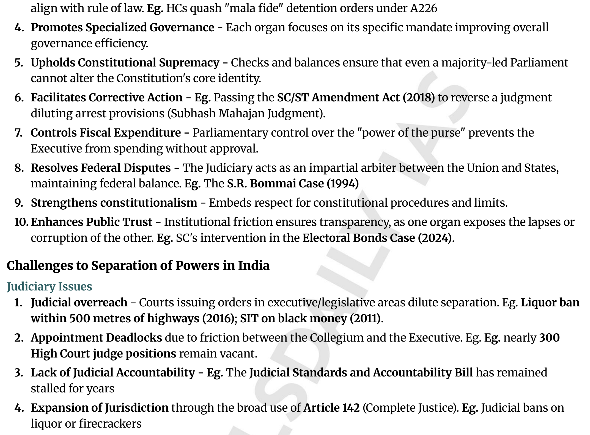

### [Smash Mains Source Page 26](../../pages/mains/mains_page_026.pdf)

### [Smash Mains Source Page 26](../../pages/mains/mains_page_026.pdf)

*Diagram Screenshot: [Percentage of Bills Referred to Parliamentary Committees (14th–17th Lok Sabha)](../../diagrams/mains_diag_bills_referred_committees_p026.png) · [Full Source Page 26](../../pages/mains/mains_page_026.pdf)*

- **3.** Ensures Legal Accountability - Administrative actions are subject to judicial scrutiny to ensure they align with rule of law. Eg. HCs quash "mala fide" detention orders under A226

- **4.** Promotes Specialized Governance - Each organ focuses on its specific mandate improving overall governance efficiency.

- **5.** Upholds Constitutional Supremacy - Checks and balances ensure that even a majority-led Parliament cannot alter the Constitution's core identity.

- **6.** Facilitates Corrective Action - Eg. Passing the SC/ST Amendment Act (2018) to reverse a judgment diluting arrest provisions (Subhash Mahajan Judgment).

- **7.** Controls Fiscal Expenditure - Parliamentary control over the "power of the purse" prevents the Executive from spending without approval.

- **8.** Resolves Federal Disputes - The Judiciary acts as an impartial arbiter between the Union and States, maintaining federal balance. Eg. The S.R. Bommai Case (1994)

- **9.** Strengthens constitutionalism - Embeds respect for constitutional procedures and limits.

- **10.** Enhances Public Trust - Institutional friction ensures transparency, as one organ exposes the lapses or corruption of the other. Eg. SC's intervention in the Electoral Bonds Case (2024).

### Challenges to Separation of Powers in India

Judiciary Issues

- **1.** Judicial overreach - Courts issuing orders in executive/legislative areas dilute separation. Eg. Liquor ban within 500 metres of highways (2016); SIT on black money (2011).

- **2.** Appointment Deadlocks due to friction between the Collegium and the Executive. Eg. Eg. nearly 300 High Court judge positions remain vacant.

- **3.** Lack of Judicial Accountability - Eg. The Judicial Standards and Accountability Bill has remained stalled for years

- **4.** Expansion of Jurisdiction through the broad use of Article 142 (Complete Justice). Eg. Judicial bans on liquor or firecrackers

- **5.** Tribalization of Judiciary - The creation of Executive-led Tribunals reduces the High Courts' jurisdiction, blurring the lines of judicial independence.

- **6.** Judicial Backlog - Pending cases (over 5 crore) reduce judiciary's ability to check arbitrary actions effectively. Executive Issues

- **1.** Weaponization of Agencies - Allegations of misuse of central investigative agencies to suppress opposition. Eg. 400% surge in PMLA cases against political rivals since 2014.

- **2.** Influence over Appointments - By sitting on files recommended by the Collegium, the Executive exercises "veto power" over judicial selection.

- **3.** Expansion of "Police State" Powers - New criminal laws (BNSS) grant broader discretionary powers to the Executive for search, seizure, and detention.

- **4.** Excessive Ordinance Promulgation bypasses legislature. Criticised in DC Wadhwa v. State of Bihar (1986) as a "fraud on the Constitution."
