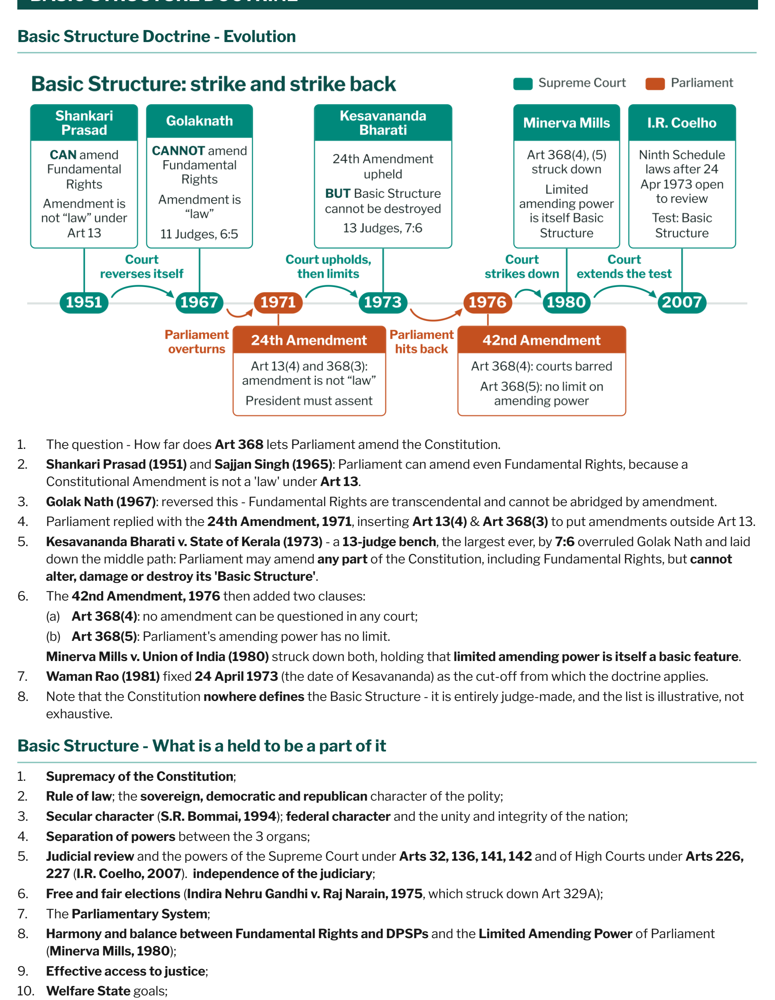

# Preamble, Parts, Schedules, Amendments & Basic Structure Doctrine — Prelims Notes (X-Factor Pre'27)

---

### [Prelims Source Page 13](../pages/prelims/prelims_page_013.pdf)

## CHAPTER 02: PREAMBLE, NATURE, PARTS & SCHEDULES

### THEME ANALYSIS

#### 1. REPEATS

#### A. Preamble and its Keywords

- On 26 January 1950 India was a Sovereign Democratic Republic; Socialist and Secular came in 1976 [2021].

- Economic liberty is no Preamble objective; the Preamble mirrors the makers' mind [2017].

- It is part of the Constitution but has no independent legal effect [2020].

#### B. Parts, Schedules and Concluding Articles

- Part IXA municipalities, Part XVIII emergency, Part XX amendment [2024].

- Seventh Schedule traps: inter State quarantine is Union [2024]; education spans many provisions [2012].

- Eighth Schedule holds 22 languages [2024, 2008]; classical language status is separate [2015, 2014].

#### C. Ninth and Tenth Schedules

- The Ninth Schedule came with the First Amendment, 1951; entries after 1973 face Basic Structure review [2019, 2018].

- The Tenth Schedule carries anti defection [2014]; the presiding officer decides with no time frame [2022].

- Political party appears in the Constitution only through the Tenth Schedule [2025].

#### D. Basic Features and Core Concepts

- A Constitution defines and limits government power [2023, 2021, 2020, 2014].

- Rule of law: limitation of powers, equality before law, liberty and civil rights [2018].

- Separation of powers best safeguards liberty [2021]; due process means natural justice [2023].

- Concept staples: liberty [2019, 2018], rights against the State, equality as absence of privileges [2017].

#### 2. HOW THE FORMAT HAS CHANGED

- 2008 to 2014: direct recall of Schedules, languages and anti defection [2008, 2012, 2014]

- 2017 to 2023: one best answer concept questions on liberty, rule of law, State and constitutional government [2017, 2019, 2021, 2023]

- 2024 to 2025: multi statement sets on Parts, Lists and ratification [2024, 2025]

- 2026: the "which conclusion is correct" format, judging three statements together [2026]

#### 3. WHAT IS BEING ASKED NOW

- The bare text: which Part holds what [2024], subjects needing State ratification [2025], Articles that name the Constitution, repeal the old Acts and fix commencement [2026]

- Tenth Schedule detail: who decides disqualification, and whether "political party" is mentioned [2025]

- One concept question per paper still appears [2023]

---

### [Prelims Source Page 14](../pages/prelims/prelims_page_014.pdf)

### PRELIMS PREVIOUS YEAR QUESTIONS

#### Q1 (2026)

**Consider the following statements with reference to the Constitution of India:**

- **1.** There is no Article in the Constitution of India that specifies that the Constitution of India will be officially called the 'Constitution of India'.
- **2.** There is no Article in the Constitution of India that specifies that the Indian Independence Act, 1947 and the Government of India Act, 1935 stand repealed.
- **3.** There is no Article in the Constitution of India that mentions 26th January, 1950 as the date of the commencement of the Constitution of India.

*Which one of the following conclusions based on the above statements is correct?*

- **(a)** All three statements are correct
- **(b)** There is no correct statement
- **(c)** There are two correct statements that include statement 3
- **(d)** There is only one correct statement

> **Answer:** `(b)` · [Prelims Source Page 14](../pages/prelims/prelims_page_014.pdf)

#### Q2 (2025)

**Consider the following subjects under the Constitution of India:**

- **I.** List I – Union List, in the Seventh Schedule
- **II.** Extent of the executive power of a State
- **III.** Conditions of the Governor’s office For a constitutional amendment with respect to which of the above, ratification by the Legislatures of not less than one-half of the States is required before presenting the bill to the President of India for assent?

- **(a)** I and II only
- **(b)** II and III only
- **(c)** I and III only
- **(d)** I, II and III

> **Answer:** `(a)` · [Prelims Source Page 14](../pages/prelims/prelims_page_014.pdf)

#### Q3 (2025)

**Consider the following statements:**

- **I.** If any question arises as to whether a Member of the House of the People has become subject to disqualification under the 10th Schedule, the (President’s) decision in accordance with the opinion of the Council of Union Ministers shall be final.
- **II.** There is no mention of the word ‘political party’ in the Constitution of India.

*Which of the statements given above is/are correct?*

- **(a)** I only
- **(b)** II only
- **(c)** Both I and II
- **(d)** Neither I nor II

> **Answer:** `(d)` · [Prelims Source Page 14](../pages/prelims/prelims_page_014.pdf)

#### Q4 (2024)

**Which of the following statements are correct about the Constitution of India?**

- **1.** Powers of the Municipalities are given in Part IX A of the Constitution.
- **2.** Emergency provisions are given in Part XVIII of the Constitution.
- **3.** Provisions related to the amendment of the Constitution are given in Part XX of the Constitution.

*SELECT THE ANSWER USING THE CODE GIVEN BELOW:*

- **(a)** 1 and 2 only
- **(b)** 2 and 3 only
- **(c)** 1 and 3 only
- **(d)** 1, 2 and 3

> **Answer:** `(d)` · [Prelims Source Page 14](../pages/prelims/prelims_page_014.pdf)

#### Q5 (2024)

**Which one of the following statements is correct as per the Constitution of India?**

- **(a)** Inter-State trade and commerce is a State subject under the State List.
- **(b)** Inter-State migration is a State subject under the State List.
- **(c)** Inter-State quarantine is a Union subject under the Union List.
- **(d)** Corporation tax is a State subject under the State List.

> **Answer:** `(c)` · [Prelims Source Page 14](../pages/prelims/prelims_page_014.pdf)

#### Q6 (2024)

**The Constitution (71st Amendment) Act, 1992 amends the Eighth Schedule to the Constitution to include which of the following languages?**

- **1.** Konkani
- **2.** Manipuri
- **3.** Nepali
- **4.** Maithili

*Select the correct answer using the code given below:*

- **(a)** 1, 2 and 3
- **(b)** 1, 2 and 4
- **(c)** 1, 3 and 4
- **(d)** 2, 3 and 4

> **Answer:** `(a)` · [Prelims Source Page 14](../pages/prelims/prelims_page_014.pdf)

---

### [Prelims Source Page 15](../pages/prelims/prelims_page_015.pdf)

#### Q7 (2023)

**Which one of the following statements best reflects the Chief purpose of the 'Constitution' of a country?**

- **(a)** It determines the objective for the making of necessary laws.
- **(b)** It enables the creation of political offices and a government
- **(c)** It defines and limits the powers of government.
- **(d)** It secures social justice, social equality and social security

> **Answer:** `(c)` · [Prelims Source Page 15](../pages/prelims/prelims_page_015.pdf)

#### Q8 (2023)

**In essence, what does 'Due Process of Law' mean?**

- **(a)** The principle of natural justice
- **(b)** The procedure established by law
- **(c)** Fair application of law
- **(d)** Equality before law

> **Answer:** `(a)` · [Prelims Source Page 15](../pages/prelims/prelims_page_015.pdf)

#### Q9 (2022)

**With reference to anti-defection law in India, consider the following statements :**

- **1.** The law specifies that a nominated legislator cannot join any political party within six months of being appointed to the House.
- **2.** The law does not provide any time-frame within which the presiding officer has to decide a defection case.

*Which of the statements given above is/are correct ?*

- **(a)** 1 only
- **(b)** 2 only
- **(c)** Both 1 and 2
- **(d)** Neither 1 nor 2

> **Answer:** `(b)` · [Prelims Source Page 15](../pages/prelims/prelims_page_015.pdf)

#### Q10 (2021)

**What was the exact constitutional status of India on 26th January, 1950?**

- **(a)** A democratic Republic
- **(b)** A Sovereign Democratic Republic
- **(c)** A Sovereign Secular Democratic Republic
- **(d)** A Sovereign Socialist Secular Democratic Republic

> **Answer:** `(b)` · [Prelims Source Page 15](../pages/prelims/prelims_page_015.pdf)

#### Q11 (2021)

**Constitutional government means:**

- **(a)** a representative government of a nation with a federal structure
- **(b)** a government whose Head enjoys nominal powers
- **(c)** a government whose Head enjoys real powers
- **(d)** a government limited by the terms of the Constitution

> **Answer:** `(d)` · [Prelims Source Page 15](../pages/prelims/prelims_page_015.pdf)

#### Q12 (2021)

**Which one of the following best defines the term 'State'?**

- **(a)** A community of persons permanently occupying a definite territory independent of external control and possessing an organized government.
- **(b)** A politically organized people of a definite territory and possessing an authority to govern them, maintain law and order, protect their natural rights, and safeguard their means of sustenance.
- **(c)** A number of persons who have been living in a definite territory for a very long time with their own culture, tradition, and government.
- **(d)** A society permanently living in a definite territory with a central authority, an executive responsible to the central authority, and an independent judiciary.

> **Answer:** `(a)` · [Prelims Source Page 15](../pages/prelims/prelims_page_015.pdf)

#### Q13 (2021)

**Which one of the following factors constitutes the best safeguard of liberty in a liberal democracy?**

- **(a)** A committed judiciary
- **(b)** Centralization of powers
- **(c)** Elected government
- **(d)** Separation of powers

> **Answer:** `(d)` · [Prelims Source Page 15](../pages/prelims/prelims_page_015.pdf)

#### Q14 (2021)

**With reference to India, consider the following statements:**

- **1.** There is only one citizenship and one domicile.
- **2.** A citizen by birth only can become the Head of State.
- **3.** A foreigner, once granted citizenship, cannot be deprived of it under any circumstances.

*Which of the statements given above is/are correct?*

- **(a)** 1 only
- **(b)** 2 only
- **(c)** 1 and 3
- **(d)** 2 and 3

> **Answer:** `(a)` · [Prelims Source Page 15](../pages/prelims/prelims_page_015.pdf)

#### Q15 (2020)

**The Preamble to the Constitution of India is**

- **(a)** a part of the Constitution but has no legal effect
- **(b)** not a part of the Constitution and has no legal effect either
- **(c)** part of the Constitution and has the same legal effect as any other part
- **(d)** a part of the Constitution but has no legal effect independently of other parts

> **Answer:** `(d)` · [Prelims Source Page 15](../pages/prelims/prelims_page_015.pdf)

---

### [Prelims Source Page 16](../pages/prelims/prelims_page_016.pdf)

#### Q16 (2020)

**A constitutional government by definition is a**

- **(a)** government by legislature
- **(b)** popular government
- **(c)** multi-party government
- **(d)** limited government

> **Answer:** `(d)` · [Prelims Source Page 16](../pages/prelims/prelims_page_016.pdf)

#### Q17 (2020)

**In the context of India, which one of the following is the characteristic appropriate for bureaucracy?**

- **(a)** An agency for widening the scope of parliamentary democracy
- **(b)** An agency for strengthening the structure of federalism
- **(c)** An agency for facilitating political stability and economic growth
- **(d)** An agency for the implementation of public policy

> **Answer:** `(d)` · [Prelims Source Page 16](../pages/prelims/prelims_page_016.pdf)

#### Q18 (2019)

**The Ninth Schedule was introduced in the Constitution of India during the prime ministership of**

- **(a)** Jawaharlal Nehru
- **(b)** Lal Bahadur Shastri
- **(c)** Indira Gandhi
- **(d)** Morarji Desai

> **Answer:** `(a)` · [Prelims Source Page 16](../pages/prelims/prelims_page_016.pdf)

#### Q19 (2019)

**In the context of any country, which one of the following would be considered as part of its social capital?**

- **(a)** The proportion of literates in the population
- **(b)** The stock of its buildings, other infrastructure and machines
- **(c)** The size of population in the working age group
- **(d)** The level of mutual trust and harmony in the society

> **Answer:** `(d)` · [Prelims Source Page 16](../pages/prelims/prelims_page_016.pdf)

#### Q20 (2019)

**In the context of polity, which one of the following would you accept as the most appropriate definition of liberty?**

- **(a)** Protection against the tyranny of political rulers
- **(b)** Absence of restraint
- **(c)** Opportunity to do whatever one likes
- **(d)** Opportunity to develop oneself fully.

> **Answer:** `(d)` · [Prelims Source Page 16](../pages/prelims/prelims_page_016.pdf)

#### Q21 (2018)

**Consider the following statements:**

- **1.** The Parliament of India can place a particular law in the Ninth Schedule of the Constitution of India.
- **2.** The validity of a law placed in the Ninth Schedule cannot be examined by any court and no judgement can be made on it.

*Which of the statements given above is/are correct ?*

- **(a)** 1 only
- **(b)** 2 only
- **(c)** Both 1 and 2
- **(d)** Neither 1 nor 2

> **Answer:** `(a)` · [Prelims Source Page 16](../pages/prelims/prelims_page_016.pdf)

#### Q22 (2018)

**Which of the following are regarded as the main features of the “Rule of Law” ?**

- **1.** Limitation of powers
- **2.** Equality before law
- **3.** People’s responsibility to the Government
- **4.** Liberty and civil rights

*Select the correct answer using the code given below :*

- **(a)** 1 and 3 only
- **(b)** 2 and 4 only
- **(c)** 1, 2 and 4 only
- **(d)** 1, 2, 3 and 4

> **Answer:** `(c)` · [Prelims Source Page 16](../pages/prelims/prelims_page_016.pdf)

#### Q23 (2018)

**Which one of the following reflects the most appropriate relationship between law and liberty?**

- **(a)** If there are more laws, there is less liberty.
- **(b)** If there are no laws, there is no liberty.
- **(c)** If there is liberty laws have to be made by the people.
- **(d)** If laws are changed too often, liberty is in danger.

> **Answer:** `(b)` · [Prelims Source Page 16](../pages/prelims/prelims_page_016.pdf)

#### Q24 (2017)

**The mind of the makers of the Constitution of India is reflected in which of the following?**

- **(a)** The Preamble
- **(b)** The Fundamental Rights
- **(c)** The Directive Principles of State Policy
- **(d)** The Fundamental Duties

> **Answer:** `(a)` · [Prelims Source Page 16](../pages/prelims/prelims_page_016.pdf)

#### Q25 (2017)

**Which one of the following objectives is not embodied in the Preamble to the Constitution of India?**

- **(a)** Liberty of thought
- **(b)** Economic liberty
- **(c)** Liberty of expression
- **(d)** Liberty of belief

> **Answer:** `(b)` · [Prelims Source Page 16](../pages/prelims/prelims_page_016.pdf)

---

### [Prelims Source Page 17](../pages/prelims/prelims_page_017.pdf)

#### Q26 (2017)

**‘Democracy’s superior virtue lies in the fact that it calls into activity**

- **(a)** the intelligence and character ordinary men and women.
- **(b)** the methods for strengthening executive leadership
- **(c)** a superior individual with dynamism and vision.
- **(d)** a band of dedicated party workers.

> **Answer:** `(a)` · [Prelims Source Page 17](../pages/prelims/prelims_page_017.pdf)

#### Q27 (2017)

**Which one of the following statements is correct?**

- **(a)** Right are claims of the State against the citizens.
- **(b)** Rights are privileges which are incorporated in the Constitution of a State.
- **(c)** Rights are claims of the citizens against the State.
- **(d)** Rights are privileges of a few citizens against the many

> **Answer:** `(c)` · [Prelims Source Page 17](../pages/prelims/prelims_page_017.pdf)

#### Q28 (2017)

**One of the implications of equality in society is the absence of**

- **(a)** Privileges
- **(b)** Restraints
- **(c)** Competition
- **(d)** Ideology

> **Answer:** `(a)` · [Prelims Source Page 17](../pages/prelims/prelims_page_017.pdf)

#### Q29 (2015)

**Which one of the following was given classical language status recently?**

- **(a)** Odia
- **(b)** Konkani
- **(c)** Bhojpuri
- **(d)** Assamese

> **Answer:** `(a)` · [Prelims Source Page 17](../pages/prelims/prelims_page_017.pdf)

#### Q30 (2014)

**Consider the following languages:**

- **1.** Gujarati
- **2.** Kannada
- **3.** Telugu Which of the above has/have been declared as 'Classical Language / Languages' by the Government?

*SELECT THE CORRECT ANSWER USING THE CODE GIVEN BELOW.:*

- **(a)** 1 and 2 only
- **(b)** 3 only
- **(c)** 2 and 3 only
- **(d)** 1, 2 and 3 only

> **Answer:** `(c)` · [Prelims Source Page 17](../pages/prelims/prelims_page_017.pdf)

#### Q31 (2014)

**Which one of the following Schedules of the Constitution of India contains provisions regarding anti-defection?**

- **(a)** Second Schedule
- **(b)** Fifth Schedule
- **(c)** Eighth Schedule
- **(d)** Tenth Schedule

> **Answer:** `(d)` · [Prelims Source Page 17](../pages/prelims/prelims_page_017.pdf)

#### Q32 (2014)

**Consider the following statements : A CONSTITUTIONAL GOVERNMENT IS ONE WHICH:**

- **1.** places effective restrictions on individual liberty in the interest of State Authority.
- **2.** places effective restrictions on the Authority of the State in the interest of individual liberty.

*Which of the statements given above is/are correct?*

- **(a)** 1 only
- **(b)** 2 only
- **(c)** Both 1 and 2
- **(d)** Neither 1 nor 2

> **Answer:** `(b)` · [Prelims Source Page 17](../pages/prelims/prelims_page_017.pdf)

#### Q33 (2012)

**Which of the following provisions of the Constitution of India have a bearing on Education?**

- **1.** Directive Principles of State Policy
- **2.** Rural and Urban Local Bodies
- **3.** Fifth Schedule
- **4.** Sixth Schedule
- **5.** Seventh Schedule

*Select the correct answer using the code given below:*

- **(a)** 1 and 2 only
- **(b)** 3, 4 and 5 only
- **(c)** 1, 2 and 5 only
- **(d)** 1, 2, 3, 4 and 5

> **Answer:** `(d)` · [Prelims Source Page 17](../pages/prelims/prelims_page_017.pdf)

#### Q34 (2008)

**Under which one of the following Constitution Amendment Acts, four languages were added to the languages under the Eighth Schedule of the Constitution of India, thereby raising their number to 22?**

- **(a)** Constitution (Ninetieth Amendment) Act
- **(b)** Constitution (Ninety-first Amendment) Act
- **(c)** Constitution (Ninety-second Amendment) Act
- **(d)** Constitution (Ninety-third Amendment) Act

> **Answer:** `(c)` · [Prelims Source Page 17](../pages/prelims/prelims_page_017.pdf)

---

### [Prelims Source Page 18](../pages/prelims/prelims_page_018.pdf)

### SOURCES OF THE CONSTITUTION

| SOURCE | CONSTITUTION PROVISIONS |
| --- | --- |
| British Constitution | Parliamentary government, Rule of Law, legislative procedure, single citizenship, cabinet system, prerogative writs, parliamentary privileges and bicameralism. |
| US Constitution | Fundamental rights, independence of judiciary, judicial review, impeachment of the president, removal of Supreme Court and high court judges and post of vice-president. |
| Irish Constitution | Directive Principles of State Policy, nomination of members to Rajya Sabha and method of election of president. |
| Canadian Constitution | Federation with a strong Centre, vesting of residuary powers in the Centre, appointment of state governors by the Centre, and advisory jurisdiction of the Supreme Court. |
| Australian Constitution | Concurrent List, freedom of trade, commerce and intercourse, and joint sitting of the two Houses of Parliament. |
| Weimar Constitution of Germany | Suspension of Fundamental Rights during Emergency. |
| Soviet Constitution (USSR, now Russia) | Fundamental duties and the ideal of justice (social, economic and political) in the Preamble. |
| French Constitution | Republic and the ideals of liberty, equality and fraternity in the Preamble. |
| South African Constitution | Procedure for amendment of the Constitution and election of members of Rajya Sabha. |
| Japanese Constitution | Procedure established by Law. |
| Government of India Act of 1935 | Federal Scheme, Office of governor, Judiciary, Public Service Commissions, Emergency provisions and administrative details. |

### FEATURES OF THE CONSTITUTION

Lengthiest Written Constitution

- **1.** Originally 395 articles were divided into 22 parts and 8 schedules.

- **2.** Presently 25 Parts and 12 Schedules (Part VII omitted by 7th CAA;

- **3.** Parts IV-A, IX-A, IX-B, XIV-A added). Blend of Rigidity and Flexibility [PRELIMS 2025]

- **1.** Rigidity keeps core values intact.

- **2.** Flexibility meets changing demands.

- **3.** Article 368 provides for two type of amendments - (a) by special majority (b) special majority + ratification of half of the state legislatures . (c) However some provisions can be amended by simple majority. Federal System with Unitary Bias Unitary features like single constitution and citizenship, All India Services, appointment of governor, Destructible states, Emergency, Single election commission etc. Parliamentary Form of Government Based on cooperation and coordination between legislative and executive organs.

---

### [Prelims Source Page 19](../pages/prelims/prelims_page_019.pdf)

Constitutional Supremacy

- **1.** Proper synthesis between the British principle of Parliamentary sovereignty(Parliament has the sole authority over law making on anything) and the

- **2.** American principle of judicial supremacy(judiciary the ultimate authority to interpret the Constitution and laws of a country.) In India we have Constitutional supremacy where the constitution is supreme not the organs. Integrated + independent judiciary

- **1.** SC at top of hierarchy then HC for one or more states below SC then below it subordinate courts.

- **2.** Separation of powers under art 50 to keep judiciary independent.

### Fundamental Rights

- **1.** Six Fundamental Rights, in Part III (Arts 12 to 35).

- **2.** Promote the ideal of political democracy.

- **3.** Act as a limitation on the tyranny of the executive and on arbitrary laws of the legislature.

- **4.** Justiciable and enforceable through Arts 32 and 226. DPSPs

- **1.** Contained in Part IV (Arts 36 to 51).

- **2.** Promote the ideal of social and economic democracy.

- **3.** Non justiciable under Art 37, yet declared fundamental in the governance of the country and a duty of the State to apply in making laws. Fundamental Duties

- **1.** Ten Fundamental Duties were added by the 42nd Amendment, 1976, on the recommendation of the Swaran Singh Committee.

- **2.** The eleventh, on providing education to a child between six and fourteen, was added by the 86th Amendment, 2002, so there are eleven in all.

- **3.** They sit in Part IVA, in the single Article 51A.

- **4.** Not directly enforceable by any court, but given effect through ordinary statutes. Secular State Indian secularism means the State has no religion of its own and gives equal respect to all faiths, rather than the Western wall of separation between religion and State. It ensures 1. that one religious community does not dominate another; 2. that some members do not dominate other members of the same religious community; 3. that the State neither enforces any particular religion nor takes away the religious freedom of individuals. The word secular was added to the Preamble by the 42nd Amendment, 1976, though the concept was always implicit in Arts 14 to 16 and 25 to 28.

---

### [Prelims Source Page 20](../pages/prelims/prelims_page_020.pdf)

### PREAMBLE

Introduction [PRELIMS 2021,2017]

- **1.** Origin: The US Constitution was the first to begin with a Preamble.

- **2.** Philosophy: Contains the philosophy and basic values of the Constitution; called its “identity card” (N.A. Palkhivala), “soul” (Thakurdas Bhargava) and “horoscope” (K.M. Munshi).

- **3.** Source: Based on Nehru’s Objectives Resolution, moved on 13 December 1946 and adopted on 22 January 1947.

- **4.** Amendment: “Socialist,” “Secular” and “Integrity” added by the 42nd Amendment, 1976, the only amendment so far; their insertion was upheld by the SC in Balram Singh v Union of India (2024).

- **5.** Source of authority: Declares the people of India as the source of authority of the Constitution; the Preamble itself is neither a source of power to the legislature nor a limit on it.

- **6.** Non-justiciable: Not enforceable in courts on its own; its ideals work through other provisions.

- **7.** Interpretation: States the ideals and objectives, and helps interpret provisions where the text is ambiguous.

- **8.** Aspirations: Reflects the aspirations of the people to be achieved. Preamble: Keywords and Objectives [PRELIMS 2017] Order of words: “Sovereign Socialist Secular Democratic Republic”. The original Preamble (adopted 26 November 1949) read “Sovereign Democratic Republic”; Socialist, Secular and Integrity were added by the 42nd Amendment, 1976.

- **1.** Sovereign

- India is neither a dependency nor a dominion; internally supreme and externally free from foreign control. Commonwealth or UN membership does not dilute it.

- Can acquire foreign territory; but ceding Indian territory needs a constitutional amendment (Art 368), not an ordinary law under Art 3 (In re Berubari Union, 1960, advisory opinion). Eg. 9th Amendment, 1960 (Berubari); 100th Amendment, 2015 (Land Boundary Agreement with Bangladesh).

- **2.** Socialist (42nd Amendment, 1976)

- Democratic socialism: a mixed economy where public and private sectors coexist; not communistic socialism or state ownership of everything. Aims at a welfare State through DPSPs, without abolishing private property.

- Dr Balram Singh v Union of India (25 November 2024): SC upheld the insertion of “socialist” and “secular”; “socialist” means a welfare State and does not restrict economic policy.

- **3.** Secular (42nd Amendment, 1976)

- The idea already existed in Arts 14 to 16 and 25 to 28.

- No State religion; the State neither favours nor penalises any faith.

- Positive secularism: equal respect for all religions (sarva dharma sambhava), not the Western “wall of separation”.

- Part of the Basic Structure (S.R. Bommai, 1994).

- **4.** Democratic

- Popular sovereignty: “We, the People of India” are the source of authority.

- Indirect (representative) parliamentary democracy, not direct democracy; referendum, initiative and recall are not part of the constitutional scheme.

- Pillars:

- Universal adult franchise (Art 326; voting age lowered from 21 to 18 by the 61st Amendment, 1988)

- Periodic free and fair elections

- One person, one vote

- An independent judiciary and rule of law

- Aims at political, social and economic democracy, echoing Ambedkar’s warning about a “life of contradictions”.

- **5.** Republic

- Head of State is elected, not hereditary: the President is indirectly elected for a fixed 5 year term (Arts 52, 54, 55), unlike the British Crown.

- Political sovereignty rests with the people; no privileged class; all public offices open to every citizen without discrimination.

---

### [Prelims Source Page 21](../pages/prelims/prelims_page_021.pdf)

Objectives: Justice is taken from the Russian Revolution (1917); Liberty, Equality and Fraternity from the French Revolution (1789).

- **6.** Justice: Social, Economic, Political

- Social justice: no discrimination on grounds of caste, religion, sex etc. (Arts 15, 16, 17, 46).

- Economic justice: removal of gross inequalities in wealth and income (Arts 38, 39).

- Political justice: equal political rights and equal access to public office.

- Secured through a mix of Fundamental Rights and DPSPs.

- **7.** Liberty: of Thought, Expression, Belief, Faith and Worship

- The Preamble secures only these five liberties; not “action” or “conscience”.

- Means absence of arbitrary restraint plus conditions for full development of personality.

- Not absolute: Art 19 rights are subject to reasonable restrictions.

- **8.** Equality: of Status and Opportunity

- Core idea: absence of special privileges.

- Civic: Arts 14 to 18. Political: Arts 325, 326. Economic: Art 39(d) (equal pay for equal work).

- **9.** Fraternity

- A sense of common brotherhood, promoted through single citizenship.

- Assures both (i) dignity of the individual and (ii) unity and integrity of the Nation; “Integrity” added in 1976.

- Reinforced by Fundamental Duty Art 51A(e). Traps

- Word order: Sovereign, Socialist, Secular, Democratic, Republic.

- Justice from the Russian Revolution; Liberty, Equality, Fraternity from the French Revolution.

- Fraternity covers both dignity of the individual and unity and integrity of the Nation.

- Liberty lists five items only; action and conscience are not among them. Is the Preamble amendable? The 42nd Amendment, 1976

- **1.** Can it be amended? Yes. Kesavananda Bharati (1973) held the Preamble is part of the Constitution, so it can be amended under Art 368, but not in a way that destroys its basic features.

- **2.** Amended only once, by the 42nd Amendment, 1976, which:

- added “Socialist” and “Secular”, and

- changed “unity of the Nation” to “unity and integrity of the Nation”.

- So on 26 January 1950, India was a “Sovereign Democratic Republic”.

- **3.** Not a source of power for the legislature, nor a limit on its powers.

- **4.** Non-justiciable, but a “key to open the mind of the makers” (Berubari, 1960); used to resolve ambiguity in the text.

- **5.** LIC v Consumer Education and Research Centre (1995) reaffirmed it as an integral part of the Constitution.

- **6.** Insertion of “socialist” and “secular” upheld in Dr Balram Singh v Union of India (2024)

---

### [Prelims Source Page 22](../pages/prelims/prelims_page_022.pdf)

*Diagram Screenshot: [Basic Structure: Strike and Strike Back Timeline (1951–1980)](../diagrams/pre_diag_basic_structure_p022.png) · [Full Source Page 22](../pages/prelims/prelims_page_022.pdf)*

### BASIC STRUCTURE DOCTRINE

Basic Structure Doctrine - Evolution

- **1.** The question - How far does Art 368 lets Parliament amend the Constitution.

- **2.** Shankari Prasad (1951) and Sajjan Singh (1965): Parliament can amend even Fundamental Rights, because a Constitutional Amendment is not a 'law' under Art 13.

- **3.** Golak Nath (1967): reversed this - Fundamental Rights are transcendental and cannot be abridged by amendment.

- **4.** Parliament replied with the 24th Amendment, 1971, inserting Art 13(4) & Art 368(3) to put amendments outside Art 13.

- **5.** Kesavananda Bharati v. State of Kerala (1973) - a 13-judge bench, the largest ever, by 7:6 overruled Golak Nath and laid down the middle path: Parliament may amend any part of the Constitution, including Fundamental Rights, but cannot alter, damage or destroy its 'Basic Structure'.

- **6.** The 42nd Amendment, 1976 then added two clauses: (a) Art 368(4): no amendment can be questioned in any court; (b) Art 368(5): Parliament's amending power has no limit. Minerva Mills v. Union of India (1980) struck down both, holding that limited amending power is itself a basic feature.

- **7.** Waman Rao (1981) fixed 24 April 1973 (the date of Kesavananda) as the cut-off from which the doctrine applies.

- **8.** Note that the Constitution nowhere defines the Basic Structure - it is entirely judge-made, and the list is illustrative, not exhaustive. Basic Structure - What is a held to be a part of it

- **1.** Supremacy of the Constitution;

- **2.** Rule of law; the sovereign, democratic and republican character of the polity;

- **3.** Secular character (S.R. Bommai, 1994); federal character and the unity and integrity of the nation;

- **4.** Separation of powers between the 3 organs;

- **5.** Judicial review and the powers of the Supreme Court under Arts 32, 136, 141, 142 and of High Courts under Arts 226, 227 (I.R. Coelho, 2007). independence of the judiciary;

- **6.** Free and fair elections (Indira Nehru Gandhi v. Raj Narain, 1975, which struck down Art 329A);

- **7.** The Parliamentary System;

- **8.** Harmony and balance between Fundamental Rights and DPSPs and the Limited Amending Power of Parliament (Minerva Mills, 1980);

- **9.** Effective access to justice;

- **10.** Welfare State goals;

- **11.** Art 21 - the rule of law and life and liberty.

---

### [Prelims Source Page 23](../pages/prelims/prelims_page_023.pdf)

Held not to be part of it: the right to property (deleted as a Fundamental Right by the 44th Amendment, 1978 and now only a constitutional right under Art 300A). Consequence: a law placed in the Ninth Schedule after 24 April 1973 enjoys no blanket immunity - it can be struck down if it damages a basic feature.

### PARTS OF THE CONSTITUTION

Parts of the Constitution & Concluding Articles [PRELIMS 2026,2024]

- **1.** Presently 25 Parts (Part VII omitted by the 7th Amendment Act, 1956).

- **2.** Key Part-wise mapping: Part I Union and its territory;

- **3.** Part II Citizenship (Arts 5-11);

- **4.** Part III Fundamental Rights;

- **5.** Part IV DPSP; Part IV-A Fundamental Duties;

- **6.** Part IX Panchayats; Part IX-A Municipalities (Arts 243-P to 243-ZG);

- **7.** Part IX-B Co-operative Societies;

- **8.** Part XI Centre-State relations;

- **9.** Part XVIII Emergency Provisions (Arts 352-360);

- **10.** Part XX Amendment of the Constitution (Art 368);

- **11.** Part XXI Temporary, Transitional and Special Provisions;

- **12.** Part XXII Short title, commencement, authoritative Hindi text and repeals.

- **13.** Concluding articles: Art 393 states the Constitution 'may be called the Constitution of India';

- **14.** Art 394 brought Arts 5 to 9, 60, 324, 366, 367, 379, 380, 388, 391, 392, 393 and Art 394 itself into force on 26 November 1949, and the rest on 26 January 1950;

- **15.** Art 395 expressly repeals the Indian Independence Act, 1947 and the Government of India Act, 1935.

### SCHEDULES

| SCHEDULES | SUBJECT MATTER |
| --- | --- |
| First schedule | **1.** Names of the States and their territorial jurisdiction **2.** Names of the Union Territories and their extent |
| Second Schedule | Provisions relating to the emoluments, allowances, privileges and so on of : **1.** The President of India, The Governors of the states **2.** The speaker and deputy speaker of lok sabha and the state legislative Assembly in the states **3.** The chairman and the Deputy Chairman of the Rajya Sabha and the state legislative council in the states **4.** The judges of Supreme court, High courts and Comptroller and Auditor General of India |
| Third Schedule | Forms of oaths or Affirmations for :- **1.** The union Ministers , Candidates for the election to the parliament and the members of Parliament. **2.** The state Ministers , Candidates for the election to the State legislatures and the Members of the State legislatures. **3.** Judges of Supreme court, High courts and Comptroller and Auditor General of India |
| Fourth Schedule | Allocation of seats in the Rajya Sabha to the states and the union territories |
| Fifth Schedule | Provisions relating to the administration and control of Scheduled areas and Scheduled tribes |
| Sixth schedule | Provisions relating to the administration of tribal areas in the states of Assam, Meghalaya, Tripura and Mizoram |
| Seventh Schedule [PRELIMS 2024,2012] | **1.** Division of powers between the Union and the States through three lists: **2.** List I, Union List: 100 subjects (originally 97) **3.** List II, State List: 61 subjects (originally 66) |

---

### [Prelims Source Page 24](../pages/prelims/prelims_page_024.pdf)

| SCHEDULES | SUBJECT MATTER |
| --- | --- |
| **Seventh Schedule** *(Contd.)* | **4.** List III, Concurrent List: 52 subjects (originally 47) |
| Eighth Schedule [PRELIMS 2024,2008] | **1.** Languages recognised by the Constitution. **2.** Originally it had 14 languages but presently there are 22 languages. |
| Classical Languages (distinct from Eighth Schedule) [PRELIMS 2015,2014] | **1.** Classical Language status is conferred by the Government of India (Ministry of Culture) on the recommendation of a Linguistic Experts Committee constituted under the Sahitya Akademi. **2.** It is an executive decision, not a constitutional listing, and is entirely separate from the Eighth Schedule (Pali and Prakrit show the two lists are not the same). **3.** Broad criteria: high antiquity of early texts or recorded history spanning 1500-2000 years; 4. a body of ancient literature regarded as a valuable heritage by generations of speakers; 5. an original literary tradition not borrowed from another speech community; and a possible discontinuity between the classical language and its later forms. **6.** 11 languages hold the status: **(a)** 2004 Tamil **(b)** 2005 Sanskrit **(c)** 2008 Telugu, Kannada **(d)** 2013 Malayalam **(e)** 2014 Odia **(f)** 3 October 2024 (Union Cabinet): Marathi, Pali, Prakrit, Assamese, Bengali |
| Ninth Schedule: [PRELIMS 2019,2018] | **1.** Acts and Regulations of the state legislatures dealing with land reforms and abolition of the Zamindari system and of the Parliament dealing with other matters . **2.** This schedule was added by 1st Amendment 1951. **3.** Now the laws included in this schedule are open to Judicial review |
| Tenth Schedule [PRELIMS 2025,2022,2014] | **1.** Provisions relating to disqualification of the members of the Parliament and State legislatures on the ground of Defection. **2.** This schedule was added by the 52nd Amendment Act of 1985 , also known as Anti Defection Law |
| Eleventh Schedule | **1.** Specifies the powers , authority and responsibilities of Panchayats and it contains 29 subjects. **2.** This schedule was added by the 73rd Amendment Act of 1992 |
| Twelfth Schedule | **1.** Specifies the powers, authority and responsibilities of Municipalities. **2.** It has 18 matters. **3.** This schedule was added by the 74th Amendment Act of 1992 |

### KEY CONCEPTS

Constitution and Constitutional Government [PRELIMS 2023,2021,2020,2014]

- **1.** A Constitution is the fundamental law that constitutes the organs of government and allocates power among them, but its chief purpose is to define and limit the powers of government.

- **2.** Constitutional government therefore means limited government - a government bound by the terms of the Constitution.

- **3.** It places effective restrictions on the authority of the State in the interest of individual liberty, not restrictions on liberty in the interest of State authority.

- **4.** The devices of limitation in India: (a) Justiciable Fundamental Rights (Part III), enforceable under Arts 32 and 226. (b) Judicial review. (c) Federal division of powers under the Seventh Schedule. (d) An independent judiciary. (e) The Basic Structure doctrine (Kesavananda Bharati, 1973).

- **5.** A government may be popular, elected or multi-party and still not be constitutional if it is not legally limited.

---

### [Prelims Source Page 25](../pages/prelims/prelims_page_025.pdf)

Due Process of Law vs Procedure Established by Law [PRELIMS 2023]

- **1.** Article 21 as drafted adopted the 'procedure established by law' formula (traced to the Japanese Constitution): the court asks only whether a competent legislature validly enacted the law and whether its procedure was followed.

- **2.** 'Due process of law' (US 5th and 14th Amendments) goes further and requires the law and its procedure to be fair, just and reasonable - in essence it embodies the principles of natural justice (nemo judex in causa sua - no one a judge in his own cause; audi alteram partem - hear the other side).

- **3.** In A.K. Gopalan v State of Madras (1950) the Supreme Court read Art 21 literally;

- **4.** In Maneka Gandhi v Union of India (1978) it held that the procedure under Art 21 must be 'right, just and fair and not arbitrary, fanciful or oppressive', effectively reading due process into the Constitution. State, Government, Democracy and Bureaucracy [PRELIMS 2021,2020,2017]

- **1.** In political theory the State has four essential elements - population, a definite territory, a government, and sovereignty (independence of external control). Hence the correct definition is a community of persons permanently occupying a definite territory, independent of external control and possessing an organised government; 2. long residence, common culture or tradition make a nation or a society, not a State.

- **3.** The State is permanent and wider;

- **4.** The government is only its agency and changes.

- **5.** (Note: Art 12 gives a separate and wider working definition of 'the State' for the purposes of Part III.) Democracy's superior virtue is that it calls into activity the intelligence and character of ordinary men and women, resting on participation, accountability and universal adult franchise rather than on a single dynamic leader.

- **6.** The bureaucracy is the permanent, politically neutral civil service whose characteristic function is the implementation of public policy framed by the political executive;

- **7.** Art 311 safeguards and the All India Services underpin it. Rule of Law and Separation of Powers [PRELIMS 2021,2018]

- **1.** Rule of Law comes from Britain and was explained by A.V. Dicey. It has three parts: (a) Supremacy of law: no arbitrary power; the powers of government are limited. (b) Equality before law: embodied in Art 14. (c) Predominance of legal spirit: ordinary courts protect liberty and civil rights.

- **2.** It does not include any 'responsibility of the people to the government';

- **3.** The direction of accountability runs the other way.

- **4.** The Rule of Law is part of the Basic Structure (Indira Nehru Gandhi v Raj Narain, 1975).

- **5.** Separation of powers - the organic and functional distribution of authority among the legislature, executive and judiciary with checks and balances - is regarded as the best safeguard of liberty in a liberal democracy because it prevents concentration of power;

- **6.** India follows it functionally rather than absolutely (Art 50 separates the judiciary from the executive), and it too is part of the Basic Structure. Citizenship (Part II, Articles 5-11) [PRELIMS 2021]

- **1.** India has single citizenship and a single domicile - there is no separate State citizenship, unlike the USA.

- **2.** Arts 5-11 (Part II) deal only with citizenship at the commencement of the Constitution;

- **3.** Art 11 empowers Parliament to regulate citizenship by law, under which the Citizenship Act, 1955 was enacted.

- **4.** It provides five modes of acquisition - birth, descent, registration, naturalisation and incorporation of territory - and three modes of loss - renunciation, termination and deprivation.

- **5.** The Central Government can deprive a registered or naturalised citizen of citizenship if the person: (a) obtained it by fraud; (b) showed disloyalty to the Constitution; (c) traded or communicated with the enemy during a war; (d) was sentenced to two years' imprisonment within five years of registration or naturalisation; (e) lived outside India for seven years continuously. So citizenship, once granted, is not indefeasible.

---

### [Prelims Source Page 26](../pages/prelims/prelims_page_026.pdf)

- **6.** The President need only be a citizen of India qualified for election to the Lok Sabha (Art 58) - citizenship by birth is not required, unlike the US requirement of a natural-born citizen. Liberty, Equality, Rights and Social Capital [PRELIMS 2019,2018,2017]

- **1.** Liberty is not mere absence of restraint or the opportunity to do whatever one likes; 2. in its positive sense it is the opportunity to develop oneself fully.

- **3.** Law and liberty are complementary, not opposed - 'where there is no law there is no liberty' (John Locke) - because law restrains interference by others and creates the conditions of freedom; 4. more laws do not automatically mean less liberty.

- **5.** Equality implies primarily the absence of special privileges and equality of opportunity;

- **6.** It does not mean absence of restraint, competition or ideology.

- **7.** Rights are claims of the citizen against the State, recognised and enforced by it - not claims of the State against citizens nor privileges of a few; 8. in India they are made justiciable through Part III read with Arts 32 and 226.

- **9.** Social capital is a distinct, intangible resource - the level of mutual trust, harmony, networks and reciprocity in a society - as opposed to physical capital (buildings, infrastructure, machines) and human capital (literacy, skills, working-age population). Constitutionalism and Constitutional Morality

- **1.** Constitutionalism is the doctrine that governmental power must be limited by and exercised through law - 'limited government'.

- **2.** A country may possess a Constitution without having constitutionalism (authoritarian regimes have written constitutions but unchecked power); 3. the two are therefore not the same thing.

- **4.** Its essential ingredients are: rule of law, separation of powers with checks and balances, judicial review, enforceable fundamental rights, an independent judiciary, free and fair periodic elections, and a government accountable to the people.

- **5.** Constitutional morality: a phrase Ambedkar borrowed from the historian George Grote and pressed in the Constituent Assembly (4 November 1948). It means following the spirit and core values of the Constitution, not mere literal legality, and the willingness of all actors to work it with restraint.

- **6.** Illustrations: Rameshwar Prasad v. Union of India (2006) - the proclamation dissolving the Bihar Assembly on the Governor's report was held unconstitutional and mala fide;

- **7.** I.R. Coelho v. State of Tamil Nadu (2007) - judicial review is part of the Basic Structure, so even Ninth Schedule laws inserted after 24 April 1973 can be tested;

- **8.** Navtej Singh Johar (2018) - constitutional morality prevails over popular/social morality. Sovereignty and its Kinds Sovereignty is the supreme, original and independent authority of the State, one of the four essential elements of a State and the one that distinguishes a State from every other association.

### KINDS OF SOVEREIGNTY

- **1.** Internal: supremacy over all persons and associations within the territory.

- **2.** External: freedom from foreign control in the conduct of relations with other States.

- **3.** Legal: the authority that makes law and whose commands the courts enforce. In India the Constitution is supreme; in Britain, Parliament.

- **4.** Political: the electorate behind the legal sovereign, whose will ultimately prevails.

- **5.** Popular: power flows from the people, declared in the opening words WE, THE PEOPLE OF INDIA and worked through universal adult franchise.

- **6.** De jure against de facto: legal title to rule as against actual effective control.

- **7.** Pluralist view (Harold Laski): the State is only one association among many and not absolutely supreme.

- Parliamentary sovereignty in the United Kingdom means no court can question an Act of Parliament.

- India instead follows constitutional supremacy, so Parliament's power to legislate and to amend is limited and judicially reviewable.

---

### [Prelims Source Page 27](../pages/prelims/prelims_page_027.pdf)

Doctrines - I: Severability, Eclipse, Colourable Legislation

- **1.** Doctrine of Severability (Separability) - under Art 13, when only a part of a law offends the Constitution, the court strikes down only that offending part if it can be separated from the rest;

- **2.** If the valid and invalid parts are inseparable, the whole law falls (A.K. Gopalan, 1950, where only s.14 of the Preventive Detention Act was voided; R.M.D. Chamarbaugwalla, 1957).

- **3.** Doctrine of Eclipse - a pre-Constitution law inconsistent with a Fundamental Right is not dead but dormant;

- **4.** The dormant law stays valid for past transactions and for people who cannot claim that right (for example, those who are not citizens, for Art 19 rights). When an amendment removes the conflict, it revives automatically (Bhikaji Narain Dhakras v. State of M.P., 1955).

- **5.** It does not apply the same way to post-Constitution laws violating Fundamental Rights, which are void from inception (Deep Chand, 1959;

- **6.** Mahendra Lal Jaini, 1963), though such a law may still operate against non-citizens where the right is available only to citizens.

- **7.** Doctrine of Colourable Legislation - 'what cannot be done directly cannot be done indirectly'. 8. a legislature cannot use a subject within its competence as a mere pretence to legislate on a subject outside it.

- **9.** The test goes to legislative competence, not to the motive or bona fides of the legislature (K.C. Gajapati Narayan Deo v. State of Orissa, 1953). Doctrines - II: Pith and Substance, Harmonious Construction, Territorial Nexus, Repugnancy

- **1.** Pith and Substance - to test a law against the Seventh Schedule the court looks at its true nature and character, not its form;

- **2.** If in pith and substance it falls within the legislature's own List, an incidental encroachment on another List does not invalidate it (Prafulla Kumar Mukherjee, 1947, Privy Council; F.N. Balsara, 1951).

- **3.** Harmonious Construction - overlapping provisions or List entries must be read so as to give effect to both, and one should not be so construed as to render the other nugatory;

- **4.** It is used to reconcile Fundamental Rights with DPSPs (In re Kerala Education Bill, 1957; Minerva Mills, 1980).

- **5.** Doctrine of Territorial Nexus: under Art 245(1), a State law normally applies only within that State. A State law that operates outside the State is still valid if there is a real (not illusory) connection between the State and the object taxed or regulated (State of Bombay v. R.M.D. Chamarbaugwala, 1957);

- **6.** Art 245(2) protects Parliament's laws absolutely - no law of Parliament is invalid merely because it operates extra-territorially.

- **7.** Doctrine of Repugnancy - Art 254(1): on a Concurrent List subject, if a State law is repugnant to a Parliamentary law or an existing law, the Union law prevails and the State law is void to the extent of repugnancy;

- **8.** Art 254(2): but if the State law was reserved for and received the President's assent, it prevails in that State - subject to Parliament's power to later add to, amend or repeal it.

### TERMS WHERE THE CONSTITUTION IS NOT CLEAR

- Not Mentioned - Federation, Judicial Review, Vice President removal, Offices of leader of house and leader of opposition

- Mentioned but not defined - Minority, Martial law, Untouchability, Cabinet - Added by 44th CAA but without defining

---

### [Prelims Source Page 215](../pages/prelims/prelims_page_215.pdf)

## CHAPTER 26: AMENDMENTS

### THEME ANALYSIS PYQ pattern for this chapter

#### 1. REPEATS

#### A. Procedure under Article 368

- Parliament may amend by addition, variation or repeal [2024]

- A Bill may start in either House, needs no Presidential recommendation, allows no joint sitting [2013, 2022]

- Assent is obligatory since the 24th Amendment (1971) [2022]

- Federal provisions need ratification by half the States [2013]

#### B. The Three Majorities

- Simple majority outside Article 368: Articles 2, 3, 4, new States and boundaries

- Special majority alone for the bulk of the text under Article 368

- Special majority plus ratification for Articles 54, 55, 66, Seventh Schedule, judiciary

#### C. Landmark Amendments by Number

- First Amendment (1951) answered judicial readings of Fundamental Rights; Ninth Schedule [2023]

- 42nd Amendment (1976) added worker participation in management to the Directive Principles [2017]

- 91st Amendment (2003) capped the Council of Ministers at fifteen percent [2009]

- 99th Amendment (2014) and the NJAC, struck down for hurting judicial independence [2019]

#### D. Judiciary versus the Amending Power

- Amendments stay reviewable, with Basic Structure as the yardstick [2019]

- The 44th Amendment (1978) did not shield the Prime Minister's election [2019]

- The Constitution nowhere defines its own federal character, so options claiming it fail [2013]

#### 2. HOW THE FORMAT HAS CHANGED

- 2009 to 2013: single answer recall of amendment numbers and ratification [2009, 2013]

- 2019 to 2024: two and three statement sets on Art 368 mechanics [2019, 2022, 2024]

- 2023: a motive based single answer, why an amendment was made [2023]

#### 3. WHAT IS BEING ASKED NOW

- The text of Art 368: modes, assent, majority, no joint sitting [2022, 2024]

- Why an amendment was enacted [2023]

### PRELIMS PREVIOUS YEAR QUESTIONS

#### Q1 (2024)

**As per Article 368 of the Constitution of India, the Parliament may amend any provision of the Constitution by way of:**

- **1.** Addition
- **2.** Variation
- **3.** Repeal

*Select the correct answer using the code given below:*

- **(a)** 1 and 2 only
- **(b)** 2 and 3 only
- **(c)** 1 and 3 only
- **(d)** 1, 2 and 3

> **Answer:** `(d)` · [Prelims Source Page 215](../pages/prelims/prelims_page_215.pdf)

#### Q2 (2023)

**In India, which one of the following Constitutional Amendments was widely believed to be enacted to overcome the judicial interpretations of Fundamental Rights?**

- **(a)** 1st Amendment
- **(b)** 42nd Amendment
- **(c)** 44th Amendment
- **(d)** 86th Amendment

> **Answer:** `(a)` · [Prelims Source Page 215](../pages/prelims/prelims_page_215.pdf) *(Note: UPSC dropped/deleted this specific question from the final official answer key for Prelims 2023.)*

---

### [Prelims Source Page 216](../pages/prelims/prelims_page_216.pdf)

#### Q3 (2022)

**Consider the following statements :**

- **1.** A Bill amending the Constitution requires a prior recommendation of the President of India.
- **2.** When a Constitution Amendment Bill is presented to the President of India, it is obligatory for the President of India to give his/her assent.
- **3.** A Constitution Amendment Bill must be passed by both the Lok Sabha and the Rajya Sabha by a special majority and there is no provision for joint sitting.

*Which of the statements given above are correct?*

- **(a)** 1 and 2 only
- **(b)** 2 and 3 only
- **(c)** 1 and 3 only
- **(d)** 1,2 and 3

> **Answer:** `(b)` · [Prelims Source Page 216](../pages/prelims/prelims_page_216.pdf)

#### Q4 (2019)

**Consider the following statements:**

- **1.** The 44th Amendment to the Constitution of India introduced an Article placing the election of the Prime Minister beyond judicial review.
- **2.** The Supreme Court of India struck down the 99th Amendment to the Constitution of India as being violative of the independence of judiciary.

*Which of the statements given above is/are correct?*

- **(a)** 1 only
- **(b)** 2 only
- **(c)** Both 1 and 2
- **(d)** Neither 1 nor 2

> **Answer:** `(b)` · [Prelims Source Page 216](../pages/prelims/prelims_page_216.pdf)

#### Q5 (2013)

**Consider the following statements : (1) . An amendment to the Constitution of India can be initiated by an introduction of a bill in the Lok Sabha only. (2) . If such an amendment seeks to make changes in the federal character of the Constitution, the amendment also requires to be ratified by the legislature of all the States of India. Which of the statements given above is/are correct?**

- **(a)** 1 only
- **(b)** 2 only
- **(c)** Both 1 and 2
- **(d)** Neither 1 nor 2

> **Answer:** `(d)` · [Prelims Source Page 216](../pages/prelims/prelims_page_216.pdf)

#### Q6 (2009)

**Which one of the following Constitutional Amendments states that the total number of Ministers, including the Prime Minister, in the Council of Ministers shall not exceed fifteen percent of the total number of**

- **(a)** 90th
- **(b)** 91st
- **(c)** 92nd
- **(d)** 93rd

> **Answer:** `(b)` · [Prelims Source Page 216](../pages/prelims/prelims_page_216.pdf)

### AMENDING PROCEDURE

- **1.** Special Majority: Art 368(2) [PRELIMS 2024, 2022]

### CONDITION

- Any amendment not covered by the proviso to Art 368(2), i.e. one that does not affect the federal provisions or the Seventh Schedule.

- Examples: Fundamental Rights, DPSPs, and most other provisions.

### MAJORITY NEEDED

- Special majority in each House: a majority of the total membership and 2/3 of members present and voting.

- Presidential assent is mandatory (24th CAA, 1971).

- The Basic Structure doctrine (Kesavananda Bharati, 1973) limits this amending power.

- **2.** Special Majority + State Ratification: Proviso to Art 368(2) [PRELIMS 2013] CONDITION: the amendment affects any of the following:

- **1.** Election of the President (Arts 54, 55);

- **2.** Extent of the executive power of the Union and the States (Arts 73, 162);

- **3.** The Supreme Court, the High Courts, and High Courts for UTs (Art 241);

- **4.** Distribution of legislative powers between the Union and the States, and any List in the Seventh Schedule;

- **5.** GST Council (Art 279A, added by the 101st CAA, 2016);

- **6.** Representation of States in Parliament;

- **7.** Article 368 itself.

### MAJORITY NEEDED

- Special majority in each House, plus ratification by the legislatures of not less than half the States, by simple majority.

---

### [Prelims Source Page 217](../pages/prelims/prelims_page_217.pdf)

- The Constitution sets no time limit for State ratification.

- Presidential assent is required.

- The aim is to protect federalism: matters that affect the States cannot be changed by Parliament alone.

- **3.** Simple Majority: Arts 2 and 3 (outside Art 368)

### CONDITION

- Art 2: admission or establishment of new States from territory outside India.

- Art 3: formation of new States, and alteration of the areas, boundaries or names of existing States.

### MAJORITY NEEDED

- Simple majority in both Houses of Parliament.

- Under Art 3, the Bill needs the President’s prior recommendation. The President refers it to the State Legislature concerned for its views, which are not binding.

- Example (Art 3): formation of Telangana under the AP Reorganisation Act, 2014.

- TRAP: Sikkim was made a State by the 36th CAA, 1975, not by a simple-majority law.

- TRAP: ceding Indian territory to a foreign country needs an Art 368 amendment, not an Art 3 law (Berubari Union, 1960). This is why the 9th CAA, 1960 and the 100th CAA, 2015 (India–Bangladesh Land Boundary Agreement) were needed.

- **4.** Simple Majority: Art 4

### CONDITION

- A law under Art 2 or 3 may make consequential changes to the First Schedule (names and areas of States and UTs) and the Fourth Schedule (Rajya Sabha seats).

- Art 4(2): such a law is not deemed an amendment under Art 368.

### MAJORITY NEEDED

- Simple majority in both Houses of Parliament.

- Example: merger of the UTs of Dadra and Nagar Haveli and Daman and Diu (2019 Act, effective 26 Jan 2020).

- **5.** Election of the President and Vice-President: Arts 55 and 66 CONDITION: the provisions on the election of the President (Arts 54, 55) and the Vice-President (Art 66).

### MAJORITY NEEDED

- **1.** Art 55 (President): special majority + ratification by half the States, because the President’s election is in the proviso to Art 368(2).

- **2.** Art 66 (Vice-President): special majority only, because the VP’s election is not in the proviso. TRAP: The procedural details of both elections are governed by the Presidential and Vice-Presidential Elections Act, 1952, which Parliament can change by simple majority. Only changing the Articles themselves needs Art 368.

### IMPORTANT CONSTITUTIONAL AMENDMENTS

First Amendment (1951) [PRELIMS 2023]

- **1.** Added 1. Article 19(2) (substituted): 'reasonable' restrictions on free speech on grounds of security of the State, friendly relations with foreign States, public order and incitement to an offence (new grounds), decency or morality, contempt of court, defamation. 'Sovereignty and integrity of India' was added later by the 16th CAA, 1963.

- **2.** Also inserted Art 15(4).

- **3.** Article 31A - saves laws providing for acquisition of estates / abolition of zamindari from being declared void for inconsistency with Art 14 or Art 19.

- **4.** Article 31B - This clause introduced the Ninth Schedule to the Constitution, which provides protection to laws that are placed in it from being challenged in a court of law on the grounds of violating fundamental rights.

---

### [Prelims Source Page 218](../pages/prelims/prelims_page_218.pdf)

Seventh Amendment (1956)

- **1.** To Implement the recommendations of the States Reorganisation Commission regarding the reorganization of the states on a linguistic basis.

- **2.** 14 States and 6 Union territories were created; 3. the Part A/B/C/D classification was abolished.

- **4.** A new Article 350A : to provide facilities for instruction in mother tongue at the Primary stage to children belonging to linguistic minority groups and empowers the President to issue directions to any State for securing such facilities.

- **5.** Article 350B: a Special Officer for Linguistic Minorities, appointed by the President, investigates all matters relating to their safeguards. He reports to the President; the reports are laid before Parliament and sent to the State Governments concerned.

- **6.** Article 239 (substituted): every Union territory shall be administered by the President through an administrator appointed by him;

- **7.** Part VII (Art 238, Part B States) was omitted. 24th Amendment (1971) Nullified the Supreme Court's judgment in the Golaknath case, which had held that the Parliament did not have the power to amend the fundamental rights. 42nd Amendment (1976) [PRELIMS 2017]

- **1.** Preamble - The preamble was amended to insert the words "Socialist" and "Secular" and to emphasize the unity and integrity of the nation.

- **2.** Article 31C - This clause was amended to provide immunity to laws passed by Parliament that implemented the Directive Principles of State Policy from judicial review.

- **3.** Fundamental Duties - A new Part IV-A was added to the Constitution, which introduced ten Fundamental Duties that were expected of every citizen of India.

- **4.** Judicial Review - The Supreme Court's power of judicial review was limited by adding a new provision that allowed Parliament to determine the power and jurisdiction of the Court.

- **5.** Added Part XIV-A - Administrative Tribunals (Arts 323A & 323B); 6. extended Lok Sabha & Assembly terms from 5 to 6 years; 7. made the President bound by the Council of Ministers' advice (Art 74(1)); 8. shifted education, forests, wildlife and weights & measures to the Concurrent List. 44th Amendment (1978)

- **1.** Removed the Right to Property from Part III (Arts 19(1)(f) and 31 omitted); 2. it survives only as a constitutional/legal right under Art 300A - no person shall be deprived of property save by authority of law, with no guaranteed compensation.

- **3.** Arts 20 & 21 can no longer be suspended during an Emergency (Art 359); 4. the six freedoms under Art 19 are suspended only when the Emergency is declared on grounds of war or external aggression (Art 358).

- **5.** The Amendment restored the power of Judicial Review to the Supreme Court and High Courts.

- **6.** Restored the term of the Lok Sabha & State Assemblies to 5 years (the 42nd CAA had made it 6 years).

- **7.** Limitation on Emergency Powers - It specified that the President could declare a National Emergency only on the written advice of the Cabinet, and that the Emergency must be approved by Parliament within one month. 73rd Amendment (1992)

- **1.** Panchayats - provided for the establishment of Panchayats at the village, intermediate, and district levels as institutions of self-government.

- **2.** Elections - Direct election -Panchayats.

- **3.** Indirect election -post of Chairman at the intermediate and district level.

- **4.** The minimum age to contest a Panchayat election-21 years.

- **5.** Duration and Reconstitution - It fixed the duration of Panchayats at five years and provided for their reconstitution after every five years through fresh elections.

---

### [Prelims Source Page 219](../pages/prelims/prelims_page_219.pdf)

- **6.** Powers and Functions - It empowered the Panchayats to prepare plans for economic development and social justice, implement schemes for poverty alleviation, and manage natural resources such as water, forests, and land.

- **7.** Reservations for SC and ST at all three tiers in proportion to population percentage.

- **8.** Women: 1/3 seats of total and 1/3 of chairperson positions at all levels

- **9.** Article 243-K. Election to the Panchayats The superintendence, direction and control of the preparation of electoral rolls for, and the conduct of, all elections to the Panchayats shall be vested in a State Election Commission consisting of a State Election Commissioner to be appointed by the Governor.

- **10.** Article 243-I -Constitution of State finance commission 86th Amendment (2002) 1. free and compulsory education to all children of the age of six to fourteen years in such manner as the State may, by law, determine

- **2.** Paved way for Right to Education Act, 2009 91st Amendment (2003) [PRELIMS 2009]

- **1.** Inserted two ceilings: (a) Art 75(1A): the Union Council of Ministers, including the Prime Minister, cannot exceed 15% of the total members of the Lok Sabha; (b) Art 164(1A): the same 15% ceiling for a State, based on the Legislative Assembly, with a minimum of 12 Ministers (for smaller States).

- **2.** Anti-defection tightening: Art 75(1B)/164(1B) disqualifies a defector from being appointed a Minister for the rest of the term, and Art 361B bars them from remunerative political posts.

- **3.** Paragraph 3 of the Tenth Schedule - the one-third 'split' exemption - was omitted, leaving only merger by two-thirds of a legislature party as a defence.

- **4.** Enacted on the recommendations of the Dinesh Goswami Committee, the Law Commission's 170th Report and the National Commission to Review the Working of the Constitution (NCRWC), to curb jumbo ministries and defection. 99th Amendment (2014) - NJAC [PRELIMS 2019]

- **1.** Inserted Articles 124A, 124B and 124C to create the National Judicial Appointments Commission (NJAC) - the CJI as chairperson, two senior-most Supreme Court judges, the Union Law Minister and two eminent persons - to replace the collegium for appointment and transfer of Supreme Court and High Court judges; 2. enacted with the NJAC Act, 2014.

- **3.** Struck down by a Supreme Court Constitution Bench in Supreme Court Advocates-on-Record Association v. Union of India (2015), the Fourth Judges case, as violating the independence of the judiciary, a part of the Basic Structure; 4. the collegium system was revived.

- **5.** It was a proviso-to-Art-368(2) amendment ratified by State legislatures.

- **6.** Contrast: the 39th Amendment (1975) inserted Art 329A, placing the election of the Prime Minister and the Speaker beyond judicial review. Disputes over the President's and Vice President's election were dealt with separately, by amending Art 71. Clause (4) of Art 329A was struck down in Indira Nehru Gandhi v. Raj Narain (1975), and the 44th Amendment (1978) repealed Art 329A as a whole.

- **7.** Art 329A had already been struck down in Indira Nehru Gandhi v. Raj Narain (1975). 101st Amendment (2016)

- **1.** Article 279A: GST Council as a constitutional body, comprising the Union Finance Minister and the Finance Ministers of all the states.

- **2.** The Council is responsible for making recommendations on the rates, exemptions, and thresholds for the GST.

- **3.** Dual tax system: the Centre and the states would both levy GST on the supply of goods and services.

---

### [Prelims Source Page 220](../pages/prelims/prelims_page_220.pdf)

102nd Amendment (2018)

- **1.** Article 338B: provided constitutional status to the National Commission for Backward Classes (NCBC)

- **2.** Powers: empowered the NCBC to examine requests for inclusion of any class of citizens as a backward class, to hear complaints of over-inclusion or under-inclusion of any backward class in the list, and to advise the central government on matters related to the welfare and development of backward classes. 103rd Amendment (2019) Inserted Articles 15(6) and 16(6) in the Constitution to provide up to 10 per cent reservation to the economically weaker sections (EWS) among non-OBC and non-SC/ST sections of the population. 104th Amendment (2020) 1. extended the deadline for the cessation of seats for SCs and STs in the Lok Sabha and states assemblies from Seventy years to Eighty.

- **2.** It removed the reserved seats for the Anglo-Indian community in the Lok Sabha and state assemblies. 105th Amendment (2021) Restored state governments' power to prepare the Socially and Educationally Backward Classes (SEBC) list.(Which was taken away by 102nd amendment 106th Amendment (2023)

- **1.** Reserves one-third of seats for women in the Lok Sabha, State Legislative Assemblies and the Delhi Legislative Assembly. It inserted Arts 330A, 332A, 334A and 239AA(2)(ba).

- **2.** One-third of the seats reserved for SCs and STs are also reserved for women of those groups.

- **3.** No reservation in the Rajya Sabha, State Legislative Councils, or for OBC women separately.

- **4.** It takes effect only after delimitation based on the first census after its commencement. It lasts 15 years unless Parliament extends it, and reserved seats rotate after each delimitation.

- **5.** It is the latest enacted amendment.
