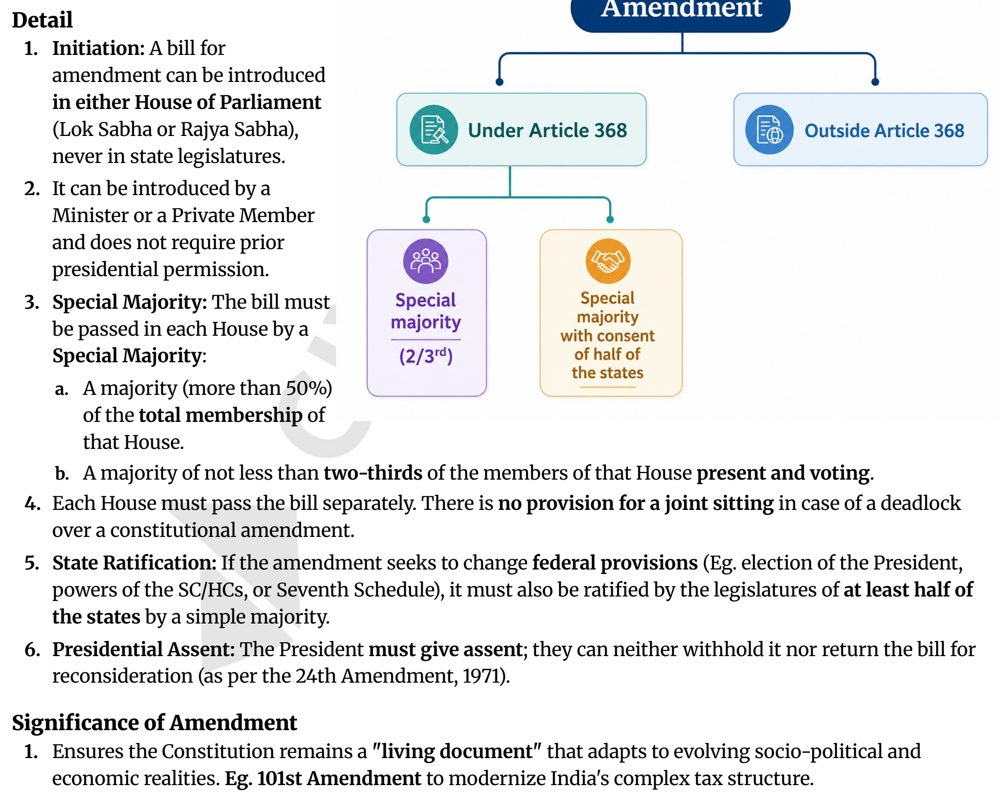

# Preamble, Parts, Schedules, Amendments & Basic Structure Doctrine — Smash Mains Notes (X-Factor Mains'27)

---

### [Smash Mains Source Page 11](../pages/mains/mains_page_011.pdf)

## Chapter 2: Salient Features Of Indian Constitution

### Preamble Of The Indian Constitution

### PYQs

- **[2019]** Do you think that the Constitution of India does not accept the principle of strict separation of powers rather it is based on the principle of 'checks and balances'? Explain. (10)

> The Preamble is the introductory statement that outlines the philosophy, ideals, and objectives of the Constitution. It reflects the vision of the Constituent Assembly and acts as the identity card of the Constitution. We, THE PEOPLE OF INDIA, having solemnly resolved to constitute India into a SOVEREIGN SOCIALIST SECULAR DEMOCRATIC REPUBLIC and to secure to all its citizens: JUSTICE, Social, Economic and Political. LIBERTY of thought, expression, belief, faith and worship. EQUALITY of status and of opportunity and to promote among them all. FRATERNITY assuring the dignity of the individual and the unity and integrity of the Nation. In Our Constituent Assembly, this 26th day of November 1949, do HEREBY ADOPT, ENACT, and GIVE TO OURSELVES THIS CONSTITUTION.

### Significance of the Preamble

- **1.** Philosophical Foundation - Serves as the soul of the Constitution, reflecting ideals of justice, liberty, equality, fraternity.

- **2.** Source of Authority - Declares that the power rests with the people, establishing popular sovereignty.

- **3.** Guiding Principles - Acts as a compass for governance and guides constitutional interpretation.

- **4.** Identity of the State - Defines India as Sovereign, Socialist, Secular, Democratic, Republic.

- **5.** Vision of Social Revolution - Highlights the goal of transforming Indian society based on social, economic, and political justice.

- **6.** Inspirational Value - Inspires citizens and institutions to uphold constitutional morality and democratic values.

- **7.** Judicial Reference - Frequently used by the Supreme Court to uphold the basic structure. Eg. Kesavananda Bharati, 1973.

- **8.** National Unity - Reinforces unity in diversity through the ideals of fraternity and integrity.

---

### [Smash Mains Source Page 12](../pages/mains/mains_page_012.pdf)

### Scholars

- **1.** In Sajjan Singh vs. State of Rajasthan, Justice Madholkar said that the Preamble had the stamp of "deep deliberation" and "an epitome" of the broad features of the Constitution.

- **2.** Sir Ernest Barker's Tribute: called the Preamble the "keynote" of the Constitution and quoted it in his book Principles of Social and Political Theory (1951).

- **3.** N.A. Palkhivala - the "horoscope of the Constitution".

### Criticism of the Preamble

- **1.** Non-justiciable nature - Ideals in the Preamble are not legally enforceable, reducing their practical impact.

- **2.** Redundancy argument - Critics argue it merely restates principles already covered in Fundamental Rights and DPSPs.

- **3.** Ambiguity - Terms such as justice, equality, fraternity are abstract and open to subjective interpretation.

- **4.** Borrowed Principles - Critics note inspiration from the US and French constitutions, questioning originality

- **5.** Symbolic over substantive - Seen as more of a moral declaration than a practical instrument of governance.

- **6.** Risk of Judicial Overreach - Its use in Kesavananda Bharati (1973) and later cases gives courts wide discretion, raising fears of judicial legislation.

### Debate surrounding whether preamble is part of constitution or not

### Judicial Debate on the Preamble

- **1.** Berubari Case (1960) - SC held that the Preamble is not part of the Constitution. It serves only as a guide to understand the farmers' intentions. Not enforceable in a court of law.

- **2.** Golak Nath v. State of Punjab (1967) - described Preamble as the "very soul" of the Constitution, eternal and unalterable. Though not enforceable, it represents the core principles guiding government.

- **3.** Kesavananda Bharati Case (1973)

  - **a.** SC overruled Berubari; held the Preamble is part of the Constitution.

  - **b.** Declared the Preamble as part of the Basic Structure.

  - **c.** It can be amended, but only if the Basic Structure is not altered.

  - **d.** Established its role as an interpretative tool for constitutional provisions.

- **4.** LIC of India v. Union of India (1995) - Reaffirmed that the Preamble is an integral part of the Constitution.

- **5.** Present Position -Preamble is part of the Constitution. It is non-justiciable, but has interpretative value. Embodies the Basic Structure, restricting Parliament's amending powers.

### Salient Features and keywords in Preamble

### Socialism

It is a governmental system that advocates community ownership and control of all lands and businesses rather than individual ownership. The word 'Socialist', added in the Preamble by 42nd Amendment Act, 1976 aims to eliminate inequality in income, status and standard of living.

---

### [Smash Mains Source Page 13](../pages/mains/mains_page_013.pdf)

### Indian Socialism

- **1.** 42nd Amendment, 1976: The term "Socialist" was added, but the Directive Principles of State Policy (DPSPs) already reflected socialist ideals.

- **2.** Nehruvian Socialism: state-led industrialization, central planning, and public sector control of key industries.

- **3.** Five-Year Plans: promoted industrialization through significant state intervention.

- **4.** Public Sector Dominance: The government controlled key industries like steel and mining through public enterprises.

- **5.** Land Reforms: Socialist principles drove land distribution efforts to address rural inequality.

- **6.** Gandhian Socialism -

  - **a.** For Gandhi, socialism meant equality, where all-prince, peasant, wealthy, poor, employer, and employee-are equal.

  - **b.** Article 40: Promotes village panchayats to handle local administration, in line with Gandhian ideals.

  - **c.** Article 43: Encourages the promotion of cottage industries in rural areas. Eg. Khadi and Village Industries Commission (KVIC).

  - **d.** Article 43(B): Supports the voluntary formation and democratic control of cooperative societies (97th CAA, 2011).

  - **e.** Social Justice and Welfare: Articles 15, 16, and 46 reflecting Gandhian Sarvodaya ideals by preventing discrimination and supporting marginalized sections.

### Challenges to socialism in India

Political

- **1.** Populism over Principle: Political class often pursues short-term welfare schemes for electoral gains, weakening socialist vision. Eg. loan waiver schemes

- **2.** Poor Land Reform Implementation: By 2024, land reforms redistributed only 4% of India's total agricultural land. Economic

- **1.** LPG Reforms (1991 onwards): Shift from socialist planning to market-oriented policies (liberalisation, privatisation, globalisation).

- **2.** Global Integration: Emphasis on foreign investment, trade competitiveness, and market efficiency over state-led redistribution.

- **3.** Wealth Inequality: As per Oxfam report, the top 1% in India held over 40.5% of the country's total wealth, exacerbating inequality.

- **4.** Privatization Trends: Eg. Strategic disinvestment in PSUs

- **5.** Globalization Pressures: WTO obligations limited India's agricultural subsidies under the Agreement on Agriculture, restricting state control. Socio-Cultural

- **1.** Middle-Class Aspirations: Growing focus on material prosperity and consumerism clashes with collective welfare ideals.

- **2.** Individualism vs. Collectivism: Aspirations for personal success increasingly overshadow socialist emphasis on equality and fraternity. Environmental

- **1.** Unsustainable development - Over-exploitation of resources disproportionately harms the poor, eroding Gandhian socialist justice.

---

### [Smash Mains Source Page 14](../pages/mains/mains_page_014.pdf)

- Rajni Kothari - Warned that coalition politics and rise of regional parties dilute ideological commitments, reducing socialism to populist slogans.

- Amartya Sen - Highlighted that social opportunity failures (health, education, gender justice) persist despite growth, showing India's socialism failed to deliver capabilities-based equality.

- Prabhat Patnaik - Argued that globalisation and neoliberal reforms hollow out socialist policies by prioritising capital flows over welfare.

- Granville Austin - Pointed out that India's Constitution envisions a "social revolution", but political practice has lagged in translating socialism into social justice.

### SC judgments on Socialism

- **1.** D.S. Nakara v. Union of India (1983) - Defined Indian Socialism as providing "a decent standard of life" and "security from cradle to grave."

- **2.** AK Gopalan v. State of Madras (1950) - Initially restricted individual liberty in favor of state-led social goals before the "Due Process" era.

- **3.** Olga Tellis v. Bombay Municipal Corporation (1985): Recognized livelihood as part of the right to life under Article 21.

- **4.** Bandhua Mukti Morcha v. Union of India (1984): Upheld the right to dignity and fair wages as Fundamental Rights under Article 21.

- **5.** D.S. Nakara v. Union of India (1983) - Expanded right to pension as a measure of socio-economic justice, calling India a welfare state rooted in socialism.

- **6.** Sanjeev Coke Mfg. Co. v. Bharat Coking Coal Ltd. (1983) - Upheld nationalisation of coal mines, affirming socialism as part of constitutional philosophy.

- **7.** Minerva Mills v. Union of India (1980) - Held that harmony between Fundamental Rights and DPSPs is essential. Socialism under Preamble guides this balance.

- **8.** Samatha v. State of Andhra Pradesh (1997) - Barred transfer of tribal land to non-tribals, emphasising socialist commitment to protect weaker sections.

### Way Forward for Socialism in India

- **1.** Reduce Inequality through Progressive Welfare - Strengthen progressive taxation and expand Direct Benefit Transfer (DBT) schemes. Eg. PM-KISAN, MGNREGA.

- **2.** Universal Education and Healthcare - increasing spending on Health and Education to 2.5% and 6% of GDP respectively.

- **3.** Revitalise Public Sector & Cooperative Models - Eg. Amul cooperative model.

- **4.** Empower Marginalised Communities - Strengthen affirmative action, and tribal welfare programmes.

- **5.** Sustainable & Equitable Development - Adopt green growth strategies that balance industrialisation with environmental justice. Eg. Green India mission

### Secularism

Secularism is a principle or ideology that advocates for the separation of religious institutions and beliefs from the affairs of the state, government, or public institutions. SC in the Subramanian Swamy case, upheld the inclusion of 'socialist, secular' in the Preamble of the Constitution.

---

### [Smash Mains Source Page 15](../pages/mains/mains_page_015.pdf)

SC in the S.R. Bommai (1994) declared secularism a basic structure. According to Akeel Bilgrami, Secularism consists of three commitments

- **1.** Freedom of religious belief and practice,

- **2.** Principles enshrined in the Constitution such as equality, freedom of speech, gender equality

- **3.** Meta-commitment, which says if there is a clash between the first and second commitments, the second commitment must get priority

### Secularism under the Indian constitution

- **1.** Article 15: Prohibits discrimination based on religion, race, caste, sex, or place of birth, ensuring equal treatment by the state.

- **2.** Article 16: Guarantees equality of opportunity in public employment, prohibiting discrimination on various grounds.

- **3.** Articles 25-28: Ensures freedom of religion, allowing individuals to practice and propagate their religion, subject to public order.

- **4.** Article 28: Protects the rights of minorities to establish and manage educational institutions.

- **5.** Articles 29 & 30: Provide cultural and educational rights to protect minority interests.

- **6.** Article 44: Promotes the idea of a Uniform Civil Code to establish common laws for all citizens.

- **7.** Article 51A: Fundamental duty to promote harmony, preserve cultural heritage, and foster brotherhood.

### Significance of secularism

Political Significance

- **1.** Protection of Individual Rights - Eg. Article 25 guarantees freedom of religion.

- **2.** Prevention of Religious Discrimination - Separation of state and religion discourages imposition of beliefs.

- **3.** Promotion of Rational Governance - Policies based on rationality, not religion. Eg. Uniform civil code.

- **4.** Protects Minority Rights - Eg. Article 30 ensures minorities' right to establish institutions.

- **5.** Strengthens Democracy - Prevents fusion of state and religion. equal citizenship for all. (Rajeev Bhargava - principled distance).

- **6.** Supports Constitutional Morality - Upholds justice, liberty, equality, fraternity.

- **7.** Encourages Global Standing - Projects India as a tolerant and inclusive democracy. Social Significance

- **1.** Preserves Unity in Diversity - Ensures coexistence of multiple religions, castes, and cultures.

- **2.** Promotes Social Justice - Reforms regressive practices. Protects gender and caste equality. Eg. Shayara Bano (2017) struck down instant triple talaq.

- **3.** Prevents Communal Conflicts - Safeguards against polarisation and religious violence.

### Western vs. Indian secularism

| Dimension | Western Secularism | Indian Secularism |
| --- | --- | --- |
| State-Religion Relation | Strict separation of State and Church. Eg. the French laïcité model bans religious symbols in public institutions. | Principled distance - equal respect but engagement if needed. Eg. Triple Talaq, Sabarimala |

---

### [Smash Mains Source Page 16](../pages/mains/mains_page_016.pdf)

| Dimension | Western Secularism | Indian Secularism |
| --- | --- | --- |
| Origin | Evolved during the European Renaissance as a response to widespread corruption in the Church | It originated in the ancient Vedic era and is grounded on religious pluralism (Sarva Dharma Samabhav and Dharma Nirapekshata.) |
| Role of Religion | Religion confined to private sphere | Religion recognised in both private and public life |
| State Intervention | No positive intervention, state avoids reform | State can intervene to reform evils (Eg. abolition of Sati, untouchability) |
| Rights Focus | Individual-centric - freedom of religion | Protects both individual (Article 25) and community rights (Article 29-30) |
| Nature of Neutrality | Exclusion of religion from state | Equal respect and balanced engagement |

### Threats to Indian Secularism

Political Threats

- **1.** Communal Politics - Religion used for mobilisation. Eg. Babri Masjid demolition (1992).

- **2.** Majoritarianism - Dominance of majority sentiments undermines minority rights. Eg. Nagpur violence (2025) over demand to remove Aurangzeb's tomb.

- **3.** Vote-bank Appeasement - Political concessions weakening neutrality. Eg. Shah Bano case (1985) reversal. Social Threats

- **1.** Communal Violence - Riots weaken harmony. Eg. Haldwani riots, Uttarakhand (2024) after madrasa demolition.

- **2.** Caste-Religion Overlap - Eg. Dalit temple entry struggles continue in Tamil Nadu villages.

- **3.** Patriarchal Religious Practices - Resistance to gender justice. Eg. Sabarimala verdict (2018) on women's entry faced strong opposition. Legal & Institutional Threats

- **1.** Misuse of Laws - Anti-conversion laws used to target minorities.

- **2.** Weak Institutional Neutrality - Eg. Reports of police excess in Haldwani riots (2024). Global & External Threats

- **1.** Religious Radicalisation - Eg. ISIS online recruitment cases in Kerala (2023-24).

- **2.** Diaspora Funding - Eg. FCRA cancellations (2024) for NGOs accused of communal polarisation. Media & Civil Society Threats

- **1.** Hate Speech & Social Media triggering violence. Eg. Dehgam, Gujarat riots (2025) after offensive social media posts.

- **2.** Communal Campaigns - Eg. "I Love Mohammad" campaign unrest in UP (2025).

- **3.** Sensationalism in Media - TV debates and biased coverage inflame tensions. Eg. Tablighi Jamaat Covid case

---

### [Smash Mains Source Page 17](../pages/mains/mains_page_017.pdf)

### Scholar views

- **1.** Ashis Nandy - Criticised Indian secularism as an elite project; argued that real tolerance lies in India's traditional religious pluralism, not constitutional imposition.

- **2.** T.N. Madan - Called secularism in India a "problematic ideology", arguing it is difficult to implement in a deeply religious society where faith permeates social life.

- **3.** Granville Austin - Indian Constitution envisions secularism as part of the "composite culture" project, ensuring unity in diversity through equal respect for all faiths.

- **4.** Upendra Baxi - Warned of secularism's erosion through communalisation of state institutions.

### Quotes

- **1.** Shashi Tharoor: "Indian secularism has always been the idea of India."

- **2.** Maulana Abul Kalam Azad: Secularism is not confined merely to political democracy but goes much beyond that. It is a political, social and cultural process."

### SC judgments related to secularism

- **1.** S.R. Bommai v. Union of India (1994) - Held that secularism is a basic feature; use of religion in politics can justify dismissal of state governments under Article 356.

- **2.** Aruna Roy v. Union of India (2002) - Upheld inclusion of value education in schools; clarified that teaching about religions is not against secularism if done in a neutral way.

- **3.** Bijoe Emmanuel v. State of Kerala (1986) - Upheld Jehovah's Witness children's right not to sing the national anthem on religious grounds, linking secularism to freedom of conscience.

- **4.** Shayara Bano v. Union of India (2017) - Struck down instant triple talaq, showing secular reformist intervention to uphold gender justice.

- **5.** Indian Young Lawyers Association v. State of Kerala (Sabarimala, 2018) - Allowed women's entry into temples; emphasised constitutional morality over religious customs.

- **6.** M.P. Gopalakrishnan Nair v. State of Kerala (2005): The Court emphasized that no religious instruction shall be provided in government-aided schools.

### Way forward

Political Reforms

- **1.** Strengthen Election Commission's autonomy to check communal campaigning.

- **2.** Promote inner-party democracy to reduce identity-based mobilisation. Legal & Institutional Safeguards

- **1.** Gradually implement the UCC to eliminate disparities in personal laws and promote a common legal framework.

- **2.** Enact a comprehensive law on hate speech to curb communal incitement.

- **3.** Strengthen neutrality of police and bureaucracy during communal tensions. Social & Educational Measures

- **1.** Introduce constitutional literacy programmes in schools and colleges.

- **2.** Encourage civil society initiatives to protect cultural pluralism. Eg. Ganga-Jamuni Tehzeeb of Uttar Pradesh as a model of grassroots harmony. Media & Technology Regulation

- **1.** Strengthen monitoring of fake news and hate propaganda on social media.

- **2.** Encourage ethical journalism to avoid sensationalism of communal issues. Inclusive Development

- **1.** Focus on education, health, and skill development for minorities. Eg. Himayat scheme

---

### [Smash Mains Source Page 18](../pages/mains/mains_page_018.pdf)

### Debate on Inclusion of Secularism and Socialism

### Background

- **1.** 42nd Amendment (1976) added the words "Socialist" and "Secular" to the Preamble during the Emergency.

- **2.** Intended to explicitly reaffirm constitutional ideals of equality, justice, and neutrality of the State. Arguments in Favour

- **1.** Reflects existing spirit - Even before the 42nd Amendment, the Constitution had secular provisions (Arts. 25-30) and socialist orientation (DPSPs).

- **2.** Judicial recognition - SC in Kesavananda Bharati (1973) and S.R. Bommai (1994) held secularism and socialism as part of the Basic Structure.

- **3.** Moral commitment - Explicit mention strengthens State's commitment to social and religious justice.

- **4.** Guidance for policy - Helps in framing welfare policies and pro-poor programmes.

### Arguments Against

- **1.** Redundancy - Values already implicit in the Constitution; insertion was political symbolism.

- **2.** Lack of debate - Added during Emergency, without wide consultation or Constituent Assembly backing.

- **3.** Ambiguity - Terms "socialism" and "secularism" open to varied interpretations, leading to political misuse.

- **4.** Dynamic needs - Socialism seen as outdated in the era of liberalisation and globalisation.

- **5.** Imposition of Western Constructs - Critics say socialism and Western secularism are alien to Indian ethos; Indian tradition allows positive state-religion alignment.

- **6.** Procedural Concerns - Preamble, adopted in 1949 as the soul of the Constitution, should not have been retrospectively altered. Key Debates in constitutional Assembly

- Risk of Superficial Symbolism - Nehru warned adding 'secular' would be symbolic, stressing that secularism must be lived and practiced rather than declared.

- Need for Legislative Flexibility - Explicit term could restrict State's scope in social reforms like abolishing untouchability or reforming personal laws.

- Constitutional Role vs. Ideological Proclamation - Ambedkar held that the Constitution should be a framework of governance, not fix rigid ideological commitments. Values must evolve through people's will.

- Fear of Misinterpretation - Members like Loknath Misra, H.V. Kamath feared it might be seen as anti-religious, alienating India's deeply spiritual society.

### Justice

In the words of John Rawls, "Justice is the first virtue of social institutions, as truth is of systems of thought." According to Amartya Sen, Justice is not merely a matter of giving people what they are entitled to, but also a matter of treating people with the equal concern and respect they deserve. The key elements of Justice include Fairness, equality, rights, impartiality and accountability.

### Types of Justice

- **1.** Distributive Justice: Focuses on ensuring all members of society receive a fair share of resources and benefits. Eg. Articles 38 and 39 of DPSP

---

### [Smash Mains Source Page 19](../pages/mains/mains_page_019.pdf)

- **2.** Procedural Justice: Ensures that decisions are made and implemented through fair processes, safeguarding fair treatment. Eg. 'procedure established by law.' (Article 21)

- **3.** Retributive Justice: Based on the principle of punishment proportionate to wrongdoing, aiming for justice through accountability. Eg. BnS.

- **4.** Restorative Justice: Aims to heal victims, rehabilitate offenders, and repair harm caused to the community. Eg. Article 39A and Article 32.

### Principles of Justice under the Indian constitution

Social Justice

- **1.** Article 15 - Prohibits discrimination based on religion, race, caste, sex, or place of birth

- **2.** Article 17-Abolishes "Untouchability" in any form and practice a punishable offense

- **3.** Article 21 - Guarantees the right to live with human dignity, free from social exploitation.

- **4.** Article 24 - Prohibits the employment of children in hazardous industries. Economic Justice

- **1.** Article 39(b) - Directs the state to distribute material resources for the common public good.

- **2.** Article 39(d) - Mandates equal pay for equal work for both men and women.

- **3.** Article 39(c) - Requires the state to prevent the concentration of wealth in few hands.

- **4.** Article 41 - state to provide public assistance in cases of unemployment or old age. Political Justice

- **1.** Article 16 - Provides equal opportunity for all citizens in matters of public employment.

- **2.** Article 325 - Ensures no person is excluded from electoral rolls due to caste or religion.

- **3.** Article 326 - Grants every adult citizen the right to vote through Universal Adult Suffrage.

- **4.** Article 330/332 - Reserves seats in legislatures for SC/ST communities.

### Liberty

The name "liberty" comes from the Latin word "Liber," which means "free from all shackles." Liberty means freedom of the individual to think, express, and act without arbitrary restraint, subject to reasonable restrictions to protect social order. The Preamble guarantees "Liberty of thought, expression, belief, faith and worship" as a fundamental value of the Republic.

### Political Theory

- **1.** J.S. Mill - Liberty is the absence of external restraints and protection of individuality, so long as it does not harm others.

- **2.** Isaiah Berlin - Differentiated between:

  - **a.** Negative liberty - freedom from interference (non-restriction).

  - **b.** Positive liberty - freedom to act and develop one's potential (self-determination). Constitutional Law - Liberty is embodied in Fundamental Rights (Arts. 19-22), especially Article 21, which the SC has interpreted broadly to include dignity, privacy, livelihood, health, and environment. Eg. Maneka Gandhi v. Union of India (1978) expanded liberty under Article 21 to include due process of law.

---

### [Smash Mains Source Page 20](../pages/mains/mains_page_020.pdf)

### Principles of Liberty under the Indian constitution

Negative Liberty (Freedom from interference)

- **1.** Article 19(1)(a) - Freedom of speech and expression. Eg. Shreya Singhal (2015) struck down Sec. 66A IT Act restricting speech.

- **2.** Article 19(1)(b) - Freedom of peaceful assembly.

- **3.** Article 19(1)(c) - Freedom of association.

- **4.** Article 19(1)(d)(e) - Freedom of movement and residence.

- **5.** Article 21 - Right to life and personal liberty (protection from arbitrary state action).

- **6.** Article 22 - Protection against arbitrary arrest and detention. Positive Liberty (Freedom to realise potential)

- **1.** Article 21 - Expanded to include dignity, education, health, livelihood, privacy. Eg. Olga Tellis (1985) - Right to livelihood; Puttaswamy (2017) - Right to privacy.

- **2.** Article 21A - Right to education for children 6-14 years.

- **3.** Directive Principles (Arts. 38, 39, 41, 43) - Ensure conditions for meaningful liberty through socio-economic justice.

- **4.** Article 25-28 - Freedom of conscience, belief, faith, and worship.

### SC on Liberty

- **1.** Maneka Gandhi v. Union of India (1978) - Expanded Art. 21, holding that any "procedure" must be just, fair and reasonable (introduced due process).

- **2.** Hussainara Khatoon v. State of Bihar (1979) - Recognised speedy trial as part of personal liberty under Art. 21.

- **3.** Olga Tellis v. Bombay Municipal Corporation (1985) - Right to livelihood held as part of right to life and liberty.

- **4.** K.S. Puttaswamy v. Union of India (2017) - Recognised right to privacy as intrinsic to personal liberty under Art. 21.

- **5.** Navtej Singh Johar v. Union of India (2018) - Decriminalised homosexuality; expanded liberty to include sexual autonomy.

- **6.** Joseph Shine v. Union of India (2018) - Struck down adultery law (Sec. 497 IPC) for violating dignity and personal liberty.

- **7.** Anuradha Bhasin v. Union of India (2020) - Liberty includes internet access; indefinite suspension of internet is unconstitutional.

- **8.** Shafin Jahan v. Asokan K.M. (Hadiya case, 2018) - Recognised right to marry a person of choice as part of personal liberty.

- **9.** Common Cause v. Union of India (2018) - Recognised right to die with dignity; upheld passive euthanasia.

### Quotes

- **1.** Article 21 is 'designed to assure the dignity of the individual as a most cherished human value which ensures the means of full development and evolution of a human being' (Justice R.F. Nariman in Puttaswamy)

- **2.** Gettell- "Liberty is the positive power of doing and enjoying those things which are worthy of enjoyment and work". The need of the hour is proactive judicial interventions through creative constitutionalism (Upendra Baxi) to safeguard personal liberty as justice.

---

### [Smash Mains Source Page 21](../pages/mains/mains_page_021.pdf)

### Equality

Equality means treating individuals without unjust discrimination and ensuring they enjoy the same legal status, rights, and opportunities, irrespective of caste, class, gender, religion, or wealth. The Preamble guarantees "Equality of status and of opportunity," elaborated in Articles 14-18 (Equality Code).

### Scholarly Perspectives

- **1.** Aristotle - Equality means treating equals equally and unequals unequally in proportion to their needs.

- **2.** J.S. Mill - Equality ensures equal liberty for every individual.

- **3.** Amartya Sen - Stresses "capability equality", i.e., ensuring equal freedom to achieve valuable life outcomes. Equality under the Indian Constitution is both formal (equal laws) and substantive (affirmative action to remove structural disadvantages). As Ambedkar said, political democracy must be backed by social and economic democracy to make equality meaningful.

### Principles of Equality under the Indian constitution

Civic Equality:

- **1.** Article 14: Right to equality before law.

- **2.** Article 15: Prohibition of discrimination on grounds of religion, race, caste, sex, or place of birth.

- **3.** Article 16: Equality of opportunity in matters of public employment. Political Equality:

- **1.** Article 326: Universal adult suffrage.

- **2.** Article 325: No person to be ineligible for inclusion in, or to claim to be included in, a special, electoral roll on grounds of religion, race, caste, or sex. Socio-economic Equality:

- **1.** Article 330 and 332: Reservation of seats for SC and ST in the House of the People.

- **2.** Article 38 includes provisions for minimizing inequalities in income, status, facilities, and opportunities.

- **3.** Article 39(d) directs the State to ensure equal justice and free legal aid.

- **4.** Article 46: Promotion of educational and economic interests of Scheduled Castes, Scheduled Tribes, and other weaker sections. Gender Equality:

- **1.** Article 15(1): Prohibition of discrimination on grounds of religion, race, caste, sex, or place of birth.

- **2.** Article 15(3): Empowers the State to make special provisions for women and children.

- **3.** Article 16: Equality of opportunity in matters of public employment.

- **4.** Article 39(a): Equal pay for equal work for both men and women.

### Challenges to liberty, equality and justice

### Threats to liberty in India

Political & Legal Threats

- **1.** Excessive preventive detention - Broad powers under NSA, UAPA undermine personal liberty. Eg. Gautam Navlakha case (2023).

- **2.** Misuse of sedition & anti-terror laws - Curtails freedom of speech and dissent. Eg. Sedition charges against journalists (Sidheeq Kappan) & students (Kanhaiya Kumar Case).

---

### [Smash Mains Source Page 22](../pages/mains/mains_page_022.pdf)

- **3.** Majoritarian pressures - Liberty of minorities curtailed by political narratives. Eg. Hijab ban controversy in Karnataka.

- **4.** Underrepresentation in legislatures - Women (~15% MPs in 2024) and minorities face barriers to inclusive democracy. Social & Cultural Threats

- **1.** Caste-based hierarchy - Enduring social stratification undermines constitutional morality (Art. 17). Eg. Hathras Dalit woman assault.

- **2.** Patriarchy - Structural barriers in education, labour force, inheritance limit gender equality. Eg. Female labour force participation ~41% vs. 72% in China. Economic Threats

- **1.** Poverty and inequality - Limit effective liberty by restricting opportunities. Eg. India's income inequality (Oxfam Report 2024) - Top 10% hold ~77% of wealth.

- **2.** Unemployment & lack of skills - Deny positive liberty to realise potential. Technological & Media Threats

- **1.** Mass surveillance - Pegasus spyware allegations (2021) raised privacy concerns.

- **2.** Censorship and content bans - Eg. 25 books banned in Kashmir (2024) for "secessionist content."

- **3.** Digital divide - Restricts access to liberty-enhancing tools like education and e-governance. Institutional Threats

- **1.** Judicial delays & undertrial prisoners - Eg. Over 4.5 lakh undertrial prisoners in India (NCRB 2025).

- **2.** Weak checks on executive power - Erosion of balance between state authority and citizen freedoms. Eg. custodial torture in TN (Sattankulam case)

- **3.** Weak enforcement of protective discrimination laws like SC/ST Act dilutes affirmative action.

### Fraternity

Fraternity is derived from the French term fraternité, which means brotherhood, friendship, community, and collaboration (Asthana 1992: 118). Dr. B.R. Ambedkar -"Without fraternity, equality and liberty will be no more than a coat of paint. Without fraternity, liberty and equality could not become a natural flow of events."

### Key provisions on fraternity in the Indian Constitution

- **1.** Preamble: Promotes fraternity to ensure the dignity of individuals and the unity and integrity of the nation.

- **2.** Fundamental Duties (Article 51A): Citizens are expected to promote harmony, brotherhood, and preserve India's diverse heritage.

- **3.** DPSP (Article 38 & 39A): Directs the state to ensure a just social order and equal access to justice, fostering fraternity.

- **4.** Fundamental Rights (Part III): Promotes equality and prohibits discrimination, upholding dignity and social harmony.

- **5.** Universal adult franchise

### Meaning and purpose of fraternity

- **1.** Preamble declares that fraternity assures two things- the dignity of individuals and promoting unity and integrity of the nation.

---

### [Smash Mains Source Page 23](../pages/mains/mains_page_023.pdf)

- **2.** According to K.M.Munshi, the phrase "dignity of the individual" means that the Constitution not only assures material advancement and sustains a democratic system but also acknowledges that each individual's personality is precious.

- **3.** "National unity and integrity" refers to the psychological and geographical components of national integration.

### Indian Context

- **1.** Ambedkar - Saw fraternity as inseparable from liberty and equality; essential for social democracy.

- **2.** Constitutional vision - Privileged the individual over community, embedding liberty-equality-fraternity as citizenship preconditions.

- **3.** Affirmative action (reservations) - Intended to create level playing field and build political fraternity among unequal social groups

### Challenges to Fraternity in India's Context

- **1.** Vagueness: constitutional assembly member H.M. Seervai finds the concept too vague, making it less useful for interpreting constitutional provisions or guiding legal decisions.

- **2.** Glossing over inequalities → produces solidarity built on exclusion of minorities rather than inclusion.

- **3.** Rise of aggressive nationalism - Substitutes fraternity with hostility towards minorities.

- **4.** Fundamentalism - Incompatible with fraternity; undermines dialogue and pluralism.

- **5.** Caste dominance - Fraternity limited within caste groups, preventing political fraternity across society.

- **6.** Regionalism: Movements for regional autonomy, like the Assamese vs. Bengali identity conflict in Assam or Gorkhaland movement in West Bengal, challenge national unity.

- **7.** Language and Cultural Barriers: Tensions, such as Tamil Nadu's resistance to Hindi imposition, challenge the ideal of fraternity in India.

### Way Forward for Ensuring Liberty, Equality and Fraternity

- **1.** Protect civic space - Ensure safeguards for NGOs, dissenting voices, and academic freedom by reducing arbitrary use of laws.

- **2.** Police reforms - Introduce independent oversight bodies and modernise investigation systems to curb arbitrary arrests. (Prakash Singh Guidelines)

- **3.** Free press - Protect journalists from misuse of laws and promote editorial independence for healthy democracy.

- **4.** Modernise reservations - Move towards multi-dimensional criteria (caste + income + education) to ensure fairness in affirmative action.

- **5.** Inclusive growth - Invest in public health, quality education, and skilling programmes for marginalised communities.

- **6.** Minority inclusion - Expand targeted schemes for tribals, minorities, and differently-abled to bridge socio-economic gaps.

- **7.** Access to justice - Strengthen legal aid services and fast-track courts to make justice delivery affordable and timely.

- **8.** Inter-community exchange - Promote cultural bonds through Ek Bharat Shreshtha Bharat and student exchange programmes.

- **9.** Constitutional literacy - Introduce civic education in schools and colleges to build respect for constitutional values.

- Amartya Sen - Capability Approach: Expand health, education, digital access to ensure liberty and equality translate into real capabilities.

---

### [Smash Mains Source Page 24](../pages/mains/mains_page_024.pdf)

- John Rawls - Theory of Justice: Apply the difference principle so inequalities benefit the most disadvantaged through welfare and inclusion.

### Separation of powers

- **1.** Derived from Montesquieu's Spirit of Laws (1748) - dividing state power into Legislature, Executive, Judiciary to prevent concentration and arbitrariness.

- **2.** In India - not in a strict sense but adopted in functional form with checks and balances. Aristotle first classified government functions into deliberative (law-making), magisterial (execution), and judicial (dispute resolution), laying the foundation for the doctrine of separation of powers.

### Principles of Separation of Powers in India

- **1.** Exclusivity Principle - Government is divided into three structural organs (Legislature, Executive, Judiciary). Eg. Legislature makes laws, Executive implements, Judiciary interprets.

- **2.** Functional Principle - Boundaries of each organ are defined. Eg. Judiciary cannot legislate, Parliament cannot sit in appeal over judicial decisions.

- **3.** Check and Balance Principle - Each organ checks the other to ensure actions remain within constitutional bounds. Eg. Judicial Review, Impeachment of judges, Executive assent to bills.

- **4.** Mutuality Principle - Cooperation, not confrontation, engagement not estrangement. Eg. Executive is derived from Legislature.

### Strict Separation of Powers in India

Legislature vs. Executive

- **1.** Exclusive Law-Making & Amendment Power - Only legislature can enact/amend laws under Art. 245-246 & 368.

- **2.** Control Over Consolidated Fund - Executive cannot spend money without legislative approval (Art. 266-267).

- **3.** No Usurpation of Legislative Privileges - Executive cannot breach parliamentary privileges (Art. 105, 194). Legislature vs. Judiciary

- **1.** Parliamentary Proceedings Immunity - Courts cannot inquire into parliamentary/state legislature proceedings (Art. 122, 212).

- **2.** Judicial Conduct Immunity - Parliament/Legislatures cannot discuss judicial conduct, except during impeachment under Art. 124(4).

- **3.** No Legislative Overruling of Judgments - Legislature cannot directly overrule judicial decisions. Judiciary vs. Executive

- **1.** Cabinet Secrecy - Courts cannot question cabinet deliberations (Art. 74(2)).

- **2.** Judicial Independence - Security of tenure, salaries, and contempt powers shield judiciary from executive control (Art. 124-147, 214-237).

- **3.** Appointments - Post NJAC Case (2015), executive's role in judicial appointments is limited to formal approval of collegium recommendations.

---

### [Smash Mains Source Page 31](../pages/mains/mains_page_031.pdf)

*Diagram Screenshot: [Constitutional Amendment Process: Under Article 368 vs Outside Article 368](../diagrams/mains_diag_amendment_art368_flowchart_p031.png) · [Full Source Page 31](../pages/mains/mains_page_031.pdf)*

## Chapter 4: Amendments And Basic Structure

### PYQs

- **[2025]** Indian Constitution has conferred the amending power on the ordinary legislative institutions with a few procedural hurdles. In view of this statement, examine the procedural and substantive limitations on the amending power of the Parliament to change the Constitution. (15)

- **[2019]** "Parliament's power to amend the Constitution is a limited power and it cannot be enlarged into absolute power." In the light of this statement explain whether Parliament under Article 368 of the Constitution can destroy the Basic Structure of the Constitution by expanding its amending power? (15) Under Article 368, the Parliament is granted the power to amend the Constitution by way of addition, variation, or repeal of any provision.

### Amendment Procedure in Detail

- **1.** Initiation: A bill for amendment can be introduced in either House of Parliament (Lok Sabha or Rajya Sabha), never in state legislatures.

- **2.** It can be introduced by a Minister or a Private Member and does not require prior presidential permission.

- **3.** Special Majority: The bill must be passed in each House by a Special Majority:

  - **a.** A majority (more than 50%) of the total membership of that House.

  - **b.** A majority of not less than two-thirds of the members of that House present and voting.

- **4.** Each House must pass the bill separately. There is no provision for a joint sitting in case of a deadlock over a constitutional amendment.

- **5.** State Ratification: If the amendment seeks to change federal provisions (Eg. election of the President, powers of the SC/HCs, or Seventh Schedule), it must also be ratified by the legislatures of at least half of the states by a simple majority.

- **6.** Presidential Assent: The President must give assent; they can neither withhold it nor return the bill for reconsideration (as per the 24th Amendment, 1971).

### Significance of Amendment

- **1.** Ensures the Constitution remains a "living document" that adapts to evolving socio-political and economic realities. Eg. 101st Amendment to modernize India's complex tax structure.

---

### [Smash Mains Source Page 32](../pages/mains/mains_page_032.pdf)

- **2.** Social Engineering: Eg. The 103rd Amendment provided 10% reservation for the Economically Weaker Sections (EWS).

- **3.** Correction of Anomalies: Allows the state to correct judicial interpretations that may hinder urgent national policy goals. Eg. 1st Amendment created the Ninth Schedule to protect land reform laws from judicial review.

- **4.** Federal Balancing: Provides a mechanism to re-negotiate the power-sharing balance between the Centre and the States.

- **5.** Rights Evolution: Eg. The 86th Amendment made the "Right to Education" a Fundamental Right under Article 21A.

- **6.** Institutional Reform: Eg. The 121st Amendment (though struck down) attempted to create the National Judicial Appointments Commission (NJAC).

### Limitations of Amendment powers of Parliament

### Procedural Limitations

These are explicit constitutional conditions laid down in Article 368.

- **1.** Special Majority Requirement - Majority of total membership of each House, and Two-thirds of members present and voting.

- **2.** Separate Approval by Each House - No joint sitting is allowed under Article 108.

- **3.** Ratification by Half States for Federal Provisions - Eg. 101st Amendment (GST) required ratification.

- **4.** Presidential Assent under Article 368(2).

- **5.** Bill must follow all legislative procedures - notice, debate, quorum, and voting. Procedural irregularities can invite judicial scrutiny (as per Raj Narain v. Indira Gandhi, 1975).

### Substantive Limitations on the Amending Power

Judicially evolved constraints that restrict Parliament from altering core identity of Constitution

- **1.** Doctrine of Basic Structure (Kesavananda Bharati v. State of Kerala (1973))

- **2.** Limited Amending Power Itself is Basic Structure (Minerva Mills, 1980) - Clauses (4) and (5) of Article 368 (inserted by the 42nd Amendment) were struck down.

- **3.** I.R. Coelho v. State of Tamil Nadu (2007) held that even laws placed in the Ninth Schedule after 1973 are open to Basic Structure review.

- **4.** Parliament cannot amend to abrogate or emasculate Fundamental Rights forming part of the Basic Structure (Eg. equality, liberty).

- **5.** Parliament cannot alter the essential federal balance between Centre and States. (Kuldip Nayar v. Union of India (2006))

### Other criticisms

- **1.** Frequent Changes: With over 106 amendments in 75 years, critics argue the Constitution is amended too easily compared to the US.

- **2.** Central Dominance: State legislatures cannot initiate amendments, leaving them dependent on the Centre's political will.

- **3.** Ambiguity of "Basic Structure": Since the SC hasn't exhaustively defined "Basic Structure," it leads to uncertainty and potential judicial overreach.

- **4.** No Joint Sitting: A small minority in the Rajya Sabha can block a critical amendment favored by a massive Lok Sabha majority.

---

### [Smash Mains Source Page 33](../pages/mains/mains_page_033.pdf)

### Major SC Judgments related to Amendment

- **1.** Shankari Prasad Case (1951): Ruled that Parliament can amend any part of the Constitution, including Fundamental Rights.

- **2.** Golaknath Case (1967): Reversed the previous stance, ruling that Fundamental Rights are "transcendental" and cannot be amended.

- **3.** Kesavananda Bharati Case (1973): Created the Basic Structure Doctrine, limiting the Parliament's power.

- **4.** Minerva Mills Case (1980): Reaffirmed that the Parliament's power to amend is limited and cannot be used to grant itself unlimited power.

### Major Amendments in Article 368

- **1.** 24th Amendment (1971): Clarified that Parliament can amend any part of the Constitution and made it obligatory for the President to give assent.

- **2.** 42nd Amendment (1976): Attempted to declare that there shall be no limitation whatsoever on the constituent power of Parliament; this was later invalidated by the SC in Minerva Mills.
