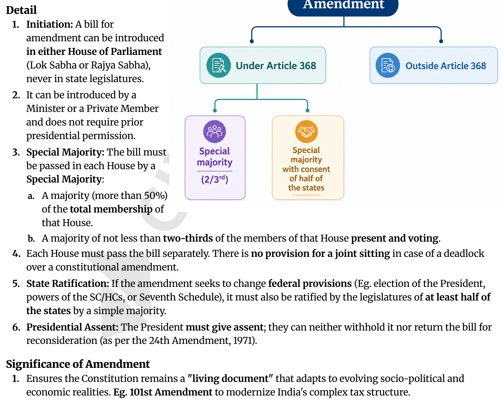

### [Smash Mains Source Page 31](../../pages/mains/mains_page_031.pdf)

### [Smash Mains Source Page 31](../../pages/mains/mains_page_031.pdf)

*Diagram Screenshot: [Constitutional Amendment Process: Under Article 368 vs Outside Article 368](../../diagrams/mains_diag_amendment_art368_flowchart_p031.png) · [Full Source Page 31](../../pages/mains/mains_page_031.pdf)*

## Chapter 4: Amendments And Basic Structure

### PYQs

- **[2025]** Indian Constitution has conferred the amending power on the ordinary legislative institutions with a few procedural hurdles. In view of this statement, examine the procedural and substantive limitations on the amending power of the Parliament to change the Constitution. (15)

- **[2019]** "Parliament's power to amend the Constitution is a limited power and it cannot be enlarged into absolute power." In the light of this statement explain whether Parliament under Article 368 of the Constitution can destroy the Basic Structure of the Constitution by expanding its amending power? (15) Under Article 368, the Parliament is granted the power to amend the Constitution by way of addition, variation, or repeal of any provision.

### Amendment Procedure in Detail

- **1.** Initiation: A bill for amendment can be introduced in either House of Parliament (Lok Sabha or Rajya Sabha), never in state legislatures.

- **2.** It can be introduced by a Minister or a Private Member and does not require prior presidential permission.

- **3.** Special Majority: The bill must be passed in each House by a Special Majority:

  - **a.** A majority (more than 50%) of the total membership of that House.

  - **b.** A majority of not less than two-thirds of the members of that House present and voting.

- **4.** Each House must pass the bill separately. There is no provision for a joint sitting in case of a deadlock over a constitutional amendment.

- **5.** State Ratification: If the amendment seeks to change federal provisions (Eg. election of the President, powers of the SC/HCs, or Seventh Schedule), it must also be ratified by the legislatures of at least half of the states by a simple majority.

- **6.** Presidential Assent: The President must give assent; they can neither withhold it nor return the bill for reconsideration (as per the 24th Amendment, 1971).

### Significance of Amendment

- **1.** Ensures the Constitution remains a "living document" that adapts to evolving socio-political and economic realities. Eg. 101st Amendment to modernize India's complex tax structure.
