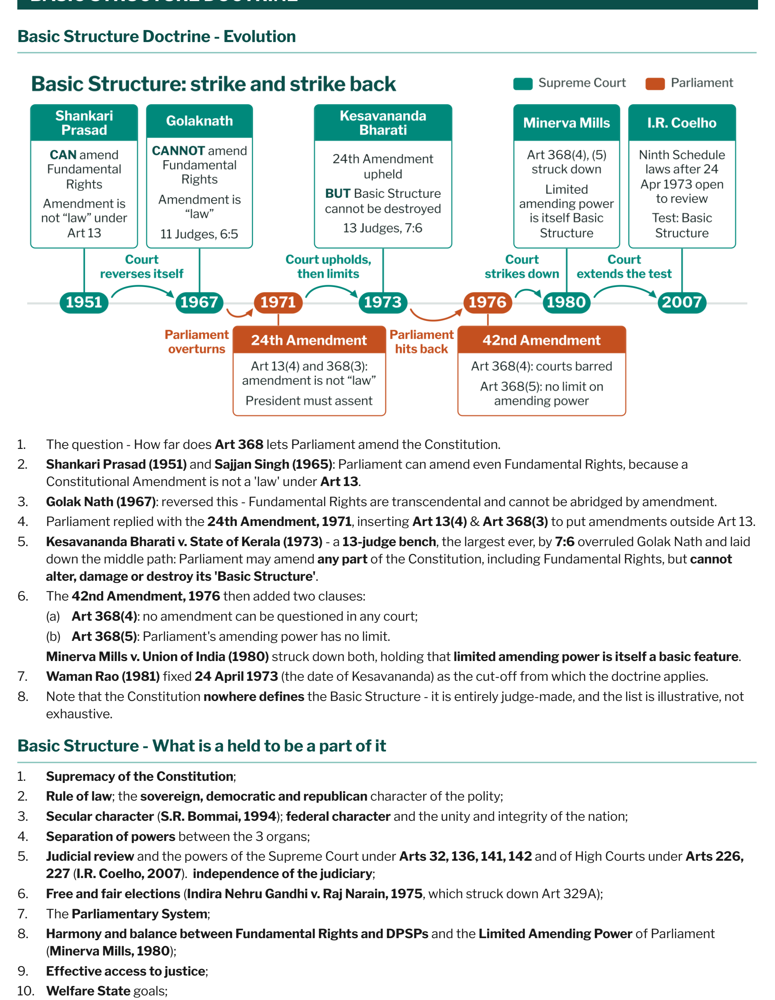

### [Prelims Source Page 22](../../pages/prelims/prelims_page_022.pdf)

### [Prelims Source Page 22](../../pages/prelims/prelims_page_022.pdf)

*Diagram Screenshot: [Basic Structure: Strike and Strike Back Timeline (1951–1980)](../../diagrams/pre_diag_basic_structure_p022.png) · [Full Source Page 22](../../pages/prelims/prelims_page_022.pdf)*

### BASIC STRUCTURE DOCTRINE

Basic Structure Doctrine - Evolution

- **1.** The question - How far does Art 368 lets Parliament amend the Constitution.

- **2.** Shankari Prasad (1951) and Sajjan Singh (1965): Parliament can amend even Fundamental Rights, because a Constitutional Amendment is not a 'law' under Art 13.

- **3.** Golak Nath (1967): reversed this - Fundamental Rights are transcendental and cannot be abridged by amendment.

- **4.** Parliament replied with the 24th Amendment, 1971, inserting Art 13(4) & Art 368(3) to put amendments outside Art 13.

- **5.** Kesavananda Bharati v. State of Kerala (1973) - a 13-judge bench, the largest ever, by 7:6 overruled Golak Nath and laid down the middle path: Parliament may amend any part of the Constitution, including Fundamental Rights, but cannot alter, damage or destroy its 'Basic Structure'.

- **6.** The 42nd Amendment, 1976 then added two clauses: (a) Art 368(4): no amendment can be questioned in any court; (b) Art 368(5): Parliament's amending power has no limit. Minerva Mills v. Union of India (1980) struck down both, holding that limited amending power is itself a basic feature.

- **7.** Waman Rao (1981) fixed 24 April 1973 (the date of Kesavananda) as the cut-off from which the doctrine applies.

- **8.** Note that the Constitution nowhere defines the Basic Structure - it is entirely judge-made, and the list is illustrative, not exhaustive. Basic Structure - What is a held to be a part of it

- **1.** Supremacy of the Constitution;

- **2.** Rule of law; the sovereign, democratic and republican character of the polity;

- **3.** Secular character (S.R. Bommai, 1994); federal character and the unity and integrity of the nation;

- **4.** Separation of powers between the 3 organs;

- **5.** Judicial review and the powers of the Supreme Court under Arts 32, 136, 141, 142 and of High Courts under Arts 226, 227 (I.R. Coelho, 2007). independence of the judiciary;

- **6.** Free and fair elections (Indira Nehru Gandhi v. Raj Narain, 1975, which struck down Art 329A);

- **7.** The Parliamentary System;

- **8.** Harmony and balance between Fundamental Rights and DPSPs and the Limited Amending Power of Parliament (Minerva Mills, 1980);

- **9.** Effective access to justice;

- **10.** Welfare State goals;

- **11.** Art 21 - the rule of law and life and liberty.
