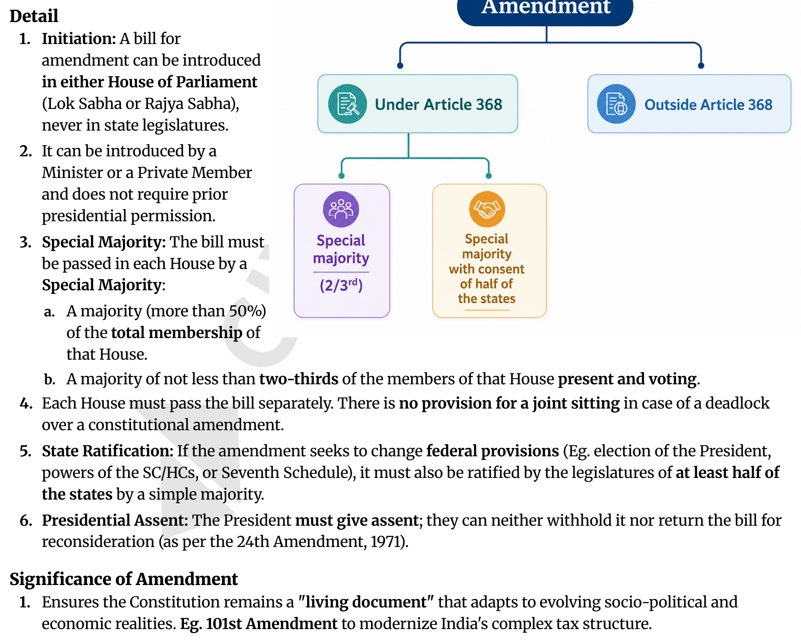

# Parts of the Constitution & Twelve Schedules (Fifth, Sixth, Seventh, Ninth, Tenth Schedules) — Smash Mains Notes (Ch02_Sub03_Parts_and_Twelve_Schedules)

---

### [Smash Mains Source Page 31](../../pages/mains/mains_page_031.pdf)

*Diagram Screenshot: [Constitutional Amendment Process: Under Article 368 vs Outside Article 368](../../diagrams/mains_diag_amendment_art368_flowchart_p031.png) · [Full Source Page 31](../../pages/mains/mains_page_031.pdf)*

## Chapter 4: Amendments And Basic Structure

### PYQs

- **[2025]** Indian Constitution has conferred the amending power on the ordinary legislative institutions with a few procedural hurdles. In view of this statement, examine the procedural and substantive limitations on the amending power of the Parliament to change the Constitution. (15)

- **[2019]** "Parliament's power to amend the Constitution is a limited power and it cannot be enlarged into absolute power." In the light of this statement explain whether Parliament under Article 368 of the Constitution can destroy the Basic Structure of the Constitution by expanding its amending power? (15) Under Article 368, the Parliament is granted the power to amend the Constitution by way of addition, variation, or repeal of any provision.

### Amendment Procedure in Detail

- **1.** Initiation: A bill for amendment can be introduced in either House of Parliament (Lok Sabha or Rajya Sabha), never in state legislatures.

- **2.** It can be introduced by a Minister or a Private Member and does not require prior presidential permission.

- **3.** Special Majority: The bill must be passed in each House by a Special Majority:

  - **a.** A majority (more than 50%) of the total membership of that House.

  - **b.** A majority of not less than two-thirds of the members of that House present and voting.

- **4.** Each House must pass the bill separately. There is no provision for a joint sitting in case of a deadlock over a constitutional amendment.

- **5.** State Ratification: If the amendment seeks to change federal provisions (Eg. election of the President, powers of the SC/HCs, or Seventh Schedule), it must also be ratified by the legislatures of at least half of the states by a simple majority.

- **6.** Presidential Assent: The President must give assent; they can neither withhold it nor return the bill for reconsideration (as per the 24th Amendment, 1971).

### Significance of Amendment

- **1.** Ensures the Constitution remains a "living document" that adapts to evolving socio-political and economic realities. Eg. 101st Amendment to modernize India's complex tax structure.

---

### [Smash Mains Source Page 32](../../pages/mains/mains_page_032.pdf)

- **2.** Social Engineering: Eg. The 103rd Amendment provided 10% reservation for the Economically Weaker Sections (EWS).

- **3.** Correction of Anomalies: Allows the state to correct judicial interpretations that may hinder urgent national policy goals. Eg. 1st Amendment created the Ninth Schedule to protect land reform laws from judicial review.

- **4.** Federal Balancing: Provides a mechanism to re-negotiate the power-sharing balance between the Centre and the States.

- **5.** Rights Evolution: Eg. The 86th Amendment made the "Right to Education" a Fundamental Right under Article 21A.

- **6.** Institutional Reform: Eg. The 121st Amendment (though struck down) attempted to create the National Judicial Appointments Commission (NJAC).

### Limitations of Amendment powers of Parliament

### Procedural Limitations

These are explicit constitutional conditions laid down in Article 368.

- **1.** Special Majority Requirement - Majority of total membership of each House, and Two-thirds of members present and voting.

- **2.** Separate Approval by Each House - No joint sitting is allowed under Article 108.

- **3.** Ratification by Half States for Federal Provisions - Eg. 101st Amendment (GST) required ratification.

- **4.** Presidential Assent under Article 368(2).

- **5.** Bill must follow all legislative procedures - notice, debate, quorum, and voting. Procedural irregularities can invite judicial scrutiny (as per Raj Narain v. Indira Gandhi, 1975).

### Substantive Limitations on the Amending Power

Judicially evolved constraints that restrict Parliament from altering core identity of Constitution

- **1.** Doctrine of Basic Structure (Kesavananda Bharati v. State of Kerala (1973))

- **2.** Limited Amending Power Itself is Basic Structure (Minerva Mills, 1980) - Clauses (4) and (5) of Article 368 (inserted by the 42nd Amendment) were struck down.

- **3.** I.R. Coelho v. State of Tamil Nadu (2007) held that even laws placed in the Ninth Schedule after 1973 are open to Basic Structure review.

- **4.** Parliament cannot amend to abrogate or emasculate Fundamental Rights forming part of the Basic Structure (Eg. equality, liberty).

- **5.** Parliament cannot alter the essential federal balance between Centre and States. (Kuldip Nayar v. Union of India (2006))

### Other criticisms

- **1.** Frequent Changes: With over 106 amendments in 75 years, critics argue the Constitution is amended too easily compared to the US.

- **2.** Central Dominance: State legislatures cannot initiate amendments, leaving them dependent on the Centre's political will.

- **3.** Ambiguity of "Basic Structure": Since the SC hasn't exhaustively defined "Basic Structure," it leads to uncertainty and potential judicial overreach.

- **4.** No Joint Sitting: A small minority in the Rajya Sabha can block a critical amendment favored by a massive Lok Sabha majority.

---

### [Smash Mains Source Page 33](../../pages/mains/mains_page_033.pdf)

### Major SC Judgments related to Amendment

- **1.** Shankari Prasad Case (1951): Ruled that Parliament can amend any part of the Constitution, including Fundamental Rights.

- **2.** Golaknath Case (1967): Reversed the previous stance, ruling that Fundamental Rights are "transcendental" and cannot be amended.

- **3.** Kesavananda Bharati Case (1973): Created the Basic Structure Doctrine, limiting the Parliament's power.

- **4.** Minerva Mills Case (1980): Reaffirmed that the Parliament's power to amend is limited and cannot be used to grant itself unlimited power.

### Major Amendments in Article 368

- **1.** 24th Amendment (1971): Clarified that Parliament can amend any part of the Constitution and made it obligatory for the President to give assent.

- **2.** 42nd Amendment (1976): Attempted to declare that there shall be no limitation whatsoever on the constituent power of Parliament; this was later invalidated by the SC in Minerva Mills.
