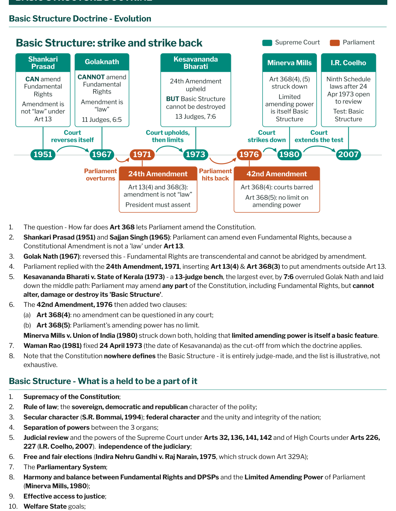

### [Prelims Source Page 16](../pages/prelims/prelims_page_016.pdf)

**Q16. A constitutional government by definition is a [2020]**
(a) government by legislature
(b) popular government
(c) multi-party government
(d) limited government
**`ANSWER (d)`**

**Q17. In the context of India, which one of the following is**
the characteristic appropriate for bureaucracy?

- **[2020]** 
(a) An agency for widening the scope of
parliamentary democracy
(b) An agency for strengthening the structure of
federalism
(c) An agency for facilitating political stability and
economic growth
(d) An agency for the implementation of public policy
**`ANSWER (d)`**

**Q18. The Ninth Schedule was introduced in the Constitution**
of India during the prime ministership of [2019]
(a) Jawaharlal Nehru
(b) Lal Bahadur Shastri
(c) Indira Gandhi
(d) Morarji Desai
**`ANSWER (a)`**

**Q19. In the context of any country, which one of the**
following would be considered as part of its social
capital? [2019]
(a) The proportion of literates in the population
(b) The stock of its buildings, other infrastructure and
machines
(c) The size of population in the working age group
(d) The level of mutual trust and harmony in the
society
**`ANSWER (d)`**

**Q20. In the context of polity, which one of the following**
would you accept as the most appropriate definition of
liberty? [2019]
(a) Protection against the tyranny of political rulers
(b) Absence of restraint
(c) Opportunity to do whatever one likes
(d) Opportunity to develop oneself fully.
**`ANSWER (d)`**

**Q21. Consider the following statements: [2018]**
1. The Parliament of India can place a particular law
in the Ninth Schedule of the Constitution of India.
2. The validity of a law placed in the Ninth Schedule
cannot be examined by any court and no
judgement can be made on it.
Which of the statements given above is/are correct ?
(a) 1 only
(b) 2 only
(c) Both 1 and 2
(d) Neither 1 nor 2
**`ANSWER (a)`**

**Q22. Which of the following are regarded as the main**
features of the “Rule of Law” ? [2018]
1. Limitation of powers
2. Equality before law
3. People’s responsibility to the Government
4. Liberty and civil rights Select the correct answer
using the code given below :
(a) 1 and 3 only
(b) 2 and 4 only
(c) 1, 2 and 4 only
(d) 1, 2, 3 and 4
**`ANSWER (c)`**

**Q23. Which one of the following reflects the most**
appropriate relationship between law and liberty?

- **[2018]** 
(a) If there are more laws, there is less liberty.
(b) If there are no laws, there is no liberty.
(c) If there is liberty laws have to be made by the
people.
(d) If laws are changed too often, liberty is in danger.
**`ANSWER (b)`**

**Q24. The mind of the makers of the Constitution of India is**
reflected in which of the following? [2017]
(a) The Preamble
(b) The Fundamental Rights
(c) The Directive Principles of State Policy
(d) The Fundamental Duties
**`ANSWER (a)`**

**Q25. Which one of the following objectives is not embodied**
in the Preamble to the Constitution of India? [2017]
(a) Liberty of thought
(b) Economic liberty
(c) Liberty of expression
(d) Liberty of belief
**`ANSWER (b)`**

---

### [Prelims Source Page 17](../pages/prelims/prelims_page_017.pdf)

**Q26. ‘Democracy’s superior virtue lies in the fact that it calls**
into activity [2017]
(a) the intelligence and character ordinary men and
women.
(b) the methods for strengthening executive
leadership
(c) a superior individual with dynamism and vision.
(d) a band of dedicated party workers.
**`ANSWER (a)`**

**Q27. Which one of the following statements is correct?**

- **[2017]** 
(a) Right are claims of the State against the citizens.
(b) Rights are privileges which are incorporated in
the Constitution of a State.
(c) Rights are claims of the citizens against the State.
(d) Rights are privileges of a few citizens against the
many
**`ANSWER (c)`**

**Q28. One of the implications of equality in society is the**
absence of [2017]
(a) Privileges
(b) Restraints
(c) Competition
(d) Ideology
**`ANSWER (a)`**

**Q29. Which one of the following was given classical**
language status recently? [2015]
(a) Odia
(b) Konkani
(c) Bhojpuri
(d) Assamese
**`ANSWER (a)`**

**Q30. Consider the following languages: [2014]**
1. Gujarati
2. Kannada
3. Telugu Which of the above has/have been
declared as 'Classical Language / Languages' by
the Government?
SELECT THE CORRECT ANSWER USING THE CODE
GIVEN BELOW.:
(a) 1 and 2 only
(b) 3 only
(c) 2 and 3 only
(d) 1, 2 and 3 only
**`ANSWER (c)`**

**Q31. Which one of the following Schedules of the**
Constitution of India contains provisions regarding
anti-defection? [2014]
(a) Second Schedule
(b) Fifth Schedule
(c) Eighth Schedule
(d) Tenth Schedule
**`ANSWER (d)`**

**Q32. Consider the following statements : [2014]**
A CONSTITUTIONAL GOVERNMENT IS ONE WHICH:
1. places effective restrictions on individual liberty
in the interest of State Authority.
2. places effective restrictions on the Authority of
the State in the interest of individual liberty.
Which of the statements given above is/are correct?
(a) 1 only
(b) 2 only
(c) Both 1 and 2
(d) Neither 1 nor 2
**`ANSWER (b)`**

**Q33. Which of the following provisions of the Constitution**
of India have a bearing on Education? [2012]
1. Directive Principles of State Policy
2. Rural and Urban Local Bodies
3. Fifth Schedule
4. Sixth Schedule
5. Seventh Schedule Select the correct answer
using the code given below:
(a) 1 and 2 only
(b) 3, 4 and 5 only
(c) 1, 2 and 5 only
(d) 1, 2, 3, 4 and 5
**`ANSWER (d)`**

**Q34. Under which one of the following Constitution**
Amendment Acts, four languages were added to the
languages under the Eighth Schedule of the
Constitution of India, thereby raising their number to
22? [2008]
(a) Constitution (Ninetieth Amendment) Act
(b) Constitution (Ninety-first Amendment) Act
(c) Constitution (Ninety-second Amendment) Act
(d) Constitution (Ninety-third Amendment) Act
**`ANSWER (c)`**

---

### [Prelims Source Page 21](../pages/prelims/prelims_page_021.pdf)

Objectives: Justice is taken from the Russian Revolution (1917); Liberty, Equality and Fraternity from the French Revolution
(1789).
6. Justice: Social, Economic, Political
- Social justice: no discrimination on grounds of caste, religion, sex etc. (Arts 15, 16, 17, 46).
- Economic justice: removal of gross inequalities in wealth and income (Arts 38, 39).
- Political justice: equal political rights and equal access to public office.
- Secured through a mix of Fundamental Rights and DPSPs.
7. Liberty: of Thought, Expression, Belief, Faith and Worship
- The Preamble secures only these five liberties; not “action” or “conscience”.
- Means absence of arbitrary restraint plus conditions for full development of personality.
- Not absolute: Art 19 rights are subject to reasonable restrictions.
8. Equality: of Status and Opportunity
- Core idea: absence of special privileges.
- Civic: Arts 14 to 18. Political: Arts 325, 326. Economic: Art 39(d) (equal pay for equal work).
9. Fraternity
- A sense of common brotherhood, promoted through single citizenship.
- Assures both (i) dignity of the individual and (ii) unity and integrity of the Nation; “Integrity” added in 1976.
- Reinforced by Fundamental Duty Art 51A(e).
Traps
- Word order: Sovereign, Socialist, Secular, Democratic, Republic.
- Justice from the Russian Revolution; Liberty, Equality, Fraternity from the French Revolution.
- Fraternity covers both dignity of the individual and unity and integrity of the Nation.
- Liberty lists five items only; action and conscience are not among them.
Is the Preamble amendable? The 42nd Amendment, 1976
1. Can it be amended? Yes. Kesavananda Bharati (1973) held the Preamble is part of the Constitution, so it can be
amended under Art 368, but not in a way that destroys its basic features.
2. Amended only once, by the 42nd Amendment, 1976, which:
- added “Socialist” and “Secular”, and
- changed “unity of the Nation” to “unity and integrity of the Nation”.
- So on 26 January 1950, India was a “Sovereign Democratic Republic”.
3. Not a source of power for the legislature, nor a limit on its powers.
4. Non-justiciable, but a “key to open the mind of the makers” (Berubari, 1960); used to resolve ambiguity in the text.
5. LIC v Consumer Education and Research Centre (1995) reaffirmed it as an integral part of the Constitution.
6. Insertion of “socialist” and “secular” upheld in Dr Balram Singh v Union of India (2024)

---

### [Prelims Source Page 22](../pages/prelims/prelims_page_022.pdf)

*Diagram Screenshot: [Basic Structure: Strike and Strike Back Timeline (1951–1980)](../diagrams/pre_diag_basic_structure_p022.png) | [Full Source Page 22](../pages/prelims/prelims_page_022.pdf)*

BASIC STRUCTURE DOCTRINE
Basic Structure Doctrine - Evolution
1. The question - How far does Art 368 lets Parliament amend the Constitution.
2. Shankari Prasad (1951) and Sajjan Singh (1965): Parliament can amend even Fundamental Rights, because a
Constitutional Amendment is not a 'law' under Art 13.
3. Golak Nath (1967): reversed this - Fundamental Rights are transcendental and cannot be abridged by amendment.
4. Parliament replied with the 24th Amendment, 1971, inserting Art 13(4) & Art 368(3) to put amendments outside Art 13.
5. Kesavananda Bharati v. State of Kerala (1973) - a 13-judge bench, the largest ever, by 7:6 overruled Golak Nath and laid
down the middle path: Parliament may amend any part of the Constitution, including Fundamental Rights, but cannot
alter, damage or destroy its 'Basic Structure'.
6. The 42nd Amendment, 1976 then added two clauses:
(a) Art 368(4): no amendment can be questioned in any court;
(b) Art 368(5): Parliament's amending power has no limit.
Minerva Mills v. Union of India (1980) struck down both, holding that limited amending power is itself a basic feature.
7. Waman Rao (1981) fixed 24 April 1973 (the date of Kesavananda) as the cut-off from which the doctrine applies.
8. Note that the Constitution nowhere defines the Basic Structure - it is entirely judge-made, and the list is illustrative, not
exhaustive.
Basic Structure - What is a held to be a part of it
1. Supremacy of the Constitution;
2. Rule of law; the sovereign, democratic and republican character of the polity;
3. Secular character (S.R. Bommai, 1994); federal character and the unity and integrity of the nation;
4. Separation of powers between the 3 organs;
5. Judicial review and the powers of the Supreme Court under Arts 32, 136, 141, 142 and of High Courts under Arts 226,
227 (I.R. Coelho, 2007). independence of the judiciary;
6. Free and fair elections (Indira Nehru Gandhi v. Raj Narain, 1975, which struck down Art 329A);
7. The Parliamentary System;
8. Harmony and balance between Fundamental Rights and DPSPs and the Limited Amending Power of Parliament
(Minerva Mills, 1980);
9. Effective access to justice;
10. Welfare State goals;
11. Art 21 - the rule of law and life and liberty.

---

### [Prelims Source Page 215](../pages/prelims/prelims_page_215.pdf)

## CHAPTER 26
AMENDMENTS
THEME ANALYSIS PYQ pattern for this chapter
1. REPEATS

#### A. Procedure under Article 368
- Parliament may amend by addition, variation or repeal [2024]
- A Bill may start in either House, needs no Presidential recommendation, allows no joint sitting [2013, 2022]
- Assent is obligatory since the 24th Amendment (1971) [2022]
- Federal provisions need ratification by half the States [2013]

#### B. The Three Majorities
- Simple majority outside Article 368: Articles 2, 3, 4, new States and boundaries
- Special majority alone for the bulk of the text under Article 368
- Special majority plus ratification for Articles 54, 55, 66, Seventh Schedule, judiciary

#### C. Landmark Amendments by Number
- First Amendment (1951) answered judicial readings of Fundamental Rights; Ninth Schedule [2023]
- 42nd Amendment (1976) added worker participation in management to the Directive Principles [2017]
- 91st Amendment (2003) capped the Council of Ministers at fifteen percent [2009]
- 99th Amendment (2014) and the NJAC, struck down for hurting judicial independence [2019]

#### D. Judiciary versus the Amending Power
- Amendments stay reviewable, with Basic Structure as the yardstick [2019]
- The 44th Amendment (1978) did not shield the Prime Minister's election [2019]
- The Constitution nowhere defines its own federal character, so options claiming it fail [2013]
2. HOW THE FORMAT HAS CHANGED
- 2009 to 2013: single answer recall of amendment numbers and ratification [2009, 2013]
- 2019 to 2024: two and three statement sets on Art 368 mechanics [2019, 2022, 2024]
- 2023: a motive based single answer, why an amendment was made [2023]
3. WHAT IS BEING ASKED NOW
- The text of Art 368: modes, assent, majority, no joint sitting [2022, 2024]
- Why an amendment was enacted [2023]

### PRELIMS PREVIOUS YEAR QUESTIONS

**Q1. As per Article 368 of the Constitution of India, the**
Parliament may amend any provision of the
Constitution by way of: [2024]
1. Addition
2. Variation
3. Repeal Select the correct answer using the code
given below:
(a) 1 and 2 only
(b) 2 and 3 only
(c) 1 and 3 only
(d) 1, 2 and 3
**`ANSWER (d)`**

**Q2. In India, which one of the following Constitutional**
Amendments was widely believed to be enacted to
overcome the judicial interpretations of Fundamental
Rights? [2023]
(a) 1st Amendment
(b) 42nd Amendment
(c) 44th Amendment
(d) 86th Amendment
**`ANSWER (a)`**

Note: UPSC dropped/deleted this specific question from the
final official answer key for Prelims 2023.

#### Structured Tables on Page 215

| CHAPTER 26 |
| --- |
| AMENDMENTS |
| THEME ANALYSIS PYQ pattern for this chapter |
| 1. REPEATS A. Procedure under Article 368 • Parliament may amend by addition, variation or repeal [2024] • A Bill may start in either House, needs no Presidential recommendation, allows no joint sitting [2013, 2022] • Assent is obligatory since the 24th Amendment (1971) [2022] • Federal provisions need ratification by half the States [2013] B. The Three Majorities • Simple majority outside Article 368: Articles 2, 3, 4, new States and boundaries • Special majority alone for the bulk of the text under Article 368 • Special majority plus ratification for Articles 54, 55, 66, Seventh Schedule, judiciary C. Landmark Amendments by Number • First Amendment (1951) answered judicial readings of Fundamental Rights; Ninth Schedule [2023] • 42nd Amendment (1976) added worker participation in management to the Directive Principles [2017] • 91st Amendment (2003) capped the Council of Ministers at fifteen percent [2009] • 99th Amendment (2014) and the NJAC, struck down for hurting judicial independence [2019] D. Judiciary versus the Amending Power • Amendments stay reviewable, with Basic Structure as the yardstick [2019] • The 44th Amendment (1978) did not shield the Prime Minister's election [2019] • The Constitution nowhere defines its own federal character, so options claiming it fail [2013] 2. HOW THE FORMAT HAS CHANGED • 2009 to 2013: single answer recall of amendment numbers and ratification [2009, 2013] • 2019 to 2024: two and three statement sets on Art 368 mechanics [2019, 2022, 2024] • 2023: a motive based single answer, why an amendment was made [2023] 3. WHAT IS BEING ASKED NOW • The text of Art 368: modes, assent, majority, no joint sitting [2022, 2024] • Why an amendment was enacted [2023] |

| ANSWER (a) |
| --- |
| UPSC dropped/deleted this specific question from the |

---

### [Prelims Source Page 216](../pages/prelims/prelims_page_216.pdf)

**Q3. Consider the following statements : [2022]**
1. A Bill amending the Constitution requires a prior
recommendation of the President of India.
2. When a Constitution Amendment Bill is
presented to the President of India, it is obligatory
for the President of India to give his/her assent.
3. A Constitution Amendment Bill must be passed
by both the Lok Sabha and the Rajya Sabha by a
special majority and there is no provision for joint
sitting.
Which of the statements given above are correct?
(a) 1 and 2 only
(b) 2 and 3 only
(c) 1 and 3 only
(d) 1,2 and 3
**`ANSWER (b)`**

**Q4. Consider the following statements: [2019]**
1. The 44th Amendment to the Constitution of India
introduced an Article placing the election of the
Prime Minister beyond judicial review.
2. The Supreme Court of India struck down the 99th
Amendment to the Constitution of India as being
violative of the independence of judiciary.
Which of the statements given above is/are correct?
(a) 1 only
(b) 2 only
(c) Both 1 and 2
(d) Neither 1 nor 2
**`ANSWER (b)`**

**Q5. Consider the following statements : [2013]**
(1) . An amendment to the Constitution of India can
be initiated by an introduction of a bill in the Lok
Sabha only.
(2) . If such an amendment seeks to make changes in
the federal character of the Constitution, the
amendment also requires to be ratified by the
legislature of all the States of India.
Which of the statements given above is/are correct?
(a) 1 only
(b) 2 only
(c) Both 1 and 2
(d) Neither 1 nor 2
**`ANSWER (d)`**

**Q6. Which one of the following Constitutional**
Amendments states that the total number of
Ministers, including the Prime Minister, in the Council
of Ministers shall not exceed fifteen percent of the
total number of [2009]
(a) 90th
(b) 91st
(c) 92nd
(d) 93rd
**`ANSWER (b)`**

AMENDING PROCEDURE
1. Special Majority: Art 368(2) [PRELIMS 2024, 2022]
CONDITION
- Any amendment not covered by the proviso to Art 368(2), i.e. one that does not affect the federal provisions or the
Seventh Schedule.
- Examples: Fundamental Rights, DPSPs, and most other provisions.
MAJORITY NEEDED
- Special majority in each House: a majority of the total membership and 2/3 of members present and voting.
- Presidential assent is mandatory (24th CAA, 1971).
- The Basic Structure doctrine (Kesavananda Bharati, 1973) limits this amending power.
2. Special Majority + State Ratification: Proviso to Art 368(2) [PRELIMS 2013]
CONDITION: the amendment affects any of the following:
1. Election of the President (Arts 54, 55);
2. Extent of the executive power of the Union and the States (Arts 73, 162);
3. The Supreme Court, the High Courts, and High Courts for UTs (Art 241);
4. Distribution of legislative powers between the Union and the States, and any List in the Seventh Schedule;
5. GST Council (Art 279A, added by the 101st CAA, 2016);
6. Representation of States in Parliament;
7. Article 368 itself.
MAJORITY NEEDED
- Special majority in each House, plus ratification by the legislatures of not less than half the States, by simple
majority.

---

### [Prelims Source Page 217](../pages/prelims/prelims_page_217.pdf)

- The Constitution sets no time limit for State ratification.
- Presidential assent is required.
- The aim is to protect federalism: matters that affect the States cannot be changed by Parliament alone.
3. Simple Majority: Arts 2 and 3 (outside Art 368)
CONDITION
- Art 2: admission or establishment of new States from territory outside India.
- Art 3: formation of new States, and alteration of the areas, boundaries or names of existing States.
MAJORITY NEEDED
- Simple majority in both Houses of Parliament.
- Under Art 3, the Bill needs the President’s prior recommendation. The President refers it to the State Legislature
concerned for its views, which are not binding.
- Example (Art 3): formation of Telangana under the AP Reorganisation Act, 2014.
- TRAP: Sikkim was made a State by the 36th CAA, 1975, not by a simple-majority law.
- TRAP: ceding Indian territory to a foreign country needs an Art 368 amendment, not an Art 3 law (Berubari Union,
1960). This is why the 9th CAA, 1960 and the 100th CAA, 2015 (India–Bangladesh Land Boundary Agreement)
were needed.
4. Simple Majority: Art 4
CONDITION
- A law under Art 2 or 3 may make consequential changes to the First Schedule (names and areas of States and UTs)
and the Fourth Schedule (Rajya Sabha seats).
- Art 4(2): such a law is not deemed an amendment under Art 368.
MAJORITY NEEDED
- Simple majority in both Houses of Parliament.
- Example: merger of the UTs of Dadra and Nagar Haveli and Daman and Diu (2019 Act, effective 26 Jan 2020).
5. Election of the President and Vice-President: Arts 55 and 66
CONDITION: the provisions on the election of the President (Arts 54, 55) and the Vice-President (Art 66).
MAJORITY NEEDED
1. Art 55 (President): special majority + ratification by half the States, because the President’s election is in the
proviso to Art 368(2).
2. Art 66 (Vice-President): special majority only, because the VP’s election is not in the proviso.
TRAP: The procedural details of both elections are governed by the Presidential and Vice-Presidential Elections Act, 1952,
which Parliament can change by simple majority. Only changing the Articles themselves needs Art 368.
IMPORTANT CONSTITUTIONAL AMENDMENTS
First Amendment (1951) [PRELIMS 2023]
1. Added 1. Article 19(2) (substituted): 'reasonable' restrictions on free speech on grounds of security of the State, friendly
relations with foreign States, public order and incitement to an offence (new grounds), decency or morality, contempt
of court, defamation. 'Sovereignty and integrity of India' was added later by the 16th CAA, 1963.
2. Also inserted Art 15(4).
3. Article 31A - saves laws providing for acquisition of estates / abolition of zamindari from being declared void for
inconsistency with Art 14 or Art 19.
4. Article 31B - This clause introduced the Ninth Schedule to the Constitution, which provides protection to laws that are
placed in it from being challenged in a court of law on the grounds of violating fundamental rights.

---

### [Prelims Source Page 218](../pages/prelims/prelims_page_218.pdf)

Seventh Amendment (1956)
1. To Implement the recommendations of the States Reorganisation Commission regarding the reorganization of the states
on a linguistic basis.
2. 14 States and 6 Union territories were created;
3. the Part A/B/C/D classification was abolished.
4. A new Article 350A : to provide facilities for instruction in mother tongue at the Primary stage to children belonging to
linguistic minority groups and empowers the President to issue directions to any State for securing such facilities.
5. Article 350B: a Special Officer for Linguistic Minorities, appointed by the President, investigates all matters relating to
their safeguards.
He reports to the President; the reports are laid before Parliament and sent to the State Governments concerned.
6. Article 239 (substituted): every Union territory shall be administered by the President through an administrator
appointed by him;
7. Part VII (Art 238, Part B States) was omitted.
24th Amendment (1971)
Nullified the Supreme Court's judgment in the Golaknath case, which had held that the Parliament did not have the power to
amend the fundamental rights.
42nd Amendment (1976) [PRELIMS 2017]
1. Preamble - The preamble was amended to insert the words "Socialist" and "Secular" and to emphasize the unity and
integrity of the nation.
2. Article 31C - This clause was amended to provide immunity to laws passed by Parliament that implemented the Directive
Principles of State Policy from judicial review.
3. Fundamental Duties - A new Part IV-A was added to the Constitution, which introduced ten Fundamental Duties that
were expected of every citizen of India.
4. Judicial Review - The Supreme Court's power of judicial review was limited by adding a new provision that allowed
Parliament to determine the power and jurisdiction of the Court.
5. Added Part XIV-A - Administrative Tribunals (Arts 323A & 323B);
6. extended Lok Sabha & Assembly terms from 5 to 6 years;
7. made the President bound by the Council of Ministers' advice (Art 74(1));
8. shifted education, forests, wildlife and weights & measures to the Concurrent List.
44th Amendment (1978)
1. Removed the Right to Property from Part III (Arts 19(1)(f) and 31 omitted);
2. it survives only as a constitutional/legal right under Art 300A - no person shall be deprived of property save by authority
of law, with no guaranteed compensation.
3. Arts 20 & 21 can no longer be suspended during an Emergency (Art 359);
4. the six freedoms under Art 19 are suspended only when the Emergency is declared on grounds of war or external
aggression (Art 358).
5. The Amendment restored the power of Judicial Review to the Supreme Court and High Courts.
6. Restored the term of the Lok Sabha & State Assemblies to 5 years (the 42nd CAA had made it 6 years).
7. Limitation on Emergency Powers - It specified that the President could declare a National Emergency only on the written
advice of the Cabinet, and that the Emergency must be approved by Parliament within one month.
73rd Amendment (1992)
1. Panchayats - provided for the establishment of Panchayats at the village, intermediate, and district levels as institutions
of self-government.
2. Elections - Direct election -Panchayats.
3. Indirect election -post of Chairman at the intermediate and district level.
4. The minimum age to contest a Panchayat election-21 years.
5. Duration and Reconstitution - It fixed the duration of Panchayats at five years and provided for their reconstitution after
every five years through fresh elections.

---

### [Prelims Source Page 219](../pages/prelims/prelims_page_219.pdf)

6. Powers and Functions - It empowered the Panchayats to prepare plans for economic development and social justice,
implement schemes for poverty alleviation, and manage natural resources such as water, forests, and land.
7. Reservations for SC and ST at all three tiers in proportion to population percentage.
8. Women: 1/3 seats of total and 1/3 of chairperson positions at all levels
9. Article 243-K. Election to the Panchayats The superintendence, direction and control of the preparation of electoral rolls
for, and the conduct of, all elections to the Panchayats shall be vested in a State Election Commission consisting of a
State Election Commissioner to be appointed by the Governor.
10. Article 243-I -Constitution of State finance commission
86th Amendment (2002)
1. free and compulsory education to all children of the age of six to fourteen years in such manner as the State may, by law,
determine
2. Paved way for Right to Education Act, 2009
91st Amendment (2003) [PRELIMS 2009]
1. Inserted two ceilings:
(a) Art 75(1A): the Union Council of Ministers, including the Prime Minister, cannot exceed 15% of the total members
of the Lok Sabha;
(b) Art 164(1A): the same 15% ceiling for a State, based on the Legislative Assembly, with a minimum of 12 Ministers
(for smaller States).
2. Anti-defection tightening: Art 75(1B)/164(1B) disqualifies a defector from being appointed a Minister for the rest of the
term, and Art 361B bars them from remunerative political posts.
3. Paragraph 3 of the Tenth Schedule - the one-third 'split' exemption - was omitted, leaving only merger by two-thirds of
a legislature party as a defence.
4. Enacted on the recommendations of the Dinesh Goswami Committee, the Law Commission's 170th Report and the
National Commission to Review the Working of the Constitution (NCRWC), to curb jumbo ministries and defection.
99th Amendment (2014) - NJAC [PRELIMS 2019]
1. Inserted Articles 124A, 124B and 124C to create the National Judicial Appointments Commission (NJAC) - the CJI as
chairperson, two senior-most Supreme Court judges, the Union Law Minister and two eminent persons - to replace the
collegium for appointment and transfer of Supreme Court and High Court judges;
2. enacted with the NJAC Act, 2014.
3. Struck down by a Supreme Court Constitution Bench in Supreme Court Advocates-on-Record Association v. Union of
India (2015), the Fourth Judges case, as violating the independence of the judiciary, a part of the Basic Structure;
4. the collegium system was revived.
5. It was a proviso-to-Art-368(2) amendment ratified by State legislatures.
6. Contrast: the 39th Amendment (1975) inserted Art 329A, placing the election of the Prime Minister and the Speaker
beyond judicial review. Disputes over the President's and Vice President's election were dealt with separately, by
amending Art 71.
Clause (4) of Art 329A was struck down in Indira Nehru Gandhi v. Raj Narain (1975), and the 44th Amendment (1978)
repealed Art 329A as a whole.
7. Art 329A had already been struck down in Indira Nehru Gandhi v. Raj Narain (1975).
101st Amendment (2016)
1. Article 279A: GST Council as a constitutional body, comprising the Union Finance Minister and the Finance Ministers of
all the states.
2. The Council is responsible for making recommendations on the rates, exemptions, and thresholds for the GST.
3. Dual tax system: the Centre and the states would both levy GST on the supply of goods and services.

---

### [Prelims Source Page 220](../pages/prelims/prelims_page_220.pdf)

102nd Amendment (2018)
1. Article 338B: provided constitutional status to the National Commission for Backward Classes (NCBC)
2. Powers: empowered the NCBC to examine requests for inclusion of any class of citizens as a backward class, to hear
complaints of over-inclusion or under-inclusion of any backward class in the list, and to advise the central government on
matters related to the welfare and development of backward classes.
103rd Amendment (2019)
Inserted Articles 15(6) and 16(6) in the Constitution to provide up to 10 per cent reservation to the economically weaker
sections (EWS) among non-OBC and non-SC/ST sections of the population.
104th Amendment (2020)
1. extended the deadline for the cessation of seats for SCs and STs in the Lok Sabha and states assemblies from Seventy
years to Eighty.
2. It removed the reserved seats for the Anglo-Indian community in the Lok Sabha and state assemblies.
105th Amendment (2021)
Restored state governments' power to prepare the Socially and Educationally Backward Classes (SEBC) list.(Which was taken
away by 102nd amendment
106th Amendment (2023)
1. Reserves one-third of seats for women in the Lok Sabha, State Legislative Assemblies and the Delhi Legislative
Assembly. It inserted Arts 330A, 332A, 334A and 239AA(2)(ba).
2. One-third of the seats reserved for SCs and STs are also reserved for women of those groups.
3. No reservation in the Rajya Sabha, State Legislative Councils, or for OBC women separately.
4. It takes effect only after delimitation based on the first census after its commencement. It lasts 15 years unless
Parliament extends it, and reserved seats rotate after each delimitation.
5. It is the latest enacted amendment.