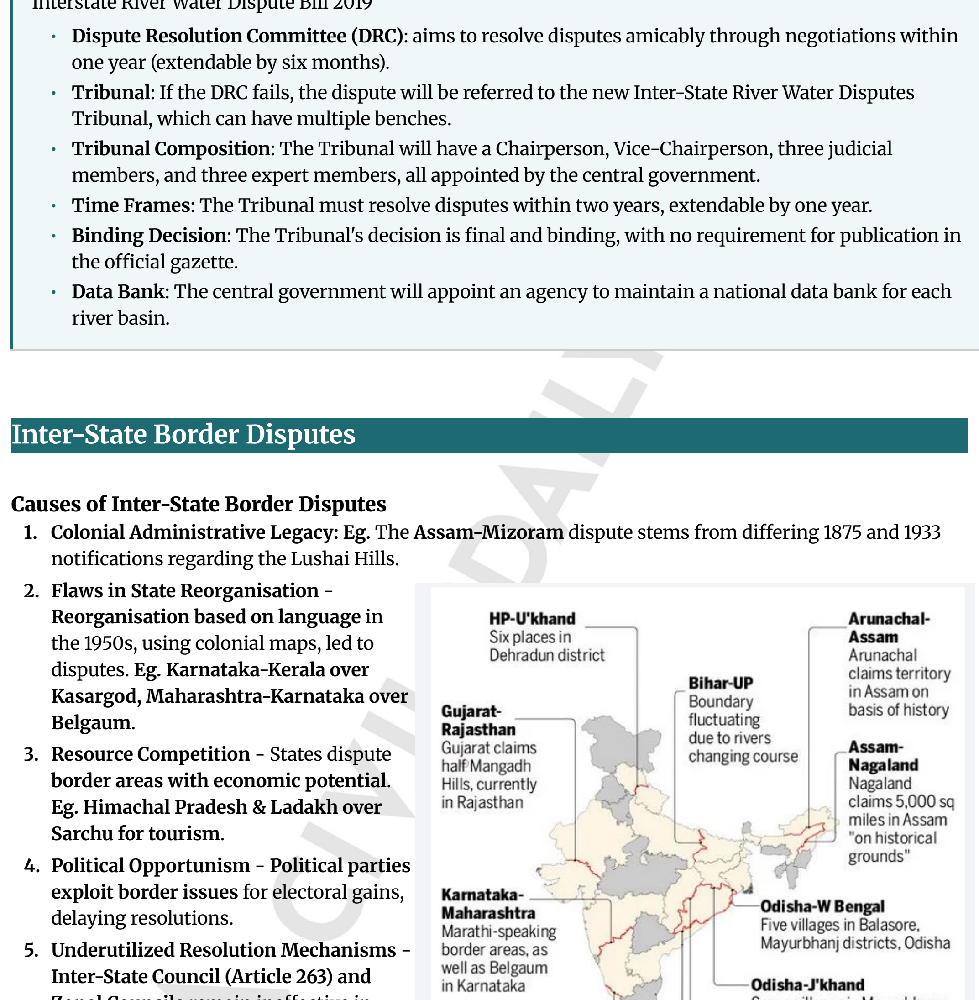

### [Smash Mains Source Page 99](../../pages/mains/mains_page_099.pdf)

### [Smash Mains Source Page 99](../../pages/mains/mains_page_099.pdf)

*Diagram Screenshot: [Map of Inter-State Border Disputes in India](../../diagrams/mains_diag_interstate_border_disputes_map_p099.png) · [Full Source Page 99](../../pages/mains/mains_page_099.pdf)*

Interstate River Water Dispute Bill 2019

- Dispute Resolution Committee (DRC): aims to resolve disputes amicably through negotiations within one year (extendable by six months).

- Tribunal: If the DRC fails, the dispute will be referred to the new Inter-State River Water Disputes Tribunal, which can have multiple benches.

- Tribunal Composition: The Tribunal will have a Chairperson, Vice-Chairperson, three judicial members, and three expert members, all appointed by the central government.

- Time Frames: The Tribunal must resolve disputes within two years, extendable by one year.

- Binding Decision: The Tribunal's decision is final and binding, with no requirement for publication in the official gazette.

- Data Bank: The central government will appoint an agency to maintain a national data bank for each river basin.

### Inter-State Border Disputes

### Causes of Inter-State Border Disputes

- **1.** Colonial Administrative Legacy: Eg. The Assam-Mizoram dispute stems from differing 1875 and 1933 notifications regarding the Lushai Hills.

- **2.** Flaws in State Reorganisation - Reorganisation based on language in the 1950s, using colonial maps, led to disputes. Eg. Karnataka-Kerala over Kasargod, Maharashtra-Karnataka over Belgaum.

- **3.** Resource Competition - States dispute border areas with economic potential. Eg. Himachal Pradesh & Ladakh over Sarchu for tourism.

- **4.** Political Opportunism - Political parties exploit border issues for electoral gains, delaying resolutions.

- **5.** Underutilized Resolution Mechanisms - Inter-State Council (Article 263) and Zonal Councils remain ineffective in resolving disputes.

- **6.** Judicial delays - Eg. Dispute between Odisha and Andhra Pradesh over Kotia cluster has been before the Supreme Court since 1968.

### Success case studies

- **1.** Assam-Arunachal "Namsai Declaration" - The declaration reduced the number of disputed villages from 123 to 86. The first border pillar was erected at Seijosa in February 2026
