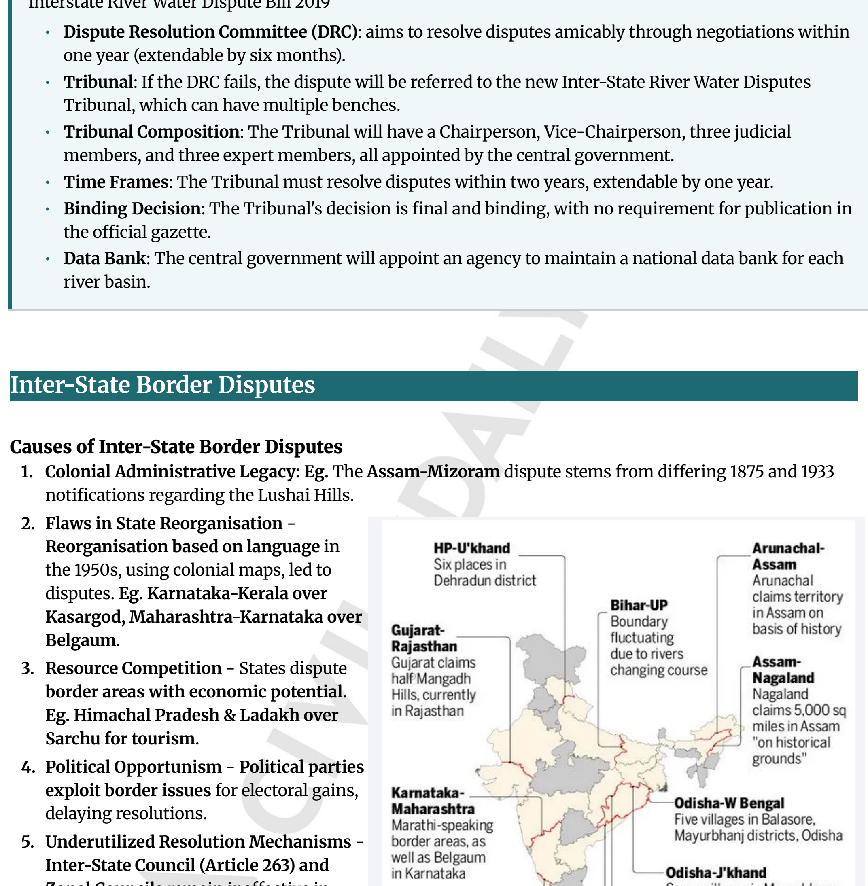

# Articles 1 to 4: Union of States, Formation of New States & Evolution of States/UTs — Smash Mains Notes (Ch03_Sub01_Union_Territory_Articles_1_to_4_Statehood)

---

### [Smash Mains Source Page 28](../../pages/mains/mains_page_028.pdf)

## Chapter 3: Citizenship

CITIZENSHIP In the Indian constitutional framework, Citizenship is governed by Articles 5–11 (Part II) and the Citizenship Act, 1955. It represents a person's legal status as a member of the sovereign state, entitling them to all civil and political rights.

### Acquisition and Renunciation

#### A. Acquisition (5 Ways)

- **1.** Birth:

  - **a.** Every person born in India on or after 26th January, 1950 but before 1st July, 1987.

  - **b.** Every person born in India between 1st July, 1987 and 2nd February, 2004 is a citizen of India given that either of their parents is a citizen of the country at the time of birth.

  - **c.** Person born in India on or after 3rd December, 2004 is a citizen if both parents are Indians or at least one parent is a citizen and the other is not an illegal migrant at the time of birth.

- **2.** Descent: Born outside India to an Indian parent. Must be registered at an Indian consulate within one year of birth.

- **3.** Registration:

  - **a.** Minor children of persons who are citizens of India.

  - **b.** A person of Indian origin who is a resident of any country outside undivided India.

  - **c.** A person of Indian origin who has been a resident of India for 7 years before applying for registration.

  - **d.** A person who is married to an Indian citizen and is ordinarily resident for 7 years before applying for registration.

- **4.** Naturalization: For foreigners resident for 12 years (1+11) who meet Third Schedule qualifications (language, character).

- **5.** Incorporation of Territory: If a new territory becomes part of India (Eg. Pondicherry, 1962), the Government notifies its citizens.

#### B. Renunciation and Loss (3 Ways)

- **1.** Renunciation: A voluntary act where a citizen of full age makes a declaration. Minor children also lose citizenship but can resume it at 18.

- **2.** Termination: Automatic loss if a citizen voluntarily acquires the citizenship of another country (Single Citizenship principle).

- **3.** Deprivation: Compulsory termination by the Government if citizenship was obtained by fraud, disloyalty to the Constitution, or during war with an enemy. CAA-NRC: Concepts and Evolution

- **1.** CAA (Citizenship Amendment Act, 2019): Amends the 1955 Act to grant expedited citizenship to persecuted minorities (Hindus, Sikhs, Buddhists, Jains, Parsis, Christians) from Afghanistan, Bangladesh, and Pakistan who entered India before 31 Dec 2014.

- **2.** NRC (National Register of Citizens): A register of all legal Indian citizens. Mandated by the 2003 Amendment to identify illegal immigrants.

- **3.** Historical Evolution:

---

### [Smash Mains Source Page 99](../../pages/mains/mains_page_099.pdf)

*Diagram Screenshot: [Map of Inter-State Border Disputes in India](../../diagrams/mains_diag_interstate_border_disputes_map_p099.png) · [Full Source Page 99](../../pages/mains/mains_page_099.pdf)*

Interstate River Water Dispute Bill 2019

- Dispute Resolution Committee (DRC): aims to resolve disputes amicably through negotiations within one year (extendable by six months).

- Tribunal: If the DRC fails, the dispute will be referred to the new Inter-State River Water Disputes Tribunal, which can have multiple benches.

- Tribunal Composition: The Tribunal will have a Chairperson, Vice-Chairperson, three judicial members, and three expert members, all appointed by the central government.

- Time Frames: The Tribunal must resolve disputes within two years, extendable by one year.

- Binding Decision: The Tribunal's decision is final and binding, with no requirement for publication in the official gazette.

- Data Bank: The central government will appoint an agency to maintain a national data bank for each river basin.

### Inter-State Border Disputes

### Causes of Inter-State Border Disputes

- **1.** Colonial Administrative Legacy: Eg. The Assam-Mizoram dispute stems from differing 1875 and 1933 notifications regarding the Lushai Hills.

- **2.** Flaws in State Reorganisation - Reorganisation based on language in the 1950s, using colonial maps, led to disputes. Eg. Karnataka-Kerala over Kasargod, Maharashtra-Karnataka over Belgaum.

- **3.** Resource Competition - States dispute border areas with economic potential. Eg. Himachal Pradesh & Ladakh over Sarchu for tourism.

- **4.** Political Opportunism - Political parties exploit border issues for electoral gains, delaying resolutions.

- **5.** Underutilized Resolution Mechanisms - Inter-State Council (Article 263) and Zonal Councils remain ineffective in resolving disputes.

- **6.** Judicial delays - Eg. Dispute between Odisha and Andhra Pradesh over Kotia cluster has been before the Supreme Court since 1968.

### Success case studies

- **1.** Assam-Arunachal "Namsai Declaration" - The declaration reduced the number of disputed villages from 123 to 86. The first border pillar was erected at Seijosa in February 2026

---

### [Smash Mains Source Page 100](../../pages/mains/mains_page_100.pdf)

- **2.** Assam-Meghalaya "Give-and-Take" Accord: They used a "Near Equal Share" principle, where each state received roughly half of the 36 sq km disputed land.

### Way Forward

- **1.** Strengthening Inter-State Coordination Mechanisms - Revitalize Inter-State Councils (Article 263) & Zonal Councils to effectively mediate and implement solutions.

- **2.** Replicate the "Assam-Meghalaya" model of regional committees for direct, time-bound negotiation instead of long court battles.

- **3.** Use high-resolution Lidar and Drone surveys to create a definitive, shared digital map of all state borders.

- **4.** People-Centric Approach: Use "local will" and "administrative convenience" as the primary metrics for transfer, rather than just historical maps.

- **5.** Create a dedicated "Federal Bench" in the SC to dispose of territorial suits (Article 131) within 24 months.

### 7th Schedule

Article 246 of the Constitution defines three lists in the Seventh Schedule: Union, State, and Concurrent. Need For Revision Arguments against

- **1.** Defined Roles Maintain Stability - The existing division of powers between the Union, State, and Concurrent Lists ensures clear governance roles

- **2.** Disrupts Federal Balance - Altering the 7th Schedule may weaken state autonomy, increasing central control.

- **3.** A strong central role has historically helped in national integration, particularly in security matters.

- **4.** Judicial and Bureaucratic Overload - A major revision would result in increased legal disputes and interpretational challenges for judiciary.

- **5.** Redundancy of Amendment: Article 248 (Residuary Powers) already allows the Centre to handle new issues without a full schedule overhaul.

- **6.** Achieving the "Two-Thirds Majority" and state ratification (Article 368) for such a revision is difficult

### Arguments For

- **1.** The 7th Schedule is based on the Government of India Act, 1935, and does not reflect modern governance challenges. Eg. "Cybersecurity" remains a residuary subject

- **2.** Empowering Local Governments - Introducing a Local Government List can strengthen grassroots governance and decentralization.

- **3.** Reducing "Unitary Tilt": Eg. Over the years, the Union List has grown from 97 to 100 entries, while the State List has shrunk from 66 to 61

- **4.** Administrative Efficiency: Shifting local subjects to states can reduce the Union's "administrative overstretch" and improve public service delivery.

- **5.** Judicial Workload Reduction: Vague entries lead to frequent "Special Leave Petitions" in the SC regarding the doctrine of Pith and Substance.

### Way Forward

- **1.** Transfer residuary subjects to the Concurrent List, ensuring states have a say in emerging governance areas, as suggested by the Sarkaria Commission.

- **2.** Institutionalize mandatory consultation with states before the Centre legislates on Concurrent List subjects
