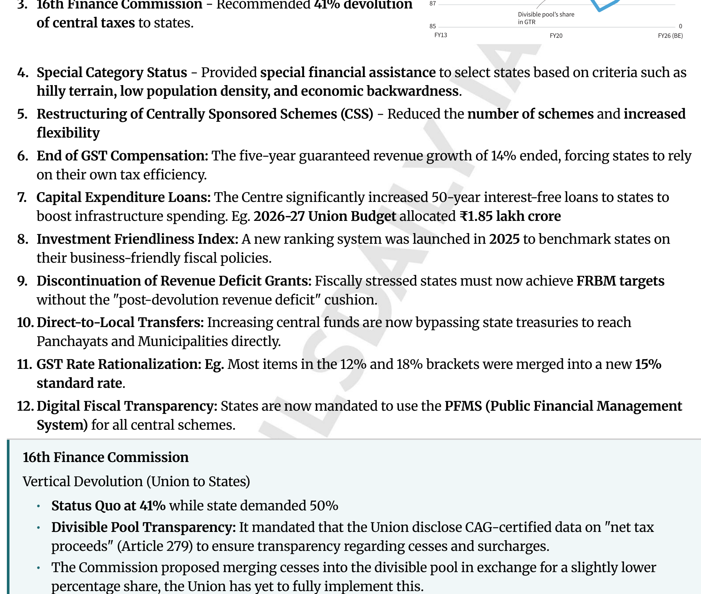

### [Smash Mains Source Page 92](../../pages/mains/mains_page_092.pdf)

### [Smash Mains Source Page 92](../../pages/mains/mains_page_092.pdf)

*Diagram Screenshot: [Fiscal Federalism: Divisible Pool's Share in Gross Tax Revenue (GTR)](../../diagrams/mains_diag_divisible_pool_gtr_p092.png) · [Full Source Page 92](../../pages/mains/mains_page_092.pdf)*

### Changes in the last few years

- **1.** Introduction of Goods and Services Tax (GST) - Replaced multiple indirect taxes with a unified tax system, creating a single national tax structure.

- **2.** 14th Finance Commission - Increased the state's share in central taxes from 32% to 42%, enhancing fiscal autonomy.

- **3.** 16th Finance Commission - Recommended 41% devolution of central taxes to states.

- **4.** Special Category Status - Provided special financial assistance to select states based on criteria such as hilly terrain, low population density, and economic backwardness.

- **5.** Restructuring of Centrally Sponsored Schemes (CSS) - Reduced the number of schemes and increased flexibility

- **6.** End of GST Compensation: The five-year guaranteed revenue growth of 14% ended, forcing states to rely on their own tax efficiency.

- **7.** Capital Expenditure Loans: The Centre significantly increased 50-year interest-free loans to states to boost infrastructure spending. Eg. 2026-27 Union Budget allocated ₹1.85 lakh crore

- **8.** Investment Friendliness Index: A new ranking system was launched in 2025 to benchmark states on their business-friendly fiscal policies.

- **9.** Discontinuation of Revenue Deficit Grants: Fiscally stressed states must now achieve FRBM targets without the "post-devolution revenue deficit" cushion.

- **10.** Direct-to-Local Transfers: Increasing central funds are now bypassing state treasuries to reach Panchayats and Municipalities directly.

- **11.** GST Rate Rationalization: Eg. Most items in the 12% and 18% brackets were merged into a new 15% standard rate.

- **12.** Digital Fiscal Transparency: States are now mandated to use the PFMS (Public Financial Management System) for all central schemes. 16th Finance Commission Vertical Devolution (Union to States)

- Status Quo at 41% while state demanded 50%

- Divisible Pool Transparency: It mandated that the Union disclose CAG-certified data on "net tax proceeds" (Article 279) to ensure transparency regarding cesses and surcharges.

- The Commission proposed merging cesses into the divisible pool in exchange for a slightly lower percentage share, the Union has yet to fully implement this. Horizontal Devolution

- Shift from "Equity" to "Efficiency": Introduced a 10% weight for GDP contribution and reduced the weight of "Income Distance." It favors industrialized and high-growth states. Other

- The Commission enforced a hard cap on State Fiscal Deficits at 3% of GSDP.

- It also mandated the end of off-budget borrowings, forcing states to bring all "hidden" liabilities onto their main budgets

- The discontinuation of Revenue Deficit Grants can hit Northeastern and Hill states the hardest.
