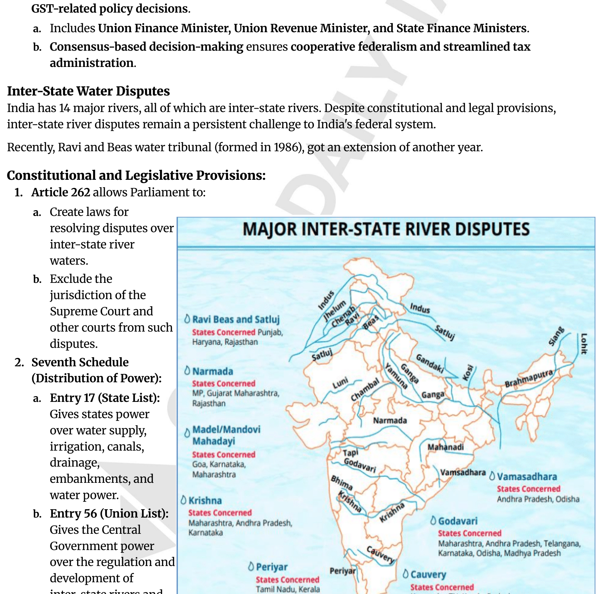

### [Smash Mains Source Page 97](../../pages/mains/mains_page_097.pdf)

### [Smash Mains Source Page 97](../../pages/mains/mains_page_097.pdf)

*Diagram Screenshot: [Map of Major Inter-State River Water Disputes in India (Article 262)](../../diagrams/mains_diag_interstate_river_disputes_map_p097.png) · [Full Source Page 97](../../pages/mains/mains_page_097.pdf)*

### Other Inter-State Institutions

- **1.** Zonal Councils - Statutory bodies under the States Reorganisation Act, 1956, promoting interstate cooperation and coordination.

  - **a.** Five Zonal Councils: Northern, Central, Eastern, Western, and Southern.

  - **b.** Chaired by the Union Home Minister, with state Chief Ministers as rotating Vice-Chairpersons.

  - **c.** North Eastern Council (NEC) - Established in 1972 under the North Eastern Council Act, 1972, focusing on regional development and coordination among North Eastern states.

- **2.** Inter-State River Water Dispute Tribunals - Constituted under the Inter-State River Water Disputes Act, 1956, to resolve water-sharing disputes between states.

- **3.** Goods and Services Tax (GST) Council - A constitutional body under Article 279A, responsible for GST-related policy decisions.

  - **a.** Includes Union Finance Minister, Union Revenue Minister, and State Finance Ministers.

  - **b.** Consensus-based decision-making ensures cooperative federalism and streamlined tax administration.

### Inter-State Water Disputes

India has 14 major rivers, all of which are inter-state rivers. Despite constitutional and legal provisions, inter-state river disputes remain a persistent challenge to India's federal system. Recently, Ravi and Beas water tribunal (formed in 1986), got an extension of another year.

### Constitutional and Legislative Provisions

- **1.** Article 262 allows Parliament to:

  - **a.** Create laws for resolving disputes over inter-state river waters.

  - **b.** Exclude the jurisdiction of the Supreme Court and other courts from such disputes.

- **2.** Seventh Schedule (Distribution of Power):

  - **a.** Entry 17 (State List): Gives states power over water supply, irrigation, canals, drainage, embankments, and water power.

  - **b.** Entry 56 (Union List): Gives the Central Government power over the regulation and development of inter-state rivers and river valleys.
