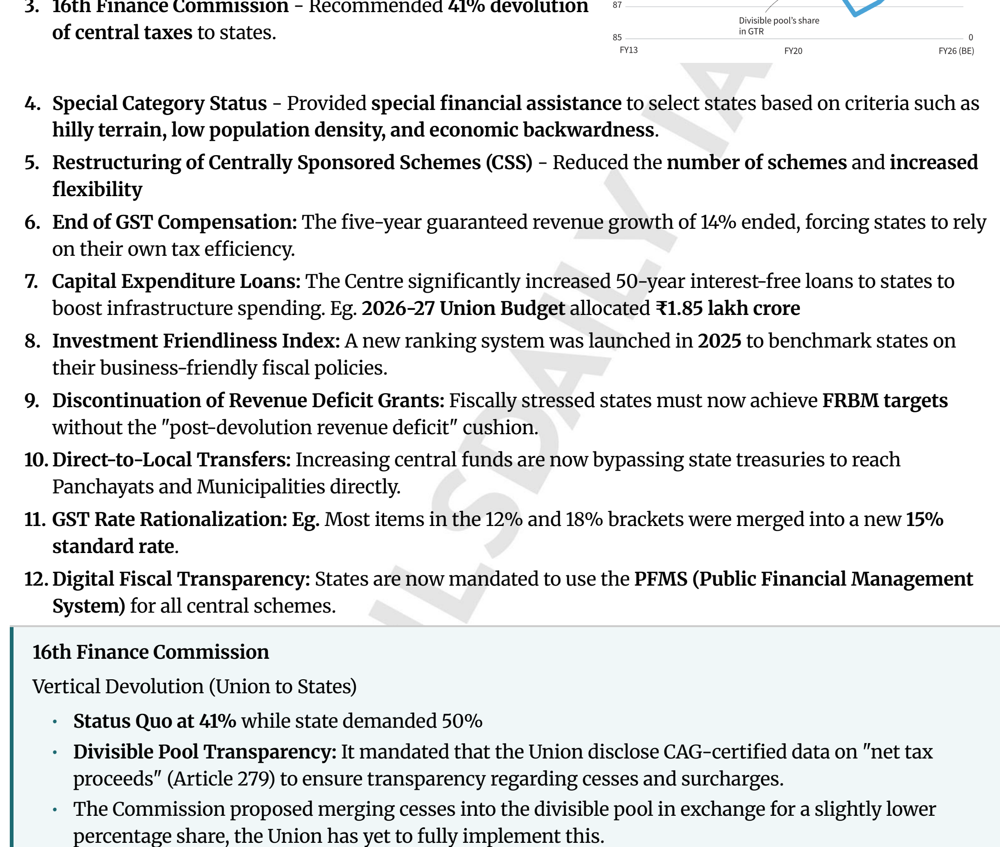
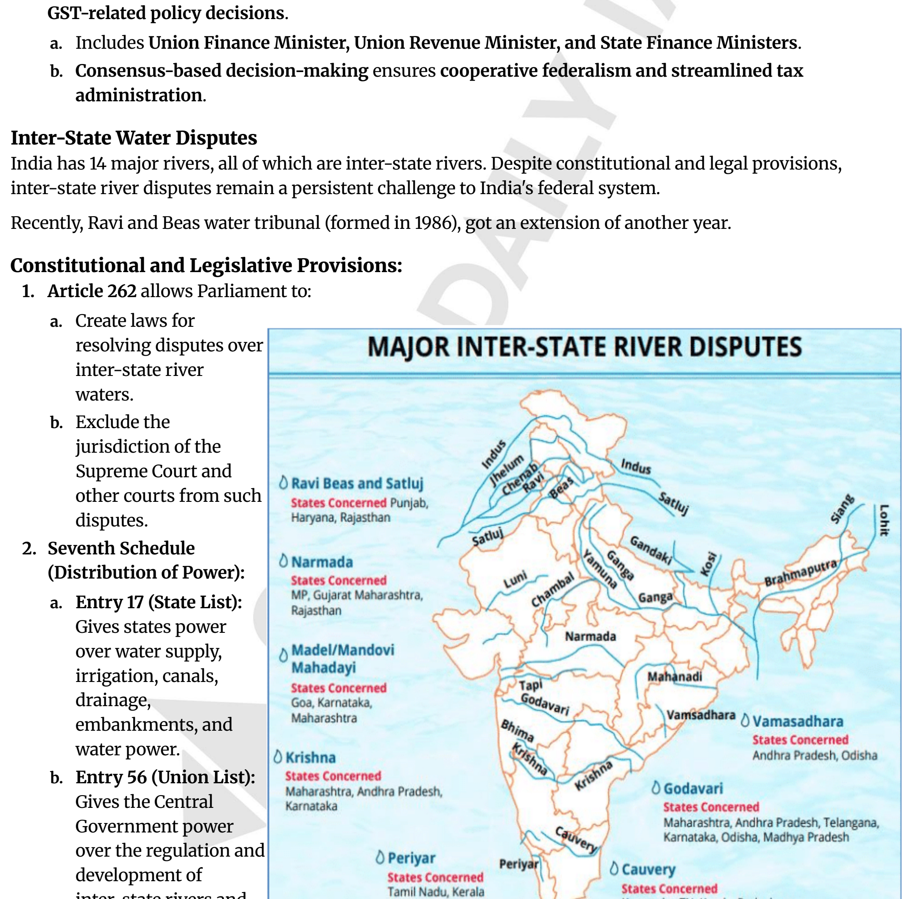
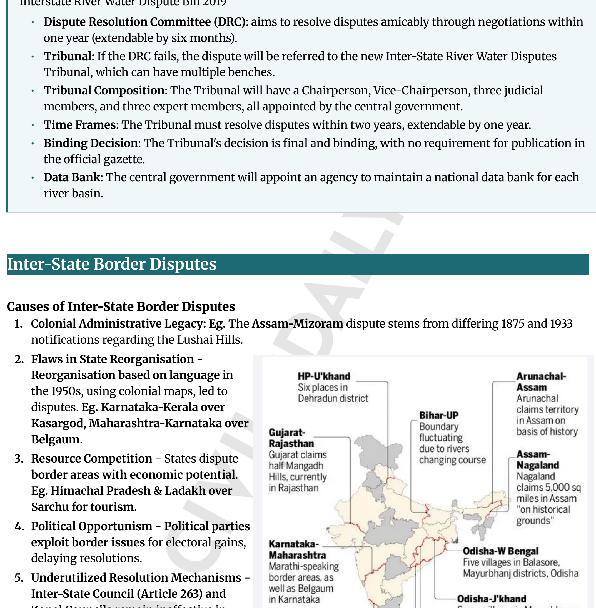

### [Smash Mains Source Page 91](../pages/mains/mains_page_091.pdf)

Aspect Description
- Competition fosters economic efficiency, attracting more investment and
streamlining administrative processes
Examples Smart Cities Mission: Encourages cities to compete on urban development.
Swachh Bharat Rankings: Cities compete in sanitation performance.
Ease of Living Index: Ranks cities based on quality of life indicators.
Fiscal Federalism
It entails the division of responsibilities and resources between the central and state governments, with
the Finance Commission playing a key role in recommending tax proceeds distribution.
Constitutional Provisions
Seventh Schedule (Article 246)
1. Union List: Income Tax, Customs, and Excise on tobacco/petroleum
2. State List: Land Revenue, Agricultural Income Tax, Excise on alcoholic liquors, and Professional Tax.
3. Concurrent List: After the 101st Amendment (2016), both Centre and States have concurrent powers to
levy Goods and Services Tax (GST) under Article 246A.
Revenue Sharing Mechanisms
1. Article 268: Duties levied by the Union but collected and appropriated by the States (Eg. Stamp duties).
2. Article 269: Taxes levied and collected by the Union but assigned to the States (Eg. tax on inter-state
trade).
3. Article 269A: Specifically governs the levy and collection of IGST (Integrated GST) on inter-state trade,
which is shared between the Union and States.
4. Article 270: The "Divisible Pool." Most taxes levied by the Union are distributed between the Union and
States based on Finance Commission recommendations.
5. Article 271: Power of the Union to levy surcharges and cesses for its own purposes. Notably, these are
not shared with the States.
Institutional Framework
1. Article 280 (FC): A quasi-judicial body constituted by the President every five years to recommend the
vertical and horizontal distribution of net tax proceeds.
2. Article 279A (GST Council) highest decision-making body for GST rates, exemptions, and thresholds.
Grants-in-Aid
1. Article 275 (Statutory Grants): Mandatory grants paid out of the Consolidated Fund of India to States in
need
2. Article 282 (Discretionary Grants): Allows Union and States to make grants for any "public purpose,"
even if the subject is not within their respective legislative lists
Borrowing Powers
1. Article 292: Governs the borrowing powers of the Central Government.
2. Article 293: Governs the borrowing powers of the State Governments. State must obtain the Centre's
consent to raise a new loan if it has any outstanding liabilities to the Union.
93

#### Structured Tables on Page 91

| Aspect | Description |
| --- | --- |
|  | • Competition fosters economic efficiency, attracting more investment and streamlining administrative processes |
| Examples | Smart Cities Mission: Encourages cities to compete on urban development. Swachh Bharat Rankings: Cities compete in sanitation performance. Ease of Living Index: Ranks cities based on quality of life indicators. |

---

### [Smash Mains Source Page 92](../pages/mains/mains_page_092.pdf)

*Diagram Screenshot: [Fiscal Federalism: Divisible Pool's Share in Gross Tax Revenue (GTR)](../diagrams/mains_diag_divisible_pool_gtr_p092.png) | [Full Source Page 92](../pages/mains/mains_page_092.pdf)*

Changes in the last few years
1. Introduction of Goods and Services Tax (GST) - Replaced
multiple indirect taxes with a unified tax system, creating a
single national tax structure.
2. 14th Finance Commission - Increased the state's share in
central taxes from 32% to 42%, enhancing fiscal autonomy.
3. 16th Finance Commission - Recommended 41% devolution
of central taxes to states.
4. Special Category Status - Provided special financial assistance to select states based on criteria such as
hilly terrain, low population density, and economic backwardness.
5. Restructuring of Centrally Sponsored Schemes (CSS) - Reduced the number of schemes and increased
flexibility
6. End of GST Compensation: The five-year guaranteed revenue growth of 14% ended, forcing states to rely
on their own tax efficiency.
7. Capital Expenditure Loans: The Centre significantly increased 50-year interest-free loans to states to
boost infrastructure spending. Eg. 2026-27 Union Budget allocated ₹1.85 lakh crore
8. Investment Friendliness Index: A new ranking system was launched in 2025 to benchmark states on
their business-friendly fiscal policies.
9. Discontinuation of Revenue Deficit Grants: Fiscally stressed states must now achieve FRBM targets
without the "post-devolution revenue deficit" cushion.
10. Direct-to-Local Transfers: Increasing central funds are now bypassing state treasuries to reach
Panchayats and Municipalities directly.
11. GST Rate Rationalization: Eg. Most items in the 12% and 18% brackets were merged into a new 15%
standard rate.
12. Digital Fiscal Transparency: States are now mandated to use the PFMS (Public Financial Management
System) for all central schemes.
16th Finance Commission
Vertical Devolution (Union to States)
- Status Quo at 41% while state demanded 50%
- Divisible Pool Transparency: It mandated that the Union disclose CAG-certified data on "net tax
proceeds" (Article 279) to ensure transparency regarding cesses and surcharges.
- The Commission proposed merging cesses into the divisible pool in exchange for a slightly lower
percentage share, the Union has yet to fully implement this.
Horizontal Devolution
- Shift from "Equity" to "Efficiency": Introduced a 10% weight for GDP contribution and reduced the
weight of "Income Distance." It favors industrialized and high-growth states.
Other
- The Commission enforced a hard cap on State Fiscal Deficits at 3% of GSDP.
- It also mandated the end of off-budget borrowings, forcing states to bring all "hidden" liabilities onto
their main budgets
- The discontinuation of Revenue Deficit Grants can hit Northeastern and Hill states the hardest.
94

---

### [Smash Mains Source Page 93](../pages/mains/mains_page_093.pdf)

Issues
1. North-South Equity Gap: Southern states feel "penalized" for successful population control under the
2011 Census-based devolution formulas.
2. Uttar Pradesh receives more than the combined share of the five southern states - Karnataka, Tamil
Nadu, Telangana, Andhra Pradesh, and Kerala.
3. Rise of Non-Devolvable Cesses - Centre's non-shareable revenue grew from 12.8% (2015-20) to 18.5%
(2020-24).
4. Vertical Imbalance - States' effective share shrank from 35% (2015-20) to ~31% (2020-24) of Centre's
gross tax revenue.
5. Increase in Conditional Transfers - Grants are linked to Union-defined conditions, limiting state policy
flexibility. Eg. Jal Jeevan mission grants based on target coverage
6. Borrowing Restrictions - Centre enforces a 3% SDP borrowing cap, limiting states' fiscal flexibility
7. Centrally Sponsored Scheme (CSS) Burden: States must provide 40% matching funds for schemes
designed entirely by the Central Government.
8. Erosion of Tax Autonomy: Post-GST, states have lost the power to vary tax rates on most goods to
address local emergencies.
9. Discretionary Grant Delays: Central grants under Article 282 are often seen as politically motivated or
delayed for opposition-ruled states.
10. Inter-State Council Inactivity: The lack of regular meetings of the Inter-State Council (Article 263)
prevents resolution of fiscal disputes through dialogue.
Scholar Views
- Upendra Baxi - Warned against "executive federalism", where Centre dictates state policy through
fiscal and administrative tools rather than genuine consultation.
- Nidhi Sharma ("Quasi-federal constitution?) - posits that India's avoidance of explicit "federal"
vocabulary (preferring "Union of States") has allowed the Union and judiciary to reinforce
centralization over time.
- Louis Tillin in "An Incomplete Bargain" (Asian Survey, 2025) - argues that state reorganizations have
paradoxically reinforced central dominance while masking persistent federal tensions.
Major SC Judgments on Federalism
- State of WB v. UoI (1963): first case to define India's federal character, ruling that the Constitution is not
"truly federal" but has a strong central bias for national integrity.
- S.R. Bommai v. Union of India (1994): it declared federalism a "Basic Structure" of the Constitution and
made the dismissal of state governments (Article 356) justiciable.
- Kuldip Nayar (2006): Upheld the removal of the "domicile requirement" for RS members, confirming
that India maintains a "unitary spirit" in legislative representation
- Madras Bar Association: Union cannot bypass the "federal balance" by creating parallel judicial bodies
that strip High Courts of their powers.
- NCT of Delhi: In a federal democracy, the elected government (Delhi) must have control over "services,"
emphasizing that "real" power must lie with the people's representatives.
- State of Punjab v. Governor: Critiqued Governors sitting on state bills indefinitely, ruling that the
Governor cannot "thwart the normal course of lawmaking" in a federal setup.
95

---

### [Smash Mains Source Page 94](../pages/mains/mains_page_094.pdf)

Way Forward for federalism
1. Sarkaria & Punchhi Commissions:
a. Governors should be eminent persons from outside the state, not active politicians from the ruling
central party.
b. Implement a fixed 5-year tenure for Governors, with removal only through a process similar to
impeachment rather than "at the pleasure of the President."
2. Inter-State Council (Article 263) Reforms:
a. Mandatory Meetings at least three times a year (as recommended by NCRWC).
b. Pre-Legislative Consultation with states through the Council before introducing any bill in
Parliament concerning "Concurrent List" subjects.
3. Strengthen the role of Rajya Sabha similar to German Bundesrat, where state governments have a
direct and weighted vote on federal laws affecting regional administration.
4. Move residuary powers of legislation from the Union List to the Concurrent List to give states more
flexibility in emerging areas like AI and Digital Governance.
5. Asymmetric Delimitation: use a "weighted formula" that rewards states for social milestones like health
and education, instead of relying solely on population
6. Fiscal Federalism Roadmap
a. Cess and Surcharge Reform: cap at 10% of Gross Tax Revenue to ensure the "divisible pool" for
states is not artificially shrunk.
b. Flexible CSS: Allow states to customize 25–30% of the parameters of Centrally Sponsored Schemes
(CSS) to suit local geographical and ecological needs
Office of Governor
"The Governor is a constitutional head and the custodian of the Constitution within the state." - Ambedkar
"He serves as a bridge, ensuring that the dual system of governance works in harmony within the
constitutional framework." - S. Radhakrishnan
Powers and Functions of the Governor
The Governor's role is similar to the President of India, but without diplomatic, military, or emergency
powers.
Executive Powers
1. Appoints the Chief Minister(Article 164), Ministers, Advocate General(Article 165), State Election
Commissioner(Article 243K), and Public Service Commission members(Article 316).
2. Oversees state executive actions and serves as Chancellor of state universities.
3. Can recommend President's Rule(Article 356) and act as the Centre's representative during
emergencies.
Legislative Powers
1. Summons, prorogues, and addresses the legislature(Article 174).
2. Appoints presiding officers and nominated members(Article 171).
3. Can exercise veto over bills by assenting, withholding, returning, or reserving them for the
President(Article 200).
Financial Powers
1. Supervises the state budget and approves money bills(Article 199).
2. Can make advances from the Contingency Fund(Article 267).
96

---

### [Smash Mains Source Page 95](../pages/mains/mains_page_095.pdf)

3. Establishes a State Finance Commission every five years(Article 243I) to assess panchayats and
municipalities' financial health.
Judicial Powers
1. Grants pardons, reprieves, and commutations (Article 161) for state offenses.
2. Consulted on state high court judge appointments(Article 217).
3. Oversees appointments, postings, and promotions of district and judicial officers(Article 233 and 234)
in consultation with the High Court and State Public Service Commission.
Case Studies
- Tamil Nadu: SC expressed serious concern over Governor's decision to withhold assent to 10 Bills
passed by the state legislature, some pending since 2020. Three days later, all 10 Bills were returned for
reconsideration, but no reasons were provided for the decision.
- Kerala: Governor refused to sign an ordinance to transfer the powers of Chancellor of state
universities from the Governor to the Chief Minister.
Issues pertaining to the office of governor
1. Appointment retired politicians,former Bureaucrats and party loyalists, using the post as a political
reward.
2. Acting as Centre's Agent - Governors promote ruling party interests. Often seen as a retirement
package for politicians.
3. Indefinite Delay of Bills: Governors frequently use "pocket vetoes" to stall state legislation. Eg. Tamil
Nadu NEET Bill controversy
4. Misuse of Discretionary Powers: Discretion in government formation during hung assemblies often
favors the party ruling at the Centre. Eg. 2019 Maharashtra case
5. Governors are removed when central governments change, as there is no impeachment provision. Eg.
in 1989, the V.P Singh government asked all Governors to resign.
6. Article 356 Misuse - Governors recommend President's Rule prematurely, often targeting opposition
states.
7. Politicization of Public Addresses: Eg. 2025 Kerala Assembly session saw a constitutional standoff
when the Governor skipped key policy paragraphs.
SC on the position of Governor
1. Shamsher Singh vs. State of Punjab (1974) - Governor must act on the advice of the Council of
Ministers, except where the Constitution states otherwise.
2. S.R. Bommai vs. Union of India (1994) - President's Rule is subject to judicial review, and CM must be
allowed a floor test.
3. Rameshwar Prasad vs. UoI (2006) - Governor's actions are open to judicial review. Article 361(1) does
not grant immunity in cases of mala fide or unconstitutional acts.
4. B.P. Singhal vs. Union of India (2010) - President cannot remove Governors arbitrarily; change in
central government is not a valid reason for dismissal.
5. Nabam Rebia (2016) - Governor must follow the Council of Ministers' advice; cannot disqualify the
Speaker or summon Assembly unilaterally.
6. State of TN v. Governor of TN - Introduced the "Deemed Assent" doctrine (invoking Article 142). It
established that once a bill is "re-passed" by the Assembly, the Governor must sign it.
7. State of Kerala v. Governor - The Court clarified that while it cannot fix a rigid "calendar deadline" for
every bill, prolonged and unexplained inaction is justiciable.
97

---

### [Smash Mains Source Page 96](../pages/mains/mains_page_096.pdf)

Recommendations of Various Commissions
1. Sarkaria Commission (1988):
2. Governors should be appointed after consulting the CM of State, should be eminent and from outside
the State, and not have recent intense political links.
3. Governors should be removed only for issues of morality, dignity, or constitutional propriety, with the
State Government consulted.
4. Article 200: When Bill is reserved by the Governor, the Centre should decide within 6 months.
5. Article 356: Use sparingly and as a last resort
6. NCRWC (2002): Governors should be appointed by a committee including the Prime Minister, Home
Minister, Lok Sabha Speaker, and the Chief Minister of State.
7. Punchhi Commission (2010):
8. Term and Removal: Governors should have a fixed 5-year term and can be removed by impeachment
by the State Legislature
9. Chancellorship: Governors should not be university chancellors.
Inter-State Council
The Inter-State Council (ISC) is a Constitutionally mandated body established under Article 263 of the
Constitution of India that facilitates coordination and cooperation between the central government and the
state governments. It was set up on the recommendation of the Sarkaria Commission.
Mandate:
1. To enquire and advise upon inter-state disputes.
2. Investigating & discussing subjects in which states or the Centre and the states have a common interest.
3. Recommending on any matter for better coordination of policy & action.
4. Its decisions are advisory and not binding.
Issues
1. Infrequent Meetings - ISC has only met 11 times since 1990 (last meeting in 2016)
2. Limited Agenda Scope - lacks focus on emerging inter-state disputes and broader governance issues.
3. Non-Binding Recommendations
4. Lack of Functional Autonomy - The absence of an independent professional secretariat limits ISC's
operational efficiency
Way Forward
1. Constitutional Status - Amend Article 263 to make ISC a permanent constitutional body, ensuring
regular meetings and enforceable decisions.
2. Enhance Technical Expertise - Include non-partisan experts and specialists to strengthen policy
research and dispute resolution (as suggested by Sarkaria & Punchhi Commissions).
3. Establish a Dedicated Secretariat with officials from both the Centre and states for efficient
coordination. Eg. Canada's Intergovernmental Conference Secretariat.
4. Expand ISC's Scope - Empower ISC to review and approve Finance Commission terms of reference,
ensuring greater state involvement in fiscal matters (NCRWC).
5. Strengthen Dispute Resolution Role - Equip ISC with legal and mediation powers to resolve
Centre-State and inter-state conflicts, particularly in water sharing, taxation, and administrative
jurisdiction.
98

---

### [Smash Mains Source Page 97](../pages/mains/mains_page_097.pdf)

*Diagram Screenshot: [Map of Major Inter-State River Water Disputes in India (Article 262)](../diagrams/mains_diag_interstate_river_disputes_map_p097.png) | [Full Source Page 97](../pages/mains/mains_page_097.pdf)*

Other Inter-State Institutions
1. Zonal Councils - Statutory bodies under the States Reorganisation Act, 1956, promoting interstate
cooperation and coordination.
a. Five Zonal Councils: Northern, Central, Eastern, Western, and Southern.
b. Chaired by the Union Home Minister, with state Chief Ministers as rotating Vice-Chairpersons.
c. North Eastern Council (NEC) - Established in 1972 under the North Eastern Council Act, 1972,
focusing on regional development and coordination among North Eastern states.
2. Inter-State River Water Dispute Tribunals - Constituted under the Inter-State River Water Disputes
Act, 1956, to resolve water-sharing disputes between states.
3. Goods and Services Tax (GST) Council - A constitutional body under Article 279A, responsible for
GST-related policy decisions.
a. Includes Union Finance Minister, Union Revenue Minister, and State Finance Ministers.
b. Consensus-based decision-making ensures cooperative federalism and streamlined tax
administration.
Inter-State Water Disputes
India has 14 major rivers, all of which are inter-state rivers. Despite constitutional and legal provisions,
inter-state river disputes remain a persistent challenge to India's federal system.
Recently, Ravi and Beas water tribunal (formed in 1986), got an extension of another year.
Constitutional and Legislative Provisions:
1. Article 262 allows Parliament to:
a. Create laws for
resolving disputes over
inter-state river
waters.
b. Exclude the
jurisdiction of the
Supreme Court and
other courts from such
disputes.
2. Seventh Schedule
(Distribution of Power):
a. Entry 17 (State List):
Gives states power
over water supply,
irrigation, canals,
drainage,
embankments, and
water power.
b. Entry 56 (Union List):
Gives the Central
Government power
over the regulation and
development of
inter-state rivers and
river valleys.
99

---

### [Smash Mains Source Page 98](../pages/mains/mains_page_098.pdf)

3. Inter-State River Water Disputes (ISRWD) Act, 1956: it allows a state to request the Centre to refer a
dispute to a Tribunal. The decision of the Tribunal is final and binding. Once published in the Official
Gazette, it has the same force as an order of the Supreme Court.
4. River Boards Act, 1956: Provides for the establishment of boards for the regulation and development of
inter-state rivers. However, this Act has remained largely a "dead letter" as no such board has been
successfully empowered.
5. The ISRWD (Amendment) Bill: Aimed at streamlining the process by replacing ad-hoc tribunals with a
single, permanent "Inter-State River Water Disputes Tribunal" and introducing a Dispute Resolution
Committee (DRC) for preliminary mediation.
Reasons
1. Pre-independence agreements were made without considering future state boundaries. Eg. Mysore
Kingdom-Madras Presidency agreements led to the Cauvery dispute.
2. Non-Basin State Boundaries: State reorganization was based on language, not geography.
3. Vague "Equitable Apportionment": There is no fixed mathematical formula for "fair share," leaving
water allocation to subjective and lengthy tribunal interpretations.
4. Unilateral Dam Construction: Eg. Karnataka's Mekedatu project proposal opposed by Tamil Nadu over
fears of reduced downstream flow.
5. Supreme Court Intervention (Article 136): Despite the bar under Article 262, states frequently use
"Special Leave Petitions" to appeal tribunal awards
6. Seventh Schedule conflict: Centre regulates inter-state river disputes, but states control water supply
& irrigation, leading to overlapping authority.
7. Article 262 empowers Parliament to form Water Disputes Tribunals, but no time limit leads to
prolonged conflicts. Eg. Cauvery Water Disputes Tribunal took 17 years to decide.
8. Overuse, pollution, and climate change have intensified disputes as states compete for diminishing
resources.
9. Agricultural & industrial demand: Rising irrigation & industry needs exceed available resources,
leading to conflicts. Eg. Narmada dispute among Gujarat, MP, Maharashtra.
10. Inconsistent data on river flow, usage, and availability prevents fair water-sharing decisions, leading to
implementation challenges.
11. Regional parties use disputes as electoral issues, reducing efforts for a permanent resolution.
12. Lack of political will to implement tribunal and Supreme Court rulings, as governments fear voter
backlash.
Way Forward
1. Leverage inter-state council to develop consensus among states
2. Set time limits for tribunals to deliver awards to prevent prolonged disputes.
3. Restrict appeals by amending laws to limit the scope of Article 136 (Special Leave Petition).
4. Include multidisciplinary experts in hydrology, environmental science, and engineering for informed
decision-making.
5. Develop a centralized hydrological database for transparent and reliable water availability data.
6. Utilize remote sensing and GIS technology for accurate monitoring of river flows.
7. Establish regular review mechanisms to assess the implementation of tribunal awards.
100

---

### [Smash Mains Source Page 99](../pages/mains/mains_page_099.pdf)

*Diagram Screenshot: [Map of Inter-State Border Disputes in India](../diagrams/mains_diag_interstate_border_disputes_map_p099.png) | [Full Source Page 99](../pages/mains/mains_page_099.pdf)*

Interstate River Water Dispute Bill 2019
- Dispute Resolution Committee (DRC): aims to resolve disputes amicably through negotiations within
one year (extendable by six months).
- Tribunal: If the DRC fails, the dispute will be referred to the new Inter-State River Water Disputes
Tribunal, which can have multiple benches.
- Tribunal Composition: The Tribunal will have a Chairperson, Vice-Chairperson, three judicial
members, and three expert members, all appointed by the central government.
- Time Frames: The Tribunal must resolve disputes within two years, extendable by one year.
- Binding Decision: The Tribunal's decision is final and binding, with no requirement for publication in
the official gazette.
- Data Bank: The central government will appoint an agency to maintain a national data bank for each
river basin.
Inter-State Border Disputes
Causes of Inter-State Border Disputes
1. Colonial Administrative Legacy: Eg. The Assam-Mizoram dispute stems from differing 1875 and 1933
notifications regarding the Lushai Hills.
2. Flaws in State Reorganisation -
Reorganisation based on language in
the 1950s, using colonial maps, led to
disputes. Eg. Karnataka-Kerala over
Kasargod, Maharashtra-Karnataka over
Belgaum.
3. Resource Competition - States dispute
border areas with economic potential.
Eg. Himachal Pradesh & Ladakh over
Sarchu for tourism.
4. Political Opportunism - Political parties
exploit border issues for electoral gains,
delaying resolutions.
5. Underutilized Resolution Mechanisms -
Inter-State Council (Article 263) and
Zonal Councils remain ineffective in
resolving disputes.
6. Judicial delays - Eg. Dispute between
Odisha and Andhra Pradesh over Kotia
cluster has been before the Supreme
Court since 1968.
Success case studies
1. Assam-Arunachal "Namsai Declaration" - The declaration reduced the number of disputed villages
from 123 to 86. The first border pillar was erected at Seijosa in February 2026
101

---

### [Smash Mains Source Page 100](../pages/mains/mains_page_100.pdf)

2. Assam-Meghalaya "Give-and-Take" Accord: They used a "Near Equal Share" principle, where each state
received roughly half of the 36 sq km disputed land.
Way Forward
1. Strengthening Inter-State Coordination Mechanisms - Revitalize Inter-State Councils (Article 263) &
Zonal Councils to effectively mediate and implement solutions.
2. Replicate the "Assam-Meghalaya" model of regional committees for direct, time-bound negotiation
instead of long court battles.
3. Use high-resolution Lidar and Drone surveys to create a definitive, shared digital map of all state
borders.
4. People-Centric Approach: Use "local will" and "administrative convenience" as the primary metrics for
transfer, rather than just historical maps.
5. Create a dedicated "Federal Bench" in the SC to dispose of territorial suits (Article 131) within 24 months.
7th Schedule
Article 246 of the Constitution defines three lists in the Seventh Schedule: Union, State, and Concurrent.
Need For Revision
Arguments against
1. Defined Roles Maintain Stability - The existing division of powers between the Union, State, and
Concurrent Lists ensures clear governance roles
2. Disrupts Federal Balance - Altering the 7th Schedule may weaken state autonomy, increasing central
control.
3. A strong central role has historically helped in national integration, particularly in security matters.
4. Judicial and Bureaucratic Overload - A major revision would result in increased legal disputes and
interpretational challenges for judiciary.
5. Redundancy of Amendment: Article 248 (Residuary Powers) already allows the Centre to handle new
issues without a full schedule overhaul.
6. Achieving the "Two-Thirds Majority" and state ratification (Article 368) for such a revision is difficult
Arguments For
1. The 7th Schedule is based on the Government of India Act, 1935, and does not reflect modern
governance challenges. Eg. "Cybersecurity" remains a residuary subject
2. Empowering Local Governments - Introducing a Local Government List can strengthen grassroots
governance and decentralization.
3. Reducing "Unitary Tilt": Eg. Over the years, the Union List has grown from 97 to 100 entries, while the
State List has shrunk from 66 to 61
4. Administrative Efficiency: Shifting local subjects to states can reduce the Union's "administrative
overstretch" and improve public service delivery.
5. Judicial Workload Reduction: Vague entries lead to frequent "Special Leave Petitions" in the SC
regarding the doctrine of Pith and Substance.
Way Forward
1. Transfer residuary subjects to the Concurrent List, ensuring states have a say in emerging governance
areas, as suggested by the Sarkaria Commission.
2. Institutionalize mandatory consultation with states before the Centre legislates on Concurrent List
subjects
102

---

### [Smash Mains Source Page 101](../pages/mains/mains_page_101.pdf)

3. Introduce a Local Government List - Establish a new list for local bodies, ensuring effective
decentralization.
"Federalism is not a monolith; it is a dialogue between self-rule and shared rule." Both Union & States are
creatures of the Constitution → must act in synergy.
President's Rule
President's Rule ensures federal stability during crises and is governed by Articles 355 to 357 (Part XVIII)
and Article 365 (Part XIX) of the Indian Constitution.
1. Article 355 - Mandates the Union to protect states from external aggression and internal disturbances.
2. Article 356 - Allows the President to assume state government functions if the constitutional
machinery fails.
3. Article 357 - Grants the President power to legislate for a state via ordinance when President's Rule is
in effect.
4. Article 365 - Specifies the consequences for a state failing to comply with Union directives, potentially
leading to President's Rule.
Impact of President's Rule
1. State Executive:
2. Assumption of State Government Functions
3. Dismissal of Council of Ministers
4. The President can sanction expenditure from the state consolidated fund when the Lok Sabha is not in
session, pending Parliament's approval.
5. Ordinance Promulgation by the President.
6. State Legislature:
7. The President can declare that the powers of the state legislature are to be exercised by the Parliament.
8. Suspension or Dissolution of State Legislative Assembly
9. Parliament's Authority Over State Matters: passing state bills and budgets.
10. Laws enacted by Parliament continue to remain effective even after the imposition of President's Rule.
11. Judiciary: The Constitutional position, status, powers, and functions of the State High Court remain
unchanged
12. Fundamental Rights of Citizens: The fundamental Rights of citizens are not impacted upon use of
Article 356.
Issues pertaining to Article 356
Dr. B.R. Ambedkar hoped that the drastic power under Article 356 would remain a Dead Letter and only be a
last resort.
1. Arbitrary Dismissal of Governments: Eg. invoked over 100 times since independence
2. Political Misuse - Often invoked to remove opposition-led governments. Eg. President rule in Kerala in
1959.
3. Prolonged Use of President's Rule: Eg. over 4 years in Jammu and Kashmir
4. The term "failure of constitutional machinery" lacks a precise legal definition, allowing for subjective
central interpretation.
5. Partisan Role of Governors: Eg. Sarkaria Commission noted that 90% of Article 356 cases were based
on purely political gubernatorial recommendations.
103

---

### [Smash Mains Source Page 102](../pages/mains/mains_page_102.pdf)

6. Bypassing the Floor Test: Eg. In the S.R. Bommai (1994) case, the CM was dismissed despite offering to
prove his majority.
7. Negative agenda: Invoked during hung assemblies to prevent certain coalitions from forming, rather
than exploring alternative governments.
8. Delayed Judicial Restitutions: Eg. It took five years for the SC to deliver the Bommai judgment, long
after the term ended.
Key Recommendations:
1. Supreme Court Guidelines: In the S.R. Bommai case (1994)
a. Judicial Review: Proclamations of President's Rule are subject to judicial review.
b. Power under Article 356 is exceptional and should be used only in special situations.
c. The President's satisfaction must be based on relevant material. The court can assess the relevance
but not the correctness or adequacy of the material.
d. Floor Test: The loss of confidence in the Legislative Assembly should be decided on the floor of the
House.
e. Assembly Suspension: The State Legislative Assembly can only be dissolved after parliamentary
approval of the proclamation. Until then, it can be suspended.
f. Restoration Power: If a proclamation is found unconstitutional, the court can restore the dismissed
State Government and revive the State Legislative Assembly.
2. Sarkaria Commission Recommendations (1983)
3. Reasons for Proclamation: The President's proclamation of President's Rule should state reasons for the
decision.
4. Punchhi Commission Recommendations
5. Amendments for Bommai Guidelines: Amend the article to incorporate guidelines from the SC in the
Bommai case.
6. Localized Emergency: Introduce a 'Localized Emergency' to address issues at town/district levels
without dissolving the state legislature, fulfilling the Union's duty to protect states as per Article 355.
Financial Emergency (Article 360)
It is a constitutional provision in India that allows the Union government to take control of the financial
affairs of the State and the country if the economic stability or credit of India is threatened.
Proclamation
1. The President can declare a Financial Emergency if he is satisfied that a situation has arisen whereby
the financial stability or credit of India (or any part of its territory) is threatened.
2. The proclamation must be approved by both Houses of Parliament within two months by a simple
majority. Once approved, it continues indefinitely until revoked by the President. There is no maximum
period prescribed, and it does not require periodic approval like a National Emergency.
Key Effects:
1. Executive Control: The Union can give directions to any State to observe specific canons of "financial
propriety."
2. The President can issue orders to reduce the salaries and allowances of any class of persons serving the
State or the Union, Judges of the Supreme Court and High Courts.
3. The President can require that all Money Bills or other financial bills passed by a State Legislature be
reserved for his consideration.
104

---

### [Smash Mains Source Page 103](../pages/mains/mains_page_103.pdf)

4. The Union may modify the allocation of taxes and revenue between the Center and States.
National Emergency (Article 352)
Under Article 352, The President can declare a national emergency when the security of India or a part of it is
threatened by war or external aggression or armed rebellion (inserted by 44th amendment). The President
can declare a national emergency even before the actual occurrence of war or armed rebellion or external
aggression.
Procedure
1. The President can only proclaim an emergency after receiving a written recommendation from the
Union Cabinet (added by 44th amendment).
2. Both Houses must approve the proclamation within one month by a Special Majority (majority of the
total membership & 2/3rd of the members present & voting).
3. Once approved, the emergency lasts for six months. It can be extended indefinitely, but it must be
re-approved by Parliament every six months.
4. The President can revoke the proclamation at any time via a subsequent proclamation. This does not
require parliamentary approval.
5. The President must revoke the emergency if the Lok Sabha passes a resolution disapproving its
continuation by a simple majority.
Key Safeguards under the 44th Amendment (1978)
1. Replaced the vague term "internal disturbance" with "Armed Rebellion" to prevent political misuse of
the emergency.
2. Written Cabinet Advice: The President can only proclaim an emergency on the written
recommendation of the entire Cabinet, not just the PM.
3. Stricter Approval: Reduced the approval window from two months to one month and mandated a
Special Majority.
4. Enhanced Revocation: Empowered the Lok Sabha to force a revocation via a Simple Majority resolution.
5. Inviolable Rights: Prohibited the suspension of Articles 20 (Protection in respect of conviction for
offences) and 21 (Protection of life and personal liberty).
Effects of National Emergency
1. Executive: The Union government can give directions to any State on any matter. State governments are
not dismissed, but they come under the total control of the Center.
2. Legislative: Parliament gains the power to make laws on subjects listed in the State List. The president
can issue ordinances on State subjects also, if the parliament is not in session.
3. Financial: The President can modify the constitutional distribution of revenues between the Center and
the States.
4. Fundamental Rights:
a. Article 358: Automatically suspends the freedoms guaranteed by Article 19
b. Article 359: The President can suspend the right to move courts for the enforcement of other rights,
EXCEPT Articles 20 & 21
105

---

### [Smash Mains Source Page 104](../pages/mains/mains_page_104.pdf)

History of National Emergency in India
Year Reason Context
1962–1968 External Aggression During the Indo-China War; it continued through the 1965 war
with Pakistan.
1971–1977 External Aggression During the Indo-Pakistan War that led to the creation of
Bangladesh.
1975–1977 Internal Disturbance Declared by the Indira Gandhi government; remains the most
controversial period in Indian democracy.
Justification of National Emergency Provisions
1. Ensuring National Integrity & preventing the disintegration of the country during war.
2. Parliament can make laws on any subject in the State List for coordinated national response.
3. Financial Resource Mobilization: Allows the President to modify the distribution of revenues to
prioritize national security over local spending.
4. Transitions the "slow" federal system into a "fast" unitary one to handle crises effectively.
5. Allows the Lok Sabha's term to be extended when holding elections is impossible.
6. Acts as a "safety valve" that allows the state to suspend normal law to save the law itself.
7. Follows the "Necessity Doctrine" recognized in most democracies, from the US (War Powers) to the UK
(Emergency Acts).
Criticism of National Emergency Provisions
1. Erosion of Federalism: State governments become subordinates to the Centre.
2. Suspension of Civil Liberties: Article 19 is automatically suspended. Eg. Mass censorship of the press in
1975.
3. Potential for "Constitutional Dictatorship": An ambitious PM could theoretically maintain an
emergency indefinitely through a compliant Parliamentary majority.
4. Impact on Judicial Review: While the Minerva Mills (1980) case allows limited review, challenging
"Presidential Satisfaction" remains extremely difficult.
5. Economic Centralization can cripple state-level social welfare schemes and local governance.
6. Vagueness of "Armed Rebellion": While better than "internal disturbance," it still lacks a precise legal
threshold for "scale."
Way Forward
1. Time-Limited Article 19 Suspension: Ensure Article 19 is only suspended in conflict zones, not the
entire country, during partial emergencies.
2. Strengthening Federal Veto: Require a resolution from 1/3rd of State Assemblies to approve an
"Internal Emergency" (Armed Rebellion).
3. Mandate a bi-monthly report by the NHRC on the status of detainees during the emergency
4. Use the Inter-State Council as a consultation platform before invoking Article 352 for internal matters.
106

#### Structured Tables on Page 104

| Year | Reason | Context |
| --- | --- | --- |
| 1962–1968 | External Aggression | During the Indo-China War; it continued through the 1965 war with Pakistan. |
| 1971–1977 | External Aggression | During the Indo-Pakistan War that led to the creation of Bangladesh. |
| 1975–1977 | Internal Disturbance | Declared by the Indira Gandhi government; remains the most controversial period in Indian democracy. |