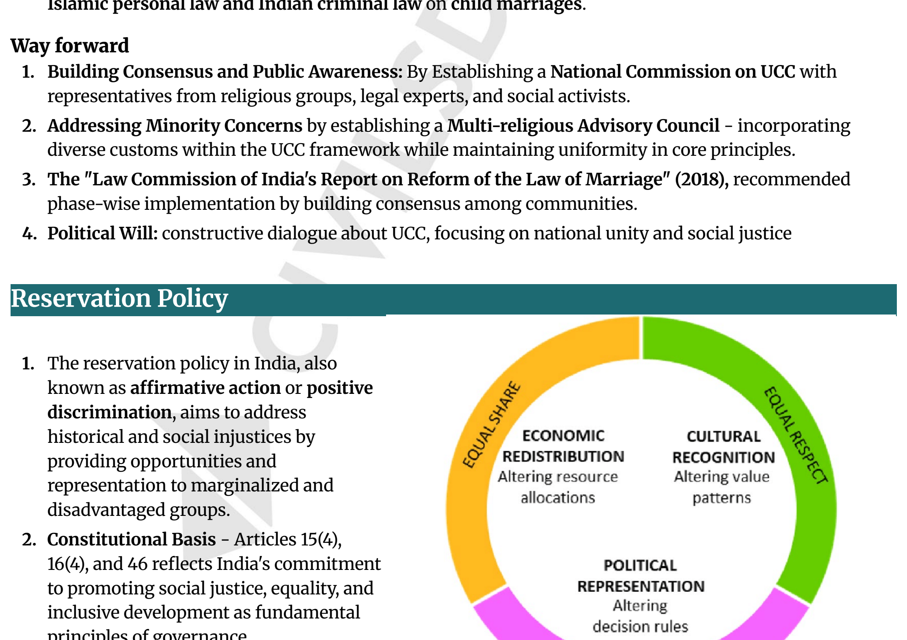
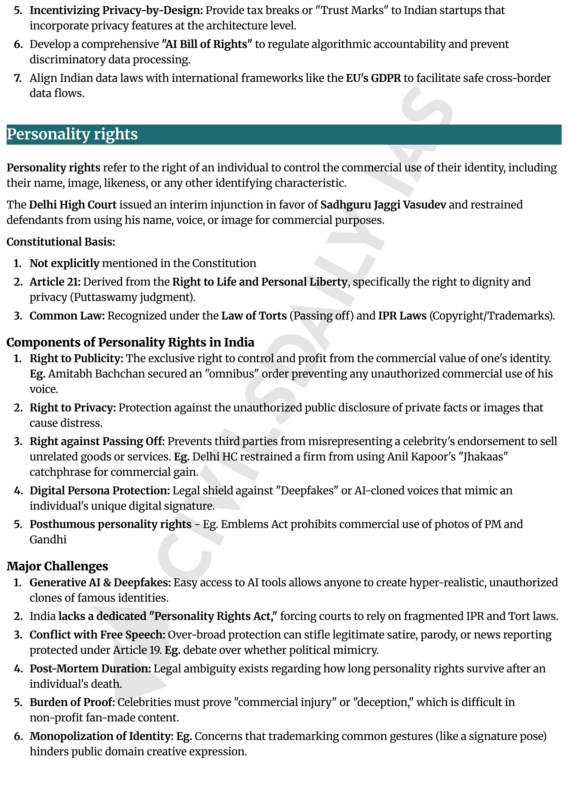
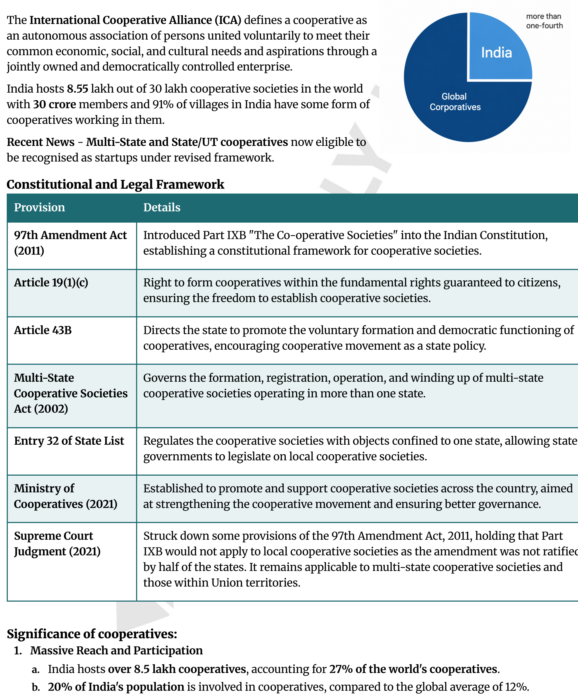
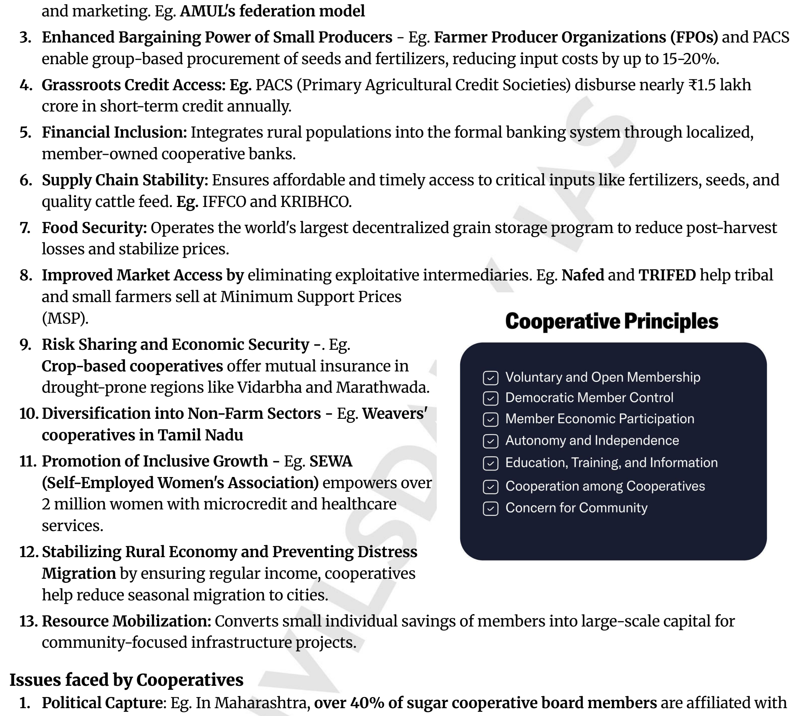

# Fundamental Rights (Part III: Articles 12 to 35) — Smash Mains Notes (X-Factor Mains'27)

---

### [Smash Mains Source Page 34](pages/mains/mains_page_034.pdf)

## Chapter 5
Fundamental Rights

### PYQs

- **[2026]** Right to privacy relating to self-identity is very dear to every human being and well protected
under Article 21 of the Constitution. In this context, examine the effect of the amendment in 2026, to the
Transgender Persons (Protection of Rights) Act, 2019. (10M)

- **[2024]** Right to privacy is intrinsic to life and personal liberty and is inherently protected under Article 21
of the Constitution. Explain. In this reference discuss the law relating to D.N.A. testing of a child in the
womb to establish its paternity.

- **[2023]** "The Constitution of India is a living instrument with capabilities of enormous dynamism. It is a
constitution made for a progressive society". Illustrate with special reference to the expanding horizons
of the right to life and personal liberty.

- **[2022]** Right of movement and residence throughout the territory of India are freely available to the
Indian citizens, but these rights are not absolute. Comment (10M)
Fundamental Rights
Fundamental rights are a set of basic rights and freedoms that are considered essential for the protection of
human dignity, liberty, and equality and are guaranteed to individuals by a constitution.
FR are referred to as the "Magna Carta" of India and are delineated in Part III (Article 12 to 35). These rights
are defended and guaranteed by the Supreme Court of India.

### Quotes
1. "Fundamental rights are both the shield and sword against State tyranny." - Prof. Upendra Baxi
2. "Freedom of speech and expression is the bulwark of a democratic government. It is the very foundation
of democracy." - Dr. Rajendra Prasad
3. "I measure the progress of a community by the degree of progress which women have achieved." -B R
Ambedkar - Affirmative Action
4. "Without political freedom, economic freedom is a mere chimera." - Nehru - Balancing FR and DPSP
5. For Conclusion - "Those who would give up Essential Liberty to purchase Temporary Safety, deserve
neither Liberty nor Safety." (Benjamin Franklin). Thus, protection and promotion of FR is vital for the
well-being of a free and democratic society.
Features
1. Guaranteed by the Constitution Part III (Articles 12-35) - enforceable by SC & HC (Art. 32 & 226).
2. Primarily act as limitations on State power, preventing arbitrary actions. Eg. Shreya Singhal case
3. Against the State as well as against private persons. (Art. 17, 23)
4. Not absolute - Subject to reasonable restrictions for public order, morality, security, etc.
5. Negative and Positive obligations - Some rights prevent State interference (freedom of speech) while
others impose duties to act (abolition of untouchability).
36

#### Structured Tables on Page 34

| PYQs |
| --- |
| [2026] Right to privacy relating to self-identity is very dear to every human being and well protected under Article 21 of the Constitution. In this context, examine the effect of the amendment in 2026, to the Transgender Persons (Protection of Rights) Act, 2019. (10M) [2024] Right to privacy is intrinsic to life and personal liberty and is inherently protected under Article 21 of the Constitution. Explain. In this reference discuss the law relating to D.N.A. testing of a child in the womb to establish its paternity. [2023] "The Constitution of India is a living instrument with capabilities of enormous dynamism. It is a constitution made for a progressive society". Illustrate with special reference to the expanding horizons of the right to life and personal liberty. [2022] Right of movement and residence throughout the territory of India are freely available to the Indian citizens, but these rights are not absolute. Comment (10M) |

---

### [Smash Mains Source Page 35](pages/mains/mains_page_035.pdf)

6. Universal in nature - Apply to all citizens, though certain rights (Eg. Art. 19) are exclusive to citizens.
7. Different classes of rights - Cover equality (Articles 14-18), freedoms (Articles 19-22), against
exploitation (Articles 23-24), religion (Articles 25-28), cultural & educational (Articles 29-30), and
constitutional remedies (Art. 32).
8. Amendable but Basic Structure bound - Kesavananda Bharati (1973).
9. Suspension during Emergency under Art. 359. (except Articles 20 & 21).
10. Supplemented by DPSPs & FDs to balance individual liberty with collective good.
Limitations and Criticism
1. Not Absolute - subject to reasonable restrictions for public order, morality, and security. Eg. Internet
shutdowns in Kashmir.
2. Limited Nature - Do not include social and economic rights necessary for a free and quality life. Eg.
Right to employment, right to social security.
3. Suspension during Emergency under Art. 359. (except Articles 20 & 21).
4. Amendable Nature - Eg. 44th Constitutional Amendment Act, 1978 removed Right to Property.
5. Accessing justice under Art. 32 or 226 is a challenge for poor or illiterate citizens.
6. The scope of FRs depends heavily on judicial interpretation. Eg. Expansion of Art. 21 (from "procedure
established by law" in A.K. Gopalan, 1950 to "just, fair, reasonable" in Maneka Gandhi, 1978).
7. Conflict with Directive Principles - Eg. Champakam Dorairajan v. State of Madras (1951) struck down
caste-based reservations as violating Art. 15, later addressed by the First Amendment (1951).
8. Misuse of Restrictions - Vague grounds like "public order" or "decency" allow overreach.
Role of Judiciary
Guardian of Fundamental Rights - Judiciary acts as the protector and guarantor of FRs under Art. 32 & 226.
Eg. Ambedkar called Art. 32 the "heart and soul" of the Constitution.
Judicial Review - Ensures that laws and executive actions do not violate FRs. Eg. Kesavananda Bharati v.
State of Kerala (1973) - Parliament cannot amend FRs to destroy the Basic Structure.
Expansive Interpretation
1. Eg. Maneka Gandhi v. Union of India (1978) - Due process made part of personal liberty.
2. Eg. K.S. Puttaswamy v. Union of India (2017) - Recognised Right to Privacy.
Creation of New Rights - Judicial activism has expanded the scope of FRs.
1. Eg. Right to Education (Unnikrishnan v. State of A.P., 1993 → later Art. 21A).
2. Eg. Right to Clean Environment (Subhash Kumar v. State of Bihar, 1991).
3. Eg. Right to Internet Access (Anuradha Bhasin v. Union of India, 2020).
Striking Down Unconstitutional Laws
1. Shreya Singhal v. Union of India (2015) - Struck down Sec. 66A IT Act for violating free speech.
2. Navtej Singh Johar v. Union of India (2018) - Decriminalised homosexuality (Sec. 377 IPC).
Public Interest Litigation - Expanded access to justice by allowing social activists and NGOs to file for
protection of FRs. Eg. Hussainara Khatoon v. State of Bihar (1979) - Recognised right to speedy trial
Critical analysis of the role of judiciary
1. Judicial Overreach - Courts intrude into policy-making, raising separation of powers concerns. Eg. SC
ban on firecrackers (2017), SC's regulation of BS-VI fuel deadlines (2018).
2. Inherent Judicial Subjectivity - Eg. Doctrine of Basic Structure - Varied interpretations affecting
predictability.
3. Accessibility Barriers - Eg. NALSA reports (2023) show over 70% rural poor lack effective legal aid.
37

---

### [Smash Mains Source Page 36](pages/mains/mains_page_036.pdf)

4. Delay and Pendency - Eg. over 5 Cr cases pending in Judiciary
5. Weak Enforcement of Judgments - Eg. Vishaka Guidelines (1997) on sexual harassment enforced only
with POSH Act in 2013, prison reform directions (Inhuman Conditions in Prisons, 2016) still pending.
6. Overdependence on Judiciary - Excessive reliance on courts highlights weak legislative oversight. Eg. SC
directed framing of COVID-19 migrant worker relief measures (2020) due to government inaction.
Right to Equality
Uniform Civil Code
It is a single set of laws governing personal matters like marriage, divorce, inheritance, adoption, and
maintenance. Article 44 of DPSP of the Constitution states that the 'State shall endeavor to secure a Uniform
Civil Code for the citizens throughout the territory of India.'
In his Independence Day speech, the Prime Minister called for a Uniform Civil Code, advocating a secular
civil framework to replace the existing religion-based personal laws.
Present Status of Civil Laws in India
1. Hindu Personal Laws - Codified under four Acts: Hindu Marriage Act (1955), Hindu Succession Act
(1956), Hindu Minority & Guardianship Act (1956), and Hindu Adoptions & Maintenance Act (1956).
Applies also to Sikhs, Jains, Buddhists.
2. Muslim Personal Laws - Uncodified, based on religious texts; partly recognised under the Shariat Act
(1937) and Dissolution of Muslim Marriages Act (1939).
3. Christian Personal Laws - Governed by the Indian Christian Marriage Act (1872).
4. Secular Laws - Special Marriage Act (1954) allows inter-religious marriages; Guardians and Wards Act
(1890) provides a secular guardianship framework.
5. Regional Exceptions - Art. 371 grants exemptions to states like Nagaland, Mizoram, Assam for
customary laws.
6. Uniform Codes - Goa and Uttarakhand have adopted a UCC; states like Assam and Gujarat are exploring
feasibility.
Need for UCC
1. Constitutional Duty - Art. 44 directs the state to secure UCC.
2. Addressing Social Divisions - Eg. Polygamy under Shariat Act (1937) still legal for Muslims, but
discriminatory against women.
3. Equality under Law - Ensures equal rights for all citizens irrespective of religion, in line with Art. 14.
Eg. Uttarakhand UCC (2024) bans polygamy and standardises marriage age at 21.
4. Empowering Women - Removes patriarchal and discriminatory practices like triple talaq, unequal
inheritance, child marriage.
5. Simplifying Legal System - Replaces multiple personal laws with one uniform law, reducing judicial
backlog and making rights clearer.
6. National Integration - Strengthens common citizenship over religious identity; promotes
constitutional patriotism (Habermas).
7. Modernisation & Social Reform - Updates outdated practices and aligns laws with contemporary
values. Eg. Navtej Johar (2018) decriminalised same-sex relations.
8. International Alignment - Brings India closer to global human rights standards.
38

---

### [Smash Mains Source Page 37](pages/mains/mains_page_037.pdf)

*Diagram Screenshot: [Dimensions of Equality: Equal Share, Equal Respect, Equal Say](diagrams/mains_diag_equality_dimensions_p037.png) | [Full Source Page 37](pages/mains/mains_page_037.pdf)*

Challenges
1. Lack of Consensus - Absence of broad-based community agreement may lead to social unrest.
2. Religious Freedom - May infringe on Art. 25, as personal laws are integral to religious practices.
3. Minority Rights - Could marginalise minorities, with fear of majority practices dominating.
4. Cultural Diversity - Risks eroding India's plural traditions and imposing uniformity. Eg. Khasi
matrilineal system in Meghalaya could be threatened.
5. Practical Challenges - Drafting a uniform law for all communities is complex due to regional variations.
6. Law Commission Report 2018: UCC "neither necessary nor desirable"
7. Federalism Concerns - May undermine state autonomy, as personal laws fall under Concurrent List.
8. Presence of Secular Laws that already address many issues for all citizens. Eg. Section 125 of the
Criminal Procedure Code (maintenance) and Domestic Violence Act.
SC Judgments
1. Shah Bano Case (1985) - SC upheld Muslim women's right to maintenance under CrPC 125.
2. Sarla Mudgal Case (1995) - SC declared second marriage after conversion void and stressed need for UCC
for gender justice.
3. Shayara Bano Case (2017) - SC struck down instant triple talaq, reinforcing uniform standards for
gender justice.
4. Jose Paulo Coutinho Case (2019) - SC praised Goa's UCC as a model for national implementation.
5. The Delhi High Court recently advocated for a Uniform Civil Code (UCC), noting conflicts between
Islamic personal law and Indian criminal law on child marriages.
Way forward
1. Building Consensus and Public Awareness: By Establishing a National Commission on UCC with
representatives from religious groups, legal experts, and social activists.
2. Addressing Minority Concerns by establishing a Multi-religious Advisory Council - incorporating
diverse customs within the UCC framework while maintaining uniformity in core principles.
3. The "Law Commission of India's Report on Reform of the Law of Marriage" (2018), recommended
phase-wise implementation by building consensus among communities.
4. Political Will: constructive dialogue about UCC, focusing on national unity and social justice
Reservation Policy
1. The reservation policy in India, also
known as affirmative action or positive
discrimination, aims to address
historical and social injustices by
providing opportunities and
representation to marginalized and
disadvantaged groups.
2. Constitutional Basis - Articles 15(4),
16(4), and 46 reflects India's commitment
to promoting social justice, equality, and
inclusive development as fundamental
principles of governance.
39

---

### [Smash Mains Source Page 38](pages/mains/mains_page_038.pdf)

Grounds for reservation
Group Reason for Support
SCs and STs Historical injustice and social exclusion.
Other Backward Classes (OBCs) Social and educational backwardness.
Economically Weaker Sections (EWS) Economic deprivation and lack of access to resources.
Women Gender discrimination and underrepresentation
Persons with Disabilities (PwD) Ensure inclusion, accessibility, and participation
Reasons behind rising demand for reservation
Aspect Description Examples
Perceived Discrimination Andre Béteille argues that
reservations for lower castes
create a sense of reverse
discrimination among upper
castes.
Patidar agitation in Gujarat (2015)
for OBC status.
Competition for Opportunities M.N. Srinivas: pressure on
dominant castes to secure
economic opportunities as
traditional agrarian roles
diminish.
Maratha reservation protests in
Maharashtra (2018).
Economic Disparities Sections within these
communities experience poverty
or lack access to resources.
Job Security Yogendra Singh: shift from
agrarian economy to job-based
economy increased demand for
job security.
Demand for local reservation in
Haryana
Identity Politics and Mobilization Christophe Jaffrelot: political
mobilization around caste
identities can consolidate electoral
support.
Backlash Against Affirmative
Action
Reservation policies perceived as
unfair or discriminatory by
dominant castes.
Anti-reservation protests
40

#### Structured Tables on Page 38

| Group | Reason for Support |
| --- | --- |
| SCs and STs | Historical injustice and social exclusion. |
| Other Backward Classes (OBCs) | Social and educational backwardness. |
| Economically Weaker Sections (EWS) | Economic deprivation and lack of access to resources. |
| Women | Gender discrimination and underrepresentation |
| Persons with Disabilities (PwD) | Ensure inclusion, accessibility, and participation |

| Aspect | Description | Examples |
| --- | --- | --- |
| Perceived Discrimination | Andre Béteille argues that reservations for lower castes create a sense of reverse discrimination among upper castes. | Patidar agitation in Gujarat (2015) for OBC status. |
| Competition for Opportunities | M.N. Srinivas: pressure on dominant castes to secure economic opportunities as traditional agrarian roles diminish. | Maratha reservation protests in Maharashtra (2018). |
| Economic Disparities | Sections within these communities experience poverty or lack access to resources. |  |
| Job Security | Yogendra Singh: shift from agrarian economy to job-based economy increased demand for job security. | Demand for local reservation in Haryana |
| Identity Politics and Mobilization | Christophe Jaffrelot: political mobilization around caste identities can consolidate electoral support. |  |
| Backlash Against Affirmative Action | Reservation policies perceived as unfair or discriminatory by dominant castes. | Anti-reservation protests |

---

### [Smash Mains Source Page 39](pages/mains/mains_page_039.pdf)

Challenges
1. Politicization of caste and castecization of politics undermines the original intent of reservation
policies. Eg. reservation demands by dominant communities like Patels, Marathas, etc.
2. Strengthening Caste Identity: The redistributive justice based on caste reinforces caste identities and
poses challenges to establishing a casteless egalitarian society.
3. Stigmatization and Stereotyping: Individuals from reserved categories face discrimination or be
perceived as beneficiaries of preferential treatment.
4. Creamy Layer: The absence of a creamy layer for SC and ST and the higher creamy layer limit for OBCs
can lead to a 'class within caste'. Eg. As per Justice G. Rohini Commission's report, 97% of central OBC
quota benefits go to just under 25% of its castes.
5. Reservation in Promotions: lead to inefficiency and compromise the merit-based selection process,
affecting overall productivity and performance in government institutions.
6. Dependency on Reservations: Over-reliance on reservation policies discourage investment in holistic
measures for socio-economic development such as health and education.
SC Judgments
Case Description
Indra Sawhney v. UoI (1992) Upheld reservations for OBCs but capped them at
50%.

#### M. Nagaraj & Others v. Union of India (2006) Upheld reservations in promotions for SC/STs under
specific conditions: backwardness, inadequate
representation, and administrative efficiency.
Jarnail Singh v. Lachhmi Narain Gupta (2018) States are not required to provide quantifiable data to
justify reservations in promotions, reversing M.
Nagaraj.
Jaishri Laxmanrao Patil v. Chief Minister (2021) Struck down Maratha Reservation law for exceeding
the 50% cap; upheld Indra Sawhney and the 102nd
Constitutional Amendment.
Reservation in promotions
1. As per 16 (4A), the state can make provision for reservation in matters of promotion, with
consequential seniority, in favor of Scheduled Castes and the Scheduled Tribes which in the opinion of
the State are not adequately represented in the services under the State.
2. Among the 275 joint secretaries, 13 (4.73 per cent) are SCs, nine (3.27 per cent) are STs and 19 belong to
the OBC category. Of 89 secretaries, there are just 3 STs, 1 Dalit and no OBCs.
Benefits
1. Addressing Structural Discrimination and systemic barriers that hinder the upward mobility of
marginalized groups in the workforce. Eg. In Group-A, the highest tier among these, the representation
of SCs is just 12.86%, of STs 5.64% and of OBCs 16.88%. Reservation for these communities is 15%, 7.5%
and 27% respectively.
2. Role Model Effect within marginalized communities.
3. Encouraging Equal Opportunity and Building a Representative Workforce
41

#### Structured Tables on Page 39

| Case | Description |
| --- | --- |
| Indra Sawhney v. UoI (1992) | Upheld reservations for OBCs but capped them at 50%. |
| M. Nagaraj & Others v. Union of India (2006) | Upheld reservations in promotions for SC/STs under specific conditions: backwardness, inadequate representation, and administrative efficiency. |
| Jarnail Singh v. Lachhmi Narain Gupta (2018) | States are not required to provide quantifiable data to justify reservations in promotions, reversing M. Nagaraj. |
| Jaishri Laxmanrao Patil v. Chief Minister (2021) | Struck down Maratha Reservation law for exceeding the 50% cap; upheld Indra Sawhney and the 102nd Constitutional Amendment. |

---

### [Smash Mains Source Page 40](pages/mains/mains_page_040.pdf)

Challenges
Challenge Description
Meritocracy Concerns By prioritizing social identity over individual
qualifications and performance
Quantifiable Data Difficulty in collecting accurate data to justify
reservations in promotions.
Administrative Efficiency Concerns that reservations in promotions can
undermine Article 335.
Backlog As reserved category candidates may not always be
available for promotion.
Judicial Interpretations In the Jarnail Singh case, SC reversed the
requirement for quantifiable data set by M. Nagaraj.
Way forward for reservation
Expert Recommendation
Dr. Amartya Sen Capability approach focusing on 3Es: education, employability, and employment.
Dr. Yogendra Yadav Introduction of sunset clauses in reservation policies.
Institutional
Recommendations
Create institutions similar to the Equal Opportunities Commission (US/UK) to
create deprivation indexes and audit reservation policies.
Comprehensive Data
and Guidelines
Need for comprehensive data and clear guidelines for identifying beneficiaries.
Accompanying
Structural Reforms
Implement structural reforms like land reforms and skilling programs alongside
reservations.
Periodic Reviews Every five years to addresses distortions and ensures equitable opportunities
Sub-categorization of OBCs
1. It refers to creating sub-categories within the larger group of OBCs to ensure "equitable distribution" of
representation among all OBC communities.
2. The Landmark SC judgment allowing sub-classification of SCs/STs has provided the legal logic for
expanding similar "graded backwardness" models for OBCs at the Central level.
SC in Davinder Singh case overturned the 2004 ruling in E.V. Chinnaiah and allowed states to sub-classify
SCs and STs
42

#### Structured Tables on Page 40

| Challenge | Description |
| --- | --- |
| Meritocracy Concerns | By prioritizing social identity over individual qualifications and performance |
| Quantifiable Data | Difficulty in collecting accurate data to justify reservations in promotions. |
| Administrative Efficiency | Concerns that reservations in promotions can undermine Article 335. |
| Backlog | As reserved category candidates may not always be available for promotion. |
| Judicial Interpretations | In the Jarnail Singh case, SC reversed the requirement for quantifiable data set by M. Nagaraj. |

| Expert | Recommendation |
| --- | --- |
| Dr. Amartya Sen | Capability approach focusing on 3Es: education, employability, and employment. |
| Dr. Yogendra Yadav | Introduction of sunset clauses in reservation policies. |
| Institutional Recommendations | Create institutions similar to the Equal Opportunities Commission (US/UK) to create deprivation indexes and audit reservation policies. |
| Comprehensive Data and Guidelines | Need for comprehensive data and clear guidelines for identifying beneficiaries. |
| Accompanying Structural Reforms | Implement structural reforms like land reforms and skilling programs alongside reservations. |
| Periodic Reviews | Every five years to addresses distortions and ensures equitable opportunities |

---

### [Smash Mains Source Page 41](pages/mains/mains_page_041.pdf)

1. Justice Rohini commission on OBC sub-categorization was set up by the President of India, mandated
under Article 340 to investigate the conditions of socially and educationally backward classes and
propose steps for their improvement. It submitted its report in October 2023.
a. 97% of the reserved jobs and seats have gone to 25% of OBC sub-castes, and only 10 OBC
communities have taken the 25% of reserved central jobs and institutional seats.
b. As many as 983, or 37%t, of the 2,600 communities under the OBC had zero representation in jobs
and institutes, and only 2.68% reservations have been used by 994 castes.
Sub-categorisation of OBCs in states:
- 1972: Karnataka CM Devraj Urs appointed Havanur Commission, its report formed the basis for the
sub-categorisation of OBCs.
- 1977: Bihar CM Karpoori Thakur implemented the Mungeri Lal Commission report to divide OBCs into
two categories: extremely backward classes (EBCs), and backward classes.
- 2002: UP CM Rajnath Singh appointed Hukum Singh committee to earmark 5% OBC quota for Yadavs
and 14% for Most Backward Classes
Need for Sub-Categorization of OBCs
1. Unequal Distribution of Quota Benefits - 97% of the reserved jobs and seats have gone to 25% of OBC
sub-castes
2. Horizontal Equity - Sub-categorization ensures fair share for most backward classes (MBCs) within
OBCs, aligning with Articles 14, 15, and 16 guaranteeing equality.
3. Better Targeting of Affirmative Action - Helps identify truly deprived groups for focused support in
education, jobs, and welfare.
4. Political Representation - Sub-categorization could improve political inclusion for marginalised OBC
groups who are otherwise overshadowed by dominant castes.
5. Ensuring Fair Distribution Structure - Justice Rohini Commission's recommendation to sub-categorize
OBCs into three benefit bands: communities receiving no benefits, those with partial benefits, and those
receiving maximum benefits.
6. Scientific Resource Allocation - Sub-categorization allows the state to direct specialized welfare
schemes to specific clusters of castes.
7. Fulfills the mandate of Article 340, requiring the State to investigate and improve backward class
conditions.
8. Harmonizing State-Central Lists - Eg. Bihar and Tamil Nadu have successfully used sub-categorization
for decades to balance social groups.
9. Moves from "formal equality" (treating unequals as equals) to "substantive equality" (graded assistance).
Challenges
1. Absence of Current Population Data Without a completed 2027 Census, determining the exact
population weight for sub-quotas remains speculative.
2. Fear of political backlash from dominant OBCs leading to delay in implementing Justice Rohini report
3. Identical castes use different surnames or spellings across states, leading to classification errors.
4. Triggering "Competitive Backwardness" Further division might encourage even more groups to
demand specialized "micro-quotas" within categories.
5. Erosion of Collective Bargaining - Eg. Sociologists argue that sub-categorization is a "divide and rule"
strategy to weaken the Mandal movement.
43

---

### [Smash Mains Source Page 42](pages/mains/mains_page_042.pdf)

Scheduled Caste Reservation
Recently, SC in Chinthada Anand v. State of Andhra Pradesh (2026) ruled that a person professing any
religion other than Hinduism, Buddhism, or Sikhism cannot be recognised as a member of a SC community
and conversion to any other religion (Islam or Christianity) results in the loss of SC status. (there is no
religion-based restriction on ST status)
SC held that as other religions do not theologically recognize the caste system, a person cannot publicly
practice them while simultaneously claiming SC status
SC Reservation criteria
1. Under Article 341 of the Constitution, the President can specify the castes that are officially deemed
Scheduled Castes.
2. Once the initial Presidential list was published, only the Parliament of India has the authority to make
additions or removal.
3. SC eligibility is strictly governed by Clause 3 of the Constitution (Scheduled Castes) Order, 1950.
4. SC status is State/Union Territory-specific. A community recognized as a SC in one state may be
categorized as general category or an OBC or in another state
Caste census
1. Caste-based census refers to the collection of demographic data that includes information about the
caste or social group of individuals within a population.
2. M. N. Srinivas (Indian sociologist) defines caste as a hereditary, endogamous, and usually localized
group, linked to a specific occupation, and occupying a certain position in the social hierarchy.
3. The Bihar government released the caste census and a few other state governments like Karnataka
announced the same.
4. After a gap of 16 years, the Government of India officially launched Phase 1 (House Listing and Housing
Census) of the "Census 2027" on April 1, 2026.
5. The Union Government confirmed that caste and sub-caste data will be collected nationwide for the
first time since 1931.
6. Every Census in independent India from 1951 to 2011 has published data on Scheduled Castes and
Scheduled Tribes, but not on other castes. Before that, every Census until 1931 had data on caste.
7. The Socio-Economic Caste Census (SECC) conducted in 2011 aimed to gather comprehensive data on
socio-economic indicators, including caste information. However, issues regarding data quality and
classification challenges have hindered the effective release and utilization of the raw caste data
collected in the SECC.
Need of caste census
1. Evidence-Based Policymaking: A caste census can help design targeted welfare programs for the most
marginalized within OBCs, SCs, and other underserved communities.
2. Update Outdated Baselines - Current OBC quotas rely on 1931 colonial data extrapolated by the 1980
Mandal Commission, now nearly a century old
3. Enable Sub-categorization - Granular data allows the state to divide broad categories like OBCs to
ensure benefits reach "Extremely Backward Classes" (EBCs)
4. Rationalize Reservation Quotas - Updated population figures may justify increasing the 50%
reservation cap if demographics show significantly higher marginalized populations.
44

---

### [Smash Mains Source Page 43](pages/mains/mains_page_043.pdf)

5. Map Social Mobility - The census acts as a "progress report" to see which communities have actually
advanced since independence and which remain stagnant.
6. Targeted Welfare and Resource Allocation: The 2023 Bihar caste survey revealed that 22.6 million
people eligible for subsidized food under NFSA were left out due to outdated population estimates.
7. Addressing Structural Inequality: A caste census is a scientific and objective tool to measure and
address wealth, education, and opportunity gaps rooted in social stratification.
8. The Sachar Committee (2006) emphasized that religion-based data enabled more focused minority
welfare- a similar framework can be adopted for caste.
9. Recognizing Intersectionality: A caste census can illuminate how caste intersects with gender, religion,
and region, leading to compounded disadvantages. Eg. Dalit women in rural Bihar face triple
marginalization - on the basis of caste, class, and gender.
10. Judicial Relevance - The Supreme Court in Indra Sawhney v. Union of India (1992) emphasized the need
for contemporary and quantifiable data on backwardness for reservations.
Challenges:
Political
1. Caste Census data may be weaponized for vote-bank politics, and could fuel sectarian populism.
2. "Competitive Backwardness" - Fresh demographic weight encourages dominant communities to seek
"backward" status, risking a "race to the bottom."
Social
1. Deepening of Caste Identities and Consciousness: "Enumeration is not a neutral act; it carries with it
the risk of reifying the very categories it seeks to understand." - Dipankar Gupta
2. Reification of Social Hierarchies - Scholars like M.N. Srinivas warned that overemphasis on caste in
public discourse may harden caste boundaries and hinder social mobility.
Legal
1. New data showing higher backward populations will likely trigger legal challenges to the Supreme
Court's 50% reservation cap. Eg. The 2023 Bihar Survey showed 63% OBC/EBCs
Administrative
1. Privacy and Data Misuse - Linking caste to digital IDs raises fears of surveillance and the potential
misuse of data for targeted political exclusion.
2. Administrative challenges: Caste is not uniform; identical groups use different names across states,
making standardized "coding" nearly impossible.
3. Misclassification or over-enumeration could create data reliability issues, as seen during the
Socio-Economic and Caste Census (SECC) 2011, whose caste data was withheld due to inconsistencies.
Way forward for advancing Equity Without Deepening Divisions:
1. Merging caste enumeration with data on education, income, health, sanitation, and land ownership,
adopting a holistic lens rather than relying on caste alone.
2. Establishing a multi-tier verification mechanism and a grievance redressal system for corrections.
3. Ensure caste data is anonymized and used strictly for policymaking, not for political mobilisation.
4. As per Suhas Palshikar, prepare a backwardness index based on the caste census and incentivize the
inclusion of persons with a high backwardness index in private employment.
5. Sub-categorization for Equity:
a. Implement Justice Rohini Commission's recommendations for sub-categorizing OBCs.
b. Aligning with the Supreme Court judgment in State of Punjab v. Davinder Singh (2024), sub-classify
SCs and STs within the reservation quota.
45

---

### [Smash Mains Source Page 44](pages/mains/mains_page_044.pdf)

Sedition Law
1. In India, Section 124(A) of IPC defines sedition as an offense committed when any person by words or
otherwise brings or attempts to bring into hatred or contempt, or excites or attempts to excite
disaffection towards the government established by law in India by words, either spoken or written,
signs, visible representation, or otherwise.
2. The new Bharatiya Nyaya Sanhita has removed section 124A of IPSC but has introduced similar
provisions under Section 152.
3. It penalizes anyone who, purposely or knowingly, by words, signs, electronic communication, or
financial means, excites or attempts to excite secession, armed rebellion, or subversive activities.
Statistics about Sedition Cases
1. The 2023 NCRB report (released in 2025) noted a 26% drop in "Offences against the State," down from
7,128 in 2019 to 5,272 in 2023.
2. Between 2015 and 2020, out of 548 persons arrested under Section 124A, only 12 faced conviction
(approx. 2%).
3. Pendency rate exceeding 90% for sedition-related trials, leading to "punishment by process.
Need for Sedition Law
1. Combating Anti-National Elements - Eg. Use against groups advocating for Khalistan or separatist
movements in Jammu & Kashmir.
2. Maintaining Public Order Prevents the incitement of violence that could lead to large-scale civil unrest
or communal riots.
3. Ensures that a government established by law is not subverted by unconstitutional, violent, or illegal
means.
4. Reasonable Restriction on Freedom of speech (Article 19). Upheld by SC in Kedar Nath (1962) case
5. Curbing Fake News & Digital Warfare - The new BNS includes "electronic means" to tackle
foreign-funded digital campaigns aimed at destabilizing India.
6. Arguments by Law Commission,
a. The existence of laws such as the UAPA and the NSA does not cover all elements of the offense
envisaged under Section 124A of the IPC.
b. The mere colonial origin of a legal provision does not automatically justify its repeal.
c. The mere occurrence of misuse doesn't necessitate the scrapping of a law; instead, establishing
procedural safeguards can effectively curb any alleged misuse.
Arguments Against
1. Vagueness of "Subversive Activities" - The term is not defined in the BNS, allowing police to interpret
legitimate protest as subversion.
2. Chilling Effect on Dissent - The fear of life imprisonment silences journalists, activists, and citizens
from criticizing government failures.
3. Low Conviction Rate - only ~3% of sedition cases result in actual convictions. (NCRB Data)
4. Colonial Baggage - Critics argue Section 152 is just "Old Wine in a New Bottle," retaining colonial-era
suppression tactics.
5. Weaponization for Political Vendetta - Eg. State governments using sedition against protesters in
environmental or land-rights movements.
6. Contradicts the International Covenant on Civil and Political Rights (ICCPR), which India has ratified.
7. Subjective "Tendency Test" allows arrests for poems or slogans even if no riot actually occurred.
46

---

### [Smash Mains Source Page 45](pages/mains/mains_page_045.pdf)

8. Burden of Proof on Accused - Being a non-bailable offense, the accused spends years in jail before the
trial even begins. Eg. Stan Swamy
Way forward
1. The law commission has recommended aligning the law with Kedar Nath judgment which stipulated
that there must be a 'pernicious tendency to incite violence' to invoke the sedition law.
2. Sensitization of law enforcement agencies to prevent the problem of misuse.
3. Alternatives like strengthening existing mechanisms related to hate speech, and violence so that there
would be no need to use it or use it sparingly.
SC Judgments
1. Kedar Nath Singh v. State of Bihar (1962): Upheld the law but limited its use only to acts involving
incitement to violence or public disorder.
2. P. Alavi vs. State of Kerala, 1982: SC held that sloganeering, criticizing Parliament, or Judicial setup did
not amount to sedition.
3. Vinod Dua (2021): The court quashed a sedition case against journalist Vinod Dua. It reiterated that
criticism of the government isn't sedition and called for the "disinvocation" of the law in most cases.
4. Javed Ahmad Hazam v. State of Maharashtra (2024): Ruled that dissent must be judged by the
"reasonable person" standard, not by overly sensitive state actors.
Global Best Practices
1. United Kingdom: Formally abolished sedition in 2009
2. United States: The "Clear and Present Danger" test
Right to Privacy
Right to Privacy is recognised as part of Article 21 (Right to Life and Personal Liberty) and extended to
Articles 14 and 19 (triple test of liberty).
"Privacy is the constitutional core of human dignity." - Justice D.Y. Chandrachud
"In an age of information, privacy is not merely a civil right but the very foundation of freedom." - UN
Special Rapporteur on Privacy (2016)
Evolution -
Constituent Assembly on Right to Privacy
- Proposals by Sub-Committee on Fundamental Rights - Suggested:
◦ Inviolability of home against unreasonable searches & seizures.
◦ Secrecy of correspondence.
- Kazi Syed Karimuddin proposed explicit protection against state interference, searches, and seizures,
modeled on American and Irish Constitutions.
- Members like B.N. Rau, K.M. Pannikar, dissented, arguing it would hinder law enforcement
- Ambedkar's Response - Noted that Criminal Procedure Code already provided safeguards; hence no
need for constitutional mention.
47

---

### [Smash Mains Source Page 46](pages/mains/mains_page_046.pdf)

1. M.P. Sharma v. Satish Chandra (1954) - SC initially held privacy is not a fundamental right.
2. Kharak Singh v. State of U.P. (1962) - SC struck down domiciliary visits by police, linking privacy to
personal liberty.
3. Govind v. State of M.P. (1975) - SC hinted privacy is protected under Article 21, but not absolute.
4. Justice K.S. Puttaswamy case: Privacy is a fundamental right intrinsic to dignity, liberty, autonomy.
Scope of Right to Privacy (post-Puttaswamy)
1. Informational Privacy - Protection of personal data, Aadhaar details, medical records, online footprints.
2. Decisional Autonomy - Freedom to make intimate personal choices such as marriage, procreation,
reproductive rights, and sexual orientation. Eg. Navtej Singh Johar (2018)
3. Bodily Integrity - Protection from intrusive medical procedures, biometric misuse, surveillance, and
forced sterilisation.
4. Family, Marriage & Relationships - Choice of partner and right to marry a person of choice. Eg. Shafin
Jahan v. Asokan (2018, Hadiya case) upheld interfaith marriage choice.
5. Reproductive Rights - Autonomy over pregnancy decisions. Eg. X v. Principal Secretary, Health (2022)
allowed abortion for unmarried women under MTP Act.
6. Digital Privacy - Protection against surveillance, right to internet access, and data protection in
cyberspace.
Significance of Right to Privacy in India
Political Significance
1. Protection from Arbitrary State Action - Limits police/state surveillance, checked through
proportionality test.
2. Strengthening Democracy - Enables dissent, protest, and freedom of expression without fear.
Economic Significance
1. Consumer & Corporate Regulation - Protects citizens from misuse of data in e-commerce, fintech, and
big tech.
2. Informational Privacy in the Digital Era - Prevents misuse of Aadhaar, biometrics, financial and
medical data.
Social Significance
1. Dignity & Bodily Integrity - Safeguards reproductive rights and autonomy from forced medical
procedures.
2. Gender Justice & Equality - Ensures women's rights in marriage, contraception, and abortion.
3. Protection of Minority Rights - Ensures religious practices are not arbitrarily interfered with.
Technological Significance
1. Safe Digital Space & Cyber Rights - Expands to right to internet, digital freedoms.
2. Regulation of AI & Big Data - Prevents excessive state or corporate surveillance in technology-driven
governance.
Legal Significance
1. Strengthening Rule of Law - Ensures restrictions are legal, necessary, proportionate (Puttaswamy
proportionality test).
2. Judicial Enforcement - Privacy protected via writs under Articles 32 & 226, making it enforceable
against state abuse.
Global / External Significance
1. Global Human Rights Alignment - Consistent with Article 12 UDHR and Article 17 ICCPR.
2. Enhances India's reputation as a constitutional democracy respecting civil liberties.
48

---

### [Smash Mains Source Page 47](pages/mains/mains_page_047.pdf)

Challenges to Right to Privacy in India
Political
1. Mass Surveillance by State - Eg. controversy over Pegasus spyware (2021).
2. Lack of independent oversight on agencies like IB, RAW, NIA.
3. Balancing Privacy with National Security - Frequent internet shutdowns in Jammu & Kashmir.
Institutional
1. Though the Digital Personal Data Protection Act, 2023 was enacted, critics argue it gives excessive
exemptions to the government.
2. Agencies continue to misuse outdated colonial laws. Eg. Telegraph Act for phone tapping
3. Privacy often clashes with Right to Information, transparency in governance, and freedom of press,
leading to judicial dilemmas.
Technological
1. Corporate Surveillance (Surveillance Capitalism) - Big tech firms harvest personal data for targeted ads
without informed consent, threatening informational privacy.
2. Health Data & Bio-Surveillance - COVID-19 contact tracing apps (like Aarogya Setu) sparked concerns
over storage, retention, and misuse of sensitive health data.
Social
1. Lack of Awareness & Digital Literacy - Citizens often unaware of their privacy rights in digital and
financial transactions, making them vulnerable to exploitation.
Reasonable Restrictions
1. Test of Proportionality - Puttaswamy (2017) - To justify restrictions on the Right to Privacy, three
conditions must be satisfied:
a. Legality - Any interference with privacy must be sanctioned by law, with a just, fair, and reasonable
procedure, free from arbitrariness.
b. Legitimate Aim - The law must serve a legitimate state interest (Eg. national security, public health),
preventing unnecessary state intrusion.
c. Proportionality - The nature, method, and extent of interference must be proportionate to the
purpose sought, ensuring minimal restriction of rights.
d. National Security - Eg. PUCL v. Union of India (1997) upheld phone tapping under strict
safeguards.
e. Public Order & Crime Prevention - Eg. UAPA surveillance cases justified under "public order".
f. Protection of Rights of Others - Privacy cannot be invoked to harm others' rights (Eg. child safety,
protection from domestic violence, misuse of digital content).
g. Public Health & Safety - Eg. COVID-19 contact tracing and Aarogya Setu App justified under health
emergency.
Way Forward for Protection of Right to Privacy
1. Judicial Oversight on Surveillance - Set up mechanisms like warrant-based approvals, review
committees, and parliamentary scrutiny to prevent arbitrary phone tapping and spyware use.
2. Strengthen application of legality, legitimacy, and proportionality test (Puttaswamy 2017) in all
privacy-related state actions.
3. Establish an independent Privacy Commission to monitor data use by government and corporates.
4. Build secure data storage infrastructure in India and improve cybersecurity protocols to prevent leaks
and hacks.
5. Digital Literacy Campaigns to educate citizens on data protection, online safety, and privacy rights.
49

---

### [Smash Mains Source Page 48](pages/mains/mains_page_048.pdf)

6. Balancing Privacy & Security - Adopt global best practices like UK's Investigatory Powers Act and GDPR,
ensuring security needs without compromising individual liberty.
Global Best Practices
- European Union - GDPR (2018)
- Principles: explicit consent, right to be forgotten, data minimisation, portability, accountability.
- Heavy penalties on violations (up to 4% of global turnover).
Digital Rights
1. As per WEF, Digital rights are closely linked to freedom of expression and privacy and allow people to
access, use, create, and publish digital media, as well as access and use computers, other electronic
devices, and communications networks.
2. The European Commission has proposed a set of digital rights and principles. It is an extension of the
Berlin Declaration on Digital Society and Value-Based Digital Government
Right to access to Internet
1. SC in Amar Jain V Union of India judgment held that inclusive and meaningful digital access to
e-governance and welfare delivery systems is a part of the fundamental right to life and liberty.
a. Directed the state to revise KYC norms to help acid attack victims and PwDs.
b. States's responsibility to ensure digital infrastructure to all vulnerable sections under Article 14,21,38.
2. Faheema Shirin v. State of Kerala (2019) - Kerala HC held that the right to internet is part of the right to
education and privacy under Article 21.
3. Anuradha Bhasin v. Union of India (2020) - SC ruled against indefinite internet shutdowns,
recognising internet access as essential to fundamental rights.
Digital Rights Principles
1. PEOPLE AT THE CENTRE - Digital technologies should protect people's rights, support democracy, and
ensure that all digital players act responsibly and safely.
2. SOLIDARITY AND INCLUSION - Everyone should have access to the internet, digital skills, digital public
services, and fair working conditions.
3. FREEDOM OF CHOICE - People should benefit from a fair online environment. Users should be safe from
illegal and harmful content.
4. PARTICIPATION - Individuals should have control over their own data.
5. SAFETY AND SECURITY - The digital environment should be safe and secure.
6. SUSTAINABILITY
a. Digital devices should support sustainability and the green transition.
b. People need to know about the environmental impact and energy consumption of their devices.
Key Data on Digital India (2025-2026)
- Internet Users: India surpassed 1 billion broadband subscriptions in late 2025 (Source: PIB).
- Digital Identity: Over 143 crore (1.43 billion) Aadhaar IDs have been issued as of February 2026.
- Financial Inclusion: UPI processed 21.7 billion transactions worth ₹28.33 lakh crore in January 2026.
- Connectivity: Over 2.15 lakh Gram Panchayats are now connected via optical fiber under BharatNet.
50

---

### [Smash Mains Source Page 49](pages/mains/mains_page_049.pdf)

Significance of Digital Rights in India
1. Constitutional Empowerment - Strengthens Article 19(1)(a) freedom of speech and Article 19(1)(g)
freedom to trade
2. Privacy Protection: Ensures personal data isn't exploited by corporations or the state without explicit,
informed consent.
3. Digital Inclusion: Guarantees equal access to the internet, preventing marginalized communities from
being left behind economically. Eg. Kerala became the first state to declare the "Right to Internet" a basic
right.
4. Democratic Participation: Eg. Use of the MyGov platform for public consultation on Draft Bills.
5. Information Access: Empowers citizens to find educational, medical, and legal resources instantly
regardless of their location. Eg. DIKSHA platform hosting 19,000+ courses.
6. Accountability and Transparency: Digital rights allow for the online tracking of welfare delivery and
government spending.
7. Protection from Harassment: Provides legal recourse against cyber-bullying, stalking, and the
non-consensual sharing of private images.
8. Global Alignment - Recognised by UNHRC (2016) as a human right; countries like Finland (2010) made
internet access a legal right.
Challenges in Ensuring Right to Internet in India
1. Surveillance Risks:
a. Broad government exemptions in the DPDP Act.
b. Mandate pre-installation of the Sanchar Saathi app on mobile phones
2. Internet Shutdowns: India frequently leads the world in local internet blackouts to maintain public order
during protests. Eg. Ongoing shutdowns in Manipur.
3. The Digital Divide: Eg. 25% gender gap in mobile internet usage in rural India.
4. Misinformation and Deepfakes: The rapid spread of AI-generated fake news threatens social harmony
and electoral integrity.
5. Cybersecurity Vulnerabilities: Frequent data breaches in government and healthcare databases expose
sensitive biometric and medical info. Eg. AIIMS data breach
6. Consent Fatigue: Complex privacy policies and "dark patterns" lead users to agree to data harvesting
without understanding.
7. Lack of Independent Oversight: The Data Protection Board (DPB) is government-appointed, raising
concerns about its impartiality and transparency
8. Operational Barriers - Network issues, adverse climatic conditions, and poor e-readiness hamper
effective connectivity in remote areas.
9. Affordability Concerns - Despite low data tariffs, costs of smartphones, devices, and monthly packs
remain prohibitive for BPL households, widening the digital divide.
Way Forward for Ensuring Right to Internet in India
1. Technological Innovations - Promote satellite internet (Eg. Starlink, OneWeb) and other alternatives to
complement traditional infrastructure in remote areas.
2. Rights Linkage - Recognise that denial of internet affects multiple rights (education under Article 21A,
expression, livelihood), making it a democratic and developmental necessity.
3. Launch "Digital Rights Awareness" drives in regional languages to help rural users manage consent.
4. Implementing the Anuradha Bhasin guidelines strictly to ensure shutdowns are temporary and
localized.
51

---

### [Smash Mains Source Page 50](pages/mains/mains_page_050.pdf)

*Diagram Screenshot: [Right to Privacy (Article 21) & Puttaswamy Three-Pronged Test vs DPDP Act](diagrams/mains_diag_privacy_data_protection_art21_p050.png) | [Full Source Page 50](pages/mains/mains_page_050.pdf)*

5. Incentivizing Privacy-by-Design: Provide tax breaks or "Trust Marks" to Indian startups that
incorporate privacy features at the architecture level.
6. Develop a comprehensive "AI Bill of Rights" to regulate algorithmic accountability and prevent
discriminatory data processing.
7. Align Indian data laws with international frameworks like the EU's GDPR to facilitate safe cross-border
data flows.
Personality rights
Personality rights refer to the right of an individual to control the commercial use of their identity, including
their name, image, likeness, or any other identifying characteristic.
The Delhi High Court issued an interim injunction in favor of Sadhguru Jaggi Vasudev and restrained
defendants from using his name, voice, or image for commercial purposes.
Constitutional Basis:
1. Not explicitly mentioned in the Constitution
2. Article 21: Derived from the Right to Life and Personal Liberty, specifically the right to dignity and
privacy (Puttaswamy judgment).
3. Common Law: Recognized under the Law of Torts (Passing off) and IPR Laws (Copyright/Trademarks).
Components of Personality Rights in India
1. Right to Publicity: The exclusive right to control and profit from the commercial value of one's identity.
Eg. Amitabh Bachchan secured an "omnibus" order preventing any unauthorized commercial use of his
voice.
2. Right to Privacy: Protection against the unauthorized public disclosure of private facts or images that
cause distress.
3. Right against Passing Off: Prevents third parties from misrepresenting a celebrity's endorsement to sell
unrelated goods or services. Eg. Delhi HC restrained a firm from using Anil Kapoor's "Jhakaas"
catchphrase for commercial gain.
4. Digital Persona Protection: Legal shield against "Deepfakes" or AI-cloned voices that mimic an
individual's unique digital signature.
5. Posthumous personality rights - Eg. Emblems Act prohibits commercial use of photos of PM and
Gandhi
Major Challenges
1. Generative AI & Deepfakes: Easy access to AI tools allows anyone to create hyper-realistic, unauthorized
clones of famous identities.
2. India lacks a dedicated "Personality Rights Act," forcing courts to rely on fragmented IPR and Tort laws.
3. Conflict with Free Speech: Over-broad protection can stifle legitimate satire, parody, or news reporting
protected under Article 19. Eg. debate over whether political mimicry.
4. Post-Mortem Duration: Legal ambiguity exists regarding how long personality rights survive after an
individual's death.
5. Burden of Proof: Celebrities must prove "commercial injury" or "deception," which is difficult in
non-profit fan-made content.
6. Monopolization of Identity: Eg. Concerns that trademarking common gestures (like a signature pose)
hinders public domain creative expression.
52

---

### [Smash Mains Source Page 51](pages/mains/mains_page_051.pdf)

Major SC Judgments on Personality Rights
1. Amitabh Bachchan v. Rajat Nagi & Ors: it set the national standard for "John Doe" (Dynamic)
injunctions to protect a persona.
2. ICC Development (International) Ltd. v. Arvee Enterprises (2003): One of the earliest cases stating that
personality rights vest in the individual and not in a corporate entity.
3. Deepa Jayakumar v. A.L. Vijay (2021): The Madras HC held that personality rights are generally not
heritable unless specific reputation damage is shown.
Global Examples
1. European Union (GDPR): Provides a "Right to Erasure" and protects "Biometric Data," which effectively
safeguards an individual's likeness as sensitive personal data.
2. South Korea: Recently introduced the "Celebrity Protection Act" (2024) specifically to combat
AI-generated digital human clones used in K-Pop.
Defamation
Origin - The formal codification of defamation began during the British Raj. The primary objective was to
maintain social order and protect the reputation of officials and the elite. IPC Sec 499& 500.
Defamation is any intentional "imputation" (written, spoken, or visual) concerning a person that is intended
to harm, or known to be likely to harm, the reputation of that person.
Constitutional and legal provisions
1. Constitutional: Article 19(2) explicitly lists "Defamation" as one of the eight Reasonable Restrictions
upon the Freedom of Speech and Expression.
2. Criminal Law (Section 356 of BNS, 2023): Replaces IPC Sections 499/500. It defines the offense and
prescribes punishment (up to 2 years, fine, or both).
3. New Addition (2024–26): Community Service has been added as a punishment option for defamation
under the BNS framework.
4. Civil Law: Based on Tort Law, allowing the aggrieved to sue for monetary compensation.
Statutory Exceptions under Section 356 of BNS
- Truth for Public Good: Stating the truth is a defense only if it serves the public interest.
- Public Conduct: Good faith opinions on the official duties of public servants.
- Merits of Public Performance: Criticism of books, films, or public speeches.
- Censure by Authority: A parent, teacher, or boss passing a "good faith" warning or censure.
Major SC Judgments
1. Subramanian Swamy v. UoI (2016) - The SC upheld the law that the & Right to Reputation is part of the
Right to Life and constitutes a "reasonable restriction" on free speech.
2. Rahul Gandhi v. Purnesh Modi (The "Modi Surname" Case, 2023)
3. R. Rajagopal (Auto Shankar Case)- Court that public officials cannot sue for defamation for their official
duties unless statements are made with reckless disregard for the truth.
4. Arun Jaitley v. Arvind Kejriwal - The case ended in a settlement. In 2018, Arvind Kejriwal tendered an
unconditional apology to Jaitley
a. MJ Akbar v. Priya Ramani - court acquitted Ramani, right to dignity over reputation in #MeToo
context
53

---

### [Smash Mains Source Page 52](pages/mains/mains_page_052.pdf)

Justification of criminal Defamation
1. Dignity as Fundamental Right: Reputation is an inseparable facet of the Right to Life (Article 21),
necessitating protection from malicious attacks.
2. Prevention of Character Assassination: Legal checks prevent individuals from using free speech as a
license to destroy another's professional or social standing.
3. Maintaining Public Order: Malicious defamatory statements, especially against religious or community
leaders, can incite widespread communal unrest and violence.
4. Deterrence in the Digital Age: Eg. to check "Cyber Defamation" using deepfakes.
5. Protection of Vulnerable Groups: Protecting minorities and women from "gendered" or "casteist" slurs.
6. Inadequacy of Civil Remedies due to delays. Eg. average civil suit in India lasts 12-15 years.
7. Adequate safeguards - Statutory Exceptions under Section 356 BNS protects truthful statements made
for the "public good."
Criticism
1. Vagueness of "Imputation": The definition is broad enough to include satire, irony, and alternative
expressions, stifling creative freedom.
2. Colonial Hangover: The law was designed by the British (Macaulay) to suppress Indian dissent and
"protect the prestige" of the crown.
3. Chilling Effect on Press: The fear of criminal summons leads to self-censorship by journalists, especially
when reporting on corporate or political scams.
4. Weaponization of Process: The "process itself becomes the punishment" as accused must appear in
person in remote courts for years.
5. SLAPP Suits: Strategic Lawsuits Against Public Participation are used by the powerful to intimidate and
"bankrupt" whistleblowers.
6. Subjectivity of "Public Good": The burden of proving "public good" lies on the accused, which is a
reverse-onus that violates natural justice.
7. Overburdening Judiciary: Eg. 25,000+ defamation cases pending in lower courts
8. Disproportionate Penalty: "Speech should only be countered with speech," not handcuffs.
9. Most Western democracies (UK, USA) have decriminalized defamation
Way Forward
1. criminal prosecution only when speech causes actual and substantial harm (Law Commission)
2. Decriminalization: Shift defamation entirely to Civil Law, retaining criminal penalties only for cases
involving "National Security" or "Incitement to Violence."
3. Enacting Anti-SLAPP Legislation: Create a mechanism for courts to strike out frivolous, "intimidatory"
suits at the first hearing.
4. Mandatory Mediation: Require parties to undergo court-mandated mediation before a defamation trial
begins to encourage apologies and settlements.
5. Media Self-Regulation: Empower the Press Council of India to handle defamation complaints against
journalists through a "Correction and Apology" mechanism.
Phone Tapping
Phone tapping, also known as wiretapping, is the monitoring of telephone conversations and internet-based
communication by a third party, often in secret.
54

---

### [Smash Mains Source Page 53](pages/mains/mains_page_053.pdf)

Recently, the case of phone tapping of political leaders in Telangana, NSE Phone Tapping Case has brought
this issue into highlight.
In India, phone tapping is governed by The Indian Telegraph Act, 1885.
1. Section 5(2): At the center, 10 agencies (IB, CBI, etc.) and at states, police have powers to tap the phones.
2. Authority: Under Rule 419A of the Indian Telegraph (Amendment) Rules, 2007, at the central level, the
secretary in MoHA and at the state level, the secretary in the Home Department has the authority to
issue orders for phone tapping. They must record reasons for tapping in writing.
3. Grounds for phone tapping: If the center or states satisfy that it is necessary in case of public emergency
in the interest of "public safety", "sovereignty and integrity of India, the security of the State, friendly
relations with foreign States or public order or for preventing incitement to the commission of an
offense".
Safeguards available against phone tapping
1. Last option: It must be ordered only if there is no other way of getting the information.
2. Time period: If not revoked earlier, the order remains in force for 60 days. It can be renewed but not for
more than 180 days in total.
3. Review committee: At the center, it is headed by the Cabinet secretary, and at the state level, it is headed
by the Chief Secretary. It reviews orders by competent authorities, copies of which are sent to it within 7
working days.
Issues related to phone tapping:
Issue Details
Violation of Right to
Privacy
Infringes upon the right to privacy (Article 21) as sensitive information about
personal life and business is tapped without permission.
Chilling Effect on Freedom
of Speech
Fear of being monitored can lead to self-censorship and discourage open
communication about sensitive topics. (PUCL vs. Union of India).
Abuse of Power Governments might use phone tapping for political purposes, targeting
dissidents or critics to suppress dissent. Example: Pegasus issue.
Divergence with
International Obligation
Article 17 of the International Covenant on Civil and Political Rights states that
no one should face arbitrary interference with their privacy. India is a
signatory.
SC Judgments
Case Details
People's Union for Civil Liberties vs.
Union of India (1996)
The court laid down guidelines for the interception of telephone
conversations
55

#### Structured Tables on Page 53

| Issue | Details |
| --- | --- |
| Violation of Right to Privacy | Infringes upon the right to privacy (Article 21) as sensitive information about personal life and business is tapped without permission. |
| Chilling Effect on Freedom of Speech | Fear of being monitored can lead to self-censorship and discourage open communication about sensitive topics. (PUCL vs. Union of India). |
| Abuse of Power | Governments might use phone tapping for political purposes, targeting dissidents or critics to suppress dissent. Example: Pegasus issue. |
| Divergence with International Obligation | Article 17 of the International Covenant on Civil and Political Rights states that no one should face arbitrary interference with their privacy. India is a signatory. |

| Case | Details |
| --- | --- |
| People's Union for Civil Liberties vs. Union of India (1996) | The court laid down guidelines for the interception of telephone conversations |

---

### [Smash Mains Source Page 54](pages/mains/mains_page_054.pdf)

Way forward
Recommendation Details
Enact Comprehensive
Law
Outline clear procedures, grounds for authorization, and independent oversight
mechanisms for phone tapping.
Judicial Review of
Authorizations
Establish a process for judicial review to ensure phone-tapping authorizations meet
legal requirements and are not arbitrary.
Independent
Oversight Body
Create an independent body to oversee phone-tapping practices, investigate
complaints of misuse, and report to the public.
Freedom of Press
1. It is a cornerstone principle that ensures the right to freely communicate and express information
through various media channels like print(newspaper), electronic(TV), social media(Twitter), etc.
2. As per the World Press Freedom Index 2025, India ranks 151 out of 180 countries.
3. Press and Registration of Periodicals Act became fully operational, replacing the 1867 colonial law
4. There are over 1.54 lakh registered publications in India
Key features and changes under the new Act include:
- Defines "periodical" to include registered newspapers, magazines, and journals, but excludes books
and journals published by educational institutions.
- Office of PRGI: Replaces the Registrar of Newspapers for India (RNI), serving as the sole authority for
title allotment and registration of periodicals, including newspapers and magazines.
- Registration is now a fully online process via the Press Sewa Portal, eliminating the need to make a
declaration before a District Magistrate for starting a publication.
- Decriminalization: The act removes strict penalties (like imprisonment) that were present in the 1867
Act, focusing on penalties.
- Restrictions: Individuals convicted of terrorist acts, unlawful activities, or actions against national
security are prohibited from publishing periodicals.
- Printing Presses: Printers only need to file an online intimation with the PRGI rather than a formal
declaration.
Constitutional Basis
1. Not explicitly mentioned, but derived from Article 19(1)(a) - Freedom of Speech & Expression.
2. Subject to reasonable restrictions under Article 19(2): sovereignty, security, public order, decency,
morality, contempt of court, defamation, incitement to offence.
Judicial Recognition
1. Indian Express Newspapers v. Union of India (1985) - SC held press freedom is part of the basic
structure of the Constitution.
2. Sakal Papers v. Union of India (1962) - Government cannot restrict circulation of newspapers to control
ideas.
56

#### Structured Tables on Page 54

| Recommendation | Details |
| --- | --- |
| Enact Comprehensive Law | Outline clear procedures, grounds for authorization, and independent oversight mechanisms for phone tapping. |
| Judicial Review of Authorizations | Establish a process for judicial review to ensure phone-tapping authorizations meet legal requirements and are not arbitrary. |
| Independent Oversight Body | Create an independent body to oversee phone-tapping practices, investigate complaints of misuse, and report to the public. |

---

### [Smash Mains Source Page 55](pages/mains/mains_page_055.pdf)

3. Bennett Coleman v. Union of India (1973) - Newsprint policy struck down; press freedom > indirect
state control.
Statutory Regulations
1. Press Council of India Act, 1978 - Establishes the PCI, a quasi-judicial body to uphold press ethics and
prevent misuse of freedom.
2. Registration of Newspapers (RNI) Act, 1956 - Regulates title verification, ownership, and circulation
data.
3. Cable Television Networks (Regulation) Act, 1995 - Controls content codes for electronic media.
4. Information Technology Act, 2000 (Section 69A) - Empowers government to block online content.
Institutional Mechanisms
1. Press Council of India (PCI) - Advisory; can censure newspapers but lacks punitive power.
2. News Broadcasters & Digital Association (NBDA) - Industry-led regulation for TV and digital news.
3. Broadcasting Content Complaints Council (BCCC) - Regulates non-news entertainment content.
4. Ministry of Information & Broadcasting (MIB) - Supervises press, broadcasting, and online content.
Significance of Freedom of Press
1. Democratic Oversight: Acts as a watchdog, exposing corruption and ensuring the government remains
accountable to its citizens. Eg. Investigative reports on electoral bond data in 2024-25
2. Check on Abuse of Power - Acts as a safeguard against authoritarian tendencies and arbitrary state
actions. Eg. Investigative reports on Pegasus surveillance case (2021).
3. Acts as a Bridge between State & Society - Serves as a medium for policy feedback and grievance
redressal. Eg. Coverage of COVID-19 migrant workers' crisis (2020) prompted state action.
4. Voice of Marginalized: Eg. women led digital news outlets like Khabar Lahariya highlight rural gender
issues ignored by mainstream media.
5. Checks Misinformation: Professional journalism counters the spread of "fake news" and viral AI
deepfakes on social media. Eg. Alt fact check
6. Judicial Support: Media coverage often prompts the judiciary to take suo motu cognizance of gross
human rights violations.
7. Economic Accountability: Financial journalism monitors corporate governance and protects retail
investors from market fraud or manipulation. Eg. Harshad Metha scam expose
8. Promotes Pluralism & Diversity - Enables debates on religion, caste, gender, and regional issues,
reinforcing unity in diversity. Eg. Reporting on LGBTQ+ rights post-Navtej Johar (2018) case.
9. Strengthens Rule of Law - Exposes violations of fundamental rights and mobilises opinion for legal
reforms. Eg. Media role in Nirbhaya case (2012) leading to stricter rape laws.
"Freedom of the press is the mother of all liberties in a democracy." - Justice V.R. Krishna Iyer
"Were it left to me to decide whether we should have a government without newspapers, or newspapers
without a government, I should not hesitate a moment to prefer the latter." - Thomas Jefferson
"A free press can be good or bad, but, most certainly, without freedom it will never be anything but bad." -
Albert Camus
57

---

### [Smash Mains Source Page 56](pages/mains/mains_page_056.pdf)

Challenges to Freedom of Press - PIES Framework
Political
1. Political Pressures & Intimidation - Harassment, arrests, and threats against critical journalists. Eg.
Siddique Kappan (2020).
2. Digital Surveillance: New data laws may allow the state to access journalists' sources under the guise of
"national security." (IFJ 2025 report)
Institutional
1. Legal Overreach - Misuse of sedition, UAPA, IT Act to curb dissent. Eg. Media One ban case.
2. Weak Regulatory Mechanisms - Press Council of India lacks binding powers; IT Rules 2025 expand
state control.
3. Digital Media Regulation - Sweeping powers under IT Rules threaten editorial autonomy.
Economic
1. Corporate & Ownership Control - Concentration of media ownership limits independence. Eg. Adani
takeover of NDTV (2022).
2. Financial Pressures - Dependence on government advertising and corporate funding undermines
independence.
3. Paid News & Propaganda - Commercial interests fuel misinformation and political bias.
Social
1. Violence & Safety Threats - Journalists face physical attacks and online trolling. Eg. Shashikant
Warishe murder (2023).
2. Fake News & Disinformation - Rise of propaganda and misinformation undermines press credibility.
3. Global Image Decline - India ranks 159/180 in RSF Press Freedom Index (2024), reflecting systemic
erosion of press freedom.
Major SC Judgments on Press Freedom
1. Romesh Thappar v. State of Madras (1950): Established that freedom of the press is an essential part of
the right to free speech.
2. Bennett Coleman & Co. v. Union of India (1973): Struck down newsprint quotas, ruling that the state
cannot use economic measures to stifle the press.
3. MediaOne (Madhyamam Broadcasting) Case (2023): Ruled that the state cannot ban channels based on
"sealed cover" submissions without proving a direct national security threat.
Way Forward
1. The Second Press Commission had suggested strengthening the Press Council of India and enhancing
its role in ensuring journalistic standards.
2. Decriminalize Defamation: Amend Section 499 of the IPC to make defamation a purely civil wrong,
preventing arrests.
3. Enact a dedicated Journalists Protection Act to provide state-level security for investigative reporters.
4. Transforming Press Council of India (PCI) into a statutory body with the power to penalize both media
and aggressors.
5. Newsrooms must adopt voluntary "Code of Ethics" and robust internal fact-checking mechanisms to
rebuild public trust
58

---

### [Smash Mains Source Page 57](pages/mains/mains_page_057.pdf)

Censorship in India
Censorship refers to the suppression, prohibition, or restriction of information, ideas, speech, or other forms
of expression by governmental authorities, institutions, or other controlling bodies.
"Censorship is the tool of those who need to hide actualities from themselves and others." - Isaac Asimov
"The first condition of progress is the removal of censorship." - George Bernard Shaw
Constitutional Basis
1. Article 19(2) - Allows reasonable restrictions on grounds: sovereignty, security, public order, decency,
morality, contempt of court, defamation, incitement to offence.
Forms of Censorship
1. Press & Print Media - Indirect through sedition, defamation, Press Council of India guidelines.
2. Cinema - Regulated under Cinematograph Act, 1952; certification by Central Board of Film Certification
(CBFC). Eg. Cuts in Padmavat (2018) citing public order.
3. Television & Radio - Governed by Cable TV Networks (Regulation) Act, 1995 and programme codes.
4. Digital Media & OTT - Regulated by IT Rules, 2021, giving government oversight over online content.
5. Books & Literature - Bans under Customs Act and IPC for sedition/hate speech. Eg. Ban on Salman
Rushdie's Satanic Verses (1988).
6. Internet & Social Media - Section 69A of IT Act allows blocking of online content. Eg. Twitter handles
blocked during farmers' protests (2021).
7. Sahyog Platform under Section 79 of the IT Act - allows even district-level officers to demand social
media firms pull down posts.
Key Provisions of IT Rules, 2021
- For Social Media Intermediaries (SMI)
- Due Diligence: Platforms must inform users not to host/upload illegal content (defamatory, obscene,
harmful to minors, etc.).
- Significant Social Media Intermediaries (SSMI): Platforms with over 5 million users face extra
obligations:
◦ Resident Officers: Must appoint a Chief Compliance Officer, a Nodal Contact Person, and a Resident
Grievance Officer (all must live in India).
◦ Traceability: Messaging apps (like WhatsApp) must be able to identify the "first originator" of a
message if ordered by a court/government for serious crimes.
◦ Monthly Compliance Reports: Platforms must publish the number of complaints received and
actions taken.
- Safe Harbour Protection: If a platform follows these rules, it is not legally liable for content posted by
its users (Section 79 of the IT Act).
- For Digital Media & OTT Platforms (Ethics Code)
- Self-Classification: OTT platforms (Netflix, Hotstar, etc.) must classify content into age categories: U,
U/A 7+, U/A 13+, U/A 16+, and A.
- Parental Locks: Platforms must provide parental locks for content rated U/A 13+ or higher.
- Three-Tier Grievance Redressal:
◦ Level I: Self-regulation by the publisher.
◦ Level II: Self-regulation by an independent body of publishers.
59

---

### [Smash Mains Source Page 58](pages/mains/mains_page_058.pdf)

◦ Level III: Oversight by an Inter-Departmental Committee (headed by the Ministry of Information &
Broadcasting).
April 2023 Amendment
- Fact Check Unit (FCU): Permitted the government to designate an agency to identify "fake or
misleading" information regarding government business. Note: This was struck down by the Bombay
High Court in 2024; the Supreme Court is currently examining the Centre's plea as of March 2026.
- Online Gaming: require them to be registered with a self-regulatory body and prohibit games involving
wagering/betting.
October 2025 Amendment
- Rule 3(1)(d) of the IT Rules, 2021 requires internet intermediaries to remove or disable access to
unlawful content upon receiving a government order or notification.
- An officer of at least Joint Secretary rank or Inspector General of Police (DIG) rank can issue order
Information Technology (Intermediary Guidelines and Digital Media Ethics Code) Amendment Rules,
2026
- For the first time, Indian law provides a statutory definition for SGI. It includes any audio, visual, or
audio-visual information created or modified using algorithms that appear "real, authentic, or true."
- Mandatory Labeling and Provenance - Intermediaries must ensure that all SGI is prominently and
clearly labeled so that users can easily identify it as AI-generated.
- The window for removing unlawful content has been slashed from 36 hours to just 3 hours upon
receiving a court order or government notification.
- For cases involving non-consensual nudity, deepfake pornography, or impersonation, the removal
window is just 2 hours after a complaint is received.
- If a platform (like X, YouTube, or Meta) fails to label AI content or misses the 3-hour takedown deadline,
it loses its Safe Harbour protection under Section 79 of the IT Act.
- Platforms must now acknowledge a user grievance within 24 hours and provide a final resolution
within 7 days (down from the previous 15-day limit).
MeiTY has also proposed to include "users who are not publishers" who share content related to "news and
current affairs" within a "code of ethics" it currently applies to registered news publishers.
Need for Censorship in India
1. Communal Harmony: Prevents the spread of hate speech that could incite religious or ethnic violence in
a diverse society.
2. National Security: Eg. blocking of 59 Chinese applications including TikTok in 2020.
3. Public Order: Restricts the viral spread of rumors that could lead to mob lynchings or mass panic. Eg.
Internet shutdowns
4. Sovereignty and Integrity: Eg. Authorities regularly seize publications or block websites displaying
"incorrect" Indian borders.
5. Protecting Minors: Regulates access to obscene material and pornographic content to safeguard child
psychology. Eg. blocking of over 800 pornographic websites.
6. Defamation and Contempt: Restricts expression that undermines judicial authority or causes unlawful
harm to an individual's reputation. Eg. removal of NCERT content criticising judiciary
7. Countering Deepfakes: Eg. The 2026 IT Rules requiring mandatory labeling of synthetically generated
audio-visual content.
8. Moral Standards: Ensures that broadcast content adheres to "community standards" of decency and
morality. Eg. CBFC (Censor Board) cuts in films containing extreme violence or excessive profanity.
60

---

### [Smash Mains Source Page 59](pages/mains/mains_page_059.pdf)

9. Protection of intellectual property from theft using AI
Criticism of Censorship in India
1. Chilling Effect: Over-regulation leads to self-censorship among creators who fear legal harassment or
arrest.
2. Vague Terminology: Use of broad terms like "anti-national" allows for arbitrary interpretation by state
agencies.
3. Lack of Transparency: Many content blocking orders are not made public, preventing judicial or public
review.
4. Executive Overreach: The 2026 IT Rules shift the Inter-Departmental Committee's role from
grievance-handling to an instrument of censorship.
5. Targeting Dissent: Censorship is often perceived as a tool to silence political opponents and activists.
6. Selective Enforcement: Critics argue that hate speech from pro-establishment groups is often
overlooked while critical voices are suppressed. Eg. action against Kunal Kamara
7. Undermining Art: Artistic freedom is often sacrificed to placate extremist groups or religious
sentiments. Eg. Padmavat movie controversy or Samay Raina controversy
Major SC Judgments on Censorship
1. Shreya Singhal v. Union of India (2015): Struck down Section 66A of the IT Act, ruling that speech
cannot be restricted merely for being "offensive."
2. The Supreme Court in Ranjit D. Udeshi v. State of Maharashtra (1965) defined obscenity as a reasonable
restriction to free speech (Article 19).
Way Forward
1. Judicial Oversight: Mandate that all blocking orders undergo a summary judicial review within 24 hours
of implementation.
2. Independent Regulator: Replace ministerial committees with a multi-stakeholder body (judiciary, civil
society, and industry) for digital regulation.
3. Narrow Definitions: Clearly define "national security" and "public order" to prevent administrative
misuse.
4. Transparency Reports: Require the government to publish bi-annual reports on all content takedown
requests and their legal basis.
5. Safeguarding Freelancers: Provide legal aid and exemptions for independent creators from burdensome
broadcast-level compliance.
6. Ethical Self-Regulation: Encourage media houses to adopt robust, voluntary fact-checking standards to
reduce the "need" for state intervention.
Global Best Practices
1. The Santa Clara Principles: Global standards for transparency and accountability in content moderation
by digital platforms.
2. Manila Principles on Intermediary Liability: Framework to protect intermediaries from being forced to
censor content without a court order.
3. EU Digital Services Act (DSA): Focuses on systemic risk and transparency while providing users with
clear avenues to challenge content removal.
Way forward
1. Revise censorship laws to provide clearer definitions of terms like "public order" and "morality" to
minimize subjective interpretations and misuse.
61

---

### [Smash Mains Source Page 60](pages/mains/mains_page_060.pdf)

2. Encourage Self-Regulation: It is imperative for media institutions to prioritize self-regulation as a
proactive measure against excessive government intervention. This strategy presents a more equitable
solution compared to direct government oversight of content.
3. Implement age-gating systems for online content deemed mature, restricting access for underage users
without resorting to complete bans.
4. Integrate media literacy programs into school curriculums to equip students with the skills to evaluate
information sources, identify bias, and spot misinformation.
5. Mandate social media platforms to publish regular transparency reports disclosing the volume and
nature of content removed and the reasons behind them.
OTT Regulation in India
OTT stands for "Over-the-Top." An OTT platform is an audio and video hosting and streaming service that
delivers streaming media content directly to viewers over the internet, bypassing traditional cable, satellite,
and broadcast television. Eg. Netflix, Amazon, etc.
As per Ormax Media report, India has over 500 million OTT users and 150 million paid subscriptions. It also
shows a growth rate of 20% showing an increasing market for OTT platforms.
Regulatory Mechanism in India
1. IT Act, 2000
a. Section 67 & 67A - deals with publication and transmission of obscene content
b. Section 69A - empowers central government to block public access
2. IT rules, 2021
a. Self-Classification: OTT platforms (Netflix, Hotstar, etc.) must classify content into age categories: U,
U/A 7+, U/A 13+, U/A 16+, and A.
b. Parental Locks: Platforms must provide parental locks for content rated U/A 13+ or higher.
3. Section 294 of BNS - defines and criminalises obscene content
4. POSCO Act - criminalises child pornography
Need for OTT regulation
1. Protection from Obscenity & Harmful Content - The SC in Ranjit Udeshi case (1965), upheld obscenity
as a reasonable restriction under Article 19. Eg. India's Got Latent controversy.
2. Level Playing Field - Traditional media (TV, cinema) faces strict censorship (CBFC, Cable TV Act), but
OTT enjoys regulatory vacuum, leading to unfair competition.
3. Consumer Rights - Need for clear mechanisms to address complaints on content classification,
parental control, and offensive material.
4. Protecting dignity of women - Eg. Bulli Bai app incident (auctioning of images of women)
5. Child Safety & Age-Appropriate Content - Lack of effective age-rating, parental filters, and access
controls exposes minors to inappropriate content.
6. Data Privacy & Algorithmic Concerns - OTT platforms collect vast user data, raising issues of profiling,
consent, and surveillance capitalism.
7. Cultural Sensitivity - Content may offend religious, caste, or regional sentiments, sparking protests.
Eg. Controversies over Tandav (2021) series.
8. Preventing Monopolistic Practices - Need to regulate pricing models, market dominance, and
exclusivity contracts by global giants like Netflix, Amazon Prime.
62

---

### [Smash Mains Source Page 61](pages/mains/mains_page_061.pdf)

9. Global Best Practices Alignment - Countries like UK (Ofcom), EU (AVMS Directive) already regulate
OTT for content standards, transparency, and consumer protection.
10. Judicial Guidance - Courts (SC & HCs) have repeatedly urged the Centre to evolve a comprehensive
framework for OTT regulation.
Challenges in OTT regulation
1. Jurisdictional Overlap - Turf war between MeiTY, MIB, and TRAI creates confusion over who should
regulate OTTs.
2. Balancing Free Speech & Regulation - OTT is a pull medium, unlike broadcast, making excessive
censorship a chilling effect on Article 19(1)(a).
3. Vague Standards - Terms like "obscene," "immoral," "offensive" are context-dependent, risking
arbitrary interpretation.
4. Content Diversity - OTT platforms host regional, global, experimental content, making uniform
classification and regulation difficult.
5. Enforcement Weakness - IT Rules, 2021 rely on self-regulation but lack teeth for enforcement and
appeal mechanisms for publishers.
6. Tech vs. Traditional Models - Borrowing censorship models from TV/films ignores the on-demand and
internet-based nature of OTT.
7. Global Platforms vs. Indian Laws - Multinational OTTs (Netflix, Amazon Prime) operate across borders,
complicating compliance with Indian regulatory frameworks.
8. Data & Privacy Concerns - OTT platforms collect massive user data; regulation must balance data
protection with innovation.
9. Political & Social Pressures - Content controversies (Eg. Tandav series, 2021) show how
religious/cultural sensitivities often lead to calls for bans.
10. Technological Limitations - Automated filters and content scanners may lead to over-blocking or
under-filtering, harming both creativity and user safety.
Way Forward
1. Tripartite Expertise - Create a specialised body drawing from IT, broadcasting, and telecom sectors to
draft bespoke OTT regulations, reflecting both infrastructure and content aspects.
2. Co-Regulation Model - Retain self-regulation by platforms while adding independent oversight to
ensure flexibility, accountability, and stakeholder participation.
3. Clear Definitions - Avoid vague terms like "grossly offensive" (as in struck-down Section 66A IT Act).
Clearly define harmful, obscene, and offensive content to prevent arbitrary censorship.
4. Judicial Oversight - Ensure that blocking or takedown orders require judicial review, preventing
misuse of executive powers for censorship.
5. Evolving Standards - Recognise that morality and obscenity are context-driven; include review clauses
for periodic reassessment of content norms.
6. Inclusivity in Regulation - Incorporate voices of marginalised and vulnerable groups to prevent
silencing of critical depictions of caste, gender, or social evils.
7. Stakeholder Consultations - Involve platforms, creators, civil society, academia, and government in
shaping balanced rules that respect free speech and societal sensitivities.
8. Soft-Touch Framework - Focus on age-based classification, content labelling, parental controls, rather
than heavy-handed censorship models like CBFC.
9. Appeal Mechanism - Amend gaps in IT Rules, 2021 by providing publishers a right to appeal decisions
of self-regulating bodies, ensuring fairness.
63

---

### [Smash Mains Source Page 62](pages/mains/mains_page_062.pdf)

*Diagram Screenshot: [Global & Indian Cooperatives: Scale, GDP Share & 97th Amendment](diagrams/mains_diag_cooperatives_overview_p062.png) | [Full Source Page 62](pages/mains/mains_page_062.pdf)*

10. Tech-Aided Self-Regulation - Encourage platforms to use automated profanity filters, AI-driven
content scanners, and user-report systems to flag objectionable material.
Cooperatives
The International Cooperative Alliance (ICA) defines a cooperative as
an autonomous association of persons united voluntarily to meet their
common economic, social, and cultural needs and aspirations through a
jointly owned and democratically controlled enterprise.
India hosts 8.55 lakh out of 30 lakh cooperative societies in the world
with 30 crore members and 91% of villages in India have some form of
cooperatives working in them.
Recent News - Multi-State and State/UT cooperatives now eligible to
be recognised as startups under revised framework.
Constitutional and Legal Framework
Provision Details
97th Amendment Act
(2011)
Introduced Part IXB "The Co-operative Societies" into the Indian Constitution,
establishing a constitutional framework for cooperative societies.
Article 19(1)(c) Right to form cooperatives within the fundamental rights guaranteed to citizens,
ensuring the freedom to establish cooperative societies.
Article 43B Directs the state to promote the voluntary formation and democratic functioning of
cooperatives, encouraging cooperative movement as a state policy.
Multi-State
Cooperative Societies
Act (2002)
Governs the formation, registration, operation, and winding up of multi-state
cooperative societies operating in more than one state.
Entry 32 of State List Regulates the cooperative societies with objects confined to one state, allowing state
governments to legislate on local cooperative societies.
Ministry of
Cooperatives (2021)
Established to promote and support cooperative societies across the country, aimed
at strengthening the cooperative movement and ensuring better governance.
Supreme Court
Judgment (2021)
Struck down some provisions of the 97th Amendment Act, 2011, holding that Part
IXB would not apply to local cooperative societies as the amendment was not ratified
by half of the states. It remains applicable to multi-state cooperative societies and
those within Union territories.
Significance of cooperatives:
1. Massive Reach and Participation
a. India hosts over 8.5 lakh cooperatives, accounting for 27% of the world's cooperatives.
b. 20% of India's population is involved in cooperatives, compared to the global average of 12%.
c. Maharashtra alone accounts for 25% of India's cooperatives.
64

#### Structured Tables on Page 62

| Provision | Details |
| --- | --- |
| 97th Amendment Act (2011) | Introduced Part IXB "The Co-operative Societies" into the Indian Constitution, establishing a constitutional framework for cooperative societies. |
| Article 19(1)(c) | Right to form cooperatives within the fundamental rights guaranteed to citizens, ensuring the freedom to establish cooperative societies. |
| Article 43B | Directs the state to promote the voluntary formation and democratic functioning of cooperatives, encouraging cooperative movement as a state policy. |
| Multi-State Cooperative Societies Act (2002) | Governs the formation, registration, operation, and winding up of multi-state cooperative societies operating in more than one state. |
| Entry 32 of State List | Regulates the cooperative societies with objects confined to one state, allowing state governments to legislate on local cooperative societies. |
| Ministry of Cooperatives (2021) | Established to promote and support cooperative societies across the country, aimed at strengthening the cooperative movement and ensuring better governance. |
| Supreme Court Judgment (2021) | Struck down some provisions of the 97th Amendment Act, 2011, holding that Part IXB would not apply to local cooperative societies as the amendment was not ratified by half of the states. It remains applicable to multi-state cooperative societies and those within Union territories . |

---

### [Smash Mains Source Page 63](pages/mains/mains_page_063.pdf)

*Diagram Screenshot: [Seven Cooperative Principles & Constitutional Provisions](diagrams/mains_diag_cooperative_principles_p063.png) | [Full Source Page 63](pages/mains/mains_page_063.pdf)*

2. Economies of Scale - Cooperatives aggregate small producers, enabling bulk procurement, processing,
and marketing. Eg. AMUL's federation model
3. Enhanced Bargaining Power of Small Producers - Eg. Farmer Producer Organizations (FPOs) and PACS
enable group-based procurement of seeds and fertilizers, reducing input costs by up to 15-20%.
4. Grassroots Credit Access: Eg. PACS (Primary Agricultural Credit Societies) disburse nearly ₹1.5 lakh
crore in short-term credit annually.
5. Financial Inclusion: Integrates rural populations into the formal banking system through localized,
member-owned cooperative banks.
6. Supply Chain Stability: Ensures affordable and timely access to critical inputs like fertilizers, seeds, and
quality cattle feed. Eg. IFFCO and KRIBHCO.
7. Food Security: Operates the world's largest decentralized grain storage program to reduce post-harvest
losses and stabilize prices.
8. Improved Market Access by eliminating exploitative intermediaries. Eg. Nafed and TRIFED help tribal
and small farmers sell at Minimum Support Prices
(MSP).
9. Risk Sharing and Economic Security -. Eg.
Crop-based cooperatives offer mutual insurance in
drought-prone regions like Vidarbha and Marathwada.
10. Diversification into Non-Farm Sectors - Eg. Weavers'
cooperatives in Tamil Nadu
11. Promotion of Inclusive Growth - Eg. SEWA
(Self-Employed Women's Association) empowers over
2 million women with microcredit and healthcare
services.
12. Stabilizing Rural Economy and Preventing Distress
Migration by ensuring regular income, cooperatives
help reduce seasonal migration to cities.
13. Resource Mobilization: Converts small individual savings of members into large-scale capital for
community-focused infrastructure projects.
Issues faced by Cooperatives
1. Political Capture: Eg. In Maharashtra, over 40% of sugar cooperative board members are affiliated with
political parties (EPW, 2020).
2. Low Professional Capacity and Outdated Practices - Eg. As per RBI Report, less than 30% of urban
cooperative banks have adopted full core banking solutions (CBS).
3. Fragmented Regulation and Dual Control - Multi-State Cooperatives face dual control by Central and
State authorities, causing delays and administrative confusion.
4. Weak Financial Discipline and Mismanagement - Poor accounting, delayed audits, and
misappropriation of funds remain common. Eg. The PMC Bank scandal (2019)
5. Inadequate Member Participation and Awareness - Eg. IRMA Study found less than 25% of
cooperative members attend AGMs regularly.
6. Narrow Sectoral Spread: Success is limited to agriculture, dairy, and credit; weak presence in new sectors
like tech or services.
7. Regional Imbalance: 5 states (Eg. Maharashtra, Gujarat) hold 57% of all cooperatives, leaving others
underrepresented.
8. Financial Fragility: Low capital and high dependency on state support restrict scalability and
innovation.
65

---

### [Smash Mains Source Page 64](pages/mains/mains_page_064.pdf)

Key Government Initiatives for Cooperatives
- NCDC (1963): Statutory body under Ministry of Cooperation to finance and promote cooperatives.
- Ministry of Cooperation (2021): Formed to boost rural prosperity and cooperative growth.
- National Cooperative Policy (Drafting): Committee set up under Sahkar-se-Samriddhi vision.
- MSCS Amendment Act, 2023: Enhances governance, transparency, and electoral reforms.
- Margdarshika Plan: Targets formation of 2 lakh PACS, dairy, and fishery cooperatives.
National cooperative policy 2025
- Mission - To create an enabling legal, economic, and institutional framework t0 cooperative
movement at the grassroots level and facilitate the transformation of cooperative enterprises into
professionally managed, transparent, technology-enabled, vibrant, and responsive economic entities
Key Highlights
- Legislative and Institutional Reforms - Encourage States to amend cooperative laws to enhance
transparency, autonomy and the ease of doing business.
- Financial Empowerment - Promote the three-tier Primary Agriculture Credit Societies - District
Central Cooperative Bank - State Cooperative Bank credit structure.
- Business Ecosystem Development
- Encouraging States/UTs to develop at least one model cooperative village with multipurpose PACS as
growth engines.
- Develop rural economic clusters (Eg. honey, spices, tea) and support branding under the 'Bharat'
brand.
- Future-Readiness & Technology
- Develop a national 'Cooperative Stack' integrating with Agri-stack and databases.
- Promote Open Network for Digital Commerce and GeM platform integration.
- Encourage R&D through cooperative incubators and Centres of Excellence.
- Inclusivity Measures
- Model bye-laws for gender representation and transparent governance.
- Cooperative awareness campaigns in schools and colleges.
- Sectoral Diversification - Promote cooperatives in new and emerging sectors such as Renewable
energy, Waste management, Health and education, Biogas and ethanol production, etc.
- Youth-Oriented Capacity Building
- Develop cooperative-focused courses in higher education institutions (HEIs).
- Build a national digital cooperative employment exchange.
Implementation and Monitoring
- Implementation Cell within the Ministry of Cooperation with technical Project Management Unit
support for effective and timely implementation of the policy.
- National Steering Committee on Cooperation Policy chaired by the Union Cooperation Minister for
guidance, coordination, periodic policy review, etc.
- Policy Implementation and Monitoring Committee for coordination with States, troubleshooting
implementation bottlenecks, periodic monitoring and evaluation, etc.
66

---

### [Smash Mains Source Page 65](pages/mains/mains_page_065.pdf)

Way Forward
1. Professionalisation of Management - Implement Vaidyanathan Committee recommendation for
trained, full-time CEOs in cooperatives.
2. Autonomy and Accountability - Ensure political neutrality and audit transparency by enforcing Model
Bye-Laws and MSCS Amendment Act, 2023.
3. Diversification Beyond Agriculture
a. Promote cooperatives in logistics, green energy, healthcare, and urban services, as suggested by
NITI Aayog (2021).
b. Encourage multi-sector PACS through Margdarshika Plan.
4. Integrated Policy Framework
a. Finalise the National Cooperative Policy with stakeholder input.
b. Harmonise laws to resolve dual control of multi-state cooperatives (as noted by the HLC on
Cooperatives, 2013).
5. Access to Capital and Credit
a. Encourage cooperative banks to meet Basel norms and expand refinancing from NCDC, NABARD,
and SIDBI.
b. Operationalise umbrella body NUCFDC for urban cooperative banks.
6. Grassroots Awareness and Inclusion
a. Expand cooperative education through Sahkar Bharti-type campaigns.
b. Ensure inclusion of women, SC/STs, and youth in leadership roles.
To truly realise the vision of "Sahkar se Samriddhi", India must transform cooperatives into modern,
autonomous, tech-driven institutions rooted in democratic governance.
X-Factor Pointers on Cooperatives
- The UN has declared 2025 as the UN International Year of Cooperatives 2025 (IYC 2025) with the theme
"Cooperatives Build a Better World."
- India hosts 27% of the world's cooperatives, with 20% of its population engaged, compared to the
global average of 12%.
- Five states-led by Maharashtra (25%)-account for 57% of India's total cooperatives, highlighting
regional concentration
Anti-Conversion Laws
Anti-conversion laws are the legislations that restrict or prohibit individuals from converting from one
religion to another. In India, more than 10 states have anti-conversion laws.
Article 25 guarantees freedom of conscience and right to profess, practice, and propagate religion. But this
right is not absolute, subject to public order, morality, health, and other fundamental rights.
Evolution of Anti-Conversion Laws
1. Pre-Independence: Several princely states (Eg. Raigarh, Kota, Patna, Bikaner) enacted anti-conversion
laws in the 1930s-40s.
2. Post-Independence State Laws: Since Parliament never passed a national law, states legislated under
Entry 1 (public order) and Entry 2 (criminal law) of State List.
67

---

### [Smash Mains Source Page 66](pages/mains/mains_page_066.pdf)

Key Provisions in State Laws
1. Mandatory prior permission or intimation to district magistrate for religious conversion.
2. Ban on conversion through force, fraud, inducement, or allurement.
3. Prescribed penalties (1-10 years imprisonment, fines up to ₹50,000 or more).
4. Special protection for women, minors, and SC/ST individuals.
5. Burden of proof is often placed on the person converting or the religious leader.
Judicial Pronouncements
1. Rev. Stainislaus v. State of Madhya Pradesh (1977) - SC upheld state laws, ruling that the right to
"propagate" religion does not include the right to "convert" another.
2. Hadiya Case (Shafin Jahan v. Asokan K.M., 2018) - SC upheld adult woman's right to choose religion and
marriage partner.
Significance
1. Reflects the balance between individual liberty and state interest in public order.
2. Prevents forced, fraudulent, or induced conversions, ensuring genuine choice. Eg. The 1977 Stainislaus
judgment noted that "propagate" does not include the right to convert others forcibly.
3. Safeguards Vulnerable Groups - Protects women, minors, and SC/STs from exploitation.
4. Regulates Conversion by Marriage - Prevents concealment or coercion in interfaith marriages.
5. Protecting Public Order: Coercive conversions can trigger social unrest, communal tensions, and
localized violence between different religious groups.
6. Cultural Preservation: Protects the indigenous cultural and religious identity of Adivasi/tribal
populations from being erased by external missionary activities.
7. Curbing "Love Jihad": Prevents marriages conducted solely for the purpose of religious conversion
through deception or misrepresentation.
8. National Security: Concerns that mass conversions funded by foreign NGOs could be used to destabilize
border regions or influence politics.
9. Countering Allurement: Prevents "material inducements" like free education or healthcare from being
used as bait for switching religions.
Criticism of Anti-Conversion Laws
1. Infringement of Privacy: Eg. Mandatory notification to a District Magistrate violates the "Right to
Privacy" established in the Puttaswamy judgment.
2. Vague Terms - Words like "allurement" and "inducement" are loosely defined, enabling misuse.
3. Violation of Fundamental Rights - Curtails Article 25 (religious freedom) and Article 21 (personal
liberty & privacy).
4. Targeted Enforcement - Disproportionately affects minorities and interfaith couples.
5. Politicisation - Often linked to identity politics and communal polarisation.
6. Incentivizing Vigilantism: Laws embolden fringe groups to disrupt interfaith weddings or prayer
meetings under the guise of "stopping crime."
7. Burden of Proof: Reversing the burden onto the accused (the convert/priest) is inconsistent with the
fundamental legal principle of "innocence until proven guilty."
Way Forward
1. Uniform Principles - Clear national guidelines to prevent misuse while safeguarding genuine freedom
of choice.
2. Judicial Safeguards - Ensure laws do not curtail rights under Articles 21 and 25.
68

---

### [Smash Mains Source Page 67](pages/mains/mains_page_067.pdf)

3. Focus on Consent - Regulation should address coercion, not voluntary conversion.
4. Awareness Programs - Promote interfaith dialogue and reduce suspicion around conversions.
Essential Religious Practices
1. Recently, SC constituted a 9-judge bench to review the 2018 Sabarimala verdict focusing on the scope of
religious freedom (Article 25) versus denominational rights (Article 26).
2. Thiruparankundram Deepathoon Dispute: Madras HC warned officials of contempt for obstructing the
Karthigai Deepam ritual atop the hill. It ruled that the state cannot use "law and order" concerns as a
pretext to block long-standing religious rituals.
3. Thenkalai Sect Rights: Reaffirming a century-old legal position, the Court ruled that only the Thenkalai
sect has the exclusive right to recite specific hymns (Mantrams/Prabandhams) at the Kancheepuram
Varadaraja Perumal Temple. It held that an individual's right to worship (Article 25) does not override the
established denominational and ritual office rights of a sect protected under Article 26.
Major Judgments of Judiciary Involvement
1. Shirur Mutt Case(1954): Established the Essential Religious Practices (ERP) test, protecting essential or
core rituals while allowing State regulation of secular temple administration.
2. Durgah Committee Case (1961): Ruled that "superstitious beliefs" or "unessential accretions" are not
protected under Article 26.
3. Sastri Yagnapurushadji (1966): Defined the scope of "Hinduism" to include diverse sects, preventing
them from using "denominational" status to exclude others from temples.
4. Seshammal Case (1972): Held that while the performance of rituals is religious, the appointment of
priests is a secular function that the State can regulate.
5. Ananda Marga Case (2004): Clarified that a practice is "essential" only if its absence fundamentally
alters the religion itself.
6. Acharya Jagadishwarananda Avadhuta case(2004): Introduced the "essentiality test". A practice is
essential only if its absence fundamentally alters the religion.
7. Haji Ali Dargah Case(2016): Struck down the ban on women entering the sanctum
8. Shayara Bano Case(2017)
9. Sabarimala Case(2018)
Major Doctrines
1. Doctrine of Essentiality: Only those practices that are "integral" or "fundamental" to a religion receive
protection under Article 25.
2. Constitutional Morality: The idea that the Constitution's core values (justice, liberty, equality) must
prevail over traditional or religious norms if they conflict.
3. Doctrine of Principled Distance: The state does not strictly separate from religion but intervenes only
when religious practices infringe upon fundamental rights or social welfare.
4. Doctrine of Pith and Substance: Used to determine if a law truly regulates a "secular" aspect of religion
or is an unconstitutional strike at the "religious" core.
5. Definitional Filter: The court first assesses if a claim is "religious" in nature (theistic vs. non-theistic)
before applying other tests.
Justification of Judicial Oversight
1. Protection of Fundamental Rights: Courts intervene when religious customs violate Article 14
(Equality), ensuring traditions do not override rights.
69

---

### [Smash Mains Source Page 68](pages/mains/mains_page_068.pdf)

2. Public Health and Peace: Eg. In Church of God (2000), the court justified restricting loudspeakers,
ruling that no religion grants the right to disturb the peace of others.
3. Purging Social Evils: Oversight helps eliminate harmful traditions from religious spaces. Eg. Sabarimala
4. Upholding Constitutional Morality: Pratap Bhanu Mehta argues that the Court acts as a "theologian" to
modernize religious identity.
5. Defining Secular vs. Religious: It distinguishes between spiritual rites and administrative functions like
managing temple funds.
6. Standardizing Legal Definitions: Eg. The Bombay High Court defined religion as anything that "binds a
man to his own conscience".
7. Gender Justice in Personal Law: Judicial intervention has been the primary driver for reform in
discriminatory divorce or inheritance laws. Eg. Shayara Bano case.
8. Curbing Superstitious Crimes like ritual sacrifice by labeling them "unessential accretions" rather than
protected faith. Eg. Durgah Committee Case
9. Refinement of Faith: Judicial "entry into the sanctum" helps refine religions by tethering them to
modern democratic values.
Criticism of Judicial Oversight
1. Judicial Overreach: Secular judges often lack the theological expertise to interpret sacred scriptures and
define "essential" rituals correctly.
2. Arbitrary Standards: The ERP test is criticized for being inconsistent, relying on a judge's personal
philosophy rather than objective theology.
3. Threat to Autonomy: Constant oversight undermines the right of religious denominations (Art. 26) to
manage their internal affairs without interference.
4. Political Sensitivity: Judicial intervention in sensitive religious disputes can inadvertently trigger
communal disharmony or perceptions of state bias.
5. Subjective Morality: Using Constitutional Morality is seen as a vague tool used to bypass established
religious customs and local practices.
6. Risk of Politicization: Religious rulings are frequently weaponized by political actors to deepen social
and communal divisions.
7. Burden of Proof: The ERP doctrine forces believers to "prove" their faith in court rather than the state
justifying its restrictions.
Way Forward
1. Adopting Constitutional Morality: Moving from the "Essentiality" test to a focus on individual dignity
and equality.
2. Principled Non-Intervention: Establishing a high threshold for state interference in non-discriminatory,
private religious matters.
3. Engaging Religious Experts: Using Amicus Curiae from diverse religious backgrounds to provide
nuanced theological context.
4. Encouraging Alternative Dispute Resolution for sectarian conflicts instead of endless court litigation.
5. Empowering Community Reform: Encouraging religions to reform from within rather than through
"top-down" judicial mandates.
6. Transparency in State Management: Ensuring state-run temple boards are inclusive and represent the
actual worshipping community.
70

---

### [Smash Mains Source Page 69](pages/mains/mains_page_069.pdf)

Rights of Minorities
The Indian constitution doesn't define the term Minority. However, Article 29(the word "minorities",
generally means a minority or a group within a majority community), Article 30 (speaks of religious and
linguistic minorities), and Articles- 350A and 350B relate to minorities.
Special Provisions for Linguistic Minorities: Article 350B provides for a Special Officer for Linguistic
Minorities to investigate complaints of neglect and safeguard their linguistic rights.
At present, Muslims, Christians, Sikhs, Buddhists, Parsis, and Jains are notified as minority communities at
the national level.
On a global level, Parts 3 & 4 of the first article of the UN Charter and Articles 55 & Article 65 recognizes FRs
and freedoms for minority groups without any discrimination based on race, religion, language, etc.
Significance of Minority Rights
1. Protects Diversity - Safeguards India's multi-religious, multi-lingual, and multi-cultural fabric by
ensuring inclusion of all communities.
2. Prevents Majoritarianism - Acts as a constitutional shield against domination by majority groups,
preserving democratic balance.
3. Educational Empowerment - Minority-run institutions under Article 30 promote literacy, higher
education, and cultural continuity. Eg. St. Stephen's College, Jamia Millia Islamia.
4. Cultural Preservation - Secures the language, script, and culture of minority groups under Article 29,
fostering cultural pluralism.
5. Promotes Social Justice - Enables disadvantaged minorities to access affirmative action and welfare
schemes, reducing inequalities.
6. Strengthens Democracy - Encourages political participation of minorities, ensuring their voices in
representative institutions.
7. Supports National Integration - Builds trust and belongingness, reducing alienation and fostering
unity in diversity.
8. Upholds Constitutional Morality - Reinforces justice, equality, fraternity, and the basic structure
doctrine as emphasized in S.R. Bommai (1994).
Issues with Minority Rights
Issue Details
Absence of a
universally
agreed-upon definition
of 'minority'
Presently, linguistic minorities are identified at the state level, decided by
respective state governments, while religious minorities are determined by the
Central Government.
Discrimination and
Social Exclusion
In a survey by Lokniti-CSDS, 60% of Muslims reported facing discrimination in
housing.
Political
Underrepresentation
In the 2024 Lok Sabha elections, only 24 out of 543 members (4.5%) were Muslim,
compared to their 14% share of the population.
Educational Inequality According to the Ministry of Minority Affairs, only 4.8% of government funds for
education are allocated to minority institutions.
71

#### Structured Tables on Page 69

| Issue | Details |
| --- | --- |
| Absence of a universally agreed-upon definition of 'minority' | Presently, linguistic minorities are identified at the state level, decided by respective state governments, while religious minorities are determined by the Central Government. |
| Discrimination and Social Exclusion | In a survey by Lokniti-CSDS, 60% of Muslims reported facing discrimination in housing. |
| Political Underrepresentation | In the 2024 Lok Sabha elections, only 24 out of 543 members (4.5%) were Muslim, compared to their 14% share of the population. |
| Educational Inequality | According to the Ministry of Minority Affairs, only 4.8% of government funds for education are allocated to minority institutions. |

---

### [Smash Mains Source Page 70](pages/mains/mains_page_070.pdf)

Issue Details
Economic Disparities Minorities often experience higher rates of poverty, unemployment, and economic
instability. (The Sachar Committee Report)
As per the 2011 Census, the poverty rate among Muslims was 31%, compared to the
national average of 22%.
Language Barriers Linguistic minorities face challenges in accessing education and government
services in their language.
SC Judgments
1. Aligarh Muslim University (AMU) Case (2024): the SC overruled the 1967 S. Azeez Basha judgment
(which claimed a university established by statute cannot be a minority institution).
a. Criteria for Minority Status:
b. Genesis and Purpose: The origin and objective of establishing the institution.
c. Founders and Contributors: Identification of individuals or entities who established and funded the
institution.
d. Administrative Control: The extent of control exercised by the minority community over the
institution's administration.
e. Pre-Constitution Institutions: The Court held that institutions established before the Constitution's
commencement are also entitled to Article 30 protections.
2. Kerala Education Bill (1958): right to "administer" does not include the right to "mismanage." It allowed
the State to impose reasonable regulations (Eg. teacher qualifications, hygiene) to maintain standards
without destroying the "minority character" of the institution.
3. T.M.A. Pai Foundation v. State of Karnataka (2002): An 11-judge bench held that the unit for
determining religious or linguistic minority status is the State, not the whole of India.
4. St. Stephen's College -allowed minority institutions to reserve up to 50% of seats for own community.
5. P.A. Inamdar v. State of Maharashtra (2005): The SC ruled that the State cannot impose its reservation
policy (for SC/ST/OBC) on unaided private minority or non-minority colleges.
Way forward
Recommendation
Ranganath Mishra
Commission
Increased budgetary allocations for minority welfare programs
Improved access to education and employment opportunities
Better representation of minorities in government administration and law
enforcement
Proactive enforcement of existing constitutional safeguards for minorities
Stringent enforcement
of anti-discrimination
laws
Strictly apply laws against discrimination in education, employment, housing,
and public services.
72

#### Structured Tables on Page 70

| Issue | Details |
| --- | --- |
| Economic Disparities | Minorities often experience higher rates of poverty, unemployment, and economic instability. (The Sachar Committee Report) As per the 2011 Census, the poverty rate among Muslims was 31%, compared to the national average of 22%. |
| Language Barriers | Linguistic minorities face challenges in accessing education and government services in their language. |

|  | Recommendation |
| --- | --- |
| Ranganath Mishra Commission | Increased budgetary allocations for minority welfare programs |
|  | Improved access to education and employment opportunities |
|  | Better representation of minorities in government administration and law enforcement |
|  | Proactive enforcement of existing constitutional safeguards for minorities |
| Stringent enforcement of anti-discrimination laws | Strictly apply laws against discrimination in education, employment, housing, and public services. |

---

### [Smash Mains Source Page 71](pages/mains/mains_page_071.pdf)

Recommendation
Targeted affirmative
action
Develop policies and schemes to reduce socio-economic disparities faced by
minorities. Eg. Prime Minister's 15-Point Program for Minorities
Right to Property
The Right to Property under the Indian Constitution was derived from Section 299 of GoI Act, 1935, and
Article 17 of UDHR,1948.
Key Constitutional Amendments
1. 1st Amendment (1951): Inserted Articles 31A and 31B and the Ninth Schedule to protect land reform laws
from judicial review on the grounds of violating fundamental rights.
2. 4th Amendment (1955): Stated that the adequacy of compensation provided by the State for acquiring
property could not be challenged in court.
3. 25th Amendment (1971): Replaced the word "compensation" with "amount," further limiting the
judiciary's power to scrutinize the value paid for seized property.
4. 44th Amendment (1978): It repealed Article 19(1)(f) and Article 31, removing the Right to Property as a
Fundamental Right and re-inserting it as Article 300A (a mere legal right).
a. Amended Article 30 with new clause (1-A) with the effect that if the state acquires the property of any
minority-administered educational institution, the compensation shall not encroach on the rights of
the minorities.
Major Supreme Court Judgments
1. Property Owners Association v. State of Maharashtra (2024) Ruled that not all private property is a
"material resource of the community" for state acquisition. It overruled the decades-old "Justice Krishna
Iyer" doctrine (which favored total state control), stating that the State cannot indiscriminately seize
private property unless it meets specific criteria like scarcity or public utility.
2. Samiullah v. State of Bihar (2026) Quashed rules requiring proof of mutation for registration,
emphasizing that the state cannot block property transfers.
3. Vidya Devi v. State of Himachal - Right to Property is a "Human Right" in a welfare state. State cannot
be a "trespasser" on its citizens' land and must follow the due process of law for any acquisition.
4. R.C. Cooper v. Union of India (1970) Struck down bank nationalization for providing "illusory"
compensation, forcing the state to follow fair valuation principles.
5. Bela Banerjee v. State of West Bengal (1954) - The Court held that compensation meant a "just
equivalent" or the full market value of the property.
6. K.T. Plantation Pvt. Ltd. v. State of Karnataka (2011) Held that deprivation of property under Article
300A must follow valid law and be for public purpose.
Major Challenges in Right to Property in India
1. Presumptive Titling System: Registration proves a transaction occurred, but the government does not
guarantee actual ownership of the land. NITI Aayog has suggested shift to "conclusive land titling"
2. Pending Litigation Backlog: Eg. In 2026, roughly 7.3 million property cases remain pending,
representing 66% of all civil litigation.
3. Inaccurate and outdated land records - lead to fraudulent sales and overlapping claims.
73

#### Structured Tables on Page 71

|  | Recommendation |
| --- | --- |
| Targeted affirmative action | Develop policies and schemes to reduce socio-economic disparities faced by minorities. Eg. Prime Minister's 15-Point Program for Minorities |

---

### [Smash Mains Source Page 72](pages/mains/mains_page_072.pdf)

4. Eminent Domain Misuse: The State sometimes acquires land for "public purpose" that eventually
benefits private developers or corporations.
5. Complex Tenant Laws: Archaic Rent Control Acts make it difficult for landlords to evict non-paying or
violating tenants.
6. Bargaining Power Asymmetry: Small farmers lack the legal resources to fight state or corporate entities
for fair compensation.
7. Gender Bias in Inheritance: Eg. only 13% of rural land titles are held solely by women.
Right to Property in Other Countries
1. USA: Protected by the 5th Amendment, which states that private property shall not be taken for public
use without "just compensation."
2. Australia: The government uses "Conclusive Titling" (Torrens Title), meaning the State guarantees
ownership, effectively eliminating title-related litigation.
Article 32, 226
"It is the very soul of the Constitution and the very heart of it." Dr Ambedkar
1. Article 32 and 226: Guarantees the right to move the SC and HC respectively for the enforcement of FR.
Empowers the SC to issue directions, orders & writs
2. 32(3): Allows Parliament to empower any other court to exercise these powers within their local limits.
3. 32(4): States that the right to move the SC shall not be suspended except during a National Emergency.
WRITS
1. Habeas Corpus (To have the body): Used to release a person who has been detained or imprisoned
unlawfully. Eg. ADM Jabalpur Case
2. Mandamus (We command): Issued to a public official, corporation, or lower court to perform a
mandatory duty they have failed or refused to do. Eg. In Gujarat State Financial Corp v. Lotus Hotels
(1983), SC issued a writ of Mandamus to provide loan to a hotel,
3. Prohibition (To forbid): Issued by a higher court to a lower court or quasi-judicial body to stop them
from continuing a case that exceeds their jurisdiction.
4. Certiorari (To be certified): Issued to quash or overturn an order already passed by a lower court or
authority because it lacked jurisdiction or contained a legal error. Eg. in A.K. Kraipak case, SC quashed a
selection list for the Forest Service as one of the members of the selection board was also a candidate.
5. Quo Warranto (By what authority): Issued to prevent a person from illegally holding a public office and
to inquire into the legality of their claim to that office.
Comparison between SC & HC Powers
Feature Supreme Court (Article 32) High Court (Article 226)
Nature of Right The SC cannot refuse to exercise
this power.
Discretionary Power. The HC may
refuse to grant relief if an
alternative remedy exists.
Scope of Power Narrower: Can only be invoked for
the enforcement of Fundamental
Rights (Part III).
Wider: Can be invoked for
Fundamental Rights plus ordinary
legal rights.
74

#### Structured Tables on Page 72

| Feature | Supreme Court (Article 32) | High Court (Article 226) |
| --- | --- | --- |
| Nature of Right | The SC cannot refuse to exercise this power. | Discretionary Power. The HC may refuse to grant relief if an alternative remedy exists. |
| Scope of Power | Narrower: Can only be invoked for the enforcement of Fundamental Rights (Part III). | Wider: Can be invoked for Fundamental Rights plus ordinary legal rights. |

---

### [Smash Mains Source Page 73](pages/mains/mains_page_073.pdf)

Feature Supreme Court (Article 32) High Court (Article 226)
Territorial Jurisdiction Bigger: Can issue writs against
any person or government
throughout the entire territory of
India.
Smaller: Limited to its own state
or where the "cause of action"
arises within its territory.
Significance
1. Article 32 is a Fundamental Right. Ambedkar called it the "Heart and Soul" because rights are
meaningless without a direct enforcement mechanism.
2. Public Interest Litigation allows any citizen to approach courts for the protection of marginalized
groups' rights. Eg. M C Mehta cases on environment
3. Democratic Stability: By providing a legal vent for grievances, they prevent citizens from resorting to
extra-constitutional means for justice.
4. They provide a direct shield against the abuse of power, ensuring that fundamental rights are not just
promises on paper but actionable guarantees.
5. They act as a constitutional check and balance, forcing the executive and legislature to operate strictly
within the boundaries of the law.
6. They foster a culture of accountability and justice by allowing the marginalized to challenge systemic
inequalities through Public Interest Litigation (PIL).
Major Challenges
1. Exponential Misuse: Eg. Justice Nagarathna flagged the "gross misuse" of Article 32 for seeking simple
court adjournments.
2. Massive Case Pendency: Eg. over 6 million cases pending in HCs, with writs forming a significant
chunk.
3. Executive Non-compliance: Eg. A 2026 report noted a 15% rise in contempt cases against state officials
for ignoring Mandamus orders.
4. Geographical Barriers: While Article 32 is Pan-India, traveling to Delhi is prohibitively expensive for
citizens from remote southern or eastern regions.
5. Cost of Litigation: High legal fees for senior advocates in writ matters make these remedies inaccessible
to the poor.
6. Vigilante Intimidation: Eg. attacks on RTI/PIL activists who filed writs against illegal mining.
7. Over-reach Concerns: Eg. The Law Minister in 2025 suggested that writ jurisdiction should not interfere
in "complex economic policy decisions."
Major SC judgments
1. L. Chandra Kumar v. Union of India (1997) - power of judicial review under Articles 32 and 226 is part of
the "Basic Structure" of the Constitution.
2. Kishore Samrite v. State of Uttar Pradesh (2013) - The SC established strict guidelines to prevent the
abuse of the process of court through frivolous Article 32 petitions.
3. S.S. Ahluwalia v. Union of India - SC can award compensation under Article 32 for the violation of
fundamental rights by the State.
Validity of Narco Tests
The SC recently clarified the legal boundaries of narco-tests in Amlesh Kumar v. State of Bihar (2025).
75

#### Structured Tables on Page 73

| Feature | Supreme Court (Article 32) | High Court (Article 226) |
| --- | --- | --- |
| Territorial Jurisdiction | Bigger: Can issue writs against any person or government throughout the entire territory of India. | Smaller: Limited to its own state or where the "cause of action" arises within its territory. |

---

### [Smash Mains Source Page 74](pages/mains/mains_page_074.pdf)

- The Supreme Court set aside a Patna High Court order that had permitted an involuntary narco test. It
ruled that forcing an accused to undergo narco-analysis is a direct violation of their FR U/A 20, 21.
- Key Observations:
◦ Right to Mental Privacy: SC expanded Article 21 to include cognitive freedom and mental privacy.
It held that drugs like Sodium Pentothal interfere with a person's mental autonomy.
◦ Any statement made in a drug-induced state is considered "compelled testimony," which violates
Article 20(3) (the right against self-incrimination).
◦ Consent must not only be voluntary but also informed and recorded before a Judicial Magistrate.
◦ As per SC, while an accused can request a narco test as part of their defence evidence (under Section
253 of the BNS, 2023), they do not have an absolute right to demand it.
Other Judgments
- Selvi v. State of Karnataka (2010) - involuntary administration of Narco-analysis, Polygraph
(Lie-detector), and Brain Electrical Activation Profile (BEAP) is unconstitutional.
- Manoj Kumar Saini v. State of MP (2023): Reaffirmed that narco test results are only investigative tools
and cannot confirm guilt without independent corroboration.
76