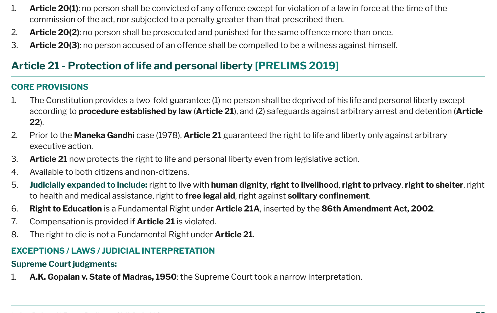
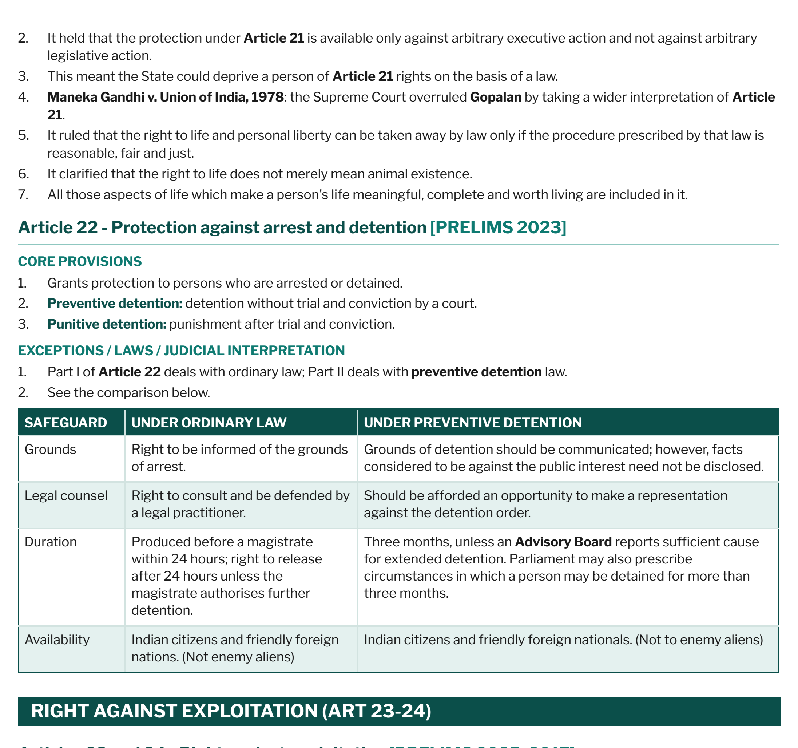

# Fundamental Rights (Part III: Articles 12 to 35) — Prelims Notes (X-Factor Pre'27)

---

### [Prelims Source Page 46](pages/prelims/prelims_page_046.pdf)

## CHAPTER 07
FUNDAMENTAL RIGHTS
THEME ANALYSIS PYQ pattern for this chapter
1. REPEATS

#### A. Placing a Right in the Correct Article
- Article 21 dominates, choice of marriage partner [2019] and Right to Privacy [2024, 2021, 2018]
- Which head does abolition of untouchability fall - under Right to Equality (Article 17) [2020, 2017]
- Articles 23 and 24, forced labour and child labour below 14 years [2025, 2017]

#### B. Definitions, Doctrines and Limits
- Article 13 meaning of law, including custom or usage having the force of law [2026]
- Article 14 voiding unguided and uncontrolled executive discretion [2021]
- Article 16(4) read with Article 335, which defines nothing [2023]
- Article 30 minority institutions and the Prime Minister's 15 Point Programme [2011]

#### C. Rights Inside versus Outside Part III
- Right to Property under Article 300A, a legal right of any person [2021]
- Right to vote as a constitutional right, not fundamental or natural [2017]
- Part III beside the Preamble, DPSP and duties as UDHR, 1948 reflections [2020, 2011]

#### D. Statutes and Remedies
- Article 22 detention, counsel and the Prevention of Terrorism Act, 2002 [2023]
- Article 32 writs, Habeas Corpus, Mandamus, Certiorari, Quo Warranto
- Article 35, certain rights legislated by Parliament alone
2. HOW THE FORMAT HAS CHANGED
- 2011 to 2017: code based recall of lists, minority benefits and UDHR rights [2011, 2017]
- 2018 to 2024: single answer placement of a right in its Article [2018, 2019, 2020, 2021, 2024]
- 2023: "how many" and Statement I and Statement II formats [2023]
- 2026: an argument style stem on the meaning of "law" in Art 13 [2026]
3. WHAT IS BEING ASKED NOW
- Definitions and doctrine: "law" under Art 13 [2026], Art 335 and reservation [2023], arbitrariness under Art 14 [2021]
- Detention safeguards under Art 22 [2023]
- Privacy keeps returning under Art 21 [2018, 2021, 2024]

#### Structured Tables on Page 46

| CHAPTER 07 |
| --- |
| FUNDAMENTAL RIGHTS |
| THEME ANALYSIS PYQ pattern for this chapter |
| 1. REPEATS A. Placing a Right in the Correct Article • Article 21 dominates, choice of marriage partner [2019] and Right to Privacy [2024, 2021, 2018] • Which head does abolition of untouchability fall - under Right to Equality (Article 17) [2020, 2017] • Articles 23 and 24, forced labour and child labour below 14 years [2025, 2017] B. Definitions, Doctrines and Limits • Article 13 meaning of law, including custom or usage having the force of law [2026] • Article 14 voiding unguided and uncontrolled executive discretion [2021] • Article 16(4) read with Article 335, which defines nothing [2023] • Article 30 minority institutions and the Prime Minister's 15 Point Programme [2011] C. Rights Inside versus Outside Part III • Right to Property under Article 300A, a legal right of any person [2021] • Right to vote as a constitutional right, not fundamental or natural [2017] • Part III beside the Preamble, DPSP and duties as UDHR, 1948 reflections [2020, 2011] D. Statutes and Remedies • Article 22 detention, counsel and the Prevention of Terrorism Act, 2002 [2023] • Article 32 writs, Habeas Corpus, Mandamus, Certiorari, Quo Warranto • Article 35, certain rights legislated by Parliament alone 2. HOW THE FORMAT HAS CHANGED • 2011 to 2017: code based recall of lists, minority benefits and UDHR rights [2011, 2017] • 2018 to 2024: single answer placement of a right in its Article [2018, 2019, 2020, 2021, 2024] • 2023: "how many" and Statement I and Statement II formats [2023] • 2026: an argument style stem on the meaning of "law" in Art 13 [2026] 3. WHAT IS BEING ASKED NOW • Definitions and doctrine: "law" under Art 13 [2026], Art 335 and reservation [2023], arbitrariness under Art 14 [2021] • Detention safeguards under Art 22 [2023] • Privacy keeps returning under Art 21 [2018, 2021, 2024] |

---

### [Prelims Source Page 47](pages/prelims/prelims_page_047.pdf)

### PRELIMS PREVIOUS YEAR QUESTIONS

**Q1. 'X' was addressing a seminar on the meaning of the**
term 'law' as provided under Article 13, Part III of the
Constitution of India. 'X' explained that the meaning
of the term 'law' in the Constitution of India was very
comprehensive. It included ordinances, orders and
even rules and regulations. 'Y' pointed out that the
term 'law' in Article 13 also included custom or usage
having in the territory of India the force of law, to which
'X' was not convinced. Based on the above, select the
correct conclusion from the options given below:

- **[2026]** 
(a) X is correct in the interpretation of law, including
the view on non-inclusion of custom
(b) The view of Y that 'law' included custom is not
correct
(c) The views of both X and Y are correct
(d) The view of only Y is correct
**`ANSWER (d)`**

Pairs on DPSP, Fundamental Duties and Fundamental
Rights [2025]: this PYQ now sits in Chapter 8, DPSP and
Fundamental Duties.

**Q2. Under which of the following Articles of the**
Constitution of India has the Supreme Court of India
placed the Right to Privacy? [2024]
(a) Article 15
(b) Article 16
(c) Article 19
(d) Article 21
**`ANSWER (d)`**

**Q3. Consider the following statements: [2023]**
Statement-I: The Supreme Court of India has held in
some judgements that the reservation policies made
under Article 16(4) of the Constitution of India would
be limited by Article 335 for maintenance of efficiency
of administration.
Statement-II: Article 335 of the Constitution of India
defines the term 'efficiency of administration'.
Which one of the following is correct in respect of the
above statements?
(a) Both Statement-I and Statement-II are correct
and Statement-II is the correct explanation for
Statement-I
(b) Both Statement-I and Statement-II are correct
and Statement-II is not the correct explanation
for Statement-I
(c) Statement-I is correct but Statement-II is
incorrect
(d) Statement-I is incorrect but Statement-II is
correct
**`ANSWER (c)`**

**Q4. Consider the following statements: [2023]**
1. According to the Constitution of India, the Central
Government has a duty to protect States from
internal disturbances.
2. The Constitution of India exempts the States
from providing legal counsel to a person being
held for preventive detention.
3. According to the Prevention of Terrorism Act,
2002, confession of the accused before the
police cannot be used as evidence.
How many of the above statements are correct?
(a) Only one
(b) Only two
(c) All three
(d) None
**`ANSWER (b)`**

**Q5. A legislation which confers on the executive or**
administrative authority an unguided and uncontrolled
discretionary power in the matter of application of law
violates which one of the following Articles of the
Constitution of India? [2021]
(a) Article 14
(b) Article 28
(c) Article 32
(d) Article 44
**`ANSWER (a)`**

**Q6. What is the position of the Right to Property in India?**

- **[2021]** 
(a) Legal right available to citizens only
(b) Legal right available to any person
(c) Fundamental Right available to citizens only
(d) Neither Fundamental Right nor legal right
**`ANSWER (b)`**

**Q7. 'Right to Privacy' is protected under which Article of**
the Constitution of India? [2021]
(a) Article 15
(b) Article 19
(c) Article 21
(d) Article 29
**`ANSWER (c)`**

---

### [Prelims Source Page 48](pages/prelims/prelims_page_048.pdf)

**Q8. Which one of the following categories of 'Fundamental**
Rights' incorporates protection against untouchability
as a form of discrimination? [2020]
(a) Right against Exploitation
(b) Right to Freedom
(c) Right to Constitutional Remedies
(d) Right to Equality
**`ANSWER (d)`**

**Q9. Other than the Fundamental Rights, which of the**
following parts of the Constitution of India
reflect/reflects the principles and provisions of the
Universal Declaration of Human Rights (1948)? [2020]
1. Preamble
2. Directive Principles of State Policy
3. Fundamental Duties Select the correct answer
using the code given below:
(a) 1 and 2 only
(b) 2 only
(c) 1 and 3 only
(d) 1, 2 and 3
**`ANSWER (d)`**

**Q10. Which Article of the Constitution of India safeguards**
one's right to marry the person of one's choice? [2019]
(a) Article 19
(b) Article 21
(c) Article 25
(d) Article 29
**`ANSWER (b)`**

**Q11. Right to Privacy is protected as an intrinsic part of**
Right to Life and Personal Liberty. Which of the
following in the Constitution of India correctly and
appropriately imply the above statement? [2018]
(a) Article 14 and the provisions under the 42nd
Amendment to the Constitution
(b) Article 17 and the Directive Principles of State
Policy in Part IV
(c) Article 21 and the freedoms guaranteed in Part III
(d) Article 24 and the provisions under the 44th
Amendment to the Constitution
**`ANSWER (c)`**

**Q12. Which of the following are envisaged by the Right**
against Exploitation in the Constitution of India?

- **[2017]** 
1. Prohibition of traffic in human beings and forced
labour
2. Abolition of untouchability
3. Protection of the interests of minorities
4. Prohibition of employment of children in factories
and mines Select the correct answer using the
code given below:
(a) 1, 2 and 4 only
(b) 2, 3 and 4 only
(c) 1 and 4 only
(d) 1, 2, 3 and 4
**`ANSWER (c)`**

Right to vote [2017]: this PYQ now sits in Chapter 19,
Elections.

**Q13. In India, if a religious sect/community is given the**
status of a national minority, what special advantages
is it entitled to? [2011]
1. It can establish and administer exclusive
educational institutions.
2. The President of India automatically nominates a
representative of the community to Lok Sabha.
3. It can derive benefits from the Prime Minister's
15-Point Programme.
Which of the statements given above is/are correct?
(a) 1 only
(b) 2 and 3 only
(c) 1 and 3 only
(d) 1, 2 and 3
**`ANSWER (c)`**

**Q14. Consider the following: [2011]**
1. Right to education
2. Right to equal access to public service
3. Right to food Which of the above is/are Human
Right/Human Rights under the Universal
Declaration of Human Rights?
(a) 1 only
(b) 1 and 2 only
(c) 3 only
(d) 1, 2 and 3
**`ANSWER (d)`**

PART III - FUNDAMENTAL RIGHTS: GENERAL FEATURES
Nature and Scope

### CORE PROVISIONS
1. Contained in Part III of the Constitution; described as the Magna Carta of the Indian Constitution.
2. Place limits on the tyranny of the Executive and on arbitrary laws of the Legislature.
3. Parliament can amend Fundamental Rights.

---

### [Prelims Source Page 49](pages/prelims/prelims_page_049.pdf)

4. Not absolute; subject to reasonable restrictions.
5. Important for the overall development of citizens.
EXCEPTIONS / LAWS / JUDICIAL INTERPRETATION
1. While Articles 17, 20, and 24 act as strict limitations that Parliament cannot override (though it must legislate to enforce
them), Articles 15 and 18 are not absolute because the Constitution explicitly permits the legislature to create exceptions
like reservations, military titles, and academic honors.
2. Available to Indian citizens only: Art 15, 16, 19, 29, 30.
3. Available to all residents of India, both citizens and foreigners: Art 14, 20, 21, 21A, 22, 23, 24, 25, 26, 27, 28.
4. Negatively worded as prohibitions on the State: Art 14, 15(1), 16(2), 18(1), 20, 22(1), 28(1).
5. Rights outside Part III:
(a) Art 265: no tax except by authority of law.
(b) Art 300A: property, a constitutional and legal right after the 44th Amendment Act, 1978.
(c) Art 301: freedom of trade, commerce and intercourse.
DEFINITION AND SCOPE (ART 12-13)

#### Article 12 - Definition of 'State'

### CORE PROVISIONS
1. Defines State for the purposes of Part III, covering four categories.
2. Government and Parliament of India, i.e. the executive and legislature of the Union.
3. Government and legislature of each State.
4. All local authorities within the territory of India: municipalities, panchayats, district boards, improvement trusts.
5. All other authorities within the territory of India or under the control of the Government of India: bodies such as LIC,
ONGC, SAIL.
EXCEPTIONS / LAWS / JUDICIAL INTERPRETATION
1. As per the Supreme Court, a private body or agency working as an instrument of the State falls within the meaning of
State under Article 12.

#### Article 13 - Laws inconsistent with Fundamental Rights [PRELIMS 2026]

### CORE PROVISIONS
1. All laws that are inconsistent with, or in derogation of, any of the Fundamental Rights shall be void.
2. Article 13 does not include a Constitutional Amendment within the meaning of law.
EXCEPTIONS / LAWS / JUDICIAL INTERPRETATION
'Law' under Article 13 includes:
1. Permanent and temporary laws made by Parliament, and Ordinances.
2. Delegated legislation: order, bye-law, rule, regulation or notification.
3. Non-legislative sources of law, that is custom or usage having the force of law.
RIGHT TO EQUALITY (ART 14-18)

#### Article 14 - Equality before law [PRELIMS 2021]

### CORE PROVISIONS
1. The State shall not deny to any person equality before the law or the equal protection of the laws within the territory of
India.
2. Available to all persons, citizens as well as foreigners, and to legal persons.
EXCEPTIONS / LAWS / JUDICIAL INTERPRETATION
Five exceptions:
1. Article 31C: laws made by the State for implementing the Directive Principles in Art 39(b) or 39(c) cannot be challenged
on the ground that they violate Article 14. 'Where Article 31-C comes in, Article 14 goes out', the Supreme Court ruled.

---

### [Prelims Source Page 50](pages/prelims/prelims_page_050.pdf)

2. Article 361: protection of the President, Governors and Rajpramukhs - 361(1) not answerable to any court for
performance of their duties; 361(2) no criminal proceeding; 361(3) no arrest; 361(4) no civil proceeding.
3. Article 361A: no person liable for civil or criminal proceedings in respect of publication in a newspaper of a substantially
true report of proceedings of Parliament or a State legislature.
4. Article 105: parliamentary privileges of Members of Parliament.
5. Article 194: privileges of members of State legislatures.
COMPARISON EQUALITY BEFORE LAW EQUAL PROTECTION OF LAW
Concept Negative concept. Positive concept.
Meaning Absence of any special privilege in favour of any
person.
Right to equality of treatment in similar
circumstances.
Application Law is the same for rich or poor, official or
non-official, high or low.
Like should be treated alike, and not that unlike
should be treated as alike.
Doctrine Dicey's concept of Rule of Law. Treated as due process of law.
Origin British origin. American origin.

#### Article 15 - Prohibition of discrimination

### CORE PROVISIONS
1. The State shall not discriminate against any citizen on five grounds: (1) religion, (2) race, (3) caste, (4) sex, (5) place of birth.
2. The provision prohibits discrimination both by the State and by private individuals.
3. Articles 15(3) and 15(4) are the foundational bricks of reservation in the country.
EXCEPTIONS / LAWS / JUDICIAL INTERPRETATION
Laws passed:
1. Reservation for OBCs in educational institutions: Central Educational Institutions (Reservation in Admission) Act,
2006.
2. It provides 27% reservation for OBCs in all central higher educational institutions, including the IITs and IIMs.
3. Reservation for EWS in educational institutions: the 103rd Amendment Act, 2019 inserted Article 15(6), and the
Central Government issued an order in 2019 providing 10% reservation to EWS in admission to educational institutions.

#### Article 16 - Equality of opportunity in public employment [PRELIMS 2023]

### CORE PROVISIONS
1. Equality of opportunity for all citizens in matters of employment or appointment to any office under the State.
2. No discrimination on seven grounds: (1) religion, (2) race, (3) caste, (4) sex, (5) descent, (6) place of birth, (7) residence.
EXCEPTIONS / LAWS / JUDICIAL INTERPRETATION
Four exceptions:
1. Article 16(3): residence within a State may be prescribed as a qualification for appointment to a government post.
2. Article 16(4): reservation of posts in government jobs in favour of any backward class.
3. Article 16(5) : creates an exception to the rule of equal opportunity by allowing the state to make a law that the head or
governing members of a religious or denominational institution must belong to that specific religion or denomination.
4. Article 16(6): the State may reserve up to 10% of appointments in favour of any economically weaker section of citizens.

#### Article 17 - Abolition of untouchability [PRELIMS 2020]

### CORE PROVISIONS
1. Abolishes “untouchability” and forbids its practice in any form.
2. Enforcing any disability arising out of untouchability is an offence punishable by law.
3. It is an absolute right with no exceptions, and it is available against private individuals as well. The State has a
constitutional obligation to take necessary action so the right is not violated (PUDR v. Union of India, 1982).
4. It does not cover the social boycott of a few individuals or their exclusion from religious services, unless that
exclusion rests on caste or untouchability.
5. Neither the Constitution nor the Act defines “untouchability”.

#### Structured Tables on Page 50

| COMPARISON | EQUALITY BEFORE LAW | EQUAL PROTECTION OF LAW |
| --- | --- | --- |
| Concept | Negative concept. | Positive concept. |
| Meaning | Absence of any special privilege in favour of any person. | Right to equality of treatment in similar circumstances. |
| Application | Law is the same for rich or poor, official or non-official, high or low. | Like should be treated alike, and not that unlike should be treated as alike. |
| Doctrine | Dicey's concept of Rule of Law. | Treated as due process of law. |
| Origin | British origin. | American origin. |

---

### [Prelims Source Page 51](pages/prelims/prelims_page_051.pdf)

6. Under Art 35, only Parliament (not State legislatures) can make laws prescribing punishment for untouchability.
EXCEPTIONS / LAWS / JUDICIAL INTERPRETATION
Laws passed:
1. Parliament enacted the Untouchability (Offences) Act, 1955.
2. In 1976 it was made more stringent and renamed the Protection of Civil Rights Act, 1955.
Judicial interpretation:
3. Mysore High Court: the subject matter of Article 17 is not untouchability in the literal or grammatical sense, but the
practice as it developed historically in the country, involving social disabilities imposed on certain classes.

#### Article 18 - Abolition of titles

### CORE PROVISIONS
1. Prohibits the State from conferring any title, except a military or academic distinction, on anybody, whether a citizen or a
foreigner.
2. Prohibits a citizen of India from accepting any title from any foreign state.
EXCEPTIONS / LAWS / JUDICIAL INTERPRETATION
Supreme Court judgment:
1. Balaji Raghavan v. Union of India, 1996: the Supreme Court upheld the validity of the National Awards - Bharat Ratna,
Padma Vibhushan, Padma Bhushan and Padma Shri.
2. The theory of equality does not mandate that merit should not be recognised.
3. These awards do not amount to titles within the meaning of Article 18, which prohibits only hereditary titles of nobility.
4. They should not be used as suffixes or prefixes to the names of awardees.
RIGHT TO FREEDOM (ART 19-22)

#### Article 19 - Right to Freedom

### CORE PROVISIONS
1. Guarantees six freedoms to citizens; originally seven.
2. Article 19(1)(f), the right to acquire, hold and dispose of property, was omitted by the 44th Amendment Act, 1978.
3. Available to citizens only, not to foreigners or legal persons such as companies.
EXCEPTIONS / LAWS / JUDICIAL INTERPRETATION
1. Each freedom is subject to reasonable restrictions specified in Articles 19(2) to 19(6).
2. See the freedom-wise breakdown below.
FREEDOM UNDER ART 19(1) REASONABLE RESTRICTIONS RELEVANT
AMENDMENTS
19(1)(a) - Freedom of speech and
expression
Eight grounds under Art 19(2), in two groups:
(a) State related: sovereignty and integrity of India, security
of the State, friendly relations with foreign States, public
order.
(b) Society and courts: decency or morality, contempt of
court, defamation, incitement to an offence.
1st Amendment
(1951): added
friendly relations,
public order,
incitement to an
offence, and the
word “reasonable”.
16th Amendment
(1963): added
sovereignty and
integrity
19(1)(b) - To assemble peaceably
and without arms
Two grounds under Art 19(3): (1) sovereignty and integrity of
India, (2) public order.
16th Amendment
(1963).
19(1)(c) - To form associations,
unions or co-operative societies
Three grounds under Art 19(4): (1) sovereignty and integrity of
India, (2) public order, (3) morality.
16th Amendment
(1963): added
sovereignty and
integrity. 97th

#### Structured Tables on Page 51

| FREEDOM UNDER ART 19(1) | REASONABLE RESTRICTIONS | RELEVANT AMENDMENTS |
| --- | --- | --- |
| 19(1)(a) - Freedom of speech and expression | Eight grounds under Art 19(2), in two groups: (a) State related: sovereignty and integrity of India, security of the State, friendly relations with foreign States, public order. (b) Society and courts: decency or morality, contempt of court, defamation, incitement to an offence. | 1st Amendment (1951): added friendly relations, public order, incitement to an offence, and the word “reasonable”. 16th Amendment (1963): added sovereignty and integrity |
| 19(1)(b) - To assemble peaceably and without arms | Two grounds under Art 19(3): (1) sovereignty and integrity of India, (2) public order. | 16th Amendment (1963). |
| 19(1)(c) - To form associations, unions or co-operative societies | Three grounds under Art 19(4): (1) sovereignty and integrity of India, (2) public order, (3) morality. | 16th Amendment (1963): added sovereignty and integrity. 97th |

---

### [Prelims Source Page 52](pages/prelims/prelims_page_052.pdf)

*Diagram Screenshot: [Article 21: Protection of Life and Personal Liberty & Landmark Cases](diagrams/pre_diag_art21_rights_table_p052.png) | [Full Source Page 52](pages/prelims/prelims_page_052.pdf)*

FREEDOM UNDER ART 19(1) REASONABLE RESTRICTIONS RELEVANT
AMENDMENTS
Amendment (2011):
added “co-operative
societies”. Part IXB
was struck down for
State co-operatives
(Rajendra N. Shah,
2021); 19(1)(c) and
Art 43B survive
19(1)(d) - To move freely
throughout the territory of India
Two grounds under Art 19(5): (1) protection of the interests of
the general public, (2) protection of the interests of Scheduled
Tribes.
19(1)(e) - To reside and settle in any
part of the territory of India
Two grounds under Art 19(5), same as above.
19(1)(f) - To acquire, hold and
dispose of property [OMITTED]
Formerly two grounds under Art 19(5); omitted along with the
freedom.
44th Amendment
(1978) - omitted.
19(1)(g) - To practise any
profession, or carry on any
occupation, trade or business
Three grounds under Art 19(6): (1) interests of the general
public, (2) prescription of professional or technical
qualifications, (3) State monopoly.
1st Amendment
(1951).

#### Article 20 - Protection in respect of conviction for offences

### CORE PROVISIONS
1. Provides protection from arbitrary and disproportionate punishment to an accused person, whether a citizen, a foreigner,
or a legal person such as a company or corporation.
2. Contains three safeguards: (1) no ex-post-facto law, (2) no double jeopardy, (3) no self-incrimination.
3. Cannot be suspended even during a National Emergency (along with Article 21).
EXCEPTIONS / LAWS / JUDICIAL INTERPRETATION
1. Article 20(1): no person shall be convicted of any offence except for violation of a law in force at the time of the
commission of the act, nor subjected to a penalty greater than that prescribed then.
2. Article 20(2): no person shall be prosecuted and punished for the same offence more than once.
3. Article 20(3): no person accused of an offence shall be compelled to be a witness against himself.

#### Article 21 - Protection of life and personal liberty [PRELIMS 2019]

### CORE PROVISIONS
1. The Constitution provides a two-fold guarantee: (1) no person shall be deprived of his life and personal liberty except
according to procedure established by law (Article 21), and (2) safeguards against arbitrary arrest and detention (Article
22).
2. Prior to the Maneka Gandhi case (1978), Article 21 guaranteed the right to life and liberty only against arbitrary
executive action.
3. Article 21 now protects the right to life and personal liberty even from legislative action.
4. Available to both citizens and non-citizens.
5. Judicially expanded to include: right to live with human dignity, right to livelihood, right to privacy, right to shelter, right
to health and medical assistance, right to free legal aid, right against solitary confinement.
6. Right to Education is a Fundamental Right under Article 21A, inserted by the 86th Amendment Act, 2002.
7. Compensation is provided if Article 21 is violated.
8. The right to die is not a Fundamental Right under Article 21.
EXCEPTIONS / LAWS / JUDICIAL INTERPRETATION
Supreme Court judgments:
1. A.K. Gopalan v. State of Madras, 1950: the Supreme Court took a narrow interpretation.

#### Structured Tables on Page 52

| FREEDOM UNDER ART 19(1) | REASONABLE RESTRICTIONS | RELEVANT AMENDMENTS |
| --- | --- | --- |
|  |  | Amendment (2011): added “co-operative societies”. Part IXB was struck down for State co-operatives (Rajendra N. Shah, 2021); 19(1)(c) and Art 43B survive |
| 19(1)(d) - To move freely throughout the territory of India | Two grounds under Art 19(5): (1) protection of the interests of the general public, (2) protection of the interests of Scheduled Tribes. |  |
| 19(1)(e) - To reside and settle in any part of the territory of India | Two grounds under Art 19(5), same as above. |  |
| 19(1)(f) - To acquire, hold and dispose of property [OMITTED] | Formerly two grounds under Art 19(5); omitted along with the freedom. | 44th Amendment (1978) - omitted. |
| 19(1)(g) - To practise any profession, or carry on any occupation, trade or business | Three grounds under Art 19(6): (1) interests of the general public, (2) prescription of professional or technical qualifications, (3) State monopoly. | 1st Amendment (1951). |

---

### [Prelims Source Page 53](pages/prelims/prelims_page_053.pdf)

*Diagram Screenshot: [Article 21: Inferred Fundamental Rights, Right to Education (Art 21A) & Art 22 Safeguards](diagrams/pre_diag_art21_inferred_rights_p053.png) | [Full Source Page 53](pages/prelims/prelims_page_053.pdf)*

2. It held that the protection under Article 21 is available only against arbitrary executive action and not against arbitrary
legislative action.
3. This meant the State could deprive a person of Article 21 rights on the basis of a law.
4. Maneka Gandhi v. Union of India, 1978: the Supreme Court overruled Gopalan by taking a wider interpretation of Article
21.
5. It ruled that the right to life and personal liberty can be taken away by law only if the procedure prescribed by that law is
reasonable, fair and just.
6. It clarified that the right to life does not merely mean animal existence.
7. All those aspects of life which make a person's life meaningful, complete and worth living are included in it.

#### Article 22 - Protection against arrest and detention [PRELIMS 2023]

### CORE PROVISIONS
1. Grants protection to persons who are arrested or detained.
2. Preventive detention: detention without trial and conviction by a court.
3. Punitive detention: punishment after trial and conviction.
EXCEPTIONS / LAWS / JUDICIAL INTERPRETATION
1. Part I of Article 22 deals with ordinary law; Part II deals with preventive detention law.
2. See the comparison below.
SAFEGUARD UNDER ORDINARY LAW UNDER PREVENTIVE DETENTION
Grounds Right to be informed of the grounds
of arrest.
Grounds of detention should be communicated; however, facts
considered to be against the public interest need not be disclosed.
Legal counsel Right to consult and be defended by
a legal practitioner.
Should be afforded an opportunity to make a representation
against the detention order.
Duration Produced before a magistrate
within 24 hours; right to release
after 24 hours unless the
magistrate authorises further
detention.
Three months, unless an Advisory Board reports sufficient cause
for extended detention. Parliament may also prescribe
circumstances in which a person may be detained for more than
three months.
Availability Indian citizens and friendly foreign
nations. (Not enemy aliens)
Indian citizens and friendly foreign nationals. (Not to enemy aliens)
RIGHT AGAINST EXPLOITATION (ART 23-24)
Articles 23 and 24 - Right against exploitation [PRELIMS 2025, 2017]

### CORE PROVISIONS

#### Article 23:
1. Prohibits traffic in human beings and forced labour.
2. Protects the individual against actions of both the State and private citizens.
3. Available to both citizens and non-citizens.

#### Article 24:
4. Prohibits employment of children below 14 years of age in any factory, mine or other hazardous occupation.
EXCEPTIONS / LAWS / JUDICIAL INTERPRETATION
Exception:
1. Compulsory service for public purposes, such as conscription to the armed forces, is not unconstitutional.
2. In imposing such service the State shall not discriminate on four grounds: (1) religion, (2) race, (3) caste, (4) class, or any of
them.
Laws passed:
3. Suppression of Immoral Traffic in Women and Girls Act, 1956.
4. Bonded Labour System (Abolition) Act, 1976.

#### Structured Tables on Page 53

| SAFEGUARD | UNDER ORDINARY LAW | UNDER PREVENTIVE DETENTION |
| --- | --- | --- |
| Grounds | Right to be informed of the grounds of arrest. | Grounds of detention should be communicated; however, facts considered to be against the public interest need not be disclosed. |
| Legal counsel | Right to consult and be defended by a legal practitioner. | Should be afforded an opportunity to make a representation against the detention order. |
| Duration | Produced before a magistrate within 24 hours; right to release after 24 hours unless the magistrate authorises further detention. | Three months, unless an Advisory Board reports sufficient cause for extended detention. Parliament may also prescribe circumstances in which a person may be detained for more than three months. |
| Availability | Indian citizens and friendly foreign nations. (Not enemy aliens) | Indian citizens and friendly foreign nationals. (Not to enemy aliens) |

---

### [Prelims Source Page 54](pages/prelims/prelims_page_054.pdf)

5. Commissions for Protection of Child Rights Act, 2005, providing for a National Commission and State Commissions for
Protection of Child Rights and for Children's Courts for speedy trial of offences against children or violation of child
rights.
RIGHT TO FREEDOM OF RELIGION (ART 25-28)
Articles 25 and 26 - Freedom of religion

### CORE PROVISIONS
1. Article 25 guarantees freedom of conscience and the right freely to profess, practise and propagate religion.
2. Article 26 guarantees freedom to manage religious affairs.
3. See the comparison below.
EXCEPTIONS / LAWS / JUDICIAL INTERPRETATION
Exceptions:
1. Subject to public order, morality and health.
2. Subject to the other provisions of Part III relating to Fundamental Rights (Article 25 only).
3. The right to propagate does not include the right to convert.
BASIS ARTICLE 25 ARTICLE 26
Content Freedom of conscience, and free profession,
practice and propagation of religion.
Freedom to manage religious affairs.
Holder of the
right
Rights of individuals. Rights of religious denominations or their sections, to
establish and maintain institutions for religious and
charitable purposes.
Character Protects individualistic freedom of religion. Protects collective freedom of religion.
Limitations Subject to public order, morality and health, and
also to the other provisions of Part III relating to
Fundamental Rights.
Subject to public order, morality and health, but not
to the other provisions of Part III relating to
Fundamental Rights.

#### Article 27 - Freedom from taxation for promotion of religion

### CORE PROVISIONS
1. No person shall be compelled to pay any taxes for the promotion or maintenance of any particular religion or religious
denomination.
2. The provision prohibits the State from favouring, patronising or supporting one religion over another.
EXCEPTIONS / LAWS / JUDICIAL INTERPRETATION
Supreme Court judgment:
1. Ratilal Panachand Gandhi v. State of Bombay, 1954: the provision prohibits only the levy of a tax, not a fee.
2. The purpose of a fee is to control the secular administration of religious institutions, not to promote or maintain religion.
3. A fee can be levied on pilgrims to provide them with some special service or safety measures.
4. Similarly, a fee can be levied on religious endowments to meet regulatory expenditure.

#### Article 28 - Freedom to attend religious instruction

### CORE PROVISIONS
1. No religious instruction shall be provided in any educational institution wholly maintained out of State funds.
2. This does not apply to an educational institution administered by the State but established under an endowment or trust
requiring imparting of religious instruction in such institution.
EXCEPTIONS / LAWS / JUDICIAL INTERPRETATION
Article 28 distinguishes four types of educational institutions:
1. Institutions wholly maintained by the State: religious instruction completely prohibited.
2. Institutions administered by the State but established under an endowment or trust: religious instruction permitted.

#### Structured Tables on Page 54

| BASIS | ARTICLE 25 | ARTICLE 26 |
| --- | --- | --- |
| Content | Freedom of conscience, and free profession, practice and propagation of religion. | Freedom to manage religious affairs. |
| Holder of the right | Rights of individuals. | Rights of religious denominations or their sections, to establish and maintain institutions for religious and charitable purposes. |
| Character | Protects individualistic freedom of religion. | Protects collective freedom of religion. |
| Limitations | Subject to public order, morality and health, and also to the other provisions of Part III relating to Fundamental Rights. | Subject to public order, morality and health, but not to the other provisions of Part III relating to Fundamental Rights. |

---

### [Prelims Source Page 55](pages/prelims/prelims_page_055.pdf)

3. Institutions recognised by the State: religious instruction permitted on a voluntary basis.
4. Institutions receiving aid from the State: religious instruction permitted on a voluntary basis.
CULTURAL AND EDUCATIONAL RIGHTS (ART 29-30)

#### Article 29 - Protection of interests of minorities

### CORE PROVISIONS
1. Any section of citizens having a distinct language, script or culture has the right to conserve the same.
2. No citizen can be denied admission into any educational institution maintained by the State, or receiving aid out of State
funds, on grounds of religion, race, caste or language.
3. Covers both religious and linguistic minorities.
4. The Constitution of India does not define minorities.
EXCEPTIONS / LAWS / JUDICIAL INTERPRETATION
Supreme Court judgments:
1. The right to conserve the language includes the right to agitate for the protection of the language.
2. The scope of this Article is not necessarily restricted to minorities alone.
3. This is because of the use of the words 'section of citizens' in Article 29, which includes minorities as well as the
majority.

#### Article 30 - Right of minorities to establish and administer educational institutions [PRELIMS
2011]

### CORE PROVISIONS
1. Right to establish and administer educational institutions of their choice.
2. The State shall not discriminate against minority-managed institutions while granting aid.
3. Available only to religious and linguistic minorities, not to any section of citizens.
EXCEPTIONS / LAWS / JUDICIAL INTERPRETATION
1. Contrast with Article 29, which extends to any section of citizens; Article 30 is confined to minorities.
2. Compensation for compulsory acquisition of the property of a minority educational institution must not restrict or
abrogate the right guaranteed under Article 30.
RIGHT TO CONSTITUTIONAL REMEDIES (ART 32) AND ART 35

#### Article 32 - Right to Constitutional Remedies

### CORE PROVISIONS
1. Entitles citizens to move the Supreme Court for the enforcement of Fundamental Rights.
2. Described by Dr B.R. Ambedkar as the heart and soul of the Constitution.
3. Writs are written orders issued by the Supreme Court to provide constitutional remedies and protect the fundamental
rights of citizens from violation.
4. Five writs: habeas corpus, mandamus, prohibition, certiorari, quo warranto.
EXCEPTIONS / LAWS / JUDICIAL INTERPRETATION
Exceptions and limits:
1. The right to move the Supreme Court shall not be suspended except as provided for by the Constitution, not by
Parliament.
2. Accordingly, the Constitution provides that the President can suspend enforcement of Fundamental Rights during a
National Emergency (Article 359).
3. Violation of a Fundamental Right is a sine qua non for Article 32; it cannot be invoked to determine the constitutionality
of an executive order or legislation unless it directly infringes a Fundamental Right.

---

### [Prelims Source Page 56](pages/prelims/prelims_page_056.pdf)

BASIS ARTICLE 32 ARTICLE 226
Nature of
right
A Fundamental Right. A constitutional right.
Scope Narrow scope. Applicable for the enforcement of Fundamental
Rights alone.
Broader scope. Applicable for the
enforcement of Fundamental Rights as
well as legal rights.
Jurisdiction Broader territorial jurisdiction; the Supreme Court can issue
writs all over India.
Narrower territorial jurisdiction; a High
Court can issue a writ within its own local
jurisdiction only.
Discretion to
refuse
Since Article 32 is itself a Fundamental Right, the Supreme
Court cannot refuse relief.
Article 226 confers a discretionary
power on the High Court, which may or
may not issue a writ.
Suspension Art 32(4): the right to move the Supreme Court cannot be
suspended, except as the Constitution itself provides.
The one route: during a National Emergency, the President may
suspend enforcement of Fundamental Rights under Article
359.
Even then, Arts 20 and 21 cannot be suspended (44th
Amendment, 1978).
Cannot be suspended even at the time of
emergency.
WRIT PURPOSE CAN BE ISSUED AGAINST
Habeas
Corpus
To direct the release of a person detained
unlawfully.
Both public authorities and private individuals.
Mandamus To direct a public authority to perform its
duty.
A public body, a corporation, an inferior court, a tribunal, or the
government. Not against a private individual, the President or
Governors, or the Chief Justice of a High Court acting judicially.
Prohibition To prohibit a lower court or tribunal from
proceeding in a case exceeding its
jurisdiction.
Judicial and quasi-judicial authorities only. Not against
administrative authorities, legislative bodies or private
individuals.
Certiorari To transfer a pending case to itself, or to
squash the order of a lower court in a
case.
Judicial, quasi-judicial and, since 1991, administrative authorities.
Quo
Warranto
To direct a person to vacate an office
assumed wrongfully.
Only in respect of a substantive public office of a permanent
character created by statute or by the Constitution. Not against
ministerial or private offices.

#### Article 35 - Legislation to give effect to Fundamental Rights

### CORE PROVISIONS
1. The power to give effect to certain specified Fundamental Rights vests only in Parliament and not in the State
legislatures.
2. This ensures uniformity throughout India regarding the nature of those Fundamental Rights and the punishment for
their infringement.
EXCEPTIONS / LAWS / JUDICIAL INTERPRETATION
Parliament alone may make laws for:
1. Prescribing residence as a condition for certain employment or appointments in a State, Union Territory, local authority or
other authority.
2. Empowering courts other than the Supreme Court and the High Courts to issue directions, orders and writs for the
enforcement of Fundamental Rights.
3. Restricting or abrogating the application of Fundamental Rights to members of the armed forces, police forces, etc.
4. Indemnifying any government servant or other person for acts done during the operation of martial law in any area.

#### Structured Tables on Page 56

| BASIS | ARTICLE 32 | ARTICLE 226 |
| --- | --- | --- |
| Nature of right | A Fundamental Right. | A constitutional right. |
| Scope | Narrow scope. Applicable for the enforcement of Fundamental Rights alone. | Broader scope. Applicable for the enforcement of Fundamental Rights as well as legal rights. |
| Jurisdiction | Broader territorial jurisdiction; the Supreme Court can issue writs all over India. | Narrower territorial jurisdiction; a High Court can issue a writ within its own local jurisdiction only. |
| Discretion to refuse | Since Article 32 is itself a Fundamental Right, the Supreme Court cannot refuse relief. | Article 226 confers a discretionary power on the High Court, which may or may not issue a writ. |
| Suspension | Art 32(4): the right to move the Supreme Court cannot be suspended, except as the Constitution itself provides. The one route: during a National Emergency, the President may suspend enforcement of Fundamental Rights under Article 359. Even then, Arts 20 and 21 cannot be suspended (44th Amendment, 1978). | Cannot be suspended even at the time of emergency. |

| WRIT | PURPOSE | CAN BE ISSUED AGAINST |
| --- | --- | --- |
| Habeas Corpus | To direct the release of a person detained unlawfully. | Both public authorities and private individuals. |
| Mandamus | To direct a public authority to perform its duty. | A public body, a corporation, an inferior court, a tribunal, or the government. Not against a private individual, the President or Governors, or the Chief Justice of a High Court acting judicially. |
| Prohibition | To prohibit a lower court or tribunal from proceeding in a case exceeding its jurisdiction. | Judicial and quasi-judicial authorities only. Not against administrative authorities, legislative bodies or private individuals. |
| Certiorari | To transfer a pending case to itself, or to squash the order of a lower court in a case. | Judicial, quasi-judicial and, since 1991, administrative authorities. |
| Quo Warranto | To direct a person to vacate an office assumed wrongfully. | Only in respect of a substantive public office of a permanent character created by statute or by the Constitution. Not against ministerial or private offices. |

---

### [Prelims Source Page 57](pages/prelims/prelims_page_057.pdf)

5. Prescribing punishment for acts declared to be offences under the Fundamental Rights, namely untouchability (Article
17) and traffic in human beings and forced labour (Article 23).
ALLIED THEMES
Rights outside Part III [PRELIMS 2021, 2017]

### CORE PROVISIONS
1. Right to property ceased to be a Fundamental Right when the 44th Amendment Act, 1978 omitted Article 19(1)(f) and
Article 31.
2. It now rests in Article 300A, Part XII: 'No person shall be deprived of his property save by authority of law', that is a legal
or constitutional right available to any person, citizen or foreigner, and not to citizens alone.
3. Right to vote and to be elected is not a Fundamental Right. It flows from Article 326 (adult suffrage) and is regulated by
the Representation of the People Act, 1951, making it a constitutional right exercised subject to statutory conditions.
EXCEPTIONS / LAWS / JUDICIAL INTERPRETATION
1. The Supreme Court has held that though no longer a Fundamental Right, property remains a constitutional right under

#### Article 300A and a human right in a welfare State, and cannot be taken away except in accordance with law.
2. Consequence: only Part III rights are enforceable under Article 32; these other rights are enforced through ordinary law
or under Article 226.
Right to Privacy [PRELIMS 2024, 2021, 2018]

### CORE PROVISIONS
1. Justice K.S. Puttaswamy (Retd.) v. Union of India, 2017: a nine-judge Bench of the Supreme Court held on 24 August
2017 that the right to privacy is a Fundamental Right.
2. Privacy is protected as an intrinsic part of the right to life and personal liberty under Article 21, and as part of the
freedoms guaranteed in Part III.
3. The anchor article is Article 21; it is not placed under Article 15, 16, 19 or 29.
EXCEPTIONS / LAWS / JUDICIAL INTERPRETATION
1. It is not an absolute right; it may be restricted only by a fair, just and reasonable procedure established by law.
2. The ruling is the constitutional basis of India's data protection law, the Digital Personal Data Protection Act, 2023.
UDHR, 1948 and the Constitution [PRELIMS 2020, 2011]

### CORE PROVISIONS
1. The Universal Declaration of Human Rights was adopted on 10 December 1948 and has 30 articles; India took part in its
drafting.
2. Besides the Fundamental Rights, its principles and provisions are reflected in the Preamble, the Directive Principles of
State Policy and the Fundamental Duties, all three.
3. The civil and political rights of the UDHR broadly correspond to Part III; its social, economic and cultural rights
correspond to Part IV.
EXCEPTIONS / LAWS / JUDICIAL INTERPRETATION
1. Rights expressly recognised in the UDHR include Article 26, the right to education; Article 21(2), the right of equal
access to public service in one's country; and Article 25(1), an adequate standard of living including food, that is the right
to food.
2. The UDHR is a declaration, not a treaty: it is not by itself legally binding, but it informs the reading of Part III.