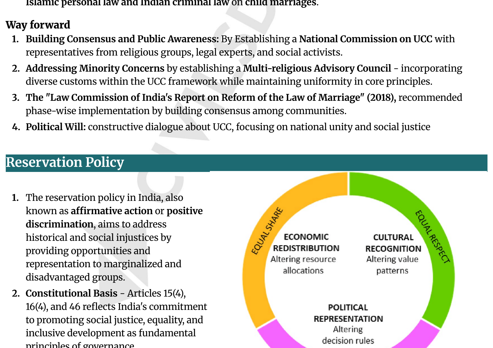

### [Smash Mains Source Page 37](../../pages/mains/mains_page_037.pdf)

### [Smash Mains Source Page 37](../../pages/mains/mains_page_037.pdf)

*Diagram Screenshot: [Dimensions of Equality: Equal Share, Equal Respect, Equal Say](../../diagrams/mains_diag_equality_dimensions_p037.png) · [Full Source Page 37](../../pages/mains/mains_page_037.pdf)*

### Challenges

- **1.** Lack of Consensus - Absence of broad-based community agreement may lead to social unrest.

- **2.** Religious Freedom - May infringe on Art. 25, as personal laws are integral to religious practices.

- **3.** Minority Rights - Could marginalise minorities, with fear of majority practices dominating.

- **4.** Cultural Diversity - Risks eroding India's plural traditions and imposing uniformity. Eg. Khasi matrilineal system in Meghalaya could be threatened.

- **5.** Practical Challenges - Drafting a uniform law for all communities is complex due to regional variations.

- **6.** Law Commission Report 2018: UCC "neither necessary nor desirable"

- **7.** Federalism Concerns - May undermine state autonomy, as personal laws fall under Concurrent List.

- **8.** Presence of Secular Laws that already address many issues for all citizens. Eg. Section 125 of the Criminal Procedure Code (maintenance) and Domestic Violence Act.

### SC Judgments

- **1.** Shah Bano Case (1985) - SC upheld Muslim women's right to maintenance under CrPC 125.

- **2.** Sarla Mudgal Case (1995) - SC declared second marriage after conversion void and stressed need for UCC for gender justice.

- **3.** Shayara Bano Case (2017) - SC struck down instant triple talaq, reinforcing uniform standards for gender justice.

- **4.** Jose Paulo Coutinho Case (2019) - SC praised Goa's UCC as a model for national implementation.

- **5.** The Delhi High Court recently advocated for a Uniform Civil Code (UCC), noting conflicts between Islamic personal law and Indian criminal law on child marriages.

### Way forward

- **1.** Building Consensus and Public Awareness: By Establishing a National Commission on UCC with representatives from religious groups, legal experts, and social activists.

- **2.** Addressing Minority Concerns by establishing a Multi-religious Advisory Council - incorporating diverse customs within the UCC framework while maintaining uniformity in core principles.

- **3.** The "Law Commission of India's Report on Reform of the Law of Marriage" (2018), recommended phase-wise implementation by building consensus among communities.

- **4.** Political Will: constructive dialogue about UCC, focusing on national unity and social justice

### Reservation Policy

- **1.** The reservation policy in India, also known as affirmative action or positive discrimination, aims to address historical and social injustices by providing opportunities and representation to marginalized and disadvantaged groups.

- **2.** Constitutional Basis - Articles 15(4), 16(4), and 46 reflects India's commitment to promoting social justice, equality, and inclusive development as fundamental principles of governance.
