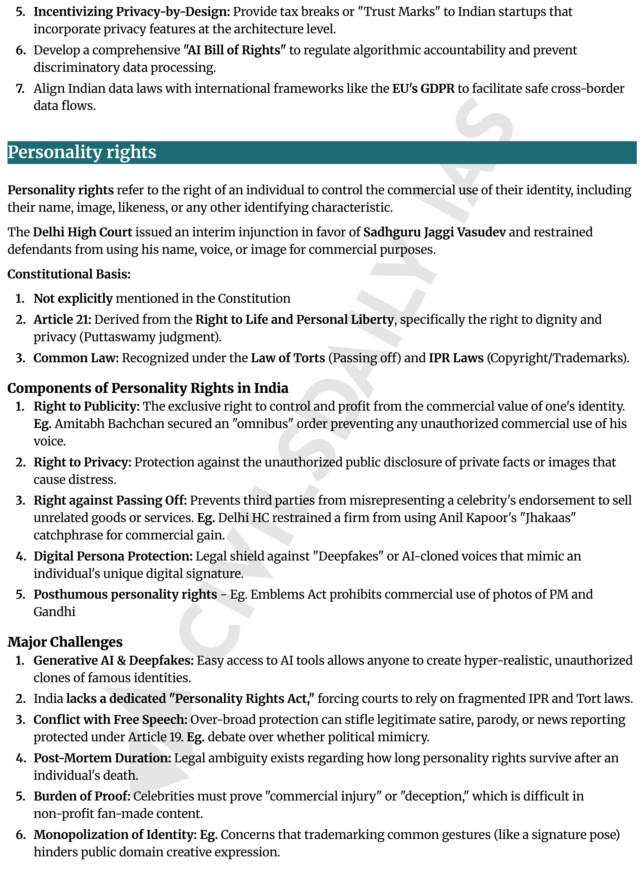

### [Smash Mains Source Page 50](../../pages/mains/mains_page_050.pdf)

### [Smash Mains Source Page 50](../../pages/mains/mains_page_050.pdf)

*Diagram Screenshot: [Right to Privacy (Article 21) & Puttaswamy Three-Pronged Test vs DPDP Act](../../diagrams/mains_diag_privacy_data_protection_art21_p050.png) · [Full Source Page 50](../../pages/mains/mains_page_050.pdf)*

- **5.** Incentivizing Privacy-by-Design: Provide tax breaks or "Trust Marks" to Indian startups that incorporate privacy features at the architecture level.

- **6.** Develop a comprehensive "AI Bill of Rights" to regulate algorithmic accountability and prevent discriminatory data processing.

- **7.** Align Indian data laws with international frameworks like the EU's GDPR to facilitate safe cross-border data flows.

### Personality rights

Personality rights refer to the right of an individual to control the commercial use of their identity, including their name, image, likeness, or any other identifying characteristic. The Delhi High Court issued an interim injunction in favor of Sadhguru Jaggi Vasudev and restrained defendants from using his name, voice, or image for commercial purposes. Constitutional Basis:

- **1.** Not explicitly mentioned in the Constitution

- **2.** Article 21: Derived from the Right to Life and Personal Liberty, specifically the right to dignity and privacy (Puttaswamy judgment).

- **3.** Common Law: Recognized under the Law of Torts (Passing off) and IPR Laws (Copyright/Trademarks).

### Components of Personality Rights in India

- **1.** Right to Publicity: The exclusive right to control and profit from the commercial value of one's identity. Eg. Amitabh Bachchan secured an "omnibus" order preventing any unauthorized commercial use of his voice.

- **2.** Right to Privacy: Protection against the unauthorized public disclosure of private facts or images that cause distress.

- **3.** Right against Passing Off: Prevents third parties from misrepresenting a celebrity's endorsement to sell unrelated goods or services. Eg. Delhi HC restrained a firm from using Anil Kapoor's "Jhakaas" catchphrase for commercial gain.

- **4.** Digital Persona Protection: Legal shield against "Deepfakes" or AI-cloned voices that mimic an individual's unique digital signature.

- **5.** Posthumous personality rights - Eg. Emblems Act prohibits commercial use of photos of PM and Gandhi

### Major Challenges

- **1.** Generative AI & Deepfakes: Easy access to AI tools allows anyone to create hyper-realistic, unauthorized clones of famous identities.

- **2.** India lacks a dedicated "Personality Rights Act," forcing courts to rely on fragmented IPR and Tort laws.

- **3.** Conflict with Free Speech: Over-broad protection can stifle legitimate satire, parody, or news reporting protected under Article 19. Eg. debate over whether political mimicry.

- **4.** Post-Mortem Duration: Legal ambiguity exists regarding how long personality rights survive after an individual's death.

- **5.** Burden of Proof: Celebrities must prove "commercial injury" or "deception," which is difficult in non-profit fan-made content.

- **6.** Monopolization of Identity: Eg. Concerns that trademarking common gestures (like a signature pose) hinders public domain creative expression.
