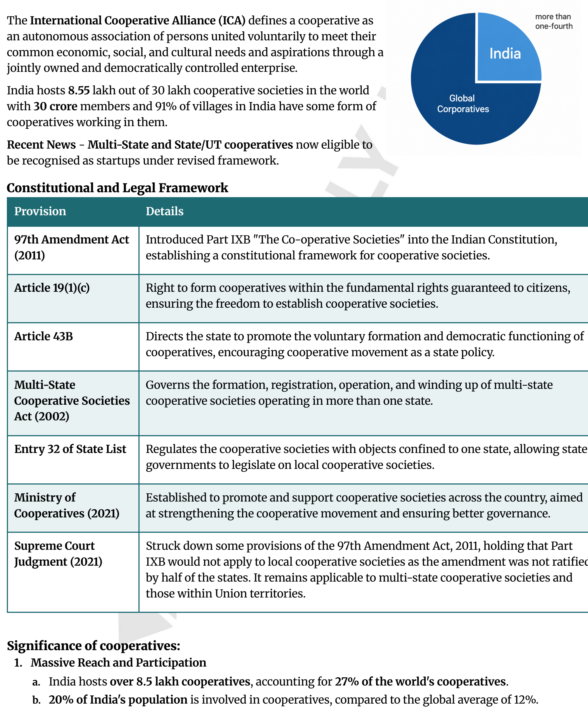

### [Smash Mains Source Page 62](../../pages/mains/mains_page_062.pdf)

### [Smash Mains Source Page 62](../../pages/mains/mains_page_062.pdf)

*Diagram Screenshot: [Global & Indian Cooperatives: Scale, GDP Share & 97th Amendment](../../diagrams/mains_diag_cooperatives_overview_p062.png) · [Full Source Page 62](../../pages/mains/mains_page_062.pdf)*

- **10.** Tech-Aided Self-Regulation - Encourage platforms to use automated profanity filters, AI-driven content scanners, and user-report systems to flag objectionable material.

### Cooperatives

The International Cooperative Alliance (ICA) defines a cooperative as an autonomous association of persons united voluntarily to meet their common economic, social, and cultural needs and aspirations through a jointly owned and democratically controlled enterprise. India hosts 8.55 lakh out of 30 lakh cooperative societies in the world with 30 crore members and 91% of villages in India have some form of cooperatives working in them. Recent News - Multi-State and State/UT cooperatives now eligible to be recognised as startups under revised framework.

### Constitutional and Legal Framework

| Provision | Details |
| --- | --- |
| 97th Amendment Act (2011) | Introduced Part IXB "The Co-operative Societies" into the Indian Constitution, establishing a constitutional framework for cooperative societies. |
| Article 19(1)(c) | Right to form cooperatives within the fundamental rights guaranteed to citizens, ensuring the freedom to establish cooperative societies. |
| Article 43B | Directs the state to promote the voluntary formation and democratic functioning of cooperatives, encouraging cooperative movement as a state policy. |
| Multi-State Cooperative Societies Act (2002) | Governs the formation, registration, operation, and winding up of multi-state cooperative societies operating in more than one state. |
| Entry 32 of State List | Regulates the cooperative societies with objects confined to one state, allowing state governments to legislate on local cooperative societies. |
| Ministry of Cooperatives (2021) | Established to promote and support cooperative societies across the country, aimed at strengthening the cooperative movement and ensuring better governance. |
| Supreme Court Judgment (2021) | Struck down some provisions of the 97th Amendment Act, 2011, holding that Part IXB would not apply to local cooperative societies as the amendment was not ratified by half of the states. It remains applicable to multi-state cooperative societies and those within Union territories . |

### Significance of cooperatives

- **1.** Massive Reach and Participation

  - **a.** India hosts over 8.5 lakh cooperatives, accounting for 27% of the world's cooperatives.

  - **b.** 20% of India's population is involved in cooperatives, compared to the global average of 12%.

  - **c.** Maharashtra alone accounts for 25% of India's cooperatives.
