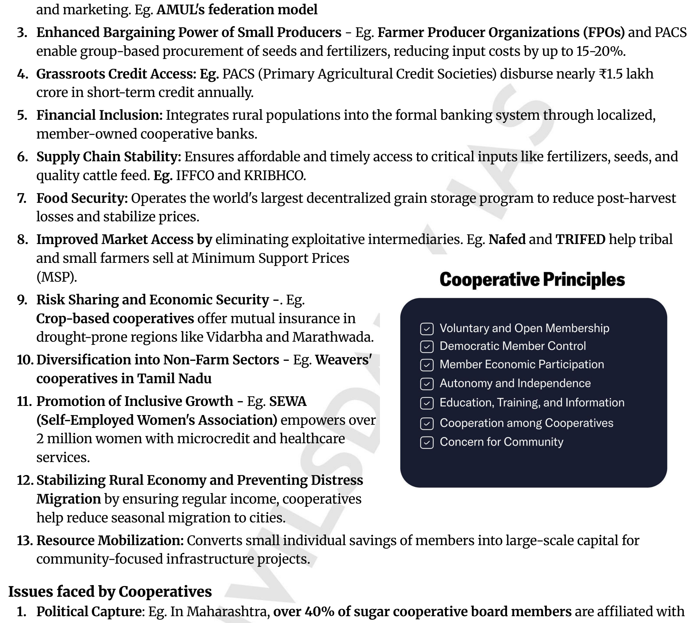

### [Smash Mains Source Page 63](../../pages/mains/mains_page_063.pdf)

### [Smash Mains Source Page 63](../../pages/mains/mains_page_063.pdf)

*Diagram Screenshot: [Seven Cooperative Principles & Constitutional Provisions](../../diagrams/mains_diag_cooperative_principles_p063.png) · [Full Source Page 63](../../pages/mains/mains_page_063.pdf)*

- **2.** Economies of Scale - Cooperatives aggregate small producers, enabling bulk procurement, processing, and marketing. Eg. AMUL's federation model

- **3.** Enhanced Bargaining Power of Small Producers - Eg. Farmer Producer Organizations (FPOs) and PACS enable group-based procurement of seeds and fertilizers, reducing input costs by up to 15-20%.

- **4.** Grassroots Credit Access: Eg. PACS (Primary Agricultural Credit Societies) disburse nearly ₹1.5 lakh crore in short-term credit annually.

- **5.** Financial Inclusion: Integrates rural populations into the formal banking system through localized, member-owned cooperative banks.

- **6.** Supply Chain Stability: Ensures affordable and timely access to critical inputs like fertilizers, seeds, and quality cattle feed. Eg. IFFCO and KRIBHCO.

- **7.** Food Security: Operates the world's largest decentralized grain storage program to reduce post-harvest losses and stabilize prices.

- **8.** Improved Market Access by eliminating exploitative intermediaries. Eg. Nafed and TRIFED help tribal and small farmers sell at Minimum Support Prices (MSP).

- **9.** Risk Sharing and Economic Security -. Eg. Crop-based cooperatives offer mutual insurance in drought-prone regions like Vidarbha and Marathwada.

- **10.** Diversification into Non-Farm Sectors - Eg. Weavers' cooperatives in Tamil Nadu

- **11.** Promotion of Inclusive Growth - Eg. SEWA (Self-Employed Women's Association) empowers over 2 million women with microcredit and healthcare services.

- **12.** Stabilizing Rural Economy and Preventing Distress Migration by ensuring regular income, cooperatives help reduce seasonal migration to cities.

- **13.** Resource Mobilization: Converts small individual savings of members into large-scale capital for community-focused infrastructure projects.

### Issues faced by Cooperatives

- **1.** Political Capture: Eg. In Maharashtra, over 40% of sugar cooperative board members are affiliated with political parties (EPW, 2020).

- **2.** Low Professional Capacity and Outdated Practices - Eg. As per RBI Report, less than 30% of urban cooperative banks have adopted full core banking solutions (CBS).

- **3.** Fragmented Regulation and Dual Control - Multi-State Cooperatives face dual control by Central and State authorities, causing delays and administrative confusion.

- **4.** Weak Financial Discipline and Mismanagement - Poor accounting, delayed audits, and misappropriation of funds remain common. Eg. The PMC Bank scandal (2019)

- **5.** Inadequate Member Participation and Awareness - Eg. IRMA Study found less than 25% of cooperative members attend AGMs regularly.

- **6.** Narrow Sectoral Spread: Success is limited to agriculture, dairy, and credit; weak presence in new sectors like tech or services.

- **7.** Regional Imbalance: 5 states (Eg. Maharashtra, Gujarat) hold 57% of all cooperatives, leaving others underrepresented.

- **8.** Financial Fragility: Low capital and high dependency on state support restrict scalability and innovation.
