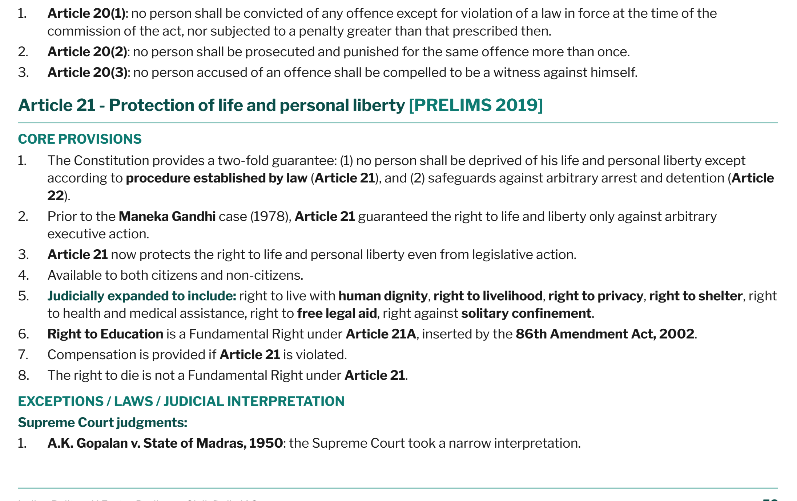

### [Prelims Source Page 52](../../pages/prelims/prelims_page_052.pdf)

### [Prelims Source Page 52](../../pages/prelims/prelims_page_052.pdf)

*Diagram Screenshot: [Article 21: Protection of Life and Personal Liberty & Landmark Cases](../../diagrams/pre_diag_art21_rights_table_p052.png) · [Full Source Page 52](../../pages/prelims/prelims_page_052.pdf)*

| FREEDOM UNDER ART 19(1) | REASONABLE RESTRICTIONS | RELEVANT AMENDMENTS |
| --- | --- | --- |
| **19(1)(c) - To form associations, unions or co-operative soci** *(Contd.)* | — | Amendment (2011): added “co-operative societies”. Part IXB was struck down for State co-operatives (Rajendra N. Shah, 2021); 19(1)(c) and Art 43B survive |
| 19(1)(d) - To move freely throughout the territory of India | Two grounds under Art 19(5): (1) protection of the interests of the general public, (2) protection of the interests of Scheduled Tribes. | — |
| 19(1)(e) - To reside and settle in any part of the territory of India | Two grounds under Art 19(5), same as above. | — |
| 19(1)(f) - To acquire, hold and dispose of property [OMITTED] | Formerly two grounds under Art 19(5); omitted along with the freedom. | 44th Amendment (1978) - omitted. |
| 19(1)(g) - To practise any profession, or carry on any occupation, trade or business | Three grounds under Art 19(6): (1) interests of the general public, (2) prescription of professional or technical qualifications, (3) State monopoly. | 1st Amendment (1951). |

### Article 20 - Protection in respect of conviction for offences

### CORE PROVISIONS

- **1.** Provides protection from arbitrary and disproportionate punishment to an accused person, whether a citizen, a foreigner, or a legal person such as a company or corporation.

- **2.** Contains three safeguards: (1) no ex-post-facto law, (2) no double jeopardy, (3) no self-incrimination.

- **3.** Cannot be suspended even during a National Emergency (along with Article 21). EXCEPTIONS / LAWS / JUDICIAL INTERPRETATION

- **1.** Article 20(1): no person shall be convicted of any offence except for violation of a law in force at the time of the commission of the act, nor subjected to a penalty greater than that prescribed then.

- **2.** Article 20(2): no person shall be prosecuted and punished for the same offence more than once.

- **3.** Article 20(3): no person accused of an offence shall be compelled to be a witness against himself.

### Article 21 - Protection of life and personal liberty [PRELIMS 2019]

### CORE PROVISIONS

- **1.** The Constitution provides a two-fold guarantee: (1) no person shall be deprived of his life and personal liberty except according to procedure established by law (Article 21), and (2) safeguards against arbitrary arrest and detention (Article 22).

- **2.** Prior to the Maneka Gandhi case (1978), Article 21 guaranteed the right to life and liberty only against arbitrary executive action.

- **3.** Article 21 now protects the right to life and personal liberty even from legislative action.

- **4.** Available to both citizens and non-citizens.

- **5.** Judicially expanded to include: right to live with human dignity, right to livelihood, right to privacy, right to shelter, right to health and medical assistance, right to free legal aid, right against solitary confinement.

- **6.** Right to Education is a Fundamental Right under Article 21A, inserted by the 86th Amendment Act, 2002.

- **7.** Compensation is provided if Article 21 is violated.

- **8.** The right to die is not a Fundamental Right under Article 21. EXCEPTIONS / LAWS / JUDICIAL INTERPRETATION Supreme Court judgments:

- **1.** A.K. Gopalan v. State of Madras, 1950: the Supreme Court took a narrow interpretation.
