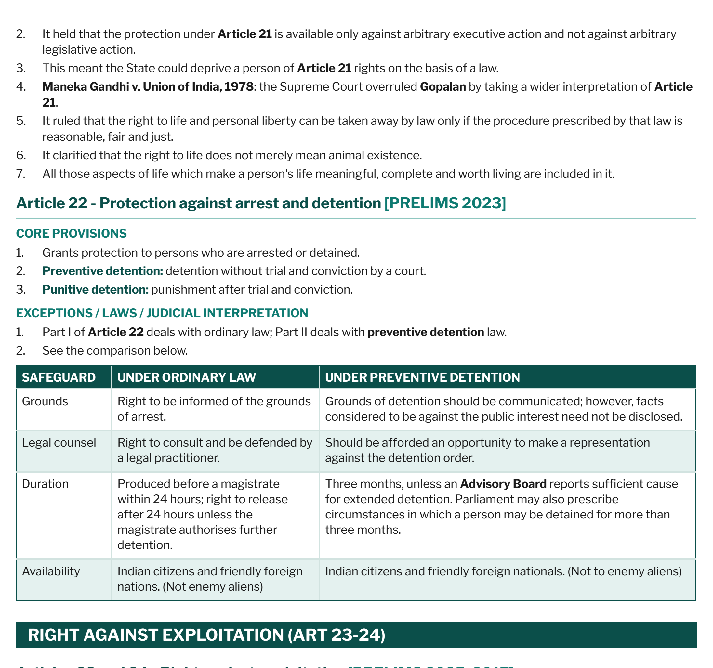

### [Prelims Source Page 53](../../pages/prelims/prelims_page_053.pdf)

### [Prelims Source Page 53](../../pages/prelims/prelims_page_053.pdf)

*Diagram Screenshot: [Article 21: Inferred Fundamental Rights, Right to Education (Art 21A) & Art 22 Safeguards](../../diagrams/pre_diag_art21_inferred_rights_p053.png) · [Full Source Page 53](../../pages/prelims/prelims_page_053.pdf)*

- **2.** It held that the protection under Article 21 is available only against arbitrary executive action and not against arbitrary legislative action.

- **3.** This meant the State could deprive a person of Article 21 rights on the basis of a law.

- **4.** Maneka Gandhi v. Union of India, 1978: the Supreme Court overruled Gopalan by taking a wider interpretation of Article 21.

- **5.** It ruled that the right to life and personal liberty can be taken away by law only if the procedure prescribed by that law is reasonable, fair and just.

- **6.** It clarified that the right to life does not merely mean animal existence.

- **7.** All those aspects of life which make a person's life meaningful, complete and worth living are included in it.

### Article 22 - Protection against arrest and detention [PRELIMS 2023]

### CORE PROVISIONS

- **1.** Grants protection to persons who are arrested or detained.

- **2.** Preventive detention: detention without trial and conviction by a court.

- **3.** Punitive detention: punishment after trial and conviction. EXCEPTIONS / LAWS / JUDICIAL INTERPRETATION

- **1.** Part I of Article 22 deals with ordinary law; Part II deals with preventive detention law.

- **2.** See the comparison below.

| SAFEGUARD | UNDER ORDINARY LAW | UNDER PREVENTIVE DETENTION |
| --- | --- | --- |
| Grounds | Right to be informed of the grounds of arrest. | Grounds of detention should be communicated; however, facts considered to be against the public interest need not be disclosed. |
| Legal counsel | Right to consult and be defended by a legal practitioner. | Should be afforded an opportunity to make a representation against the detention order. |
| Duration | Produced before a magistrate within 24 hours; right to release after 24 hours unless the magistrate authorises further detention. | Three months, unless an Advisory Board reports sufficient cause for extended detention. Parliament may also prescribe circumstances in which a person may be detained for more than three months. |
| Availability | Indian citizens and friendly foreign nations. (Not enemy aliens) | Indian citizens and friendly foreign nationals. (Not to enemy aliens) |

RIGHT AGAINST EXPLOITATION (ART 23-24) Articles 23 and 24 - Right against exploitation [PRELIMS 2025, 2017]

### CORE PROVISIONS

### Article 23

- **1.** Prohibits traffic in human beings and forced labour.

- **2.** Protects the individual against actions of both the State and private citizens.

- **3.** Available to both citizens and non-citizens.

### Article 24

- **4.** Prohibits employment of children below 14 years of age in any factory, mine or other hazardous occupation. EXCEPTIONS / LAWS / JUDICIAL INTERPRETATION Exception:

- **1.** Compulsory service for public purposes, such as conscription to the armed forces, is not unconstitutional.

- **2.** In imposing such service the State shall not discriminate on four grounds: (1) religion, (2) race, (3) caste, (4) class, or any of them. Laws passed:

- **3.** Suppression of Immoral Traffic in Women and Girls Act, 1956.

- **4.** Bonded Labour System (Abolition) Act, 1976.
