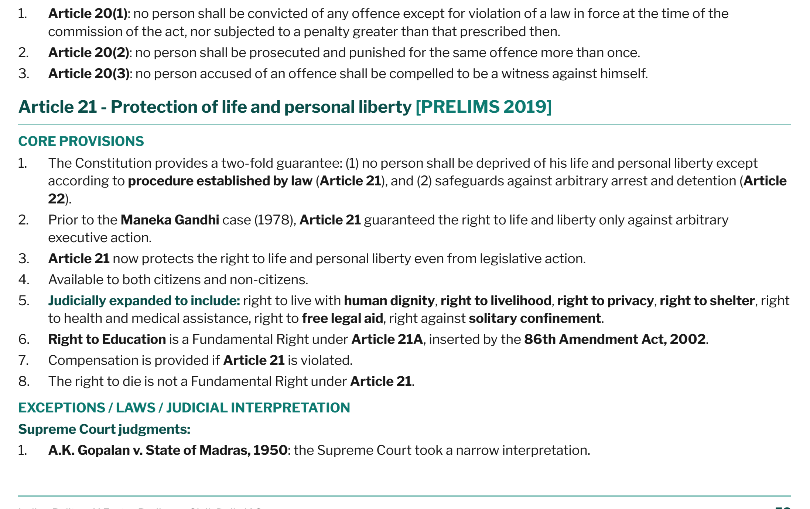
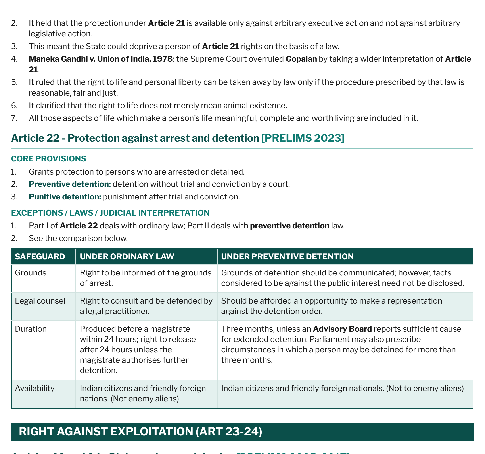

# Articles 21 & 21A: Protection of Life and Personal Liberty, Right to Privacy, Digital Rights, Personality Rights, Passive Euthanasia & Right to Education — Prelims Notes (Art_21_Right_to_Life_Personal_Liberty_Privacy_Digital_Rights_Education)

---

### [Prelims Source Page 46](../../pages/prelims/prelims_page_046.pdf)

## CHAPTER 07: FUNDAMENTAL RIGHTS

### THEME ANALYSIS PYQ pattern for this chapter

#### 1. REPEATS

#### A. Placing a Right in the Correct Article

- Article 21 dominates, choice of marriage partner [2019] and Right to Privacy [2024, 2021, 2018]

- Which head does abolition of untouchability fall - under Right to Equality (Article 17) [2020, 2017]

- Articles 23 and 24, forced labour and child labour below 14 years [2025, 2017]

#### B. Definitions, Doctrines and Limits

- Article 13 meaning of law, including custom or usage having the force of law [2026]

- Article 14 voiding unguided and uncontrolled executive discretion [2021]

- Article 16(4) read with Article 335, which defines nothing [2023]

- Article 30 minority institutions and the Prime Minister's 15 Point Programme [2011]

#### C. Rights Inside versus Outside Part III

- Right to Property under Article 300A, a legal right of any person [2021]

- Right to vote as a constitutional right, not fundamental or natural [2017]

- Part III beside the Preamble, DPSP and duties as UDHR, 1948 reflections [2020, 2011]

#### D. Statutes and Remedies

- Article 22 detention, counsel and the Prevention of Terrorism Act, 2002 [2023]

- Article 32 writs, Habeas Corpus, Mandamus, Certiorari, Quo Warranto

- Article 35, certain rights legislated by Parliament alone

#### 2. HOW THE FORMAT HAS CHANGED

- 2011 to 2017: code based recall of lists, minority benefits and UDHR rights [2011, 2017]

- 2018 to 2024: single answer placement of a right in its Article [2018, 2019, 2020, 2021, 2024]

- 2023: "how many" and Statement I and Statement II formats [2023]

- 2026: an argument style stem on the meaning of "law" in Art 13 [2026]

#### 3. WHAT IS BEING ASKED NOW

- Definitions and doctrine: "law" under Art 13 [2026], Art 335 and reservation [2023], arbitrariness under Art 14 [2021]

- Detention safeguards under Art 22 [2023]

- Privacy keeps returning under Art 21 [2018, 2021, 2024]

---

### [Prelims Source Page 47](../../pages/prelims/prelims_page_047.pdf)

### PRELIMS PREVIOUS YEAR QUESTIONS

#### Q1 (2026)

**'X' was addressing a seminar on the meaning of the term 'law' as provided under Article 13, Part III of the Constitution of India. 'X' explained that the meaning of the term 'law' in the Constitution of India was very comprehensive. It included ordinances, orders and even rules and regulations. 'Y' pointed out that the term 'law' in Article 13 also included custom or usage having in the territory of India the force of law, to which 'X' was not convinced. Based on the above, select the correct conclusion from the options given below:**

- **(a)** X is correct in the interpretation of law, including the view on non-inclusion of custom
- **(b)** The view of Y that 'law' included custom is not correct
- **(c)** The views of both X and Y are correct
- **(d)** The view of only Y is correct

> **Answer:** `(d)` · [Prelims Source Page 47](../../pages/prelims/prelims_page_047.pdf)

#### Q2 (2024)

**Under which of the following Articles of the Constitution of India has the Supreme Court of India placed the Right to Privacy?**

- **(a)** Article 15
- **(b)** Article 16
- **(c)** Article 19
- **(d)** Article 21

> **Answer:** `(d)` · [Prelims Source Page 47](../../pages/prelims/prelims_page_047.pdf)

#### Q3 (2023)

**Consider the following statements:**

- **Statement-I:** The Supreme Court of India has held in some judgements that the reservation policies made under Article 16(4) of the Constitution of India would be limited by Article 335 for maintenance of efficiency of administration.
- **Statement-II:** Article 335 of the Constitution of India defines the term 'efficiency of administration'.

*Which one of the following is correct in respect of the above statements?*

- **(a)** Both Statement-I and Statement-II are correct and Statement-II is the correct explanation for Statement-I
- **(b)** Both Statement-I and Statement-II are correct and Statement-II is not the correct explanation for Statement-I
- **(c)** Statement-I is correct but Statement-II is incorrect
- **(d)** Statement-I is incorrect but Statement-II is correct

> **Answer:** `(c)` · [Prelims Source Page 47](../../pages/prelims/prelims_page_047.pdf)

#### Q4 (2023)

**Consider the following statements:**

- **1.** According to the Constitution of India, the Central Government has a duty to protect States from internal disturbances.
- **2.** The Constitution of India exempts the States from providing legal counsel to a person being held for preventive detention.
- **3.** According to the Prevention of Terrorism Act, 2002, confession of the accused before the police cannot be used as evidence.

*How many of the above statements are correct?*

- **(a)** Only one
- **(b)** Only two
- **(c)** All three
- **(d)** None

> **Answer:** `(b)` · [Prelims Source Page 47](../../pages/prelims/prelims_page_047.pdf)

#### Q5 (2021)

**A legislation which confers on the executive or administrative authority an unguided and uncontrolled discretionary power in the matter of application of law violates which one of the following Articles of the Constitution of India?**

- **(a)** Article 14
- **(b)** Article 28
- **(c)** Article 32
- **(d)** Article 44

> **Answer:** `(a)` · [Prelims Source Page 47](../../pages/prelims/prelims_page_047.pdf)

#### Q6 (2021)

**What is the position of the Right to Property in India?**

- **(a)** Legal right available to citizens only
- **(b)** Legal right available to any person
- **(c)** Fundamental Right available to citizens only
- **(d)** Neither Fundamental Right nor legal right

> **Answer:** `(b)` · [Prelims Source Page 47](../../pages/prelims/prelims_page_047.pdf)

#### Q7 (2021)

**'Right to Privacy' is protected under which Article of the Constitution of India?**

- **(a)** Article 15
- **(b)** Article 19
- **(c)** Article 21
- **(d)** Article 29

> **Answer:** `(c)` · [Prelims Source Page 47](../../pages/prelims/prelims_page_047.pdf)

---

### [Prelims Source Page 48](../../pages/prelims/prelims_page_048.pdf)

#### Q8 (2020)

**Which one of the following categories of 'Fundamental Rights' incorporates protection against untouchability as a form of discrimination?**

- **(a)** Right against Exploitation
- **(b)** Right to Freedom
- **(c)** Right to Constitutional Remedies
- **(d)** Right to Equality

> **Answer:** `(d)` · [Prelims Source Page 48](../../pages/prelims/prelims_page_048.pdf)

#### Q9 (2020)

**Other than the Fundamental Rights, which of the following parts of the Constitution of India reflect/reflects the principles and provisions of the Universal Declaration of Human Rights (1948)?**

- **1.** Preamble
- **2.** Directive Principles of State Policy
- **3.** Fundamental Duties

*Select the correct answer using the code given below:*

- **(a)** 1 and 2 only
- **(b)** 2 only
- **(c)** 1 and 3 only
- **(d)** 1, 2 and 3

> **Answer:** `(d)` · [Prelims Source Page 48](../../pages/prelims/prelims_page_048.pdf)

#### Q10 (2019)

**Which Article of the Constitution of India safeguards one's right to marry the person of one's choice?**

- **(a)** Article 19
- **(b)** Article 21
- **(c)** Article 25
- **(d)** Article 29

> **Answer:** `(b)` · [Prelims Source Page 48](../../pages/prelims/prelims_page_048.pdf)

#### Q11 (2018)

**Right to Privacy is protected as an intrinsic part of Right to Life and Personal Liberty. Which of the following in the Constitution of India correctly and appropriately imply the above statement?**

- **(a)** Article 14 and the provisions under the 42nd Amendment to the Constitution
- **(b)** Article 17 and the Directive Principles of State Policy in Part IV
- **(c)** Article 21 and the freedoms guaranteed in Part III
- **(d)** Article 24 and the provisions under the 44th Amendment to the Constitution

> **Answer:** `(c)` · [Prelims Source Page 48](../../pages/prelims/prelims_page_048.pdf)

#### Q12 (2017)

**Which of the following are envisaged by the Right against Exploitation in the Constitution of India?**

- **1.** Prohibition of traffic in human beings and forced labour
- **2.** Abolition of untouchability
- **3.** Protection of the interests of minorities
- **4.** Prohibition of employment of children in factories and mines

*Select the correct answer using the code given below:*

- **(a)** 1, 2 and 4 only
- **(b)** 2, 3 and 4 only
- **(c)** 1 and 4 only
- **(d)** 1, 2, 3 and 4

> **Answer:** `(c)` · [Prelims Source Page 48](../../pages/prelims/prelims_page_048.pdf)

#### Q13 (2011)

**In India, if a religious sect/community is given the status of a national minority, what special advantages is it entitled to?**

- **1.** It can establish and administer exclusive educational institutions.
- **2.** The President of India automatically nominates a representative of the community to Lok Sabha.
- **3.** It can derive benefits from the Prime Minister's 15-Point Programme.

*Which of the statements given above is/are correct?*

- **(a)** 1 only
- **(b)** 2 and 3 only
- **(c)** 1 and 3 only
- **(d)** 1, 2 and 3

> **Answer:** `(c)` · [Prelims Source Page 48](../../pages/prelims/prelims_page_048.pdf)

#### Q14 (2011)

**Consider the following:**

- **1.** Right to education
- **2.** Right to equal access to public service
- **3.** Right to food Which of the above is/are Human Right/Human Rights under the Universal Declaration of Human Rights?

- **(a)** 1 only
- **(b)** 1 and 2 only
- **(c)** 3 only
- **(d)** 1, 2 and 3

> **Answer:** `(d)` · [Prelims Source Page 48](../../pages/prelims/prelims_page_048.pdf)

PART III - FUNDAMENTAL RIGHTS: GENERAL FEATURES Nature and Scope

### CORE PROVISIONS

- **1.** Contained in Part III of the Constitution; described as the Magna Carta of the Indian Constitution.

- **2.** Place limits on the tyranny of the Executive and on arbitrary laws of the Legislature.

- **3.** Parliament can amend Fundamental Rights.

---

### [Prelims Source Page 52](../../pages/prelims/prelims_page_052.pdf)

*Diagram Screenshot: [Article 21: Protection of Life and Personal Liberty & Landmark Cases](../../diagrams/pre_diag_art21_rights_table_p052.png) · [Full Source Page 52](../../pages/prelims/prelims_page_052.pdf)*

| FREEDOM UNDER ART 19(1) | REASONABLE RESTRICTIONS | RELEVANT AMENDMENTS |
| --- | --- | --- |
| **19(1)(c) - To form associations, unions or co-operative soci** *(Contd.)* | — | Amendment (2011): added “co-operative societies”. Part IXB was struck down for State co-operatives (Rajendra N. Shah, 2021); 19(1)(c) and Art 43B survive |
| 19(1)(d) - To move freely throughout the territory of India | Two grounds under Art 19(5): (1) protection of the interests of the general public, (2) protection of the interests of Scheduled Tribes. | — |
| 19(1)(e) - To reside and settle in any part of the territory of India | Two grounds under Art 19(5), same as above. | — |
| 19(1)(f) - To acquire, hold and dispose of property [OMITTED] | Formerly two grounds under Art 19(5); omitted along with the freedom. | 44th Amendment (1978) - omitted. |
| 19(1)(g) - To practise any profession, or carry on any occupation, trade or business | Three grounds under Art 19(6): (1) interests of the general public, (2) prescription of professional or technical qualifications, (3) State monopoly. | 1st Amendment (1951). |

### Article 20 - Protection in respect of conviction for offences

### CORE PROVISIONS

- **1.** Provides protection from arbitrary and disproportionate punishment to an accused person, whether a citizen, a foreigner, or a legal person such as a company or corporation.

- **2.** Contains three safeguards: (1) no ex-post-facto law, (2) no double jeopardy, (3) no self-incrimination.

- **3.** Cannot be suspended even during a National Emergency (along with Article 21). EXCEPTIONS / LAWS / JUDICIAL INTERPRETATION

- **1.** Article 20(1): no person shall be convicted of any offence except for violation of a law in force at the time of the commission of the act, nor subjected to a penalty greater than that prescribed then.

- **2.** Article 20(2): no person shall be prosecuted and punished for the same offence more than once.

- **3.** Article 20(3): no person accused of an offence shall be compelled to be a witness against himself.

### Article 21 - Protection of life and personal liberty [PRELIMS 2019]

### CORE PROVISIONS

- **1.** The Constitution provides a two-fold guarantee: (1) no person shall be deprived of his life and personal liberty except according to procedure established by law (Article 21), and (2) safeguards against arbitrary arrest and detention (Article 22).

- **2.** Prior to the Maneka Gandhi case (1978), Article 21 guaranteed the right to life and liberty only against arbitrary executive action.

- **3.** Article 21 now protects the right to life and personal liberty even from legislative action.

- **4.** Available to both citizens and non-citizens.

- **5.** Judicially expanded to include: right to live with human dignity, right to livelihood, right to privacy, right to shelter, right to health and medical assistance, right to free legal aid, right against solitary confinement.

- **6.** Right to Education is a Fundamental Right under Article 21A, inserted by the 86th Amendment Act, 2002.

- **7.** Compensation is provided if Article 21 is violated.

- **8.** The right to die is not a Fundamental Right under Article 21. EXCEPTIONS / LAWS / JUDICIAL INTERPRETATION Supreme Court judgments:

- **1.** A.K. Gopalan v. State of Madras, 1950: the Supreme Court took a narrow interpretation.

---

### [Prelims Source Page 53](../../pages/prelims/prelims_page_053.pdf)

*Diagram Screenshot: [Article 21: Inferred Fundamental Rights, Right to Education (Art 21A) & Art 22 Safeguards](../../diagrams/pre_diag_art21_inferred_rights_p053.png) · [Full Source Page 53](../../pages/prelims/prelims_page_053.pdf)*

- **2.** It held that the protection under Article 21 is available only against arbitrary executive action and not against arbitrary legislative action.

- **3.** This meant the State could deprive a person of Article 21 rights on the basis of a law.

- **4.** Maneka Gandhi v. Union of India, 1978: the Supreme Court overruled Gopalan by taking a wider interpretation of Article 21.

- **5.** It ruled that the right to life and personal liberty can be taken away by law only if the procedure prescribed by that law is reasonable, fair and just.

- **6.** It clarified that the right to life does not merely mean animal existence.

- **7.** All those aspects of life which make a person's life meaningful, complete and worth living are included in it.

### Article 22 - Protection against arrest and detention [PRELIMS 2023]

### CORE PROVISIONS

- **1.** Grants protection to persons who are arrested or detained.

- **2.** Preventive detention: detention without trial and conviction by a court.

- **3.** Punitive detention: punishment after trial and conviction. EXCEPTIONS / LAWS / JUDICIAL INTERPRETATION

- **1.** Part I of Article 22 deals with ordinary law; Part II deals with preventive detention law.

- **2.** See the comparison below.

| SAFEGUARD | UNDER ORDINARY LAW | UNDER PREVENTIVE DETENTION |
| --- | --- | --- |
| Grounds | Right to be informed of the grounds of arrest. | Grounds of detention should be communicated; however, facts considered to be against the public interest need not be disclosed. |
| Legal counsel | Right to consult and be defended by a legal practitioner. | Should be afforded an opportunity to make a representation against the detention order. |
| Duration | Produced before a magistrate within 24 hours; right to release after 24 hours unless the magistrate authorises further detention. | Three months, unless an Advisory Board reports sufficient cause for extended detention. Parliament may also prescribe circumstances in which a person may be detained for more than three months. |
| Availability | Indian citizens and friendly foreign nations. (Not enemy aliens) | Indian citizens and friendly foreign nationals. (Not to enemy aliens) |

RIGHT AGAINST EXPLOITATION (ART 23-24) Articles 23 and 24 - Right against exploitation [PRELIMS 2025, 2017]

### CORE PROVISIONS

### Article 23

- **1.** Prohibits traffic in human beings and forced labour.

- **2.** Protects the individual against actions of both the State and private citizens.

- **3.** Available to both citizens and non-citizens.

### Article 24

- **4.** Prohibits employment of children below 14 years of age in any factory, mine or other hazardous occupation. EXCEPTIONS / LAWS / JUDICIAL INTERPRETATION Exception:

- **1.** Compulsory service for public purposes, such as conscription to the armed forces, is not unconstitutional.

- **2.** In imposing such service the State shall not discriminate on four grounds: (1) religion, (2) race, (3) caste, (4) class, or any of them. Laws passed:

- **3.** Suppression of Immoral Traffic in Women and Girls Act, 1956.

- **4.** Bonded Labour System (Abolition) Act, 1976.

---

### [Prelims Source Page 57](../../pages/prelims/prelims_page_057.pdf)

- **5.** Prescribing punishment for acts declared to be offences under the Fundamental Rights, namely untouchability (Article 17) and traffic in human beings and forced labour (Article 23).

### ALLIED THEMES

Rights outside Part III [PRELIMS 2021, 2017]

### CORE PROVISIONS

- **1.** Right to property ceased to be a Fundamental Right when the 44th Amendment Act, 1978 omitted Article 19(1)(f) and Article 31.

- **2.** It now rests in Article 300A, Part XII: 'No person shall be deprived of his property save by authority of law', that is a legal or constitutional right available to any person, citizen or foreigner, and not to citizens alone.

- **3.** Right to vote and to be elected is not a Fundamental Right. It flows from Article 326 (adult suffrage) and is regulated by the Representation of the People Act, 1951, making it a constitutional right exercised subject to statutory conditions. EXCEPTIONS / LAWS / JUDICIAL INTERPRETATION

- **1.** The Supreme Court has held that though no longer a Fundamental Right, property remains a constitutional right under

### Article 300A and a human right in a welfare State, and cannot be taken away except in accordance with law.

- **2.** Consequence: only Part III rights are enforceable under Article 32; these other rights are enforced through ordinary law or under Article 226. Right to Privacy [PRELIMS 2024, 2021, 2018]

### CORE PROVISIONS

- **1.** Justice K.S. Puttaswamy (Retd.) v. Union of India, 2017: a nine-judge Bench of the Supreme Court held on 24 August 2017 that the right to privacy is a Fundamental Right.

- **2.** Privacy is protected as an intrinsic part of the right to life and personal liberty under Article 21, and as part of the freedoms guaranteed in Part III.

- **3.** The anchor article is Article 21; it is not placed under Article 15, 16, 19 or 29. EXCEPTIONS / LAWS / JUDICIAL INTERPRETATION

- **1.** It is not an absolute right; it may be restricted only by a fair, just and reasonable procedure established by law.

- **2.** The ruling is the constitutional basis of India's data protection law, the Digital Personal Data Protection Act, 2023. UDHR, 1948 and the Constitution [PRELIMS 2020, 2011]

### CORE PROVISIONS

- **1.** The Universal Declaration of Human Rights was adopted on 10 December 1948 and has 30 articles; India took part in its drafting.

- **2.** Besides the Fundamental Rights, its principles and provisions are reflected in the Preamble, the Directive Principles of State Policy and the Fundamental Duties, all three.

- **3.** The civil and political rights of the UDHR broadly correspond to Part III; its social, economic and cultural rights correspond to Part IV. EXCEPTIONS / LAWS / JUDICIAL INTERPRETATION

- **1.** Rights expressly recognised in the UDHR include Article 26, the right to education; Article 21(2), the right of equal access to public service in one's country; and Article 25(1), an adequate standard of living including food, that is the right to food.

- **2.** The UDHR is a declaration, not a treaty: it is not by itself legally binding, but it informs the reading of Part III.
