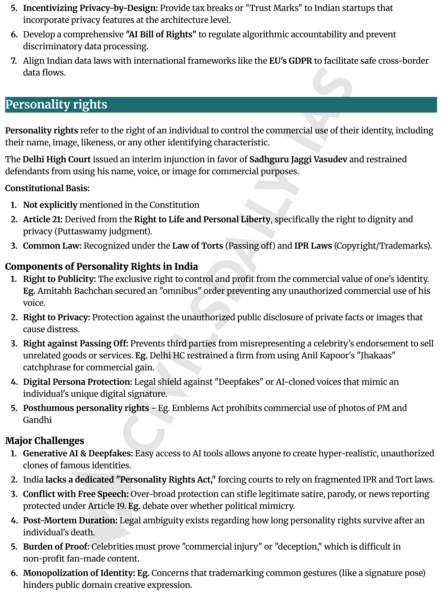

# Articles 21 & 21A: Protection of Life and Personal Liberty, Right to Privacy, Digital Rights, Personality Rights, Passive Euthanasia & Right to Education — Smash Mains Notes (Art_21_Right_to_Life_Personal_Liberty_Privacy_Digital_Rights_Education)

---

### [Smash Mains Source Page 34](../../pages/mains/mains_page_034.pdf)

## Chapter 5: Fundamental Rights

### PYQs

- **[2026]** Right to privacy relating to self-identity is very dear to every human being and well protected under Article 21 of the Constitution. In this context, examine the effect of the amendment in 2026, to the Transgender Persons (Protection of Rights) Act, 2019. (10M)

- **[2024]** Right to privacy is intrinsic to life and personal liberty and is inherently protected under Article 21 of the Constitution. Explain. In this reference discuss the law relating to D.N.A. testing of a child in the womb to establish its paternity.

- **[2023]** "The Constitution of India is a living instrument with capabilities of enormous dynamism. It is a constitution made for a progressive society". Illustrate with special reference to the expanding horizons of the right to life and personal liberty.

- **[2022]** Right of movement and residence throughout the territory of India are freely available to the Indian citizens, but these rights are not absolute. Comment (10M)

### Fundamental Rights

Fundamental rights are a set of basic rights and freedoms that are considered essential for the protection of human dignity, liberty, and equality and are guaranteed to individuals by a constitution. FR are referred to as the "Magna Carta" of India and are delineated in Part III (Article 12 to 35). These rights are defended and guaranteed by the Supreme Court of India.

### Quotes

- **1.** "Fundamental rights are both the shield and sword against State tyranny." - Prof. Upendra Baxi

- **2.** "Freedom of speech and expression is the bulwark of a democratic government. It is the very foundation of democracy." - Dr. Rajendra Prasad

- **3.** "I measure the progress of a community by the degree of progress which women have achieved." -B R Ambedkar - Affirmative Action

- **4.** "Without political freedom, economic freedom is a mere chimera." - Nehru - Balancing FR and DPSP

- **5.** For Conclusion - "Those who would give up Essential Liberty to purchase Temporary Safety, deserve neither Liberty nor Safety." (Benjamin Franklin). Thus, protection and promotion of FR is vital for the well-being of a free and democratic society.

### Features

- **1.** Guaranteed by the Constitution Part III (Articles 12-35) - enforceable by SC & HC (Art. 32 & 226).

- **2.** Primarily act as limitations on State power, preventing arbitrary actions. Eg. Shreya Singhal case

- **3.** Against the State as well as against private persons. (Art. 17, 23)

- **4.** Not absolute - Subject to reasonable restrictions for public order, morality, security, etc.

- **5.** Negative and Positive obligations - Some rights prevent State interference (freedom of speech) while others impose duties to act (abolition of untouchability).

---

### [Smash Mains Source Page 49](../../pages/mains/mains_page_049.pdf)

### Significance of Digital Rights in India

- **1.** Constitutional Empowerment - Strengthens Article 19(1)(a) freedom of speech and Article 19(1)(g) freedom to trade

- **2.** Privacy Protection: Ensures personal data isn't exploited by corporations or the state without explicit, informed consent.

- **3.** Digital Inclusion: Guarantees equal access to the internet, preventing marginalized communities from being left behind economically. Eg. Kerala became the first state to declare the "Right to Internet" a basic right.

- **4.** Democratic Participation: Eg. Use of the MyGov platform for public consultation on Draft Bills.

- **5.** Information Access: Empowers citizens to find educational, medical, and legal resources instantly regardless of their location. Eg. DIKSHA platform hosting 19,000+ courses.

- **6.** Accountability and Transparency: Digital rights allow for the online tracking of welfare delivery and government spending.

- **7.** Protection from Harassment: Provides legal recourse against cyber-bullying, stalking, and the non-consensual sharing of private images.

- **8.** Global Alignment - Recognised by UNHRC (2016) as a human right; countries like Finland (2010) made internet access a legal right.

### Challenges in Ensuring Right to Internet in India

- **1.** Surveillance Risks:

  - **a.** Broad government exemptions in the DPDP Act.

  - **b.** Mandate pre-installation of the Sanchar Saathi app on mobile phones

- **2.** Internet Shutdowns: India frequently leads the world in local internet blackouts to maintain public order during protests. Eg. Ongoing shutdowns in Manipur.

- **3.** The Digital Divide: Eg. 25% gender gap in mobile internet usage in rural India.

- **4.** Misinformation and Deepfakes: The rapid spread of AI-generated fake news threatens social harmony and electoral integrity.

- **5.** Cybersecurity Vulnerabilities: Frequent data breaches in government and healthcare databases expose sensitive biometric and medical info. Eg. AIIMS data breach

- **6.** Consent Fatigue: Complex privacy policies and "dark patterns" lead users to agree to data harvesting without understanding.

- **7.** Lack of Independent Oversight: The Data Protection Board (DPB) is government-appointed, raising concerns about its impartiality and transparency

- **8.** Operational Barriers - Network issues, adverse climatic conditions, and poor e-readiness hamper effective connectivity in remote areas.

- **9.** Affordability Concerns - Despite low data tariffs, costs of smartphones, devices, and monthly packs remain prohibitive for BPL households, widening the digital divide.

### Way Forward for Ensuring Right to Internet in India

- **1.** Technological Innovations - Promote satellite internet (Eg. Starlink, OneWeb) and other alternatives to complement traditional infrastructure in remote areas.

- **2.** Rights Linkage - Recognise that denial of internet affects multiple rights (education under Article 21A, expression, livelihood), making it a democratic and developmental necessity.

- **3.** Launch "Digital Rights Awareness" drives in regional languages to help rural users manage consent.

- **4.** Implementing the Anuradha Bhasin guidelines strictly to ensure shutdowns are temporary and localized.

---

### [Smash Mains Source Page 50](../../pages/mains/mains_page_050.pdf)

*Diagram Screenshot: [Right to Privacy (Article 21) & Puttaswamy Three-Pronged Test vs DPDP Act](../../diagrams/mains_diag_privacy_data_protection_art21_p050.png) · [Full Source Page 50](../../pages/mains/mains_page_050.pdf)*

- **5.** Incentivizing Privacy-by-Design: Provide tax breaks or "Trust Marks" to Indian startups that incorporate privacy features at the architecture level.

- **6.** Develop a comprehensive "AI Bill of Rights" to regulate algorithmic accountability and prevent discriminatory data processing.

- **7.** Align Indian data laws with international frameworks like the EU's GDPR to facilitate safe cross-border data flows.

### Personality rights

Personality rights refer to the right of an individual to control the commercial use of their identity, including their name, image, likeness, or any other identifying characteristic. The Delhi High Court issued an interim injunction in favor of Sadhguru Jaggi Vasudev and restrained defendants from using his name, voice, or image for commercial purposes. Constitutional Basis:

- **1.** Not explicitly mentioned in the Constitution

- **2.** Article 21: Derived from the Right to Life and Personal Liberty, specifically the right to dignity and privacy (Puttaswamy judgment).

- **3.** Common Law: Recognized under the Law of Torts (Passing off) and IPR Laws (Copyright/Trademarks).

### Components of Personality Rights in India

- **1.** Right to Publicity: The exclusive right to control and profit from the commercial value of one's identity. Eg. Amitabh Bachchan secured an "omnibus" order preventing any unauthorized commercial use of his voice.

- **2.** Right to Privacy: Protection against the unauthorized public disclosure of private facts or images that cause distress.

- **3.** Right against Passing Off: Prevents third parties from misrepresenting a celebrity's endorsement to sell unrelated goods or services. Eg. Delhi HC restrained a firm from using Anil Kapoor's "Jhakaas" catchphrase for commercial gain.

- **4.** Digital Persona Protection: Legal shield against "Deepfakes" or AI-cloned voices that mimic an individual's unique digital signature.

- **5.** Posthumous personality rights - Eg. Emblems Act prohibits commercial use of photos of PM and Gandhi

### Major Challenges

- **1.** Generative AI & Deepfakes: Easy access to AI tools allows anyone to create hyper-realistic, unauthorized clones of famous identities.

- **2.** India lacks a dedicated "Personality Rights Act," forcing courts to rely on fragmented IPR and Tort laws.

- **3.** Conflict with Free Speech: Over-broad protection can stifle legitimate satire, parody, or news reporting protected under Article 19. Eg. debate over whether political mimicry.

- **4.** Post-Mortem Duration: Legal ambiguity exists regarding how long personality rights survive after an individual's death.

- **5.** Burden of Proof: Celebrities must prove "commercial injury" or "deception," which is difficult in non-profit fan-made content.

- **6.** Monopolization of Identity: Eg. Concerns that trademarking common gestures (like a signature pose) hinders public domain creative expression.

---

### [Smash Mains Source Page 51](../../pages/mains/mains_page_051.pdf)

### Major SC Judgments on Personality Rights

- **1.** Amitabh Bachchan v. Rajat Nagi & Ors: it set the national standard for "John Doe" (Dynamic) injunctions to protect a persona.

- **2.** ICC Development (International) Ltd. v. Arvee Enterprises (2003): One of the earliest cases stating that personality rights vest in the individual and not in a corporate entity.

- **3.** Deepa Jayakumar v. A.L. Vijay (2021): The Madras HC held that personality rights are generally not heritable unless specific reputation damage is shown.

### Global Examples

- **1.** European Union (GDPR): Provides a "Right to Erasure" and protects "Biometric Data," which effectively safeguards an individual's likeness as sensitive personal data.

- **2.** South Korea: Recently introduced the "Celebrity Protection Act" (2024) specifically to combat AI-generated digital human clones used in K-Pop.

### Defamation

Origin - The formal codification of defamation began during the British Raj. The primary objective was to maintain social order and protect the reputation of officials and the elite. IPC Sec 499& 500. Defamation is any intentional "imputation" (written, spoken, or visual) concerning a person that is intended to harm, or known to be likely to harm, the reputation of that person. Constitutional and legal provisions

- **1.** Constitutional: Article 19(2) explicitly lists "Defamation" as one of the eight Reasonable Restrictions upon the Freedom of Speech and Expression.

- **2.** Criminal Law (Section 356 of BNS, 2023): Replaces IPC Sections 499/500. It defines the offense and prescribes punishment (up to 2 years, fine, or both).

- **3.** New Addition (2024–26): Community Service has been added as a punishment option for defamation under the BNS framework.

- **4.** Civil Law: Based on Tort Law, allowing the aggrieved to sue for monetary compensation. Statutory Exceptions under Section 356 of BNS

- Truth for Public Good: Stating the truth is a defense only if it serves the public interest.

- Public Conduct: Good faith opinions on the official duties of public servants.

- Merits of Public Performance: Criticism of books, films, or public speeches.

- Censure by Authority: A parent, teacher, or boss passing a "good faith" warning or censure.

### Major SC Judgments

- **1.** Subramanian Swamy v. UoI (2016) - The SC upheld the law that the & Right to Reputation is part of the Right to Life and constitutes a "reasonable restriction" on free speech.

- **2.** Rahul Gandhi v. Purnesh Modi (The "Modi Surname" Case, 2023)

- **3.** R. Rajagopal (Auto Shankar Case)- Court that public officials cannot sue for defamation for their official duties unless statements are made with reckless disregard for the truth.

- **4.** Arun Jaitley v. Arvind Kejriwal - The case ended in a settlement. In 2018, Arvind Kejriwal tendered an unconditional apology to Jaitley

  - **a.** MJ Akbar v. Priya Ramani - court acquitted Ramani, right to dignity over reputation in #MeToo context

---

### [Smash Mains Source Page 52](../../pages/mains/mains_page_052.pdf)

### Justification of criminal Defamation

- **1.** Dignity as Fundamental Right: Reputation is an inseparable facet of the Right to Life (Article 21), necessitating protection from malicious attacks.

- **2.** Prevention of Character Assassination: Legal checks prevent individuals from using free speech as a license to destroy another's professional or social standing.

- **3.** Maintaining Public Order: Malicious defamatory statements, especially against religious or community leaders, can incite widespread communal unrest and violence.

- **4.** Deterrence in the Digital Age: Eg. to check "Cyber Defamation" using deepfakes.

- **5.** Protection of Vulnerable Groups: Protecting minorities and women from "gendered" or "casteist" slurs.

- **6.** Inadequacy of Civil Remedies due to delays. Eg. average civil suit in India lasts 12-15 years.

- **7.** Adequate safeguards - Statutory Exceptions under Section 356 BNS protects truthful statements made for the "public good."

### Criticism

- **1.** Vagueness of "Imputation": The definition is broad enough to include satire, irony, and alternative expressions, stifling creative freedom.

- **2.** Colonial Hangover: The law was designed by the British (Macaulay) to suppress Indian dissent and "protect the prestige" of the crown.

- **3.** Chilling Effect on Press: The fear of criminal summons leads to self-censorship by journalists, especially when reporting on corporate or political scams.

- **4.** Weaponization of Process: The "process itself becomes the punishment" as accused must appear in person in remote courts for years.

- **5.** SLAPP Suits: Strategic Lawsuits Against Public Participation are used by the powerful to intimidate and "bankrupt" whistleblowers.

- **6.** Subjectivity of "Public Good": The burden of proving "public good" lies on the accused, which is a reverse-onus that violates natural justice.

- **7.** Overburdening Judiciary: Eg. 25,000+ defamation cases pending in lower courts

- **8.** Disproportionate Penalty: "Speech should only be countered with speech," not handcuffs.

- **9.** Most Western democracies (UK, USA) have decriminalized defamation

### Way Forward

1. criminal prosecution only when speech causes actual and substantial harm (Law Commission)

- **2.** Decriminalization: Shift defamation entirely to Civil Law, retaining criminal penalties only for cases involving "National Security" or "Incitement to Violence."

- **3.** Enacting Anti-SLAPP Legislation: Create a mechanism for courts to strike out frivolous, "intimidatory" suits at the first hearing.

- **4.** Mandatory Mediation: Require parties to undergo court-mandated mediation before a defamation trial begins to encourage apologies and settlements.

- **5.** Media Self-Regulation: Empower the Press Council of India to handle defamation complaints against journalists through a "Correction and Apology" mechanism.

### Phone Tapping

Phone tapping, also known as wiretapping, is the monitoring of telephone conversations and internet-based communication by a third party, often in secret.

---

### [Smash Mains Source Page 56](../../pages/mains/mains_page_056.pdf)

### Challenges to Freedom of Press - PIES Framework

Political

- **1.** Political Pressures & Intimidation - Harassment, arrests, and threats against critical journalists. Eg. Siddique Kappan (2020).

- **2.** Digital Surveillance: New data laws may allow the state to access journalists' sources under the guise of "national security." (IFJ 2025 report) Institutional

- **1.** Legal Overreach - Misuse of sedition, UAPA, IT Act to curb dissent. Eg. Media One ban case.

- **2.** Weak Regulatory Mechanisms - Press Council of India lacks binding powers; IT Rules 2025 expand state control.

- **3.** Digital Media Regulation - Sweeping powers under IT Rules threaten editorial autonomy. Economic

- **1.** Corporate & Ownership Control - Concentration of media ownership limits independence. Eg. Adani takeover of NDTV (2022).

- **2.** Financial Pressures - Dependence on government advertising and corporate funding undermines independence.

- **3.** Paid News & Propaganda - Commercial interests fuel misinformation and political bias. Social

- **1.** Violence & Safety Threats - Journalists face physical attacks and online trolling. Eg. Shashikant Warishe murder (2023).

- **2.** Fake News & Disinformation - Rise of propaganda and misinformation undermines press credibility.

- **3.** Global Image Decline - India ranks 159/180 in RSF Press Freedom Index (2024), reflecting systemic erosion of press freedom.

### Major SC Judgments on Press Freedom

- **1.** Romesh Thappar v. State of Madras (1950): Established that freedom of the press is an essential part of the right to free speech.

- **2.** Bennett Coleman & Co. v. Union of India (1973): Struck down newsprint quotas, ruling that the state cannot use economic measures to stifle the press.

- **3.** MediaOne (Madhyamam Broadcasting) Case (2023): Ruled that the state cannot ban channels based on "sealed cover" submissions without proving a direct national security threat.

### Way Forward

- **1.** The Second Press Commission had suggested strengthening the Press Council of India and enhancing its role in ensuring journalistic standards.

- **2.** Decriminalize Defamation: Amend Section 499 of the IPC to make defamation a purely civil wrong, preventing arrests.

- **3.** Enact a dedicated Journalists Protection Act to provide state-level security for investigative reporters.

- **4.** Transforming Press Council of India (PCI) into a statutory body with the power to penalize both media and aggressors.

- **5.** Newsrooms must adopt voluntary "Code of Ethics" and robust internal fact-checking mechanisms to rebuild public trust

---

### [Smash Mains Source Page 74](../../pages/mains/mains_page_074.pdf)

- The Supreme Court set aside a Patna High Court order that had permitted an involuntary narco test. It ruled that forcing an accused to undergo narco-analysis is a direct violation of their FR U/A 20, 21.

- Key Observations: ◦ Right to Mental Privacy: SC expanded Article 21 to include cognitive freedom and mental privacy. It held that drugs like Sodium Pentothal interfere with a person's mental autonomy. ◦ Any statement made in a drug-induced state is considered "compelled testimony," which violates Article 20(3) (the right against self-incrimination). ◦ Consent must not only be voluntary but also informed and recorded before a Judicial Magistrate. ◦ As per SC, while an accused can request a narco test as part of their defence evidence (under Section 253 of the BNS, 2023), they do not have an absolute right to demand it. Other Judgments

- Selvi v. State of Karnataka (2010) - involuntary administration of Narco-analysis, Polygraph (Lie-detector), and Brain Electrical Activation Profile (BEAP) is unconstitutional.

- Manoj Kumar Saini v. State of MP (2023): Reaffirmed that narco test results are only investigative tools and cannot confirm guilt without independent corroboration.
