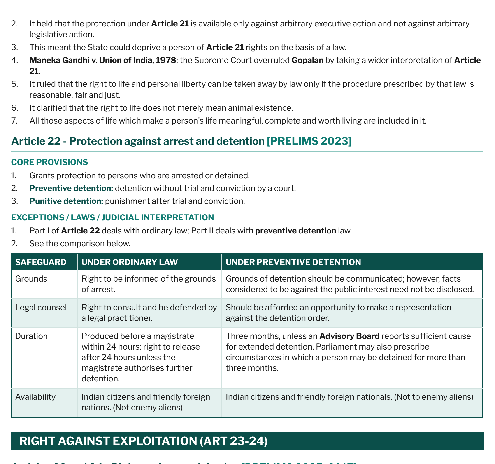

# Article 22: Protection Against Arrest and Detention (Punitive vs Preventive Detention) — Prelims Notes (Art_22_Safeguards_Against_Arrest_and_Preventive_Detention)

---

### [Prelims Source Page 46](../../pages/prelims/prelims_page_046.pdf)

## CHAPTER 07: FUNDAMENTAL RIGHTS

### THEME ANALYSIS PYQ pattern for this chapter

#### 1. REPEATS

#### A. Placing a Right in the Correct Article

- Article 21 dominates, choice of marriage partner [2019] and Right to Privacy [2024, 2021, 2018]

- Which head does abolition of untouchability fall - under Right to Equality (Article 17) [2020, 2017]

- Articles 23 and 24, forced labour and child labour below 14 years [2025, 2017]

#### B. Definitions, Doctrines and Limits

- Article 13 meaning of law, including custom or usage having the force of law [2026]

- Article 14 voiding unguided and uncontrolled executive discretion [2021]

- Article 16(4) read with Article 335, which defines nothing [2023]

- Article 30 minority institutions and the Prime Minister's 15 Point Programme [2011]

#### C. Rights Inside versus Outside Part III

- Right to Property under Article 300A, a legal right of any person [2021]

- Right to vote as a constitutional right, not fundamental or natural [2017]

- Part III beside the Preamble, DPSP and duties as UDHR, 1948 reflections [2020, 2011]

#### D. Statutes and Remedies

- Article 22 detention, counsel and the Prevention of Terrorism Act, 2002 [2023]

- Article 32 writs, Habeas Corpus, Mandamus, Certiorari, Quo Warranto

- Article 35, certain rights legislated by Parliament alone

#### 2. HOW THE FORMAT HAS CHANGED

- 2011 to 2017: code based recall of lists, minority benefits and UDHR rights [2011, 2017]

- 2018 to 2024: single answer placement of a right in its Article [2018, 2019, 2020, 2021, 2024]

- 2023: "how many" and Statement I and Statement II formats [2023]

- 2026: an argument style stem on the meaning of "law" in Art 13 [2026]

#### 3. WHAT IS BEING ASKED NOW

- Definitions and doctrine: "law" under Art 13 [2026], Art 335 and reservation [2023], arbitrariness under Art 14 [2021]

- Detention safeguards under Art 22 [2023]

- Privacy keeps returning under Art 21 [2018, 2021, 2024]

---

### [Prelims Source Page 47](../../pages/prelims/prelims_page_047.pdf)

### PRELIMS PREVIOUS YEAR QUESTIONS

#### Q1 (2026)

**'X' was addressing a seminar on the meaning of the term 'law' as provided under Article 13, Part III of the Constitution of India. 'X' explained that the meaning of the term 'law' in the Constitution of India was very comprehensive. It included ordinances, orders and even rules and regulations. 'Y' pointed out that the term 'law' in Article 13 also included custom or usage having in the territory of India the force of law, to which 'X' was not convinced. Based on the above, select the correct conclusion from the options given below:**

- **(a)** X is correct in the interpretation of law, including the view on non-inclusion of custom
- **(b)** The view of Y that 'law' included custom is not correct
- **(c)** The views of both X and Y are correct
- **(d)** The view of only Y is correct

> **Answer:** `(d)` · [Prelims Source Page 47](../../pages/prelims/prelims_page_047.pdf)

#### Q2 (2024)

**Under which of the following Articles of the Constitution of India has the Supreme Court of India placed the Right to Privacy?**

- **(a)** Article 15
- **(b)** Article 16
- **(c)** Article 19
- **(d)** Article 21

> **Answer:** `(d)` · [Prelims Source Page 47](../../pages/prelims/prelims_page_047.pdf)

#### Q3 (2023)

**Consider the following statements:**

- **Statement-I:** The Supreme Court of India has held in some judgements that the reservation policies made under Article 16(4) of the Constitution of India would be limited by Article 335 for maintenance of efficiency of administration.
- **Statement-II:** Article 335 of the Constitution of India defines the term 'efficiency of administration'.

*Which one of the following is correct in respect of the above statements?*

- **(a)** Both Statement-I and Statement-II are correct and Statement-II is the correct explanation for Statement-I
- **(b)** Both Statement-I and Statement-II are correct and Statement-II is not the correct explanation for Statement-I
- **(c)** Statement-I is correct but Statement-II is incorrect
- **(d)** Statement-I is incorrect but Statement-II is correct

> **Answer:** `(c)` · [Prelims Source Page 47](../../pages/prelims/prelims_page_047.pdf)

#### Q4 (2023)

**Consider the following statements:**

- **1.** According to the Constitution of India, the Central Government has a duty to protect States from internal disturbances.
- **2.** The Constitution of India exempts the States from providing legal counsel to a person being held for preventive detention.
- **3.** According to the Prevention of Terrorism Act, 2002, confession of the accused before the police cannot be used as evidence.

*How many of the above statements are correct?*

- **(a)** Only one
- **(b)** Only two
- **(c)** All three
- **(d)** None

> **Answer:** `(b)` · [Prelims Source Page 47](../../pages/prelims/prelims_page_047.pdf)

#### Q5 (2021)

**A legislation which confers on the executive or administrative authority an unguided and uncontrolled discretionary power in the matter of application of law violates which one of the following Articles of the Constitution of India?**

- **(a)** Article 14
- **(b)** Article 28
- **(c)** Article 32
- **(d)** Article 44

> **Answer:** `(a)` · [Prelims Source Page 47](../../pages/prelims/prelims_page_047.pdf)

#### Q6 (2021)

**What is the position of the Right to Property in India?**

- **(a)** Legal right available to citizens only
- **(b)** Legal right available to any person
- **(c)** Fundamental Right available to citizens only
- **(d)** Neither Fundamental Right nor legal right

> **Answer:** `(b)` · [Prelims Source Page 47](../../pages/prelims/prelims_page_047.pdf)

#### Q7 (2021)

**'Right to Privacy' is protected under which Article of the Constitution of India?**

- **(a)** Article 15
- **(b)** Article 19
- **(c)** Article 21
- **(d)** Article 29

> **Answer:** `(c)` · [Prelims Source Page 47](../../pages/prelims/prelims_page_047.pdf)

---

### [Prelims Source Page 53](../../pages/prelims/prelims_page_053.pdf)

*Diagram Screenshot: [Article 21: Inferred Fundamental Rights, Right to Education (Art 21A) & Art 22 Safeguards](../../diagrams/pre_diag_art21_inferred_rights_p053.png) · [Full Source Page 53](../../pages/prelims/prelims_page_053.pdf)*

- **2.** It held that the protection under Article 21 is available only against arbitrary executive action and not against arbitrary legislative action.

- **3.** This meant the State could deprive a person of Article 21 rights on the basis of a law.

- **4.** Maneka Gandhi v. Union of India, 1978: the Supreme Court overruled Gopalan by taking a wider interpretation of Article 21.

- **5.** It ruled that the right to life and personal liberty can be taken away by law only if the procedure prescribed by that law is reasonable, fair and just.

- **6.** It clarified that the right to life does not merely mean animal existence.

- **7.** All those aspects of life which make a person's life meaningful, complete and worth living are included in it.

### Article 22 - Protection against arrest and detention [PRELIMS 2023]

### CORE PROVISIONS

- **1.** Grants protection to persons who are arrested or detained.

- **2.** Preventive detention: detention without trial and conviction by a court.

- **3.** Punitive detention: punishment after trial and conviction. EXCEPTIONS / LAWS / JUDICIAL INTERPRETATION

- **1.** Part I of Article 22 deals with ordinary law; Part II deals with preventive detention law.

- **2.** See the comparison below.

| SAFEGUARD | UNDER ORDINARY LAW | UNDER PREVENTIVE DETENTION |
| --- | --- | --- |
| Grounds | Right to be informed of the grounds of arrest. | Grounds of detention should be communicated; however, facts considered to be against the public interest need not be disclosed. |
| Legal counsel | Right to consult and be defended by a legal practitioner. | Should be afforded an opportunity to make a representation against the detention order. |
| Duration | Produced before a magistrate within 24 hours; right to release after 24 hours unless the magistrate authorises further detention. | Three months, unless an Advisory Board reports sufficient cause for extended detention. Parliament may also prescribe circumstances in which a person may be detained for more than three months. |
| Availability | Indian citizens and friendly foreign nations. (Not enemy aliens) | Indian citizens and friendly foreign nationals. (Not to enemy aliens) |

RIGHT AGAINST EXPLOITATION (ART 23-24) Articles 23 and 24 - Right against exploitation [PRELIMS 2025, 2017]

### CORE PROVISIONS

### Article 23

- **1.** Prohibits traffic in human beings and forced labour.

- **2.** Protects the individual against actions of both the State and private citizens.

- **3.** Available to both citizens and non-citizens.

### Article 24

- **4.** Prohibits employment of children below 14 years of age in any factory, mine or other hazardous occupation. EXCEPTIONS / LAWS / JUDICIAL INTERPRETATION Exception:

- **1.** Compulsory service for public purposes, such as conscription to the armed forces, is not unconstitutional.

- **2.** In imposing such service the State shall not discriminate on four grounds: (1) religion, (2) race, (3) caste, (4) class, or any of them. Laws passed:

- **3.** Suppression of Immoral Traffic in Women and Girls Act, 1956.

- **4.** Bonded Labour System (Abolition) Act, 1976.
