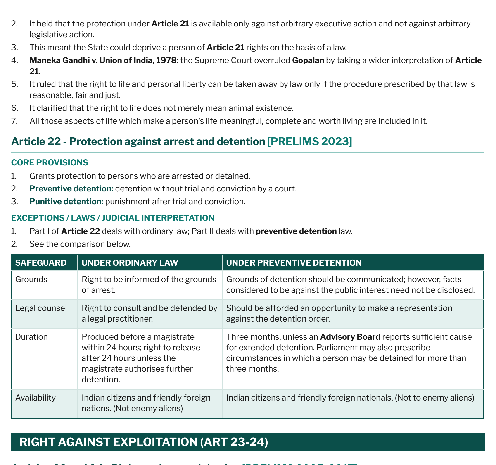

# Articles 23 & 24: Prohibition of Human Trafficking, Forced Labour (Begar) & Child Labour — Prelims Notes (Art_23_24_Right_Against_Exploitation)

---

### [Prelims Source Page 46](../../pages/prelims/prelims_page_046.pdf)

## CHAPTER 07: FUNDAMENTAL RIGHTS

### THEME ANALYSIS PYQ pattern for this chapter

#### 1. REPEATS

#### A. Placing a Right in the Correct Article

- Article 21 dominates, choice of marriage partner [2019] and Right to Privacy [2024, 2021, 2018]

- Which head does abolition of untouchability fall - under Right to Equality (Article 17) [2020, 2017]

- Articles 23 and 24, forced labour and child labour below 14 years [2025, 2017]

#### B. Definitions, Doctrines and Limits

- Article 13 meaning of law, including custom or usage having the force of law [2026]

- Article 14 voiding unguided and uncontrolled executive discretion [2021]

- Article 16(4) read with Article 335, which defines nothing [2023]

- Article 30 minority institutions and the Prime Minister's 15 Point Programme [2011]

#### C. Rights Inside versus Outside Part III

- Right to Property under Article 300A, a legal right of any person [2021]

- Right to vote as a constitutional right, not fundamental or natural [2017]

- Part III beside the Preamble, DPSP and duties as UDHR, 1948 reflections [2020, 2011]

#### D. Statutes and Remedies

- Article 22 detention, counsel and the Prevention of Terrorism Act, 2002 [2023]

- Article 32 writs, Habeas Corpus, Mandamus, Certiorari, Quo Warranto

- Article 35, certain rights legislated by Parliament alone

#### 2. HOW THE FORMAT HAS CHANGED

- 2011 to 2017: code based recall of lists, minority benefits and UDHR rights [2011, 2017]

- 2018 to 2024: single answer placement of a right in its Article [2018, 2019, 2020, 2021, 2024]

- 2023: "how many" and Statement I and Statement II formats [2023]

- 2026: an argument style stem on the meaning of "law" in Art 13 [2026]

#### 3. WHAT IS BEING ASKED NOW

- Definitions and doctrine: "law" under Art 13 [2026], Art 335 and reservation [2023], arbitrariness under Art 14 [2021]

- Detention safeguards under Art 22 [2023]

- Privacy keeps returning under Art 21 [2018, 2021, 2024]

---

### [Prelims Source Page 48](../../pages/prelims/prelims_page_048.pdf)

#### Q8 (2020)

**Which one of the following categories of 'Fundamental Rights' incorporates protection against untouchability as a form of discrimination?**

- **(a)** Right against Exploitation
- **(b)** Right to Freedom
- **(c)** Right to Constitutional Remedies
- **(d)** Right to Equality

> **Answer:** `(d)` · [Prelims Source Page 48](../../pages/prelims/prelims_page_048.pdf)

#### Q9 (2020)

**Other than the Fundamental Rights, which of the following parts of the Constitution of India reflect/reflects the principles and provisions of the Universal Declaration of Human Rights (1948)?**

- **1.** Preamble
- **2.** Directive Principles of State Policy
- **3.** Fundamental Duties

*Select the correct answer using the code given below:*

- **(a)** 1 and 2 only
- **(b)** 2 only
- **(c)** 1 and 3 only
- **(d)** 1, 2 and 3

> **Answer:** `(d)` · [Prelims Source Page 48](../../pages/prelims/prelims_page_048.pdf)

#### Q10 (2019)

**Which Article of the Constitution of India safeguards one's right to marry the person of one's choice?**

- **(a)** Article 19
- **(b)** Article 21
- **(c)** Article 25
- **(d)** Article 29

> **Answer:** `(b)` · [Prelims Source Page 48](../../pages/prelims/prelims_page_048.pdf)

#### Q11 (2018)

**Right to Privacy is protected as an intrinsic part of Right to Life and Personal Liberty. Which of the following in the Constitution of India correctly and appropriately imply the above statement?**

- **(a)** Article 14 and the provisions under the 42nd Amendment to the Constitution
- **(b)** Article 17 and the Directive Principles of State Policy in Part IV
- **(c)** Article 21 and the freedoms guaranteed in Part III
- **(d)** Article 24 and the provisions under the 44th Amendment to the Constitution

> **Answer:** `(c)` · [Prelims Source Page 48](../../pages/prelims/prelims_page_048.pdf)

#### Q12 (2017)

**Which of the following are envisaged by the Right against Exploitation in the Constitution of India?**

- **1.** Prohibition of traffic in human beings and forced labour
- **2.** Abolition of untouchability
- **3.** Protection of the interests of minorities
- **4.** Prohibition of employment of children in factories and mines

*Select the correct answer using the code given below:*

- **(a)** 1, 2 and 4 only
- **(b)** 2, 3 and 4 only
- **(c)** 1 and 4 only
- **(d)** 1, 2, 3 and 4

> **Answer:** `(c)` · [Prelims Source Page 48](../../pages/prelims/prelims_page_048.pdf)

#### Q13 (2011)

**In India, if a religious sect/community is given the status of a national minority, what special advantages is it entitled to?**

- **1.** It can establish and administer exclusive educational institutions.
- **2.** The President of India automatically nominates a representative of the community to Lok Sabha.
- **3.** It can derive benefits from the Prime Minister's 15-Point Programme.

*Which of the statements given above is/are correct?*

- **(a)** 1 only
- **(b)** 2 and 3 only
- **(c)** 1 and 3 only
- **(d)** 1, 2 and 3

> **Answer:** `(c)` · [Prelims Source Page 48](../../pages/prelims/prelims_page_048.pdf)

#### Q14 (2011)

**Consider the following:**

- **1.** Right to education
- **2.** Right to equal access to public service
- **3.** Right to food Which of the above is/are Human Right/Human Rights under the Universal Declaration of Human Rights?

- **(a)** 1 only
- **(b)** 1 and 2 only
- **(c)** 3 only
- **(d)** 1, 2 and 3

> **Answer:** `(d)` · [Prelims Source Page 48](../../pages/prelims/prelims_page_048.pdf)

PART III - FUNDAMENTAL RIGHTS: GENERAL FEATURES Nature and Scope

### CORE PROVISIONS

- **1.** Contained in Part III of the Constitution; described as the Magna Carta of the Indian Constitution.

- **2.** Place limits on the tyranny of the Executive and on arbitrary laws of the Legislature.

- **3.** Parliament can amend Fundamental Rights.

---

### [Prelims Source Page 53](../../pages/prelims/prelims_page_053.pdf)

*Diagram Screenshot: [Article 21: Inferred Fundamental Rights, Right to Education (Art 21A) & Art 22 Safeguards](../../diagrams/pre_diag_art21_inferred_rights_p053.png) · [Full Source Page 53](../../pages/prelims/prelims_page_053.pdf)*

- **2.** It held that the protection under Article 21 is available only against arbitrary executive action and not against arbitrary legislative action.

- **3.** This meant the State could deprive a person of Article 21 rights on the basis of a law.

- **4.** Maneka Gandhi v. Union of India, 1978: the Supreme Court overruled Gopalan by taking a wider interpretation of Article 21.

- **5.** It ruled that the right to life and personal liberty can be taken away by law only if the procedure prescribed by that law is reasonable, fair and just.

- **6.** It clarified that the right to life does not merely mean animal existence.

- **7.** All those aspects of life which make a person's life meaningful, complete and worth living are included in it.

### Article 22 - Protection against arrest and detention [PRELIMS 2023]

### CORE PROVISIONS

- **1.** Grants protection to persons who are arrested or detained.

- **2.** Preventive detention: detention without trial and conviction by a court.

- **3.** Punitive detention: punishment after trial and conviction. EXCEPTIONS / LAWS / JUDICIAL INTERPRETATION

- **1.** Part I of Article 22 deals with ordinary law; Part II deals with preventive detention law.

- **2.** See the comparison below.

| SAFEGUARD | UNDER ORDINARY LAW | UNDER PREVENTIVE DETENTION |
| --- | --- | --- |
| Grounds | Right to be informed of the grounds of arrest. | Grounds of detention should be communicated; however, facts considered to be against the public interest need not be disclosed. |
| Legal counsel | Right to consult and be defended by a legal practitioner. | Should be afforded an opportunity to make a representation against the detention order. |
| Duration | Produced before a magistrate within 24 hours; right to release after 24 hours unless the magistrate authorises further detention. | Three months, unless an Advisory Board reports sufficient cause for extended detention. Parliament may also prescribe circumstances in which a person may be detained for more than three months. |
| Availability | Indian citizens and friendly foreign nations. (Not enemy aliens) | Indian citizens and friendly foreign nationals. (Not to enemy aliens) |

RIGHT AGAINST EXPLOITATION (ART 23-24) Articles 23 and 24 - Right against exploitation [PRELIMS 2025, 2017]

### CORE PROVISIONS

### Article 23

- **1.** Prohibits traffic in human beings and forced labour.

- **2.** Protects the individual against actions of both the State and private citizens.

- **3.** Available to both citizens and non-citizens.

### Article 24

- **4.** Prohibits employment of children below 14 years of age in any factory, mine or other hazardous occupation. EXCEPTIONS / LAWS / JUDICIAL INTERPRETATION Exception:

- **1.** Compulsory service for public purposes, such as conscription to the armed forces, is not unconstitutional.

- **2.** In imposing such service the State shall not discriminate on four grounds: (1) religion, (2) race, (3) caste, (4) class, or any of them. Laws passed:

- **3.** Suppression of Immoral Traffic in Women and Girls Act, 1956.

- **4.** Bonded Labour System (Abolition) Act, 1976.

---

### [Prelims Source Page 54](../../pages/prelims/prelims_page_054.pdf)

- **5.** Commissions for Protection of Child Rights Act, 2005, providing for a National Commission and State Commissions for Protection of Child Rights and for Children's Courts for speedy trial of offences against children or violation of child rights. RIGHT TO FREEDOM OF RELIGION (ART 25-28) Articles 25 and 26 - Freedom of religion

### CORE PROVISIONS

- **1.** Article 25 guarantees freedom of conscience and the right freely to profess, practise and propagate religion.

- **2.** Article 26 guarantees freedom to manage religious affairs.

- **3.** See the comparison below. EXCEPTIONS / LAWS / JUDICIAL INTERPRETATION Exceptions:

- **1.** Subject to public order, morality and health.

- **2.** Subject to the other provisions of Part III relating to Fundamental Rights (Article 25 only).

- **3.** The right to propagate does not include the right to convert.

| BASIS | ARTICLE 25 | ARTICLE 26 |
| --- | --- | --- |
| Content | Freedom of conscience, and free profession, practice and propagation of religion. | Freedom to manage religious affairs. |
| Holder of the right | Rights of individuals. | Rights of religious denominations or their sections, to establish and maintain institutions for religious and charitable purposes. |
| Character | Protects individualistic freedom of religion. | Protects collective freedom of religion. |
| Limitations | Subject to public order, morality and health, and also to the other provisions of Part III relating to Fundamental Rights. | Subject to public order, morality and health, but not to the other provisions of Part III relating to Fundamental Rights. |

### Article 27 - Freedom from taxation for promotion of religion

### CORE PROVISIONS

- **1.** No person shall be compelled to pay any taxes for the promotion or maintenance of any particular religion or religious denomination.

- **2.** The provision prohibits the State from favouring, patronising or supporting one religion over another. EXCEPTIONS / LAWS / JUDICIAL INTERPRETATION Supreme Court judgment:

- **1.** Ratilal Panachand Gandhi v. State of Bombay, 1954: the provision prohibits only the levy of a tax, not a fee.

- **2.** The purpose of a fee is to control the secular administration of religious institutions, not to promote or maintain religion.

- **3.** A fee can be levied on pilgrims to provide them with some special service or safety measures.

- **4.** Similarly, a fee can be levied on religious endowments to meet regulatory expenditure.

### Article 28 - Freedom to attend religious instruction

### CORE PROVISIONS

- **1.** No religious instruction shall be provided in any educational institution wholly maintained out of State funds.

- **2.** This does not apply to an educational institution administered by the State but established under an endowment or trust requiring imparting of religious instruction in such institution. EXCEPTIONS / LAWS / JUDICIAL INTERPRETATION Article 28 distinguishes four types of educational institutions:

- **1.** Institutions wholly maintained by the State: religious instruction completely prohibited.

- **2.** Institutions administered by the State but established under an endowment or trust: religious instruction permitted.
