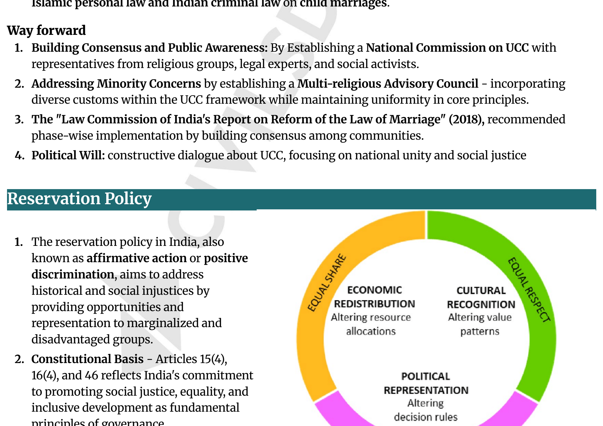

### [Smash Mains Source Page 34](../pages/mains/mains_page_034.pdf)

## Chapter 5
Fundamental Rights

### PYQs

- **[2026]** Right to privacy relating to self-identity is very dear to every human being and well protected
under Article 21 of the Constitution. In this context, examine the effect of the amendment in 2026, to the
Transgender Persons (Protection of Rights) Act, 2019. (10M)

- **[2024]** Right to privacy is intrinsic to life and personal liberty and is inherently protected under Article 21
of the Constitution. Explain. In this reference discuss the law relating to D.N.A. testing of a child in the
womb to establish its paternity.

- **[2023]** "The Constitution of India is a living instrument with capabilities of enormous dynamism. It is a
constitution made for a progressive society". Illustrate with special reference to the expanding horizons
of the right to life and personal liberty.

- **[2022]** Right of movement and residence throughout the territory of India are freely available to the
Indian citizens, but these rights are not absolute. Comment (10M)
Fundamental Rights
Fundamental rights are a set of basic rights and freedoms that are considered essential for the protection of
human dignity, liberty, and equality and are guaranteed to individuals by a constitution.
FR are referred to as the "Magna Carta" of India and are delineated in Part III (Article 12 to 35). These rights
are defended and guaranteed by the Supreme Court of India.

### Quotes
1. "Fundamental rights are both the shield and sword against State tyranny." - Prof. Upendra Baxi
2. "Freedom of speech and expression is the bulwark of a democratic government. It is the very foundation
of democracy." - Dr. Rajendra Prasad
3. "I measure the progress of a community by the degree of progress which women have achieved." -B R
Ambedkar - Affirmative Action
4. "Without political freedom, economic freedom is a mere chimera." - Nehru - Balancing FR and DPSP
5. For Conclusion - "Those who would give up Essential Liberty to purchase Temporary Safety, deserve
neither Liberty nor Safety." (Benjamin Franklin). Thus, protection and promotion of FR is vital for the
well-being of a free and democratic society.
Features
1. Guaranteed by the Constitution Part III (Articles 12-35) - enforceable by SC & HC (Art. 32 & 226).
2. Primarily act as limitations on State power, preventing arbitrary actions. Eg. Shreya Singhal case
3. Against the State as well as against private persons. (Art. 17, 23)
4. Not absolute - Subject to reasonable restrictions for public order, morality, security, etc.
5. Negative and Positive obligations - Some rights prevent State interference (freedom of speech) while
others impose duties to act (abolition of untouchability).
36

#### Structured Tables on Page 34

| PYQs |
| --- |
| [2026] Right to privacy relating to self-identity is very dear to every human being and well protected under Article 21 of the Constitution. In this context, examine the effect of the amendment in 2026, to the Transgender Persons (Protection of Rights) Act, 2019. (10M) [2024] Right to privacy is intrinsic to life and personal liberty and is inherently protected under Article 21 of the Constitution. Explain. In this reference discuss the law relating to D.N.A. testing of a child in the womb to establish its paternity. [2023] "The Constitution of India is a living instrument with capabilities of enormous dynamism. It is a constitution made for a progressive society". Illustrate with special reference to the expanding horizons of the right to life and personal liberty. [2022] Right of movement and residence throughout the territory of India are freely available to the Indian citizens, but these rights are not absolute. Comment (10M) |

---

### [Smash Mains Source Page 37](../pages/mains/mains_page_037.pdf)

*Diagram Screenshot: [Dimensions of Equality: Equal Share, Equal Respect, Equal Say](../diagrams/mains_diag_equality_dimensions_p037.png) | [Full Source Page 37](../pages/mains/mains_page_037.pdf)*

Challenges
1. Lack of Consensus - Absence of broad-based community agreement may lead to social unrest.
2. Religious Freedom - May infringe on Art. 25, as personal laws are integral to religious practices.
3. Minority Rights - Could marginalise minorities, with fear of majority practices dominating.
4. Cultural Diversity - Risks eroding India's plural traditions and imposing uniformity. Eg. Khasi
matrilineal system in Meghalaya could be threatened.
5. Practical Challenges - Drafting a uniform law for all communities is complex due to regional variations.
6. Law Commission Report 2018: UCC "neither necessary nor desirable"
7. Federalism Concerns - May undermine state autonomy, as personal laws fall under Concurrent List.
8. Presence of Secular Laws that already address many issues for all citizens. Eg. Section 125 of the
Criminal Procedure Code (maintenance) and Domestic Violence Act.
SC Judgments
1. Shah Bano Case (1985) - SC upheld Muslim women's right to maintenance under CrPC 125.
2. Sarla Mudgal Case (1995) - SC declared second marriage after conversion void and stressed need for UCC
for gender justice.
3. Shayara Bano Case (2017) - SC struck down instant triple talaq, reinforcing uniform standards for
gender justice.
4. Jose Paulo Coutinho Case (2019) - SC praised Goa's UCC as a model for national implementation.
5. The Delhi High Court recently advocated for a Uniform Civil Code (UCC), noting conflicts between
Islamic personal law and Indian criminal law on child marriages.
Way forward
1. Building Consensus and Public Awareness: By Establishing a National Commission on UCC with
representatives from religious groups, legal experts, and social activists.
2. Addressing Minority Concerns by establishing a Multi-religious Advisory Council - incorporating
diverse customs within the UCC framework while maintaining uniformity in core principles.
3. The "Law Commission of India's Report on Reform of the Law of Marriage" (2018), recommended
phase-wise implementation by building consensus among communities.
4. Political Will: constructive dialogue about UCC, focusing on national unity and social justice
Reservation Policy
1. The reservation policy in India, also
known as affirmative action or positive
discrimination, aims to address
historical and social injustices by
providing opportunities and
representation to marginalized and
disadvantaged groups.
2. Constitutional Basis - Articles 15(4),
16(4), and 46 reflects India's commitment
to promoting social justice, equality, and
inclusive development as fundamental
principles of governance.
39

---

### [Smash Mains Source Page 38](../pages/mains/mains_page_038.pdf)

Grounds for reservation
Group Reason for Support
SCs and STs Historical injustice and social exclusion.
Other Backward Classes (OBCs) Social and educational backwardness.
Economically Weaker Sections (EWS) Economic deprivation and lack of access to resources.
Women Gender discrimination and underrepresentation
Persons with Disabilities (PwD) Ensure inclusion, accessibility, and participation
Reasons behind rising demand for reservation
Aspect Description Examples
Perceived Discrimination Andre Béteille argues that
reservations for lower castes
create a sense of reverse
discrimination among upper
castes.
Patidar agitation in Gujarat (2015)
for OBC status.
Competition for Opportunities M.N. Srinivas: pressure on
dominant castes to secure
economic opportunities as
traditional agrarian roles
diminish.
Maratha reservation protests in
Maharashtra (2018).
Economic Disparities Sections within these
communities experience poverty
or lack access to resources.
Job Security Yogendra Singh: shift from
agrarian economy to job-based
economy increased demand for
job security.
Demand for local reservation in
Haryana
Identity Politics and Mobilization Christophe Jaffrelot: political
mobilization around caste
identities can consolidate electoral
support.
Backlash Against Affirmative
Action
Reservation policies perceived as
unfair or discriminatory by
dominant castes.
Anti-reservation protests
40

#### Structured Tables on Page 38

| Group | Reason for Support |
| --- | --- |
| SCs and STs | Historical injustice and social exclusion. |
| Other Backward Classes (OBCs) | Social and educational backwardness. |
| Economically Weaker Sections (EWS) | Economic deprivation and lack of access to resources. |
| Women | Gender discrimination and underrepresentation |
| Persons with Disabilities (PwD) | Ensure inclusion, accessibility, and participation |

| Aspect | Description | Examples |
| --- | --- | --- |
| Perceived Discrimination | Andre Béteille argues that reservations for lower castes create a sense of reverse discrimination among upper castes. | Patidar agitation in Gujarat (2015) for OBC status. |
| Competition for Opportunities | M.N. Srinivas: pressure on dominant castes to secure economic opportunities as traditional agrarian roles diminish. | Maratha reservation protests in Maharashtra (2018). |
| Economic Disparities | Sections within these communities experience poverty or lack access to resources. |  |
| Job Security | Yogendra Singh: shift from agrarian economy to job-based economy increased demand for job security. | Demand for local reservation in Haryana |
| Identity Politics and Mobilization | Christophe Jaffrelot: political mobilization around caste identities can consolidate electoral support. |  |
| Backlash Against Affirmative Action | Reservation policies perceived as unfair or discriminatory by dominant castes. | Anti-reservation protests |

---

### [Smash Mains Source Page 39](../pages/mains/mains_page_039.pdf)

Challenges
1. Politicization of caste and castecization of politics undermines the original intent of reservation
policies. Eg. reservation demands by dominant communities like Patels, Marathas, etc.
2. Strengthening Caste Identity: The redistributive justice based on caste reinforces caste identities and
poses challenges to establishing a casteless egalitarian society.
3. Stigmatization and Stereotyping: Individuals from reserved categories face discrimination or be
perceived as beneficiaries of preferential treatment.
4. Creamy Layer: The absence of a creamy layer for SC and ST and the higher creamy layer limit for OBCs
can lead to a 'class within caste'. Eg. As per Justice G. Rohini Commission's report, 97% of central OBC
quota benefits go to just under 25% of its castes.
5. Reservation in Promotions: lead to inefficiency and compromise the merit-based selection process,
affecting overall productivity and performance in government institutions.
6. Dependency on Reservations: Over-reliance on reservation policies discourage investment in holistic
measures for socio-economic development such as health and education.
SC Judgments
Case Description
Indra Sawhney v. UoI (1992) Upheld reservations for OBCs but capped them at
50%.

#### M. Nagaraj & Others v. Union of India (2006) Upheld reservations in promotions for SC/STs under
specific conditions: backwardness, inadequate
representation, and administrative efficiency.
Jarnail Singh v. Lachhmi Narain Gupta (2018) States are not required to provide quantifiable data to
justify reservations in promotions, reversing M.
Nagaraj.
Jaishri Laxmanrao Patil v. Chief Minister (2021) Struck down Maratha Reservation law for exceeding
the 50% cap; upheld Indra Sawhney and the 102nd
Constitutional Amendment.
Reservation in promotions
1. As per 16 (4A), the state can make provision for reservation in matters of promotion, with
consequential seniority, in favor of Scheduled Castes and the Scheduled Tribes which in the opinion of
the State are not adequately represented in the services under the State.
2. Among the 275 joint secretaries, 13 (4.73 per cent) are SCs, nine (3.27 per cent) are STs and 19 belong to
the OBC category. Of 89 secretaries, there are just 3 STs, 1 Dalit and no OBCs.
Benefits
1. Addressing Structural Discrimination and systemic barriers that hinder the upward mobility of
marginalized groups in the workforce. Eg. In Group-A, the highest tier among these, the representation
of SCs is just 12.86%, of STs 5.64% and of OBCs 16.88%. Reservation for these communities is 15%, 7.5%
and 27% respectively.
2. Role Model Effect within marginalized communities.
3. Encouraging Equal Opportunity and Building a Representative Workforce
41

#### Structured Tables on Page 39

| Case | Description |
| --- | --- |
| Indra Sawhney v. UoI (1992) | Upheld reservations for OBCs but capped them at 50%. |
| M. Nagaraj & Others v. Union of India (2006) | Upheld reservations in promotions for SC/STs under specific conditions: backwardness, inadequate representation, and administrative efficiency. |
| Jarnail Singh v. Lachhmi Narain Gupta (2018) | States are not required to provide quantifiable data to justify reservations in promotions, reversing M. Nagaraj. |
| Jaishri Laxmanrao Patil v. Chief Minister (2021) | Struck down Maratha Reservation law for exceeding the 50% cap; upheld Indra Sawhney and the 102nd Constitutional Amendment. |

---

### [Smash Mains Source Page 40](../pages/mains/mains_page_040.pdf)

Challenges
Challenge Description
Meritocracy Concerns By prioritizing social identity over individual
qualifications and performance
Quantifiable Data Difficulty in collecting accurate data to justify
reservations in promotions.
Administrative Efficiency Concerns that reservations in promotions can
undermine Article 335.
Backlog As reserved category candidates may not always be
available for promotion.
Judicial Interpretations In the Jarnail Singh case, SC reversed the
requirement for quantifiable data set by M. Nagaraj.
Way forward for reservation
Expert Recommendation
Dr. Amartya Sen Capability approach focusing on 3Es: education, employability, and employment.
Dr. Yogendra Yadav Introduction of sunset clauses in reservation policies.
Institutional
Recommendations
Create institutions similar to the Equal Opportunities Commission (US/UK) to
create deprivation indexes and audit reservation policies.
Comprehensive Data
and Guidelines
Need for comprehensive data and clear guidelines for identifying beneficiaries.
Accompanying
Structural Reforms
Implement structural reforms like land reforms and skilling programs alongside
reservations.
Periodic Reviews Every five years to addresses distortions and ensures equitable opportunities
Sub-categorization of OBCs
1. It refers to creating sub-categories within the larger group of OBCs to ensure "equitable distribution" of
representation among all OBC communities.
2. The Landmark SC judgment allowing sub-classification of SCs/STs has provided the legal logic for
expanding similar "graded backwardness" models for OBCs at the Central level.
SC in Davinder Singh case overturned the 2004 ruling in E.V. Chinnaiah and allowed states to sub-classify
SCs and STs
42

#### Structured Tables on Page 40

| Challenge | Description |
| --- | --- |
| Meritocracy Concerns | By prioritizing social identity over individual qualifications and performance |
| Quantifiable Data | Difficulty in collecting accurate data to justify reservations in promotions. |
| Administrative Efficiency | Concerns that reservations in promotions can undermine Article 335. |
| Backlog | As reserved category candidates may not always be available for promotion. |
| Judicial Interpretations | In the Jarnail Singh case, SC reversed the requirement for quantifiable data set by M. Nagaraj. |

| Expert | Recommendation |
| --- | --- |
| Dr. Amartya Sen | Capability approach focusing on 3Es: education, employability, and employment. |
| Dr. Yogendra Yadav | Introduction of sunset clauses in reservation policies. |
| Institutional Recommendations | Create institutions similar to the Equal Opportunities Commission (US/UK) to create deprivation indexes and audit reservation policies. |
| Comprehensive Data and Guidelines | Need for comprehensive data and clear guidelines for identifying beneficiaries. |
| Accompanying Structural Reforms | Implement structural reforms like land reforms and skilling programs alongside reservations. |
| Periodic Reviews | Every five years to addresses distortions and ensures equitable opportunities |

---

### [Smash Mains Source Page 41](../pages/mains/mains_page_041.pdf)

1. Justice Rohini commission on OBC sub-categorization was set up by the President of India, mandated
under Article 340 to investigate the conditions of socially and educationally backward classes and
propose steps for their improvement. It submitted its report in October 2023.
a. 97% of the reserved jobs and seats have gone to 25% of OBC sub-castes, and only 10 OBC
communities have taken the 25% of reserved central jobs and institutional seats.
b. As many as 983, or 37%t, of the 2,600 communities under the OBC had zero representation in jobs
and institutes, and only 2.68% reservations have been used by 994 castes.
Sub-categorisation of OBCs in states:
- 1972: Karnataka CM Devraj Urs appointed Havanur Commission, its report formed the basis for the
sub-categorisation of OBCs.
- 1977: Bihar CM Karpoori Thakur implemented the Mungeri Lal Commission report to divide OBCs into
two categories: extremely backward classes (EBCs), and backward classes.
- 2002: UP CM Rajnath Singh appointed Hukum Singh committee to earmark 5% OBC quota for Yadavs
and 14% for Most Backward Classes
Need for Sub-Categorization of OBCs
1. Unequal Distribution of Quota Benefits - 97% of the reserved jobs and seats have gone to 25% of OBC
sub-castes
2. Horizontal Equity - Sub-categorization ensures fair share for most backward classes (MBCs) within
OBCs, aligning with Articles 14, 15, and 16 guaranteeing equality.
3. Better Targeting of Affirmative Action - Helps identify truly deprived groups for focused support in
education, jobs, and welfare.
4. Political Representation - Sub-categorization could improve political inclusion for marginalised OBC
groups who are otherwise overshadowed by dominant castes.
5. Ensuring Fair Distribution Structure - Justice Rohini Commission's recommendation to sub-categorize
OBCs into three benefit bands: communities receiving no benefits, those with partial benefits, and those
receiving maximum benefits.
6. Scientific Resource Allocation - Sub-categorization allows the state to direct specialized welfare
schemes to specific clusters of castes.
7. Fulfills the mandate of Article 340, requiring the State to investigate and improve backward class
conditions.
8. Harmonizing State-Central Lists - Eg. Bihar and Tamil Nadu have successfully used sub-categorization
for decades to balance social groups.
9. Moves from "formal equality" (treating unequals as equals) to "substantive equality" (graded assistance).
Challenges
1. Absence of Current Population Data Without a completed 2027 Census, determining the exact
population weight for sub-quotas remains speculative.
2. Fear of political backlash from dominant OBCs leading to delay in implementing Justice Rohini report
3. Identical castes use different surnames or spellings across states, leading to classification errors.
4. Triggering "Competitive Backwardness" Further division might encourage even more groups to
demand specialized "micro-quotas" within categories.
5. Erosion of Collective Bargaining - Eg. Sociologists argue that sub-categorization is a "divide and rule"
strategy to weaken the Mandal movement.
43

---

### [Smash Mains Source Page 42](../pages/mains/mains_page_042.pdf)

Scheduled Caste Reservation
Recently, SC in Chinthada Anand v. State of Andhra Pradesh (2026) ruled that a person professing any
religion other than Hinduism, Buddhism, or Sikhism cannot be recognised as a member of a SC community
and conversion to any other religion (Islam or Christianity) results in the loss of SC status. (there is no
religion-based restriction on ST status)
SC held that as other religions do not theologically recognize the caste system, a person cannot publicly
practice them while simultaneously claiming SC status
SC Reservation criteria
1. Under Article 341 of the Constitution, the President can specify the castes that are officially deemed
Scheduled Castes.
2. Once the initial Presidential list was published, only the Parliament of India has the authority to make
additions or removal.
3. SC eligibility is strictly governed by Clause 3 of the Constitution (Scheduled Castes) Order, 1950.
4. SC status is State/Union Territory-specific. A community recognized as a SC in one state may be
categorized as general category or an OBC or in another state
Caste census
1. Caste-based census refers to the collection of demographic data that includes information about the
caste or social group of individuals within a population.
2. M. N. Srinivas (Indian sociologist) defines caste as a hereditary, endogamous, and usually localized
group, linked to a specific occupation, and occupying a certain position in the social hierarchy.
3. The Bihar government released the caste census and a few other state governments like Karnataka
announced the same.
4. After a gap of 16 years, the Government of India officially launched Phase 1 (House Listing and Housing
Census) of the "Census 2027" on April 1, 2026.
5. The Union Government confirmed that caste and sub-caste data will be collected nationwide for the
first time since 1931.
6. Every Census in independent India from 1951 to 2011 has published data on Scheduled Castes and
Scheduled Tribes, but not on other castes. Before that, every Census until 1931 had data on caste.
7. The Socio-Economic Caste Census (SECC) conducted in 2011 aimed to gather comprehensive data on
socio-economic indicators, including caste information. However, issues regarding data quality and
classification challenges have hindered the effective release and utilization of the raw caste data
collected in the SECC.
Need of caste census
1. Evidence-Based Policymaking: A caste census can help design targeted welfare programs for the most
marginalized within OBCs, SCs, and other underserved communities.
2. Update Outdated Baselines - Current OBC quotas rely on 1931 colonial data extrapolated by the 1980
Mandal Commission, now nearly a century old
3. Enable Sub-categorization - Granular data allows the state to divide broad categories like OBCs to
ensure benefits reach "Extremely Backward Classes" (EBCs)
4. Rationalize Reservation Quotas - Updated population figures may justify increasing the 50%
reservation cap if demographics show significantly higher marginalized populations.
44

---

### [Smash Mains Source Page 43](../pages/mains/mains_page_043.pdf)

5. Map Social Mobility - The census acts as a "progress report" to see which communities have actually
advanced since independence and which remain stagnant.
6. Targeted Welfare and Resource Allocation: The 2023 Bihar caste survey revealed that 22.6 million
people eligible for subsidized food under NFSA were left out due to outdated population estimates.
7. Addressing Structural Inequality: A caste census is a scientific and objective tool to measure and
address wealth, education, and opportunity gaps rooted in social stratification.
8. The Sachar Committee (2006) emphasized that religion-based data enabled more focused minority
welfare- a similar framework can be adopted for caste.
9. Recognizing Intersectionality: A caste census can illuminate how caste intersects with gender, religion,
and region, leading to compounded disadvantages. Eg. Dalit women in rural Bihar face triple
marginalization - on the basis of caste, class, and gender.
10. Judicial Relevance - The Supreme Court in Indra Sawhney v. Union of India (1992) emphasized the need
for contemporary and quantifiable data on backwardness for reservations.
Challenges:
Political
1. Caste Census data may be weaponized for vote-bank politics, and could fuel sectarian populism.
2. "Competitive Backwardness" - Fresh demographic weight encourages dominant communities to seek
"backward" status, risking a "race to the bottom."
Social
1. Deepening of Caste Identities and Consciousness: "Enumeration is not a neutral act; it carries with it
the risk of reifying the very categories it seeks to understand." - Dipankar Gupta
2. Reification of Social Hierarchies - Scholars like M.N. Srinivas warned that overemphasis on caste in
public discourse may harden caste boundaries and hinder social mobility.
Legal
1. New data showing higher backward populations will likely trigger legal challenges to the Supreme
Court's 50% reservation cap. Eg. The 2023 Bihar Survey showed 63% OBC/EBCs
Administrative
1. Privacy and Data Misuse - Linking caste to digital IDs raises fears of surveillance and the potential
misuse of data for targeted political exclusion.
2. Administrative challenges: Caste is not uniform; identical groups use different names across states,
making standardized "coding" nearly impossible.
3. Misclassification or over-enumeration could create data reliability issues, as seen during the
Socio-Economic and Caste Census (SECC) 2011, whose caste data was withheld due to inconsistencies.
Way forward for advancing Equity Without Deepening Divisions:
1. Merging caste enumeration with data on education, income, health, sanitation, and land ownership,
adopting a holistic lens rather than relying on caste alone.
2. Establishing a multi-tier verification mechanism and a grievance redressal system for corrections.
3. Ensure caste data is anonymized and used strictly for policymaking, not for political mobilisation.
4. As per Suhas Palshikar, prepare a backwardness index based on the caste census and incentivize the
inclusion of persons with a high backwardness index in private employment.
5. Sub-categorization for Equity:
a. Implement Justice Rohini Commission's recommendations for sub-categorizing OBCs.
b. Aligning with the Supreme Court judgment in State of Punjab v. Davinder Singh (2024), sub-classify
SCs and STs within the reservation quota.
45

---

### [Smash Mains Source Page 44](../pages/mains/mains_page_044.pdf)

Sedition Law
1. In India, Section 124(A) of IPC defines sedition as an offense committed when any person by words or
otherwise brings or attempts to bring into hatred or contempt, or excites or attempts to excite
disaffection towards the government established by law in India by words, either spoken or written,
signs, visible representation, or otherwise.
2. The new Bharatiya Nyaya Sanhita has removed section 124A of IPSC but has introduced similar
provisions under Section 152.
3. It penalizes anyone who, purposely or knowingly, by words, signs, electronic communication, or
financial means, excites or attempts to excite secession, armed rebellion, or subversive activities.
Statistics about Sedition Cases
1. The 2023 NCRB report (released in 2025) noted a 26% drop in "Offences against the State," down from
7,128 in 2019 to 5,272 in 2023.
2. Between 2015 and 2020, out of 548 persons arrested under Section 124A, only 12 faced conviction
(approx. 2%).
3. Pendency rate exceeding 90% for sedition-related trials, leading to "punishment by process.
Need for Sedition Law
1. Combating Anti-National Elements - Eg. Use against groups advocating for Khalistan or separatist
movements in Jammu & Kashmir.
2. Maintaining Public Order Prevents the incitement of violence that could lead to large-scale civil unrest
or communal riots.
3. Ensures that a government established by law is not subverted by unconstitutional, violent, or illegal
means.
4. Reasonable Restriction on Freedom of speech (Article 19). Upheld by SC in Kedar Nath (1962) case
5. Curbing Fake News & Digital Warfare - The new BNS includes "electronic means" to tackle
foreign-funded digital campaigns aimed at destabilizing India.
6. Arguments by Law Commission,
a. The existence of laws such as the UAPA and the NSA does not cover all elements of the offense
envisaged under Section 124A of the IPC.
b. The mere colonial origin of a legal provision does not automatically justify its repeal.
c. The mere occurrence of misuse doesn't necessitate the scrapping of a law; instead, establishing
procedural safeguards can effectively curb any alleged misuse.
Arguments Against
1. Vagueness of "Subversive Activities" - The term is not defined in the BNS, allowing police to interpret
legitimate protest as subversion.
2. Chilling Effect on Dissent - The fear of life imprisonment silences journalists, activists, and citizens
from criticizing government failures.
3. Low Conviction Rate - only ~3% of sedition cases result in actual convictions. (NCRB Data)
4. Colonial Baggage - Critics argue Section 152 is just "Old Wine in a New Bottle," retaining colonial-era
suppression tactics.
5. Weaponization for Political Vendetta - Eg. State governments using sedition against protesters in
environmental or land-rights movements.
6. Contradicts the International Covenant on Civil and Political Rights (ICCPR), which India has ratified.
7. Subjective "Tendency Test" allows arrests for poems or slogans even if no riot actually occurred.
46

---

### [Smash Mains Source Page 45](../pages/mains/mains_page_045.pdf)

8. Burden of Proof on Accused - Being a non-bailable offense, the accused spends years in jail before the
trial even begins. Eg. Stan Swamy
Way forward
1. The law commission has recommended aligning the law with Kedar Nath judgment which stipulated
that there must be a 'pernicious tendency to incite violence' to invoke the sedition law.
2. Sensitization of law enforcement agencies to prevent the problem of misuse.
3. Alternatives like strengthening existing mechanisms related to hate speech, and violence so that there
would be no need to use it or use it sparingly.
SC Judgments
1. Kedar Nath Singh v. State of Bihar (1962): Upheld the law but limited its use only to acts involving
incitement to violence or public disorder.
2. P. Alavi vs. State of Kerala, 1982: SC held that sloganeering, criticizing Parliament, or Judicial setup did
not amount to sedition.
3. Vinod Dua (2021): The court quashed a sedition case against journalist Vinod Dua. It reiterated that
criticism of the government isn't sedition and called for the "disinvocation" of the law in most cases.
4. Javed Ahmad Hazam v. State of Maharashtra (2024): Ruled that dissent must be judged by the
"reasonable person" standard, not by overly sensitive state actors.
Global Best Practices
1. United Kingdom: Formally abolished sedition in 2009
2. United States: The "Clear and Present Danger" test
Right to Privacy
Right to Privacy is recognised as part of Article 21 (Right to Life and Personal Liberty) and extended to
Articles 14 and 19 (triple test of liberty).
"Privacy is the constitutional core of human dignity." - Justice D.Y. Chandrachud
"In an age of information, privacy is not merely a civil right but the very foundation of freedom." - UN
Special Rapporteur on Privacy (2016)
Evolution -
Constituent Assembly on Right to Privacy
- Proposals by Sub-Committee on Fundamental Rights - Suggested:
◦ Inviolability of home against unreasonable searches & seizures.
◦ Secrecy of correspondence.
- Kazi Syed Karimuddin proposed explicit protection against state interference, searches, and seizures,
modeled on American and Irish Constitutions.
- Members like B.N. Rau, K.M. Pannikar, dissented, arguing it would hinder law enforcement
- Ambedkar's Response - Noted that Criminal Procedure Code already provided safeguards; hence no
need for constitutional mention.
47

---

### [Smash Mains Source Page 46](../pages/mains/mains_page_046.pdf)

1. M.P. Sharma v. Satish Chandra (1954) - SC initially held privacy is not a fundamental right.
2. Kharak Singh v. State of U.P. (1962) - SC struck down domiciliary visits by police, linking privacy to
personal liberty.
3. Govind v. State of M.P. (1975) - SC hinted privacy is protected under Article 21, but not absolute.
4. Justice K.S. Puttaswamy case: Privacy is a fundamental right intrinsic to dignity, liberty, autonomy.
Scope of Right to Privacy (post-Puttaswamy)
1. Informational Privacy - Protection of personal data, Aadhaar details, medical records, online footprints.
2. Decisional Autonomy - Freedom to make intimate personal choices such as marriage, procreation,
reproductive rights, and sexual orientation. Eg. Navtej Singh Johar (2018)
3. Bodily Integrity - Protection from intrusive medical procedures, biometric misuse, surveillance, and
forced sterilisation.
4. Family, Marriage & Relationships - Choice of partner and right to marry a person of choice. Eg. Shafin
Jahan v. Asokan (2018, Hadiya case) upheld interfaith marriage choice.
5. Reproductive Rights - Autonomy over pregnancy decisions. Eg. X v. Principal Secretary, Health (2022)
allowed abortion for unmarried women under MTP Act.
6. Digital Privacy - Protection against surveillance, right to internet access, and data protection in
cyberspace.
Significance of Right to Privacy in India
Political Significance
1. Protection from Arbitrary State Action - Limits police/state surveillance, checked through
proportionality test.
2. Strengthening Democracy - Enables dissent, protest, and freedom of expression without fear.
Economic Significance
1. Consumer & Corporate Regulation - Protects citizens from misuse of data in e-commerce, fintech, and
big tech.
2. Informational Privacy in the Digital Era - Prevents misuse of Aadhaar, biometrics, financial and
medical data.
Social Significance
1. Dignity & Bodily Integrity - Safeguards reproductive rights and autonomy from forced medical
procedures.
2. Gender Justice & Equality - Ensures women's rights in marriage, contraception, and abortion.
3. Protection of Minority Rights - Ensures religious practices are not arbitrarily interfered with.
Technological Significance
1. Safe Digital Space & Cyber Rights - Expands to right to internet, digital freedoms.
2. Regulation of AI & Big Data - Prevents excessive state or corporate surveillance in technology-driven
governance.
Legal Significance
1. Strengthening Rule of Law - Ensures restrictions are legal, necessary, proportionate (Puttaswamy
proportionality test).
2. Judicial Enforcement - Privacy protected via writs under Articles 32 & 226, making it enforceable
against state abuse.
Global / External Significance
1. Global Human Rights Alignment - Consistent with Article 12 UDHR and Article 17 ICCPR.
2. Enhances India's reputation as a constitutional democracy respecting civil liberties.
48