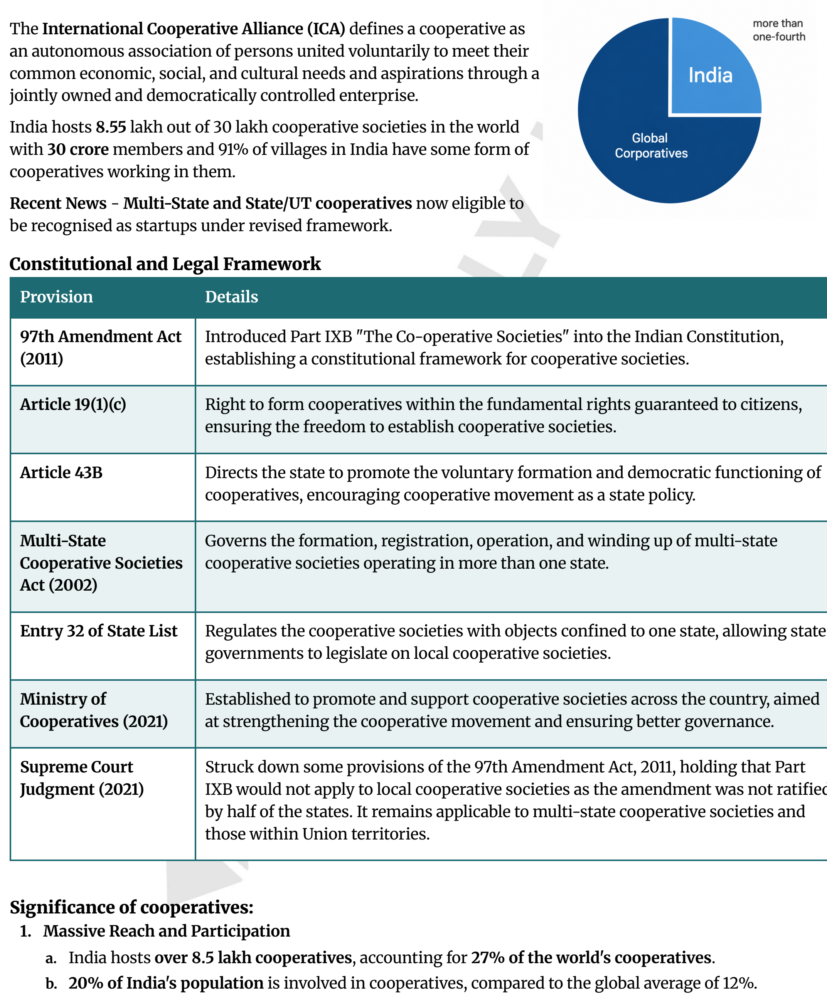
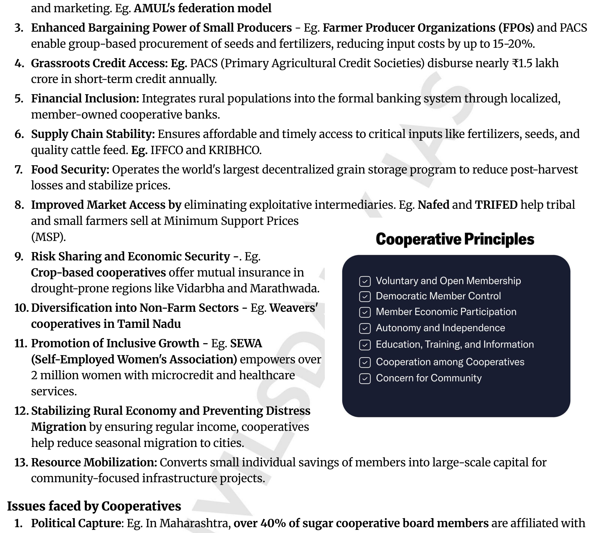

### [Smash Mains Source Page 34](../pages/mains/mains_page_034.pdf)

## Chapter 5
Fundamental Rights

### PYQs

- **[2026]** Right to privacy relating to self-identity is very dear to every human being and well protected
under Article 21 of the Constitution. In this context, examine the effect of the amendment in 2026, to the
Transgender Persons (Protection of Rights) Act, 2019. (10M)

- **[2024]** Right to privacy is intrinsic to life and personal liberty and is inherently protected under Article 21
of the Constitution. Explain. In this reference discuss the law relating to D.N.A. testing of a child in the
womb to establish its paternity.

- **[2023]** "The Constitution of India is a living instrument with capabilities of enormous dynamism. It is a
constitution made for a progressive society". Illustrate with special reference to the expanding horizons
of the right to life and personal liberty.

- **[2022]** Right of movement and residence throughout the territory of India are freely available to the
Indian citizens, but these rights are not absolute. Comment (10M)
Fundamental Rights
Fundamental rights are a set of basic rights and freedoms that are considered essential for the protection of
human dignity, liberty, and equality and are guaranteed to individuals by a constitution.
FR are referred to as the "Magna Carta" of India and are delineated in Part III (Article 12 to 35). These rights
are defended and guaranteed by the Supreme Court of India.

### Quotes
1. "Fundamental rights are both the shield and sword against State tyranny." - Prof. Upendra Baxi
2. "Freedom of speech and expression is the bulwark of a democratic government. It is the very foundation
of democracy." - Dr. Rajendra Prasad
3. "I measure the progress of a community by the degree of progress which women have achieved." -B R
Ambedkar - Affirmative Action
4. "Without political freedom, economic freedom is a mere chimera." - Nehru - Balancing FR and DPSP
5. For Conclusion - "Those who would give up Essential Liberty to purchase Temporary Safety, deserve
neither Liberty nor Safety." (Benjamin Franklin). Thus, protection and promotion of FR is vital for the
well-being of a free and democratic society.
Features
1. Guaranteed by the Constitution Part III (Articles 12-35) - enforceable by SC & HC (Art. 32 & 226).
2. Primarily act as limitations on State power, preventing arbitrary actions. Eg. Shreya Singhal case
3. Against the State as well as against private persons. (Art. 17, 23)
4. Not absolute - Subject to reasonable restrictions for public order, morality, security, etc.
5. Negative and Positive obligations - Some rights prevent State interference (freedom of speech) while
others impose duties to act (abolition of untouchability).
36

#### Structured Tables on Page 34

| PYQs |
| --- |
| [2026] Right to privacy relating to self-identity is very dear to every human being and well protected under Article 21 of the Constitution. In this context, examine the effect of the amendment in 2026, to the Transgender Persons (Protection of Rights) Act, 2019. (10M) [2024] Right to privacy is intrinsic to life and personal liberty and is inherently protected under Article 21 of the Constitution. Explain. In this reference discuss the law relating to D.N.A. testing of a child in the womb to establish its paternity. [2023] "The Constitution of India is a living instrument with capabilities of enormous dynamism. It is a constitution made for a progressive society". Illustrate with special reference to the expanding horizons of the right to life and personal liberty. [2022] Right of movement and residence throughout the territory of India are freely available to the Indian citizens, but these rights are not absolute. Comment (10M) |

---

### [Smash Mains Source Page 47](../pages/mains/mains_page_047.pdf)

Challenges to Right to Privacy in India
Political
1. Mass Surveillance by State - Eg. controversy over Pegasus spyware (2021).
2. Lack of independent oversight on agencies like IB, RAW, NIA.
3. Balancing Privacy with National Security - Frequent internet shutdowns in Jammu & Kashmir.
Institutional
1. Though the Digital Personal Data Protection Act, 2023 was enacted, critics argue it gives excessive
exemptions to the government.
2. Agencies continue to misuse outdated colonial laws. Eg. Telegraph Act for phone tapping
3. Privacy often clashes with Right to Information, transparency in governance, and freedom of press,
leading to judicial dilemmas.
Technological
1. Corporate Surveillance (Surveillance Capitalism) - Big tech firms harvest personal data for targeted ads
without informed consent, threatening informational privacy.
2. Health Data & Bio-Surveillance - COVID-19 contact tracing apps (like Aarogya Setu) sparked concerns
over storage, retention, and misuse of sensitive health data.
Social
1. Lack of Awareness & Digital Literacy - Citizens often unaware of their privacy rights in digital and
financial transactions, making them vulnerable to exploitation.
Reasonable Restrictions
1. Test of Proportionality - Puttaswamy (2017) - To justify restrictions on the Right to Privacy, three
conditions must be satisfied:
a. Legality - Any interference with privacy must be sanctioned by law, with a just, fair, and reasonable
procedure, free from arbitrariness.
b. Legitimate Aim - The law must serve a legitimate state interest (Eg. national security, public health),
preventing unnecessary state intrusion.
c. Proportionality - The nature, method, and extent of interference must be proportionate to the
purpose sought, ensuring minimal restriction of rights.
d. National Security - Eg. PUCL v. Union of India (1997) upheld phone tapping under strict
safeguards.
e. Public Order & Crime Prevention - Eg. UAPA surveillance cases justified under "public order".
f. Protection of Rights of Others - Privacy cannot be invoked to harm others' rights (Eg. child safety,
protection from domestic violence, misuse of digital content).
g. Public Health & Safety - Eg. COVID-19 contact tracing and Aarogya Setu App justified under health
emergency.
Way Forward for Protection of Right to Privacy
1. Judicial Oversight on Surveillance - Set up mechanisms like warrant-based approvals, review
committees, and parliamentary scrutiny to prevent arbitrary phone tapping and spyware use.
2. Strengthen application of legality, legitimacy, and proportionality test (Puttaswamy 2017) in all
privacy-related state actions.
3. Establish an independent Privacy Commission to monitor data use by government and corporates.
4. Build secure data storage infrastructure in India and improve cybersecurity protocols to prevent leaks
and hacks.
5. Digital Literacy Campaigns to educate citizens on data protection, online safety, and privacy rights.
49

---

### [Smash Mains Source Page 48](../pages/mains/mains_page_048.pdf)

6. Balancing Privacy & Security - Adopt global best practices like UK's Investigatory Powers Act and GDPR,
ensuring security needs without compromising individual liberty.
Global Best Practices
- European Union - GDPR (2018)
- Principles: explicit consent, right to be forgotten, data minimisation, portability, accountability.
- Heavy penalties on violations (up to 4% of global turnover).
Digital Rights
1. As per WEF, Digital rights are closely linked to freedom of expression and privacy and allow people to
access, use, create, and publish digital media, as well as access and use computers, other electronic
devices, and communications networks.
2. The European Commission has proposed a set of digital rights and principles. It is an extension of the
Berlin Declaration on Digital Society and Value-Based Digital Government
Right to access to Internet
1. SC in Amar Jain V Union of India judgment held that inclusive and meaningful digital access to
e-governance and welfare delivery systems is a part of the fundamental right to life and liberty.
a. Directed the state to revise KYC norms to help acid attack victims and PwDs.
b. States's responsibility to ensure digital infrastructure to all vulnerable sections under Article 14,21,38.
2. Faheema Shirin v. State of Kerala (2019) - Kerala HC held that the right to internet is part of the right to
education and privacy under Article 21.
3. Anuradha Bhasin v. Union of India (2020) - SC ruled against indefinite internet shutdowns,
recognising internet access as essential to fundamental rights.
Digital Rights Principles
1. PEOPLE AT THE CENTRE - Digital technologies should protect people's rights, support democracy, and
ensure that all digital players act responsibly and safely.
2. SOLIDARITY AND INCLUSION - Everyone should have access to the internet, digital skills, digital public
services, and fair working conditions.
3. FREEDOM OF CHOICE - People should benefit from a fair online environment. Users should be safe from
illegal and harmful content.
4. PARTICIPATION - Individuals should have control over their own data.
5. SAFETY AND SECURITY - The digital environment should be safe and secure.
6. SUSTAINABILITY
a. Digital devices should support sustainability and the green transition.
b. People need to know about the environmental impact and energy consumption of their devices.
Key Data on Digital India (2025-2026)
- Internet Users: India surpassed 1 billion broadband subscriptions in late 2025 (Source: PIB).
- Digital Identity: Over 143 crore (1.43 billion) Aadhaar IDs have been issued as of February 2026.
- Financial Inclusion: UPI processed 21.7 billion transactions worth ₹28.33 lakh crore in January 2026.
- Connectivity: Over 2.15 lakh Gram Panchayats are now connected via optical fiber under BharatNet.
50

---

### [Smash Mains Source Page 53](../pages/mains/mains_page_053.pdf)

Recently, the case of phone tapping of political leaders in Telangana, NSE Phone Tapping Case has brought
this issue into highlight.
In India, phone tapping is governed by The Indian Telegraph Act, 1885.
1. Section 5(2): At the center, 10 agencies (IB, CBI, etc.) and at states, police have powers to tap the phones.
2. Authority: Under Rule 419A of the Indian Telegraph (Amendment) Rules, 2007, at the central level, the
secretary in MoHA and at the state level, the secretary in the Home Department has the authority to
issue orders for phone tapping. They must record reasons for tapping in writing.
3. Grounds for phone tapping: If the center or states satisfy that it is necessary in case of public emergency
in the interest of "public safety", "sovereignty and integrity of India, the security of the State, friendly
relations with foreign States or public order or for preventing incitement to the commission of an
offense".
Safeguards available against phone tapping
1. Last option: It must be ordered only if there is no other way of getting the information.
2. Time period: If not revoked earlier, the order remains in force for 60 days. It can be renewed but not for
more than 180 days in total.
3. Review committee: At the center, it is headed by the Cabinet secretary, and at the state level, it is headed
by the Chief Secretary. It reviews orders by competent authorities, copies of which are sent to it within 7
working days.
Issues related to phone tapping:
Issue Details
Violation of Right to
Privacy
Infringes upon the right to privacy (Article 21) as sensitive information about
personal life and business is tapped without permission.
Chilling Effect on Freedom
of Speech
Fear of being monitored can lead to self-censorship and discourage open
communication about sensitive topics. (PUCL vs. Union of India).
Abuse of Power Governments might use phone tapping for political purposes, targeting
dissidents or critics to suppress dissent. Example: Pegasus issue.
Divergence with
International Obligation
Article 17 of the International Covenant on Civil and Political Rights states that
no one should face arbitrary interference with their privacy. India is a
signatory.
SC Judgments
Case Details
People's Union for Civil Liberties vs.
Union of India (1996)
The court laid down guidelines for the interception of telephone
conversations
55

#### Structured Tables on Page 53

| Issue | Details |
| --- | --- |
| Violation of Right to Privacy | Infringes upon the right to privacy (Article 21) as sensitive information about personal life and business is tapped without permission. |
| Chilling Effect on Freedom of Speech | Fear of being monitored can lead to self-censorship and discourage open communication about sensitive topics. (PUCL vs. Union of India). |
| Abuse of Power | Governments might use phone tapping for political purposes, targeting dissidents or critics to suppress dissent. Example: Pegasus issue. |
| Divergence with International Obligation | Article 17 of the International Covenant on Civil and Political Rights states that no one should face arbitrary interference with their privacy. India is a signatory. |

| Case | Details |
| --- | --- |
| People's Union for Civil Liberties vs. Union of India (1996) | The court laid down guidelines for the interception of telephone conversations |

---

### [Smash Mains Source Page 54](../pages/mains/mains_page_054.pdf)

Way forward
Recommendation Details
Enact Comprehensive
Law
Outline clear procedures, grounds for authorization, and independent oversight
mechanisms for phone tapping.
Judicial Review of
Authorizations
Establish a process for judicial review to ensure phone-tapping authorizations meet
legal requirements and are not arbitrary.
Independent
Oversight Body
Create an independent body to oversee phone-tapping practices, investigate
complaints of misuse, and report to the public.
Freedom of Press
1. It is a cornerstone principle that ensures the right to freely communicate and express information
through various media channels like print(newspaper), electronic(TV), social media(Twitter), etc.
2. As per the World Press Freedom Index 2025, India ranks 151 out of 180 countries.
3. Press and Registration of Periodicals Act became fully operational, replacing the 1867 colonial law
4. There are over 1.54 lakh registered publications in India
Key features and changes under the new Act include:
- Defines "periodical" to include registered newspapers, magazines, and journals, but excludes books
and journals published by educational institutions.
- Office of PRGI: Replaces the Registrar of Newspapers for India (RNI), serving as the sole authority for
title allotment and registration of periodicals, including newspapers and magazines.
- Registration is now a fully online process via the Press Sewa Portal, eliminating the need to make a
declaration before a District Magistrate for starting a publication.
- Decriminalization: The act removes strict penalties (like imprisonment) that were present in the 1867
Act, focusing on penalties.
- Restrictions: Individuals convicted of terrorist acts, unlawful activities, or actions against national
security are prohibited from publishing periodicals.
- Printing Presses: Printers only need to file an online intimation with the PRGI rather than a formal
declaration.
Constitutional Basis
1. Not explicitly mentioned, but derived from Article 19(1)(a) - Freedom of Speech & Expression.
2. Subject to reasonable restrictions under Article 19(2): sovereignty, security, public order, decency,
morality, contempt of court, defamation, incitement to offence.
Judicial Recognition
1. Indian Express Newspapers v. Union of India (1985) - SC held press freedom is part of the basic
structure of the Constitution.
2. Sakal Papers v. Union of India (1962) - Government cannot restrict circulation of newspapers to control
ideas.
56

#### Structured Tables on Page 54

| Recommendation | Details |
| --- | --- |
| Enact Comprehensive Law | Outline clear procedures, grounds for authorization, and independent oversight mechanisms for phone tapping. |
| Judicial Review of Authorizations | Establish a process for judicial review to ensure phone-tapping authorizations meet legal requirements and are not arbitrary. |
| Independent Oversight Body | Create an independent body to oversee phone-tapping practices, investigate complaints of misuse, and report to the public. |

---

### [Smash Mains Source Page 55](../pages/mains/mains_page_055.pdf)

3. Bennett Coleman v. Union of India (1973) - Newsprint policy struck down; press freedom > indirect
state control.
Statutory Regulations
1. Press Council of India Act, 1978 - Establishes the PCI, a quasi-judicial body to uphold press ethics and
prevent misuse of freedom.
2. Registration of Newspapers (RNI) Act, 1956 - Regulates title verification, ownership, and circulation
data.
3. Cable Television Networks (Regulation) Act, 1995 - Controls content codes for electronic media.
4. Information Technology Act, 2000 (Section 69A) - Empowers government to block online content.
Institutional Mechanisms
1. Press Council of India (PCI) - Advisory; can censure newspapers but lacks punitive power.
2. News Broadcasters & Digital Association (NBDA) - Industry-led regulation for TV and digital news.
3. Broadcasting Content Complaints Council (BCCC) - Regulates non-news entertainment content.
4. Ministry of Information & Broadcasting (MIB) - Supervises press, broadcasting, and online content.
Significance of Freedom of Press
1. Democratic Oversight: Acts as a watchdog, exposing corruption and ensuring the government remains
accountable to its citizens. Eg. Investigative reports on electoral bond data in 2024-25
2. Check on Abuse of Power - Acts as a safeguard against authoritarian tendencies and arbitrary state
actions. Eg. Investigative reports on Pegasus surveillance case (2021).
3. Acts as a Bridge between State & Society - Serves as a medium for policy feedback and grievance
redressal. Eg. Coverage of COVID-19 migrant workers' crisis (2020) prompted state action.
4. Voice of Marginalized: Eg. women led digital news outlets like Khabar Lahariya highlight rural gender
issues ignored by mainstream media.
5. Checks Misinformation: Professional journalism counters the spread of "fake news" and viral AI
deepfakes on social media. Eg. Alt fact check
6. Judicial Support: Media coverage often prompts the judiciary to take suo motu cognizance of gross
human rights violations.
7. Economic Accountability: Financial journalism monitors corporate governance and protects retail
investors from market fraud or manipulation. Eg. Harshad Metha scam expose
8. Promotes Pluralism & Diversity - Enables debates on religion, caste, gender, and regional issues,
reinforcing unity in diversity. Eg. Reporting on LGBTQ+ rights post-Navtej Johar (2018) case.
9. Strengthens Rule of Law - Exposes violations of fundamental rights and mobilises opinion for legal
reforms. Eg. Media role in Nirbhaya case (2012) leading to stricter rape laws.
"Freedom of the press is the mother of all liberties in a democracy." - Justice V.R. Krishna Iyer
"Were it left to me to decide whether we should have a government without newspapers, or newspapers
without a government, I should not hesitate a moment to prefer the latter." - Thomas Jefferson
"A free press can be good or bad, but, most certainly, without freedom it will never be anything but bad." -
Albert Camus
57

---

### [Smash Mains Source Page 57](../pages/mains/mains_page_057.pdf)

Censorship in India
Censorship refers to the suppression, prohibition, or restriction of information, ideas, speech, or other forms
of expression by governmental authorities, institutions, or other controlling bodies.
"Censorship is the tool of those who need to hide actualities from themselves and others." - Isaac Asimov
"The first condition of progress is the removal of censorship." - George Bernard Shaw
Constitutional Basis
1. Article 19(2) - Allows reasonable restrictions on grounds: sovereignty, security, public order, decency,
morality, contempt of court, defamation, incitement to offence.
Forms of Censorship
1. Press & Print Media - Indirect through sedition, defamation, Press Council of India guidelines.
2. Cinema - Regulated under Cinematograph Act, 1952; certification by Central Board of Film Certification
(CBFC). Eg. Cuts in Padmavat (2018) citing public order.
3. Television & Radio - Governed by Cable TV Networks (Regulation) Act, 1995 and programme codes.
4. Digital Media & OTT - Regulated by IT Rules, 2021, giving government oversight over online content.
5. Books & Literature - Bans under Customs Act and IPC for sedition/hate speech. Eg. Ban on Salman
Rushdie's Satanic Verses (1988).
6. Internet & Social Media - Section 69A of IT Act allows blocking of online content. Eg. Twitter handles
blocked during farmers' protests (2021).
7. Sahyog Platform under Section 79 of the IT Act - allows even district-level officers to demand social
media firms pull down posts.
Key Provisions of IT Rules, 2021
- For Social Media Intermediaries (SMI)
- Due Diligence: Platforms must inform users not to host/upload illegal content (defamatory, obscene,
harmful to minors, etc.).
- Significant Social Media Intermediaries (SSMI): Platforms with over 5 million users face extra
obligations:
◦ Resident Officers: Must appoint a Chief Compliance Officer, a Nodal Contact Person, and a Resident
Grievance Officer (all must live in India).
◦ Traceability: Messaging apps (like WhatsApp) must be able to identify the "first originator" of a
message if ordered by a court/government for serious crimes.
◦ Monthly Compliance Reports: Platforms must publish the number of complaints received and
actions taken.
- Safe Harbour Protection: If a platform follows these rules, it is not legally liable for content posted by
its users (Section 79 of the IT Act).
- For Digital Media & OTT Platforms (Ethics Code)
- Self-Classification: OTT platforms (Netflix, Hotstar, etc.) must classify content into age categories: U,
U/A 7+, U/A 13+, U/A 16+, and A.
- Parental Locks: Platforms must provide parental locks for content rated U/A 13+ or higher.
- Three-Tier Grievance Redressal:
◦ Level I: Self-regulation by the publisher.
◦ Level II: Self-regulation by an independent body of publishers.
59

---

### [Smash Mains Source Page 58](../pages/mains/mains_page_058.pdf)

◦ Level III: Oversight by an Inter-Departmental Committee (headed by the Ministry of Information &
Broadcasting).
April 2023 Amendment
- Fact Check Unit (FCU): Permitted the government to designate an agency to identify "fake or
misleading" information regarding government business. Note: This was struck down by the Bombay
High Court in 2024; the Supreme Court is currently examining the Centre's plea as of March 2026.
- Online Gaming: require them to be registered with a self-regulatory body and prohibit games involving
wagering/betting.
October 2025 Amendment
- Rule 3(1)(d) of the IT Rules, 2021 requires internet intermediaries to remove or disable access to
unlawful content upon receiving a government order or notification.
- An officer of at least Joint Secretary rank or Inspector General of Police (DIG) rank can issue order
Information Technology (Intermediary Guidelines and Digital Media Ethics Code) Amendment Rules,
2026
- For the first time, Indian law provides a statutory definition for SGI. It includes any audio, visual, or
audio-visual information created or modified using algorithms that appear "real, authentic, or true."
- Mandatory Labeling and Provenance - Intermediaries must ensure that all SGI is prominently and
clearly labeled so that users can easily identify it as AI-generated.
- The window for removing unlawful content has been slashed from 36 hours to just 3 hours upon
receiving a court order or government notification.
- For cases involving non-consensual nudity, deepfake pornography, or impersonation, the removal
window is just 2 hours after a complaint is received.
- If a platform (like X, YouTube, or Meta) fails to label AI content or misses the 3-hour takedown deadline,
it loses its Safe Harbour protection under Section 79 of the IT Act.
- Platforms must now acknowledge a user grievance within 24 hours and provide a final resolution
within 7 days (down from the previous 15-day limit).
MeiTY has also proposed to include "users who are not publishers" who share content related to "news and
current affairs" within a "code of ethics" it currently applies to registered news publishers.
Need for Censorship in India
1. Communal Harmony: Prevents the spread of hate speech that could incite religious or ethnic violence in
a diverse society.
2. National Security: Eg. blocking of 59 Chinese applications including TikTok in 2020.
3. Public Order: Restricts the viral spread of rumors that could lead to mob lynchings or mass panic. Eg.
Internet shutdowns
4. Sovereignty and Integrity: Eg. Authorities regularly seize publications or block websites displaying
"incorrect" Indian borders.
5. Protecting Minors: Regulates access to obscene material and pornographic content to safeguard child
psychology. Eg. blocking of over 800 pornographic websites.
6. Defamation and Contempt: Restricts expression that undermines judicial authority or causes unlawful
harm to an individual's reputation. Eg. removal of NCERT content criticising judiciary
7. Countering Deepfakes: Eg. The 2026 IT Rules requiring mandatory labeling of synthetically generated
audio-visual content.
8. Moral Standards: Ensures that broadcast content adheres to "community standards" of decency and
morality. Eg. CBFC (Censor Board) cuts in films containing extreme violence or excessive profanity.
60

---

### [Smash Mains Source Page 59](../pages/mains/mains_page_059.pdf)

9. Protection of intellectual property from theft using AI
Criticism of Censorship in India
1. Chilling Effect: Over-regulation leads to self-censorship among creators who fear legal harassment or
arrest.
2. Vague Terminology: Use of broad terms like "anti-national" allows for arbitrary interpretation by state
agencies.
3. Lack of Transparency: Many content blocking orders are not made public, preventing judicial or public
review.
4. Executive Overreach: The 2026 IT Rules shift the Inter-Departmental Committee's role from
grievance-handling to an instrument of censorship.
5. Targeting Dissent: Censorship is often perceived as a tool to silence political opponents and activists.
6. Selective Enforcement: Critics argue that hate speech from pro-establishment groups is often
overlooked while critical voices are suppressed. Eg. action against Kunal Kamara
7. Undermining Art: Artistic freedom is often sacrificed to placate extremist groups or religious
sentiments. Eg. Padmavat movie controversy or Samay Raina controversy
Major SC Judgments on Censorship
1. Shreya Singhal v. Union of India (2015): Struck down Section 66A of the IT Act, ruling that speech
cannot be restricted merely for being "offensive."
2. The Supreme Court in Ranjit D. Udeshi v. State of Maharashtra (1965) defined obscenity as a reasonable
restriction to free speech (Article 19).
Way Forward
1. Judicial Oversight: Mandate that all blocking orders undergo a summary judicial review within 24 hours
of implementation.
2. Independent Regulator: Replace ministerial committees with a multi-stakeholder body (judiciary, civil
society, and industry) for digital regulation.
3. Narrow Definitions: Clearly define "national security" and "public order" to prevent administrative
misuse.
4. Transparency Reports: Require the government to publish bi-annual reports on all content takedown
requests and their legal basis.
5. Safeguarding Freelancers: Provide legal aid and exemptions for independent creators from burdensome
broadcast-level compliance.
6. Ethical Self-Regulation: Encourage media houses to adopt robust, voluntary fact-checking standards to
reduce the "need" for state intervention.
Global Best Practices
1. The Santa Clara Principles: Global standards for transparency and accountability in content moderation
by digital platforms.
2. Manila Principles on Intermediary Liability: Framework to protect intermediaries from being forced to
censor content without a court order.
3. EU Digital Services Act (DSA): Focuses on systemic risk and transparency while providing users with
clear avenues to challenge content removal.
Way forward
1. Revise censorship laws to provide clearer definitions of terms like "public order" and "morality" to
minimize subjective interpretations and misuse.
61

---

### [Smash Mains Source Page 60](../pages/mains/mains_page_060.pdf)

2. Encourage Self-Regulation: It is imperative for media institutions to prioritize self-regulation as a
proactive measure against excessive government intervention. This strategy presents a more equitable
solution compared to direct government oversight of content.
3. Implement age-gating systems for online content deemed mature, restricting access for underage users
without resorting to complete bans.
4. Integrate media literacy programs into school curriculums to equip students with the skills to evaluate
information sources, identify bias, and spot misinformation.
5. Mandate social media platforms to publish regular transparency reports disclosing the volume and
nature of content removed and the reasons behind them.
OTT Regulation in India
OTT stands for "Over-the-Top." An OTT platform is an audio and video hosting and streaming service that
delivers streaming media content directly to viewers over the internet, bypassing traditional cable, satellite,
and broadcast television. Eg. Netflix, Amazon, etc.
As per Ormax Media report, India has over 500 million OTT users and 150 million paid subscriptions. It also
shows a growth rate of 20% showing an increasing market for OTT platforms.
Regulatory Mechanism in India
1. IT Act, 2000
a. Section 67 & 67A - deals with publication and transmission of obscene content
b. Section 69A - empowers central government to block public access
2. IT rules, 2021
a. Self-Classification: OTT platforms (Netflix, Hotstar, etc.) must classify content into age categories: U,
U/A 7+, U/A 13+, U/A 16+, and A.
b. Parental Locks: Platforms must provide parental locks for content rated U/A 13+ or higher.
3. Section 294 of BNS - defines and criminalises obscene content
4. POSCO Act - criminalises child pornography
Need for OTT regulation
1. Protection from Obscenity & Harmful Content - The SC in Ranjit Udeshi case (1965), upheld obscenity
as a reasonable restriction under Article 19. Eg. India's Got Latent controversy.
2. Level Playing Field - Traditional media (TV, cinema) faces strict censorship (CBFC, Cable TV Act), but
OTT enjoys regulatory vacuum, leading to unfair competition.
3. Consumer Rights - Need for clear mechanisms to address complaints on content classification,
parental control, and offensive material.
4. Protecting dignity of women - Eg. Bulli Bai app incident (auctioning of images of women)
5. Child Safety & Age-Appropriate Content - Lack of effective age-rating, parental filters, and access
controls exposes minors to inappropriate content.
6. Data Privacy & Algorithmic Concerns - OTT platforms collect vast user data, raising issues of profiling,
consent, and surveillance capitalism.
7. Cultural Sensitivity - Content may offend religious, caste, or regional sentiments, sparking protests.
Eg. Controversies over Tandav (2021) series.
8. Preventing Monopolistic Practices - Need to regulate pricing models, market dominance, and
exclusivity contracts by global giants like Netflix, Amazon Prime.
62

---

### [Smash Mains Source Page 61](../pages/mains/mains_page_061.pdf)

9. Global Best Practices Alignment - Countries like UK (Ofcom), EU (AVMS Directive) already regulate
OTT for content standards, transparency, and consumer protection.
10. Judicial Guidance - Courts (SC & HCs) have repeatedly urged the Centre to evolve a comprehensive
framework for OTT regulation.
Challenges in OTT regulation
1. Jurisdictional Overlap - Turf war between MeiTY, MIB, and TRAI creates confusion over who should
regulate OTTs.
2. Balancing Free Speech & Regulation - OTT is a pull medium, unlike broadcast, making excessive
censorship a chilling effect on Article 19(1)(a).
3. Vague Standards - Terms like "obscene," "immoral," "offensive" are context-dependent, risking
arbitrary interpretation.
4. Content Diversity - OTT platforms host regional, global, experimental content, making uniform
classification and regulation difficult.
5. Enforcement Weakness - IT Rules, 2021 rely on self-regulation but lack teeth for enforcement and
appeal mechanisms for publishers.
6. Tech vs. Traditional Models - Borrowing censorship models from TV/films ignores the on-demand and
internet-based nature of OTT.
7. Global Platforms vs. Indian Laws - Multinational OTTs (Netflix, Amazon Prime) operate across borders,
complicating compliance with Indian regulatory frameworks.
8. Data & Privacy Concerns - OTT platforms collect massive user data; regulation must balance data
protection with innovation.
9. Political & Social Pressures - Content controversies (Eg. Tandav series, 2021) show how
religious/cultural sensitivities often lead to calls for bans.
10. Technological Limitations - Automated filters and content scanners may lead to over-blocking or
under-filtering, harming both creativity and user safety.
Way Forward
1. Tripartite Expertise - Create a specialised body drawing from IT, broadcasting, and telecom sectors to
draft bespoke OTT regulations, reflecting both infrastructure and content aspects.
2. Co-Regulation Model - Retain self-regulation by platforms while adding independent oversight to
ensure flexibility, accountability, and stakeholder participation.
3. Clear Definitions - Avoid vague terms like "grossly offensive" (as in struck-down Section 66A IT Act).
Clearly define harmful, obscene, and offensive content to prevent arbitrary censorship.
4. Judicial Oversight - Ensure that blocking or takedown orders require judicial review, preventing
misuse of executive powers for censorship.
5. Evolving Standards - Recognise that morality and obscenity are context-driven; include review clauses
for periodic reassessment of content norms.
6. Inclusivity in Regulation - Incorporate voices of marginalised and vulnerable groups to prevent
silencing of critical depictions of caste, gender, or social evils.
7. Stakeholder Consultations - Involve platforms, creators, civil society, academia, and government in
shaping balanced rules that respect free speech and societal sensitivities.
8. Soft-Touch Framework - Focus on age-based classification, content labelling, parental controls, rather
than heavy-handed censorship models like CBFC.
9. Appeal Mechanism - Amend gaps in IT Rules, 2021 by providing publishers a right to appeal decisions
of self-regulating bodies, ensuring fairness.
63

---

### [Smash Mains Source Page 62](../pages/mains/mains_page_062.pdf)

*Diagram Screenshot: [Global & Indian Cooperatives: Scale, GDP Share & 97th Amendment](../diagrams/mains_diag_cooperatives_overview_p062.png) | [Full Source Page 62](../pages/mains/mains_page_062.pdf)*

10. Tech-Aided Self-Regulation - Encourage platforms to use automated profanity filters, AI-driven
content scanners, and user-report systems to flag objectionable material.
Cooperatives
The International Cooperative Alliance (ICA) defines a cooperative as
an autonomous association of persons united voluntarily to meet their
common economic, social, and cultural needs and aspirations through a
jointly owned and democratically controlled enterprise.
India hosts 8.55 lakh out of 30 lakh cooperative societies in the world
with 30 crore members and 91% of villages in India have some form of
cooperatives working in them.
Recent News - Multi-State and State/UT cooperatives now eligible to
be recognised as startups under revised framework.
Constitutional and Legal Framework
Provision Details
97th Amendment Act
(2011)
Introduced Part IXB "The Co-operative Societies" into the Indian Constitution,
establishing a constitutional framework for cooperative societies.
Article 19(1)(c) Right to form cooperatives within the fundamental rights guaranteed to citizens,
ensuring the freedom to establish cooperative societies.
Article 43B Directs the state to promote the voluntary formation and democratic functioning of
cooperatives, encouraging cooperative movement as a state policy.
Multi-State
Cooperative Societies
Act (2002)
Governs the formation, registration, operation, and winding up of multi-state
cooperative societies operating in more than one state.
Entry 32 of State List Regulates the cooperative societies with objects confined to one state, allowing state
governments to legislate on local cooperative societies.
Ministry of
Cooperatives (2021)
Established to promote and support cooperative societies across the country, aimed
at strengthening the cooperative movement and ensuring better governance.
Supreme Court
Judgment (2021)
Struck down some provisions of the 97th Amendment Act, 2011, holding that Part
IXB would not apply to local cooperative societies as the amendment was not ratified
by half of the states. It remains applicable to multi-state cooperative societies and
those within Union territories.
Significance of cooperatives:
1. Massive Reach and Participation
a. India hosts over 8.5 lakh cooperatives, accounting for 27% of the world's cooperatives.
b. 20% of India's population is involved in cooperatives, compared to the global average of 12%.
c. Maharashtra alone accounts for 25% of India's cooperatives.
64

#### Structured Tables on Page 62

| Provision | Details |
| --- | --- |
| 97th Amendment Act (2011) | Introduced Part IXB "The Co-operative Societies" into the Indian Constitution, establishing a constitutional framework for cooperative societies. |
| Article 19(1)(c) | Right to form cooperatives within the fundamental rights guaranteed to citizens, ensuring the freedom to establish cooperative societies. |
| Article 43B | Directs the state to promote the voluntary formation and democratic functioning of cooperatives, encouraging cooperative movement as a state policy. |
| Multi-State Cooperative Societies Act (2002) | Governs the formation, registration, operation, and winding up of multi-state cooperative societies operating in more than one state. |
| Entry 32 of State List | Regulates the cooperative societies with objects confined to one state, allowing state governments to legislate on local cooperative societies. |
| Ministry of Cooperatives (2021) | Established to promote and support cooperative societies across the country, aimed at strengthening the cooperative movement and ensuring better governance. |
| Supreme Court Judgment (2021) | Struck down some provisions of the 97th Amendment Act, 2011, holding that Part IXB would not apply to local cooperative societies as the amendment was not ratified by half of the states. It remains applicable to multi-state cooperative societies and those within Union territories . |

---

### [Smash Mains Source Page 63](../pages/mains/mains_page_063.pdf)

*Diagram Screenshot: [Seven Cooperative Principles & Constitutional Provisions](../diagrams/mains_diag_cooperative_principles_p063.png) | [Full Source Page 63](../pages/mains/mains_page_063.pdf)*

2. Economies of Scale - Cooperatives aggregate small producers, enabling bulk procurement, processing,
and marketing. Eg. AMUL's federation model
3. Enhanced Bargaining Power of Small Producers - Eg. Farmer Producer Organizations (FPOs) and PACS
enable group-based procurement of seeds and fertilizers, reducing input costs by up to 15-20%.
4. Grassroots Credit Access: Eg. PACS (Primary Agricultural Credit Societies) disburse nearly ₹1.5 lakh
crore in short-term credit annually.
5. Financial Inclusion: Integrates rural populations into the formal banking system through localized,
member-owned cooperative banks.
6. Supply Chain Stability: Ensures affordable and timely access to critical inputs like fertilizers, seeds, and
quality cattle feed. Eg. IFFCO and KRIBHCO.
7. Food Security: Operates the world's largest decentralized grain storage program to reduce post-harvest
losses and stabilize prices.
8. Improved Market Access by eliminating exploitative intermediaries. Eg. Nafed and TRIFED help tribal
and small farmers sell at Minimum Support Prices
(MSP).
9. Risk Sharing and Economic Security -. Eg.
Crop-based cooperatives offer mutual insurance in
drought-prone regions like Vidarbha and Marathwada.
10. Diversification into Non-Farm Sectors - Eg. Weavers'
cooperatives in Tamil Nadu
11. Promotion of Inclusive Growth - Eg. SEWA
(Self-Employed Women's Association) empowers over
2 million women with microcredit and healthcare
services.
12. Stabilizing Rural Economy and Preventing Distress
Migration by ensuring regular income, cooperatives
help reduce seasonal migration to cities.
13. Resource Mobilization: Converts small individual savings of members into large-scale capital for
community-focused infrastructure projects.
Issues faced by Cooperatives
1. Political Capture: Eg. In Maharashtra, over 40% of sugar cooperative board members are affiliated with
political parties (EPW, 2020).
2. Low Professional Capacity and Outdated Practices - Eg. As per RBI Report, less than 30% of urban
cooperative banks have adopted full core banking solutions (CBS).
3. Fragmented Regulation and Dual Control - Multi-State Cooperatives face dual control by Central and
State authorities, causing delays and administrative confusion.
4. Weak Financial Discipline and Mismanagement - Poor accounting, delayed audits, and
misappropriation of funds remain common. Eg. The PMC Bank scandal (2019)
5. Inadequate Member Participation and Awareness - Eg. IRMA Study found less than 25% of
cooperative members attend AGMs regularly.
6. Narrow Sectoral Spread: Success is limited to agriculture, dairy, and credit; weak presence in new sectors
like tech or services.
7. Regional Imbalance: 5 states (Eg. Maharashtra, Gujarat) hold 57% of all cooperatives, leaving others
underrepresented.
8. Financial Fragility: Low capital and high dependency on state support restrict scalability and
innovation.
65

---

### [Smash Mains Source Page 64](../pages/mains/mains_page_064.pdf)

Key Government Initiatives for Cooperatives
- NCDC (1963): Statutory body under Ministry of Cooperation to finance and promote cooperatives.
- Ministry of Cooperation (2021): Formed to boost rural prosperity and cooperative growth.
- National Cooperative Policy (Drafting): Committee set up under Sahkar-se-Samriddhi vision.
- MSCS Amendment Act, 2023: Enhances governance, transparency, and electoral reforms.
- Margdarshika Plan: Targets formation of 2 lakh PACS, dairy, and fishery cooperatives.
National cooperative policy 2025
- Mission - To create an enabling legal, economic, and institutional framework t0 cooperative
movement at the grassroots level and facilitate the transformation of cooperative enterprises into
professionally managed, transparent, technology-enabled, vibrant, and responsive economic entities
Key Highlights
- Legislative and Institutional Reforms - Encourage States to amend cooperative laws to enhance
transparency, autonomy and the ease of doing business.
- Financial Empowerment - Promote the three-tier Primary Agriculture Credit Societies - District
Central Cooperative Bank - State Cooperative Bank credit structure.
- Business Ecosystem Development
- Encouraging States/UTs to develop at least one model cooperative village with multipurpose PACS as
growth engines.
- Develop rural economic clusters (Eg. honey, spices, tea) and support branding under the 'Bharat'
brand.
- Future-Readiness & Technology
- Develop a national 'Cooperative Stack' integrating with Agri-stack and databases.
- Promote Open Network for Digital Commerce and GeM platform integration.
- Encourage R&D through cooperative incubators and Centres of Excellence.
- Inclusivity Measures
- Model bye-laws for gender representation and transparent governance.
- Cooperative awareness campaigns in schools and colleges.
- Sectoral Diversification - Promote cooperatives in new and emerging sectors such as Renewable
energy, Waste management, Health and education, Biogas and ethanol production, etc.
- Youth-Oriented Capacity Building
- Develop cooperative-focused courses in higher education institutions (HEIs).
- Build a national digital cooperative employment exchange.
Implementation and Monitoring
- Implementation Cell within the Ministry of Cooperation with technical Project Management Unit
support for effective and timely implementation of the policy.
- National Steering Committee on Cooperation Policy chaired by the Union Cooperation Minister for
guidance, coordination, periodic policy review, etc.
- Policy Implementation and Monitoring Committee for coordination with States, troubleshooting
implementation bottlenecks, periodic monitoring and evaluation, etc.
66