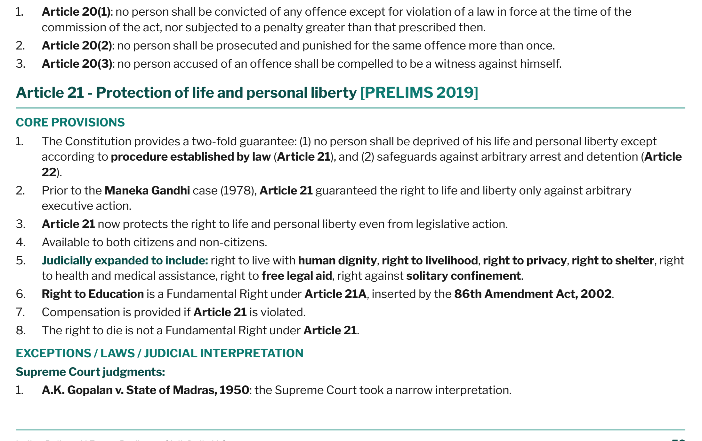

### [Prelims Source Page 46](../pages/prelims/prelims_page_046.pdf)

## CHAPTER 07
FUNDAMENTAL RIGHTS
THEME ANALYSIS PYQ pattern for this chapter
1. REPEATS

#### A. Placing a Right in the Correct Article
- Article 21 dominates, choice of marriage partner [2019] and Right to Privacy [2024, 2021, 2018]
- Which head does abolition of untouchability fall - under Right to Equality (Article 17) [2020, 2017]
- Articles 23 and 24, forced labour and child labour below 14 years [2025, 2017]

#### B. Definitions, Doctrines and Limits
- Article 13 meaning of law, including custom or usage having the force of law [2026]
- Article 14 voiding unguided and uncontrolled executive discretion [2021]
- Article 16(4) read with Article 335, which defines nothing [2023]
- Article 30 minority institutions and the Prime Minister's 15 Point Programme [2011]

#### C. Rights Inside versus Outside Part III
- Right to Property under Article 300A, a legal right of any person [2021]
- Right to vote as a constitutional right, not fundamental or natural [2017]
- Part III beside the Preamble, DPSP and duties as UDHR, 1948 reflections [2020, 2011]

#### D. Statutes and Remedies
- Article 22 detention, counsel and the Prevention of Terrorism Act, 2002 [2023]
- Article 32 writs, Habeas Corpus, Mandamus, Certiorari, Quo Warranto
- Article 35, certain rights legislated by Parliament alone
2. HOW THE FORMAT HAS CHANGED
- 2011 to 2017: code based recall of lists, minority benefits and UDHR rights [2011, 2017]
- 2018 to 2024: single answer placement of a right in its Article [2018, 2019, 2020, 2021, 2024]
- 2023: "how many" and Statement I and Statement II formats [2023]
- 2026: an argument style stem on the meaning of "law" in Art 13 [2026]
3. WHAT IS BEING ASKED NOW
- Definitions and doctrine: "law" under Art 13 [2026], Art 335 and reservation [2023], arbitrariness under Art 14 [2021]
- Detention safeguards under Art 22 [2023]
- Privacy keeps returning under Art 21 [2018, 2021, 2024]

#### Structured Tables on Page 46

| CHAPTER 07 |
| --- |
| FUNDAMENTAL RIGHTS |
| THEME ANALYSIS PYQ pattern for this chapter |
| 1. REPEATS A. Placing a Right in the Correct Article • Article 21 dominates, choice of marriage partner [2019] and Right to Privacy [2024, 2021, 2018] • Which head does abolition of untouchability fall - under Right to Equality (Article 17) [2020, 2017] • Articles 23 and 24, forced labour and child labour below 14 years [2025, 2017] B. Definitions, Doctrines and Limits • Article 13 meaning of law, including custom or usage having the force of law [2026] • Article 14 voiding unguided and uncontrolled executive discretion [2021] • Article 16(4) read with Article 335, which defines nothing [2023] • Article 30 minority institutions and the Prime Minister's 15 Point Programme [2011] C. Rights Inside versus Outside Part III • Right to Property under Article 300A, a legal right of any person [2021] • Right to vote as a constitutional right, not fundamental or natural [2017] • Part III beside the Preamble, DPSP and duties as UDHR, 1948 reflections [2020, 2011] D. Statutes and Remedies • Article 22 detention, counsel and the Prevention of Terrorism Act, 2002 [2023] • Article 32 writs, Habeas Corpus, Mandamus, Certiorari, Quo Warranto • Article 35, certain rights legislated by Parliament alone 2. HOW THE FORMAT HAS CHANGED • 2011 to 2017: code based recall of lists, minority benefits and UDHR rights [2011, 2017] • 2018 to 2024: single answer placement of a right in its Article [2018, 2019, 2020, 2021, 2024] • 2023: "how many" and Statement I and Statement II formats [2023] • 2026: an argument style stem on the meaning of "law" in Art 13 [2026] 3. WHAT IS BEING ASKED NOW • Definitions and doctrine: "law" under Art 13 [2026], Art 335 and reservation [2023], arbitrariness under Art 14 [2021] • Detention safeguards under Art 22 [2023] • Privacy keeps returning under Art 21 [2018, 2021, 2024] |

---

### [Prelims Source Page 51](../pages/prelims/prelims_page_051.pdf)

6. Under Art 35, only Parliament (not State legislatures) can make laws prescribing punishment for untouchability.
EXCEPTIONS / LAWS / JUDICIAL INTERPRETATION
Laws passed:
1. Parliament enacted the Untouchability (Offences) Act, 1955.
2. In 1976 it was made more stringent and renamed the Protection of Civil Rights Act, 1955.
Judicial interpretation:
3. Mysore High Court: the subject matter of Article 17 is not untouchability in the literal or grammatical sense, but the
practice as it developed historically in the country, involving social disabilities imposed on certain classes.

#### Article 18 - Abolition of titles

### CORE PROVISIONS
1. Prohibits the State from conferring any title, except a military or academic distinction, on anybody, whether a citizen or a
foreigner.
2. Prohibits a citizen of India from accepting any title from any foreign state.
EXCEPTIONS / LAWS / JUDICIAL INTERPRETATION
Supreme Court judgment:
1. Balaji Raghavan v. Union of India, 1996: the Supreme Court upheld the validity of the National Awards - Bharat Ratna,
Padma Vibhushan, Padma Bhushan and Padma Shri.
2. The theory of equality does not mandate that merit should not be recognised.
3. These awards do not amount to titles within the meaning of Article 18, which prohibits only hereditary titles of nobility.
4. They should not be used as suffixes or prefixes to the names of awardees.
RIGHT TO FREEDOM (ART 19-22)

#### Article 19 - Right to Freedom

### CORE PROVISIONS
1. Guarantees six freedoms to citizens; originally seven.
2. Article 19(1)(f), the right to acquire, hold and dispose of property, was omitted by the 44th Amendment Act, 1978.
3. Available to citizens only, not to foreigners or legal persons such as companies.
EXCEPTIONS / LAWS / JUDICIAL INTERPRETATION
1. Each freedom is subject to reasonable restrictions specified in Articles 19(2) to 19(6).
2. See the freedom-wise breakdown below.
FREEDOM UNDER ART 19(1) REASONABLE RESTRICTIONS RELEVANT
AMENDMENTS
19(1)(a) - Freedom of speech and
expression
Eight grounds under Art 19(2), in two groups:
(a) State related: sovereignty and integrity of India, security
of the State, friendly relations with foreign States, public
order.
(b) Society and courts: decency or morality, contempt of
court, defamation, incitement to an offence.
1st Amendment
(1951): added
friendly relations,
public order,
incitement to an
offence, and the
word “reasonable”.
16th Amendment
(1963): added
sovereignty and
integrity
19(1)(b) - To assemble peaceably
and without arms
Two grounds under Art 19(3): (1) sovereignty and integrity of
India, (2) public order.
16th Amendment
(1963).
19(1)(c) - To form associations,
unions or co-operative societies
Three grounds under Art 19(4): (1) sovereignty and integrity of
India, (2) public order, (3) morality.
16th Amendment
(1963): added
sovereignty and
integrity. 97th

#### Structured Tables on Page 51

| FREEDOM UNDER ART 19(1) | REASONABLE RESTRICTIONS | RELEVANT AMENDMENTS |
| --- | --- | --- |
| 19(1)(a) - Freedom of speech and expression | Eight grounds under Art 19(2), in two groups: (a) State related: sovereignty and integrity of India, security of the State, friendly relations with foreign States, public order. (b) Society and courts: decency or morality, contempt of court, defamation, incitement to an offence. | 1st Amendment (1951): added friendly relations, public order, incitement to an offence, and the word “reasonable”. 16th Amendment (1963): added sovereignty and integrity |
| 19(1)(b) - To assemble peaceably and without arms | Two grounds under Art 19(3): (1) sovereignty and integrity of India, (2) public order. | 16th Amendment (1963). |
| 19(1)(c) - To form associations, unions or co-operative societies | Three grounds under Art 19(4): (1) sovereignty and integrity of India, (2) public order, (3) morality. | 16th Amendment (1963): added sovereignty and integrity. 97th |

---

### [Prelims Source Page 52](../pages/prelims/prelims_page_052.pdf)

*Diagram Screenshot: [Article 21: Protection of Life and Personal Liberty & Landmark Cases](../diagrams/pre_diag_art21_rights_table_p052.png) | [Full Source Page 52](../pages/prelims/prelims_page_052.pdf)*

FREEDOM UNDER ART 19(1) REASONABLE RESTRICTIONS RELEVANT
AMENDMENTS
Amendment (2011):
added “co-operative
societies”. Part IXB
was struck down for
State co-operatives
(Rajendra N. Shah,
2021); 19(1)(c) and
Art 43B survive
19(1)(d) - To move freely
throughout the territory of India
Two grounds under Art 19(5): (1) protection of the interests of
the general public, (2) protection of the interests of Scheduled
Tribes.
19(1)(e) - To reside and settle in any
part of the territory of India
Two grounds under Art 19(5), same as above.
19(1)(f) - To acquire, hold and
dispose of property [OMITTED]
Formerly two grounds under Art 19(5); omitted along with the
freedom.
44th Amendment
(1978) - omitted.
19(1)(g) - To practise any
profession, or carry on any
occupation, trade or business
Three grounds under Art 19(6): (1) interests of the general
public, (2) prescription of professional or technical
qualifications, (3) State monopoly.
1st Amendment
(1951).

#### Article 20 - Protection in respect of conviction for offences

### CORE PROVISIONS
1. Provides protection from arbitrary and disproportionate punishment to an accused person, whether a citizen, a foreigner,
or a legal person such as a company or corporation.
2. Contains three safeguards: (1) no ex-post-facto law, (2) no double jeopardy, (3) no self-incrimination.
3. Cannot be suspended even during a National Emergency (along with Article 21).
EXCEPTIONS / LAWS / JUDICIAL INTERPRETATION
1. Article 20(1): no person shall be convicted of any offence except for violation of a law in force at the time of the
commission of the act, nor subjected to a penalty greater than that prescribed then.
2. Article 20(2): no person shall be prosecuted and punished for the same offence more than once.
3. Article 20(3): no person accused of an offence shall be compelled to be a witness against himself.

#### Article 21 - Protection of life and personal liberty [PRELIMS 2019]

### CORE PROVISIONS
1. The Constitution provides a two-fold guarantee: (1) no person shall be deprived of his life and personal liberty except
according to procedure established by law (Article 21), and (2) safeguards against arbitrary arrest and detention (Article
22).
2. Prior to the Maneka Gandhi case (1978), Article 21 guaranteed the right to life and liberty only against arbitrary
executive action.
3. Article 21 now protects the right to life and personal liberty even from legislative action.
4. Available to both citizens and non-citizens.
5. Judicially expanded to include: right to live with human dignity, right to livelihood, right to privacy, right to shelter, right
to health and medical assistance, right to free legal aid, right against solitary confinement.
6. Right to Education is a Fundamental Right under Article 21A, inserted by the 86th Amendment Act, 2002.
7. Compensation is provided if Article 21 is violated.
8. The right to die is not a Fundamental Right under Article 21.
EXCEPTIONS / LAWS / JUDICIAL INTERPRETATION
Supreme Court judgments:
1. A.K. Gopalan v. State of Madras, 1950: the Supreme Court took a narrow interpretation.

#### Structured Tables on Page 52

| FREEDOM UNDER ART 19(1) | REASONABLE RESTRICTIONS | RELEVANT AMENDMENTS |
| --- | --- | --- |
|  |  | Amendment (2011): added “co-operative societies”. Part IXB was struck down for State co-operatives (Rajendra N. Shah, 2021); 19(1)(c) and Art 43B survive |
| 19(1)(d) - To move freely throughout the territory of India | Two grounds under Art 19(5): (1) protection of the interests of the general public, (2) protection of the interests of Scheduled Tribes. |  |
| 19(1)(e) - To reside and settle in any part of the territory of India | Two grounds under Art 19(5), same as above. |  |
| 19(1)(f) - To acquire, hold and dispose of property [OMITTED] | Formerly two grounds under Art 19(5); omitted along with the freedom. | 44th Amendment (1978) - omitted. |
| 19(1)(g) - To practise any profession, or carry on any occupation, trade or business | Three grounds under Art 19(6): (1) interests of the general public, (2) prescription of professional or technical qualifications, (3) State monopoly. | 1st Amendment (1951). |