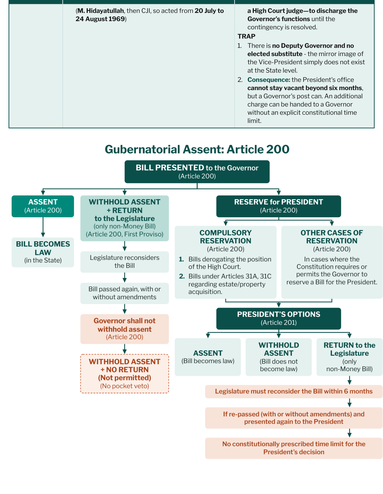

# The Union & State Executive: Parliamentary System, President, Governor, PM, CM & Council of Ministers — Prelims Notes (X-Factor Pre'27)

---

### [Prelims Source Page 28](../pages/prelims/prelims_page_028.pdf)

## CHAPTER 03: PARLIAMENTARY VS PRESIDENTIAL

### THEME ANALYSIS PYQ pattern for this chapter

#### 1. REPEATS

#### A. The Core Distinction

- Parliamentary government means the executive is responsible to the legislature and removable by it [2020].

- India qualifies because the Council of Ministers answers to the Lok Sabha [2015].

- The stated advantage is continued responsibility, not independence of organs [2017].

- The Cabinet form rests on collective responsibility through parliamentary democracy [2017].

#### B. Britain Compared with India

- The British Parliament is sovereign; Indian law making is limited by the Constitution [2021].

- Amendment validity goes to a Constitution Bench of the Supreme Court [2021].

- India has an elected President and a written Constitution; Britain has a hereditary monarch.

- India has no genuine shadow Cabinet and no legal responsibility by countersignature.

#### C. The Presidential Model and Borrowings

- One directly elected office combines Head of State and Head of Government.

- That executive sits outside the legislature, holds fixed tenure and faces no dissolution.

- Removal is only by impeachment; ministers answer to the head, not the legislature.

- India took Fundamental Rights, judicial review and impeachment from the US Constitution.

#### 2. HOW THE FORMAT HAS CHANGED

- 2015 to 2020: single answer definitions of parliamentary and Cabinet government [2015, 2017, 2020]

- 2021: a two statement comparison of the British and Indian models [2021]

#### 3. WHAT IS BEING ASKED NOW

- No question since 2021; the live angle is comparison, parliamentary sovereignty in Britain against limited legislative power in India [2021]

---

### [Prelims Source Page 29](../pages/prelims/prelims_page_029.pdf)

### PRELIMS PREVIOUS YEAR QUESTIONS

#### Q1 (2021)

**We adopted parliamentary democracy based on the British model, but how does our model differ from that model?**

- **1.** As regards legislation, the British Parliament is supreme or sovereign but in India, the power of the Parliament to legislate is limited.
- **2.** In India, matters related to the constitutionality of the Amendment of an Act of the Parliament are referred to the Constitution Bench by the Supreme Court.

*Select the correct answer using the code given below.*

- **(a)** 1 only
- **(b)** 2 only
- **(c)** Both 1 and 2
- **(d)** Neither 1 nor 2

> **Answer:** `(c)` · [Prelims Source Page 29](../pages/prelims/prelims_page_029.pdf)

#### Q2 (2020)

**A Parliamentary System of Government is one in which**

- **(a)** all political parties in the Parliament are represented in the Government
- **(b)** the Government is responsible to the Parliament and can be removed by it
- **(c)** the Government is elected by the people and can be removed by them
- **(d)** the Government is chosen by the Parliament but cannot be removed by it before completion of a fixed term

> **Answer:** `(b)` · [Prelims Source Page 29](../pages/prelims/prelims_page_029.pdf)

#### Q3 (2017)

**Out of the following statements, choose the one that brings out the principle underlying the Cabinet form of Government :**

- **(a)** An arrangement for minimizing the criticism against the Government whose responsibilities are complex and hard to carry out to the satisfaction of all.
- **(b)** A mechanism for speeding up the activities of the Government whose responsibilities are increasing day by day.
- **(c)** A mechanism of parliamentary democracy for ensuring collective responsibility of the Government to the people.
- **(d)** A device for strengthening the hands of the head of the Government whose hold over the people is in a state of decline.

> **Answer:** `(c)` · [Prelims Source Page 29](../pages/prelims/prelims_page_029.pdf)

#### Q4 (2017)

**The main advantage of the parliamentary form of government is that**

- **(a)** the executive and legislature work independently.
- **(b)** it provides continuity of policy and is more efficient.
- **(c)** the executive remains responsible to the legislature.
- **(d)** the head of the government cannot be changed without election.

> **Answer:** `(c)` · [Prelims Source Page 29](../pages/prelims/prelims_page_029.pdf)

#### Q5 (2015)

**There is a Parliamentary System of Government in India because the**

- **(a)** Lok Sabha is elected directly by the people
- **(b)** Parliament can amend the Constitution
- **(c)** Rajya Sabha cannot be dissolved
- **(d)** Council of Ministers is responsible to the Lok Sabha

> **Answer:** `(d)` · [Prelims Source Page 29](../pages/prelims/prelims_page_029.pdf)

#### 1. CORE DISTINCTION

The dividing line is the relationship between the executive and the legislature. In the parliamentary system the executive is drawn from and answerable to the legislature; in the presidential system the two are separately elected and mutually independent.

| PARAMETER | PARLIAMENTARY SYSTEM | PRESIDENTIAL SYSTEM |
| --- | --- | --- |
| Executive | - Dual: nominal head plus real head. In India the President is the nominal executive, yet the executive power of the Union is vested in him by Art 53. | - Single: one person is Head of State and Head of Government. |
| Basis of office | - Confidence of the lower house | - Direct or quasi direct election for a fixed term |

---

### [Prelims Source Page 30](../pages/prelims/prelims_page_030.pdf)

| PARAMETER | PARLIAMENTARY SYSTEM | PRESIDENTIAL SYSTEM |
| --- | --- | --- |
| Responsibility [PRELIMS 2020,2017,2015] | - Collective and individual responsibility to the legislature. | - Non responsible to the legislature, answerable directly to the electorate. The legislature cannot remove it for policy failure. |
| Membership | - Double membership: ministers sit and vote in the legislature. | - Single membership: Secretaries cannot be legislators. |
| Tenure | - No fixed tenure, removable any day on losing confidence. | - Fixed tenure, removable only by impeachment for a defined constitutional offence. |
| Dissolution | - Lower house can be dissolved before its term | - Lower house cannot be dissolved by the executive |
| Powers | - India has only a functional, not a rigid, separation. - MERIT: Harmony between the executive and the legislature, so a deadlock is structurally unlikely. - India, Separation of Powers is part of the Basic Structure (Indira Nehru Gandhi v. Raj Narain, 1975). | - Hard Separation of powers with checks and balances. - DEMERIT: conflict. Separate mandates invite friction and divided governments can produce paralysis. |
| Political homogeneity | - Usually present, ministry drawn from one party or coalition. | - May not exist. Divided government is normal. - DEMERIT: Narrow representation. The President appoints a team of his own choosing, answerable only to him. |
| Nomenclature and examples | - Westminster model, cabinet government, responsible government. - India, United Kingdom, Canada, Australia, Japan | - Non responsible or fixed executive system. - United States of America, Brazil, Indonesia, Sri Lanka - France and Russia are semi presidential, an elected President alongside a Prime Minister answerable to the legislature. - Listing them as presidential is a standard distraction. |

---

### [Prelims Source Page 31](../pages/prelims/prelims_page_031.pdf)

#### 2. INDIA VERSUS THE USA

| PARAMETER | INDIA (PARLIAMENTARY) | USA (PRESIDENTIAL) | TRAP |
| --- | --- | --- | --- |
| Head of State and Head of Government | — | — | — |
| Head of Government | **1.** The President is only the Head of State, the nominal executive. The Prime Minister is the Head of Government and the real executive. **2.** The President exercises his functions on the aid and advice of the Council of Ministers headed by the Prime Minister, and that advice is binding (Art 74(1)). **3.** The Prime Minister holds office only so long as he commands the confidence of the Lok Sabha. | **1.** The President is both Head of State and Head of Government. There is no Prime Minister. **2.** The whole executive power is vested in him personally, and the Secretaries are only his advisers. **3.** He is not answerable to Congress and cannot be voted out; only impeachment removes him. | The counterpart of the US President is not the Indian President but the Prime Minister, for everything to do with governing. Matching the two Presidents is the standard distractor. |
| Election of the executive | **1.** Indirect. An electoral college of the elected members of both Houses of Parliament and the elected members of the State Legislative Assemblies, including Delhi and Puducherry. **2.** Proportional representation by single transferable vote, by secret ballot (Arts 54 and 55). **3.** Nominated members do not vote. | **1.** Indirect in form, popular in substance. An Electoral College of 538 electors, allotted to the States, chosen on a popular vote; 270 are needed to win. **2.** A candidate can win the Electoral College while losing the national popular vote. | Nominated members are excluded from the Indian presidential electoral college but do vote in the Vice Presidential election. |
| Term and re-election of the head | **1.** Five years, and re-election is unlimited; the Constitution sets no cap. **2.** Eligible for re-election under Art 57. | **1.** Four years, with a hard cap of two terms under the 22nd Amendment, 1951. | India has no two term limit for the President. |
| Removal of the head | **1.** Impeachment under Art 61, on the sole ground of violation of the Constitution. **2.** Either House may initiate; the charge needs two thirds of the total membership of that House, and the other House investigates and must also pass it by two thirds of its total membership. **3.** Nominated members participate, since it is not an election. | **1.** Impeachment for Treason, Bribery, or other high Crimes and Misdemeanors. **2.** The House of Representatives impeaches by simple majority; the Senate tries and convicts by two thirds of members present. **3.** The Chief Justice presides when the President is tried. | India borrowed the impeachment procedure from the USA, but narrowed the ground to violation of the Constitution alone. |
| Ministers and the Cabinet | **1.** Drawn from the legislature; a non member may serve six months only (Art 75(5)). **2.** Collectively responsible to the Lok Sabha (Art 75(3)). **3.** Capped at fifteen percent of the Lok Sabha by the 91st Amendment, 2003. | **1.** Secretaries, appointed by the President with the advice and consent of the Senate, and answerable only to him. **2.** They cannot be members of Congress; Article I, Section 6 bars holding both offices. **3.** There is no collective responsibility and no cap of this kind. | Kitchen Cabinet exists in both, but the American Cabinet is an advisory body of the President, not a decision making council. |

---

### [Prelims Source Page 32](../pages/prelims/prelims_page_032.pdf)

| PARAMETER | INDIA (PARLIAMENTARY) | USA (PRESIDENTIAL) | TRAP |
| --- | --- | --- | --- |
| How the executive makes law | **1.** The Prime Minister and the Council of Ministers issue rules, orders and executive instructions only to carry out laws already passed by Parliament. They cannot create a new law. **2.** The single power to legislate directly is the Ordinance (Art 123; Art 213 for a Governor), issued by the President on the advice of the Cabinet when Parliament is not in session. **3.** An Ordinance has the same force as an Act, but is a strictly temporary measure. | **1.** A large part of American policy is made by Executive Order, signed by the President and in force the moment it is signed, with no vote in Congress. **2.** The Order stands until Congress legislates it away or a court strikes it down. | In this respect the President of the USA does what the Parliament of India does. India's nearest equivalent, the Ordinance, is a stop-gap, not a substitute for legislation. |
| Checks against an arbitrary executive act | **1.** An Ordinance must be laid before both Houses and lapses six weeks after reassembly unless both Houses approve it (Art 123(2)). **2.** Parliament can simply let it die; no special majority is needed to kill it. **3.** It is open to judicial review, and re-promulgation without placing it before the House is a fraud on the Constitution (D.C. Wadhwa, 1987; reaffirmed in Krishna Kumar Singh, 2017). | **1.** Congress may pass a law revoking the Order, but the President will veto that law, so Congress must find a two-thirds majority in both the House and the Senate - politically very difficult. **2.** Federal courts may strike an Order down if it violates the Constitution or goes beyond the authority Congress granted. **3.** In Learning Resources v. Trump (20 Feb 2026) the Supreme Court, by 6-3, held that the International Emergency Economic Powers Act did not authorise the tariffs; the trade court then ordered refunds of over $100 billion to importers. **4.** The President obeyed the ruling, publicly attacked it, and re-imposed similar tariffs under other trade statutes. Hundreds of challenges to other Orders remain pending. | The burden runs the opposite way. An Ordinance dies unless Parliament approves it; an Executive Order lives unless Congress finds two thirds or a court strikes it down. |
| Structure of the legislature | **1.** Parliament: Lok Sabha, maximum 550, term five years, dissolvable; Rajya Sabha, maximum 250, permanent, one third retiring every second year on six year terms. | **1.** Congress: House of Representatives, 435 members, two year terms; Senate, 100 members, six year terms, one third elected every second year. | The Rajya Sabha is not subject to dissolution, and neither is the US Senate. Only the popularly elected lower house is. |
| Representation in the upper house | **1.** Unequal, in rough proportion to population, under the Fourth Schedule. Uttar Pradesh has 31 seats, Sikkim has one. **2.** Members are elected by the elected members of the State Legislative Assemblies. | **1.** Equal. Two Senators for every State, whatever its size, elected directly by the people of the State since the 17th Amendment, 1913. | Equal representation of units is a classic federal feature. India's departure from it is a unitary trait, and is why India is called quasi federal. |
| Presiding officer of the upper house | **1.** The Vice President is ex officio Chairman of the Rajya Sabha and is not a member of it. | **1.** The Vice President is President of the Senate and likewise not a voting member. **2.** He votes only to break a tie. | This arrangement was borrowed from the USA. The Deputy Chairman, by contrast, |

---

### [Prelims Source Page 33](../pages/prelims/prelims_page_033.pdf)

| PARAMETER | INDIA (PARLIAMENTARY) | USA (PRESIDENTIAL) | TRAP |
| --- | --- | --- | --- |
| **Presiding officer of the upper house** *(Contd.)* | **2.** He has no vote in the first instance and only a casting vote on a tie. | — | is a member of the House. |
| Financial legislation | — | — | — |
| Veto over legislation | **1.** The President has an absolute, a suspensive and a pocket veto under Art 111, which prescribes no time limit for assent. **2.** If a Bill is returned and passed again, he must assent. **3.** He has no veto over a Constitutional Amendment Bill since the 24th Amendment, 1971. | **1.** The President may veto a Bill within ten days. **2.** Congress may override the veto by two thirds of both Houses. **3.** A pocket veto operates only where Congress adjourns within those ten days. | India has no legislative override of a Presidential veto. The Indian remedy is repassage, which then binds the President. |
| Judicial review and the rights standard | **1.** Implicit, resting on Arts 13, 32 and 226, and part of the Basic Structure. **2.** Art 21 uses procedure established by law, taken from Japan, though Maneka Gandhi, 1978 read fairness into it. | **1.** Not expressed in the Constitution; established by Marbury v. Madison, 1803. **2.** The Fifth and Fourteenth Amendments use due process of law, a wider standard. | India borrowed judicial review and the Fundamental Rights from the USA but chose the narrower procedural standard in Art 21. |
| The Supreme Court | — | — | — |
| Amending the Constitution | **1.** Art 368: special majority of each House, and for the entries in the proviso, ratification by half the States by simple majority. **2.** The Basic Structure doctrine limits the amending power. | **1.** Article V: proposal by two thirds of both Houses or by a convention, then ratification by three fourths of the States, that is 38 of 50. **2.** There is no Basic Structure doctrine. | India's is a blend of rigidity and flexibility; some provisions need only a simple majority. The American Constitution is uniformly rigid, which is why it has only 27 amendments. |
| Nature of the federation and citizenship | **1.** Art 1: a Union of States, not the product of an agreement, and no State may secede. **2.** Single citizenship, a single integrated judiciary, and residuary powers with the Union. | **1.** A federation formed by agreement among the States, described as an indestructible union of indestructible States. **2.** Dual citizenship, a dual judiciary, and residuary powers with the States under the Tenth Amendment. | Ambedkar: India is an indestructible union of destructible States, the mirror image of the American formula. |
| Emergency and rights architecture | **1.** A full Part XVIII: National Emergency (Art 352), President's Rule (Art 356) and Financial Emergency (Art 360). **2.** Fundamental Rights in Part III alongside non justiciable Directive Principles in Part IV. | **1.** No emergency chapter in the Constitution; national emergencies rest on statute, principally the National Emergencies Act, 1976. **2.** A Bill of Rights, the first ten Amendments of 1791, with no equivalent of the Directive Principles. | The Indian emergency provisions came largely from the Government of India Act, 1935 and the Weimar Constitution, not from the USA. |

---

### [Prelims Source Page 34](../pages/prelims/prelims_page_034.pdf)

#### 3. INDIA VERSUS BRITAIN

| PARAMETER | INDIA | BRITAIN |
| --- | --- | --- |
| Head of State | Republican. The Head of State is elected | Monarchical. Hereditary position, King or Queen |
| Sovereignty [PRELIMS 2021] | Constitutional supremacy, with judicial review and the Basic Structure doctrine | Sovereignty of Parliament |
| Prime Minister's House | May sit in either House of Parliament | **1.** Sits in the House of Commons by convention, not by law. **2.** The last Prime Minister from the Lords was Alec Douglas Home, 1963, who disclaimed his peerage to enter the Commons |
| Ministers | A non member may be a minister for a maximum of six months (Arts 75(5) and 164(4)) | Must be members of Parliament |
| Legal responsibility | No such system. India did not adopt countersignature | Legal responsibility of ministers, through the requirement of countersignature |
| Shadow Cabinet | No shadow cabinet in India | **1.** Shadow Cabinet is a distinct institution. **2.** The opposition mirrors every cabinet portfolio |

- **4.** WHY INDIA CHOSE THE PARLIAMENTARY SYSTEM

| REASON | SUBSTANCE | ELABORATION | TRAP |
| --- | --- | --- | --- |
| Ambedkar's formulation | **1.** Introducing the Draft Constitution to the Constituent Assembly on 4 November 1948, he framed the choice as one between a system that gives more stability and one that gives more responsibility. **2.** The Assembly preferred responsibility | **1.** The presidential executive is assessed only periodically, at the election. **2.** The parliamentary executive is assessed daily by the legislature and periodically by the electorate | The one sentence that generates most questions: parliamentary government trades stability for responsibility, presidential government trades responsibility for stability. |
| Familiarity | Indians had already worked the system under the Government of India Acts of 1919 and 1935 | Dyarchy in the provinces from 1919, provincial autonomy from 1935 | — |
| Plural society | A deeply diverse society was thought to need a government that can be changed without waiting out a fixed term | — | — |
| Fear of personal rule | A fixed term single executive was thought to tend toward personal rule | — | — |

---

### [Prelims Source Page 63](../pages/prelims/prelims_page_063.pdf)

## CHAPTER 09: PRESIDENT VS GOVERNOR

### THEME ANALYSIS PYQ pattern for this chapter

#### 1. REPEATS

#### A. Election, Removal and Tenure

- Value of an MLA vote and an MP vote in the electoral college [2023, 2018]

- Nominated members excluded, and no postponement for dissolved Assemblies [2023]

- A void election does not undo past acts, and no deadline binds assent [2023]

- No removal procedure for a Governor is laid down in the Constitution [2013]

#### B. Powers of the Union Executive

- Rules of business and executive action taken in the name of the President [2014]

- Ordinances may amend a Central Act and act retrospectively, but cannot abridge a right [2025]

- Pardoning power, open to limited judicial review, never free of government advice [2025]

- Reports laid before Parliament by the President, Finance Commission and CAG [2012, 2010]

#### C. Discretion of the Governor

- The Constitution expressly gives the Governor discretion, the President none [2025]

- Discretionary, the report for President's rule and reservation of Bills [2014]

- The President cannot reserve a State Bill unforwarded by the Governor [2025]

#### D. Immunities and Commissions

- No answerability to any court and no criminal proceedings during the term [2025, 2018]

- Emoluments not to be diminished during the term [2018]

- Sarkaria Commission, a Governor should be a detached eminent outsider [2019]

#### 2. HOW THE FORMAT HAS CHANGED

- 2009 to 2014: two statement question sets on office mechanisms [2009, 2012, 2014]

- 2018 to 2019: comparison of the two offices and reform commissions [2018, 2019]

- 2023: "how many" sets on the presidential election [2023]

- 2025: four statement sets in one paper, on ordinance, pardon, discretion and immunity [2025]

#### 3. WHAT IS BEING ASKED NOW

- Powers with limits: an ordinance can amend a Central Act and act retrospectively but cannot abridge a Fundamental Right; pardon is open to limited judicial review [2025]

- Governor's discretion and immunities, Art 163 and Art 361 [2025]

- Election arithmetic: value of an MLA's vote [2023]

---

### [Prelims Source Page 64](../pages/prelims/prelims_page_064.pdf)

### PRELIMS PREVIOUS YEAR QUESTIONS

#### Q1 (2025)

**With reference to the Indian polity, consider the following statements:**

- **I.** An Ordinance can amend any Central Act.
- **II.** An Ordinance can abridge a Fundamental Right.
- **III.** An Ordinance can come into effect from a back date.

*Which of the statements given above are correct?*

- **(a)** I and II only
- **(b)** II and III only
- **(c)** I and III only
- **(d)** I, II and III

> **Answer:** `(c)` · [Prelims Source Page 64](../pages/prelims/prelims_page_064.pdf)

#### Q2 (2025)

**Consider the following statements with regard to pardoning power of the President of India:**

- **I.** The exercise of this power by the President can be subjected to limited judicial review.
- **II.** The President can exercise this power without the advice of the Central Government.

*Which of the statements given above is/are correct?*

- **(a)** I only
- **(b)** II only
- **(c)** Both I and II
- **(d)** Neither I nor II

> **Answer:** `(a)` · [Prelims Source Page 64](../pages/prelims/prelims_page_064.pdf)

#### Q3 (2025)

**Consider the following statements:**

- **I.** The Constitution of India explicitly mentions that in certain spheres the Governor of a State acts in his/her own discretion.
- **II.** The President of India can, of his/her own, reserve a bill passed by a State Legislature for his/her consideration without it being forwarded by the Governor of the State concerned.

*Which of the statements given above is/are correct?*

- **(a)** I only
- **(b)** II only
- **(c)** Both I and II
- **(d)** Neither I nor II

> **Answer:** `(a)` · [Prelims Source Page 64](../pages/prelims/prelims_page_064.pdf)

#### Q4 (2025)

**With reference to the Indian polity, consider the following statements:**

- **I.** The Governor of a State is not answerable to any court for the exercise and performance of the powers and duties of his/her office.
- **II.** No criminal proceedings shall be instituted or continued against the Governor during his/her term of office.
- **III.** Members of a State Legislature are not liable to any proceedings in any court in respect of anything said within the House.

*Which of the statements given above are correct?*

- **(a)** I and II only
- **(b)** II and III only
- **(c)** I and III only
- **(d)** I, II and III

> **Answer:** `(d)` · [Prelims Source Page 64](../pages/prelims/prelims_page_064.pdf)

#### Q5 (2023)

**Consider the following statements :**

- **1.** If the election of the President of India is declared void by the Supreme Court of India, all acts done by him/her in the performance of duties of his/her office of President before the date of decision become invalid.
- **2.** Election for the post of the President of India can be postponed on the ground that some Legislative Assemblies have been dissolved and elections are yet to take place.
- **3.** When a Bill is presented to the President of India, the Constitution prescribes time limits within which he/she has to declare his/ her assent.

*How many of the above statements are correct?*

- **(a)** Only one
- **(b)** Only two
- **(c)** All three
- **(d)** None

> **Answer:** `(d)` · [Prelims Source Page 64](../pages/prelims/prelims_page_064.pdf)

---

### [Prelims Source Page 65](../pages/prelims/prelims_page_065.pdf)

#### Q6 (2023)

**Consider the following statements in respect of election to the President of India:**

- **1.** The members nominated to either House of the Parliament or the Legislative Assemblies of States are also eligible to be included in the Electoral College.
- **2.** Higher the number of elective Assembly seats, higher is the value of vote of each MLA of that State.
- **3.** The value of vote of each MLA of Madhya Pradesh is greater than that of Kerala.
- **4.** The value of vote of each MLA of Puducherry is higher than that of Arunachal Pradesh because the ratio of total population to total number of elective seats in Puducherry is greater as compared to Arunachal Pradesh.

*How many of the above statements are correct?*

- **(a)** Only one
- **(b)** Only two
- **(c)** Only three
- **(d)** All four

> **Answer:** `(a)` · [Prelims Source Page 65](../pages/prelims/prelims_page_065.pdf)

#### Q7 (2019)

**Which one of the following suggested that the Governor should be an eminent person from outside the State and should be a detached figure without intense political links or should not have taken part in politics in the recent past?**

- **(a)** First Administrative Reforms Commission (1966)
- **(b)** Rajamannar Committee (1969)
- **(c)** Sarkaria Commission (1983)
- **(d)** National Commission to Review the Working of the Constitution (2000)

> **Answer:** `(c)` · [Prelims Source Page 65](../pages/prelims/prelims_page_065.pdf)

#### Q8 (2018)

**With reference to the election of the President of India, consider the following statements:**

- **1.** The value of the vote of each MLA varies from State to State.
- **2.** The value of the vote of MPs of the Loksabha is more than the value of the vote of MPs of the Rajyasabha Which of the following statements given above is/are correct?

- **(a)** 1 only
- **(b)** 2 only
- **(c)** Both 1 and 2
- **(d)** Neither 1 nor 2

> **Answer:** `(a)` · [Prelims Source Page 65](../pages/prelims/prelims_page_065.pdf)

#### Q9 (2018)

**Consider the following statements:**

- **1.** No criminal proceedings shall be instituted against the Governor of a State in any court during his term of office.
- **2.** The emoluments and allowances of the Governor of a State shall not be diminished during his term of office.

*Which of the statements given above is/are correct?*

- **(a)** 1 only
- **(b)** 2 only
- **(c)** Both 1 and 2
- **(d)** Neither 1 nor 2

> **Answer:** `(c)` · [Prelims Source Page 65](../pages/prelims/prelims_page_065.pdf)

#### Q10 (2014)

**Consider the following statements:**

- **1.** The President shall make rules for the more convenient transaction of the business of the Government of India, and for the allocation among Ministers of the said business.
- **2.** All executive actions of the Government of India shall be expressed to be taken in the name of the Prime Minister.

*Which of the statements given above is/are correct?*

- **(a)** 1 only
- **(b)** 2 only
- **(c)** Both 1 and 2
- **(d)** Neither 1 nor 2

> **Answer:** `(a)` · [Prelims Source Page 65](../pages/prelims/prelims_page_065.pdf)

#### Q11 (2014)

**Which of the following are the discretionary powers given to the Governor of a State?**

- **1.** Sending a report to the President of India for imposing the President's rule
- **2.** Appointing the Ministers
- **3.** Reserving certain bills passed by the State Legislature for consideration of the President of India
- **4.** Making the rules to conduct the business of the State Government

*Select the correct answer using the code given below:*

- **(a)** 1 and 2 only
- **(b)** 1 and 3 only
- **(c)** 2, 3 and 4 only
- **(d)** 1, 2, 3 and 4

> **Answer:** `(b)` · [Prelims Source Page 65](../pages/prelims/prelims_page_065.pdf)

#### Q12 (2013)

**Which one of the following statements is correct?**

- **(a)** In India, the same person cannot be appointed as Governor for two or more States at the same time
- **(b)** The Judges of the High Court of the States in India are appointed by the Governor of the State just as the Judges of the Supreme Court are appointed by the President
- **(c)** No procedure has been laid down in the Constitution of India for the removal of a Governor from his/her post
- **(d)** In the case of a Union Territory having a legislative setup, the Chief Minister is appointed by the Lt. Governor on the basis of majority support

> **Answer:** `(c)` · [Prelims Source Page 65](../pages/prelims/prelims_page_065.pdf)

---

### [Prelims Source Page 66](../pages/prelims/prelims_page_066.pdf)

#### Q13 (2012)

**According to the Constitution of India, it is the duty of the President of India to be laid before the Parliament which of the following?**

- **1.** The Recommendations of the Union Finance Commission
- **2.** The Report of the Public Accounts Committee
- **3.** The Report of the Comptroller and Auditor General
- **4.** The Report of the National Commission for Scheduled Castes

- **(a)** 1 only
- **(b)** 2 and 4
- **(c)** 1, 3 and 4
- **(d)** 1, 2, 3 and 4

> **Answer:** `(c)` · [Prelims Source Page 66](../pages/prelims/prelims_page_066.pdf)

#### Q14 (2010)

**Who of the following shall cause every recommendation made by the Finance commission to be laid before each House of Parliament?**

- **(a)** The President of India
- **(b)** The Speaker of Lok Sabha
- **(c)** The Prime Minister of India
- **(d)** The Union Finance Minister

> **Answer:** `(a)` · [Prelims Source Page 66](../pages/prelims/prelims_page_066.pdf)

#### Q15 (2009)

**Consider the following statements :**

- **1.** The Governor of Punjab is concurrently the Administrator of Chandigarh.
- **2.** The Governor of Kerala is concurrently the Administrator of Lakshadweep. Which of the above statements is/are correct ?

- **(a)** 1 only
- **(b)** 2 only
- **(c)** Both 1 and 2
- **(d)** Neither 1 nor 2

> **Answer:** `(a)` · [Prelims Source Page 66](../pages/prelims/prelims_page_066.pdf)

| Parameter / Feature | PRESIDENT | GOVERNOR |
| --- | --- | --- |
| Constitutional Basis | Part V of the Constitution, The Union Executive | Part VI of the Constitution, The State Executive |
| Election[PRELI MS 2023,2018] | **1.** Indirect Election by an Electoral College consisting of **2.** Elected Members of Both Houses of the Parliament. **3.** Elected Members of Legislative Assemblies of State. **4.** Elected Members of LA of UT of Delhi and Puducherry. Note- Only elected members form the Electoral College. Nominated members and Legislative Councils are not involved. | No election. Nominated by the Central Government and appointed by the President by warrant under his hand and seal (Art 155) |
| Term | 5 years | 5 years. Subject to the pleasure of the President |
| Re-election | **1.** Can be re-elected any number of times. (unlike US President who gets only 2 terms) | No bar on reappointment, to the same or another State |
| Eligibility[PREL IMS 2019] | **1.** Should be a citizen of India **2.** Should have completed age of 35 years **3.** Should be qualified for Election as a Member of Lok Sabha **4.** He should not hold any Office of Profit under the Union Government or any of the State Governments **5.** A sitting President or Vice President, Governor and Ministers are not deemed to hold any office of profit. | The first 2 are the same. Rest don’t apply. Conventions followed **1.** Should be an outsider so he is not involved in the local politics **2.** The President should consult the Chief Minister of the state. |

---

### [Prelims Source Page 67](../pages/prelims/prelims_page_067.pdf)

| Parameter / Feature | PRESIDENT | GOVERNOR |
| --- | --- | --- |
| Nomination | Nomination must be subscribed by at least 50 electors as proposers and at least 50 electors as seconders. | — |
| Conditions | **1.** He must not be an MP or MLA. If a sitting member is elected President, his seat is vacated on the day he enters upon office. **2.** Shall not hold any other office of profit. **3.** Shall be entitled without payment of rent to the use of his official residences and shall be also entitled to such emoluments, allowances and privileges as may be determined by Parliament by law and, until provision in that behalf is so made, such emoluments, allowances and privileges as are specified in the Second Schedule. **4.** The emoluments and allowances of the President shall not be diminished during his term of office. | Same as that of the President. 1 Additional Point - When the same person is appointed as Governor of two or more States, the emoluments and allowances payable to the Governor shall be allocated among the States in such proportion as the President may by order determine. |
| Oath | Oath administered by the CJI | Oath administered by the Chief Justice of the concerned State High Court. |
| Resignation | Resignation submitted to the V. President | Resignation submitted to the President |
| Impeachment[P RELIMS 2013] | **1.** The procedure has both political and quasi-judicial characteristics. **2.** The only ground for impeachment is violation of the Constitution. **3.** The charge may be initiated in either House of Parliament. **4.** The charge is preferred by a resolution of the House. **5.** The resolution can be moved only after 14 days’ written notice, signed by not less than 1/4 of the total membership of that House. **6.** The initiating House must pass the resolution by a majority of not less than 2/3 of the total membership of that House. **7.** The charge is then investigated by the other House. **8.** During the investigation, the President has the right to appear and to be represented. **9.** If, after investigation, the other House sustains the charge by a majority of not less than 2/3 of its total membership, the President is removed from office. **10.** Thus, both Houses are involved, but they perform different functions: the first House prefers the charge; the other House investigates and, if it sustains the charge with the required majority, the President is removed. | **1.** No formal process of impeachment. **2.** The Governor holds the office during the pleasure of the President. |
| Vacancy | Vacancy can occur in 5 ways **1.** Expiry of tenure **2.** By resignation **3.** Removal by process of impeachment **4.** Death **5.** Otherwise - Eg. if he is disqualified. Except for 1, in all other circumstances, the election to fill the vacancy has to be held within 6 months. Till that time, the VP acts as the President. Trap - The VP acts as the President. He does not become the President. | — |

---

### [Prelims Source Page 68](../pages/prelims/prelims_page_068.pdf)

| Parameter / Feature | PRESIDENT | GOVERNOR |
| --- | --- | --- |
| Executive Powers[PRELI MS 2014] | **1.** The executive power of the Union (executing laws, administration, military powers and the business of Government) is vested in the President (Art 53); **2.** He acts on the advice of the CoM (Art 74), so he is a formal head and action is taken in his name; **3.** Administrative work is done by the ministries; **4.** For some appointments he must consult others, e.g. the CJI for SC judges Traps **1.** The 42nd CAA made advice binding on the President (amending Art 74 only). The Governor too is generally bound (Shamsher Singh, 1974; Nabam Rebia, 2016), except in discretionary matters (Art 163). **2.** 44th CAA (1978): the President may return advice (not a Bill) once for reconsideration; the reconsidered advice is binding. | **1.** Same at State level; **2.** District judges are appointed in consultation with the HC (Art 233), and other judicial officers after consulting both the SPSC and the HC (Art 234) |
| Administrative Powers | The President shall have the power to appoint The Chief Justice of India and other judges of the Supreme Court of India and state/union territory high courts. The Chief Minister of the National Capital Territory of Delhi. The Comptroller and Auditor General Of India. The Chief Election Commissioner and other Election Commissioners. The Chairman and other members of the Union Public Service Commission. The Attorney General Of India. Ambassadors and High Commissioners to other countries (only through the list of names given by the prime minister). Officers of the All India Services (IAS, IPS and IFoS), and other Central Civil Services in Group 'A'. The President shall also have the power to remove **1.** His Ministers, individually; **2.** The Attorney General of India; **3.** The Governor of a State; **4.** The Chairman or a member of the Public Service Commission of the Union or of a State, on the report of the Supreme Court; **5.** A Judge of the Supreme Court or of a High Court or the Election Commissioner, on an address of Parliament. | The Governor shall have the power to appoint **1.** The Chief Minister of the State **2.** Other Ministers of the State **3.** Advocate General of State **4.** Judges of District and Subordinate courts **5.** The State Finance Commission **6.** Members of State Public Service commissions. **7.** State Election Commissioners The Governor shall also have the power to remove **1.** His Ministers, individually; **2.** The Advocate General of State. TRAP Members of SPSCs are appointed by the Governor but removed by the President |
| Legislative Powers | **1.** Summoning, Prorogation, Dissolution: Indian President has the power to summon or prorogue the Houses of Parliament and to dissolve the Lower House. **2.** He shall also have the power to summon a joint sitting of both Houses of Parliament in case of a deadlock between them. | **1.** Same, except that there is no provision of Joint Sitting in the State Legislature. |
| **Legislative Powers** *(Contd.)* | b) The Opening Address: The President shall address both Houses of Parliament assembled together, at the first session after each general election to the House of | Same at state level. |

---

### [Prelims Source Page 69](../pages/prelims/prelims_page_069.pdf)

| Parameter / Feature | PRESIDENT | GOVERNOR |
| --- | --- | --- |
| **Legislative Powers** *(Contd.)* | the People and at the commencement of the first session of each year, and “inform Parliament of the causes of its summons”. | — |
| **Legislative Powers** *(Contd.)* | c) The Right to send Messages: Apart from the right to address, the Indian President shall have the right to send messages to either House of Parliament either in regard to any pending Bill or to any other matter, and the House must then consider the message “with all convenient dispatch”. | Same at state level |
| Legislative Powers (Continue)[PRE LIMS 2012,2010] [PRELIMS 2025] | **(d)** Nominating Members to the Houses **1.** Council of States/Rajya Sabha - 12 members nominated by the President from persons having special knowledge or practical experience of literature, science, art and social service. **2.** House of the People/Lok Sabha - nomination of 2 Anglo-Indians NO LONGER EXISTS: it lapsed on 25 Jan 2020, the 104th CAA 2019 having extended only SC/ST reservation and let the provision for Anglo-Indian representation expire. | The Governor also has the power to Nominate **1.** 1/6th Members of the State Legislative Council (special knowledge or practical experience of literature, science, art, cooperative movement and social service) **2.** 1 Anglo-Indian to the State Legislative Assembly - DISCONTINUED w.e.f. 25 Jan 2020 (104th CAA 2019) |
| **Legislative Powers (Continue)[PRE LIMS 2012,2010]** *(Contd.)* | **(e)** Laying reports before Parliament: the President causes the reports of the CAG, UPSC, Finance Commission and others to be laid before Parliament, so that Parliament can act on them. | Same at state level |
| **Legislative Powers (Continue)[PRE LIMS 2012,2010]** *(Contd.)* | **(f)** Ordinances **1.** He can promulgate ordinances when both houses of the Parliament are not in session, or either of the two Houses is not in session. **2.** These ordinances must be approved by the Parliament within 6 weeks from its reassembly. **3.** He can also withdraw an ordinance at any time. | **1.** Same at State level: the Governor has an ordinance making power (Art 213), but needs the President's prior instructions where a Bill with the same provisions would have needed the President's sanction. **2.** D.C. Wadhwa & Krishna Kumar Singh (2017): re-promulgation of ordinances without laying them before the House is a fraud on the Constitution. |
| Judicial Powers[PRELI MS 2025] | He can seek the advice of the Supreme Court through a Presidential Reference on any question of law or fact. However, the advice tendered by the Supreme Court is not binding on the President. | No such Provision. |
| **Judicial Powers[PRELI MS 2025]** *(Contd.)* | He can grant pardon, reprieve, respite and remission of punishment, or suspend, remit or commute the sentence of any person convicted of any offence: **1.** In all cases where the punishment or sentence is by a court martial; **2.** In all cases where the punishment or sentence is for an offence against a Union law; and **3.** In all cases where the sentence is a sentence of death. | 1. same but in matters to which the executive power of the state extends. **2.** He cannot pardon a death sentence (only the President can) but can suspend, remit or commute it; and he has no power at all over court-martial sentences. |
| Discretionary Powers[PRELI MS 2025,2014] | **1.** Appointment of PM when no party has a clear-cut majority or when the PM in office dies suddenly and there is no obvious successor. **2.** Dismissal of the COM when it cannot prove the confidence of the Lok Sabha **3.** Dissolution of the Lok Sabha if the COM has lost its majority. | **1.** Similar discretionary powers + Reserving Bills for the President **2.** The President can direct the Governor to reserve certain Bills. |

---

### [Prelims Source Page 70](../pages/prelims/prelims_page_070.pdf)

| Parameter / Feature | PRESIDENT | GOVERNOR |
| --- | --- | --- |
| Other Powers | **1.** Diplomatic powers- International treaties and agreements are negotiated and concluded on behalf of the President. **2.** Military powers - He is the supreme commander of the defence forces of India. **3.** He can declare war or conclude peace, subject to the approval of the Parliament. | No Explicit Diplomatic and Military Powers |
| Personal Immunities [PRELIMS 2025,2018] | **1.** Art 361(1) - the President is not answerable to any court for the exercise and performance of the powers and duties of his office, or for any act done in the exercise of those powers. **2.** Proviso: his conduct may be reviewed by a court/tribunal appointed to investigate a charge in impeachment proceedings. **3.** Art 361(2) - no criminal proceedings whatsoever shall be instituted or continued against him during his term. **4.** Art 361(3) - no process for his arrest or imprisonment shall be issued during his term. **5.** Art 361(4) - civil proceedings for personal acts allowed during the term only after 2 months' prior written notice. **6.** Immunity is personal 7. official acts of the Government remain judicially reviewable. **8.** Emoluments and allowances cannot be diminished during his term. | **1.** Identical protection - Art 361 covers the Governor (and Rajpramukh) in the same terms: not answerable to any court, no criminal proceedings instituted or continued during the term of office, no arrest/imprisonment process, civil suits only after 2 months' notice. **2.** Emoluments and allowances not to be diminished during his term. **3.** Distinguish the separate legislative immunity of members of Parliament and of the State Legislatures: no member is liable to any court proceedings in respect of anything said or any vote given in the House or its committees. TRAP **1.** Immunity protects the person of the office holder, not the office's decisions. The Supreme Court has repeatedly reviewed gubernatorial actions (e.g. Bommai, Nabam Rebia) even though the Governor himself cannot be summoned. |
| Governor as Administrator of a Union Territory [PRELIMS 2009] | **1.** Every Union Territory is administered by the President acting, to such extent as he thinks fit, through an administrator appointed by him with such designation as he may specify (Lieutenant Governor, Chief Commissioner or Administrator). **2.** The administrator is an agent of the President, not a constitutional head like a Governor. | **1.** The President may appoint the Governor of a State as the administrator of an adjoining Union Territory; **2.** When so appointed, the Governor exercises those functions independently of his State Council of Ministers. **3.** Example: Chandigarh, administered by the Governor of Punjab holding additional charge. **4.** Lakshadweep does not follow this pattern - it has its own separately appointed Administrator, not the Governor of Kerala. |
| Who fills in when the office is vacant or the holder is absent | **1.** The Vice-President acts as President on a vacancy by death, resignation, removal or otherwise, until a new President is elected; **2.** The Constitution requires that election within six months. **3.** The VP also discharges the functions when the President is unable to do so through absence, illness or any other cause. **4.** While acting the VP has all the powers, immunities and emoluments of the President. **5.** If the VP's office is also vacant, the Chief Justice of India, or failing him the senior-most Supreme Court Judge, acts under the President (Discharge of Functions) Act, 1969. | **1.** There is no office of 'Acting Governor' in the Constitution. **2.** The Constitution merely empowers the President to make a provision as he thinks fit for discharging the Governor's functions in any contingency not otherwise provided for. (Article 160) **3.** In practice the President gives additional charge to the Governor of a neighbouring State. **4.** Article 160: If the Governor’s office suddenly falls vacant or the Governor cannot discharge functions, the President may arrange for another person—such as |

---

### [Prelims Source Page 71](../pages/prelims/prelims_page_071.pdf)

*Diagram Screenshot: [Gubernatorial Assent: Article 200 Decision Flowchart](../diagrams/pre_diag_governor_assent_art200_p071.png) · [Full Source Page 71](../pages/prelims/prelims_page_071.pdf)*

| Parameter / Feature | PRESIDENT | GOVERNOR |
| --- | --- | --- |
| **Who fills in when the office is vacant or the holder is abse** *(Contd.)* | (M. Hidayatullah, then CJI, so acted from 20 July to 24 August 1969) | a High Court judge—to discharge the Governor’s functions until the contingency is resolved. TRAP **1.** There is no Deputy Governor and no elected substitute - the mirror image of the Vice-President simply does not exist at the State level. **2.** Consequence: the President's office cannot stay vacant beyond six months, but a Governor's post can. An additional charge can be handed to a Governor without an explicit constitutional time limit. |

---

### [Prelims Source Page 72](../pages/prelims/prelims_page_072.pdf)

## CHAPTER 10: PM VS CM

### THEME ANALYSIS PYQ pattern for this chapter

#### 1. REPEATS

#### A. Where Executive Power Vests

- Union executive power vests in the President, not the Prime Minister [2015]

- The Prime Minister is not ex officio Chairman of the Civil Services Board [2015]

- Ministries are assigned by the President on the advice of the Prime Minister [2009]

- Duty to communicate proposals for legislation to the President [2013]

#### B. Appointment and Membership

- A Prime Minister may be outside both Houses at appointment, for consecutive six months (at max)# [2012]

- Cabinet Ministers need not be sitting members of the Lok Sabha only [2009]

#### C. Council of Ministers and Responsibility

- The 91st Amendment Act, 2003 caps the Council at 15 percent of Lok Sabha strength [2022]

- The Constitution does not classify Ministers into four ranks [2022]

- Collective responsibility to the House, office held during the pleasure of the President [2013]

#### D. Secretariat Machinery

- Cabinet Secretariat sets the agenda and services Cabinet Committees, has no power to allocate funds [2014]

- The Chief Secretary has no fixed tenure and no discretionary appointment [2016]

- Department of Personnel placed under the Prime Minister in 1970 [2021]

#### 2. HOW THE FORMAT HAS CHANGED

- 2009: three two statement sets on Union machinery [2009]

- 2012 to 2016: single answer and code sets on appointment, responsibility and the Secretariat [2012, 2013, 2014, 2015, 2016]

- 2021 to 2022: history and numbers in two statement sets [2021, 2022]

#### 3. WHAT IS BEING ASKED NOW

- Text versus convention: the ranks of Ministers are not in the Constitution, the 15 percent cap is (Art 75(1A)) [2022]

- Administrative history: the Department of Personnel and the 1966 ARC [2021]

- Who advises whom: the PM, not the Cabinet Secretary

---

### [Prelims Source Page 73](../pages/prelims/prelims_page_073.pdf)

### PRELIMS PREVIOUS YEAR QUESTIONS

#### Q1 (2022)

**Consider the following statements :**

- **1.** The Constitution of India classifies the ministers into four ranks viz. Cabinet Minister, Minister of State with Independent Charge, Minister of State and Deputy Minister.
- **2.** The total number of ministers in the Union Government, including the Prime Minister, shall not exceed 15 percent of the total number of members in the Lok Sabha.

*Which of the statements given above is/are correct ?*

- **(a)** 1 only
- **(b)** 2 only
- **(c)** Both 1 and 2
- **(d)** Neither 1 nor 2

> **Answer:** `(b)` · [Prelims Source Page 73](../pages/prelims/prelims_page_073.pdf)

#### Q2 (2021)

**With reference to the Union Government, consider the following statements:**

- **1.** N. Gopalaswamy Iyenger Committee suggested that a minister and a secretary be designated solely for pursuing the subject of administrative reform and promoting it.
- **2.** In 1970, the Department of Personnel was constituted on the recommendation of the Administrative Reforms Commission, 1966, and this was placed under the Prime Minister’s charge.

*Which of the statements given above is/are correct?*

- **(a)** 1 only
- **(b)** 2 only
- **(c)** Both 1 and 2
- **(d)** Neither 1 nor 2

> **Answer:** `(b)` · [Prelims Source Page 73](../pages/prelims/prelims_page_073.pdf)

#### Q3 (2016)

**Consider the following statements:**

- **1.** The Chief Secretary in a State is appointed by the Governor of that State.
- **2.** The Chief Secretary in a State has a fixed tenure.

*Which of the statements given above is/are correct?*

- **(a)** 1 only
- **(b)** 2 only
- **(c)** Both 1 and 2
- **(d)** Neither 1 nor 2

> **Answer:** `(d)` · [Prelims Source Page 73](../pages/prelims/prelims_page_073.pdf)

#### Q4 (2015)

**Consider the following statements :**

- **1.** The Executive Power of the Union of India is vested in the Prime Minister.
- **2.** The Prime Minister is the ex officio Chairman of the Civil Services Board.

*Which of the statements given above is/are correct?*

- **(a)** 1 only
- **(b)** 2 only
- **(c)** Both 1 and 2
- **(d)** Neither 1 nor 2

> **Answer:** `(d)` · [Prelims Source Page 73](../pages/prelims/prelims_page_073.pdf)

#### Q5 (2014)

**Which of the following is/are the function/functions of the Cabinet Secretariat?**

- **1.** Preparation of agenda for Cabinet Meetings.
- **2.** Secretariat assistance to Cabinet Committees.
- **3.** Allocation of financial resources to the Ministries.

*Select the correct answer using the code given below.*

- **(a)** 1 only
- **(b)** 2 and 3 only
- **(c)** 1 and 2 only
- **(d)** 1, 2 and 3

> **Answer:** `(c)` · [Prelims Source Page 73](../pages/prelims/prelims_page_073.pdf)

#### Q6 (2013)

**In the context of India, which of the following principles is/are implied institutionally in the parliamentary government? (1) . Members of the Cabinet are Members of the Parliament. (2) . Ministers hold the office till they enjoy confidence in the Parliament. (3) . Cabinet is headed by the head of the State. Select the correct answer using the codes given below.**

- **(a)** 1 and 2 only
- **(b)** 3 only
- **(c)** 2 and 3 only
- **(d)** 1, 2 and 3

> **Answer:** `(a)` · [Prelims Source Page 73](../pages/prelims/prelims_page_073.pdf)

---

### [Prelims Source Page 74](../pages/prelims/prelims_page_074.pdf)

#### Q7 (2013)

**Consider the following statements :**

- **1.** The Council of Ministers in the centre shall be collectively responsible to the Parliament.
- **2.** The Union Ministers shall hold the office during the pleasure of the President of India.
- **3.** The Prime Minister shall communicate to the President about the proposals for legislation

*Which of the statements given above is/are correct?*

- **(a)** 1 only
- **(b)** 2 and 3 only
- **(c)** 1 and 3 only
- **(d)** 1, 2 and 3

> **Answer:** `(b)` · [Prelims Source Page 74](../pages/prelims/prelims_page_074.pdf)

#### Q8 (2012)

**The Prime Minister of India, at the time of his/her appointment:**

- **(a)** Need not necessarily be a member of one of the Houses of the Parliament but must become a member of one of the Houses within six months
- **(b)** Need not necessarily be a member of one of the Houses of the Parliament but must become a member of the Lok Sabha within six months
- **(c)** Must be a member of one of the Houses of the Parliament
- **(d)** Must be a member of the Lok Sabha

> **Answer:** `(a)` · [Prelims Source Page 74](../pages/prelims/prelims_page_074.pdf)

#### Q9 (2009)

**With reference to Union Government, consider the following statements :**

- **1.** The Ministries/Departments of the Government of India are created by the Prime Minister on the advice of the Cabinet Secretary.
- **2.** Each of the Ministries is assigned to a Minister by the President of India on the advice of the Prime Minister.

*Which of the statements given above is/are correct ?*

- **(a)** 1 only
- **(b)** 2 only
- **(c)** Both 1 and 2
- **(d)** Neither 1 nor 2

> **Answer:** `(b)` · [Prelims Source Page 74](../pages/prelims/prelims_page_074.pdf)

#### Q10 (2009)

**With reference to Union Government, consider the following statements :**

- **1.** The number of Ministries at the Centre on 15th August 1947 was 18.
- **2.** The number of Ministries at the Centre at present is 36.

*Which of the statements given above is/are correct ?*

- **(a)** 1 only
- **(b)** 2 only
- **(c)** Both 1 and 2
- **(d)** Neither 1 nor 2

> **Answer:** `(a)` · [Prelims Source Page 74](../pages/prelims/prelims_page_074.pdf)

#### Q11 (2009)

**With reference to Union Government, consider the following statements:**

- **1.** The Constitution of India provides that all Cabinet Ministers shall be compulsorily the sitting members of Lok Sabha only.
- **2.** The Union Cabinet Secretariat operates under the direction of the Ministry of Parliamentary Affairs.

*Which of the statements given above is/are correct?*

- **(a)** 1 only
- **(b)** 2 only
- **(c)** Both 1 and 2
- **(d)** Neither 1 nor 2

> **Answer:** `(d)` · [Prelims Source Page 74](../pages/prelims/prelims_page_074.pdf)

| Parameter / Feature | PRIME MINISTER | CHIEF MINISTER |
| --- | --- | --- |
| Establishment[PRELIM S 2015,2013] | (1) Article 74; (2) a Council of Ministers (CoM) with the Prime Minister at the head to aid and advise the President Trap: 44th CAA (1978), proviso to Art 74(1): the President may return the ministerial advice (not a Bill) to the CoM once for reconsideration; advice tendered after reconsideration is binding. | (1) Article 163; (2) a Council of Ministers with the Chief Minister at the head to aid and advise the Governor in the exercise of his functions, except where he is required to act in his discretion Trap: (1) The 42nd CAA made CoM advice binding on the President (amending Art 74 only). The Governor is also generally bound (Shamsher Singh, 1974; Nabam Rebia, 2016), except in discretionary matters (Art 163). (2) |

---

### [Prelims Source Page 75](../pages/prelims/prelims_page_075.pdf)

| Parameter / Feature | PRIME MINISTER | CHIEF MINISTER |
| --- | --- | --- |
| **Establishment[PRELIM S 2015,2013]** *(Contd.)* | — | The Governor’s discretionary powers reduce, to some extent, the power, authority, influence, prestige and role of the CM and CoM. (3) There is no reconsideration proviso for the Governor like the one in Art 74(1). |
| Election[PRELIMS 2012] | **1.** Article 75/164 **2.** President/Governor appoints the PM/CM **3.** By convention the Leader of the majority party in the Lok Sabha/SLA (Not required to prove his majority before he is appointed as the PM/CM. The President/Gov may first appoint PM/CM and then ask him to prove his majority within a reasonable period) TRAP Same relation President/PM+CoM and Governor/CM+CoM | — |
| Term | Not fixed and he holds the office during the pleasure of the President/Governor and until he enjoys the majority in Lok Sabha/SLA | — |
| Oath | President/Governor administers to him the oaths of office and secrecy | — |
| Relation with COM | **1.** Recommends persons who can be appointed as Ministers **2.** Allocates and reshuffles various portfolios **3.** Resignation or death of an incumbent PM/CM automatically dissolves the CCoM/SCoM | — |
| Relation with President/ Governor | **1.** To communicate to the President/Governor all decisions relating to the administration of the Union/State and proposals for legislation; **2.** To furnish such information relating to the administration of the Union and proposals for legislation as the President/Governor may call for; and **3.** If the President/Governor so requires, to submit for the consideration of the CCoM/SCoM any matter on which a decision has been taken by a minister but which has not been considered by the council. | — |
| Relation with Parliament/Legislature | **1.** Leader of the Lower House; when elected as a member of lower house otherwise they nominate a Minister who is member of lower house to function as the leader **2.** Advises the President/Governor with regard to summoning and proroguing of the sessions. **3.** Recommend dissolution of the Lok Sabha/SLA to President/Governor. **4.** Announces government policies on the floor of the House. | — |
| Appointments | PM/CM advises the President/Governor with regard to the appointment of important officials like Attorney general of India/Advocate General of State, Chairman and Members of the UPSC/State PSC, Election Commissioners/SEC, Chairman and Members of the Finance Commission/ State FC | — |
| Other Roles | **1.** PM/CM is the chief spokesman of the Union Government/ State Govt. **2.** Crisis manager-in-chief at the political level during emergencies | — |
| Responsibilities[PRELI MS 2013] | Idea of Collective Responsibility **1.** COM work as a team swims or sinks together. **2.** If Lok Sabha/SLA passes a no-confidence motion, the entire CCoM/SCoM has to resign including ministers from the Rajya Sabha/SLC. Individual Responsibility States that the Ministers hold office during the pleasure of the President/Governor, which means that the President/Governor can remove a minister even when the CCoM/SCoM enjoys the confidence of the Lok Sabha on the advice of the PM/CM. No Legal Responsibility: Unlike Britain, there is no provision in the Constitution for the system of legal responsibility of a Minister. | — |

---

### [Prelims Source Page 76](../pages/prelims/prelims_page_076.pdf)

| Parameter / Feature | PRIME MINISTER | CHIEF MINISTER |
| --- | --- | --- |
| **Responsibilities[PRELI MS 2013]** *(Contd.)* | TRAP Same relation President/PM+CoM and Governor/CM+CoM | — |
| Ministers[PRELIMS 2022] | Council of Minister: **1.** Constitutional body, dealt in detail by the Articles 74 and 75 of the Constitution. **2.** 3 categories - cabinet ministers, ministers of state, and deputy ministers. **3.** Does not meet as a single body, to transact everyday government business. **4.** Implements the decisions taken by the cabinet. Cabinet: **1.** Inserted through 44th CAA, 1978 in Article 352, which only defines the cabinet and does not describe its powers and functions. **2.** Includes the cabinet ministers only. **3.** Meets, as a body, frequently and take decisions regarding the transaction of government business. **4.** Supervises the implementation of its decisions by the council of ministers. Kitchen Cabinet: **1.** Informal body consists of the PM/CM and 2-4 influential colleagues in whom he has faith called the ‘Inner Cabinet’ or ‘Kitchen Cabinet’ has become the real centre of power. **2.** Composed of not only cabinet ministers but also outsiders like friends and family. **3.** Phenomenon of ‘kitchen cabinet’ is not unique to India it also exists in USA and Britain. | — |
| Chairman | NITI Aayog, National Development Council, National Integration Council, Inter-State Council,National Water Resources Council, National Board of Wildlife | State Planning Board and Vice-Chairman of the concerned zonal council by rotation, holding office for a period of one year at a time |
| Creation of Ministries / Allocation of Business [PRELIMS 2021,2009] | **1.** Ministries and Departments of the Union are not listed in the Constitution. **2.** Ministries are created, merged or abolished by amending the First Schedule of the Allocation of Business Rules, 1961. The President makes these rules under Art 77(3) on the PM's advice, not on the Cabinet Secretary's. **3.** Each Ministry is then assigned to a Minister by the President on the PM's advice. **4.** The number is elastic - about 18 ministries at Independence (15 August 1947), several times that number today. **5.** The Department of Personnel was set up in June 1970 within the Cabinet Secretariat, i.e. under the Prime Minister's charge, following the first Administrative Reforms Commission (1966); **6.** It later moved out and is today the DoPT under the Ministry of Personnel, Public Grievances and Pensions - a portfolio conventionally retained by the PM, along with Atomic Energy and Space. | **1.** State mirror: the Governor makes Rules of Business under Art 166(3) on the advice of the Chief Minister, creating departments and allocating them among ministers. **2.** The General Administration Department (and usually Home) is conventionally kept by the Chief Minister. TRAP Art 77/166 rules are rules of business, not law making. Breaking the Allocation of Business Rules does not by itself invalidate government action, because Art 77(2)/166(2) bars any inquiry into whether an order authenticated in the President's or Governor's name was actually made by him. |
| Secretariat Support: Cabinet Secretary / Chief Secretary [PRELIMS 2016,2014,2009] | **1.** The Cabinet Secretariat functions under the direct charge of the Prime Minister - not under the Ministry of Parliamentary Affairs. **2.** Its functions: preparing the agenda for Cabinet meetings, circulating Cabinet papers and recording/communicating decisions, providing secretarial assistance | **1.** State counterpart: the Chief Secretary - administrative head of the state secretariat, ex-officio secretary to the State Cabinet, and chairman of the state-level Civil Services Board. **2.** He is chosen and appointed by the Chief Minister (not by the Governor), the post is |

---

### [Prelims Source Page 77](../pages/prelims/prelims_page_077.pdf)

| Parameter / Feature | PRIME MINISTER | CHIEF MINISTER |
| --- | --- | --- |
| **Secretariat Support: Cabinet Secretary / Chief Secretary** *(Contd.)* | to Cabinet Committees, and administering the Transaction of Business Rules and Allocation of Business Rules. **3.** It does not allocate financial resources to Ministries - that is the Ministry of Finance. **4.** It is headed by the Cabinet Secretary, the senior-most civil servant, ex-officio head of the IAS and of the Civil Services Board at the Centre; **5.** The Prime Minister is not the Chairman of that Board. | outside the tenure system and carries no fixed tenure. TRAP Both offices are creations of executive rules and convention, not of the Constitution - which is why neither the Cabinet Secretary nor the Chief Secretary has any constitutionally guaranteed tenure. |
| Ranks of Ministers - constitutional status | **1.** The Constitution nowhere classifies Ministers into ranks. **2.** Arts 74, 75 and 77 speak only of 'Ministers' and the 'Council of Ministers'; **3.** The ranks are creations of convention, the Warrant of Precedence and the Government of India (Allocation of Business) Rules, 1961. **4.** Only a Cabinet Minister attends Cabinet meetings as of right. **5.** A Minister of State (Independent Charge) heads a Ministry or Department with no Cabinet Minister above him but is not a member of the Cabinet, and attends only when his subject is listed. **6.** A Minister of State is attached to a Cabinet Minister; 7. a Deputy Minister is attached to a Minister and is never given independent charge. **8.** A Deputy Prime Minister, when appointed, is a purely political designation with no constitutional or statutory basis - he takes the ordinary Minister's oath. | **1.** Identical at the State level, with the ranks set by the Rules of Business made by the Governor under Art 166(3) on the Chief Minister's advice. **2.** A Deputy Chief Minister likewise has no constitutional basis - he is sworn in as an ordinary Minister with no extra power or precedence. **3.** The Supreme Court dismissed a PIL against the practice on 12 February 2024, holding that the label does not offend the Constitution. TRAP **1.** The Constitution of India does not classify the ministers into four ranks. **2.** A Parliamentary Secretary is not a Minister. |
| Minister who is not a member of the legislature | **1.** Art 75(5) - a Minister who for any period of six consecutive months is not a member of either House of Parliament ceases to be a Minister at the expiry of that period. **2.** The rule binds the Prime Minister exactly as it binds any other Minister; 3. a non-member PM may be sworn in first and elected afterwards. | **1.** Art 164(4) - identical, for a Minister who is not a member of the State Legislature. **2.** Membership of either the Assembly or the Council satisfies it in a bicameral State. |
| Cabinet Committees | **1.** Cabinet Committees are not mentioned in the Constitution. **2.** They are set up by the Prime Minister under the Government of India (Transaction of Business) Rules, 1961, framed under Art 77(3); **3.** He alone decides their number, composition and terms of reference, can reconstitute them at will, and chairs the most important ones. **4.** Ministers who are not members of the Cabinet may be included. | The same device exists at State level as Cabinet Sub-Committees, constituted by the Chief Minister under the Rules of Business made by the Governor under Art 166(3). |

---

### [Prelims Source Page 78](../pages/prelims/prelims_page_078.pdf)

| Parameter / Feature | PRIME MINISTER | CHIEF MINISTER |
| --- | --- | --- |
| **Cabinet Committees** *(Contd.)* | **5.** Eight standing Cabinet Committees (as reconstituted in 2019): **(a)** Appointments (ACC) and Accommodation. **(b)** Security, Political Affairs, Parliamentary Affairs. **(c)** Economic Affairs, Investment and Growth, Employment and Skill Development. **6.** Their decisions may be reviewed by the full Cabinet but in practice stand as Cabinet decisions. TRAP **1.** The ACC - which clears senior civil service appointments - has just two members, the Prime Minister and the Home Minister (the Minister concerned is consulted for his own department). **2.** It is not chaired by the Cabinet Secretary, and it is distinct from the Civil Services Board, which the Cabinet Secretary heads. **3.** Distinguish both from Groups of Ministers (GoMs), which are ad hoc and dissolved once their task is done. | — |
