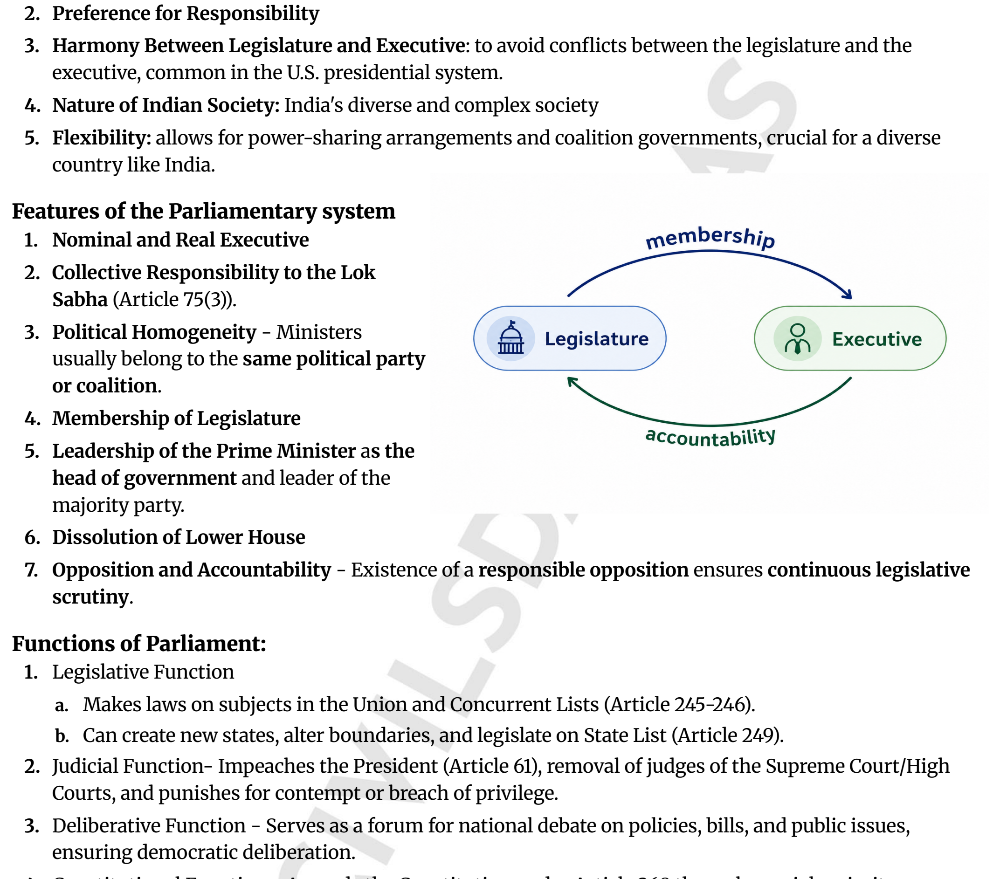

### [Smash Mains Source Page 116](../../pages/mains/mains_page_116.pdf)

### [Smash Mains Source Page 116](../../pages/mains/mains_page_116.pdf)

*Diagram Screenshot: [Legislature-Executive Accountability & Parliamentary Oversight Framework](../../diagrams/mains_diag_parliamentary_accountability_p116.png) · [Full Source Page 116](../../pages/mains/mains_page_116.pdf)*

### Reasons for Adoption

- **1.** Familiarity with the System: India's established parliamentary traditions over the past decades, particularly after the Government of India Act, 1935.

- **2.** Preference for Responsibility

- **3.** Harmony Between Legislature and Executive: to avoid conflicts between the legislature and the executive, common in the U.S. presidential system.

- **4.** Nature of Indian Society: India's diverse and complex society

- **5.** Flexibility: allows for power-sharing arrangements and coalition governments, crucial for a diverse country like India.

### Features of the Parliamentary system

- **1.** Nominal and Real Executive

- **2.** Collective Responsibility to the Lok Sabha (Article 75(3)).

- **3.** Political Homogeneity - Ministers usually belong to the same political party or coalition.

- **4.** Membership of Legislature

- **5.** Leadership of the Prime Minister as the head of government and leader of the majority party.

- **6.** Dissolution of Lower House

- **7.** Opposition and Accountability - Existence of a responsible opposition ensures continuous legislative scrutiny.

### Functions of Parliament

- **1.** Legislative Function

  - **a.** Makes laws on subjects in the Union and Concurrent Lists (Article 245-246).

  - **b.** Can create new states, alter boundaries, and legislate on State List (Article 249).

- **2.** Judicial Function- Impeaches the President (Article 61), removal of judges of the Supreme Court/High Courts, and punishes for contempt or breach of privilege.

- **3.** Deliberative Function - Serves as a forum for national debate on policies, bills, and public issues, ensuring democratic deliberation.

- **4.** Constitutional Function - Amends the Constitution under Article 368 through special majority procedures.

  - **a.** Financial Function

  - **b.** Exercises control over national finances - passes the Budget, Demands for Grants, and Appropriation Bills.

  - **c.** Enforces financial accountability through the Public Accounts Committee and Estimates Committee.

- **5.** Executive Control and Oversight

  - **a.** Holds the Council of Ministers accountable through questions, debates, adjournment motions, and no-confidence motions (Article 75(3)).

  - **b.** Approves President's ordinances and emergency proclamations.

- **6.** Electoral Function

  - **a.** Participates in the election of the President and Vice-President.

  - **b.** Elects the Deputy Speaker, Deputy Chairman, and committee members.
