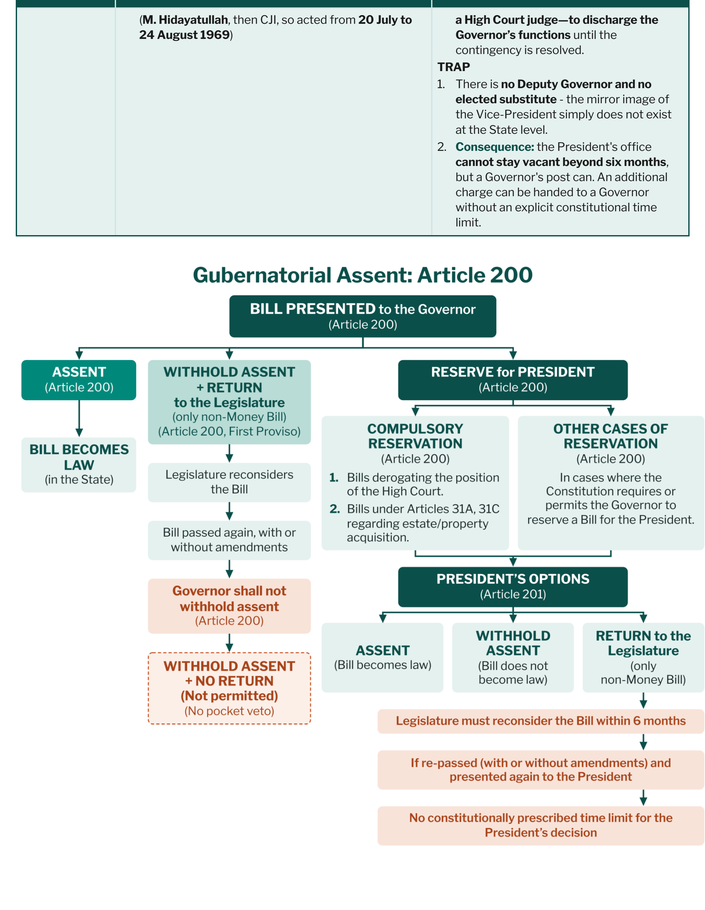

### [Prelims Source Page 71](../../pages/prelims/prelims_page_071.pdf)

### [Prelims Source Page 71](../../pages/prelims/prelims_page_071.pdf)

*Diagram Screenshot: [Gubernatorial Assent: Article 200 Decision Flowchart](../../diagrams/pre_diag_governor_assent_art200_p071.png) · [Full Source Page 71](../../pages/prelims/prelims_page_071.pdf)*

| Parameter / Feature | PRESIDENT | GOVERNOR |
| --- | --- | --- |
| **Who fills in when the office is vacant or the holder is abse** *(Contd.)* | (M. Hidayatullah, then CJI, so acted from 20 July to 24 August 1969) | a High Court judge—to discharge the Governor’s functions until the contingency is resolved. TRAP **1.** There is no Deputy Governor and no elected substitute - the mirror image of the Vice-President simply does not exist at the State level. **2.** Consequence: the President's office cannot stay vacant beyond six months, but a Governor's post can. An additional charge can be handed to a Governor without an explicit constitutional time limit. |
