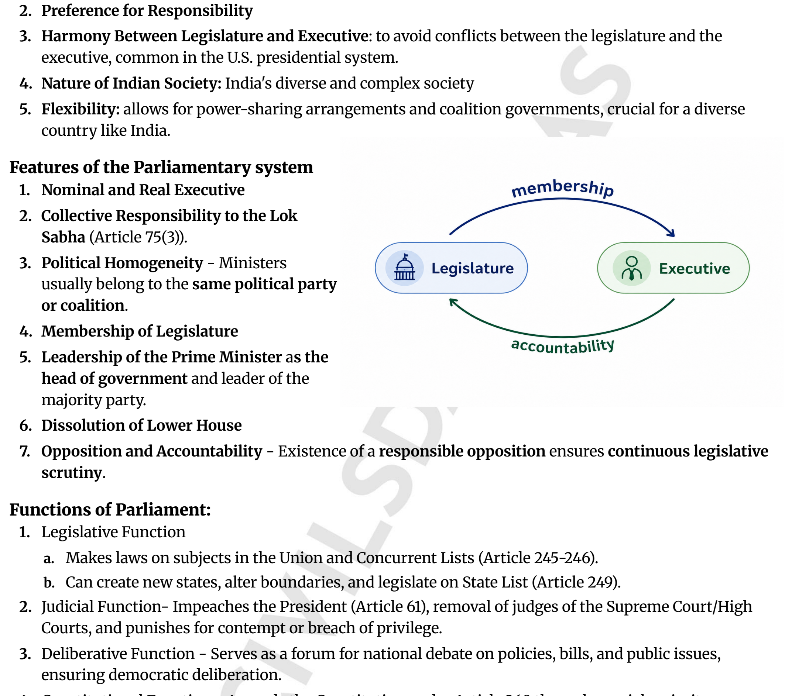

# Parliamentary vs Presidential System: Collective Responsibility, Cabinet Government & Shadow Cabinet — Smash Mains Notes (Ch07_Sub01_Parliamentary_vs_Presidential_System)

---

### [Smash Mains Source Page 105](../../pages/mains/mains_page_105.pdf)

## Chapter 9: Executive

### PYQs

- **[2025]** "The Attorney General of India plays a crucial role in guiding the legal framework of the Union Government and ensuring sound governance through legal counsel." Discuss his responsibilities, rights and limitations in this regard. (10)

- **[2024]** "The growth of cabinet system has practically resulted in the marginalisation of the parliamentary supremacy:" Elucidate. (10)

- **[2022]** Discuss the essential conditions for exercise of the legislative powers by the Governor. Discuss the legality of re-promulgation of ordinances by the Governor without placing them before the Legislature. (15)

- **[2019]** "The Attorney-General is the chief legal adviser and lawyer of the Government of India." Discuss. (15)

### Prime Minister

Lord Morley described the Prime Minister as "primus inter pares" (first among equals) and "key stone of the cabinet arch". Ramsay Muir described the Prime Minister as "the steering wheel of the ship of the state."

### Powers and Functions

### With Respect to the President

- **1.** Link between the President and the Council of Ministers (Article 78).

- **2.** Advice on Appointment:

  - **a.** Advises the President on the appointment of other ministers.

  - **b.** Recommends the allocation and reshuffling of portfolios among ministers.

- **3.** Advisory Role:

  - **a.** Advises the President on summoning and proroguing of Parliament and dissolution of the Lok Sabha.

  - **b.** Advises in appointments of constitutional authorities (Eg. Attorney General, CAG, Election Commissioners, etc.).

### With Respect to the Council of Ministers

- **1.** Head of the Council: The Prime Minister is the head of the Council of Ministers and decides its agenda.

- **2.** Leader and Coordinator:

  - **a.** Guides, directs, and coordinates the activities of all ministers.

  - **b.** Can ask any minister to resign or recommend dismissal to the President.

- **3.** Chairman of Meetings: Presides over meetings of the Cabinet and influences decisions.

### With Respect to the Parliament -

Leader of the House

### Other Powers and Functions

- **1.** Crisis Leadership: Plays a central role in times of emergency or national crisis.

---

### [Smash Mains Source Page 115](../../pages/mains/mains_page_115.pdf)

## Chapter 10: Parliament

### Parliament and State Legislature

### PYQs

- **[2026]** Examine whether the constitutional office of the Lok Sabha Speaker has become vulnerable to partisan politics under the current anti-defection regime. What institutional changes are required to ensure the neutrality of the Lok Sabha Speaker in managing a polarised House? (10)

- **[2025]** Indian Constitution has conferred the amending power on the ordinary legislative institutions with a few procedural hurdles. In view of this statement, examine the procedural and substantive limitations on the amending power of the Parliament to change the Constitution. (15)

- **[2023]** Explain the structure of the Parliamentary Committee system. How far have the financial committees helped in the institutionalization of Indian Parliament? (15)

- **[2023]** Discuss the role of Presiding Officers of state legislatures in maintaining order and impartiality in conducting legislative work and in facilitating best democratic practices. (10)

- **[2022]** Discuss the role of the Vice -Presidents of India as the chairman of the Rajyasabha (10)

- **[2021]** To what extent, in your view, the Parliament is able to ensure accountability of the executive in India? (10)

- **[2021]** Do Department-related Parliamentary Standing Committees keep the administration on its toes and inspire reverence for parliamentary control? Evaluate the working of such committees with suitable examples. (15)

- **[2021]** Explain the constitutional provisions under which Legislative Councils are established. Review the working and current status of Legislative Councils with suitable illustrations. (15)

- **[2020]** "Once a speaker, Always a speaker'! Do you think the practice should be adopted to impart objectivity to the office of the Speaker of Lok Sabha? What could be its implications for the robust functioning of parliamentary business in India. (10)

- **[2020]** Rajya Sabha has been transformed from a 'useless stepney tyre' to the most useful supporting organ in the past few decades. Highlight the factors as well as the areas in which this transformation could be visible. (15)

- **[2019]** "Parliament's power to amend the Constitution is a limited power and it cannot be enlarged into absolute power." In the light of this statement explain whether Parliament under Article 368 of the Constitution can destroy the Basic Structure of the Constitution by expanding its amending power? (15)

- **[2019]** Individual Parliamentarian's role as the national lawmaker is on a decline, which in turn, has adversely impacted the quality of debates and their outcome. Discuss. (15)

- **[2018]** Why do you think the committees are considered to be useful for parliamentary work? Discuss, in this context, the role of the Estimates Committee. (10)

> "The Parliament of India is the temple of democracy and the people of India are its high priests." - Lal Bahadur Shastri

---

### [Smash Mains Source Page 116](../../pages/mains/mains_page_116.pdf)

*Diagram Screenshot: [Legislature-Executive Accountability & Parliamentary Oversight Framework](../../diagrams/mains_diag_parliamentary_accountability_p116.png) · [Full Source Page 116](../../pages/mains/mains_page_116.pdf)*

### Reasons for Adoption

- **1.** Familiarity with the System: India's established parliamentary traditions over the past decades, particularly after the Government of India Act, 1935.

- **2.** Preference for Responsibility

- **3.** Harmony Between Legislature and Executive: to avoid conflicts between the legislature and the executive, common in the U.S. presidential system.

- **4.** Nature of Indian Society: India's diverse and complex society

- **5.** Flexibility: allows for power-sharing arrangements and coalition governments, crucial for a diverse country like India.

### Features of the Parliamentary system

- **1.** Nominal and Real Executive

- **2.** Collective Responsibility to the Lok Sabha (Article 75(3)).

- **3.** Political Homogeneity - Ministers usually belong to the same political party or coalition.

- **4.** Membership of Legislature

- **5.** Leadership of the Prime Minister as the head of government and leader of the majority party.

- **6.** Dissolution of Lower House

- **7.** Opposition and Accountability - Existence of a responsible opposition ensures continuous legislative scrutiny.

### Functions of Parliament

- **1.** Legislative Function

  - **a.** Makes laws on subjects in the Union and Concurrent Lists (Article 245-246).

  - **b.** Can create new states, alter boundaries, and legislate on State List (Article 249).

- **2.** Judicial Function- Impeaches the President (Article 61), removal of judges of the Supreme Court/High Courts, and punishes for contempt or breach of privilege.

- **3.** Deliberative Function - Serves as a forum for national debate on policies, bills, and public issues, ensuring democratic deliberation.

- **4.** Constitutional Function - Amends the Constitution under Article 368 through special majority procedures.

  - **a.** Financial Function

  - **b.** Exercises control over national finances - passes the Budget, Demands for Grants, and Appropriation Bills.

  - **c.** Enforces financial accountability through the Public Accounts Committee and Estimates Committee.

- **5.** Executive Control and Oversight

  - **a.** Holds the Council of Ministers accountable through questions, debates, adjournment motions, and no-confidence motions (Article 75(3)).

  - **b.** Approves President's ordinances and emergency proclamations.

- **6.** Electoral Function

  - **a.** Participates in the election of the President and Vice-President.

  - **b.** Elects the Deputy Speaker, Deputy Chairman, and committee members.
