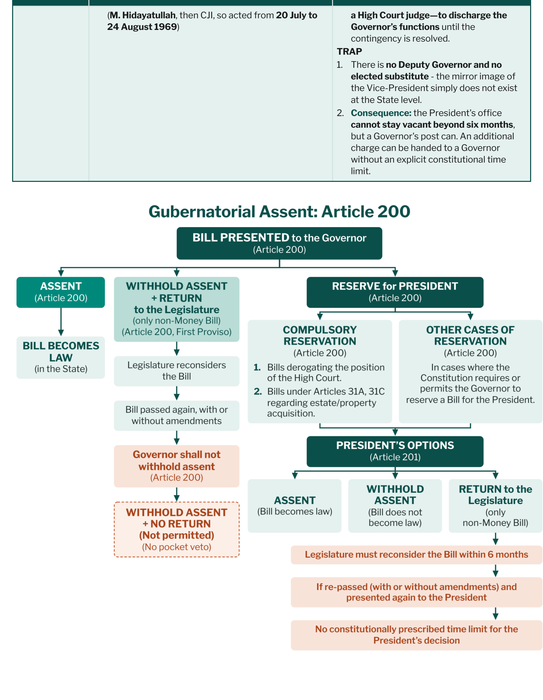

# President vs Governor: Election, Impeachment, Veto Powers (Art 111 & Art 200), Ordinance Making (Art 123 & 213) & Pardoning Powers (Art 72 & 161) — Prelims Notes (Ch07_Sub02_President_vs_Governor_Article_200_Ordinances_Pardons)

---

### [Prelims Source Page 63](../../pages/prelims/prelims_page_063.pdf)

## CHAPTER 09: PRESIDENT VS GOVERNOR

### THEME ANALYSIS PYQ pattern for this chapter

#### 1. REPEATS

#### A. Election, Removal and Tenure

- Value of an MLA vote and an MP vote in the electoral college [2023, 2018]

- Nominated members excluded, and no postponement for dissolved Assemblies [2023]

- A void election does not undo past acts, and no deadline binds assent [2023]

- No removal procedure for a Governor is laid down in the Constitution [2013]

#### B. Powers of the Union Executive

- Rules of business and executive action taken in the name of the President [2014]

- Ordinances may amend a Central Act and act retrospectively, but cannot abridge a right [2025]

- Pardoning power, open to limited judicial review, never free of government advice [2025]

- Reports laid before Parliament by the President, Finance Commission and CAG [2012, 2010]

#### C. Discretion of the Governor

- The Constitution expressly gives the Governor discretion, the President none [2025]

- Discretionary, the report for President's rule and reservation of Bills [2014]

- The President cannot reserve a State Bill unforwarded by the Governor [2025]

#### D. Immunities and Commissions

- No answerability to any court and no criminal proceedings during the term [2025, 2018]

- Emoluments not to be diminished during the term [2018]

- Sarkaria Commission, a Governor should be a detached eminent outsider [2019]

#### 2. HOW THE FORMAT HAS CHANGED

- 2009 to 2014: two statement question sets on office mechanisms [2009, 2012, 2014]

- 2018 to 2019: comparison of the two offices and reform commissions [2018, 2019]

- 2023: "how many" sets on the presidential election [2023]

- 2025: four statement sets in one paper, on ordinance, pardon, discretion and immunity [2025]

#### 3. WHAT IS BEING ASKED NOW

- Powers with limits: an ordinance can amend a Central Act and act retrospectively but cannot abridge a Fundamental Right; pardon is open to limited judicial review [2025]

- Governor's discretion and immunities, Art 163 and Art 361 [2025]

- Election arithmetic: value of an MLA's vote [2023]

---

### [Prelims Source Page 64](../../pages/prelims/prelims_page_064.pdf)

### PRELIMS PREVIOUS YEAR QUESTIONS

#### Q1 (2025)

**With reference to the Indian polity, consider the following statements:**

- **I.** An Ordinance can amend any Central Act.
- **II.** An Ordinance can abridge a Fundamental Right.
- **III.** An Ordinance can come into effect from a back date.

*Which of the statements given above are correct?*

- **(a)** I and II only
- **(b)** II and III only
- **(c)** I and III only
- **(d)** I, II and III

> **Answer:** `(c)` · [Prelims Source Page 64](../../pages/prelims/prelims_page_064.pdf)

#### Q2 (2025)

**Consider the following statements with regard to pardoning power of the President of India:**

- **I.** The exercise of this power by the President can be subjected to limited judicial review.
- **II.** The President can exercise this power without the advice of the Central Government.

*Which of the statements given above is/are correct?*

- **(a)** I only
- **(b)** II only
- **(c)** Both I and II
- **(d)** Neither I nor II

> **Answer:** `(a)` · [Prelims Source Page 64](../../pages/prelims/prelims_page_064.pdf)

#### Q3 (2025)

**Consider the following statements:**

- **I.** The Constitution of India explicitly mentions that in certain spheres the Governor of a State acts in his/her own discretion.
- **II.** The President of India can, of his/her own, reserve a bill passed by a State Legislature for his/her consideration without it being forwarded by the Governor of the State concerned.

*Which of the statements given above is/are correct?*

- **(a)** I only
- **(b)** II only
- **(c)** Both I and II
- **(d)** Neither I nor II

> **Answer:** `(a)` · [Prelims Source Page 64](../../pages/prelims/prelims_page_064.pdf)

#### Q4 (2025)

**With reference to the Indian polity, consider the following statements:**

- **I.** The Governor of a State is not answerable to any court for the exercise and performance of the powers and duties of his/her office.
- **II.** No criminal proceedings shall be instituted or continued against the Governor during his/her term of office.
- **III.** Members of a State Legislature are not liable to any proceedings in any court in respect of anything said within the House.

*Which of the statements given above are correct?*

- **(a)** I and II only
- **(b)** II and III only
- **(c)** I and III only
- **(d)** I, II and III

> **Answer:** `(d)` · [Prelims Source Page 64](../../pages/prelims/prelims_page_064.pdf)

#### Q5 (2023)

**Consider the following statements :**

- **1.** If the election of the President of India is declared void by the Supreme Court of India, all acts done by him/her in the performance of duties of his/her office of President before the date of decision become invalid.
- **2.** Election for the post of the President of India can be postponed on the ground that some Legislative Assemblies have been dissolved and elections are yet to take place.
- **3.** When a Bill is presented to the President of India, the Constitution prescribes time limits within which he/she has to declare his/ her assent.

*How many of the above statements are correct?*

- **(a)** Only one
- **(b)** Only two
- **(c)** All three
- **(d)** None

> **Answer:** `(d)` · [Prelims Source Page 64](../../pages/prelims/prelims_page_064.pdf)

---

### [Prelims Source Page 65](../../pages/prelims/prelims_page_065.pdf)

#### Q6 (2023)

**Consider the following statements in respect of election to the President of India:**

- **1.** The members nominated to either House of the Parliament or the Legislative Assemblies of States are also eligible to be included in the Electoral College.
- **2.** Higher the number of elective Assembly seats, higher is the value of vote of each MLA of that State.
- **3.** The value of vote of each MLA of Madhya Pradesh is greater than that of Kerala.
- **4.** The value of vote of each MLA of Puducherry is higher than that of Arunachal Pradesh because the ratio of total population to total number of elective seats in Puducherry is greater as compared to Arunachal Pradesh.

*How many of the above statements are correct?*

- **(a)** Only one
- **(b)** Only two
- **(c)** Only three
- **(d)** All four

> **Answer:** `(a)` · [Prelims Source Page 65](../../pages/prelims/prelims_page_065.pdf)

#### Q7 (2019)

**Which one of the following suggested that the Governor should be an eminent person from outside the State and should be a detached figure without intense political links or should not have taken part in politics in the recent past?**

- **(a)** First Administrative Reforms Commission (1966)
- **(b)** Rajamannar Committee (1969)
- **(c)** Sarkaria Commission (1983)
- **(d)** National Commission to Review the Working of the Constitution (2000)

> **Answer:** `(c)` · [Prelims Source Page 65](../../pages/prelims/prelims_page_065.pdf)

#### Q8 (2018)

**With reference to the election of the President of India, consider the following statements:**

- **1.** The value of the vote of each MLA varies from State to State.
- **2.** The value of the vote of MPs of the Loksabha is more than the value of the vote of MPs of the Rajyasabha Which of the following statements given above is/are correct?

- **(a)** 1 only
- **(b)** 2 only
- **(c)** Both 1 and 2
- **(d)** Neither 1 nor 2

> **Answer:** `(a)` · [Prelims Source Page 65](../../pages/prelims/prelims_page_065.pdf)

#### Q9 (2018)

**Consider the following statements:**

- **1.** No criminal proceedings shall be instituted against the Governor of a State in any court during his term of office.
- **2.** The emoluments and allowances of the Governor of a State shall not be diminished during his term of office.

*Which of the statements given above is/are correct?*

- **(a)** 1 only
- **(b)** 2 only
- **(c)** Both 1 and 2
- **(d)** Neither 1 nor 2

> **Answer:** `(c)` · [Prelims Source Page 65](../../pages/prelims/prelims_page_065.pdf)

#### Q10 (2014)

**Consider the following statements:**

- **1.** The President shall make rules for the more convenient transaction of the business of the Government of India, and for the allocation among Ministers of the said business.
- **2.** All executive actions of the Government of India shall be expressed to be taken in the name of the Prime Minister.

*Which of the statements given above is/are correct?*

- **(a)** 1 only
- **(b)** 2 only
- **(c)** Both 1 and 2
- **(d)** Neither 1 nor 2

> **Answer:** `(a)` · [Prelims Source Page 65](../../pages/prelims/prelims_page_065.pdf)

#### Q11 (2014)

**Which of the following are the discretionary powers given to the Governor of a State?**

- **1.** Sending a report to the President of India for imposing the President's rule
- **2.** Appointing the Ministers
- **3.** Reserving certain bills passed by the State Legislature for consideration of the President of India
- **4.** Making the rules to conduct the business of the State Government

*Select the correct answer using the code given below:*

- **(a)** 1 and 2 only
- **(b)** 1 and 3 only
- **(c)** 2, 3 and 4 only
- **(d)** 1, 2, 3 and 4

> **Answer:** `(b)` · [Prelims Source Page 65](../../pages/prelims/prelims_page_065.pdf)

#### Q12 (2013)

**Which one of the following statements is correct?**

- **(a)** In India, the same person cannot be appointed as Governor for two or more States at the same time
- **(b)** The Judges of the High Court of the States in India are appointed by the Governor of the State just as the Judges of the Supreme Court are appointed by the President
- **(c)** No procedure has been laid down in the Constitution of India for the removal of a Governor from his/her post
- **(d)** In the case of a Union Territory having a legislative setup, the Chief Minister is appointed by the Lt. Governor on the basis of majority support

> **Answer:** `(c)` · [Prelims Source Page 65](../../pages/prelims/prelims_page_065.pdf)

---

### [Prelims Source Page 66](../../pages/prelims/prelims_page_066.pdf)

#### Q13 (2012)

**According to the Constitution of India, it is the duty of the President of India to be laid before the Parliament which of the following?**

- **1.** The Recommendations of the Union Finance Commission
- **2.** The Report of the Public Accounts Committee
- **3.** The Report of the Comptroller and Auditor General
- **4.** The Report of the National Commission for Scheduled Castes

- **(a)** 1 only
- **(b)** 2 and 4
- **(c)** 1, 3 and 4
- **(d)** 1, 2, 3 and 4

> **Answer:** `(c)` · [Prelims Source Page 66](../../pages/prelims/prelims_page_066.pdf)

#### Q14 (2010)

**Who of the following shall cause every recommendation made by the Finance commission to be laid before each House of Parliament?**

- **(a)** The President of India
- **(b)** The Speaker of Lok Sabha
- **(c)** The Prime Minister of India
- **(d)** The Union Finance Minister

> **Answer:** `(a)` · [Prelims Source Page 66](../../pages/prelims/prelims_page_066.pdf)

#### Q15 (2009)

**Consider the following statements :**

- **1.** The Governor of Punjab is concurrently the Administrator of Chandigarh.
- **2.** The Governor of Kerala is concurrently the Administrator of Lakshadweep. Which of the above statements is/are correct ?

- **(a)** 1 only
- **(b)** 2 only
- **(c)** Both 1 and 2
- **(d)** Neither 1 nor 2

> **Answer:** `(a)` · [Prelims Source Page 66](../../pages/prelims/prelims_page_066.pdf)

| Parameter / Feature | PRESIDENT | GOVERNOR |
| --- | --- | --- |
| Constitutional Basis | Part V of the Constitution, The Union Executive | Part VI of the Constitution, The State Executive |
| Election[PRELI MS 2023,2018] | **1.** Indirect Election by an Electoral College consisting of **2.** Elected Members of Both Houses of the Parliament. **3.** Elected Members of Legislative Assemblies of State. **4.** Elected Members of LA of UT of Delhi and Puducherry. Note- Only elected members form the Electoral College. Nominated members and Legislative Councils are not involved. | No election. Nominated by the Central Government and appointed by the President by warrant under his hand and seal (Art 155) |
| Term | 5 years | 5 years. Subject to the pleasure of the President |
| Re-election | **1.** Can be re-elected any number of times. (unlike US President who gets only 2 terms) | No bar on reappointment, to the same or another State |
| Eligibility[PREL IMS 2019] | **1.** Should be a citizen of India **2.** Should have completed age of 35 years **3.** Should be qualified for Election as a Member of Lok Sabha **4.** He should not hold any Office of Profit under the Union Government or any of the State Governments **5.** A sitting President or Vice President, Governor and Ministers are not deemed to hold any office of profit. | The first 2 are the same. Rest don’t apply. Conventions followed **1.** Should be an outsider so he is not involved in the local politics **2.** The President should consult the Chief Minister of the state. |

---

### [Prelims Source Page 67](../../pages/prelims/prelims_page_067.pdf)

| Parameter / Feature | PRESIDENT | GOVERNOR |
| --- | --- | --- |
| Nomination | Nomination must be subscribed by at least 50 electors as proposers and at least 50 electors as seconders. | — |
| Conditions | **1.** He must not be an MP or MLA. If a sitting member is elected President, his seat is vacated on the day he enters upon office. **2.** Shall not hold any other office of profit. **3.** Shall be entitled without payment of rent to the use of his official residences and shall be also entitled to such emoluments, allowances and privileges as may be determined by Parliament by law and, until provision in that behalf is so made, such emoluments, allowances and privileges as are specified in the Second Schedule. **4.** The emoluments and allowances of the President shall not be diminished during his term of office. | Same as that of the President. 1 Additional Point - When the same person is appointed as Governor of two or more States, the emoluments and allowances payable to the Governor shall be allocated among the States in such proportion as the President may by order determine. |
| Oath | Oath administered by the CJI | Oath administered by the Chief Justice of the concerned State High Court. |
| Resignation | Resignation submitted to the V. President | Resignation submitted to the President |
| Impeachment[P RELIMS 2013] | **1.** The procedure has both political and quasi-judicial characteristics. **2.** The only ground for impeachment is violation of the Constitution. **3.** The charge may be initiated in either House of Parliament. **4.** The charge is preferred by a resolution of the House. **5.** The resolution can be moved only after 14 days’ written notice, signed by not less than 1/4 of the total membership of that House. **6.** The initiating House must pass the resolution by a majority of not less than 2/3 of the total membership of that House. **7.** The charge is then investigated by the other House. **8.** During the investigation, the President has the right to appear and to be represented. **9.** If, after investigation, the other House sustains the charge by a majority of not less than 2/3 of its total membership, the President is removed from office. **10.** Thus, both Houses are involved, but they perform different functions: the first House prefers the charge; the other House investigates and, if it sustains the charge with the required majority, the President is removed. | **1.** No formal process of impeachment. **2.** The Governor holds the office during the pleasure of the President. |
| Vacancy | Vacancy can occur in 5 ways **1.** Expiry of tenure **2.** By resignation **3.** Removal by process of impeachment **4.** Death **5.** Otherwise - Eg. if he is disqualified. Except for 1, in all other circumstances, the election to fill the vacancy has to be held within 6 months. Till that time, the VP acts as the President. Trap - The VP acts as the President. He does not become the President. | — |

---

### [Prelims Source Page 68](../../pages/prelims/prelims_page_068.pdf)

| Parameter / Feature | PRESIDENT | GOVERNOR |
| --- | --- | --- |
| Executive Powers[PRELI MS 2014] | **1.** The executive power of the Union (executing laws, administration, military powers and the business of Government) is vested in the President (Art 53); **2.** He acts on the advice of the CoM (Art 74), so he is a formal head and action is taken in his name; **3.** Administrative work is done by the ministries; **4.** For some appointments he must consult others, e.g. the CJI for SC judges Traps **1.** The 42nd CAA made advice binding on the President (amending Art 74 only). The Governor too is generally bound (Shamsher Singh, 1974; Nabam Rebia, 2016), except in discretionary matters (Art 163). **2.** 44th CAA (1978): the President may return advice (not a Bill) once for reconsideration; the reconsidered advice is binding. | **1.** Same at State level; **2.** District judges are appointed in consultation with the HC (Art 233), and other judicial officers after consulting both the SPSC and the HC (Art 234) |
| Administrative Powers | The President shall have the power to appoint The Chief Justice of India and other judges of the Supreme Court of India and state/union territory high courts. The Chief Minister of the National Capital Territory of Delhi. The Comptroller and Auditor General Of India. The Chief Election Commissioner and other Election Commissioners. The Chairman and other members of the Union Public Service Commission. The Attorney General Of India. Ambassadors and High Commissioners to other countries (only through the list of names given by the prime minister). Officers of the All India Services (IAS, IPS and IFoS), and other Central Civil Services in Group 'A'. The President shall also have the power to remove **1.** His Ministers, individually; **2.** The Attorney General of India; **3.** The Governor of a State; **4.** The Chairman or a member of the Public Service Commission of the Union or of a State, on the report of the Supreme Court; **5.** A Judge of the Supreme Court or of a High Court or the Election Commissioner, on an address of Parliament. | The Governor shall have the power to appoint **1.** The Chief Minister of the State **2.** Other Ministers of the State **3.** Advocate General of State **4.** Judges of District and Subordinate courts **5.** The State Finance Commission **6.** Members of State Public Service commissions. **7.** State Election Commissioners The Governor shall also have the power to remove **1.** His Ministers, individually; **2.** The Advocate General of State. TRAP Members of SPSCs are appointed by the Governor but removed by the President |
| Legislative Powers | **1.** Summoning, Prorogation, Dissolution: Indian President has the power to summon or prorogue the Houses of Parliament and to dissolve the Lower House. **2.** He shall also have the power to summon a joint sitting of both Houses of Parliament in case of a deadlock between them. | **1.** Same, except that there is no provision of Joint Sitting in the State Legislature. |
| **Legislative Powers** *(Contd.)* | b) The Opening Address: The President shall address both Houses of Parliament assembled together, at the first session after each general election to the House of | Same at state level. |

---

### [Prelims Source Page 69](../../pages/prelims/prelims_page_069.pdf)

| Parameter / Feature | PRESIDENT | GOVERNOR |
| --- | --- | --- |
| **Legislative Powers** *(Contd.)* | the People and at the commencement of the first session of each year, and “inform Parliament of the causes of its summons”. | — |
| **Legislative Powers** *(Contd.)* | c) The Right to send Messages: Apart from the right to address, the Indian President shall have the right to send messages to either House of Parliament either in regard to any pending Bill or to any other matter, and the House must then consider the message “with all convenient dispatch”. | Same at state level |
| Legislative Powers (Continue)[PRE LIMS 2012,2010] [PRELIMS 2025] | **(d)** Nominating Members to the Houses **1.** Council of States/Rajya Sabha - 12 members nominated by the President from persons having special knowledge or practical experience of literature, science, art and social service. **2.** House of the People/Lok Sabha - nomination of 2 Anglo-Indians NO LONGER EXISTS: it lapsed on 25 Jan 2020, the 104th CAA 2019 having extended only SC/ST reservation and let the provision for Anglo-Indian representation expire. | The Governor also has the power to Nominate **1.** 1/6th Members of the State Legislative Council (special knowledge or practical experience of literature, science, art, cooperative movement and social service) **2.** 1 Anglo-Indian to the State Legislative Assembly - DISCONTINUED w.e.f. 25 Jan 2020 (104th CAA 2019) |
| **Legislative Powers (Continue)[PRE LIMS 2012,2010]** *(Contd.)* | **(e)** Laying reports before Parliament: the President causes the reports of the CAG, UPSC, Finance Commission and others to be laid before Parliament, so that Parliament can act on them. | Same at state level |
| **Legislative Powers (Continue)[PRE LIMS 2012,2010]** *(Contd.)* | **(f)** Ordinances **1.** He can promulgate ordinances when both houses of the Parliament are not in session, or either of the two Houses is not in session. **2.** These ordinances must be approved by the Parliament within 6 weeks from its reassembly. **3.** He can also withdraw an ordinance at any time. | **1.** Same at State level: the Governor has an ordinance making power (Art 213), but needs the President's prior instructions where a Bill with the same provisions would have needed the President's sanction. **2.** D.C. Wadhwa & Krishna Kumar Singh (2017): re-promulgation of ordinances without laying them before the House is a fraud on the Constitution. |
| Judicial Powers[PRELI MS 2025] | He can seek the advice of the Supreme Court through a Presidential Reference on any question of law or fact. However, the advice tendered by the Supreme Court is not binding on the President. | No such Provision. |
| **Judicial Powers[PRELI MS 2025]** *(Contd.)* | He can grant pardon, reprieve, respite and remission of punishment, or suspend, remit or commute the sentence of any person convicted of any offence: **1.** In all cases where the punishment or sentence is by a court martial; **2.** In all cases where the punishment or sentence is for an offence against a Union law; and **3.** In all cases where the sentence is a sentence of death. | 1. same but in matters to which the executive power of the state extends. **2.** He cannot pardon a death sentence (only the President can) but can suspend, remit or commute it; and he has no power at all over court-martial sentences. |
| Discretionary Powers[PRELI MS 2025,2014] | **1.** Appointment of PM when no party has a clear-cut majority or when the PM in office dies suddenly and there is no obvious successor. **2.** Dismissal of the COM when it cannot prove the confidence of the Lok Sabha **3.** Dissolution of the Lok Sabha if the COM has lost its majority. | **1.** Similar discretionary powers + Reserving Bills for the President **2.** The President can direct the Governor to reserve certain Bills. |

---

### [Prelims Source Page 70](../../pages/prelims/prelims_page_070.pdf)

| Parameter / Feature | PRESIDENT | GOVERNOR |
| --- | --- | --- |
| Other Powers | **1.** Diplomatic powers- International treaties and agreements are negotiated and concluded on behalf of the President. **2.** Military powers - He is the supreme commander of the defence forces of India. **3.** He can declare war or conclude peace, subject to the approval of the Parliament. | No Explicit Diplomatic and Military Powers |
| Personal Immunities [PRELIMS 2025,2018] | **1.** Art 361(1) - the President is not answerable to any court for the exercise and performance of the powers and duties of his office, or for any act done in the exercise of those powers. **2.** Proviso: his conduct may be reviewed by a court/tribunal appointed to investigate a charge in impeachment proceedings. **3.** Art 361(2) - no criminal proceedings whatsoever shall be instituted or continued against him during his term. **4.** Art 361(3) - no process for his arrest or imprisonment shall be issued during his term. **5.** Art 361(4) - civil proceedings for personal acts allowed during the term only after 2 months' prior written notice. **6.** Immunity is personal 7. official acts of the Government remain judicially reviewable. **8.** Emoluments and allowances cannot be diminished during his term. | **1.** Identical protection - Art 361 covers the Governor (and Rajpramukh) in the same terms: not answerable to any court, no criminal proceedings instituted or continued during the term of office, no arrest/imprisonment process, civil suits only after 2 months' notice. **2.** Emoluments and allowances not to be diminished during his term. **3.** Distinguish the separate legislative immunity of members of Parliament and of the State Legislatures: no member is liable to any court proceedings in respect of anything said or any vote given in the House or its committees. TRAP **1.** Immunity protects the person of the office holder, not the office's decisions. The Supreme Court has repeatedly reviewed gubernatorial actions (e.g. Bommai, Nabam Rebia) even though the Governor himself cannot be summoned. |
| Governor as Administrator of a Union Territory [PRELIMS 2009] | **1.** Every Union Territory is administered by the President acting, to such extent as he thinks fit, through an administrator appointed by him with such designation as he may specify (Lieutenant Governor, Chief Commissioner or Administrator). **2.** The administrator is an agent of the President, not a constitutional head like a Governor. | **1.** The President may appoint the Governor of a State as the administrator of an adjoining Union Territory; **2.** When so appointed, the Governor exercises those functions independently of his State Council of Ministers. **3.** Example: Chandigarh, administered by the Governor of Punjab holding additional charge. **4.** Lakshadweep does not follow this pattern - it has its own separately appointed Administrator, not the Governor of Kerala. |
| Who fills in when the office is vacant or the holder is absent | **1.** The Vice-President acts as President on a vacancy by death, resignation, removal or otherwise, until a new President is elected; **2.** The Constitution requires that election within six months. **3.** The VP also discharges the functions when the President is unable to do so through absence, illness or any other cause. **4.** While acting the VP has all the powers, immunities and emoluments of the President. **5.** If the VP's office is also vacant, the Chief Justice of India, or failing him the senior-most Supreme Court Judge, acts under the President (Discharge of Functions) Act, 1969. | **1.** There is no office of 'Acting Governor' in the Constitution. **2.** The Constitution merely empowers the President to make a provision as he thinks fit for discharging the Governor's functions in any contingency not otherwise provided for. (Article 160) **3.** In practice the President gives additional charge to the Governor of a neighbouring State. **4.** Article 160: If the Governor’s office suddenly falls vacant or the Governor cannot discharge functions, the President may arrange for another person—such as |

---

### [Prelims Source Page 71](../../pages/prelims/prelims_page_071.pdf)

*Diagram Screenshot: [Gubernatorial Assent: Article 200 Decision Flowchart](../../diagrams/pre_diag_governor_assent_art200_p071.png) · [Full Source Page 71](../../pages/prelims/prelims_page_071.pdf)*

| Parameter / Feature | PRESIDENT | GOVERNOR |
| --- | --- | --- |
| **Who fills in when the office is vacant or the holder is abse** *(Contd.)* | (M. Hidayatullah, then CJI, so acted from 20 July to 24 August 1969) | a High Court judge—to discharge the Governor’s functions until the contingency is resolved. TRAP **1.** There is no Deputy Governor and no elected substitute - the mirror image of the Vice-President simply does not exist at the State level. **2.** Consequence: the President's office cannot stay vacant beyond six months, but a Governor's post can. An additional charge can be handed to a Governor without an explicit constitutional time limit. |
