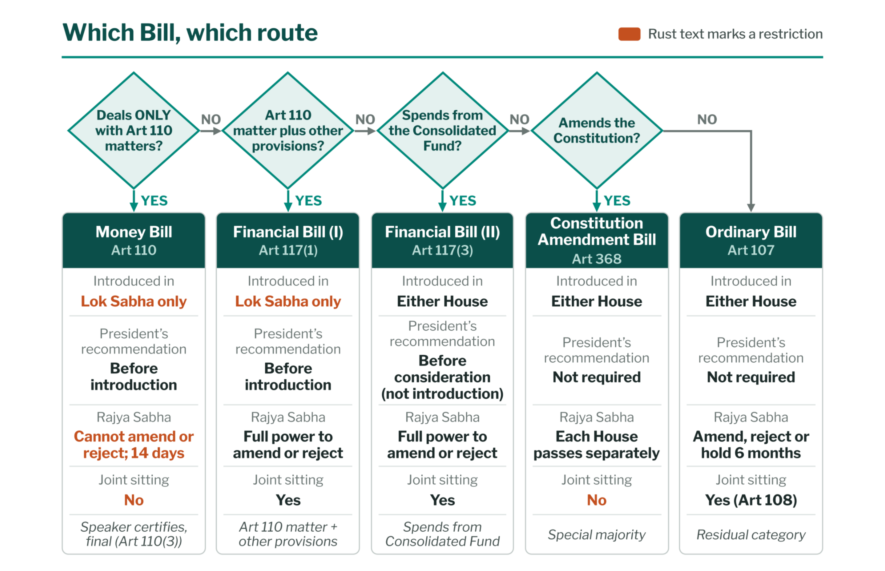

# Parliament & State Legislatures: Composition, Presiding Officers, Bills, Budget, Motions & Committees — Prelims Notes (X-Factor Pre'27)

---

### [Prelims Source Page 79](../pages/prelims/prelims_page_079.pdf)

## CHAPTER 11: PARLIAMENT VS STATE LEGISLATURE

### THEME ANALYSIS PYQ pattern for this chapter

#### 1. REPEATS

#### A. Presiding Officers

- The Speaker resigns to the Deputy Speaker and goes by a majority of all the then members [2012, 2025]

- On dissolution the Speaker stays till the new House meets, unlike a State Assembly Speaker [2018, 2025]

- Under Art 96 a Speaker facing removal may speak and vote, yet shall not preside [2024]

- The Deputy Speaker is elected on a date the Speaker fixes, bound by no convention [2022]

- The Rajya Sabha Chairman comes from outside the House, the Council Chairman from within [2013]

#### B. Composition and Membership

- A Legislative Council is capped at one third of the Assembly and floored at 40 [2015]

- Qualifications under Art 84 and Art 173, disqualification under Art 103 and Art 192

- Office of profit, the Leader of the Opposition, and Union Territory representation

#### C. Lok Sabha versus Rajya Sabha

- Only the Lok Sabha carries a no confidence motion; Emergency approval and impeachment are shared [2022]

- The Rajya Sabha acts alone under Art 249 and Art 312 [2012]

- Ministers answer collectively to the Lok Sabha under Art 75(3) [2022]

#### D. Privileges and Anti Defection

- Art 105 and Art 194 privileges stay uncodified, the bribery immunity now withdrawn

- Tenth Schedule grounds and exceptions, decided by the presiding officer

- Also tested: prorogation and dissolution [2024], sessions [2020], the Governor's address and State Assembly rules [2019], the Office of Profit Act [2019], treaty law under Art 253 [2013], UTs in the Rajya Sabha [2012], the Art 249 resolution [2016]

#### 2. HOW THE FORMAT HAS CHANGED

- 2012 to 2016: single answer and two statement sets on Rajya Sabha powers and Councils [2012, 2013, 2015, 2016]

- 2018 to 2022: code sets on presiding officers, sessions and exclusive powers [2018, 2019, 2020, 2022]

- 2024 to 2025: three statement sets on the Speaker and on prorogation [2024, 2025]

#### 3. WHAT IS BEING ASKED NOW

- Presiding officers in edge cases: the Speaker during a removal resolution [2024] and after dissolution [2025]

- Prorogation and dissolution, and on whose advice [2024]

- Exclusive powers of the Lok Sabha [2022]

### PRELIMS PREVIOUS YEAR QUESTIONS

#### Q1 (2025)

**Consider the following statements:**

- **I.** On the dissolution of the House of the People, the Speaker shall not vacate his/her office until immediately before the first meeting of the House of the People after the dissolution.
- **II.** According to the provisions of the Constitution of India, a Member of the House of the People on being elected as Speaker shall resign from his/her political party immediately.
- **III.** The Speaker of the House of the People may be removed from his/her office by a resolution of the House of the People passed by a majority of all the (then) Members of the House, provided that no resolution shall be moved unless at least fourteen days’ notice has been given of the intention to move the resolution.

*Which of the statements given above are correct?*

- **(a)** I and II only
- **(b)** II and III only
- **(c)** I and III only
- **(d)** I, II and III

> **Answer:** `(c)` · [Prelims Source Page 79](../pages/prelims/prelims_page_079.pdf)

---

### [Prelims Source Page 80](../pages/prelims/prelims_page_080.pdf)

#### Q2 (2024)

**With reference to the Speaker of the Lok Sabha, consider the following statements: While any resolution for the removal of the Speaker of the Lok Sabha is under consideration:**

- **1.** He/She shall not preside.
- **2.** He/She shall not have the right to speak.
- **3.** He/She shall not be entitled to vote on the resolution in the first instance.

*Which of the statements given above is/are correct?*

- **(a)** 1 only
- **(b)** 1 and 2 only
- **(c)** 2 and 3 only
- **(d)** 1,2 and 3

> **Answer:** `(a)` · [Prelims Source Page 80](../pages/prelims/prelims_page_080.pdf)

#### Q3 (2024)

**With reference to the Parliament of India, consider the following statements:**

- **1.** Prorogation of a House by the President of India does not require the advice of the Council of Ministers.
- **2.** Prorogation of a House is generally done after the House is adjourned sine die, but there is no bar to the President of India proroguing the House which is in session.
- **3.** Dissolution of the Lok Sabha is done by the President of India who, save in exceptional circumstances, does so on the advice of the Council of Ministers.

*Which of the statements given above is/are correct?*

- **(a)** 1 only
- **(b)** 1 and 2
- **(c)** 2 and 3
- **(d)** 3 only

> **Answer:** `(c)` · [Prelims Source Page 80](../pages/prelims/prelims_page_080.pdf)

#### Q4 (2022)

**With reference to Deputy Speaker of Lok Sabha, consider the following statements :**

- **1.** As per the Rules of Procedure and Conduct of Business in Lok Sabha, the election of Deputy Speaker shall be held on such date as the Speaker may fix.
- **2.** There is a mandatory provision that the election of a candidate as Deputy Speaker of Lok Sabha shall be from either the principal opposition party or the ruling party.
- **3.** The Deputy Speaker has the same power as of the Speaker when presiding over the sitting of the House and no appeal lies against his rulings.
- **4.** The well established parliamentary practice regarding the appointment of Deputy Speaker is that the motion is moved by the Speaker and duly seconded by the Prime Minister.

*Which of the statements given above are correct ?*

- **(a)** 1 and 3 only
- **(b)** 1, 2 and 3
- **(c)** 3 and 4 only
- **(d)** 2 and 4 only

> **Answer:** `(a)` · [Prelims Source Page 80](../pages/prelims/prelims_page_080.pdf)

#### Q5 (2022)

**Which of the following is/are the exclusive power(s) of Lok Sabha ?**

- **1.** To ratify the declaration of Emergency
- **2.** To pass a motion of no-confidence against the Council of Ministers
- **3.** To impeach the President of India Select the correct answer using the code given below :

- **(a)** 1 and 2
- **(b)** 2 only
- **(c)** 1 and 3
- **(d)** 3 only

> **Answer:** `(b)` · [Prelims Source Page 80](../pages/prelims/prelims_page_080.pdf)

#### Q6 (2020)

**Consider the following statements:**

- **1.** The President of India can summon a session of the Parliament at such place as he/she thinks fit.
- **2.** The Constitution of India provides for three sessions of the Parliament in a year, but it is not mandatory to conduct all three sessions.
- **3.** There is no minimum number of days that the Parliament is required to meet in a year.

*Which of the statements given above is/are correct?*

- **(a)** 1 only
- **(b)** 2 only
- **(c)** 1 and 3 only
- **(d)** 2 and 3 only

> **Answer:** `(c)` · [Prelims Source Page 80](../pages/prelims/prelims_page_080.pdf)

---

### [Prelims Source Page 81](../pages/prelims/prelims_page_081.pdf)

#### Q7 (2019)

**With reference to the Legislative Assembly of a State in India, consider the following statements:**

- **1.** The Governor makes a customary address to Members of the House at the commencement of the first session of the year.
- **2.** When a State Legislature does not have a rule on a particular matter, it follows the Lok Sabha rule on that matter.

*Which of the statements given above is/are correct?*

- **(a)** 1 only
- **(b)** 2 only
- **(c)** Both 1 and 2
- **(d)** Neither 1 nor 2

> **Answer:** `(c)` · [Prelims Source Page 81](../pages/prelims/prelims_page_081.pdf)

#### Q8 (2019)

**Consider the following statements:**

- **1.** The Parliament (Prevention of Disqualification) Act, 1959 exempts several posts from disqualification on the grounds of 'Office of Profit'.
- **2.** The above-mentioned Act was amended five times.
- **3.** The term 'Office of Profit' is well defined in the Constitution of India.

*Which of the statements given above is/are correct?*

- **(a)** 1 and 2 only
- **(b)** 3 only
- **(c)** 2 and 3 only
- **(d)** 1, 2 and 3

> **Answer:** `(a)` · [Prelims Source Page 81](../pages/prelims/prelims_page_081.pdf)

#### Q9 (2018)

**Consider the following statements:**

- **1.** The Speaker of the Legislative Assembly shall vacate his/her office if he/she ceases to be a member of the Assembly.
- **2.** Whenever the Legislative Assembly is dissolved, the Speaker shall vacate his/her office immediately.

*Which of the statements given above is/are correct?*

- **(a)** 1 only
- **(b)** 2 only
- **(c)** Both 1 and 2
- **(d)** Neither 1 nor 2

> **Answer:** `(a)` · [Prelims Source Page 81](../pages/prelims/prelims_page_081.pdf)

#### Q10 (2016)

**The Parliament of India acquires the power to legislate on any item in the State List in the national interest if a resolution to that effect is passed by the**

- **(a)** Lok Sabha by a simple majority of its total membership
- **(b)** Lok Sabha by a majority of not less than two-thirds of its total membership
- **(c)** Rajya Sabha by a simple majority of its total membership
- **(d)** Rajya Sabha by a majority of not less than two-thirds of its members present and voting

> **Answer:** `(d)` · [Prelims Source Page 81](../pages/prelims/prelims_page_081.pdf)

#### Q11 (2015)

**Consider the following statements : (1) The Legislative Council of a State in India can be larger in size than half of the Legislative Assembly of that particular State. (2) The Governor of a State nominates the Chairman of the Legislative Council of that particular State. Which of the statements given above is/are correct?**

- **(a)** 1 only
- **(b)** 2 only
- **(c)** Both 1 and 2
- **(d)** Neither 1 nor 2

> **Answer:** `(d)` · [Prelims Source Page 81](../pages/prelims/prelims_page_081.pdf)

#### Q12 (2013)

**With reference to Parliament, consider the following statements;**

- **1.** The Chairman and the Deputy Chairman of the Rajya Sabha are not the members of that House.
- **2.** While the nominated members of the two Houses of the Parliament have no voting right in the presidential election, they have the right to vote in the election of the Vice President.

*Which of the statements given above is/are correct?*

- **(a)** 1 only
- **(b)** 2 only
- **(c)** Both 1 and 2
- **(d)** Neither 1 nor 2

> **Answer:** `(b)` · [Prelims Source Page 81](../pages/prelims/prelims_page_081.pdf)

#### Q13 (2013)

**The Parliament can make any law for whole or any part of India for implementing international treaties**

- **(a)** with the consent of all the States
- **(b)** with the consent of the majority of States
- **(c)** with the consent of the States concerned
- **(d)** without the consent of any State

> **Answer:** `(d)` · [Prelims Source Page 81](../pages/prelims/prelims_page_081.pdf)

---

### [Prelims Source Page 82](../pages/prelims/prelims_page_082.pdf)

#### Q14 (2012)

**Regarding the Office of the Lok Sabha Speaker, consider the following statements:**

- **1.** He/She holds the office during the pleasure of the President.
- **2.** He/She need not be a member of the House at the time of his/her election but has to become a member of the House within six months from the date of his/her election.
- **3.** If he/she intends to resign, the letter of his/her resignation has to be addressed to the Deputy Speaker.

*Which of the statements given above is/are correct?*

- **(a)** 1 and 2 only
- **(b)** 3 only
- **(c)** 1, 2 and 3
- **(d)** None

> **Answer:** `(b)` · [Prelims Source Page 82](../pages/prelims/prelims_page_082.pdf)

#### Q15 (2012)

**Which of the following special powers have been conferred on the Rajya Sabha by the Constitution of India?**

- **(a)** To change the existing territory of a State and to change the name of a State.
- **(b)** To pass a resolution empowering the Parliament to make laws in the State List and to create one or more All India Services.
- **(c)** To amend the election procedure of the President and to determine the pension of the President after his/her retirement.
- **(d)** To determine the functions of the Election Commission and to determine the number of Election Commissioners.

> **Answer:** `(b)` · [Prelims Source Page 82](../pages/prelims/prelims_page_082.pdf)

#### Q16 (2012)

**Consider the following statements:**

- **1.** Union Territories are not represented in the Rajya Sabha.
- **2.** It is within the purview of the Chief Election Commissioner to adjudicate election disputes.
- **3.** According to the Constitution of India, the Parliament consists of the Lok Sabha and the Rajya Sabha only.

*Which of the statements given above is/are correct?*

- **(a)** 1 only
- **(b)** 2 and 3
- **(c)** 1 and 3
- **(d)** None

> **Answer:** `(d)` · [Prelims Source Page 82](../pages/prelims/prelims_page_082.pdf)

---

### [Prelims Source Page 83](../pages/prelims/prelims_page_083.pdf)

| ATTRIBUTE | Lok Sabha | State Legislative Assembly | Rajya Sabha | State Legislative Council |
| --- | --- | --- | --- | --- |
| Constitutional basis | Article 79 to 122 | Article 168 to 212 | Same as LS | Same as SLA |
| Organisation | Parliament = President + Rajya Sabha + Lok Sabha | **1.** State Legislature = Governor + SLA, and an SLC where one exists. **2.** No uniformity; most States are unicameral | Part of Parliament | Optional House, created or abolished under Art 169 |
| Composition [PRELIMS 2015] | **1.** Max 550 (Art 81): 530 States + 20 UTs. **2.** Anglo Indian nomination (Art 331) ceased 25 Jan 2020 under the 104th Amendment, 2019, so the old ceiling of 552 is now 550. **3.** Present strength 543 | Max 500, min 60 (Art 170) | **1.** Max 250 (Art 80): 238 representatives of States and UTs + 12 nominated by the President. **2.** Present strength 245 (233 + 12) | Max one third of the Assembly strength, min 40 (Art 171) |
| Election | Territorial constituencies, direct election, first past the post | Same as LS | **1.** Proportional representation by single transferable vote, by the elected members of the SLA (Art 80(4)). **2.** 12 nominated by the President for art, literature, science and social service. | - 1/3 elected by local bodies (municipalities, district boards etc.) -1/12 elected by graduates of 3 years’ standing residing in the state -1/12 elected by teachers with 3 years’ experience in institutions not below secondary level -1/3 elected by MLAs from among non-MLAs Remainder (~1/6) nominated by the Governor Method: Local body, graduate and teacher members chosen from territorial constituencies; all elections by proportional representation through single transferable vote.. |
| Duration | **1.** 5 years from its first meeting, then automatic dissolution. **2.** The President may dissolve it at any time. | Same scheme, the Governor dissolving, with the proviso to Art 172(1) | **1.** Permanent chamber, not subject to dissolution. | Same as the Rajya Sabha |

---

### [Prelims Source Page 84](../pages/prelims/prelims_page_084.pdf)

| ATTRIBUTE | Lok Sabha | State Legislative Assembly | Rajya Sabha | State Legislative Council |
| --- | --- | --- | --- | --- |
| **Duration** *(Contd.)* | **3.** Extendable during a National Emergency by law of Parliament, one year at a time, but not beyond 6 months after the Proclamation ceases (proviso to Art 83(2)) | — | **2.** One third retire every second year; 3. retiring members are eligible for re-election. **4.** The Constitution fixes no term; **5.** RPA, 1951 sets it at 6 years | — |
| Presiding officer [PRELIMS 2013] | **1.** Speaker: ex officio Chairman of the Indian Parliamentary Group and of the Conference of Presiding Officers; 2. presides at a joint sitting; 3. his decision on a Money Bill is final; 4. decides disqualification under the Tenth Schedule | **1.** The Speaker of the SLA has no joint sitting or IPG role. **2.** Certifies Money Bills in the SLA and decides Tenth Schedule disqualification | **1.** The Vice President is ex officio Chairman and is not a member of the House. **2.** He can be removed as Chairman only by being removed as Vice President | The Chairman is elected by the Council from among its own members |
| Presiding officer: qualification, vacation, resignation, removal [PRELIMS 2025,2018,2012] | **1.** Art 93: chosen from among the members, so there is no six month grace period of the kind Art 75(5) gives a Minister, and the Speaker does not hold office during the pleasure of the President. **2.** Art 94: vacates on ceasing to be a member; 3. resigns in writing to the Deputy Speaker; 4. removed by a resolution passed by a majority of all the then members after 14 days notice. **5.** Proviso: on dissolution the Speaker does not vacate office, but continues until immediately before the first meeting of the new House. **6.** No constitutional requirement to resign from his political party | **1.** Arts 178 to 181 reproduce the scheme. **2.** The proviso to Art 179 mirrors Art 94 on dissolution | **1.** The Chairman vacates only on ceasing to be Vice President. **2.** The Deputy Chairman resigns in writing to the Chairman. | Chairman and Deputy Chairman on the same terms as the Assembly |
| Presiding officer while a removal resolution is pending | **1.** Art 96: He shall not preside, but retains the right to speak, to take part in the proceedings and to vote in the first instance. **2.** He loses only the casting vote under Art 100(1) | Art 181, identical, and extends to the Chairman and Deputy Chairman of a Council | Same rule for the Chairman of the Rajya Sabha | Same rule |

---

### [Prelims Source Page 85](../pages/prelims/prelims_page_085.pdf)

| ATTRIBUTE | Lok Sabha | State Legislative Assembly | Rajya Sabha | State Legislative Council |
| --- | --- | --- | --- | --- |
| [PRELIMS 2024] | — | — | — | — |
| Deputy presiding officer [PRELIMS 2022] | **1.** Art 93 requires one but prescribes no time limit, which is how the office stays vacant through the whole 17th Lok Sabha, 2019 to 2024. **2.** Elected on a date the Speaker fixes (Rule 8). **3.** There is no mandatory rule that he comes from the Opposition or from the ruling party. **4.** When presiding he has the same powers as the Speaker and no appeal lies against his rulings. **5.** By practice he chairs any committee he is appointed to. **6.** Resigns in writing to the Speaker | Arts 178 and 180(1), same scheme | The Deputy Chairman is a member of the House, elected by it | Deputy Chairman elected by the Council |
| Qualifications | Citizen of India, oath before a person authorised by the Election Commission, and not less than 25 years of age (Art 84) | Not less than 25 years (Art 173) | **1.** Not less than 30 years (Art 84(b)). **2.** The requirement to be an elector of the State represented was removed in 2003 and upheld, with the open ballot, in Kuldip Nayar, 2006 | Not less than 30 years (Art 173(b)) |
| Vacation of seat and who decides a disqualification | **1.** Art 101: no person may sit in both Houses, or in Parliament and a State Legislature, at once; 2. a seat falls vacant on 60 days absence without leave. **3.** Art 103: the question is referred to the President, who acts according to the opinion of the Election Commission, not on ministerial advice. **4.** Tenth Schedule cases fall outside Art 103 | Arts 190 and 192: decided by the Governor on the opinion of the Election Commission | Same as the Lok Sabha | Same as the Assembly |
| Quorum, voting and the casting vote | **1.** Art 100(3): quorum is one tenth, so 55. **2.** Art 100(1): questions determined by a majority of members present and voting; | Art 189: quorum is ten members or one tenth, whichever is greater, so a | Quorum 25. The Chairman likewise has only a casting vote | Quorum ten or one tenth, whichever is greater |

---

### [Prelims Source Page 86](../pages/prelims/prelims_page_086.pdf)

| ATTRIBUTE | Lok Sabha | State Legislative Assembly | Rajya Sabha | State Legislative Council |
| --- | --- | --- | --- | --- |
| **Quorum, voting and the casting vote** *(Contd.)* | 3. the presiding officer has no vote in the first instance and only a casting vote on a tie. **4.** Art 100(2): the House may act notwithstanding vacancies | small Assembly has a floor of ten | — | — |
| Accountability of ministers [PRELIMS 2022] | **1.** Ministers, including the Prime Minister, may belong to either House but are responsible only to the Lok Sabha (Art 75(3)). **2.** Only the Lok Sabha can carry a no confidence motion | Same at State level under Art 164(2), responsible only to the SLA | Not responsible to the Rajya Sabha, which cannot remove the government | Not responsible to the Legislative Council |
| Special powers of the Rajya Sabha [PRELIMS 2012] | None of this kind | None | **1.** Art 249: by a resolution supported by two thirds of the members present and voting, it can authorise Parliament to legislate on a State List entry in the national interest. **2.** Art 312: by the same majority it can authorise creation of a new All India Service | None |
| Parliamentary privileges: source and why they remain uncodified | Article 105 deals with the powers, privileges and immunities of the Houses of Parliament, their members and committees, so that MPs can speak and vote freely without fear of legal action and Parliament can function independently. **1.** 105(1) Freedom of speech: A separate privilege, not under Art 19(1)(a), so Art 19(2) restrictions don’t apply. **2.** 105(2) Legal immunity: No court case for anything said or any vote cast in Parliament, or for reports published under its authority. **3.** 105(3) Other privileges: To be defined by Parliament through law. | **1.** Article 194 reproduces Art 105 word for word, with Art 194(3) traced to Section 26 of the 44th Amendment, 1978. **2.** No State has codified either. **3.** Art 194(4) covers the Advocate General and non member Ministers. | **1.** Identical. Art 105 speaks of each House, so the Rajya Sabha and its members enjoy exactly the same privileges. **2.** There is no financial chamber asymmetry here. | Identical under Art 194 |

---

### [Prelims Source Page 87](../pages/prelims/prelims_page_087.pdf)

| ATTRIBUTE | Lok Sabha | State Legislative Assembly | Rajya Sabha | State Legislative Council |
| --- | --- | --- | --- | --- |
| **Parliamentary privileges: source and why they remain uncodif** *(Contd.)* | - 44th Amendment (1978): Removed the reference to the British House of Commons, keeping existing privileges unchanged. - Not comprehensively codified: No single law defines all privileges; they are drawn from the Constitution, specific statutes (Eg. Section 135A, CPC), Rules of Procedure, conventions and court rulings. **4.** 105(4) Extension: Covers non-members entitled to speak in the House, like Ministers and the Attorney General; not the President. | — | — | — |
| Individual privileges and the bribery exception | **1.** Freedom of speech in the House; **2.** Immunity from proceedings for anything said or any vote given; **3.** Freedom from arrest in civil cases only, during the session and 40 days before and after, resting on Section 135, CPC 1908; and exemption from compulsory attendance as a witness while the House sits. **4.** No immunity in criminal cases or preventive detention. **5.** The often repeated exemption from jury service is a dead letter, jury trials having been abolished. **6.** Sita Soren, 4 March 2024: A seven judge Bench unanimously overruled P.V. Narasimha Rao, 1998, holding that Arts 105(2) and 194(2) do not protect a legislator prosecuted for taking a bribe to vote or speak. | **1.** Same under Art 194(2). **2.** Sita Soren arose from an MLA voting in a Rajya Sabha election, so it governs MLAs and MLCs directly. **3.** State of Kerala v. K. Ajith, 2021: privilege is not a mantle of impunity | **1.** Same as the Lok Sabha. **2.** Nominated members enjoy identical privileges | Same as the Assembly |
| Collective privileges; breach of privilege against contempt of the House | A. Collective Privileges Publication: Right to publish its proceedings and prohibit others from doing so; though Art 361A protects substantially true media reports made without malice. Secret sittings: Can exclude strangers and sit in secret. | **1.** Same under Art 194(3), with Art 212 as the counterpart of Art 122. **2.** Art 212 protects irregularity of | Same. The Committee of Privileges of the Rajya Sabha has 10 members, nominated by the Chairman, whose consent is required. | Same, exercised by the Chairman of the Council. |

---

### [Prelims Source Page 88](../pages/prelims/prelims_page_088.pdf)

| ATTRIBUTE | Lok Sabha | State Legislative Assembly | Rajya Sabha | State Legislative Council |
| --- | --- | --- | --- | --- |
| **Collective privileges; breach of privilege against contempt ** *(Contd.)* | Own procedure: Regulates its own procedure (Art 118) and is its sole judge. Arrest information: Must be informed of a member’s arrest, detention, conviction and release; no arrest within precincts without the Presiding Officer’s permission. Inquiry and punishment: Can summon persons, papers and records, and punish by admonition, reprimand or imprisonment; members may also be suspended or expelled. Limit: Imprisonment by the House ends with prorogation. B. Breach of Privilege vs Contempt Breach of privilege: Violation of a specific, recognised privilege. Contempt: Wider; any act that obstructs the House or lowers its dignity, even without breaching a specific privilege. Relationship: Every breach is a contempt, but not every contempt is a breach. C. Procedure: Requires Speaker’s consent; only one question per sitting; must be specific and recent; examined by the Committee of Privileges (15 members in Lok Sabha, 10 in Rajya Sabha). D. Judicial Review: Art 122: Courts cannot question proceedings for mere procedural irregularity; but Raja Ram Pal (2007) held they can review gross illegality or unconstitutionality. | procedure only, not illegality. | — | — |
| Anti defection: Tenth Schedule grounds | **1.** Origin: Added by the 52nd Amendment, 1985, which also amended Arts 101, 102, 190 and 191. **2.** Grounds for Disqualification (Para 2): | **1.** Applies identically. **2.** Most reported litigation arises here, Karnataka 2019, Manipur, Maharashtra 2023 | **1.** Applies identically. **2.** The 12 nominated members get the six month window | Applies identically, including the one sixth nominated by the Governor |

---

### [Prelims Source Page 89](../pages/prelims/prelims_page_089.pdf)

| ATTRIBUTE | Lok Sabha | State Legislative Assembly | Rajya Sabha | State Legislative Council |
| --- | --- | --- | --- | --- |
| **Anti defection: Tenth Schedule grounds** *(Contd.)* | &bull; **(a)** Voluntarily giving up membership: Wider than resignation; can be inferred from conduct (Ravi S. Naik, 1994). &bull; **(b)** Defying the whip: Voting or abstaining against party direction without prior permission, unless condoned within 15 days; applies to votes vital to the party’s policy, like confidence motions (Kihoto Hollohan, 1992). &bull; **(c)** Independent member joining a party after election. &bull; **(d)** Nominated member joining a party after six months of taking a seat. **3.** Expelled members (G. Viswanathan, 1996): An expelled member still belongs to the party for Tenth Schedule purposes; joining another party leads to disqualification. | — | — | — |
| Anti defection: exceptions and the deciding authority | **4.** Merger (Para 4): No disqualification if the original party merges with another and at least two-thirds of its legislators agree; both those who join the merger and those who stay out are protected. **5.** Presiding Officers (Para 5): A member elected Speaker or Deputy Speaker may leave the party and rejoin after demitting office without disqualification; an option, not an obligation. **6.** Deciding Authority (Para 6): &bull; Decided by the Speaker/Chairman, whose decision is final; if the case concerns the presiding officer, by a member elected by the House. &bull; Never by the President or Council of Ministers. | **1.** Same, the Speaker of the Assembly deciding. **2.** Para 5 covers the Speaker and Deputy Speaker of the Assembly | Same, the Chairman deciding. Since the Chairman is the Vice President and not a member, Para 5 exempts only the Deputy Chairman | **1.** Same, the Chairman of the Council deciding. **2.** Para 5 covers both the Chairman and the Deputy Chairman |

---

### [Prelims Source Page 90](../pages/prelims/prelims_page_090.pdf)

| ATTRIBUTE | Lok Sabha | State Legislative Assembly | Rajya Sabha | State Legislative Council |
| --- | --- | --- | --- | --- |
| **Anti defection: exceptions and the deciding authority** *(Contd.)* | &bull; Kihoto Hollohan (1992): Speaker acts as a tribunal; decision open to judicial review. **7.** Split Provision (Para 3): The one-third split exemption was deleted by the 91st Amendment, 2003. | — | — | — |
| Kihoto Hollohan, 1992 and judicial review of the Speaker decision | **1.** Bench: Decided on 18 February 1992 by a five-judge Constitution Bench, 3:2 majority. **2.** Validity: The Tenth Schedule was upheld as constitutional. **3.** Para 7 struck down: It barred all courts from reviewing disqualification, effectively altering Arts 136, 226 and 227; since it lacked ratification by half the States under the proviso to Art 368(2), it was held invalid. **4.** Severability: The majority severed Para 7 and saved the rest of the Schedule. **5.** Speaker as Tribunal: While deciding under Para 6, the Speaker acts as a tribunal, so judicial review applies, but only on grounds of violation of constitutional mandate, mala fides, breach of natural justice and perversity. **6.** Timing: No judicial review before the Speaker’s decision. **7.** Whip: Disqualification under Para 2(1)(b) limited to votes vital to the party’s policy, like confidence motions | **1.** Applies identically. **2.** Subhash Desai, May 2023: the Speaker must go by the whip of the political party, not of the legislature party, and neither Governor nor Speaker may recognise a rival faction as the party | Applies to a decision of the Chairman of the Rajya Sabha | Applies to a decision of the Chairman of a Council |
| 91st Amendment, 2003: ministry size and the bar on defectors | **1.** Under Art 75(1A), the Council of Ministers, including the PM, cannot exceed 15% of Lok Sabha strength. A member disqualified for defection cannot become a Minister till his term ends or he is re-elected (Art 75(1B)), and is barred from any remunerative political post for the same period (Art 361B). | **1.** Does not count in the 15% computation, though Ministers may be drawn from it. The same ministerial bar (Art 75(1B)) and bar on remunerative political posts (Art 361B) apply to defecting members. | Under Art 164(1A), ministry size cannot exceed 15% of Assembly strength, but not less than 12, so in small Assemblies the floor of 12 applies. Defectors face the ministerial bar (Art 164(1B)) and Art 361B. | Does not count in the 15% computation, though MLCs can be Ministers. Defecting members face the same ministerial bar (Art 164(1B)) and Art 361B. |

---

### [Prelims Source Page 91](../pages/prelims/prelims_page_091.pdf)

### DETAILED NOTES

Types of Majority in Parliament

- **1.** Simple (functional/working) majority - more than half of the members present and voting. – This is the default rule under Art 100(1) and is used for ordinary bills, money bills, confidence and no-confidence motions, censure and adjournment motions, and approval of proclamations under Arts 356 and 360.

- **2.** Absolute majority - more than half of the total membership of the House (e.g. 272 of 543 in the Lok Sabha). In Lok Sabha (545 seats), 273 seats are required for absolute majority. – It is not by itself prescribed for any parliamentary decision; it matters chiefly in government formation after a general election.

- **3.** Effective majority - more than half of the effective strength, i.e. total membership minus vacancies ('all the then members'). – Used to remove the Deputy Chairman and Chairman of the Rajya Sabha (Arts 90(c), 67(b)) and the Speaker and Deputy Speaker of the Lok Sabha (Arts 94(c), 96).

- **4.** Special majority - 4 different forms: (i) Special majority 1: majority of total membership of each House + not less than two thirds of members present and voting – Constitutional Amendment (Art 368(2)) – Removal of Supreme Court and High Court judges (Art 124(4), Art 217(1)(b)) – Removal of CEC (Art 324(5)) and CAG (Art 148(1)), on the same grounds and in the same manner as a Supreme Court judge – Approval of a National Emergency (Art 352(6)) (ii) Special majority 2: not less than two thirds of the total membership of each House Impeachment of the President (Art 61) (iii) Special majority 3: not less than two thirds of members present and voting in the Rajya Sabha – Parliament legislating on a State List subject in the national interest (Art 249) – Creating a new All India Service (Art 312) – Note: These are the two exclusive powers of the Rajya Sabha. It alone holds them because it is the Council of States, so the States must first agree before the Union moves into their domain. (iv) Special majority + State ratification Federal provisions under the Art 368(2) need the special majority in (i) + at least half the States ratify by simple majority

---

### [Prelims Source Page 92](../pages/prelims/prelims_page_092.pdf)

## CHAPTER 12: BILLS

### THEME ANALYSIS PYQ pattern for this chapter

#### 1. REPEATS

#### A. Money Bill and Financial Bills

- Art 110 covers appropriation from the Consolidated Fund, so the Contingency Fund option is the trap [2018]

- Art 109 gives the Rajya Sabha fourteen days to recommend, never to amend or reject [2013, 2024]

- A Finance Bill that is not a Money Bill can be amended or rejected above [2023]

#### B. Joint Sitting and Deadlock

- Art 108 covers only an Ordinary Bill, never a Money or amendment Bill [2012, 2023]

- It passes by a simple majority of members present and voting [2015]

- Three have been held, on dowry prohibition, banking service and terrorism law

#### C. Introduction, Private Members and Assent

- A Private Member's Bill is moved by any member who is not a minister [2017]

- Prior recommendation of the President is needed for a Money Bill and Financial Bill (I)

- Absolute, suspensive and pocket veto, with no time limit in Art 111.

#### D. Lapsing on Dissolution

- Prorogation never kills a Bill, only dissolution does [2016]

- A Bill pending in the Lok Sabha, or passed by it and waiting above, lapses [2024]

- A Bill pending only in the Rajya Sabha, or carrying a notified joint sitting, survives [2016, 2024]

#### E. Constitutional Amendment Bills

- Art 368 needs a special majority in each House separately [2012]

- Here the Rajya Sabha is equal, unlike in finance [2020]

- Federal entries need ratification by half the States, and the Nari Shakti Vandan Adhiniyam is the live example

#### 2. HOW THE FORMAT HAS CHANGED

- 2012 to 2015: single answer stems on deadlock and joint sitting [2012, 2013, 2015]

- 2016 to 2018: two statement sets on lapsing and Private Members' Bills [2016, 2017]

- 2023 to 2024: "how many" and four statement sets [2023, 2024]

#### 3. WHAT IS BEING ASKED NOW

- Money Bill versus Finance Bill, Art 109 and Art 110 [2023, 2024]

- Lapse on dissolution, including a Bill in a notified joint sitting [2024]

---

### [Prelims Source Page 93](../pages/prelims/prelims_page_093.pdf)

### PRELIMS PREVIOUS YEAR QUESTIONS

#### Q1 (2024)

**Which of the following statements are correct in respect of a Money Bill in the Parliament?**

- **1.** Article 109 mentions special procedure in respect of Money Bills.
- **2.** A Money Bill shall not be introduced in the Council of States.
- **3.** The Rajya Sabha can either approve the Bill or suggest changes but cannot reject it.
- **4.** Amendments to a Money Bill suggested by the Rajya Sabha have to be accepted by the Lok Sabha.

*SELECT THE ANSWER USING THE CODE GIVEN BELOW:*

- **(a)** 1 and 2 only
- **(b)** 2 and 3 only
- **(c)** 1,2 and 3
- **(d)** 1,3 and 4

> **Answer:** `(c)` · [Prelims Source Page 93](../pages/prelims/prelims_page_093.pdf)

#### Q2 (2024)

**With reference to the Indian Parliament, consider the following statements:**

- **1.** A Bill pending in the Lok Sabha lapses on its dissolution.
- **2.** A Bill passed by the Lok Sabha and pending in the Rajya Sabha lapses on the dissolution of the Lok Sabha.
- **3.** A Bill in regard to which the President of India notified his/her intention to summon the Houses to a joint sitting lapses on the dissolution of the Lok Sabha.

*Which of the statements given above is/are correct?*

- **(a)** 1 only
- **(b)** 1 and 2
- **(c)** 2 and 3
- **(d)** 3 only

> **Answer:** `(b)` · [Prelims Source Page 93](../pages/prelims/prelims_page_093.pdf)

#### Q3 (2023)

**With reference to Finance Bill and Money Bill in the Indian Parliament, consider the following statements :**

- **1.** When the Lok Sabha transmits Finance Bill to the Rajya Sabha, it can amend or reject the Bill.
- **2.** When the Lok Sabha transmits Money Bill to the Rajya Sabha, it cannot amend or reject the Bill, it can only make recommendations.
- **3.** In the case of disagreement between the Lok Sabha and the Rajya Sabha, there is no joint sitting for Money Bill, but a joint sitting becomes necessary for Finance Bill.

*How many of the above statements are correct?*

- **(a)** Only one
- **(b)** Only two
- **(c)** All three
- **(d)** None

> **Answer:** `(b)` · [Prelims Source Page 93](../pages/prelims/prelims_page_093.pdf)

#### Q4 (2020)

**Rajya Sabha has equal powers with Lok Sabha in**

- **(a)** the matter of creating new All India Services
- **(b)** amending the Constitution
- **(c)** the removal of the government
- **(d)** making cut motions

> **Answer:** `(b)` · [Prelims Source Page 93](../pages/prelims/prelims_page_093.pdf)

#### Q5 (2018)

**Regarding Money Bill, which of the following statements is not correct?**

- **(a)** A Bill shall be deemed to be a Money Bill if it contains only provisions relating to imposition, abolition, remission, alteration or regulation of any tax.
- **(b)** A Money Bill has provisions for the custody of the Consolidated Fund of India or the Contingency Fund of India
- **(c)** A Money Bill is concerned with the appropriation of money out of the Contingency Fund of India
- **(d)** A Money Bill deals with the regulation of borrowing of money or giving of any guarantee by the Government of India.

> **Answer:** `(c)` · [Prelims Source Page 93](../pages/prelims/prelims_page_093.pdf)

---

### [Prelims Source Page 94](../pages/prelims/prelims_page_094.pdf)

#### Q6 (2017)

**With reference to the Parliament of India, consider the following statements:**

- **1.** A Private Member’s Bill is a Bill presented by a Member of Parliament who is not elected but only nominated by the President of India.
- **2.** Recently, a Private Member’s Bill has been passed in the Parliament of India for the first time in its history.

*Which of the statements given above is/are correct?*

- **(a)** 1 only
- **(b)** 2 only
- **(c)** Both 1 and 2
- **(d)** Neither 1 nor 2

> **Answer:** `(d)` · [Prelims Source Page 94](../pages/prelims/prelims_page_094.pdf)

#### Q7 (2016)

**Which of the following statements is/are correct?**

- **1.** A Bill pending in the Lok Sabha lapses on its prorogation.
- **2.** A Bill pending in the Rajya Sabha, which has not been passed by the Lok Sabha, shall not lapse on dissolution of the Lok Sabha.

*Select the correct answer using the code given below.*

- **(a)** 1 only
- **(b)** 2 only
- **(c)** Both 1 and 2
- **(d)** Neither 1 nor 2

> **Answer:** `(b)` · [Prelims Source Page 94](../pages/prelims/prelims_page_094.pdf)

#### Q8 (2015)

**When a bill is referred to a joint sitting of both the Houses of the Parliament, it has to be passed by**

- **(a)** a simple majority of members present and voting
- **(b)** three-fourths majority of members present and voting
- **(c)** two-thirds majority of the Houses
- **(d)** absolute majority of the Houses

> **Answer:** `(a)` · [Prelims Source Page 94](../pages/prelims/prelims_page_094.pdf)

#### Q9 (2013)

**What will follow if a Money Bill substantially amended by the Rajya Sabha?**

- **(a)** The Lok Sabha may still proceed with the Bill, accepting or not accepting the recommendations of the Rajya Sabha
- **(b)** The Lok Sabha cannot consider the Bill further
- **(c)** The Lok Sabha may send the Bill to the Rajya Sabha for reconsideration
- **(d)** The President may call a joint sitting for passing the Bill

> **Answer:** `(a)` · [Prelims Source Page 94](../pages/prelims/prelims_page_094.pdf)

#### Q10 (2012)

**A deadlock between the Lok Sabha and the Rajya Sabha calls for a joint sitting of the Parliament during the passage of**

- **1.** Ordinary Legislation
- **2.** Money Bill
- **3.** Constitutional Amendment Bill Select the correct answer using the codes given below.

- **(a)** 1 only
- **(b)** 2 and 3 only
- **(c)** 1 and 3 only
- **(d)** 1, 2 and 3

> **Answer:** `(a)` · [Prelims Source Page 94](../pages/prelims/prelims_page_094.pdf)

---

### [Prelims Source Page 95](../pages/prelims/prelims_page_095.pdf)

| ATTRIBUTE | ORDINARY BILL (OB) | MONEY BILL ART 110 | FINANCIAL BILL (I) | FINANCIAL BILL (II) | CONSTITUTIONAL AMENDMENT BILL |
| --- | --- | --- | --- | --- | --- |
| Article | Art 107 (procedure), 108 (joint sitting), 111 (assent) | Art 110 (definition), 109 (procedure), 111 (assent) | Art 117(1) read with Art 110 | Art 117(3). | Art 368 |
| Definition[PRELIMS 2018] | Deals with any matter other than financial or constitutional amendment subjects. Introduced in either House; passed by simple majority in both. | Deals “ONLY” with matters in Art 110(1)(a)-(g): taxation, borrowing, Consolidated and Contingency Funds, appropriation and audit. Speaker’s certification is final, but subject to judicial review (Rojer Mathew, 2019). | Contains Art 110 matters plus other provisions, so not a Money Bill. Treated like a Money Bill at introduction (only in Lok Sabha, with President’s recommendation); otherwise like an Ordinary Bill. | Involves expenditure from the Consolidated Fund but no Art 110 matter. Treated as an Ordinary Bill, except the President’s recommendation is needed for consideration, not introduction. | Seeks to add, vary or repeal any provision of the Constitution. Needs a special majority; federal provisions also need ratification by half the States. |
| Examples | Digital Personal Data Protection Bill, 2023, regulating the processing of personal data in India. | Aadhaar (Targeted Delivery of Financial and Other Subsidies, Benefits and Services) Bill, 2016, certified a Money Bill by the Speaker and upheld in Puttaswamy, 2018. | Goods and Services Tax (Compensation to States) Amendment Bill, 2017. | National Investigation Agency (Amendment) Bill, 2019. | Constitution (103rd Amendment) Act, 2019 |
| Introduced in | Either House | Lok Sabha only | Lok Sabha only | Either House: only incurs expenditure, imposes no tax, so restriction relaxed | Either House |
| Introduced by[PRELIMS 2017] | Private Member or Minister No fiscal consequence, so the right of private members survives. | Minister only **1.** Only the Council of Ministers is collectively responsible to the Lok Sabha under Art 75(3) for the way public money is raised and spent, so only the executive may commit the Consolidated Fund. | Minister only Same reason as a Money Bill: only the executive may commit the Consolidated Fund. | **1.** Minister only in practice. **2.** The constitutional bar operates at the consideration stage, not at introduction. | Private Member or Minister No fiscal consequence, so the right of private members survives. |

---

### [Prelims Source Page 96](../pages/prelims/prelims_page_096.pdf)

| ATTRIBUTE | ORDINARY BILL (OB) | MONEY BILL ART 110 | FINANCIAL BILL (I) | FINANCIAL BILL (II) | CONSTITUTIONAL AMENDMENT BILL |
| --- | --- | --- | --- | --- | --- |
| **Introduced by** *(Contd.)* | — | **2.** A private member has no such accountability and therefore cannot open a charge on public revenue. | — | — | — |
| Prior Recommendation of the President | No | Yes, before introduction: reflects executive initiative in finance (Parliament grants supply, does not demand it) and stops the legislature from unilaterally creating liabilities on the Consolidated Fund | Yes, before introduction: since it imposes a charge, it needs clearance before entering the House | No at introduction; Yes at consideration (Art 117(3)): it only incurs expenditure, so it can be introduced freely and needs clearance only when taken up for consideration | No |
| Voting : Lower House | A simple majority of members present and voting | Simple majority | Simple majority | Simple majority | 3 routes: (1) Special majority (2) Special majority + ratification by half the States for federal provisions; (3) Simple majority outside Art 368 for administrative matters (Eg. new States, citizenship, Second Schedule). |
| Voting: Upper House[PRELIMS 2024,2023,2020,20 13] | Full power to amend or reject; can detain up to 6 months, after which a deadlock arises (joint sitting possible). Buys time for reflection without a veto. State Bills: a Legislative Council can delay only up to 4 months (3 + 1), being a weaker, advisory chamber. | Cannot amend or reject; must return within 14 days with or without recommendations, which the Lok Sabha may accept or reject; if not returned, deemed passed. Being indirectly elected, it cannot obstruct the budget cycle; it is a revising and federal chamber, not a coequal in finance. | Same as Ordinary Bill: full power to amend or reject once introduced. | Same as Ordinary Bill: full power to amend or reject. | Must be passed separately by the required majority; no detention, no joint sitting. Rajya Sabha holds an absolute veto, since changing fundamental law needs the consent of the chamber representing the States. |

---

### [Prelims Source Page 97](../pages/prelims/prelims_page_097.pdf)

| ATTRIBUTE | ORDINARY BILL (OB) | MONEY BILL ART 110 | FINANCIAL BILL (I) | FINANCIAL BILL (II) | CONSTITUTIONAL AMENDMENT BILL |
| --- | --- | --- | --- | --- | --- |
| Voting: Joint Sitting[PRELIMS 2015,2012] | Permitted (Art 108) when the other House rejects the Bill, disagrees on amendments, or 6 months elapse. No new amendments, except those in dispute or made necessary by delay. Weighted towards the larger Lok Sabha (~543 vs ~245). Held only thrice (1961, 1978, 2002), showing it is a reserve power. State Bills: no such provision. | Does not arise, since the Rajya Sabha cannot reject it. | Permitted, since Art 108 excludes only Money Bills. | Permitted | Not allowed: deadlock is the intended outcome; if both Houses cannot separately muster a special majority, the amendment should fail, not be forced through by combined numbers. |
| Veto: Suspensive | Yes: President may return once for reconsideration; if passed again, with or without amendment, assent is obligatory. As a constitutional, not political, executive, the veto ensures reflection, not obstruction; the final word rests with Parliament. | No: President may only assent or withhold, never return; since it comes on his own prior recommendation, returning it would be self-contradictory and stall supply. | Yes | Yes | No: assent mandatory after the 24th Amendment, 1971, enacted after the Golaknath conflict, making the President a formal authenticating authority under Art 368. |
| Veto: Pocket | Yes: Art 111 sets no time limit for assent, unlike the 10-day rule in the US. Eg. Indian Post Office (Amendment) Bill, 1986 under President Zail Singh. Not a designed power but a drafting silence; rare, since the President acts on | No: the President has already recommended the Bill. | No in practice: carries the President’s own prior recommendation. | No in practice | No: Art 368(2) makes assent mandatory. |

---

### [Prelims Source Page 98](../pages/prelims/prelims_page_098.pdf)

| ATTRIBUTE | ORDINARY BILL (OB) | MONEY BILL ART 110 | FINANCIAL BILL (I) | FINANCIAL BILL (II) | CONSTITUTIONAL AMENDMENT BILL |
| --- | --- | --- | --- | --- | --- |
| **Veto: Pocket** *(Contd.)* | ministerial advice (Art 74(1)), arising only during executive transition or political rupture. | — | — | — | — |
| State ratification: provisions included (proviso to Art 368(2)) | — | — | — | — | — |
| State ratification: provisions excluded | Not applicable. | Not applicable. | Not applicable. | Not applicable. | State ratification under Art 368(2) applies only to Constitutional Amendment Bills and is not applicable to Ordinary, Money or Financial Bills; it requires special majority plus approval by half the States only for federal provisions (like the President’s election, Union-State powers, judiciary, Seventh Schedule and Art 368 itself), while Fundamental Rights (Part III), DPSP (Part IV) and the Preamble need special majority alone, the most tested point being that amending Fundamental Rights needs no State ratification, with the check coming instead from the Basic Structure doctrine; and matters like creating or abolishing a Legislative Council (Art 169) need only a simple majority, as they are expressly not amendments under Art 368. |

---

### [Prelims Source Page 99](../pages/prelims/prelims_page_099.pdf)

| ATTRIBUTE | ORDINARY BILL (OB) | MONEY BILL ART 110 | FINANCIAL BILL (I) | FINANCIAL BILL (II) | CONSTITUTIONAL AMENDMENT BILL |
| --- | --- | --- | --- | --- | --- |
| Miscellaneous facts | **1.** A Private Member is any member who is not a Minister; the definition turns on office, not on whether he was elected or nominated. **2.** One month's notice of introduction is required, unless the Speaker allows a shorter period. **3.** The last two and a half hours of a sitting on Friday are allotted to private members' business, Bills and Resolutions taking alternate Fridays. **4.** In the Lok Sabha the Committee on Private Members' Bills and Resolutions, chaired by the Deputy Speaker, classifies Bills by nature, urgency and importance and allots time; in the Rajya Sabha the Business Advisory Committee does this. **5.** Record: only 14 Private Members' Bills have ever been passed by Parliament and become law, six of them in 1956 alone. **6.** The last was the Supreme Court (Enlargement of Criminal | Cannot be a Private Member's Bill: it needs the President's prior recommendation and can be introduced only by a Minister. | Cannot be a Private Member's Bill, for the same reason. | May be introduced by a Private Member. | **1.** A Private Member may introduce a Constitutional Amendment Bill, and such Bills are examined by the Committee before introduction. **2.** There is no time limit for ratification by the States, and a State that has ratified cannot withdraw. **3.** Kihoto Hollohan, 1992: Paragraph 7 of the Tenth Schedule fell precisely because it affected Arts 136, 226 and 227 without having been ratified. |

---

### [Prelims Source Page 100](../pages/prelims/prelims_page_100.pdf)

| ATTRIBUTE | ORDINARY BILL (OB) | MONEY BILL ART 110 | FINANCIAL BILL (I) | FINANCIAL BILL (II) | CONSTITUTIONAL AMENDMENT BILL |
| --- | --- | --- | --- | --- | --- |
| **Miscellaneous facts** *(Contd.)* | Appellate Jurisdiction) Bill, 1968, passed on 9 August 1970. None has been passed since. **7.** The Rights of Transgender Persons Bill, 2014, passed by the Rajya Sabha alone in April 2015, was the first Private Member's Bill cleared by that House in 45 years, but was never passed by the Lok Sabha and so never became law. | — | — | — | — |

---

### [Prelims Source Page 101](../pages/prelims/prelims_page_101.pdf)

*Diagram Screenshot: [Which Bill, Which Route: Ordinary, Money, Financial & Constitutional Amendment Bills](../diagrams/pre_diag_bills_route_p101.png) · [Full Source Page 101](../pages/prelims/prelims_page_101.pdf)*

---

### [Prelims Source Page 102](../pages/prelims/prelims_page_102.pdf)

### STATUS OF THE BILL WHEN THE LOK SABHA IS DISSOLVED

| Situation | Ordinary | Money | Fin. (I) | Fin. (II) | Const. Amend. | Reason and Example |
| --- | --- | --- | --- | --- | --- | --- |
| **1.** Pending in Lok Sabha (introduced there, or passed by RS and sent to LS) | Lapses | Lapses | Lapses | Lapses | Lapses | Art 107(5): A new House with a fresh mandate isn't bound by old business; Eg. Women's Reservation Bill, 2008, passed by RS (2010), lapsed in LS (2014); GST Bill, 2011 lapsed and was reintroduced in 2014 |
| **2.** Passed by LS, pending in RS | Lapses | Lapses | Lapses | Lapses | Lapses | Art 107(5): the House that passed it no longer exists. Eg. Triple Talaq Bill, 2018 and Citizenship (Amendment) Bill, 2019 lapsed in 2019 |
| **3.** Introduced and pending in RS (not yet sent to LS) [Prelims 2016] | Does not lapse | Not applicable | Not applicable | Does not lapse | Does not lapse | Art 107(4), 83(1): RS is a permanent House. Money and Fin. (I) Bills start only in LS. Eg. Women's Reservation Bill, 2008 was tabled in RS to survive the 2009 dissolution. |
| **4.** Passed by both Houses, awaiting assent or returned | Does not lapse | Does not lapse (cannot be returned) | Does not lapse | Does not lapse | Does not lapse (assent mandatory) | The legislative stage is complete; only assent remains. Eg. Indian Post Office Bill, 1986 (pocket veto) survived; Office of Profit Bill, 2006, returned by Kalam, repassed and assented |
| **5.** Joint sitting notified before dissolution [Prelims 2024] | Does not lapse | Not applicable | Does not lapse | Does not lapse | Not applicable | Art 108(5): joint sitting can be held even after dissolution; no joint sitting for Money or Amendment Bills |
| **6.** Ordinance-replacing Bill | Same rules as above, depending on where it is pending | — | — | — | — | The Ordinance itself lapses six weeks after Parliament reassembles unless replaced (Art 123(2)) |

---

### [Prelims Source Page 103](../pages/prelims/prelims_page_103.pdf)

### SUPPLEMENTARY NOTES

Absolute Veto of the President Not a discretionary power in normal circumstances. It is used in two situations: (a) Private Members' Bills; (b) Government Bills where the Cabinet resigns after the Bill is passed but before assent, and the new Cabinet advises the President to withhold assent. Classic instance: the PEPSU Appropriation Bill, 1954. Logic: assent is given on aid and advice. Advice from a Council of Ministers that has lost the confidence of the House cannot bind its successor. State Bills and Art 304(b) Bills imposing reasonable restrictions on the freedom of trade, commerce and intercourse within a State can be introduced in a State Legislature only with the prior sanction of the President. The requirement exists to protect the economic unity of India under Art 301, by ensuring that a State cannot erect internal trade barriers without a central check on reasonableness. Reservation of State Bills for the President The Governor may reserve any Bill for the consideration of the President under Art 200. (a) Compulsory: where the Bill derogates from the powers of the High Court and endangers its constitutional position. (b) Needed for protection: a State law on acquisition of estates and property must get the President's assent to be protected by Art 31A and Art 31C. If the President returns such a Bill, the State Legislature must reconsider it within 6 months. Even when it comes back, the President is not obliged to assent. Why: the quasi federal design lets the Union supervise State laws that touch the judiciary or the federal economic order. Current constitutional position on assent timelines April 2025, State of Tamil Nadu v. Governor of Tamil Nadu: a two judge Bench used Art 142 to prescribe timelines and granted deemed assent to ten pending State Bills. 13 May 2025: President Droupadi Murmu referred 14 questions to the Supreme Court under Art 143(1), noting that Art 200 and Art 201 prescribe no deadlines. 20 November 2025, Special Reference No. 1 of 2025 (five judge Constitution Bench headed by CJI B.R. Gavai) held: (a) no judicially imposed timeline can bind the Governor (Art 200) or the President (Art 201); (b) deemed assent has no constitutional basis and cannot be created through Art 142; (c) the President need not seek the Court's opinion under Art 143 for every reserved Bill; (d) judicial review survives only for malafide or wholly inert conduct. Why: separation of powers. A court cannot supply a deadline the framers deliberately left out, or take the place of a constitutional authority in the legislative chain. (Source: Supreme Court of India, Special Reference No. 1 of 2025, 2025 INSC 1333) Money Bill certification under judicial scrutiny Puttaswamy (2018): the Speaker's Money Bill certificate under Art 110(4) is subject to judicial review. Rojer Mathew v. South Indian Bank (2019): whether the Aadhaar Act, 2016 was rightly certified as a Money Bill was referred to a larger Bench, where it remains pending. Why it matters: a Money Bill shuts out the Rajya Sabha. So a wrong label is not a procedural slip; it removes one House from lawmaking. Joint sittings held so far Only three joint sittings so far: 1961: Dowry Prohibition Bill; 1978: Banking Service Commission (Repeal) Bill; 2002: Prevention of Terrorism Bill. The rarity shows the mechanism works mainly as a deterrent that pushes the Houses to compromise, not as an ordinary route to enactment.

---

### [Prelims Source Page 104](../pages/prelims/prelims_page_104.pdf)

## CHAPTER 13: BUDGET AND BILL PROCEDURE

### THEME ANALYSIS PYQ pattern for this chapter

#### 1. REPEATS

#### A. Annual Financial Statement and Demands for Grants

- The statement under Art 112 is laid on behalf of the President, not the Prime Minister [2024]

- A demand for grant needs the President recommendation, under Art 113 [2024]

- The Rajya Sabha may discuss it but cannot vote on Demands for Grants [2015]

- Defeat of the Budget sends the Council of Ministers out [2011]

#### B. The Three Funds

- Consolidated Fund under Art 266(1), Contingency Fund under Art 267, Public Account under Art 266(2)

- Withdrawal from the Consolidated Fund needs Parliament, through the Appropriation Bill [2011, 2015]

- Public Account disbursements need no authorisation, the government being a banker there [2015]

- The Budget is drafted by the Department of Economic Affairs, not Revenue [2015]

#### C. Appropriation Bill and Finance Bill

- The Appropriation Bill under Art 114 legalises withdrawal, and no amendment may vary the amount

- The Finance Bill carries taxation and must pass within seventy five days

- Both travel as Money Bills, so the Rajya Sabha stays advisory

#### D. Grants Other Than the Annual Grant

- Vote on account under Art 116 funds the gap, and is not a mini budget

- Art 115 carries supplementary, additional and excess grants, with token and exceptional grants

- Parliamentary control runs through these stages, and India has no Parliamentary Budget Office [2012]

- The FRBM Act, 2003 adds statutory discipline

#### 2. HOW THE FORMAT HAS CHANGED

- 2011 to 2015: single answer stems on who controls the funds [2011, 2015]

- 2012: a five item code set on methods of financial control [2012]

- 2024: a two statement set [2024]

#### 3. WHAT IS BEING ASKED NOW

- Who lays and who recommends: the Annual Financial Statement and Art 113(3) [2024]

- The Rajya Sabha's limits on Money Bills and Demands for Grants

### PRELIMS PREVIOUS YEAR QUESTIONS

#### Q1 (2024)

**With reference to Union Budget, consider the following statements:**

- **1.** The Union Finance Minister on behalf of the Prime Minister lays the Annual Financial Statement before both the Houses of Parliament.
- **2.** At the Union level, no demand for a grant can be made except on the recommendation of the President of India.

*Which of the statements given above is/are correct?*

- **(a)** 1 only
- **(b)** 2 only
- **(c)** Both 1 and 2
- **(d)** Neither 1 nor 2

> **Answer:** `(c)` · [Prelims Source Page 104](../pages/prelims/prelims_page_104.pdf)

#### Q2 (2015)

**Consider the following statements : (1) The Rajya Sabha has no power either to reject or to amend a Money Bill. (2) The Rajya Sabha cannot vote on the Demands for Grants. (3) The Rajya Sabha cannot discuss the Annual Financial Statement. Which of the statements given above is/are correct?**

- **(a)** 1 only
- **(b)** 1 and 2 only
- **(c)** 2 and 3 only
- **(d)** 1, 2 and 3

> **Answer:** `(b)` · [Prelims Source Page 104](../pages/prelims/prelims_page_104.pdf)

---

### [Prelims Source Page 105](../pages/prelims/prelims_page_105.pdf)

#### Q3 (2015)

**With reference to the Union Government, consider the following statements : (1) The department of Revenue is responsible for the preparation of Union Budget that is presented to the Parliament. (2) No amount can be withdrawn from the Consolidated Fund of India without the authorization from the Parliament of India. (3) All the disbursements made from Public Account also need the authorization from the Parliament of India. Which of the statements given above is/ are correct?**

- **(a)** 1 and 2 only
- **(b)** 2 and 3 only
- **(c)** 2 only
- **(d)** 1, 2 and 3

> **Answer:** `(c)` · [Prelims Source Page 105](../pages/prelims/prelims_page_105.pdf)

#### Q4 (2012)

**Which of the following are the methods of Parliamentary control over public finance in India?**

- **1.** Placing Annual Financial Statement before the Parliament.
- **2.** Withdrawal of moneys from Consolidated Fund of India only after passing the Appropriation Bill.
- **3.** Provisions of supplementary grants and vote-on-account.
- **4.** A periodic or at least a mid-year review of programmes of the Government against macroeconomic forecasts and expenditure by a Parliamentary Budget Office.
- **5.** Introducing Finance Bill in the Parliament.

*SELECT THE CORRECT ANSWER USING THE CODE GIVEN BELOW:*

- **(a)** 1, 2, 3 and 5 only
- **(b)** 1, 2 and 4 only
- **(c)** 3, 4 and 5 only
- **(d)** 1, 2, 3, 4 and 5

> **Answer:** `(a)` · [Prelims Source Page 105](../pages/prelims/prelims_page_105.pdf)

#### Q5 (2011)

**When the annual Union Budget is not passed by the Lok Sabha,**

- **(a)** the Budget is modified and presented again
- **(b)** the Budget is referred to the Rajya Sabha for suggestions
- **(c)** the Union Finance Minister is asked to resign
- **(d)** the Prime Minister submits the resignation of Council of Ministers

> **Answer:** `(d)` · [Prelims Source Page 105](../pages/prelims/prelims_page_105.pdf)

#### Q6 (2011)

**The authorization for the withdrawal of funds from the Consolidated Fund of India must come from**

- **(a)** The President of India
- **(b)** The Parliament of India
- **(c)** The Prime Minister of India
- **(d)** The Union Finance Minister

> **Answer:** `(b)` · [Prelims Source Page 105](../pages/prelims/prelims_page_105.pdf)

Annual Financial Statement and Demands for Grants [PRELIMS 2024,2015,2011]

- **1.** Art 112: The President causes the Annual Financial Statement (estimated receipts and expenditure of the Union) to be laid before both Houses; it is presented by the Finance Minister on the President’s behalf.

- **2.** Art 113(1), Charged Expenditure: Expenditure charged on the Consolidated Fund of India can be discussed but not voted. Eg. President’s emoluments, salaries and pensions of Supreme Court judges, pensions of High Court judges, CAG, and debt charges.

- **3.** Art 113(2), Voted Expenditure: Other estimates go as Demands for Grants to the Lok Sabha only, which may assent, refuse, or reduce them; the Rajya Sabha can only discuss.

- **4.** Art 113(3): No Demand for Grant can be made without the President’s recommendation.

- **5.** Test of Confidence: Defeat of the Budget or a Demand for Grant in the Lok Sabha is a loss of confidence, and the Council of Ministers must resign (Art 75(3)). Note: High Court judges’ salaries are charged on the State’s Consolidated Fund; only their pensions are charged on the Consolidated Fund of India.

---

### [Prelims Source Page 106](../pages/prelims/prelims_page_106.pdf)

Appropriation Bill [PRELIMS 2011]

- **1.** Purpose: After the Lok Sabha votes the Demands for Grants, an Appropriation Bill is introduced to authorise withdrawal from the Consolidated Fund of India for voted grants and charged expenditure.

- **2.** Art 114(3), Core Rule: No money can be withdrawn from the Consolidated Fund without an Appropriation Act; the authority comes from Parliament, not the President, PM or Finance Minister. The executive proposes, Parliament grants.

- **3.** Art 114(2), No Reopening: No amendment can change the amount or purpose of a voted grant, or alter charged expenditure, so the Bill cannot reopen the Demands.

- **4.** Nature: It falls under Art 110(1)(d), so it is a Money Bill, passed under the Art 109 procedure. Finance Bill and Appropriation Bill distinguished

| Basis | Appropriation Bill (Art 114) | Finance Bill |
| --- | --- | --- |
| Purpose | Authorises withdrawal from the Consolidated Fund for voted grants and charged expenditure | Gives effect to taxation proposals: imposing, abolishing, altering or regulating taxes |
| Timing | After the Demands for Grants are voted | Introduced right after the Budget speech |
| Amendment | Not allowed to change amount or purpose of grants, as Demands are already voted | Allowed, including to reject or reduce a tax |
| Nature | Money Bill (Art 110(1)(d)) | Usually a Money Bill becomes contestable if it includes non-Art 110 matters (Eg. tribunal provisions in Finance Act, 2017, referred to a larger bench in Rojer Mathew, 2019) |

Consolidated Fund, Contingency Fund and Public Account [PRELIMS 2015]

- **1.** Consolidated Fund of India (Art 266(1)): Receives all revenues, loans raised (treasury bills, loans, ways and means advances) and loan repayments. No withdrawal without parliamentary appropriation (Art 114(3)).

- **2.** Contingency Fund of India (Art 267): Placed at the President’s disposal, operated by the Finance Secretary on his behalf. An imprest for unforeseen expenditure, recouped once Parliament votes a supplementary grant. Corpus raised from ₹500 crore to ₹30,000 crore by the Finance Act, 2021.

- **3.** Public Account of India (Art 266(2)): Holds money the government keeps as banker or trustee, not owner: provident funds, small savings, deposits, remittances. Withdrawals by executive action; no parliamentary appropriation needed (often inverted in questions). Note: Budget Preparation: By the Budget Division, Department of Economic Affairs, not the Department of Revenue. Grants other than the annual grant: Art 115 and Art 116 A. Art 115: Supplementary, Additional and Excess Grants

- **1.** Supplementary Grant: When the amount sanctioned for a service in the current year proves insufficient.

- **2.** Additional Grant: For new expenditure on a new service not included in that year’s Budget.

- **3.** Excess Grant: When money already spent exceeds the grant in a past year; voted after the year ends, only after Public Accounts Committee approval. The only grant regularised retrospectively. B. Art 116: Exceptional Grants

- **4.** Vote on Account: Advance from the Consolidated Fund for part of the year until the Appropriation Bill passes; usually for two months (longer in election years).

- **5.** Vote of Credit: For unexpected demands too large or uncertain to detail, like a national emergency; effectively a blank cheque.

- **6.** Exceptional Grant: For a special purpose outside the normal services of any year.

#### C. Token Grant (by practice, not in the Constitution)

- **7.** When new expenditure can be met by reappropriating savings within an existing grant, a token sum of ₹1 is voted just to secure Parliament’s approval.

---

### [Prelims Source Page 107](../pages/prelims/prelims_page_107.pdf)

Budget stages and parliamentary control over public finance [PRELIMS 2012]

- **1.** The Union Budget passes through six stages: (a) Presentation of the Annual Financial Statement. (b) General discussion in both Houses, with no motion and no vote. (c) Scrutiny by the Departmentally Related Standing Committees. (d) Voting on Demands for Grants, in the Lok Sabha alone. Cut motions (Disapproval of Policy, Economy, Token) may be moved; undiscussed Demands are put to vote together under the guillotine. (e) Passing of the Appropriation Bill (Art 114). (f) Passing of the Finance Bill, which gives effect to the tax proposals. Its declared provisions take effect at once under the Provisional Collection of Taxes Act, but lapse if the Bill is not passed within 75 days.

- **2.** Article 116 provides the interim devices: a Vote on Account, an advance grant from the Consolidated Fund to meet expenditure for a part of the financial year pending the passing of the Appropriation Act, together with votes of credit and exceptional grants.

- **3.** Article 115 provides for supplementary, additional and excess grants, excess grants being examined first by the Public Accounts Committee.

- **4.** Post-budgetary control runs through the Comptroller and Auditor General under Article 148 and the financial committees.

- **5.** India has no Parliamentary Budget Office, so a periodic or mid-year review of programmes against macroeconomic forecasts by such a body is not a mode of parliamentary control here. The three readings: stages an Ordinary Bill passes through in each House

- **1.** First Reading (Introduction)

- Mover seeks leave to introduce; if opposed, brief statements from both sides, then the question is put.

- Introduction + publication in the Gazette completes it.

- If published before introduction, no leave is needed.

- **2.** Second Reading (Most important stage)

- Stage 1, General discussion on the Bill’s principles; the House may:

- take it into consideration at once,

- refer it to a Select Committee of that House,

- refer it to a Joint Committee of both Houses (with the other House’s concurrence), or

- circulate it for public opinion.

- The presiding officer may also refer it to a Departmentally Related Standing Committee, whose report is advisory.

- Stage 2, Clause-by-clause consideration: Amendments are moved and voted; the core of Parliament’s influence on legislation.

- **3.** Third Reading (Passage)

- Debate limited to accepting or rejecting the Bill as a whole.

- Only formal, verbal or consequential amendments allowed; passed by the required majority. Final Step: Sent to the other House for all three stages, then for President’s assent under Art 111.

---

### [Prelims Source Page 108](../pages/prelims/prelims_page_108.pdf)

## CHAPTER 14: MOTIONS

### THEME ANALYSIS PYQ pattern for this chapter

#### 1. REPEATS

#### A. Adjournment Motion and Discussion Devices

- Its purpose is a discussion on a definite matter of urgent public importance, carrying censure [2012]

- It needs 50 members, interrupts listed business, and lies in the Lok Sabha alone

- Calling Attention and Rule 193 end without a vote, while Rule 184 ends in one

- Rule 267 lets the Rajya Sabha Chairman set aside listed business

#### B. No Confidence Motion

- The Constitution never mentions it; it rests on the Rules of Procedure with Art 75(3) [2014]

- It lies only in the Lok Sabha, on 50 members rising in support [2014]

- Passing it is exclusive to the Lok Sabha, unlike Emergency approval or impeachment [2022]

- Responsibility runs to the Lok Sabha, not to Parliament, which is why the motion is confined [2013]

#### C. Adjacent Devices Commonly Confused

- A Censure Motion blames named ministers and lies in either House

- Cut Motions, in policy, economy and token forms, belong to the Lok Sabha [2020]

- Question Hour and supplementaries are control devices beside the motion [2017]

#### D. Time, Admission and Traps

- The Business Advisory Committee allots time for the no confidence motion and Rule 184 [2018]

- Admissibility rests with the Speaker or Chairman, whose refusal is final

- Separate the motion from adjournment of the House and adjournment sine die

- Also tested: starred and unstarred questions [2026]

#### 2. HOW THE FORMAT HAS CHANGED

- 2012 to 2014: single answer and two statement sets on the purpose and basis of the motions [2012, 2013, 2014]

- 2017 to 2022: code sets that bundle devices or list exclusive powers [2017, 2020, 2022]

- 2026: the "which conclusion is correct" format on starred and unstarred questions [2026]

#### 3. WHAT IS BEING ASKED NOW

- Which House, and whether a vote follows [2014, 2022]

- Questions as a control device: starred, unstarred and supplementaries [2017, 2026]

---

### [Prelims Source Page 109](../pages/prelims/prelims_page_109.pdf)

### PRELIMS PREVIOUS YEAR QUESTIONS

#### Q1 (2026)

**Consider the following statements in respect of questions asked by the Members in the Parliament of India:**

- **1.** Unstarred questions are those to which a Member desires an oral answer in the House.
- **2.** Starred questions are those to which a Member desires a written answer.
- **3.** No supplementary question can be asked on an unstarred question.

*Which one of the following conclusions based on the above statements is correct?*

- **(a)** All the three statements are correct
- **(b)** There are two correct statements, that include statement 2
- **(c)** There is only one correct statement
- **(d)** There is no correct statement

> **Answer:** `(c)` · [Prelims Source Page 109](../pages/prelims/prelims_page_109.pdf)

#### Q2 (2022)

**Which of the following is/are the exclusive power(s) of Lok Sabha?**

- **1.** To ratify the declaration of Emergency
- **2.** To pass a motion of no-confidence against the Council of Ministers
- **3.** To impeach the President of India Select the correct answer using the code given below:

- **(a)** 1 and 2
- **(b)** 2 only
- **(c)** 1 and 3
- **(d)** 3 only

> **Answer:** `(b)` · [Prelims Source Page 109](../pages/prelims/prelims_page_109.pdf)

#### Q3 (2020)

**Rajya Sabha has equal powers with Lok Sabha in**

- **(a)** the matter of creating new All India Services
- **(b)** amending the Constitution
- **(c)** the removal of the government
- **(d)** making cut motions

> **Answer:** `(b)` · [Prelims Source Page 109](../pages/prelims/prelims_page_109.pdf)

#### Q4 (2018)

**With reference to the Parliament of India, which of the following Parliamentary Committees scrutinizes and reports to the House whether the powers to make regulations, rules, sub-rules, by-laws etc. conferred by the Constitution or delegated by the Parliament are being properly exercised by the Executive within the scope of such delegation?**

- **(a)** Committee on Government Assurances
- **(b)** Committee on Subordinate Legislation
- **(c)** Rules Committee
- **(d)** Business Advisory Committee

> **Answer:** `(b)` · [Prelims Source Page 109](../pages/prelims/prelims_page_109.pdf)

#### Q5 (2017)

**The Parliament of India exercises control over the functions of the Council of Ministers through**

- **1.** Adjournment motion
- **2.** Question hour
- **3.** Supplementary questions Select the correct answer using the code given below:

- **(a)** 1 only
- **(b)** 2 and 3 only
- **(c)** 1 and 3 only
- **(d)** 1, 2 and 3

> **Answer:** `(d)` · [Prelims Source Page 109](../pages/prelims/prelims_page_109.pdf)

#### Q6 (2014)

**Consider the following statements regarding a No-Confidence Motion in India:**

- **1.** There is no mention of a No-Confidence Motion in the Constitution of India.
- **2.** A motion of No-Confidence can be introduced in the Lok Sabha only.

*Which of the statements given above is/are correct?*

- **(a)** 1 only
- **(b)** 2 only
- **(c)** Both 1 and 2
- **(d)** Neither 1 nor 2

> **Answer:** `(c)` · [Prelims Source Page 109](../pages/prelims/prelims_page_109.pdf)

#### Q7 (2013)

**Consider the following statements:**

- **1.** The Council of Ministers in the centre shall be collectively responsible to the Parliament.
- **2.** The Union Ministers shall hold the office during the pleasure of the President of India.
- **3.** The Prime Minister shall communicate to the President about the proposals for legislation

*Which of the statements given above is/are correct?*

- **(a)** 1 only
- **(b)** 2 and 3 only
- **(c)** 1 and 3 only
- **(d)** 1, 2 and 3

> **Answer:** `(b)` · [Prelims Source Page 109](../pages/prelims/prelims_page_109.pdf)

#### Q8 (2012)

**In the Parliament of India, the purpose of an Adjournment Motion is**

- **(a)** to allow a discussion on a definite matter of urgent public importance
- **(b)** to let opposition members collect information from the ministers
- **(c)** to allow a reduction of specific amount in demand for grant
- **(d)** to postpone the proceedings to check the inappropriate or violent behaviour on the part of some members

> **Answer:** `(a)` · [Prelims Source Page 109](../pages/prelims/prelims_page_109.pdf)

---

### [Prelims Source Page 110](../pages/prelims/prelims_page_110.pdf)

### THE SIX DEVICES, IN ORDER OF POLITICAL PRESSURE (LOWEST TO HIGHEST)

| PARAMETER | CALLING ATTENTION | SHORT DURATION DISCUSSION | MOTION UNDER RULE 184 | ADJOURNMENT MOTION | CENSURE MOTION (RULE 184) | NO CONFIDENCE MOTION |
| --- | --- | --- | --- | --- | --- | --- |
| Political stakes | Low. | Low. | Medium. The vote makes it a test of numbers. | High. The strongest of the discussion devices, carrying an element of censure, but below a Censure or No Confidence Motion. | Very high. An open condemnation of a Minister or of the government, and a test of numbers short of removal. | Highest. It puts the survival of the government in issue. |
| Consequence if adopted | Nothing beyond the statement on record. | Nothing beyond the reply on record. | The motion becomes a resolution of the House. | The House stands adjourned and the government stands censured for the specific failure raised. | The government stands censured on the charges stated. No constitutional compulsion to resign, but it is expected to seek a vote of confidence in the Lok Sabha. | The Council of Ministers resigns. |
| Government obligation [PRELIMS 2013] | The Minister must make a statement, or may ask for time and make a fuller statement at a later hour or date. | The Minister must reply at the end of the discussion. The member who raised it has no right of reply. | The Minister replies and the House then votes. | **1.** The Minister must reply. **2.** If the motion is adopted it is a censure of the government's failure, but there is no constitutional compulsion to resign. | The Minister replies and the House votes. If the motion is carried, the Council of Ministers must seek the confidence of the Lok Sabha. | If the motion is carried the Council of Ministers must resign. |
| Results in a vote | No | No | Yes | Yes | Yes | Yes |
| Interrupts scheduled business | No | No | No | Yes: sets aside the listed business; taken up at 16:00 | No | Yes: taken up within 10 days of leave |
| House [PRELIMS 2022] | Both Houses | Both Houses | Both Houses | Lok Sabha only | Lok Sabha (no effect in the Rajya Sabha) | Lok Sabha only |
| Rule | Rule 197 (LS); Rule 180 (RS) | Rule 193 (LS); Rule 176 (RS) | Rule 184 (LS); Rule 167 (RS) | Rules 56 to 63 (LS) | Rule 184 (LS), as a substantive motion | Rule 198 (LS) |

---

### [Prelims Source Page 111](../pages/prelims/prelims_page_111.pdf)

| PARAMETER | CALLING ATTENTION | SHORT DURATION DISCUSSION | MOTION UNDER RULE 184 | ADJOURNMENT MOTION | CENSURE MOTION (RULE 184) | NO CONFIDENCE MOTION |
| --- | --- | --- | --- | --- | --- | --- |
| Purpose [PRELIMS 2017, 2012] | Get a statement from a Minister on an urgent matter | Discuss an urgent matter, without any motion | Discuss and decide a matter through a motion | Set aside the day's business to discuss an urgent matter; implies censure | Condemn specific policies or actions of a Minister or the government | Remove the Council of Ministers by testing its majority |
| Who moves, support and notice | Who: any member, with the Chair's permission Support: none, one member is enough Notice: to the Secretary General; 2 matters per sitting (LS) | Who: any member Support: 2 members sign the notice Notice: written, signed by 3 (mover plus 2) | Who: any member Support: none fixed Notice: written, to the Speaker | Who: any member, with the Speaker's consent Support: 50 members must rise Notice: written, by 10:00 hours the same day | Who: any member, stating the grounds Support: none fixed Notice: written, with grounds | Who: any Lok Sabha member, no grounds needed Support: 50 members must rise Notice: written, by 10:00 hours; later notices count for the next day |
| Admissibility threshold | Urgent and of public importance | Definite, urgent, recent | General public interest | Strictest: definite, specific, recent, urgent; not sub judice; one matter only | Grounds must be stated | None: no reasons needed |
| Discretion of the Chair | Limited | Full | Full | Full | Full | None: must admit once 50 rise; only fixes the date |
| Duration [PRELIMS 2018] | Brief: statement and clarifications | Up to 2.5 hours | As allotted by the Speaker | At least 2.5 hours | As allotted by the Speaker | As allotted, within 10 days of leave |
| Frequency in practice | Regular | Regular, but declining | Occasional | Extremely rare: one admitted in the 16th Lok Sabha | Rare | Rare: 27 to 28 since 1963 |
| Recent instances and refusals | Pegasus (2021): not admitted | Offered by the government instead of a vote: demonetisation (2016), farm laws (2021), Manipur (2023) | Inflation (15th LS): adopted; FDI in retail: negatived | Adani and Manipur (2023): not admitted | Opposition chose a No Confidence Motion instead (2018, 2023) | Manipur: admitted 26 July 2023, negatived 10 August 2023 |

---

### [Prelims Source Page 112](../pages/prelims/prelims_page_112.pdf)

| PARAMETER | CALLING ATTENTION | SHORT DURATION DISCUSSION | MOTION UNDER RULE 184 | ADJOURNMENT MOTION | CENSURE MOTION (RULE 184) | NO CONFIDENCE MOTION |
| --- | --- | --- | --- | --- | --- | --- |
| TRAP | An Indian innovation; one member is enough; no vote | No motion, no vote, which is why governments prefer it | Same as Rule 193, but ends in a vote | Censures but does not unseat the government | Grounds required; can target one Minister; does not remove the government | No grounds needed; targets the whole Council of Ministers; not in the Constitution |

Rule 267 (Rajya Sabha) is not one of these devices. It suspends a rule so that the listed business of the day can be set aside. (a) House: Rajya Sabha only. The Rajya Sabha has no adjournment motion, so the Opposition there falls back on Rule 267. (b) Decision: by the Chairman, not by a vote; admission is rare (11 times between 1990 and 2016), and notices on Pegasus (2021) and Manipur (2023) were disallowed. (c) Ruling of 4 December 2025 (Chairman C.P. Radhakrishnan): it can be invoked only for an item listed in the day's business; a notice on an unlisted issue is invalid; it cannot be equated with the Lok Sabha adjournment motion.

### ADJACENT DEVICES THAT ARE COMMONLY CONFUSED WITH THE SIX ABOVE

| DEVICE | RULE AND BASIS | FUNCTION | HOW IT DIFFERS FROM THE SIX ABOVE |
| --- | --- | --- | --- |
| Confidence Motion | No specific rule. Moved as an ordinary motion under Rule 184. | A government that has been asked to prove its majority moves it and invites the House to express confidence in it. | **1.** Moved by the government, whereas a No Confidence Motion is moved against it. |
| Cut Motions [PRELIMS 2020] | Rules 209 to 212, Lok Sabha. Moved at the stage of voting on Demands for Grants. | Seek to reduce a Demand for Grant. Three types: Policy Cut (reduce to Re 1), Economy Cut (reduce by a specified amount), Token Cut (reduce by Rs 100 to air a specific grievance). | **1.** A financial device tied to the Budget, not a general discussion device. **2.** Available in the Lok Sabha only, since the Rajya Sabha cannot vote on Demands for Grants. **3.** Adoption amounts to a defeat of the government. |
| Privilege Motion | Rule 222 onwards, Lok Sabha. Rule 187 onwards, Rajya Sabha. | Moved against a Minister or member alleged to have committed a breach of privilege of the House by withholding facts or giving wrong information. | **1.** Directed at a breach of privilege, not at a policy failure. **2.** Available in both Houses. **3.** An adjournment motion may not be used to raise a question of privilege. |
| Zero Hour | Not mentioned in the Rules of Procedure. An Indian innovation dating from the 1960s. | The time immediately after Question Hour, used to raise matters of urgent public importance without prior notice of the usual kind. | **1.** Wholly informal and unwritten, unlike every device in the table above. **2.** No ministerial obligation to reply. |

---

### [Prelims Source Page 113](../pages/prelims/prelims_page_113.pdf)

| DEVICE | RULE AND BASIS | FUNCTION | HOW IT DIFFERS FROM THE SIX ABOVE |
| --- | --- | --- | --- |
| Question Hour and Supplementary Questions | Rules 32 to 54, Lok Sabha. The first hour of every sitting. | Starred questions receive an oral answer and admit supplementaries; unstarred questions receive a written answer; short notice questions concern matters of urgent public importance at less than ten days' notice. | **1.** An information-extracting device rather than a censure device. |
| Half-an-Hour Discussion | Rule 55, Lok Sabha. Rule 60, Rajya Sabha. | Discussion on a matter of sufficient public importance that has already been the subject of a question, where the answer needs elucidation on a point of fact. | **1.** Anchored to a prior question, unlike a Short Duration Discussion. **2.** No formal motion and no vote. |
| Special Mention (Rajya Sabha) and Rule 377 (Lok Sabha) | Rules 180A to 180E, Rajya Sabha, in force from 1 July 2000. Rule 377, Lok Sabha. | Allow a member to bring a matter that is not a point of order and cannot be raised under any other rule to the notice of the House. | **1.** Purely a device for placing a matter on record. **2.** No discussion, no ministerial reply as of right, and no vote. |
| Motion of Thanks | Rule 16 onwards, Lok Sabha. Moved on the President's Address under Article 87. | The House thanks the President for the Address; amendments may be moved and are put to vote. | **1.** The only one of these devices grounded directly in the Constitution. **2.** Its defeat amounts to a defeat of the government, which is why it is treated as a confidence test. |

---

### [Prelims Source Page 114](../pages/prelims/prelims_page_114.pdf)

## CHAPTER 15: PARLIAMENTARY COMMITTEES

### THEME ANALYSIS PYQ pattern for this chapter

#### 1. REPEATS

#### A. The Three Financial Committees

- The Public Accounts Committee has 22 members, fifteen and seven, so twenty five is wrong [2013]

- It examines appropriation and finance accounts and the Comptroller and Auditor General report [2013]

- The Estimates Committee has 30 members, all from the Lok Sabha, the largest committee [2014]

- The Committee on Public Undertakings has 22 members, no minister may sit, and each serves one year

#### B. Scrutiny of Rules and Conduct

- The Committee on Subordinate Legislation checks whether delegated rule making stays within the delegation [2018]

- The Committee on Government Assurances chases promises made on the floor, its usual distractor [2018]

- The Ethics Committee began as an ad hoc body and cannot take up a matter that is sub judice [2024]

#### C. Committees That Run the House

- The Business Advisory Committee, chaired by the Speaker, allots time to listed business [2018]

- The Rules, General Purposes, House and Library Committees manage internal working

- The Committee on Petitions and that on Private Members Bills carry members' own initiatives

#### D. Departmental, Joint and Welfare Committees

- The 24 Departmentally Related Standing Committees have 31 members each, advising without binding

- The Committee on the Welfare of Scheduled Castes and Scheduled Tribes has 30 members, twenty from the Lok Sabha, the Speaker naming its Chairperson [2026]

- A Select Committee and a Joint Parliamentary Committee are ad hoc and die with their report

#### 2. HOW THE FORMAT HAS CHANGED

- 2013 to 2018: a code set and single answer stems on committee size and function [2013, 2014, 2018]

- 2024: a three statement set on the Ethics Committee [2024]

- 2026: "which conclusion is correct" on the SC and ST Welfare Committee [2026]

#### 3. WHAT IS BEING ASKED NOW

- Conduct and welfare committees: composition, chair and tenure [2024, 2026]

- Numbers: strength and the split between the Houses

---

### [Prelims Source Page 115](../pages/prelims/prelims_page_115.pdf)

### PRELIMS PREVIOUS YEAR QUESTIONS

#### Q1 (2026)

**Consider the following statements about the Committee on the Welfare of Scheduled Castes and Scheduled Tribes of the Parliament of India:**

- **1.** Although members of this Committee are elected from both Houses of Parliament, the Chairperson of this Committee is appointed by the Chairman of the Rajya Sabha.
- **2.** Twenty members are elected by the Rajya Sabha and ten members by the Lok Sabha.
- **3.** No Minister, except for the Union Minister of Social Justice and Empowerment, is eligible to be a member of this Committee.
- **4.** Members are elected for a fixed term of two years from the date they enter their office.

*Which one of the following conclusions based on the above statements is correct?*

- **(a)** There are four correct statements
- **(b)** There is only one correct statement, that is statement 2
- **(c)** There are two correct statements, that include statement 1
- **(d)** There is no correct statement

> **Answer:** `(d)` · [Prelims Source Page 115](../pages/prelims/prelims_page_115.pdf)

#### Q2 (2024)

**Which of the following statements about the Ethics Committee in the Lok Sabha are correct?**

- **1.** Initially, it was an ad-hoc Committee.
- **2.** Only a Member of the Lok Sabha can make a complaint relating to unethical conduct of a member of the Lok Sabha.
- **3.** This Committee cannot take up any matter which is sub-judice.

*SELECT THE ANSWER USING THE CODE GIVEN BELOW:*

- **(a)** 1 and 2 only
- **(b)** 2 and 3 only
- **(c)** 1 and 3 only
- **(d)** 1,2,3

> **Answer:** `(c)` · [Prelims Source Page 115](../pages/prelims/prelims_page_115.pdf)

#### Q3 (2018)

**With reference to the Parliament of India, which of the following Parliamentary Committees scrutinizes and reports to the House whether the powers to make regulations, rules, sub-rules, by-laws etc. conferred by the constitution of delegated by the Parliament are being properly exercised by the Executive within the scope of such delegation ?**

- **(a)** Committee on Government Assurances
- **(b)** Committee on Subordinate Legislation
- **(c)** Rules Committee
- **(d)** Business Advisory Committee

> **Answer:** `(b)` · [Prelims Source Page 115](../pages/prelims/prelims_page_115.pdf)

#### Q4 (2014)

**Which one of the following is the largest Committee of the Parliament?**

- **(a)** The committee on Public Accounts.
- **(b)** The committee on Estimates
- **(c)** The Committee on Public Undertakings
- **(d)** The committee on Petition

> **Answer:** `(b)` · [Prelims Source Page 115](../pages/prelims/prelims_page_115.pdf)

#### Q5 (2013)

**Consider the following statements : The Parliamentary Committee on Public Accounts**

- **1.** Consists of not more than 25 members of the Lok Sabha
- **2.** Scrutinizes appropriation and finance accounts of the Government
- **3.** examines the report of the Comptroller and Auditor General of India

*Which of the statements given above is/are correct?*

- **(a)** 1 only
- **(b)** 2 and 3 only
- **(c)** 3 only
- **(d)** 1, 2 and 3

> **Answer:** `(b)` · [Prelims Source Page 115](../pages/prelims/prelims_page_115.pdf)

A Parliamentary Committee is a body of MPs that:

- **1.** Is appointed or elected by the House, or nominated by the Speaker/Chairman;

- **2.** Works under the direction of the Speaker/Chairman;

- **3.** Presents its report to the House or the presiding officer;

- **4.** Has a secretariat provided by the Lok Sabha/Rajya Sabha Secretariat. Why needed: Parliament has limited time and large, technical business. Committees allow detailed scrutiny, expert evidence, and bipartisan discussion away from the floor, which is why they are called “mini-Parliaments”. Constitutional basis: The Constitution does not list specific committees. They are created under the Rules of Procedure framed under Art 118, with privileges flowing from Art 105 (Parliament) and Art 194 (States). Consultative Committees are not Parliamentary Committees, since they do not meet all four conditions above.

---

### [Prelims Source Page 116](../pages/prelims/prelims_page_116.pdf)

Classification

| Type | Nature | Examples |
| --- | --- | --- |
| Standing Committees | Permanent, constituted every year or periodically, work continuously | Financial Committees, DRSCs, Privileges, Petitions |
| Ad hoc Committees | Temporary, created for a specific task, cease when the task ends | Select/Joint Committees on Bills, JPCs for inquiries |

Ad hoc committees are of two kinds:

- Inquiry Committees: Eg. JPCs on scams, Committee on Conduct of Members.

- Advisory Committees: Select or Joint Committees on Bills. Standing Committees (by function), as classified in standard texts:

- **1.** Financial Committees

- **2.** Departmentally Related Standing Committees (DRSCs)

- **3.** Committees to Inquire

- **4.** Committees to Scrutinise and Control

- **5.** Committees relating to Day-to-Day Business

- **6.** House-keeping (Service) Committees

### FINANCIAL COMMITTEES

#### A. Public Accounts Committee (PAC)

| Feature | Detail |
| --- | --- |
| Origin | 1921, under the Government of India Act, 1919 (Montford Reforms) |
| Members | 22: 15 Lok Sabha + 7 Rajya Sabha |
| Election | By MPs through proportional representation by single transferable vote |
| Term | One year |
| Ministers | Cannot be members; a member who becomes Minister ceases to be a member |
| Chairman | Appointed by the Speaker from its Lok Sabha members; since 1967, by convention, from the Opposition |
| Rajya Sabha member as Chairman? | No |

### Functions

- Examines the annual audit reports of the CAG, laid before Parliament under Art 151:

- **1.** Audit Report on Appropriation Accounts

- **2.** Audit Report on Finance Accounts

- **3.** Audit Report on Public Undertakings

- Checks whether money was spent as granted by Parliament and for the stated purpose.

- Examines excess expenditure and recommends its regularisation (the Excess Grant route under Art 115).

- Looks into legal, regularity and propriety of expenditure; identifies waste, loss, corruption, inefficiency. Relationship with CAG: The CAG is called the “friend, philosopher and guide” of the PAC. Limitations

- **1.** Post-mortem examination: looks at expenditure already incurred.

- **2.** Cannot interfere in policy matters.

- **3.** Cannot examine day-to-day administration.

- **4.** Recommendations are advisory, not binding on Ministries.

- **5.** No power of disallowance of expenditure.

- **6.** Not an executive body; cannot issue orders.

---

### [Prelims Source Page 117](../pages/prelims/prelims_page_117.pdf)

#### B. Estimates Committee

| Feature | Detail |
| --- | --- |
| Origin | First set up in 1950, on the recommendation of John Mathai (Finance Minister); traced to the Standing Financial Committee (1921) |
| Members | 30, all from Lok Sabha |
| Rajya Sabha representation | None |
| Election | Proportional representation by single transferable vote |
| Term | One year |
| Ministers | Cannot be members |
| Chairman | Appointed by the Speaker, invariably from the ruling party |
| Size | Largest of the financial committees |

### Functions

- Examines Budget estimates and suggests economies in public expenditure.

- Called the “Continuous Economy Committee”.

- Suggests alternative policies to bring efficiency and economy in administration.

- Checks whether money is well laid out within the limits of policy.

- Suggests the form in which estimates should be presented.

### Limitations

- **1.** Examines Budget estimates only after they are voted, not before.

- **2.** Cannot question policy laid down by Parliament.

- **3.** Recommendations are advisory.

- **4.** Examines only selected Ministries each year, not all.

- **5.** Lacks expert assistance of the CAG (unlike the PAC).

- **6.** Its work is in the nature of a post-mortem.

#### C. Committee on Public Undertakings (COPU)

| Feature | Detail |
| --- | --- |
| Origin | 1964, on the recommendation of the Krishna Menon Committee |
| Members | Originally 15 (10 LS + 5 RS); raised to 22 (15 LS + 7 RS) in 1974 |
| Election | Proportional representation by single transferable vote |
| Term | One year |
| Ministers | Cannot be members |
| Chairman | Appointed by the Speaker from Lok Sabha members only |

### Functions

- Examines reports and accounts of Public Sector Undertakings (PSUs).

- Examines CAG reports on PSUs.

- Checks whether PSUs are run on sound business principles and prudent commercial practices.

- Examines their autonomy and efficiency.

### Limitations

- **1.** Cannot examine matters of major government policy, as distinct from business or commercial functions.

- **2.** Cannot examine day-to-day administration.

---

### [Prelims Source Page 118](../pages/prelims/prelims_page_118.pdf)

- **3.** Cannot examine matters for which statutory machinery exists under the law creating a PSU.

- **4.** Recommendations are advisory.

- **5.** Examines only a few PSUs each year. DEPARTMENTALLY RELATED STANDING COMMITTEES (DRSCs)

| Feature | Detail |
| --- | --- |
| Origin | 1993, on the recommendation of the Rules Committee of Lok Sabha; 17 committees initially |
| Restructured | 2004: increased to 24 |
| Members per committee | 31- 21 Lok Sabha + 10 Rajya Sabha (earlier 45) |
| Selection | Nominated: LS members by the Speaker, RS members by the Chairman |
| Division | 16 under Lok Sabha, 8 under Rajya Sabha |
| Term | One year |
| Ministers | Cannot be members |

Committees under Rajya Sabha (8): Commerce; Home Affairs; Education, Women, Children, Youth and Sports; Industry; Science and Technology, Environment, Forests and Climate Change; Transport, Tourism and Culture; Health and Family Welfare; Personnel, Public Grievances, Law and Justice.

### Functions

- **1.** Consider Demands for Grants of Ministries before they are discussed and voted in the Lok Sabha.

- **2.** Examine Bills referred by the Speaker/Chairman.

- **3.** Consider Annual Reports of Ministries.

- **4.** Consider long-term national policy documents referred to them.

### Limitations

- Cannot consider day-to-day administration of Ministries.

- Recommendations are advisory, not binding.

- Do not consider matters generally under the purview of other committees. Significance:

- Secures accountability of the executive and detailed scrutiny of the Budget and Bills.

- Encourages bipartisan discussion and expert evidence.

- Concern: Declining referral of Bills to committees in recent years has been criticised as weakening scrutiny.

### COMMITTEES TO INQUIRE

#### A. Committee on Petitions

- Examines petitions on Bills and matters of general public importance.

- Entertains representations from citizens on matters in the Union List.

- Members: 15 (LS), 10 (RS).

#### B. Committee of Privileges

- Quasi-judicial body; examines cases of breach of privilege of the House and its members.

- Recommends appropriate action.

- Members: 15 (LS), 10 (RS).

#### C. Ethics Committee

- Rajya Sabha: constituted in 1997.

- Lok Sabha: constituted in 2000; became a permanent part of the rules in 2015.

- Enforces the code of conduct of members, examines misconduct.

- Example: Its report led to Mahua Moitra’s expulsion from the Lok Sabha in December 2023.

### COMMITTEES TO SCRUTINISE AND CONTROL

---

### [Prelims Source Page 119](../pages/prelims/prelims_page_119.pdf)

| Committee | Members | Role |
| --- | --- | --- |
| Committee on Government Assurances | LS 15 (1953), RS 10 (1972) | Checks whether assurances, promises and undertakings given by Ministers on the floor are implemented |
| Committee on Subordinate Legislation | LS 15 (1953), RS 15 (1964) | Checks whether rules, regulations, bye-laws made by the executive stay within powers delegated by Parliament |
| Committee on Papers Laid on the Table | LS 15 (1975), RS 10 (1982) | Examines papers laid by Ministers for compliance, delay and completeness |
| Committee on Welfare of SCs and STs | 30 (20 LS + 10 RS); 1968 | Examines NCSC/NCST reports, implementation of safeguards |
| Committee on Empowerment of Women | 30 (20 LS + 10 RS); 1997 | Examines NCW reports and measures for women’s equality and dignity |
| Joint Committee on Offices of Profit | 15 (10 LS + 5 RS) | Examines which offices should disqualify MPs under Art 102 |

### COMMITTEES RELATING TO DAY-TO-DAY BUSINESS

| Committee | Members | Chairman | Role |
| --- | --- | --- | --- |
| Business Advisory Committee | LS 15, RS 11 | Speaker / Chairman | Regulates the programme and timetable of the House; allots time |
| Committee on Private Members’ Bills and Resolutions | 15 (LS only) | Deputy Speaker | Classifies private members’ Bills and allots time |
| Rules Committee | LS 15, RS 16 | Speaker / Chairman | Considers matters of procedure and recommends amendments to rules |
| Committee on Absence of Members from Sittings | 15 (LS only) | — | Considers leave applications of members; examines absence for 60 days without permission (Art 101(4)) |

### HOUSE-KEEPING (SERVICE) COMMITTEES

A. General Purposes Committee: Matters affecting the House that do not fall under other committees; chaired by the Speaker/Chairman. B. House Committee: Residential accommodation, food, medical and other amenities for members. C. Library Committee: Matters relating to the Parliament Library; joint committee. D. Joint Committee on Salaries and Allowances of Members: 15 (10 LS + 5 RS); frames rules on members’ salaries, allowances, pension.

---

### [Prelims Source Page 120](../pages/prelims/prelims_page_120.pdf)

### AD HOC COMMITTEES

#### A. Select Committee and Joint Committee on Bills

- Select Committee: Members of one House only.

- Joint Committee: Members of both Houses; needs concurrence of the other House.

- Examine a Bill clause by clause, take expert evidence, and suggest amendments.

- Reference happens at the Second Reading stage.

#### B. Joint Parliamentary Committee (JPC)

- Constituted by a motion passed in one House and agreed by the other.

- Usually two-thirds members from Lok Sabha, one-third from Rajya Sabha (ratio varies).

- Dissolves after submitting its report.

- Can call for documents, summon witnesses; recommendations advisory.

### CONSULTATIVE COMMITTEES (Not Parliamentary Committees)

| Feature | Detail |
| --- | --- |
| Constituted by | Ministry of Parliamentary Affairs |
| Attached to | Each Ministry |
| Chairman | The Minister of that Ministry |
| Members | MPs from both Houses; minimum 10, maximum 30 |
| Purpose | Informal discussion between Ministers and MPs on policies and programmes |
| Dissolution | Dissolve on dissolution of the Lok Sabha; reconstituted after each new Lok Sabha |

Key difference from DRSCs: Consultative Committees are chaired by Ministers and are informal; DRSCs exclude Ministers and are formal parliamentary committees.

### PARLIAMENTARY FORUMS

- First forum: Parliamentary Forum on Water Conservation and Management (2005).

- Others: Youth, Children, Population and Public Health, Global Warming and Climate Change, Disaster Management.

- Purpose: Give MPs a platform to interact with experts on issues of national concern.

- Speaker is President of the forums, except the Forum on Population and Public Health, where the Chairman of Rajya Sabha is President.
