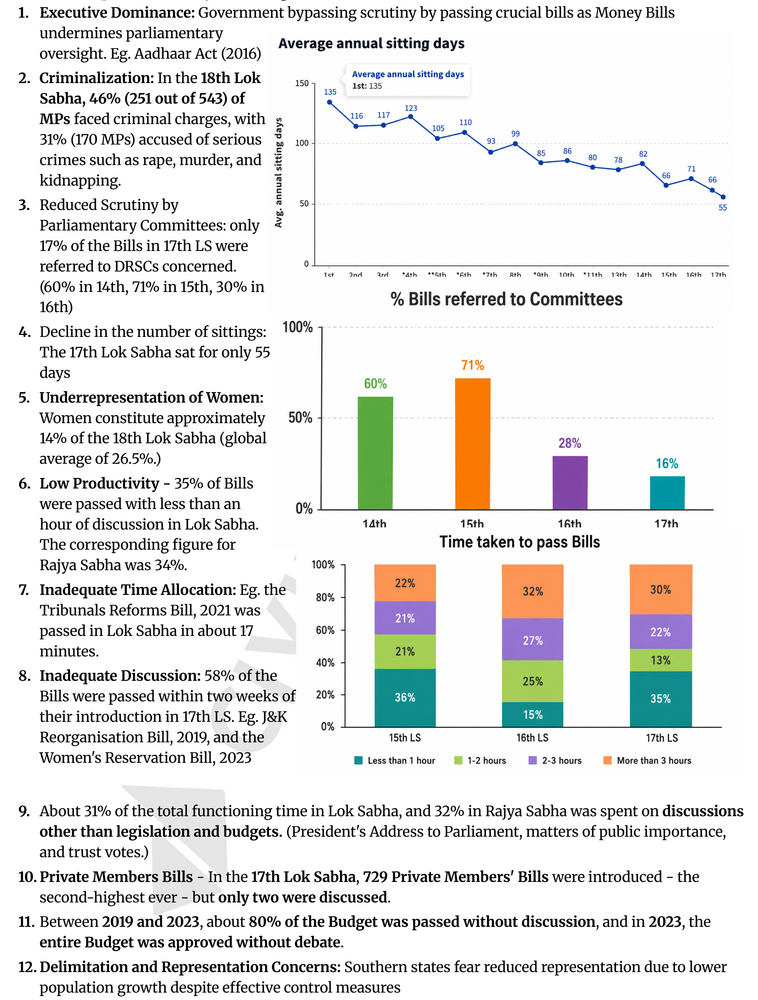

### [Smash Mains Source Page 117](../../pages/mains/mains_page_117.pdf)

### [Smash Mains Source Page 117](../../pages/mains/mains_page_117.pdf)

*Diagram Screenshot: [Parliamentary Functioning Metrics: Sitting Days, Committee Referrals & Passage Time](../../diagrams/mains_diag_parliament_decline_metrics_p117.png) · [Full Source Page 117](../../pages/mains/mains_page_117.pdf)*

### Issues with parliamentary form of government

- **1.** Executive Dominance: Government bypassing scrutiny by passing crucial bills as Money Bills undermines parliamentary oversight. Eg. Aadhaar Act (2016)

- **2.** Criminalization: In the 18th Lok Sabha, 46% (251 out of 543) of MPs faced criminal charges, with 31% (170 MPs) accused of serious crimes such as rape, murder, and kidnapping.

- **3.** Reduced Scrutiny by Parliamentary Committees: only 17% of the Bills in 17th LS were referred to DRSCs concerned. (60% in 14th, 71% in 15th, 30% in 16th)

- **4.** Decline in the number of sittings: The 17th Lok Sabha sat for only 55 days

- **5.** Underrepresentation of Women: Women constitute approximately 14% of the 18th Lok Sabha (global average of 26.5%.)

- **6.** Low Productivity - 35% of Bills were passed with less than an hour of discussion in Lok Sabha. The corresponding figure for Rajya Sabha was 34%.

- **7.** Inadequate Time Allocation: Eg. the Tribunals Reforms Bill, 2021 was passed in Lok Sabha in about 17 minutes.

- **8.** Inadequate Discussion: 58% of the Bills were passed within two weeks of their introduction in 17th LS. Eg. J&K Reorganisation Bill, 2019, and the Women's Reservation Bill, 2023

- **9.** About 31% of the total functioning time in Lok Sabha, and 32% in Rajya Sabha was spent on discussions other than legislation and budgets. (President's Address to Parliament, matters of public importance, and trust votes.)

- **10.** Private Members Bills - In the 17th Lok Sabha, 729 Private Members' Bills were introduced - the second-highest ever - but only two were discussed.

- **11.** Between 2019 and 2023, about 80% of the Budget was passed without discussion, and in 2023, the entire Budget was approved without debate.

- **12.** Delimitation and Representation Concerns: Southern states fear reduced representation due to lower population growth despite effective control measures
