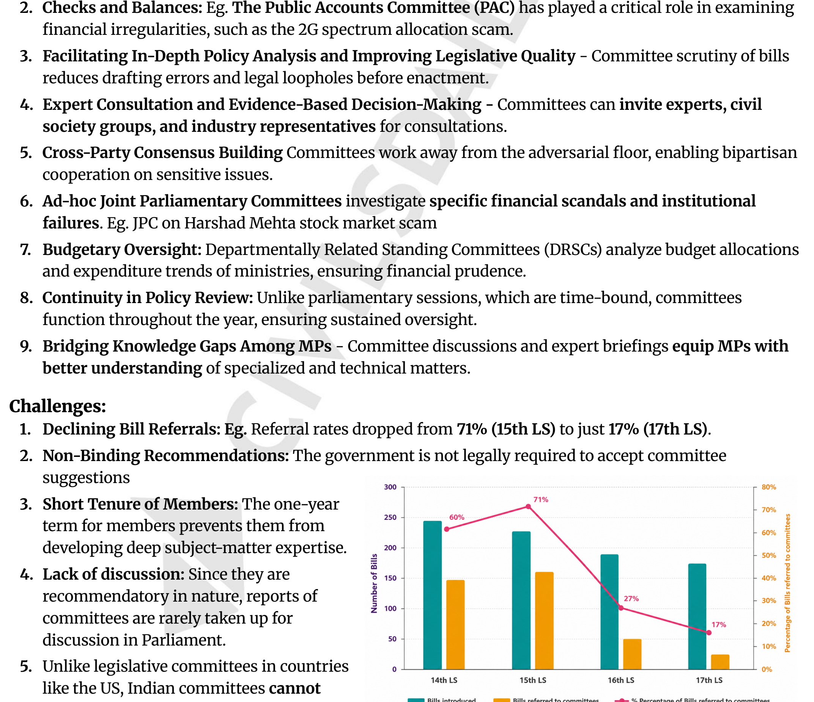

### [Smash Mains Source Page 131](../../pages/mains/mains_page_131.pdf)

### [Smash Mains Source Page 131](../../pages/mains/mains_page_131.pdf)

*Diagram Screenshot: [Number of Bills Referred to Parliamentary Committees Across Lok Sabhas](../../diagrams/mains_diag_committee_referrals_chart_p131.png) · [Full Source Page 131](../../pages/mains/mains_page_131.pdf)*

### Classification

- **1.** Standing committees: Permanent committees constituted by the Parliament to deal with specific areas of public policy or administration.

- **2.** Financial Committees: The Public Accounts Committee (PAC), Committee on Public Undertaking, Estimates Committee.

- **3.** Committees to Enquire: Committee of privileges, Committee of petitions, Ethics committee.

- **4.** Departmental Standing Committees.

- **5.** Committees to Scrutinise and Control.

- **6.** Committees Relating to the Day-to-Day Business of the House.

- **7.** House-Keeping Committees or Service Committees.

- **8.** Ad hoc committees: Ad hoc committees are temporary committees constituted for a specific purpose and for a limited period of time. Eg. JPC

### Significance of Parliamentary Committees

- **1.** Workload Management for Parliament (principle of division of labour)

- **2.** Checks and Balances: Eg. The Public Accounts Committee (PAC) has played a critical role in examining financial irregularities, such as the 2G spectrum allocation scam.

- **3.** Facilitating In-Depth Policy Analysis and Improving Legislative Quality - Committee scrutiny of bills reduces drafting errors and legal loopholes before enactment.

- **4.** Expert Consultation and Evidence-Based Decision-Making - Committees can invite experts, civil society groups, and industry representatives for consultations.

- **5.** Cross-Party Consensus Building Committees work away from the adversarial floor, enabling bipartisan cooperation on sensitive issues.

- **6.** Ad-hoc Joint Parliamentary Committees investigate specific financial scandals and institutional failures. Eg. JPC on Harshad Mehta stock market scam

- **7.** Budgetary Oversight: Departmentally Related Standing Committees (DRSCs) analyze budget allocations and expenditure trends of ministries, ensuring financial prudence.

- **8.** Continuity in Policy Review: Unlike parliamentary sessions, which are time-bound, committees function throughout the year, ensuring sustained oversight.

- **9.** Bridging Knowledge Gaps Among MPs - Committee discussions and expert briefings equip MPs with better understanding of specialized and technical matters.

### Challenges

- **1.** Declining Bill Referrals: Eg. Referral rates dropped from 71% (15th LS) to just 17% (17th LS).

- **2.** Non-Binding Recommendations: The government is not legally required to accept committee suggestions

- **3.** Short Tenure of Members: The one-year term for members prevents them from developing deep subject-matter expertise.

- **4.** Lack of discussion: Since they are recommendatory in nature, reports of committees are rarely taken up for discussion in Parliament.

- **5.** Unlike legislative committees in countries like the US, Indian committees cannot enforce their recommendations or summon ministers.
