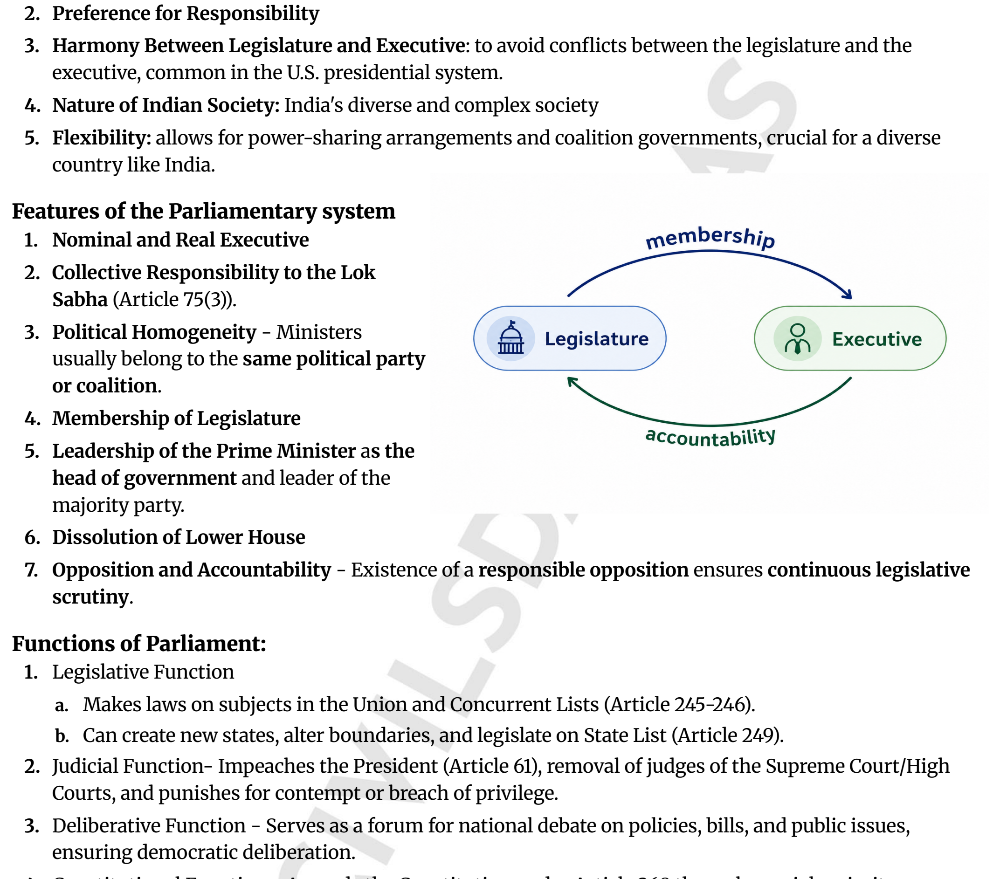
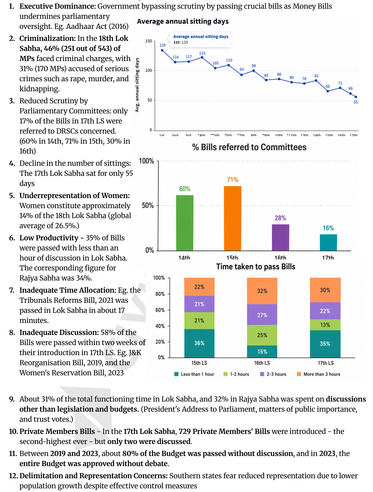

# Composition, Sessions, Speaker's Role, Rajya Sabha vs Legislative Council & Parliamentary Privileges (Art 105 & 194) — Smash Mains Notes (Ch08_Sub01_Parliament_State_Legislature_Speaker_Rajya_Sabha_Privileges)

---

### [Smash Mains Source Page 115](../../pages/mains/mains_page_115.pdf)

## Chapter 10: Parliament

### Parliament and State Legislature

### PYQs

- **[2026]** Examine whether the constitutional office of the Lok Sabha Speaker has become vulnerable to partisan politics under the current anti-defection regime. What institutional changes are required to ensure the neutrality of the Lok Sabha Speaker in managing a polarised House? (10)

- **[2025]** Indian Constitution has conferred the amending power on the ordinary legislative institutions with a few procedural hurdles. In view of this statement, examine the procedural and substantive limitations on the amending power of the Parliament to change the Constitution. (15)

- **[2023]** Explain the structure of the Parliamentary Committee system. How far have the financial committees helped in the institutionalization of Indian Parliament? (15)

- **[2023]** Discuss the role of Presiding Officers of state legislatures in maintaining order and impartiality in conducting legislative work and in facilitating best democratic practices. (10)

- **[2022]** Discuss the role of the Vice -Presidents of India as the chairman of the Rajyasabha (10)

- **[2021]** To what extent, in your view, the Parliament is able to ensure accountability of the executive in India? (10)

- **[2021]** Do Department-related Parliamentary Standing Committees keep the administration on its toes and inspire reverence for parliamentary control? Evaluate the working of such committees with suitable examples. (15)

- **[2021]** Explain the constitutional provisions under which Legislative Councils are established. Review the working and current status of Legislative Councils with suitable illustrations. (15)

- **[2020]** "Once a speaker, Always a speaker'! Do you think the practice should be adopted to impart objectivity to the office of the Speaker of Lok Sabha? What could be its implications for the robust functioning of parliamentary business in India. (10)

- **[2020]** Rajya Sabha has been transformed from a 'useless stepney tyre' to the most useful supporting organ in the past few decades. Highlight the factors as well as the areas in which this transformation could be visible. (15)

- **[2019]** "Parliament's power to amend the Constitution is a limited power and it cannot be enlarged into absolute power." In the light of this statement explain whether Parliament under Article 368 of the Constitution can destroy the Basic Structure of the Constitution by expanding its amending power? (15)

- **[2019]** Individual Parliamentarian's role as the national lawmaker is on a decline, which in turn, has adversely impacted the quality of debates and their outcome. Discuss. (15)

- **[2018]** Why do you think the committees are considered to be useful for parliamentary work? Discuss, in this context, the role of the Estimates Committee. (10)

> "The Parliament of India is the temple of democracy and the people of India are its high priests." - Lal Bahadur Shastri

---

### [Smash Mains Source Page 116](../../pages/mains/mains_page_116.pdf)

*Diagram Screenshot: [Legislature-Executive Accountability & Parliamentary Oversight Framework](../../diagrams/mains_diag_parliamentary_accountability_p116.png) · [Full Source Page 116](../../pages/mains/mains_page_116.pdf)*

### Reasons for Adoption

- **1.** Familiarity with the System: India's established parliamentary traditions over the past decades, particularly after the Government of India Act, 1935.

- **2.** Preference for Responsibility

- **3.** Harmony Between Legislature and Executive: to avoid conflicts between the legislature and the executive, common in the U.S. presidential system.

- **4.** Nature of Indian Society: India's diverse and complex society

- **5.** Flexibility: allows for power-sharing arrangements and coalition governments, crucial for a diverse country like India.

### Features of the Parliamentary system

- **1.** Nominal and Real Executive

- **2.** Collective Responsibility to the Lok Sabha (Article 75(3)).

- **3.** Political Homogeneity - Ministers usually belong to the same political party or coalition.

- **4.** Membership of Legislature

- **5.** Leadership of the Prime Minister as the head of government and leader of the majority party.

- **6.** Dissolution of Lower House

- **7.** Opposition and Accountability - Existence of a responsible opposition ensures continuous legislative scrutiny.

### Functions of Parliament

- **1.** Legislative Function

  - **a.** Makes laws on subjects in the Union and Concurrent Lists (Article 245-246).

  - **b.** Can create new states, alter boundaries, and legislate on State List (Article 249).

- **2.** Judicial Function- Impeaches the President (Article 61), removal of judges of the Supreme Court/High Courts, and punishes for contempt or breach of privilege.

- **3.** Deliberative Function - Serves as a forum for national debate on policies, bills, and public issues, ensuring democratic deliberation.

- **4.** Constitutional Function - Amends the Constitution under Article 368 through special majority procedures.

  - **a.** Financial Function

  - **b.** Exercises control over national finances - passes the Budget, Demands for Grants, and Appropriation Bills.

  - **c.** Enforces financial accountability through the Public Accounts Committee and Estimates Committee.

- **5.** Executive Control and Oversight

  - **a.** Holds the Council of Ministers accountable through questions, debates, adjournment motions, and no-confidence motions (Article 75(3)).

  - **b.** Approves President's ordinances and emergency proclamations.

- **6.** Electoral Function

  - **a.** Participates in the election of the President and Vice-President.

  - **b.** Elects the Deputy Speaker, Deputy Chairman, and committee members.

---

### [Smash Mains Source Page 117](../../pages/mains/mains_page_117.pdf)

*Diagram Screenshot: [Parliamentary Functioning Metrics: Sitting Days, Committee Referrals & Passage Time](../../diagrams/mains_diag_parliament_decline_metrics_p117.png) · [Full Source Page 117](../../pages/mains/mains_page_117.pdf)*

### Issues with parliamentary form of government

- **1.** Executive Dominance: Government bypassing scrutiny by passing crucial bills as Money Bills undermines parliamentary oversight. Eg. Aadhaar Act (2016)

- **2.** Criminalization: In the 18th Lok Sabha, 46% (251 out of 543) of MPs faced criminal charges, with 31% (170 MPs) accused of serious crimes such as rape, murder, and kidnapping.

- **3.** Reduced Scrutiny by Parliamentary Committees: only 17% of the Bills in 17th LS were referred to DRSCs concerned. (60% in 14th, 71% in 15th, 30% in 16th)

- **4.** Decline in the number of sittings: The 17th Lok Sabha sat for only 55 days

- **5.** Underrepresentation of Women: Women constitute approximately 14% of the 18th Lok Sabha (global average of 26.5%.)

- **6.** Low Productivity - 35% of Bills were passed with less than an hour of discussion in Lok Sabha. The corresponding figure for Rajya Sabha was 34%.

- **7.** Inadequate Time Allocation: Eg. the Tribunals Reforms Bill, 2021 was passed in Lok Sabha in about 17 minutes.

- **8.** Inadequate Discussion: 58% of the Bills were passed within two weeks of their introduction in 17th LS. Eg. J&K Reorganisation Bill, 2019, and the Women's Reservation Bill, 2023

- **9.** About 31% of the total functioning time in Lok Sabha, and 32% in Rajya Sabha was spent on discussions other than legislation and budgets. (President's Address to Parliament, matters of public importance, and trust votes.)

- **10.** Private Members Bills - In the 17th Lok Sabha, 729 Private Members' Bills were introduced - the second-highest ever - but only two were discussed.

- **11.** Between 2019 and 2023, about 80% of the Budget was passed without discussion, and in 2023, the entire Budget was approved without debate.

- **12.** Delimitation and Representation Concerns: Southern states fear reduced representation due to lower population growth despite effective control measures

---

### [Smash Mains Source Page 118](../../pages/mains/mains_page_118.pdf)

PRS Legislative Research report findings on 17th Lok Sabha (LS)

- It held 274 sittings and passed 179 Bills (excluding Finance and Appropriation Bills).

- Question Hour functioned for 60% of scheduled time in LS and 52% in Rajya Sabha.

- 206 instances of suspension of Members of Parliament.

- For the first time, LS did not elect a Deputy Speaker for the entire duration. Article 93 requires that LS elect a Speaker and a Deputy Speaker 'as soon as may be'.

- 80% of the budget voted without discussion. Way Forward:

- **1.** Increase Working Days: NCRWC (2002) recommended mandatory 110 days a year

- **2.** Enhancing Parliamentary Decorum: Encourage a culture of respect, professionalism, and active participation in debates among parliamentarians.

- **3.** Enhance Research Support for MPs: Dedicated legislative research units should be established. Eg. UK Parliament's Research Service

- **4.** Encouraging Public Feedback on key Bills and Public Issues

- **5.** Venkatachaliah Committee (2002): restrict the use of whips to no-confidence motions only.

- **6.** Curbing Criminalization of Politics: Reforms such as fast-track courts for swift justice, state funding of elections and transparency in candidate selection.

### Comparison with the Presidential System

| Aspect | Parliamentary System | Presidential System |
| --- | --- | --- |
| Head of State | Ceremonial (Eg. President in India) | Executive (Eg. President in the U.S.) |
| Head of Government | Prime Minister | President |
| Separation of Powers | Fused; Executive drawn from the legislature | Separated; Executive independent of the legislature |
| Election of Leader | Prime Minister elected by parliament or party members | President elected directly by people |
| Term Length | No fixed term | Fixed term (Eg. 4 years in U.S.) |
| Accountability | To the legislature | To the people (Eg. through elections) |
| Stability | Government may be unstable if no clear majority | Fixed term provides stability until the next election |
| Representation | more reflective of diverse opinions due to coalition gov't | May not represent minority views as effectively |
| Examples | India, UK, Canada | United States, Brazil, France |

---

### [Smash Mains Source Page 119](../../pages/mains/mains_page_119.pdf)

### Parliamentary Sovereignty

The Doctrine of Parliamentary Sovereignty means that Parliament holds the supreme power within the State, with no legal limitations on its authority or jurisdiction. In India, however, there is constitutional sovereignty, not parliamentary sovereignty.

### Limitations on Parliamentary Sovereignty in India

- **1.** The written Constitution defines and limits the powers of Parliament.

- **2.** Supremacy of the Constitution - Any law violating the Constitution can be declared void by courts under Article 13.

- **3.** Judicial Review guaranteed under Articles 13, 32, and 226.

- **4.** Separation of powers: Eg. Articles 121 and 211 prohibit legislative discussions on the conduct of Supreme Court and High Court judges.

- **5.** Basic Structure Doctrine - Parliament cannot destroy or damage the basic features like democracy, secularism, federalism, rule of law, and judicial independence.

- **6.** Federal Structure of Governance - States have exclusive jurisdiction over matters in the State List (Seventh Schedule), unless under extraordinary provisions.

- **7.** Limited Amendment Procedure - Some constitutional amendments require ratification by at least half of the states (Article 368(2)). Eg. Amendments affecting High Court jurisdictions.

- **8.** International Law and Treaties - Eg. Vishaka v. State of Rajasthan (1997) - SC used CEDAW (Convention on Elimination of Discrimination Against Women) to frame guidelines.

- **9.** Presidential Veto Limitations: Eg. pocket veto

### Mechanisms available with the Indian Parliament to ensure executive accountability

- **1.** Question Hour - MPs question ministers on policy and governance issues.

- **2.** Zero Hour - Members raise urgent issues without notice. Eg. Manipur violence (2023) and train accidents.

- **3.** Motion of No-Confidence (Article 75(3)) - If passed, the government must resign. Eg. No-confidence motion (2023) on Manipur issue

- **4.** Censure and Adjournment Motions - Used to express disapproval of executive policies. Eg. Censure motion (2012) against FDI in retail policy.

- **5.** Cut Motions on Demands for Grants - Allow Parliament to reduce or reject specific budget allocations.

- **6.** Parliamentary Committees - PAC, Estimates, and Standing Committees ensure financial and policy oversight. Eg. PAC (2011) report on 2G spectrum case.

- **7.** Calling Attention and Half-Hour Discussions - Seek ministerial statements on urgent matters.

- **8.** Discussion on Presidential Address - Enables MPs to review government priorities

- **9.** Privilege Motions - Raised when ministers mislead Parliament.

- **10.** Approval of Ordinances and Emergencies - Eg. Farm laws (2020)

### Role of Rajya Sabha

Rajya Sabha is the second chamber of the parliament and consists of the representatives of the States and the Union Territories and persons nominated by the President of India. Jawaharlal Nehru: "The Rajya Sabha represents the voice of reason and sobriety in our democracy." G.V. Mavalankar: "A second chamber is not a luxury in a federal system; it is a necessity for balanced legislation."

---

### [Smash Mains Source Page 120](../../pages/mains/mains_page_120.pdf)

### Powers of Rajya Sabha

Equal Powers with Lok Sabha

- **1.** Ordinary Bills: can approve, reject, or suggest amendments to ordinary bills.

- **2.** Constitutional Amendments: require a two-thirds majority in each house.

- **3.** Impeachment of the President: Can initiate and participate

- **4.** Proclamation of Emergency: Must approve the proclamation of National Emergency, President's Rule, and Financial Emergency within a specified period. Special Powers of Rajya Sabha:

- **1.** Article 249: authorize Parliament to pass laws on state list subject, in the national interest.

- **2.** Article 312: RS can authorise the Parliament to create new All-India Services.

- **3.** Removal of Vice President: RS alone can initiate a move for the removal of the VP. Limited Powers w.r.t Lok Sabha:

- **1.** No-Confidence Motion: It cannot be introduced in the Rajya Sabha.

- **2.** Money bills: return bill to LS within 14 days, LS can either accept or reject

- **3.** Joint Sitting: Speaker of LS presides and Rules of Procedure of Lok Sabha govern.

### Relevance of the Rajya Sabha in Indian Democracy

- **1.** Permanent and Continuous Chamber (Article 83) - ensures continuity in polity.

- **2.** Revisory and Deliberative Role

  - **a.** Acts as a "House of revision", ensuring in-depth scrutiny of Bills passed by the LS.

  - **b.** Checks hasty or populist legislation, enhancing legislative quality.

  - **c.** Provides a platform for smaller and regional parties to articulate their views.

- **3.** Voice of the States (Articles 80 & 81) - Functions as a federal bridge, giving states a voice in national law-making and promoting cooperative federalism.

- **4.** Constitutional and Electoral Role - Plays a key role in constitutional amendments (Article 368) and election of the President and Vice-President.

- **1.** President nominates 12 eminent members, enhancing diversity and expertise, bringing non-political and intellectual voices into national discourse.

### Concerns Related to Rajya Sabha

Legislative Role

- **1.** Bypassing through Money Bill Route - Eg. Aadhaar Act, 2016.

- **2.** Accusations of Obstructionism - Eg. delaying "progressive" legislation, such as the Privy Purses Bill (1970), Panchayati Raj Bills (1989).

- **3.** Declining Productivity - Productivity fell from 95% (1990s) to 74% (2014-21), with a low of 40% in 2018, due to frequent disruptions and walkouts. Executive Accountability Role

- **1.** Rajya Sabha cannot move a no-confidence motion, limiting direct executive accountability.

- **2.** Limited Role in Financial Oversight - no representation in the Estimates Committee and a restricted role in PAC.

- **3.** Political Partisanship - Increasing party polarization has led to deadlocks and reduced its deliberative character. Representative Role

- **1.** Dilution of Federal Character - 2003 Amendment to RPA and Kuldip Nayar judgment removed the domicile requirement, weakening state representation.

---

### [Smash Mains Source Page 121](../../pages/mains/mains_page_121.pdf)

- **2.** Unequal Representation of States in Rajya Sabha - Eg. Uttar Pradesh (31 seats) has more representation than all N-E states combined.

- **3.** A 'Parking Lot' for Wealthy Candidates - 36% of current RS members have criminal antecedents and 87% have assets over INR 1 crore, with 12% billionaires (ADR).

- **4.** Misuse of Presidential Nominations: used as a tool for "political rehabilitation" of party loyalists.

### Way Forward

- **1.** Equal representation for each state, so that large states do not dominate the proceedings. (US system)

- **2.** NCRWC, 2002 - Called for a clear procedure for nominating eminent members

- **3.** Punchhi Commission (2010)- expanding the electoral college for Rajya Sabha to include panchayats and municipalities.

- **4.** Procedural and Institutional Reforms - Allow Rajya Sabha sessions independent of Lok Sabha to underline its permanent and continuous nature.

- **5.** Enhance legislative research and committee resources to support members. With the Planning Commission abolished and the Inter-State Council inactive, Rajya Sabha should serve as a permanent institutional bridge for federal consultation. X-Factor Pointers

- At present, 79 Parliaments of the world (41% of the total number) are bicameral.

- In The Federalist, the famous essays written in 1787-88 by James Madison, Alexander Hamilton and John Jay, it was stated that the second chamber enables a second and reflective expression of representative opinion besides checking the propensity to yield to the impulse of sudden and violent passions.

### Role of Presiding officer

The Speaker of the Lok Sabha (Article 93) and the Chairman of the Rajya Sabha (Article 64) are the Presiding Officers of the two Houses of Parliament. They are entrusted with maintaining order, ensuring legislative discipline, and upholding the dignity and autonomy of Parliament.

### Functions

Legislative Functions

- **1.** Presides over sittings and ensures orderly conduct of business and debates.

- **2.** Decides on admissibility of questions, motions, and resolutions.

- **3.** Certifies Bills as Money Bills (Article 110) - a decision that is final and binding. Disciplinary Role - Maintains decorum and order in the House; can suspend or name members for disorderly conduct. Quasi-Judicial Functions - Decides questions of disqualification under the Tenth Schedule (Anti-Defection Law). Administrative and Procedural Role

- **1.** Interprets rules of procedure and parliamentary practices.

- **2.** Allocates time for debates and discussions, and decides the agenda of the House.

---

### [Smash Mains Source Page 122](../../pages/mains/mains_page_122.pdf)

Guardian of Parliamentary Privileges

- **1.** Safeguards the rights, privileges, and independence of the House and its members.

- **2.** Represents the House in all communications with the President and external authorities. Role in Parliamentary Committees

- **1.** Refers Bills to Parliamentary Committees for detailed examination.

- **2.** Speaker nominates members to Committees and serves as ex-officio Chairperson of key bodies like the Rules Committee and Business Advisory Committee.

### Issues

- **1.** The Speaker combines both legislative leadership (presiding over sessions) and quasi-judicial functions (anti-defection adjudication, privileges inquiries) creating conflict of interest.

- **2.** Partisan Role and Political Bias - Eg. In Manipur and Maharashtra defection cases (2020-23), delay in decisions benefited ruling coalitions.

- **3.** Discretion in Disqualification under Tenth Schedule - Speaker is both judge and party member under the Anti-Defection Law, creating a conflict of interest.

- **4.** Suspension and Control of the House - Powers under Rule 374A give the Speaker unilateral authority to suspend MPs for "grave disorder." Eg. 2023 mass suspension of 146 MPs

- **5.** Speaker's certification under Article 110 is final and non-justiciable, enabling executive misuse. Eg. Aadhaar Act (2016) passed as a Money Bill

- **6.** Lack of Neutrality Safeguards - Unlike the UK, the Indian Speaker remains a party member and contests elections on party tickets, compromising neutrality.

- **7.** Article 122 - Judicial review of parliamentary proceedings is limited, allowing unchecked Speaker discretion.

- **8.** Decline in Parliamentary Deliberation - "railroading" Bills without adequate discussion (Eg. Farm Bills 2020 via voice vote).

- **9.** Absence of Accountability Mechanisms - The Speaker is accountable only to the House majority, which often coincides with the ruling party.

- **10.** Increasing executive influence and declining impartiality have damaged the institutional credibility of the Speaker's office, a trend described as "executarian speakership".

### Way Forward

- **1.** Codify Speaker's neutrality - mandatory resignation from a political party upon election.

- **2.** Amend Rule 374A - require House concurrence for suspensions beyond one day.

- **3.** Limit Speaker's Role in Anti-Defection Law: In the Keisham Meghachandra Singh case, the Supreme Court suggested that the current system could be replaced by a permanent tribunal.

- **4.** Introduce legislative due process to guarantee minimum debate standards. Inspired by Israel's Quantinsky v. Knesset, which annulled a rushed tax law for violating principle of participation

- **5.** Adopt Britain's Model: Following the British convention, political parties should avoid opposing the Speaker during elections to ensure impartiality.

### Anti-Defection Law

The 52nd Amendment Act of 1985 introduced in the Tenth Schedule of the Constitution, outlining the procedure for disqualifying legislators due to defection. Anti-defection laws aim to prevent or discourage defection by imposing penalties on politicians who switch parties or otherwise violate party discipline.

---

### [Smash Mains Source Page 123](../../pages/mains/mains_page_123.pdf)

Grounds for Disqualification under Anti-Defection Law:

- **1.** If a member voluntarily resigns or gives up their political party membership.

- **2.** If a member Votes, or does not vote in the house, contrary to the direction of his political party. However, if the member has taken prior permission, or is condoned by the party within 15 days from such voting or abstention, the member shall not be disqualified.

- **3.** Independent Members: Joining a Party after Election as an Independent Candidate:

- **4.** Nominated Members: Nominated Member Joining a Party Six Months after Appointment Exceptions to Anti-Defection Law:

- **1.** Merger Exception: A political party merger occurs when two-thirds of its members agree. Members leaving due to a merger are exempt from disqualification under the law.

- **2.** Presiding Officer Exception: Elected presiding officers can temporarily relinquish party membership to ensure impartiality. ]

### Constitutional and Legal provisions

- **1.** Tenth Schedule: Introduced by the 52nd Amendment Act in 1985. It outlines procedures and criteria for disqualifying members due to defection.

- **2.** 91st Amendment Act of 2003:

  - **a.** The amendment eliminated the provision that allowed splits in parties. Earlier, if one-third of the members of a legislative party defected, it was considered legal.

  - **b.** A member of a house belonging to a political party who is disqualified under the Tenth Schedule for defection shall also be disqualified to be appointed as a minister.

### Significance

- **1.** Combating Corruption and Horse Trading: address the historical issue of "Aaya Ram Gaya Ram" in Indian politics.

- **2.** Ensures Government Stability by preventing members from switching party allegiance.

- **3.** Protects Legitimate Mergers: Recognizes that parties may evolve, allowing a 2/3rd majority to merge without losing membership.

- **4.** Upholds Electoral Mandate: Respects the voters' choice by ensuring a representative stays with the party they were elected under.

- **5.** Strengthens Party Discipline: Provides a legal framework for party leadership to maintain unity during critical legislative votes.

- **6.** Reduces Corruption (Horse-Trading): Discourages the "purchase" of legislators through ministerial berths or monetary incentives during narrow-majority situations.

- **7.** Quasi-Judicial Clarity: Grants the Presiding Officer clear authority to adjudicate cases, providing a faster alternative to civil courts.

### Criticism of the Anti-Defection Law in India

- **1.** "Wholesale" over "Retail" Defection: While individual defection is banned, the 2/3rd merger rule effectively legalizes mass shifts by larger groups.

- **2.** Lack of Time Limit for Disqualification - 56% of defection cases between 2014-2019 were decided with significant delays, mostly favoring the ruling party. (PRS Legislative Research)

- **3.** Partisan Role of Speakers

- **4.** Stifles Internal Dissent: Legislators cannot vote based on their conscience or constituency interests if it contradicts the party whip.

- **5.** Vagueness of "Voluntarily Giving Up": Conduct like criticizing the party is often interpreted as "giving up membership." Eg. Ravi Naik (1994) case

---

### [Smash Mains Source Page 124](../../pages/mains/mains_page_124.pdf)

- **6.** Dictatorship of the High Command: Power is concentrated in a few leaders who control the "whip," reducing MPs to "voting machines."

- **7.** Legislators resign to bypass the 10th Schedule, only to be re-elected on the opposing party's ticket. Eg. in MP in 2018

### Supreme Court Judgments

- **1.** Kihoto Hollohan v. Zachillhu (1992): The SC upheld the law but declared that the Speaker's decision is subject to Judicial Review for mala fides or procedural errors.

- **2.** Keisham Meghachandra Singh v. Speaker (2020): Ruled that Speakers should ideally decide disqualification cases within 3 months.

- **3.** Subhash Desai v. Governor of Maharashtra (2023): Clarified that the "Whip" and "Leader" must be appointed by the Political Party, not just the Legislative wing.

- **4.** Telangana Speaker Case (Feb 2026): Reaffirmed that "indecision" by the Speaker cannot defeat the purpose of the 10th Schedule, threatening contempt for delays.

### Way Forward

- **1.** Dinesh Goswami Committee and ECI: Recommended disqualification by President/Governor based on the Election Commission's advice.

- **2.** External Tribunal: Transfer adjudication power to an independent permanent tribunal headed by retired judges (SC Recommendation, 2020).

- **3.** Limiting the Whip: The "Whip" should only be binding for Critical Motions (No-Confidence, Budget) to allow free speech on other bills.

- **4.** Statutory Timelines: Amend the rules to mandate a final decision within 60–90 days of filing a petition.

- **5.** Pre-Election Coalitions: Grant the same legal status to pre-poll alliances as single parties to prevent post-poll "horse-trading."

- **6.** Barring Ministerial Berths: Extend the ban on holding ministerial posts for defectors even if they win a by-election immediately.

- **7.** Intra-Party Democracy: Legally mandate internal elections within parties to ensure the "whip" represents the members' will, not just the leader's.

### Parliamentary privileges

Parliamentary privileges refer to the special rights, immunities, and exemptions granted to Members of Parliament (MPs) and parliamentary committees to perform their duties effectively. Article 105 of the Indian Constitution defines these privileges for MPs, while Article 194 extends similar privileges to state legislators.

### Sources of Parliamentary privileges

- **1.** Constitutional provisions

- **2.** Parliamentary laws

- **3.** Rules of procedure for both Houses

- **4.** Established conventions

- **5.** Judicial interpretations

### Classification of Parliamentary privileges

Individual Privileges:

- **1.** Protection from Arrest: 40 days before and after the session. This applies only to civil cases

---

### [Smash Mains Source Page 125](../../pages/mains/mains_page_125.pdf)

- **2.** Freedom of Speech

- **3.** Exemption from Jury Service Collective Privileges

- **1.** Publication Rights: press can publish true reports of parliamentary proceedings without prior permission, except in the case of secret sessions.

- **2.** Exclusion of Strangers

- **3.** Regulatory Authority: Each house can make rules to regulate its procedures, conduct its business, and adjudicate related matters.

- **4.** Punitive Powers: Each house can punish members or outsiders for breaching its privileges or contempt, through reprimand, admonition, imprisonment, suspension, or expulsion.

- **5.** Notification Rights: Parliament has the right to receive immediate information regarding the arrest, detention, conviction, imprisonment, and release of its members.

- **6.** Inquiry Powers: Each house can conduct inquiries, summon witnesses, and request relevant papers and records.

- **7.** Judicial Immunity: Courts are prohibited from inquiring into parliamentary proceedings or the actions of its committees.

### Significance of Parliamentary Privileges

- **1.** Legislative Independence: Ensures autonomy from the executive and judiciary, reinforcing separation of powers.

- **2.** Independent Policy Deliberation: Ensures members speak their minds on sensitive national issues without fear of defamation suits.

- **3.** Effective Government Scrutiny: Shields MPs while questioning the government (Eg. PAC summoning officials in the 2018 Rafale deal inquiry).

- **4.** Maintaining Discipline: Allows enforcement of order, including suspensions for misconduct.

- **5.** Dignity of the House: The power to punish for contempt maintains the sanctity and decorum of the legislative chamber.

- **6.** Accountability Mechanism: Eg. in 2018, the Rajya Sabha suspended MP Vijay Mallya for misusing his position and evading financial obligations.

- **7.** Ensuring Parliamentary Supremacy: Privileges ensure that Parliament remains the final arbiter of its own internal rules and business.

### Issues

- **1.** Lack of Codification: Absence of a clear law leads to ambiguity and "rule by convention" from the British era.

- **2.** Bribery and Corruption: Recent judgments show that "immunity" was being misused to shield criminal acts like taking bribes. Eg. Sita Soren Case

- **3.** Conflict with Fundamental Rights: The "Right to Privilege" clashes with the citizen's Right to Free Speech (Art 19). Eg. privilege notices to Journalists for reporting on a Speaker's conduct

- **4.** Vague Definition of "Contempt": Unlike "Breach of Privilege," "Contempt" is undefined, allowing for arbitrary use against critics.

- **5.** Violation of Natural Justice: The House acts as "Prosecutor, Judge, and Executioner" in its own cause during privilege trials.

- **6.** Political Vendetta: Majority parties sometimes use privilege motions to silence or "expel" vocal Opposition members.

- **7.** Opacity of Committee Proceedings: Privilege Committee meetings are usually "in-camera," leading to a lack of public transparency.

---

### [Smash Mains Source Page 126](../../pages/mains/mains_page_126.pdf)

- **8.** Archaic Nature: Many privileges are verbatim copies of the 19th-century UK House of Commons, disconnected from modern India. Eg. privileges like "Secret Sittings"

### Major SC Judgments

- **1.** Sita Soren v. Union of India (2024): A landmark 7-judge bench ruled that MPs/MLAs have no immunity from prosecution for taking bribes to vote.

- **2.** K. Anandan Nambiar Case (1951): Established that an MP has no special status over citizens in criminal cases or preventive detention.

- **3.** Raja Ram Pal v. Hon'ble Speaker (2007): Upheld the House's power to expel members for conduct that brings the House into "disrepute."

- **4.** Searchlight Case (MSM Sharma): Ruled that parliamentary privileges (uncodified) can prevail over a citizen's Right to Freedom of Speech.

### Way Forward

- **1.** Legislative Codification: Enact a Parliamentary Privileges Act to clearly define "Breach" and "Contempt"

- **2.** Harmonious Construction: Privileges should be interpreted to exist alongside Fundamental Rights, not supersede them

- **3.** Independent Tribunal: Adjudication of privilege breaches should be moved to a neutral body to ensure Natural Justice.

- **4.** Adopt the UK's Defamation Act model where serious harm must be proven before a notice is issued.

- **5.** Transparency in Adjudication: Live-stream the Privilege Committee hearings (except for national security) to ensure public accountability.

- **6.** Time-Bound Resolution: Fix a 60-day limit for the disposal of privilege motions to prevent long-drawn political harassment.

- **7.** Training and Sensitization: Mandatory orientation for first-time MPs in 2026 on the ethical use of their immunities.

### Codification of Parliamentary privileges

| Arguments in Favour | Arguments Against |
| --- | --- |
| Codification would define privileges clearly, removing ambiguity. | Flexibility would be lost; future unforeseen situations may not be covered. |
| Limits misuse by members under the vague cover of "breach of privilege." | Codification could be bypassed or exploited through technical loopholes. |
| Establishing clear guidelines ensures responsible use of privileges while allowing scrutiny. | May lead to judicial intervention in parliament |
| Helps build public trust by showing that Parliament is not above the law. | May undermine the dignity and sovereign status traditionally associated with legislatures. |
| Many democracies (Eg. UK, Australia) have codified or partially codified privileges. | Indian conditions are unique; borrowed models may not suit Indian political dynamics. |

---

### [Smash Mains Source Page 127](../../pages/mains/mains_page_127.pdf)

### Money Bills

Article 110 of the Constitution of India outlines the definition of a Money Bill, stating that a bill is considered a Money Bill if it contains only provisions dealing with specific financial matters. These include:

- **1.** The imposition, abolition, remission, alteration, or regulation of any tax.

- **2.** The regulation of the borrowing of money or the giving of any guarantee by the GoI.

- **3.** The custody of the Consolidated Fund or the Contingency Fund of India, the payment of money into or the withdrawal of money from any such fund.

- **4.** The appropriation of money out of the Consolidated Fund of India.

- **5.** Declaring of any expenditure to be expenditure charged on the Consolidated Fund of India

- **6.** The receipt of money on account of the Consolidated Fund of India or the public account of India or the custody or issue of such money.

- **7.** Any matter incidental to any of the matters specified above.

### Exclusions from money bills as outlined in the Indian Constitution.

- **1.** These include the imposition of fines, pecuniary penalties, fees for licenses or services, and local taxes imposed by local authorities for local purposes.

- **2.** These matters are not considered directly related to the central financial policies of the union government.

### Need

- **1.** Ensures Executive Speed: Allows the government to pass essential financial laws without the risk of long-drawn delays in the Rajya Sabha. Eg. Finance Bill 2026

- **2.** Reflects the principle that only the "House of the People" should have the final say on the people's money.

- **3.** Financial Stability: Prevents a "fiscal cliff" by ensuring that the Consolidated Fund of India is never blocked by a political deadlock.

- **4.** Exclusive Presidential Oversight: Requires prior recommendation of the President, ensuring the executive and legislative wings are in sync.

- **5.** Administrative Efficiency: Combines multiple fiscal measures into a single bill, reducing the legislative burden on Parliament.

- **6.** Constitutional Guardrails: Explicitly excludes "fines" or "fees for services" from being termed Money Bills, preventing executive overreach.

### Issues

- **1.** Bypassing the Rajya Sabha: Eg. The Insolvency and Bankruptcy Code (IBC) and PMLA amendments were passed via this route.

- **2.** Legislative "Smuggling": Embedding non-financial provisions (like data privacy or tribunal reforms) into a Finance Bill to fast-track them.

- **3.** Role of Certifying Authority: Allegations have surfaced regarding the speaker's potentially biased role due to the speaker's sole discretion in certifying a bill as a money bill.

- **4.** Fiscal Mismanagement Risk: Limited scrutiny can lead to poorly considered financial policies.

- **5.** Conflict with Article 117: The thin line between a "Money Bill" and a "Financial Bill (Type I)" is frequently exploited to favor the former.

---

### [Smash Mains Source Page 128](../../pages/mains/mains_page_128.pdf)

### Way Forward

- **1.** Standing Committee Scrutiny: Every bill intended for "Money Bill" certification should be reviewed by a bipartisan committee before the Speaker's final stamp.

- **2.** Judicial Comity: The Speaker should voluntarily refer "hybrid" bills to the Rajya Sabha to maintain the spirit of bicameralism.

- **3.** Codified Guidelines: Parliament should enact rules that prevent the "clustering" of unrelated laws within the annual Finance Bill.

### Profile of MPs

### Analysis of the profile of the elected Members of Parliament of the 18th Lok Sabha

- **1.** The average age of MPs elected to the 18th Lok Sabha is 56 years; this was 59 years in the 17th Lok Sabha.

- **2.** 11% of MPs are 40 years or younger. Three MPs elected to the 18th Lok Sabha are 25 years old.

- **3.** Education profile: 78% of MPs have completed at least undergraduate education. 5% of MPs in the have a doctoral degree, including three women MPs.

- **4.** Women representative: 74 MPs (14%) elected to the are women. 16% of these women MPs are below the age of 40.

- **5.** Professional Profile: Agriculture (37%) and social work (48%) are the most common professions among MPs elected to the 18th Lok Sabha.

- **6.** Criminal cases:

  - **a.** 251 (46 per cent) MPs in the 18th Lok Sabha have criminal cases registered against them.

  - **b.** Twenty-seven MPs declared they were convicted. Fifteen MPs were charged with crimes against women, of which two were accused of rape.

- **7.** Legislative experience:

- **8.** 52% of newly-elected MPs are first-timers in Lok Sabha

- **9.** 262 MPs elected to the 18th Lok Sabha have previously served as members of Lok Sabha.

### Women Representation in Parliament

- **1.** The total number of women contesting general elections in the country has increased from 3% in 1957 to 10% in 2024.

- **2.** Candidacy: The number of women contesting general elections has grown substantially-from 45 candidates in 1957 to 797 in 2024.

- **3.** Parliamentary Representation: Women's representation in the Lok Sabha increased from 5% (22 seats) in 1951 to 13.6% (74 seats) in 2024. In the Rajya Sabha, female representation rose from 7% in 1952 to 13% in 2023.

- **4.** Local Governance: women hold 46% of positions in local self-government institutions, totaling approximately 1.45 million female representatives.

### Need

- **1.** Correcting Underrepresentation: 48.5% of India's population hold only 14% of LS seats. India ranks 143 in parliamentary gender parity, lagging behind neighbors like Bangladesh

- **2.** Enhancing Substantive Policy Focus: Eg. Studies on Panchayati Raj show women leaders invest more in public goods than male counterparts.

- **3.** Improving Governance and Efficiency: women lawmakers are less likely to be involved in criminal activities and corruption. Eg. 27% of women MPs/MLAs have criminal cases compared to over 40% of men. (ADR)

---

### [Smash Mains Source Page 129](../../pages/mains/mains_page_129.pdf)

- **4.** Closing the Global Gender Gap: Eg. India slipped to 131st in the 2025 Global Gender Gap Report due to falling political representation.

- **5.** Achieving "Nari-Shakti" led Development: Transitioning women from "passive beneficiaries" of schemes to "active makers" of national laws and budgets.

- **6.** Addressing Gender-Specific Legislation: Representation ensures that laws on sensitive issues like sexual violence and domestic labor are gender-sensitive.

- **7.** Economic Impact: According to a McKinsey Global Institute report, closing gender gaps in employment, including political leadership, could add $28 trillion to the global GDP by 2025.

- **8.** Challenging patriarchy: To change the stereotyped image of 'women as only homemakers' and there will be gradual acceptance of 'women as lawmakers.'

- **9.** Constitutional Mandate for Equality - Article 14 and Article 15(3)

- **10.** Positive Role Modeling and Social Change - Promotes female participation in education, workforce, and governance.

### Issues

- **1.** Ticket Distribution stage: Male-dominated party hierarchies denying tickets or fielding them in "losing" seats. Eg. In 2024, only 9.6% of total candidates were women

- **2.** Lack of Institutional Support Mechanisms - Absence of adequate training, leadership development, and capacity-building programs for women politicians.

- **3.** Delimitation-Linked Implementation Delay: The 33% reservation is legally tied to a future Census and redrawing of boundaries.

- **4.** High Financial Barriers: The "monetization" of elections disproportionately affects women who often lack independent assets or corporate backing.

- **5.** The "Proxy" Representation (Panchayat-Pati) Syndrome: In many cases, women are fielded as figureheads while male relatives exercise the actual political power.

- **6.** Gender-Based Political Violence: Women face physical threats and character assassination, creating a hostile environment that discourages new entrants.

- **7.** Disproportionate "Care Burden": Societal expectations regarding domestic duties and child-rearing limit the time women can dedicate to 24/7 politics.

- **8.** Lack of Inner-Party Democracy: The absence of transparent, merit-based candidate selection favors "dynastic" women over grassroots women leaders.

### Measures taken to improve Women's representation

- **1.** 106th Amendment (2023): Proposes 33% reservation for women in Lok Sabha & State Assemblies, pending implementation after the next census and delimitation.

- **2.** Political Party Quotas:

  - **a.** Trinamool Congress (TMC) - 40% women candidates

  - **b.** Biju Janata Dal (BJD) - Odisha: pioneer in formal 33% voluntary reservation

  - **c.** In the 2022 UP Assembly elections, congress fielded 40% women under the "Ladki Hoon, Lad Sakti Hoon" campaign.

### Way Forward

- **1.** Mandatory Internal Party Quotas: Amend the Representation of the People Act, 1951 to mandate that political parties give 33% of tickets to women.

- **2.** Capacity Building: Scale up programs like the Sashakt Panchayat-Netri Abhiyan (2025) to train local women leaders for national roles.

---

### [Smash Mains Source Page 134](../../pages/mains/mains_page_134.pdf)

  - **b.** United States: The Office of Congressional Ethics (OCE) reviews allegations against House members and refers them to the Ethics Committee.

  - **c.** Australia: "Register of Pecuniary Interests" to prevent corporate lobbying

### Delimitation

- **1.** Delimitation is an act of fixing limits or boundaries of territorial constituencies in a country to reflect population changes.

- **2.** Article 82: Mandates Parliament to enact a Delimitation Act after every Census.

- **3.** Article 170: Provides for the readjustment of seats in State Legislative Assemblies after every Census.

- **4.** Article 327: Empowers Parliament to make provisions with respect to all matters relating to elections, including delimitation.

### History of Delimitation in India

- **1.** Delimitation Commissions have been established four times, in 1952, 1963, 1973, and 2002.

- **2.** The 42nd Amendment (1976) froze seat allocation based on the 1971 Census until 2000; the 84th Amendment (2001) extended this freeze until the first census after 2026.

### Key Proposals of the 131st Amendment Bill (2026)

- **1.** Expansion of Lok Sabha: from 543 to 850 seats (815 for States, 35 for UTs).

- **2.** Enables delimitation based on the 2011 Census data to avoid further delays.

- **3.** Links the implementation of the 33% quota (Nari Shakti Vandan Adhiniyam) to this fresh delimitation.

- **4.** The Lok Sabha-to-Rajya Sabha seat ratio will shift from 2.2:1 to 3.3:1.

### Justification of Delimitation

- **1.** Upholding "One Person, One Vote": Eg. Currently, an MP from Rajasthan represents 3x more voters than one from Lakshadweep.

- **2.** Reflecting Demographic Realities: Adjusts boundaries to account for internal migration and urbanization since the 1971 freeze.

- **3.** Correcting Seat Undervaluation: Northern states like UP and Bihar are currently under-represented relative to their actual 2026 population.

- **4.** Administrative Efficiency: Smaller constituencies allow MPs to manage developmental funds and local issues more effectively.

- **5.** Updating SC/ST Reservations: Readjusts reserved seats based on the latest demographic shifts of marginalized communities.

- **6.** Bridging gap between citizens and MPs: Eg. Reduces the average population per MP from 25 lakh to a more manageable 15 lakh.

### Major Challenges in Delimitation

- **1.** The North-South Divide: Southern states fear being "penalized" for successful population control. Eg. Tamil Nadu's seat share could drop from 7.1% to 6.3%.

- **2.** "Hindi Heartland" may gain a "perpetual majority," sidelining regional linguistic identities. Eg. UP and Bihar together could control nearly 25% of the 850-seat Lok Sabha.

- **3.** Language and Cultural Hegemony: Fears that the "One Nation" narrative will override the diverse cultural interests of smaller states.

- **4.** Diminishing Rajya Sabha Power: The new 3.3:1 ratio makes the Rajya Sabha (the Council of States) numerically irrelevant during deadlocks & joint sittings

- **5.** Quality of Deliberation: Doubts whether a massive 850-member House can conduct meaningful debates without constant disruptions.

---

### [Smash Mains Source Page 135](../../pages/mains/mains_page_135.pdf)

- **6.** Increased Cost to Exchequer: Eg. Estimates suggest a 40% increase in the annual maintenance cost of the Parliament complex.

- **7.** Gerrymandering Suspicions: Allegations that the ruling party may draw boundaries to favor their specific voter banks.

- **8.** Delimitation in the Northeast faces ethnic tensions over tribal and non-tribal representation

### Way Forward

- **1.** Balance Population Growth and Fair Representation: Consider alternative metrics, such as voter density or development index, to determine seat allocation.

- **2.** Increase RS seats to 400+ to maintain the 2:1 ratio, preserving its federal veto power.

- **3.** Ensure the 2026 Delimitation Commission remains strictly non-partisan

- **4.** Use the Inter-State Council to build a "consensus formula" that balances population with development indices

- **5.** Set Population Deviation Limits - Enforce a uniform ±10% deviation rule in constituency size (like Germany) to uphold voter parity.

### Role of opposition

In a parliamentary democracy, the Opposition is as vital as the Government. It is often described as the "Government-in-waiting."

> "If there is no opposition, there is no democracy." - Sir Ivor Jennings "The duty of the Opposition is to propose nothing, to oppose everything, and to turn out the Government." - Lord Randolph Churchill (Reflecting the traditional adversarial role). "Once a government is committed to the principle of silencing the voice of opposition, it has only one way to go, and that is down the path of increasingly repressive measures." - Harry S. Truman The post of LoP is a statutory one, recognized under the Salary and Allowances of Leaders of Opposition in Parliament Act, 1977. To be recognized, a leader must:

- **1.** Belong to the largest opposition party having at least 10% of the total strength of the House (i.e., 55 seats in the Lok Sabha).

- **2.** Be officially recognized by the Speaker (Lok Sabha) or Chairman (Rajya Sabha).

- **3.** The post was vacant from 2014 to 2024 because no single opposition party reached the 55-seat mark.

### Significance of Opposition in Democracy

- **1.** Checks and Balances: Prevents the ruling party from exercising absolute power or passing arbitrary legislation without scrutiny. Eg. recent failure of constitution 131 amendment Bill

- **2.** Ensures Executive Accountability: Uses parliamentary tools like Question Hour and Zero Hour to demand answers from ministers.

- **3.** Alternative Policy Proposals: Functions as a "Shadow Government," offering viable policy alternatives to the public.

- **4.** Safeguards Minority Interests: Represents the voices of those who did not vote for the majority, protecting diverse cultural and regional identities.

- **5.** Legislative Scrutiny: Plays a critical role in Parliamentary Committees, where they analyze the fine print of complex bills.

- **6.** Upholds Public Interest: Highlights administrative failures, corruption, or public grievances that the government might overlook. Eg. Exposing Bofors Scam

---

### [Smash Mains Source Page 136](../../pages/mains/mains_page_136.pdf)

- **7.** Watchdog of Constitutional Values: Acts as a barrier against laws that might threaten secularism or federalism. Eg. opposition to Farm Bills

- **8.** Vents Popular Discontent: Provides a formal channel for citizen protests, preventing dissent from turning into violent street movements.

- **9.** Prepares Future Leadership: Serves as a training ground for future ministers and prime ministers to understand governance through critique.

### Major Challenges Faced by Opposition

- **1.** Diminishing Parliamentary Time: Increasing use of "guillotine" motions and frequent adjournments limit the time available for opposition debate.

- **2.** Marginalization in appointments - Eg. government majority in appointment committee of CEC

- **3.** Misuse of Investigative Agencies: Allegations that the ED, CBI, and IT departments are used selectively to target opposition leaders.

- **4.** Speaker's Partisan Perception: Eg. refusal to admit a removal Motion against CSE despite signature of over 100 MPs.

- **5.** Legislative Bypassing: Increasing use of the "Money Bill" tag to bypass the Rajya Sabha, where the opposition is stronger.

- **6.** Lack of Internal Cohesion: Ideological differences within umbrella alliances (like INDIA bloc) can lead to contradictory messaging.

- **7.** Suspension of Members prevents the opposition from participating in key votes. Eg. In Dec 2023-Jan 2024, over 140 MPs were suspended.

### Way Forward

- **1.** Formalize UK-style shadow cabinets to provide domain expertise and alternative budget

- **2.** Statutory "Opposition Day": Dedicate one day a week in Parliament solely for the opposition to set the agenda.

- **3.** Mandate that all bills must be referred to Standing Committees for bipartisan review.

- **4.** Legislative Productivity Targets: Agreeing on a "Code of Decorum" to minimize disruptions while maximizing the quality of debate.

### Suspension of MPs

### Recent Context

- **1.** Winter Session 2023: An unprecedented 19% of Parliament (146 MPs) was suspended for demanding a statement on the security breach.

- **2.** In a rare moment of consensus, the Lok Sabha revoked the suspension of eight opposition MPs on March 17, 2026, after a motion moved by the Parliamentary Affairs Minister.

- **3.** New 2026 protocols now explicitly ban the display of AI-generated videos/images and placards within the House precincts.

### Justification for Suspension

- **1.** Maintaining House Decorum: Eg. Rule 373 (LS) empowers the Speaker to remove members whose conduct is "grossly disorderly."

- **2.** Preventing Persistent Obstruction: Eg. Rule 374 (LS) and 256 (RS) allow suspension for "persistently and willfully obstructing" business.

- **3.** Upholding Speaker's Authority

---

### [Smash Mains Source Page 137](../../pages/mains/mains_page_137.pdf)

- **4.** Enforcing Conduct Rules: Eg. 1989 updated rulebook prohibits shouting slogans or tearing documents.

- **5.** Ensuring Legislative Productivity: Prevents a few members from stalling bills that affect the entire nation's governance.

- **6.** Safety and Security of staff and other members from violent or aggressive behavior.

- **7.** Accountability to Taxpayers: Eg. cost of a stalled hour is approximately ₹2.5 crore.

- **8.** Preventing unparliamentary tactics like playing tape recorders or displaying AI deepfakes.

### Criticisms of Suspension

- **1.** Silencing the Opposition: Eg. The Telecom Bill and Criminal Laws (2023) were passed while 146 MPs were absent.

- **2.** Erosion of Representation: Suspending an MP effectively disenfranchises millions of voters whose voices are no longer heard.

- **3.** Partisan Application: There are claims that the ruling party's disruptions are ignored while opposition dissent is strictly penalized.

- **4.** Deletion of Questions: Suspended MPs lose the right to have their parliamentary questions answered, reducing executive oversight.

- **5.** Suspension should be the last step, not the first reaction to protest.

- **6.** International observers often cite mass suspensions as a sign of "democratic backsliding" in India. Eg. Reports from V-Dem and Al Jazeera

- **7.** Trust Deficit: Constant friction and "punitive" actions create a hostile environment, ending the possibility of bipartisan cooperation.

### Way Forward

- **1.** Codifying "Disorderly Conduct": Clearly define "unruly behavior" in the rulebook to remove the Speaker's subjective "opinion" from the process.

- **2.** Statutory "Opposition Days": Dedicate specific days for the Opposition to set the agenda (UK Model) to reduce the "need" for disruption.

- **3.** Before suspension, a mandatory meeting of the Business Advisory Committee should try to resolve the deadlock.

- **4.** Graduated Penalty Scale: Introduce a tiered system (Warning -> Naming -> Day Suspension -> Session Suspension) to prevent "over-punishing."

### Issues with opening speeches of governors in state legislatures

R. Venkataraman described the address by Presidents and Governors at the commencement of the first session of the Houses each year as a "British anachronism" and a "meaningless formality."

### Recent Context

- **1.** Governors in Tamil Nadu, Kerala, and Karnataka sparked controversy by skipping large sections of the Cabinet-approved speeches that were critical of Union Government policies

- **2.** In 2025, the Tamil Nadu and Kerala assemblies passed resolutions urging the President to intervene and ensure that Governors do not deviate from the text prepared by the CoM.

- **3.** In the State of Tamil Nadu v. Governor, SC reaffirmed that the Governor is a "ceremonial conduit" and cannot act as an adversary to the elected government.

---

### [Smash Mains Source Page 138](../../pages/mains/mains_page_138.pdf)

### Constitutional Provisions

- **1.** Article 176(1): at the commencement of the first session after each general election and the first session of each year, the Governor "shall address" the Legislative Assembly.

- **2.** Article 175: Grants the Governor the "right to address" the House at any other time, though this is rarely used and is distinct from the mandatory special address.

### Major Issues in Opening Speeches

- **1.** Selective Omission of Paragraphs: Eg. the Kerala Governor omitted paragraphs criticizing the Union's fiscal federalism policies.

- **2.** Unilateral Text Alteration: Eg. The Karnataka Governor in 2026 requested changes to 11 paragraphs before agreeing to read the speech.

- **3.** Gubernatorial Walkouts: Eg. Tamil Nadu Governor walked out in February 2024 after the Speaker began the Tamil rendition.

- **4.** Article 176 doesn't explicitly say "read verbatim," allowing Governors to claim "interpretative space."

- **5.** Parallel Power Centre: Using the address as a personal manifesto turns a neutral office into a political actor.

- **6.** Violation of Westminster Model: In India's parliamentary system, the Head of State is a ceremonial figure, not an executive.

- **7.** Erosion of Federalism: Centrally appointed Governors interfering in state policy addresses is seen as "remote control" by the Union.

### Way Forward

- **1.** Codifying Conventions: Formalize the parliamentary convention that the speech is a "Government Statement" and not a "Governor's Speech."

- **2.** Time-Bound Objection Mechanism: Governors must communicate any "factual" objections in writing at least 48 hours before the session.

- **3.** Strengthening Article 163: Amend the Constitution to explicitly mention that "Address to Legislature" is a non-discretionary executive function.

- **4.** Presiding Officers' Power: Empower the Speaker to read the skipped portions into the record as the "official deemed address."

- **5.** Establish a formal "Coordination Committee" between the CM's office and Raj Bhavan to settle drafts. Joint Sitting of the Parliament A Joint Sitting of Parliament is an extraordinary constitutional mechanism used to resolve a legislative deadlock between the Lok Sabha (Lower House) and the Rajya Sabha (Upper House).

### Constitutional Provisions (Article 108)

- **1.** Summoning: The President of India summons the joint sitting after a deadlock arises.

- **2.** Conditions for Deadlock: A joint sitting can be called if, after a bill is passed by one House and transmitted to the other:

  - **a.** The bill is rejected by the other House.

  - **b.** The Houses have finally disagreed on the amendments to be made.

  - **c.** More than six months elapse from the date of reception without the bill being passed.

- **3.** The Speaker of Lok Sabha presides. In their absence, the Deputy Speaker of Lok Sabha; if they are also absent, the Deputy Chairman of Rajya Sabha.

- **4.** Voting and Decision: The bill is passed by a simple majority of the total number of members of both Houses present and voting.

- **5.** Quorum: One-tenth of the total membership of both Houses.

---

### [Smash Mains Source Page 139](../../pages/mains/mains_page_139.pdf)

- **6.** Joint sitting is also held for special Address by the President under Article 87

### Need for Joint Sittings

- **1.** Breaking Legislative Deadlocks

- **2.** Provides a constitutional "safety valve" to harmonize the differing perspectives of the popularly elected Lok Sabha and the federally representative Rajya Sabha.

- **3.** Governance Continuity: Prevents a policy paralysis when a government has a mandate in the Lower House but faces a hostile majority in the Upper House.

- **4.** Historical Significance: Has been used to pass landmark social and security laws:

  - **a.** Dowry Prohibition Bill, 1961

  - **b.** Banking Service Commission (Repeal) Bill, 1978

  - **c.** Prevention of Terrorism Bill (POTA), 2002

### Limitations and Criticisms

- **1.** Lok Sabha Dominance due to its larger numerical strength (currently 543 vs. 245)

- **2.** Undermining Bicameralism: reduces the Rajya Sabha to a "secondary" chamber, diluting the federal check-and-balance intended by the framers.

- **3.** Excluded Bills: The mechanism cannot be used for:

  - **a.** Money Bills (Article 110)

  - **b.** Constitution Amendment Bills (Article 368)

- **4.** Risk of Majoritarianism: A ruling party with a massive majority in the Lok Sabha can use a joint sitting to bypass the diverse regional interests represented in the Rajya Sabha.

- **5.** Legislative Delay: Since a joint sitting can only be called after six months of a deadlock, it is ineffective for urgent bills
