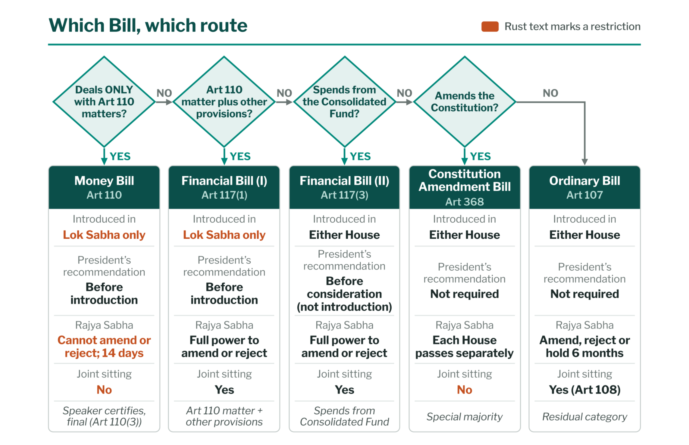

# Legislative Procedure: Ordinary, Money (Art 110), Financial (Art 117) & Amendment Bills, Joint Sitting (Art 108) & Annual Financial Statement (Art 112) — Prelims Notes (Ch08_Sub02_Bills_Money_Bill_Joint_Sitting_and_Budget)

---

### [Prelims Source Page 92](../../pages/prelims/prelims_page_092.pdf)

## CHAPTER 12: BILLS

### THEME ANALYSIS PYQ pattern for this chapter

#### 1. REPEATS

#### A. Money Bill and Financial Bills

- Art 110 covers appropriation from the Consolidated Fund, so the Contingency Fund option is the trap [2018]

- Art 109 gives the Rajya Sabha fourteen days to recommend, never to amend or reject [2013, 2024]

- A Finance Bill that is not a Money Bill can be amended or rejected above [2023]

#### B. Joint Sitting and Deadlock

- Art 108 covers only an Ordinary Bill, never a Money or amendment Bill [2012, 2023]

- It passes by a simple majority of members present and voting [2015]

- Three have been held, on dowry prohibition, banking service and terrorism law

#### C. Introduction, Private Members and Assent

- A Private Member's Bill is moved by any member who is not a minister [2017]

- Prior recommendation of the President is needed for a Money Bill and Financial Bill (I)

- Absolute, suspensive and pocket veto, with no time limit in Art 111.

#### D. Lapsing on Dissolution

- Prorogation never kills a Bill, only dissolution does [2016]

- A Bill pending in the Lok Sabha, or passed by it and waiting above, lapses [2024]

- A Bill pending only in the Rajya Sabha, or carrying a notified joint sitting, survives [2016, 2024]

#### E. Constitutional Amendment Bills

- Art 368 needs a special majority in each House separately [2012]

- Here the Rajya Sabha is equal, unlike in finance [2020]

- Federal entries need ratification by half the States, and the Nari Shakti Vandan Adhiniyam is the live example

#### 2. HOW THE FORMAT HAS CHANGED

- 2012 to 2015: single answer stems on deadlock and joint sitting [2012, 2013, 2015]

- 2016 to 2018: two statement sets on lapsing and Private Members' Bills [2016, 2017]

- 2023 to 2024: "how many" and four statement sets [2023, 2024]

#### 3. WHAT IS BEING ASKED NOW

- Money Bill versus Finance Bill, Art 109 and Art 110 [2023, 2024]

- Lapse on dissolution, including a Bill in a notified joint sitting [2024]

---

### [Prelims Source Page 93](../../pages/prelims/prelims_page_093.pdf)

### PRELIMS PREVIOUS YEAR QUESTIONS

#### Q1 (2024)

**Which of the following statements are correct in respect of a Money Bill in the Parliament?**

- **1.** Article 109 mentions special procedure in respect of Money Bills.
- **2.** A Money Bill shall not be introduced in the Council of States.
- **3.** The Rajya Sabha can either approve the Bill or suggest changes but cannot reject it.
- **4.** Amendments to a Money Bill suggested by the Rajya Sabha have to be accepted by the Lok Sabha.

*SELECT THE ANSWER USING THE CODE GIVEN BELOW:*

- **(a)** 1 and 2 only
- **(b)** 2 and 3 only
- **(c)** 1,2 and 3
- **(d)** 1,3 and 4

> **Answer:** `(c)` · [Prelims Source Page 93](../../pages/prelims/prelims_page_093.pdf)

#### Q2 (2024)

**With reference to the Indian Parliament, consider the following statements:**

- **1.** A Bill pending in the Lok Sabha lapses on its dissolution.
- **2.** A Bill passed by the Lok Sabha and pending in the Rajya Sabha lapses on the dissolution of the Lok Sabha.
- **3.** A Bill in regard to which the President of India notified his/her intention to summon the Houses to a joint sitting lapses on the dissolution of the Lok Sabha.

*Which of the statements given above is/are correct?*

- **(a)** 1 only
- **(b)** 1 and 2
- **(c)** 2 and 3
- **(d)** 3 only

> **Answer:** `(b)` · [Prelims Source Page 93](../../pages/prelims/prelims_page_093.pdf)

#### Q3 (2023)

**With reference to Finance Bill and Money Bill in the Indian Parliament, consider the following statements :**

- **1.** When the Lok Sabha transmits Finance Bill to the Rajya Sabha, it can amend or reject the Bill.
- **2.** When the Lok Sabha transmits Money Bill to the Rajya Sabha, it cannot amend or reject the Bill, it can only make recommendations.
- **3.** In the case of disagreement between the Lok Sabha and the Rajya Sabha, there is no joint sitting for Money Bill, but a joint sitting becomes necessary for Finance Bill.

*How many of the above statements are correct?*

- **(a)** Only one
- **(b)** Only two
- **(c)** All three
- **(d)** None

> **Answer:** `(b)` · [Prelims Source Page 93](../../pages/prelims/prelims_page_093.pdf)

#### Q4 (2020)

**Rajya Sabha has equal powers with Lok Sabha in**

- **(a)** the matter of creating new All India Services
- **(b)** amending the Constitution
- **(c)** the removal of the government
- **(d)** making cut motions

> **Answer:** `(b)` · [Prelims Source Page 93](../../pages/prelims/prelims_page_093.pdf)

#### Q5 (2018)

**Regarding Money Bill, which of the following statements is not correct?**

- **(a)** A Bill shall be deemed to be a Money Bill if it contains only provisions relating to imposition, abolition, remission, alteration or regulation of any tax.
- **(b)** A Money Bill has provisions for the custody of the Consolidated Fund of India or the Contingency Fund of India
- **(c)** A Money Bill is concerned with the appropriation of money out of the Contingency Fund of India
- **(d)** A Money Bill deals with the regulation of borrowing of money or giving of any guarantee by the Government of India.

> **Answer:** `(c)` · [Prelims Source Page 93](../../pages/prelims/prelims_page_093.pdf)

---

### [Prelims Source Page 94](../../pages/prelims/prelims_page_094.pdf)

#### Q6 (2017)

**With reference to the Parliament of India, consider the following statements:**

- **1.** A Private Member’s Bill is a Bill presented by a Member of Parliament who is not elected but only nominated by the President of India.
- **2.** Recently, a Private Member’s Bill has been passed in the Parliament of India for the first time in its history.

*Which of the statements given above is/are correct?*

- **(a)** 1 only
- **(b)** 2 only
- **(c)** Both 1 and 2
- **(d)** Neither 1 nor 2

> **Answer:** `(d)` · [Prelims Source Page 94](../../pages/prelims/prelims_page_094.pdf)

#### Q7 (2016)

**Which of the following statements is/are correct?**

- **1.** A Bill pending in the Lok Sabha lapses on its prorogation.
- **2.** A Bill pending in the Rajya Sabha, which has not been passed by the Lok Sabha, shall not lapse on dissolution of the Lok Sabha.

*Select the correct answer using the code given below.*

- **(a)** 1 only
- **(b)** 2 only
- **(c)** Both 1 and 2
- **(d)** Neither 1 nor 2

> **Answer:** `(b)` · [Prelims Source Page 94](../../pages/prelims/prelims_page_094.pdf)

#### Q8 (2015)

**When a bill is referred to a joint sitting of both the Houses of the Parliament, it has to be passed by**

- **(a)** a simple majority of members present and voting
- **(b)** three-fourths majority of members present and voting
- **(c)** two-thirds majority of the Houses
- **(d)** absolute majority of the Houses

> **Answer:** `(a)` · [Prelims Source Page 94](../../pages/prelims/prelims_page_094.pdf)

#### Q9 (2013)

**What will follow if a Money Bill substantially amended by the Rajya Sabha?**

- **(a)** The Lok Sabha may still proceed with the Bill, accepting or not accepting the recommendations of the Rajya Sabha
- **(b)** The Lok Sabha cannot consider the Bill further
- **(c)** The Lok Sabha may send the Bill to the Rajya Sabha for reconsideration
- **(d)** The President may call a joint sitting for passing the Bill

> **Answer:** `(a)` · [Prelims Source Page 94](../../pages/prelims/prelims_page_094.pdf)

#### Q10 (2012)

**A deadlock between the Lok Sabha and the Rajya Sabha calls for a joint sitting of the Parliament during the passage of**

- **1.** Ordinary Legislation
- **2.** Money Bill
- **3.** Constitutional Amendment Bill Select the correct answer using the codes given below.

- **(a)** 1 only
- **(b)** 2 and 3 only
- **(c)** 1 and 3 only
- **(d)** 1, 2 and 3

> **Answer:** `(a)` · [Prelims Source Page 94](../../pages/prelims/prelims_page_094.pdf)

---

### [Prelims Source Page 95](../../pages/prelims/prelims_page_095.pdf)

| ATTRIBUTE | ORDINARY BILL (OB) | MONEY BILL ART 110 | FINANCIAL BILL (I) | FINANCIAL BILL (II) | CONSTITUTIONAL AMENDMENT BILL |
| --- | --- | --- | --- | --- | --- |
| Article | Art 107 (procedure), 108 (joint sitting), 111 (assent) | Art 110 (definition), 109 (procedure), 111 (assent) | Art 117(1) read with Art 110 | Art 117(3). | Art 368 |
| Definition[PRELIMS 2018] | Deals with any matter other than financial or constitutional amendment subjects. Introduced in either House; passed by simple majority in both. | Deals “ONLY” with matters in Art 110(1)(a)-(g): taxation, borrowing, Consolidated and Contingency Funds, appropriation and audit. Speaker’s certification is final, but subject to judicial review (Rojer Mathew, 2019). | Contains Art 110 matters plus other provisions, so not a Money Bill. Treated like a Money Bill at introduction (only in Lok Sabha, with President’s recommendation); otherwise like an Ordinary Bill. | Involves expenditure from the Consolidated Fund but no Art 110 matter. Treated as an Ordinary Bill, except the President’s recommendation is needed for consideration, not introduction. | Seeks to add, vary or repeal any provision of the Constitution. Needs a special majority; federal provisions also need ratification by half the States. |
| Examples | Digital Personal Data Protection Bill, 2023, regulating the processing of personal data in India. | Aadhaar (Targeted Delivery of Financial and Other Subsidies, Benefits and Services) Bill, 2016, certified a Money Bill by the Speaker and upheld in Puttaswamy, 2018. | Goods and Services Tax (Compensation to States) Amendment Bill, 2017. | National Investigation Agency (Amendment) Bill, 2019. | Constitution (103rd Amendment) Act, 2019 |
| Introduced in | Either House | Lok Sabha only | Lok Sabha only | Either House: only incurs expenditure, imposes no tax, so restriction relaxed | Either House |
| Introduced by[PRELIMS 2017] | Private Member or Minister No fiscal consequence, so the right of private members survives. | Minister only **1.** Only the Council of Ministers is collectively responsible to the Lok Sabha under Art 75(3) for the way public money is raised and spent, so only the executive may commit the Consolidated Fund. | Minister only Same reason as a Money Bill: only the executive may commit the Consolidated Fund. | **1.** Minister only in practice. **2.** The constitutional bar operates at the consideration stage, not at introduction. | Private Member or Minister No fiscal consequence, so the right of private members survives. |

---

### [Prelims Source Page 96](../../pages/prelims/prelims_page_096.pdf)

| ATTRIBUTE | ORDINARY BILL (OB) | MONEY BILL ART 110 | FINANCIAL BILL (I) | FINANCIAL BILL (II) | CONSTITUTIONAL AMENDMENT BILL |
| --- | --- | --- | --- | --- | --- |
| **Introduced by** *(Contd.)* | — | **2.** A private member has no such accountability and therefore cannot open a charge on public revenue. | — | — | — |
| Prior Recommendation of the President | No | Yes, before introduction: reflects executive initiative in finance (Parliament grants supply, does not demand it) and stops the legislature from unilaterally creating liabilities on the Consolidated Fund | Yes, before introduction: since it imposes a charge, it needs clearance before entering the House | No at introduction; Yes at consideration (Art 117(3)): it only incurs expenditure, so it can be introduced freely and needs clearance only when taken up for consideration | No |
| Voting : Lower House | A simple majority of members present and voting | Simple majority | Simple majority | Simple majority | 3 routes: (1) Special majority (2) Special majority + ratification by half the States for federal provisions; (3) Simple majority outside Art 368 for administrative matters (Eg. new States, citizenship, Second Schedule). |
| Voting: Upper House[PRELIMS 2024,2023,2020,20 13] | Full power to amend or reject; can detain up to 6 months, after which a deadlock arises (joint sitting possible). Buys time for reflection without a veto. State Bills: a Legislative Council can delay only up to 4 months (3 + 1), being a weaker, advisory chamber. | Cannot amend or reject; must return within 14 days with or without recommendations, which the Lok Sabha may accept or reject; if not returned, deemed passed. Being indirectly elected, it cannot obstruct the budget cycle; it is a revising and federal chamber, not a coequal in finance. | Same as Ordinary Bill: full power to amend or reject once introduced. | Same as Ordinary Bill: full power to amend or reject. | Must be passed separately by the required majority; no detention, no joint sitting. Rajya Sabha holds an absolute veto, since changing fundamental law needs the consent of the chamber representing the States. |

---

### [Prelims Source Page 97](../../pages/prelims/prelims_page_097.pdf)

| ATTRIBUTE | ORDINARY BILL (OB) | MONEY BILL ART 110 | FINANCIAL BILL (I) | FINANCIAL BILL (II) | CONSTITUTIONAL AMENDMENT BILL |
| --- | --- | --- | --- | --- | --- |
| Voting: Joint Sitting[PRELIMS 2015,2012] | Permitted (Art 108) when the other House rejects the Bill, disagrees on amendments, or 6 months elapse. No new amendments, except those in dispute or made necessary by delay. Weighted towards the larger Lok Sabha (~543 vs ~245). Held only thrice (1961, 1978, 2002), showing it is a reserve power. State Bills: no such provision. | Does not arise, since the Rajya Sabha cannot reject it. | Permitted, since Art 108 excludes only Money Bills. | Permitted | Not allowed: deadlock is the intended outcome; if both Houses cannot separately muster a special majority, the amendment should fail, not be forced through by combined numbers. |
| Veto: Suspensive | Yes: President may return once for reconsideration; if passed again, with or without amendment, assent is obligatory. As a constitutional, not political, executive, the veto ensures reflection, not obstruction; the final word rests with Parliament. | No: President may only assent or withhold, never return; since it comes on his own prior recommendation, returning it would be self-contradictory and stall supply. | Yes | Yes | No: assent mandatory after the 24th Amendment, 1971, enacted after the Golaknath conflict, making the President a formal authenticating authority under Art 368. |
| Veto: Pocket | Yes: Art 111 sets no time limit for assent, unlike the 10-day rule in the US. Eg. Indian Post Office (Amendment) Bill, 1986 under President Zail Singh. Not a designed power but a drafting silence; rare, since the President acts on | No: the President has already recommended the Bill. | No in practice: carries the President’s own prior recommendation. | No in practice | No: Art 368(2) makes assent mandatory. |

---

### [Prelims Source Page 98](../../pages/prelims/prelims_page_098.pdf)

| ATTRIBUTE | ORDINARY BILL (OB) | MONEY BILL ART 110 | FINANCIAL BILL (I) | FINANCIAL BILL (II) | CONSTITUTIONAL AMENDMENT BILL |
| --- | --- | --- | --- | --- | --- |
| **Veto: Pocket** *(Contd.)* | ministerial advice (Art 74(1)), arising only during executive transition or political rupture. | — | — | — | — |
| State ratification: provisions included (proviso to Art 368(2)) | — | — | — | — | — |
| State ratification: provisions excluded | Not applicable. | Not applicable. | Not applicable. | Not applicable. | State ratification under Art 368(2) applies only to Constitutional Amendment Bills and is not applicable to Ordinary, Money or Financial Bills; it requires special majority plus approval by half the States only for federal provisions (like the President’s election, Union-State powers, judiciary, Seventh Schedule and Art 368 itself), while Fundamental Rights (Part III), DPSP (Part IV) and the Preamble need special majority alone, the most tested point being that amending Fundamental Rights needs no State ratification, with the check coming instead from the Basic Structure doctrine; and matters like creating or abolishing a Legislative Council (Art 169) need only a simple majority, as they are expressly not amendments under Art 368. |

---

### [Prelims Source Page 99](../../pages/prelims/prelims_page_099.pdf)

| ATTRIBUTE | ORDINARY BILL (OB) | MONEY BILL ART 110 | FINANCIAL BILL (I) | FINANCIAL BILL (II) | CONSTITUTIONAL AMENDMENT BILL |
| --- | --- | --- | --- | --- | --- |
| Miscellaneous facts | **1.** A Private Member is any member who is not a Minister; the definition turns on office, not on whether he was elected or nominated. **2.** One month's notice of introduction is required, unless the Speaker allows a shorter period. **3.** The last two and a half hours of a sitting on Friday are allotted to private members' business, Bills and Resolutions taking alternate Fridays. **4.** In the Lok Sabha the Committee on Private Members' Bills and Resolutions, chaired by the Deputy Speaker, classifies Bills by nature, urgency and importance and allots time; in the Rajya Sabha the Business Advisory Committee does this. **5.** Record: only 14 Private Members' Bills have ever been passed by Parliament and become law, six of them in 1956 alone. **6.** The last was the Supreme Court (Enlargement of Criminal | Cannot be a Private Member's Bill: it needs the President's prior recommendation and can be introduced only by a Minister. | Cannot be a Private Member's Bill, for the same reason. | May be introduced by a Private Member. | **1.** A Private Member may introduce a Constitutional Amendment Bill, and such Bills are examined by the Committee before introduction. **2.** There is no time limit for ratification by the States, and a State that has ratified cannot withdraw. **3.** Kihoto Hollohan, 1992: Paragraph 7 of the Tenth Schedule fell precisely because it affected Arts 136, 226 and 227 without having been ratified. |

---

### [Prelims Source Page 100](../../pages/prelims/prelims_page_100.pdf)

| ATTRIBUTE | ORDINARY BILL (OB) | MONEY BILL ART 110 | FINANCIAL BILL (I) | FINANCIAL BILL (II) | CONSTITUTIONAL AMENDMENT BILL |
| --- | --- | --- | --- | --- | --- |
| **Miscellaneous facts** *(Contd.)* | Appellate Jurisdiction) Bill, 1968, passed on 9 August 1970. None has been passed since. **7.** The Rights of Transgender Persons Bill, 2014, passed by the Rajya Sabha alone in April 2015, was the first Private Member's Bill cleared by that House in 45 years, but was never passed by the Lok Sabha and so never became law. | — | — | — | — |

---

### [Prelims Source Page 101](../../pages/prelims/prelims_page_101.pdf)

*Diagram Screenshot: [Which Bill, Which Route: Ordinary, Money, Financial & Constitutional Amendment Bills](../../diagrams/pre_diag_bills_route_p101.png) · [Full Source Page 101](../../pages/prelims/prelims_page_101.pdf)*

---

### [Prelims Source Page 102](../../pages/prelims/prelims_page_102.pdf)

### STATUS OF THE BILL WHEN THE LOK SABHA IS DISSOLVED

| Situation | Ordinary | Money | Fin. (I) | Fin. (II) | Const. Amend. | Reason and Example |
| --- | --- | --- | --- | --- | --- | --- |
| **1.** Pending in Lok Sabha (introduced there, or passed by RS and sent to LS) | Lapses | Lapses | Lapses | Lapses | Lapses | Art 107(5): A new House with a fresh mandate isn't bound by old business; Eg. Women's Reservation Bill, 2008, passed by RS (2010), lapsed in LS (2014); GST Bill, 2011 lapsed and was reintroduced in 2014 |
| **2.** Passed by LS, pending in RS | Lapses | Lapses | Lapses | Lapses | Lapses | Art 107(5): the House that passed it no longer exists. Eg. Triple Talaq Bill, 2018 and Citizenship (Amendment) Bill, 2019 lapsed in 2019 |
| **3.** Introduced and pending in RS (not yet sent to LS) [Prelims 2016] | Does not lapse | Not applicable | Not applicable | Does not lapse | Does not lapse | Art 107(4), 83(1): RS is a permanent House. Money and Fin. (I) Bills start only in LS. Eg. Women's Reservation Bill, 2008 was tabled in RS to survive the 2009 dissolution. |
| **4.** Passed by both Houses, awaiting assent or returned | Does not lapse | Does not lapse (cannot be returned) | Does not lapse | Does not lapse | Does not lapse (assent mandatory) | The legislative stage is complete; only assent remains. Eg. Indian Post Office Bill, 1986 (pocket veto) survived; Office of Profit Bill, 2006, returned by Kalam, repassed and assented |
| **5.** Joint sitting notified before dissolution [Prelims 2024] | Does not lapse | Not applicable | Does not lapse | Does not lapse | Not applicable | Art 108(5): joint sitting can be held even after dissolution; no joint sitting for Money or Amendment Bills |
| **6.** Ordinance-replacing Bill | Same rules as above, depending on where it is pending | — | — | — | — | The Ordinance itself lapses six weeks after Parliament reassembles unless replaced (Art 123(2)) |

---

### [Prelims Source Page 103](../../pages/prelims/prelims_page_103.pdf)

### SUPPLEMENTARY NOTES

Absolute Veto of the President Not a discretionary power in normal circumstances. It is used in two situations: (a) Private Members' Bills; (b) Government Bills where the Cabinet resigns after the Bill is passed but before assent, and the new Cabinet advises the President to withhold assent. Classic instance: the PEPSU Appropriation Bill, 1954. Logic: assent is given on aid and advice. Advice from a Council of Ministers that has lost the confidence of the House cannot bind its successor. State Bills and Art 304(b) Bills imposing reasonable restrictions on the freedom of trade, commerce and intercourse within a State can be introduced in a State Legislature only with the prior sanction of the President. The requirement exists to protect the economic unity of India under Art 301, by ensuring that a State cannot erect internal trade barriers without a central check on reasonableness. Reservation of State Bills for the President The Governor may reserve any Bill for the consideration of the President under Art 200. (a) Compulsory: where the Bill derogates from the powers of the High Court and endangers its constitutional position. (b) Needed for protection: a State law on acquisition of estates and property must get the President's assent to be protected by Art 31A and Art 31C. If the President returns such a Bill, the State Legislature must reconsider it within 6 months. Even when it comes back, the President is not obliged to assent. Why: the quasi federal design lets the Union supervise State laws that touch the judiciary or the federal economic order. Current constitutional position on assent timelines April 2025, State of Tamil Nadu v. Governor of Tamil Nadu: a two judge Bench used Art 142 to prescribe timelines and granted deemed assent to ten pending State Bills. 13 May 2025: President Droupadi Murmu referred 14 questions to the Supreme Court under Art 143(1), noting that Art 200 and Art 201 prescribe no deadlines. 20 November 2025, Special Reference No. 1 of 2025 (five judge Constitution Bench headed by CJI B.R. Gavai) held: (a) no judicially imposed timeline can bind the Governor (Art 200) or the President (Art 201); (b) deemed assent has no constitutional basis and cannot be created through Art 142; (c) the President need not seek the Court's opinion under Art 143 for every reserved Bill; (d) judicial review survives only for malafide or wholly inert conduct. Why: separation of powers. A court cannot supply a deadline the framers deliberately left out, or take the place of a constitutional authority in the legislative chain. (Source: Supreme Court of India, Special Reference No. 1 of 2025, 2025 INSC 1333) Money Bill certification under judicial scrutiny Puttaswamy (2018): the Speaker's Money Bill certificate under Art 110(4) is subject to judicial review. Rojer Mathew v. South Indian Bank (2019): whether the Aadhaar Act, 2016 was rightly certified as a Money Bill was referred to a larger Bench, where it remains pending. Why it matters: a Money Bill shuts out the Rajya Sabha. So a wrong label is not a procedural slip; it removes one House from lawmaking. Joint sittings held so far Only three joint sittings so far: 1961: Dowry Prohibition Bill; 1978: Banking Service Commission (Repeal) Bill; 2002: Prevention of Terrorism Bill. The rarity shows the mechanism works mainly as a deterrent that pushes the Houses to compromise, not as an ordinary route to enactment.

---

### [Prelims Source Page 104](../../pages/prelims/prelims_page_104.pdf)

## CHAPTER 13: BUDGET AND BILL PROCEDURE

### THEME ANALYSIS PYQ pattern for this chapter

#### 1. REPEATS

#### A. Annual Financial Statement and Demands for Grants

- The statement under Art 112 is laid on behalf of the President, not the Prime Minister [2024]

- A demand for grant needs the President recommendation, under Art 113 [2024]

- The Rajya Sabha may discuss it but cannot vote on Demands for Grants [2015]

- Defeat of the Budget sends the Council of Ministers out [2011]

#### B. The Three Funds

- Consolidated Fund under Art 266(1), Contingency Fund under Art 267, Public Account under Art 266(2)

- Withdrawal from the Consolidated Fund needs Parliament, through the Appropriation Bill [2011, 2015]

- Public Account disbursements need no authorisation, the government being a banker there [2015]

- The Budget is drafted by the Department of Economic Affairs, not Revenue [2015]

#### C. Appropriation Bill and Finance Bill

- The Appropriation Bill under Art 114 legalises withdrawal, and no amendment may vary the amount

- The Finance Bill carries taxation and must pass within seventy five days

- Both travel as Money Bills, so the Rajya Sabha stays advisory

#### D. Grants Other Than the Annual Grant

- Vote on account under Art 116 funds the gap, and is not a mini budget

- Art 115 carries supplementary, additional and excess grants, with token and exceptional grants

- Parliamentary control runs through these stages, and India has no Parliamentary Budget Office [2012]

- The FRBM Act, 2003 adds statutory discipline

#### 2. HOW THE FORMAT HAS CHANGED

- 2011 to 2015: single answer stems on who controls the funds [2011, 2015]

- 2012: a five item code set on methods of financial control [2012]

- 2024: a two statement set [2024]

#### 3. WHAT IS BEING ASKED NOW

- Who lays and who recommends: the Annual Financial Statement and Art 113(3) [2024]

- The Rajya Sabha's limits on Money Bills and Demands for Grants

### PRELIMS PREVIOUS YEAR QUESTIONS

#### Q1 (2024)

**With reference to Union Budget, consider the following statements:**

- **1.** The Union Finance Minister on behalf of the Prime Minister lays the Annual Financial Statement before both the Houses of Parliament.
- **2.** At the Union level, no demand for a grant can be made except on the recommendation of the President of India.

*Which of the statements given above is/are correct?*

- **(a)** 1 only
- **(b)** 2 only
- **(c)** Both 1 and 2
- **(d)** Neither 1 nor 2

> **Answer:** `(c)` · [Prelims Source Page 104](../../pages/prelims/prelims_page_104.pdf)

#### Q2 (2015)

**Consider the following statements : (1) The Rajya Sabha has no power either to reject or to amend a Money Bill. (2) The Rajya Sabha cannot vote on the Demands for Grants. (3) The Rajya Sabha cannot discuss the Annual Financial Statement. Which of the statements given above is/are correct?**

- **(a)** 1 only
- **(b)** 1 and 2 only
- **(c)** 2 and 3 only
- **(d)** 1, 2 and 3

> **Answer:** `(b)` · [Prelims Source Page 104](../../pages/prelims/prelims_page_104.pdf)

---

### [Prelims Source Page 105](../../pages/prelims/prelims_page_105.pdf)

#### Q3 (2015)

**With reference to the Union Government, consider the following statements : (1) The department of Revenue is responsible for the preparation of Union Budget that is presented to the Parliament. (2) No amount can be withdrawn from the Consolidated Fund of India without the authorization from the Parliament of India. (3) All the disbursements made from Public Account also need the authorization from the Parliament of India. Which of the statements given above is/ are correct?**

- **(a)** 1 and 2 only
- **(b)** 2 and 3 only
- **(c)** 2 only
- **(d)** 1, 2 and 3

> **Answer:** `(c)` · [Prelims Source Page 105](../../pages/prelims/prelims_page_105.pdf)

#### Q4 (2012)

**Which of the following are the methods of Parliamentary control over public finance in India?**

- **1.** Placing Annual Financial Statement before the Parliament.
- **2.** Withdrawal of moneys from Consolidated Fund of India only after passing the Appropriation Bill.
- **3.** Provisions of supplementary grants and vote-on-account.
- **4.** A periodic or at least a mid-year review of programmes of the Government against macroeconomic forecasts and expenditure by a Parliamentary Budget Office.
- **5.** Introducing Finance Bill in the Parliament.

*SELECT THE CORRECT ANSWER USING THE CODE GIVEN BELOW:*

- **(a)** 1, 2, 3 and 5 only
- **(b)** 1, 2 and 4 only
- **(c)** 3, 4 and 5 only
- **(d)** 1, 2, 3, 4 and 5

> **Answer:** `(a)` · [Prelims Source Page 105](../../pages/prelims/prelims_page_105.pdf)

#### Q5 (2011)

**When the annual Union Budget is not passed by the Lok Sabha,**

- **(a)** the Budget is modified and presented again
- **(b)** the Budget is referred to the Rajya Sabha for suggestions
- **(c)** the Union Finance Minister is asked to resign
- **(d)** the Prime Minister submits the resignation of Council of Ministers

> **Answer:** `(d)` · [Prelims Source Page 105](../../pages/prelims/prelims_page_105.pdf)

#### Q6 (2011)

**The authorization for the withdrawal of funds from the Consolidated Fund of India must come from**

- **(a)** The President of India
- **(b)** The Parliament of India
- **(c)** The Prime Minister of India
- **(d)** The Union Finance Minister

> **Answer:** `(b)` · [Prelims Source Page 105](../../pages/prelims/prelims_page_105.pdf)

Annual Financial Statement and Demands for Grants [PRELIMS 2024,2015,2011]

- **1.** Art 112: The President causes the Annual Financial Statement (estimated receipts and expenditure of the Union) to be laid before both Houses; it is presented by the Finance Minister on the President’s behalf.

- **2.** Art 113(1), Charged Expenditure: Expenditure charged on the Consolidated Fund of India can be discussed but not voted. Eg. President’s emoluments, salaries and pensions of Supreme Court judges, pensions of High Court judges, CAG, and debt charges.

- **3.** Art 113(2), Voted Expenditure: Other estimates go as Demands for Grants to the Lok Sabha only, which may assent, refuse, or reduce them; the Rajya Sabha can only discuss.

- **4.** Art 113(3): No Demand for Grant can be made without the President’s recommendation.

- **5.** Test of Confidence: Defeat of the Budget or a Demand for Grant in the Lok Sabha is a loss of confidence, and the Council of Ministers must resign (Art 75(3)). Note: High Court judges’ salaries are charged on the State’s Consolidated Fund; only their pensions are charged on the Consolidated Fund of India.

---

### [Prelims Source Page 106](../../pages/prelims/prelims_page_106.pdf)

Appropriation Bill [PRELIMS 2011]

- **1.** Purpose: After the Lok Sabha votes the Demands for Grants, an Appropriation Bill is introduced to authorise withdrawal from the Consolidated Fund of India for voted grants and charged expenditure.

- **2.** Art 114(3), Core Rule: No money can be withdrawn from the Consolidated Fund without an Appropriation Act; the authority comes from Parliament, not the President, PM or Finance Minister. The executive proposes, Parliament grants.

- **3.** Art 114(2), No Reopening: No amendment can change the amount or purpose of a voted grant, or alter charged expenditure, so the Bill cannot reopen the Demands.

- **4.** Nature: It falls under Art 110(1)(d), so it is a Money Bill, passed under the Art 109 procedure. Finance Bill and Appropriation Bill distinguished

| Basis | Appropriation Bill (Art 114) | Finance Bill |
| --- | --- | --- |
| Purpose | Authorises withdrawal from the Consolidated Fund for voted grants and charged expenditure | Gives effect to taxation proposals: imposing, abolishing, altering or regulating taxes |
| Timing | After the Demands for Grants are voted | Introduced right after the Budget speech |
| Amendment | Not allowed to change amount or purpose of grants, as Demands are already voted | Allowed, including to reject or reduce a tax |
| Nature | Money Bill (Art 110(1)(d)) | Usually a Money Bill becomes contestable if it includes non-Art 110 matters (Eg. tribunal provisions in Finance Act, 2017, referred to a larger bench in Rojer Mathew, 2019) |

Consolidated Fund, Contingency Fund and Public Account [PRELIMS 2015]

- **1.** Consolidated Fund of India (Art 266(1)): Receives all revenues, loans raised (treasury bills, loans, ways and means advances) and loan repayments. No withdrawal without parliamentary appropriation (Art 114(3)).

- **2.** Contingency Fund of India (Art 267): Placed at the President’s disposal, operated by the Finance Secretary on his behalf. An imprest for unforeseen expenditure, recouped once Parliament votes a supplementary grant. Corpus raised from ₹500 crore to ₹30,000 crore by the Finance Act, 2021.

- **3.** Public Account of India (Art 266(2)): Holds money the government keeps as banker or trustee, not owner: provident funds, small savings, deposits, remittances. Withdrawals by executive action; no parliamentary appropriation needed (often inverted in questions). Note: Budget Preparation: By the Budget Division, Department of Economic Affairs, not the Department of Revenue. Grants other than the annual grant: Art 115 and Art 116 A. Art 115: Supplementary, Additional and Excess Grants

- **1.** Supplementary Grant: When the amount sanctioned for a service in the current year proves insufficient.

- **2.** Additional Grant: For new expenditure on a new service not included in that year’s Budget.

- **3.** Excess Grant: When money already spent exceeds the grant in a past year; voted after the year ends, only after Public Accounts Committee approval. The only grant regularised retrospectively. B. Art 116: Exceptional Grants

- **4.** Vote on Account: Advance from the Consolidated Fund for part of the year until the Appropriation Bill passes; usually for two months (longer in election years).

- **5.** Vote of Credit: For unexpected demands too large or uncertain to detail, like a national emergency; effectively a blank cheque.

- **6.** Exceptional Grant: For a special purpose outside the normal services of any year.

#### C. Token Grant (by practice, not in the Constitution)

- **7.** When new expenditure can be met by reappropriating savings within an existing grant, a token sum of ₹1 is voted just to secure Parliament’s approval.

---

### [Prelims Source Page 107](../../pages/prelims/prelims_page_107.pdf)

Budget stages and parliamentary control over public finance [PRELIMS 2012]

- **1.** The Union Budget passes through six stages: (a) Presentation of the Annual Financial Statement. (b) General discussion in both Houses, with no motion and no vote. (c) Scrutiny by the Departmentally Related Standing Committees. (d) Voting on Demands for Grants, in the Lok Sabha alone. Cut motions (Disapproval of Policy, Economy, Token) may be moved; undiscussed Demands are put to vote together under the guillotine. (e) Passing of the Appropriation Bill (Art 114). (f) Passing of the Finance Bill, which gives effect to the tax proposals. Its declared provisions take effect at once under the Provisional Collection of Taxes Act, but lapse if the Bill is not passed within 75 days.

- **2.** Article 116 provides the interim devices: a Vote on Account, an advance grant from the Consolidated Fund to meet expenditure for a part of the financial year pending the passing of the Appropriation Act, together with votes of credit and exceptional grants.

- **3.** Article 115 provides for supplementary, additional and excess grants, excess grants being examined first by the Public Accounts Committee.

- **4.** Post-budgetary control runs through the Comptroller and Auditor General under Article 148 and the financial committees.

- **5.** India has no Parliamentary Budget Office, so a periodic or mid-year review of programmes against macroeconomic forecasts by such a body is not a mode of parliamentary control here. The three readings: stages an Ordinary Bill passes through in each House

- **1.** First Reading (Introduction)

- Mover seeks leave to introduce; if opposed, brief statements from both sides, then the question is put.

- Introduction + publication in the Gazette completes it.

- If published before introduction, no leave is needed.

- **2.** Second Reading (Most important stage)

- Stage 1, General discussion on the Bill’s principles; the House may:

- take it into consideration at once,

- refer it to a Select Committee of that House,

- refer it to a Joint Committee of both Houses (with the other House’s concurrence), or

- circulate it for public opinion.

- The presiding officer may also refer it to a Departmentally Related Standing Committee, whose report is advisory.

- Stage 2, Clause-by-clause consideration: Amendments are moved and voted; the core of Parliament’s influence on legislation.

- **3.** Third Reading (Passage)

- Debate limited to accepting or rejecting the Bill as a whole.

- Only formal, verbal or consequential amendments allowed; passed by the required majority. Final Step: Sent to the other House for all three stages, then for President’s assent under Art 111.
