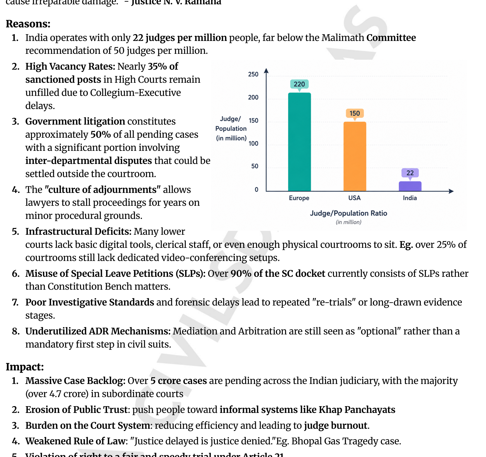

### [Smash Mains Source Page 180](../../pages/mains/mains_page_180.pdf)

### [Smash Mains Source Page 180](../../pages/mains/mains_page_180.pdf)

*Diagram Screenshot: [Judge-to-Population Ratio & Judicial Vacancies in India](../../diagrams/mains_diag_judge_population_ratio_p180.png) · [Full Source Page 180](../../pages/mains/mains_page_180.pdf)*

### Judicial Pendency

"The issue of judicial pendency is a ticking bomb. Unless we collectively act to defuse it, it will explode and cause irreparable damage." - Justice N. V. Ramana

### Reasons

- **1.** India operates with only 22 judges per million people, far below the Malimath Committee recommendation of 50 judges per million.

- **2.** High Vacancy Rates: Nearly 35% of sanctioned posts in High Courts remain unfilled due to Collegium-Executive delays.

- **3.** Government litigation constitutes approximately 50% of all pending cases with a significant portion involving inter-departmental disputes that could be settled outside the courtroom.

- **4.** The "culture of adjournments" allows lawyers to stall proceedings for years on minor procedural grounds.

- **5.** Infrastructural Deficits: Many lower courts lack basic digital tools, clerical staff, or even enough physical courtrooms to sit. Eg. over 25% of courtrooms still lack dedicated video-conferencing setups.

- **6.** Misuse of Special Leave Petitions (SLPs): Over 90% of the SC docket currently consists of SLPs rather than Constitution Bench matters.

- **7.** Poor Investigative Standards and forensic delays lead to repeated "re-trials" or long-drawn evidence stages.

- **8.** Underutilized ADR Mechanisms: Mediation and Arbitration are still seen as "optional" rather than a mandatory first step in civil suits.

### Impact

- **1.** Massive Case Backlog: Over 5 crore cases are pending across the Indian judiciary, with the majority (over 4.7 crore) in subordinate courts

- **2.** Erosion of Public Trust: push people toward informal systems like Khap Panchayats

- **3.** Burden on the Court System: reducing efficiency and leading to judge burnout.

- **4.** Weakened Rule of Law: "Justice delayed is justice denied."Eg. Bhopal Gas Tragedy case.

- **5.** Violation of right to a fair and speedy trial under Article 21

- **6.** Prison Overcrowding: Undertrials constitute 73.5% of the prison population (3.9 lakh). Prisons operate at 131% capacity

- **7.** Economic Loss: Eg. India ranked 163rd in contract enforcement in EoDB rankings

- **8.** Social Disruptions: Delays in family law cases (divorce, child custody etc.) cause mental distress and family instability.

### Steps Taken

1. e-Courts Phase III: focusing on "Integrated Digital Courts" and paperless filing.

- **2.** 774 Fast Track Special Courts are operational for time-bound trials of heinous crimes.
