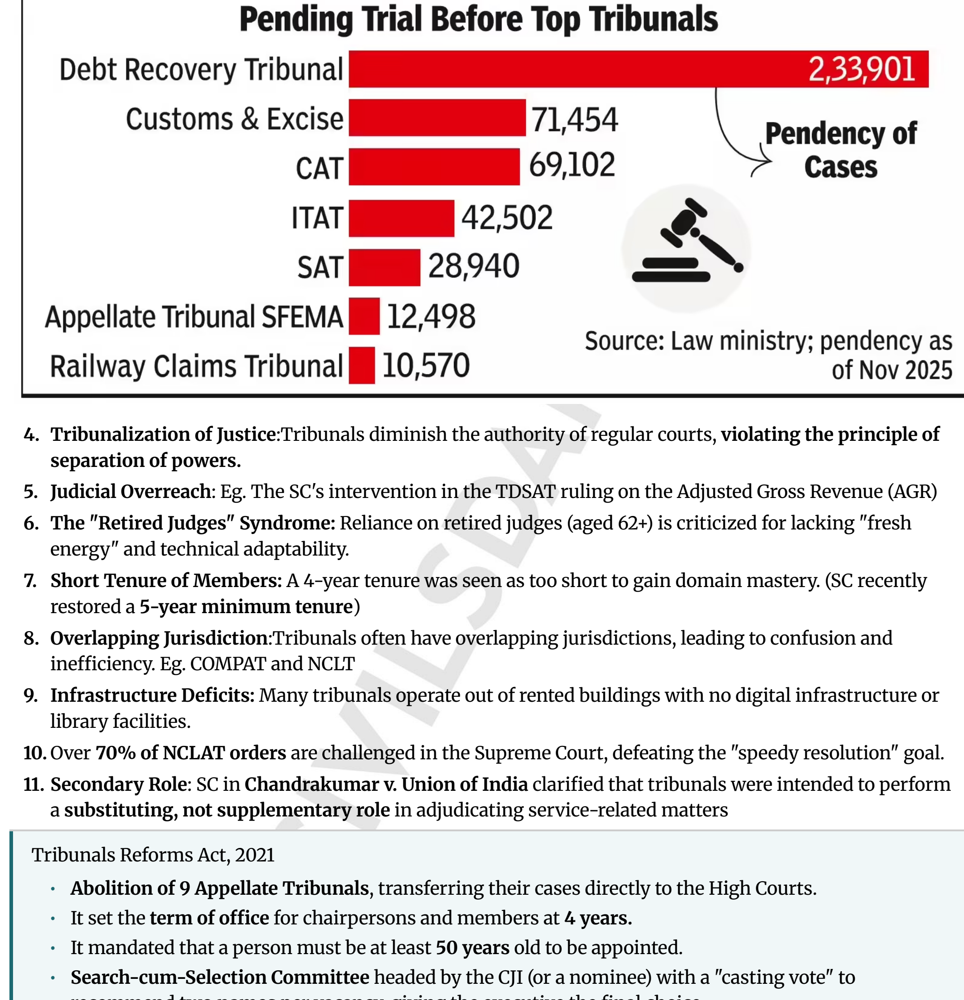

### [Smash Mains Source Page 190](../../pages/mains/mains_page_190.pdf)

### [Smash Mains Source Page 190](../../pages/mains/mains_page_190.pdf)

*Diagram Screenshot: [Justice Jammed: Pending Trials Before Top Tribunals in India](../../diagrams/mains_diag_tribunals_pendency_p190.png) · [Full Source Page 190](../../pages/mains/mains_page_190.pdf)*

- **4.** Tribunalization of Justice:Tribunals diminish the authority of regular courts, violating the principle of separation of powers.

- **5.** Judicial Overreach: Eg. The SC's intervention in the TDSAT ruling on the Adjusted Gross Revenue (AGR)

- **6.** The "Retired Judges" Syndrome: Reliance on retired judges (aged 62+) is criticized for lacking "fresh energy" and technical adaptability.

- **7.** Short Tenure of Members: A 4-year tenure was seen as too short to gain domain mastery. (SC recently restored a 5-year minimum tenure)

- **8.** Overlapping Jurisdiction:Tribunals often have overlapping jurisdictions, leading to confusion and inefficiency. Eg. COMPAT and NCLT

- **9.** Infrastructure Deficits: Many tribunals operate out of rented buildings with no digital infrastructure or library facilities.

- **10.** Over 70% of NCLAT orders are challenged in the Supreme Court, defeating the "speedy resolution" goal.

- **11.** Secondary Role: SC in Chandrakumar v. Union of India clarified that tribunals were intended to perform a substituting, not supplementary role in adjudicating service-related matters Tribunals Reforms Act, 2021

- Abolition of 9 Appellate Tribunals, transferring their cases directly to the High Courts.

- It set the term of office for chairpersons and members at 4 years.

- It mandated that a person must be at least 50 years old to be appointed.

- Search-cum-Selection Committee headed by the CJI (or a nominee) with a "casting vote" to recommend two names per vacancy, giving the executive the final choice.

- Mandated appointments within three months of the committee's recommendation.

### Major SC Judgments on Tribunals

- **1.** Tribunal Reforms Act Case (Nov 2025): The SC struck down several sections of the 2021 Act as unconstitutional. It struck down

  - **a.** Minimum age requirement of 50 years
