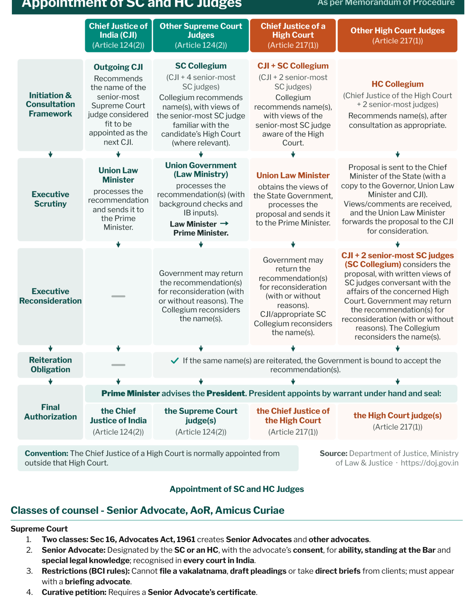

### [Prelims Source Page 131](../../pages/prelims/prelims_page_131.pdf)

### [Prelims Source Page 131](../../pages/prelims/prelims_page_131.pdf)

*Diagram Screenshot: [Appointment of Supreme Court and High Court Judges (Collegium Process)](../../diagrams/pre_diag_judges_appointment_p131.png) · [Full Source Page 131](../../pages/prelims/prelims_page_131.pdf)*

Appointment of SC and HC Judges Classes of counsel - Senior Advocate, AoR, Amicus Curiae Supreme Court

- **1.** Two classes: Sec 16, Advocates Act, 1961 creates Senior Advocates and other advocates.

- **2.** Senior Advocate: Designated by the SC or an HC, with the advocate’s consent, for ability, standing at the Bar and special legal knowledge; recognised in every court in India.

- **3.** Restrictions (BCI rules): Cannot file a vakalatnama, draft pleadings or take direct briefs from clients; must appear with a briefing advocate.

- **4.** Curative petition: Requires a Senior Advocate’s certificate.
