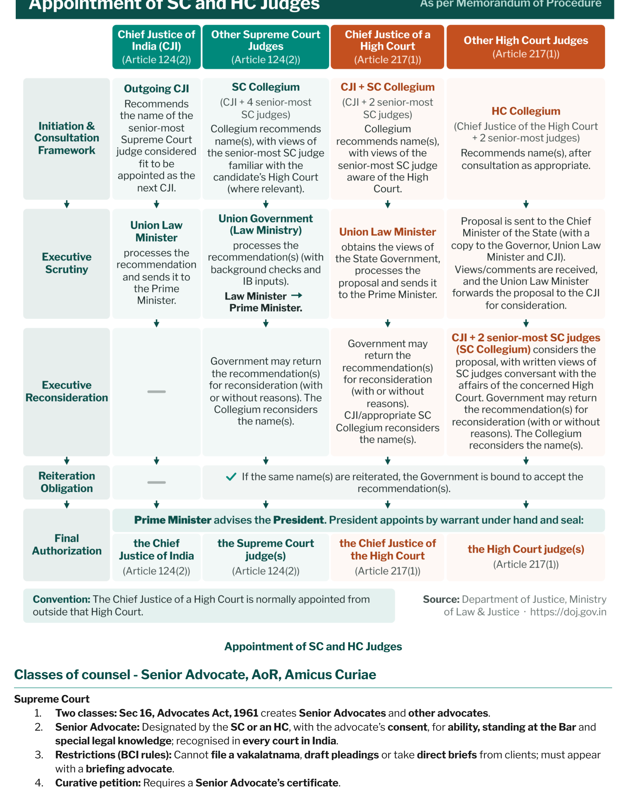

# Supreme Court & High Courts: Collegium System vs NJAC, Removal of Judges, Jurisdictions (Art 131–143), Judicial Review & Judicial Overreach — Prelims Notes (Ch09_Sub01_SC_HC_Collegium_Appointments_Jurisdiction_Judicial_Review)

---

### [Prelims Source Page 121](../../pages/prelims/prelims_page_121.pdf)

## CHAPTER 16: SC VS HC

### THEME ANALYSIS PYQ pattern for this chapter

#### 1. REPEATS

#### A. Jurisdiction and Writs

- Original jurisdiction under Article 131: Centre versus State disputes only, not election disputes [2012, 2014]

- Writs by target: Prohibition to a lower court, Mandamus needs a public duty, Quo Warranto has open locus standi [2022, 2024]

- Advisory jurisdiction under Article 143 works only on a Presidential reference [2010]

#### B. Judicial Review and Article 142

- Judicial review tests constitutionality of laws and executive orders, not wisdom [2017]

- Basic Structure is nowhere defined [2020]; a High Court may void a central law [2019]

- Article 142 is not fettered by ordinary statutes [2019]; the Court is custodian of the Constitution [2015]

#### C. Appointment, Removal, Independence

- Parliament raises the strength of the Supreme Court [2014]

- Impeachment detail lives in the Judges (Inquiry) Act, 1968 [2019]; retired judges recalled [2021]

- Autonomy props: consultation with the Chief Justice of India, salaries on the Consolidated Fund of India [2012]

#### D. Contempt, the Bar and the Shape of the Courts

- Articles 129 and 215 make the Supreme Court and every High Court courts of record; the Contempt of Courts Act, 1971 followed the H.N. Sanyal Committee [2022]

- The Bar Council of India under the Advocates Act, 1961 frames the rules on legal education and professional conduct [2022]

- A single High Court may serve more than one State or Union territory [2008]

- Senior Advocate, Advocate on Record and Amicus Curiae are distinct classes of counsel, and only an Advocate on Record may file in the Supreme Court

- Also tested: judicial custody [2021], Krishna Iyer and PIL [2008], persons and posts [2008]

#### 2. HOW THE FORMAT HAS CHANGED

- 2008 to 2015: single answer and code sets on jurisdiction and structure [2008, 2009, 2010, 2012, 2014, 2015]

- 2017 to 2022: doctrine in two statement sets, on judicial review, Art 142, Basic Structure and contempt [2017, 2019, 2020, 2021, 2022]

- 2024: a single answer writ question [2024]

#### 3. WHAT IS BEING ASKED NOW

- Writs: against whom they lie [2022, 2024]

- Statute versus Constitution: contempt and Bar Councils [2022], judicial custody [2021]

---

### [Prelims Source Page 122](../../pages/prelims/prelims_page_122.pdf)

### PRELIMS PREVIOUS YEAR QUESTIONS

#### Q1 (2024)

**A Writ of Prohibition is an order issued by the Supreme Court or High Courts to:**

- **(a)** A government officer prohibiting him from taking a particular action.
- **(b)** The Parliament/Legislative Assembly to pass a law on Prohibition.
- **(c)** The lower court prohibiting continuation of proceedings in a case.
- **(d)** The Government prohibiting it from following an unconstitutional policy.

> **Answer:** `(c)` · [Prelims Source Page 122](../../pages/prelims/prelims_page_122.pdf)

#### Q2 (2022)

**With reference to the writs issued by the Courts in India, consider the following statements :**

- **1.** Mandamus will not lie against a private organisation unless it is entrusted with a public duty.
- **2.** Mandamus will not lie against a Company even though it may be a Government Company.
- **3.** Any public minded person can be a petitioner to move the Court to obtain the writ of Quo Warranto.

*Which of the statements given above are correct ?*

- **(a)** 1 and 2 only
- **(b)** 2 and 3 only
- **(c)** 1 and 3 only
- **(d)** 1, 2 and 3

> **Answer:** `(c)` · [Prelims Source Page 122](../../pages/prelims/prelims_page_122.pdf)

#### Q3 (2022)

**Consider the following statements :**

- **1.** Pursuant to the report of H.N. Sanyal Committee, the Contempt of Courts Act, 1971 was passed.
- **2.** The Constitution of India empowers the Supreme Court and the High Courts to punish for contempt of themselves.
- **3.** The Constitution of India defines Civil Contempt and Criminal Contempt.
- **4.** In India, the Parliament is vested with the powers to make laws on Contempt of Court.

*Which of the statements given above is/are correct?*

- **(a)** 1 and 2 only
- **(b)** 1, 2 and 4
- **(c)** 3 and 4 only
- **(d)** 3 only

> **Answer:** `(b)` · [Prelims Source Page 122](../../pages/prelims/prelims_page_122.pdf)

#### Q4 (2022)

**With reference to India, consider the following statements :**

- **1.** Government law officers and legal firms are recognised as advocates, but corporate lawyers and patent attorneys are excluded from recognition as advocates.
- **2.** Bar Councils have the power to lay down the rules relating to legal education and recognition of law colleges.

*Which of the statements given above is/are correct ?*

- **(a)** 1 only
- **(b)** 2 only
- **(c)** Both 1 and 2
- **(d)** Neither 1 nor 2

> **Answer:** `(b)` · [Prelims Source Page 122](../../pages/prelims/prelims_page_122.pdf)

#### Q5 (2021)

**With reference to the Indian judiciary, consider the following statements:**

- **1.** Any retired judge of the Supreme Court of India can be called back to sit and act as a Supreme Court judge by the Chief Justice of India with prior permission from the President of India.
- **2.** A High Court in India has the power to review its own judgment, as the Supreme Court does.

*Which of the statements given above is/are correct?*

- **(a)** 1 only
- **(b)** 2 only
- **(c)** Both 1 and 2
- **(d)** Neither 1 nor 2

> **Answer:** `(a)` · [Prelims Source Page 122](../../pages/prelims/prelims_page_122.pdf)

#### Q6 (2021)

**With reference to India, consider the following statements:**

- **1.** Judicial custody means an accused is in the custody of the concerned magistrate, and such an accused is locked up in the police station, not in jail.
- **2.** During judicial custody, the police officer in charge of the case is not allowed to interrogate the suspect without the approval of the court.

*Which of the statements given above is/are correct?*

- **(a)** 1 only
- **(b)** 2 only
- **(c)** Both 1 and 2
- **(d)** Neither 1 nor 2

> **Answer:** `(b)` · [Prelims Source Page 122](../../pages/prelims/prelims_page_122.pdf)

---

### [Prelims Source Page 123](../../pages/prelims/prelims_page_123.pdf)

#### Q7 (2020)

**Consider the following statements:**

- **1.** The Constitution of India defines its ‘Basic Structure’ in terms of federalism, secularism, fundamental rights and democracy.
- **2.** The Constitution of India provides for ‘judicial review’ to safeguard the citizens’ liberties and to preserve the ideals on which the Constitution is based.

*Which of the statements given above is/are correct?*

- **(a)** 1 only
- **(b)** 2 only
- **(c)** Both 1 and 2
- **(d)** Neither 1 nor 2

> **Answer:** `(d)` · [Prelims Source Page 123](../../pages/prelims/prelims_page_123.pdf)

#### Q8 (2019)

**Consider the following statements:**

- **1.** The- motion to impeach a Judge of the Supreme Court of India cannot be rejected by the Speaker of the Lok Sabha as per the Judges (Inquiry) Act,
- 1968.
- **2.** The Constitution of India defines and gives details of what Constitutes 'incapacity and proved misbehaviour' of the Judges of the Supreme Court of India.
- **3.** The details of the process of impeachment of the Judges of the Supreme Court of India are given in the Judges (Inquiry) Act, 1968.
- **4.** If the motion for the impeachment of a Judge is taken up for voting, the law requires the motion to be backed by each House of the Parliament and supported by a majority of total membership of that House and by not less than two-thirds of total members of that House present and voting.

*Which of the statements given above is/are correct?*

- **(a)** 1 and 2
- **(b)** 3 only
- **(c)** 3 and 4 only
- **(d)** 1, 3 and 4

> **Answer:** `(c)` · [Prelims Source Page 123](../../pages/prelims/prelims_page_123.pdf)

#### Q9 (2019)

**With reference to the Constitution of India, consider the following statements:**

- **1.** No High Court shall have the jurisdiction to declare any central law to be constitutionally invalid.
- **2.** An amendment to the Constitution of India cannot be called into question by the Supreme Court of India.

*Which of the statements given above is / are correct?*

- **(a)** 1 only
- **(b)** 2 only
- **(c)** Both 1 and 2
- **(d)** Neither 1 nor 2

> **Answer:** `(d)` · [Prelims Source Page 123](../../pages/prelims/prelims_page_123.pdf)

#### Q10 (2019)

**With reference to the Constitution of India, prohibitions or limitations or provisions contained in ordinary laws cannot act as prohibitions or limitations on the constitutional powers under Article 142. It could mean which one of the following?**

- **(a)** The decisions taken by the Election Commission of India while discharging its duties cannot be challenged in any court of law.
- **(b)** The Supreme Court of India is not constrained in the exercise of its powers by laws made by the Parliament.
- **(c)** In the event of grave financial crisis in the country, the President of India can declare Financial Emergency without the counsel from the Cabinet.
- **(d)** State Legislatures cannot make laws on certain matters without the concurrence of Union Legislature.

> **Answer:** `(b)` · [Prelims Source Page 123](../../pages/prelims/prelims_page_123.pdf)

#### Q11 (2017)

**In India, Judicial Review implies**

- **(a)** the power of the Judiciary to pronounce upon the constitutionality of laws and executive orders.
- **(b)** the power of the Judiciary to question the wisdom of the laws enacted by the Legislatures.
- **(c)** the power of the Judiciary to review- all the legislative enactments before they – are assented to by the President.
- **(d)** the power of the Judiciary to review its own judgements given earlier in similar or different cases

> **Answer:** `(a)` · [Prelims Source Page 123](../../pages/prelims/prelims_page_123.pdf)

#### Q12 (2015)

**Who/Which of the following is the custodian of the Constitution of India?**

- **(a)** The President of India
- **(b)** The Prime Minister of India
- **(c)** The Lok Sabha Secretariat
- **(d)** The Supreme Court of India

> **Answer:** `(d)` · [Prelims Source Page 123](../../pages/prelims/prelims_page_123.pdf)

#### Q13 (2014)

**The power to increase the number of judges in the Supreme Court of India is vested in?**

- **(a)** The President of India.
- **(b)** The Parliament.
- **(c)** The Chief Justice of India.
- **(d)** The Law Commission.

> **Answer:** `(b)` · [Prelims Source Page 123](../../pages/prelims/prelims_page_123.pdf)

---

### [Prelims Source Page 124](../../pages/prelims/prelims_page_124.pdf)

#### Q14 (2014)

**The power of the Supreme Court of India to decide disputes between the Centre and the States falls under its:**

- **(a)** advisory jurisdiction
- **(b)** appellate jurisdiction
- **(c)** original jurisdiction
- **(d)** writ jurisdiction

> **Answer:** `(c)` · [Prelims Source Page 124](../../pages/prelims/prelims_page_124.pdf)

#### Q15 (2012)

**Which of the following are included in the original jurisdiction of the Supreme Court?**

- **1.** A dispute between the Government of India and one or more States
- **2.** A dispute regarding elections to either House of the Parliament or that of Legislature of a State
- **3.** A dispute between the Government of India and a Union Territory
- **4.** A dispute between two or more States Select the correct answer using the code given below:

- **(a)** 1 and 2 only
- **(b)** 2 and 3 only
- **(c)** 1 and 4 only
- **(d)** 3 and 4 only

> **Answer:** `(c)` · [Prelims Source Page 124](../../pages/prelims/prelims_page_124.pdf)

#### Q16 (2012)

**What is the provision to safeguard the autonomy of the Supreme Court of India?**

- **1.** While appointing the Supreme Court Judges, the President of India has to consult the Chief Justice of India.
- **2.** The Supreme Court Judges can be removed by the Chief Justice of India only.
- **3.** The salaries of the Judges are charged on the Consolidated Fund of India to which the legislature does not have to vote.
- **4.** All appointments of officers and staff of the Supreme Court of India are made by the Government only after consulting the Chief Justice of India.

*Which of the statements given above is/are correct?*

- **(a)** 1 and 3 only
- **(b)** 3 and 4 only
- **(c)** 4 only
- **(d)** 1, 2, 3 and 4

> **Answer:** `(a)` · [Prelims Source Page 124](../../pages/prelims/prelims_page_124.pdf)

#### Q17 (2010)

**Consider the following statements : The Supreme Court of India tenders advice to the President of India on matters of law or fact**

- **1.** on its own initiative (on any matter of larger public interest).
- **2.** if he seeks such an advice.
- **3.** only if the matters relate to the Fundamental Rights of the citizens.

*Which of the statements given above is/are correct ?*

- **(a)** 1 only
- **(b)** 2 only
- **(c)** 3 only
- **(d)** 1 and 2 only

> **Answer:** `(b)` · [Prelims Source Page 124](../../pages/prelims/prelims_page_124.pdf)

#### Q18 (2009)

**Consider the following statements :**

- **1.** The Advocate General of a State in India is appointed by the President of India upon the recommendation of the Governor of the concerned State.
- **2.** As provided in Civil Procedure Code, High Courts have original, appellate and advisory jurisdiction at the State level.

*Which of the statements given above is/are correct ?*

- **(a)** 1 only
- **(b)** 2 only
- **(c)** Both 1 and 2
- **(d)** Neither 1 nor 2

> **Answer:** `(d)` · [Prelims Source Page 124](../../pages/prelims/prelims_page_124.pdf)

#### Q19 (2008)

**How many High Courts in India have jurisdiction over more than one State (Union Territories not included)?**

- **(a)** 2
- **(b)** 3
- **(c)** 4
- **(d)** 5

> **Answer:** `(b)` · [Prelims Source Page 124](../../pages/prelims/prelims_page_124.pdf)

#### Q20 (2008)

**Consider the following statements:**

- **1.** Justice V.R. Krishna Iyer was the Chief Justice of India.
- **2.** Justice V.R. Krishna Iyer is considered as one of the progenitors of public interest litigation (PIL) in the Indian judicial system.

*Which of the statements given above is/are correct?*

- **(a)** 1 only
- **(b)** 2 only
- **(c)** Both 1 and 2
- **(d)** Neither 1 nor 2

> **Answer:** `(b)` · [Prelims Source Page 124](../../pages/prelims/prelims_page_124.pdf)

---

### [Prelims Source Page 125](../../pages/prelims/prelims_page_125.pdf)

#### Q21 (2008)

**Match List I (Person) with List II (Position) and select the correct answer using the codes given below the lists:**

- **A.** Nagendra Singh : 1. Chief Election Commissioner of India
- **B.** A.N. Ray : 2. President, International Court of Justice
- **C.** R.K. Trivedi : 3. Chief Justice of India
- **D.** Ashok Desai : 4. Attorney General of India

*Codes (A B C D):*

- **(a)** 1 4 2 3
- **(b)** 2 3 1 4
- **(c)** 1 3 2 4
- **(d)** 2 4 1 3

> **Answer:** `(b)` · [Prelims Source Page 125](../../pages/prelims/prelims_page_125.pdf)

| Attribute | Supreme Court | High Court | Subordinate Courts |
| --- | --- | --- | --- |
| Introduction [Prelims 2008] | Single integrated judicial system (enforcing Central and State laws), from the GoI Act, 1935. SC at the top, inaugurated 28 January 1950. Arts 124-147, Part V (Ch IV) | Below SC, above subordinate courts; top court of a State. Arts 214-231, Part VI (Ch V). First HCs: Calcutta, Bombay, Madras (1862); Allahabad (1866). Art 214: one HC per State; 7th Amendment, 1956 allowed common HCs. 25 HCs; 3 common to two or more States (Bombay, Guwahati, Punjab and Haryana). Delhi is the only UT with its own HC (since 1966) | Hierarchy under each HC; a District Court in every district with lower courts below. Arts 233-237, Part VI (Ch VI) |
| Structure [Prelims 2014] | 38 (CJI + 37) under the SC (Number of Judges) Act, 1956, amended in 2026 (Ordinance 16 May 2026, Act assented 11 August 2026). Began with CJI + 7 (1950); CJI + 33 from 2019. Parliament changes number by law (Art 124(1)) | Chief Justice + other judges as the President decides (Art 216); no fixed number. All HCs together about 1,122; Allahabad is the largest | District Judge (civil) = Sessions Judge (criminal). Below: Civil Judge (Sr Div) / CJM; Civil Judge (Jr Div) / Judicial Magistrate. Metropolitan Magistrates in metro cities |
| Seat and Benches | New Delhi; Art 130 allows sittings elsewhere (CJI + President’s approval), never used. Law Commission (95th, 125th, 229th) urged regional benches; SC rejected | Principal seat plus benches: Eg. Allahabad at Lucknow; Bombay at Nagpur, Aurangabad, Panaji; MP at Indore, Gwalior; Madras at Madurai | District and sub-divisional courts |
| Qualifications | Art 124(3): Citizen, and 5 years as HC judge, or 10 years as HC advocate, or a distinguished jurist (President’s opinion) | Art 217(2): Citizen, and 10 years in judicial office, or 10 years as HC advocate. No minimum age; no distinguished jurist category | District Judge (Art 233(2)): Not in govt service; advocate/pleader for 7 years; recommended by HC |
| Oath | Before the President or his appointee (Art 124(6)) | Before the Governor or his appointee (Art 219) | No constitutional oath; State rules |

---

### [Prelims Source Page 126](../../pages/prelims/prelims_page_126.pdf)

| Attribute | Supreme Court | High Court | Subordinate Courts |
| --- | --- | --- | --- |
| Appointment | CJI: by President; by convention senior-most judge, on outgoing CJI’s recommendation. Others: by President on Collegium (CJI + 4) recommendation. Second (1993), Third (1998), Fourth (2015, NJAC struck down) Judges Cases | Chief Justice(CJ): by President after consulting CJI and Governor. Others: also consults HC CJ. In practice via SC Collegium (CJI + 2) and HC Collegium | District Judges: Governor + HC (Art 233). Others: Governor + SPSC and HC (Art 234). HC controls them (Art 235) |
| Tenure | No fixed tenure; till 65 (Art 124(2A) for age disputes); resign to President; removal by President on Parliament’s address | No fixed tenure; till 62; resign to President; removal like SC judge; vacates on appointment to SC or transfer | State service rules |
| Removal [Prelims 2019] | Art 124(4): By President after an address by each House by special majority (majority of total membership + 2/3 present and voting), in the same session. Grounds: proved misbehaviour or incapacity. No SC judge removed so far | Art 218: Same manner and grounds | HC disciplinary control (Art 235); removal by Governor on HC’s recommendation |
| Removal Procedure (Judges (Inquiry) Act, 1968) | **1.** Motion signed by 100 LS or 50 RS members. **2.** The Speaker/Chairman may admit or refuse. **3.** Three-member committee: CJI/SC judge, HC Chief Justice, distinguished jurist. **4.** If found guilty, House considers a motion. **5.** Passed by special majority in each House; address to President. **6.** President orders removal | Same procedure | Not applicable |
| Original Jurisdiction [Prelims 2014, 2012] | Exclusive: Federal disputes (Art 131); election disputes of President and VP (Art 71) | Election petitions of MPs and MLAs; admiralty, will, marriage, divorce, company law, contempt | Original civil and criminal trials |
| Writ Jurisdiction [Prelims 2024, 2022] | Art 32: Original, not exclusive; only for FRs | Art 226: Wider; for FRs and other legal rights | No writ jurisdiction |
| Appellate: Constitutional | Art 132: If HC certifies a substantial question of constitutional interpretation | Art 228: Withdraws such cases from subordinate courts. Trap: Art 228A (42nd Amdt) omitted by the 43rd Amendment, 1977 (w.e.f. 13 April 1978) | Must refer such questions to the HC |
| Appellate: Civil | Art 133: If HC certifies (Art 134A): substantial question of law of general importance that needs SC decision. No monetary limit since 30th Amendment, 1972 | First appeals on law and facts above a monetary limit; second appeals on law only; intra-court appeals (single judge to division bench, Letters Patent) in Calcutta, Bombay, Madras and others; | District Judge hears appeals from lower civil courts |

---

### [Prelims Source Page 127](../../pages/prelims/prelims_page_127.pdf)

| Attribute | Supreme Court | High Court | Subordinate Courts |
| --- | --- | --- | --- |
| **Appellate: Civil** *(Contd.)* | — | tribunal appeals to division bench first (L. Chandra Kumar, 1997). Trap: NGT, AFT appeals go directly to SC | — |
| Appellate: Criminal | Art 134: As of right if HC reversed acquittal and gave death, or withdrew case and gave death; not a right if HC merely certifies. Conviction reversed to acquittal: no right. 1970 Enlargement Act extended right to life or 10+ years | Appeals from Sessions Courts where sentence exceeds 7 years; death sentences must be confirmed by HC; certain appeals from Asst Sessions Judges and Magistrates under CrPC 1973 (now BNSS 2023) | Sessions Court hears appeals from Magistrates |
| Special Leave (Art 136) | Discretionary; against any judgment/order of any court or tribunal (except military tribunals, courts martial); final or interlocutory | No equivalent | No equivalent |
| Advisory [Prelims 2010] | Art 143: (1) Any question of law or fact: SC may or may not answer. (2) Pre-Constitution treaties, sanads: SC must answer. President not bound | None | None |
| Supervisory | No superintendence over HCs | Art 227: Over all courts and tribunals in its territory (except military); administrative and judicial; revisional; can be suo motu | Subject to HC supervision |
| Powers [Prelims 2020, 2019, 2017, 2015] | Court of record (Art 129) and contempt; judicial review; final interpreter; President/VP election disputes (Art 71); UPSC inquiry (Art 317, advice binding, then President removes); review (Art 137); overrule via larger benches (Eg. Kesavananda overruled Golaknath); transfer cases (Art 139A); binding law (Art 141); Parliament can enlarge jurisdiction on Union List matters (Art 138) | Court of record (Art 215) and contempt; judicial review (Arts 226, 227); superintendence (Art 227); withdrawal of constitutional questions (Art 228); Arts 226, 227 jurisdiction cannot be curtailed by ordinary law | Statutory powers under CPC and BNSS |
| Important Articles [Prelims 2021] | 126: Acting CJI. 127: Ad hoc judges. 128: Retired judges. 130: Seat. 145(3): Minimum 5 judges for constitutional questions and Art 143 references. CJI = Master of the Roster | 220: Practice bar after retirement. 222: Transfer. 223: Acting CJ. 224: Additional and acting judges. 225: Jurisdiction of existing HCs | 233-237 |
| Contempt [Prelims 2022] | Art 129 (punish contempt of itself); Art 142(2) (investigate and punish, subject to law). Source: Union List Entry 77, Concurrent List Entry 14. Contempt of Courts Act, 1971 (Sanyal Committee, 1963): Civil (wilful disobedience) and Criminal (scandalising, prejudicing, obstructing). 2006 Amdt: truth a defence if public interest and bona fide | Art 215; Sec 10 of the 1971 Act: can punish contempt of subordinate courts | No own contempt power; HC punishes |

---

### [Prelims Source Page 128](../../pages/prelims/prelims_page_128.pdf)

| Attribute | Supreme Court | High Court | Subordinate Courts |
| --- | --- | --- | --- |
| Legal Profession [Prelims 2022] | Advocates Act, 1961: BCI and State Bar Councils; single class: advocates. BCI (Sec 7): conduct, legal education standards, recognises law colleges. Only enrolled advocates recognised; law officers, firms, corporate lawyers, patent attorneys not separate categories. Attorney General (Art 76), by President; Solicitor General is statutory | State Bar Councils enrol and discipline. Advocate General (Art 165), by the Governor; qualified to be HC judge | Public Prosecutors under BNSS |
| Complete Justice: Art 142 [Prelims 2019] | Any decree/order for complete justice, enforceable across India; not limited by ordinary law, but won’t override express substantive statutes or Basic Structure (SC Bar Assn, 1998). Eg. Bhopal settlement, Ayodhya (2019), divorce on irretrievable breakdown (2023), 2G, environment | No equivalent; uses Arts 226, 227 and inherent powers | None |
| Independence [Prelims 2012] | Collegium-based appointment; removal only by special-majority address; salaries, pensions, admin expenses charged on CFI (Art 146(3)); service conditions not worsened (except Financial Emergency); staff appointed by CJI (Art 146(1)); Arts 121, 211: no discussion of conduct except on removal motion; contempt (Art 129); Art 124(7): retired judges cannot plead anywhere in India | Appointment with judiciary; removal like SC; salaries on State CF (Art 202), pensions on CFI (Art 112); staff by CJ (Art 229); contempt (Art 215); Art 220: retired permanent judges cannot practise in that HC or courts below | Separation from executive (Art 50); HC control (Art 235) |
| Habeas Corpus (“to have the body of”) | Produce the detained person; free if illegal. Only writ against public and private persons. Any person may file; letters/postcards accepted. Not issued if detention lawful, for contempt, by a competent court, or outside jurisdiction | Art 226 for FRs (Arts 21, 22) and “any other purpose”; runs within territory or where cause of action arises (Art 226(2), 15th Amdt, 1963) | No writ power; Art 32(3) lets Parliament empower other courts, never used |
| Mandamus (“we command”) | Commands public officials, bodies, corporations, inferior courts, tribunals, govt to perform a public duty; positive remedy. Not against private persons (unless statutory public duty), for contracts, against President/Governor, HC CJ acting judicially, for discretionary powers, or to make a legislature enact law | Same scope; used more for ordinary statutory rights (Eg. pension release) | Cannot issue; remedy is civil suit or statutory appeal |
| Prohibition (“to forbid”) | Stops a lower court/tribunal acting beyond jurisdiction; preventive, only while pending; only against judicial/quasi-judicial bodies | Same scope; Art 227 (excluding armed forces tribunals) achieves similar results; supervisory, not appellate | Receives it; cannot issue |

---

### [Prelims Source Page 129](../../pages/prelims/prelims_page_129.pdf)

| Attribute | Supreme Court | High Court | Subordinate Courts |
| --- | --- | --- | --- |
| Certiorari (“to be certified”) | Transfers or quashes an order for excess/lack of jurisdiction or error of law; preventive and curative; now extends to administrative authorities affecting rights; not against legislative/private bodies | Same grounds; standard route against tribunal orders after L. Chandra Kumar (1997) | Their orders challenged by certiorari, revision or appeal in HC |
| Quo Warranto (“by what authority”) | Tests legal authority to hold public office; ousts illegal holders. Only for substantive public office of permanent nature (Constitution/statute); not private or ministerial. Any interested person may file | Same; used against statutory appointments violating eligibility (Eg. VC, State Information Commissioner) | Not available |
| Art 32 vs Art 226 | Art 32 is itself an FR (“heart and soul”, Ambedkar); only for FRs; relief a right; runs across India; Art 32(4) + Art 359: during National Emergency, FR enforcement may be suspended except Arts 20, 21 (44th Amdt, 1978) | Not an FR; wider (FRs + legal rights); narrower territorially; discretionary (refused if alternative remedy); Art 359 doesn’t bar non-FR petitions. Judicial review under Arts 32, 226 is Basic Structure (L. Chandra Kumar, 1997) | No writ power; citizens can go directly to HC/SC |
| Review (Art 137) | Order XLVII, SC Rules 2013. Civil: CPC grounds (new evidence, error apparent, sufficient reason). Criminal: only error apparent. Within 30 days; same bench; decided in chambers. Death sentence reviews: open court, 3 judges (Mohd. Arif, 2014) | No express constitutional power; uses inherent powers (Art 215) and Order XLVII CPC | Civil: Sec 114, Order XLVII CPC. Criminal: cannot alter signed judgment except clerical errors |
| Curative Petition | Last remedy after review dismissed; created in Rupa Ashok Hurra (2002); Order XLVIII, SC Rules 2013. Grounds: natural justice violated, bias, abuse of process. Senior Advocate’s certificate; circulated to 3 senior-most judges and original bench; in chambers; costs if frivolous | None; remedy is appeal or SLP (Art 136) | Not applicable |
| PIL | For public, not personal, interest; relaxed locus standi. From Hussainara Khatoon (1979), S.P. Gupta (1981); Bhagwati, Krishna Iyer. Epistolary jurisdiction (letters, telegrams, news reports). Under Art 32; costs for misuse | Under Art 226; broader (not limited to FRs); many environmental, prison, civic PILs | Not maintainable; go to HC/SC, NGT or consumer commissions |
| Judicial Review, Activism, Overreach, Restraint | Review: Voiding unconstitutional laws/orders; term not in the Constitution; from Art 13 with Arts 32, 131-136, 143, 226, 227, 245, 246, 372. Basic Structure (Indira Gandhi 1975, Minerva Mills 1980, L. Chandra Kumar 1997). Activism: proactive rights enforcement (PIL, continuing mandamus). Overreach: courts making policy. Restraint: deference to elected branches | Under Arts 226, 227 over State laws, subordinate legislation, administrative action, tribunals; Basic Structure | Cannot test constitutionality; HC withdraws such questions (Art 228) |

---

### [Prelims Source Page 130](../../pages/prelims/prelims_page_130.pdf)

| Attribute | Supreme Court | High Court | Subordinate Courts |
| --- | --- | --- | --- |
| Binding Precedent (Arts 141, 144) | Art 141: SC law binds all courts; only ratio decidendi binds, obiter persuasive; SC not bound by itself, overrules via larger benches (Bengal Immunity, 1955). Art 144: all authorities act in aid of SC | No Art 141 equivalent; binds subordinate courts in its territory; persuasive for other HCs; larger bench overrules smaller | Bound by SC and own HC, even if they disagree |
| Ad hoc, Additional, Acting, Retired Judges | Art 126: Acting CJI by President. Art 127: Ad hoc judges for quorum; requested by CJI, with President’s prior consent after consulting HC CJ; a sitting HC judge qualified for SC. Art 128: Retired judges; requested by CJI, consent of President and person; retired SC, Federal Court or qualified HC judges; not deemed SC judges | Art 223: Acting CJ. Art 224(1): Additional judges up to 2 years. Art 224(2): Acting judge. None beyond 62. Art 224A (15th Amdt, 1963): retired judges, requested by HC CJ, consent of President and person; not deemed HC judges; Lok Prahari (2021) set trigger conditions | No constitutional counterpart; additional district judges and fast-track courts |

### DETAILED NOTES

Collegium, Memorandum of Procedure & transfer of judges SC

- **1.** The Collegium is a judge-made mechanism, not in the Constitution's text.

- **2.** First Judges Case (S.P. Gupta, 1981) gave primacy to the executive;

- **3.** Second Judges Case (SC Advocates-on-Record Assn., 1993) held that 'consultation' in Articles 124 and 217 means concurrence and gave the CJI primacy;

- **4.** Third Judges Case (1998), on a Presidential reference under Article 143, held that the CJI must act through a collegium of the CJI plus the four senior-most Supreme Court judges for SC appointments (CJI plus the two senior-most judges for High Court appointments).

- **5.** The Memorandum of Procedure (MoP), finalised on 30 June 1999 and administered by the Department of Justice, sets out the step-by-step procedure.

- **6.** The government may return a recommendation once for reconsideration, but if the collegium reiterates it, the appointment is to be made.

- **7.** The 99th Constitutional Amendment Act, 2014 and the NJAC Act, 2014 sought to replace the collegium;

- **8.** Both were struck down in October 2015 as violating judicial independence and hence the Basic Structure.

- **9.** A revised MoP has been under negotiation since and remains unfinalised. HC

- **1.** Article 222, transfer of High Court judges: the President transfers a judge from one High Court to another after consulting the CJI. In practice, the CJI acts with the four most senior Supreme Court judges, plus the views of the Chief Justices of both High Courts.

- **2.** Consent of the judge is not required, but a transfer must be made only in the public interest, never as punishment (Sankalchand Sheth, 1977; S.P. Gupta, 1981). 3. .Article 222(2): The 15th Constitutional Amendment Act, 1963 inserted the provision entitling a transferred High Court judge to compensatory allowance; the original clause had been omitted by the 7th Amendment Act, 1956.

### SUBORDINATE COURTS

Appointments and postings in the district judiciary (Articles 233 to 235): (a) District judges: appointed by the Governor in consultation with the High Court; (b) Other judicial officers: appointed by the Governor in consultation with the High Court and the State Public Service Commission; (c) Control over the subordinate judiciary: vested in the High Court (Article 235).

---

### [Prelims Source Page 131](../../pages/prelims/prelims_page_131.pdf)

*Diagram Screenshot: [Appointment of Supreme Court and High Court Judges (Collegium Process)](../../diagrams/pre_diag_judges_appointment_p131.png) · [Full Source Page 131](../../pages/prelims/prelims_page_131.pdf)*

Appointment of SC and HC Judges Classes of counsel - Senior Advocate, AoR, Amicus Curiae Supreme Court

- **1.** Two classes: Sec 16, Advocates Act, 1961 creates Senior Advocates and other advocates.

- **2.** Senior Advocate: Designated by the SC or an HC, with the advocate’s consent, for ability, standing at the Bar and special legal knowledge; recognised in every court in India.

- **3.** Restrictions (BCI rules): Cannot file a vakalatnama, draft pleadings or take direct briefs from clients; must appear with a briefing advocate.

- **4.** Curative petition: Requires a Senior Advocate’s certificate.

---

### [Prelims Source Page 132](../../pages/prelims/prelims_page_132.pdf)

- **5.** Designation process: Indira Jaising vs Supreme Court of India (2017) introduced a permanent committee and points-based assessment; Jitender @ Kalla vs State(2025) scrapped the points system, restoring full-court decision.

- **6.** Advocate-on-Record (AoR): Exists only in the SC (Order IV, SC Rules, 2013); only an AoR can file a case or act for a party.

- **7.** AoR eligibility: 4 years’ practice, 1 year’s training under an AoR, passing the AoR exam, and a registered office near the Court.

- **8.** Amicus Curiae: “Friend of the court”, appointed by the court to assist on difficult questions or for unrepresented parties; owes duty to the court, not a client. High Court

- **1.** Designates its own Senior Advocates; must revise rules in line with the 2025 ruling.

- **2.** No AoR system; any enrolled advocate can file and argue.

- **3.** Appoints amici curiae; provides counsel through the High Court Legal Services Committee. Subordinate Courts

- **1.** Any advocate on a State Bar Council roll can appear.

- **2.** Unrepresented accused get counsel at state expense under Art 39A and the Legal Services Authorities Act, 1987, through the District Legal Services Authority; this legal-aid counsel is distinct from an amicus curiae.
