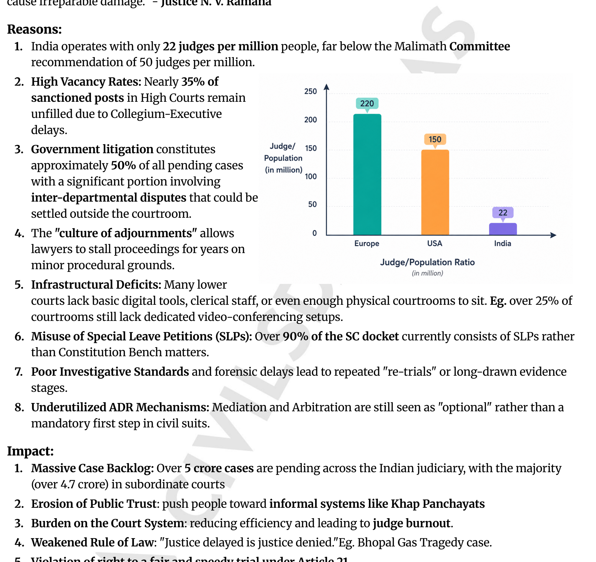

# Supreme Court & High Courts: Collegium System vs NJAC, Removal of Judges, Jurisdictions (Art 131–143), Judicial Review & Judicial Overreach — Smash Mains Notes (Ch09_Sub01_SC_HC_Collegium_Appointments_Jurisdiction_Judicial_Review)

---

### [Smash Mains Source Page 169](../../pages/mains/mains_page_169.pdf)

## Chapter 12: Judiciary

### Judiciary

### Previous Year Questions

- **[2014]** Starting from inventing the 'basic structure' doctrine, the judiciary has played a highly pro active role in ensuring that India develops into a thriving democracy. In light of the statement, evaluate the role played by judicial activism in achieving the ideals of democracy

- **[2015]** What are the major changes brought in the Arbitration and Conciliation Act, 1996 through the recent Ordinance promulgated by the President? How far will it improve India's dispute resolution mechanism? Discuss(12.5)

- **[2016]** What was held in the Coelho case? In this context, can you say that judicial review is of key importance amongst the basic features of the Constitution? (12.5)

- **[2016]** What is a quasi-judicial body? Explain with the help of concrete examples. (12.5)

- **[2017]** Critically examine the Supreme Court's judgment on 'National Judicial Appointments Commission Act, 2014' with reference to appointment of judges of higher judiciary in India. (10)

- **[2019]** "The Central Administration Tribunal which was established for redressal of grievances and complaints by or against central government employees, nowadays is exercising its powers as an independent judicial authority." Explain.(10)

- **[2018]** How far do you agree with the view that tribunals curtail the jurisdiction of ordinary courts? In view of the above, discuss the constitutional validity and competency of the tribunals in India. (15)

- **[2020]** Judicial Legislation is antithetical to the doctrine of separation of powers as envisaged in the Indian Constitution. In this context justify the filing of large number of public interest petitions praying for issuing guidelines to executive authorities. (15)

- **[2021]** Discuss the desirability of greater representation to women in the higher judiciary to ensure diversity, equity and inclusiveness. (10)

- **[2023]** "Constitutionally guaranteed judicial independence is a prerequisite of democracy". Comment. (10)

- **[2023]** Who are entitled to receive free legal aid? Assess the role of the National Legal Services Authority(NALSA) in rendering free legal aid in India. 10

- **[2024]** Explain the reasons for the growth of public interest litigation in India. As a result of it, has the Indian Supreme Court emerged as the world's most powerful judiciary? (15)

- **[2024]** Explain and distinguish between Lok Adalats And Arbitration Tribunals. Whether they entertain civil as well as criminal cases? (10)

- **[2025]** Discuss the evolution of the collegium system in India. Critically examine the advantages and disadvantages of the system of appointment of the Judges of the Supreme Court of India and that of the USA. (15)

---

### [Smash Mains Source Page 170](../../pages/mains/mains_page_170.pdf)

- **[2025]** Comment on the need of administrative tribunals as compared to the court system. Assess the impact of the recent tribunal reforms through rationalization of tribunals made in 2021. (10)

- **[2025]** "Constitutional morality is the fulcrum which acts as an essential check upon the high functionaries and citizens alike..." In view of the above observation of the Supreme Court, explain the concept of constitutional morality and its application to ensure balance between judicial independence and judicial accountability in India.

- **[2026]** What is meant by judicial legislation? In this context, discuss the verdicts of the apex court allowing “passive euthanasia” and a “living will”. (15)

### Quotes

"Indian Judiciary is not only guardian of the Constitution but also Active Participants in the Social Revolution." - J.L. Nehru

> "Judiciary is the only effective means to ensure limitations on the different organs of the state." - A. K. Ayyar

> "There is no better test of the excellence of government than the working of its judicial system." - Lord Bryce

### Role of Judiciary

- **1.** Guardian of the Constitution- Eg. Kesavananda Bharati case (1973).

- **2.** Promoting Rule of Law: Eg. A.K. Gopalan case on preventive detention laws.

- **3.** Guardian of Fundamental Rights - Eg. invalidating section 66A of IT Act (Shreya Singhal).

- **4.** Maintaining Federalism: Eg. S.R. Bommai Case 1994

- **5.** Checks and Balances: Eg. electoral Bond Judgment

- **6.** Protecting Separation of Powers: Eg. NJAC Case.

- **7.** Setting Legal Precedents: Eg. Vishaka guidelines

- **8.** Promoting Social Justice - Eg. NALSA v/s UOI- Transgender rights

- Total Pendency: 55.8 Million+ cases across all levels (Source: NJDG).

- Pendency in the SC hit a historic high of over 93000 cases in March 2026. (70k in 2021)

- Over 180,000 cases have been pending for more than 30 years in district and high courts

- Lower Court Load: 49 Million cases are pending in District/Subordinate courts alone (~88% of total).

- Sanctioned Strength: 24,631 judges for subordinate courts. Approximately 25% of vacancy.

- Judge-to-Population: ~21 judges per million people (Target: 50 per million).

### Judicial Appointment

"Judicial appointments are not mere administrative tasks but go to the root of the independence of the judiciary." - Justice M.N. Venkatachaliah

### Constitutional Provisions

- **1.** Article 124: Supreme Court judges should be appointed by the President after consultation with such judges of the HCs and the SC as the President may deem necessary.

- **2.** Article 217: High Court judges should be appointed by the President after consultation with the Chief Justice of the HC concerned, the CJI and the Governor of the state.

---

### [Smash Mains Source Page 171](../../pages/mains/mains_page_171.pdf)

### Collegium system and its evolution

- **1.** S P Gupta Vs UoI, 1981 (First Judge Case): The word "consultation" in Article 124 (2) and in Article 217 does not mean "concurrence", and only involves the exchange of views.

- **2.** Second Judge Case: The SC altered the definition of consultation to mean concurrence. It gave birth to the Collegium System, which included CJI and the 2 most senior judges of the SC.

- **3.** Third Judge Case,1998: SC expanded the Collegium to include the CJI and the 4 most-senior judges of the SC. Must be a collective opinion.

- **4.** NJAC Act, 2014: SC termed NJAC Act as unconstitutional and nullified it, stating that it posed a threat to the independence of the judiciary.

- **5.** Memorandum of Procedure (MoP): A revised MoP was sought in 2015 to enhance transparency but remains unresolved.

### Issues with collegium system

- **1.** Judges appointing judges: It goes against the principle of separation of powers and principle of check and balance.

- **2.** Lack of Objective Merit Criteria: There is no standardized evaluation of judgment quality used for selections.

- **3.** Regional Imbalance: Eg. As of April 2026, seven High Courts remain unrepresented in the Supreme Court.

- **4.** Lack of Transparency and Accountability: Deliberations occur behind closed doors without published minutes, criteria, or reasons for selection

- **5.** Uncle-Judge Syndrome: Allegations of nepotism and "closed-club" syndrome. Eg. nearly 30% of sitting HC judges have relatives in the legal profession. (ADR report)

- **6.** Vacancy: The collegium system has struggled to keep up with the stagnant vacancies in the judiciary.

- **7.** Absence of institutional support for the collegium: It remains an ad hoc body. There is no permanent secretariat and support staff dedicated to the task of helping the collegium.

- **8.** Lack of representation of women: Only 14% of all HC judges are female. There is currently only 1 women justices out of the sitting 34 in the Supreme Court.

- **9.** Poor representation of marginalised communities: out of 537 appointments to High courts between 2018 and 2022->79% (Upper caste), 11% (OBCs), 2.8% (SCs), 1.3% (STs).

### Way Forward

- **1.** Finalize MoP: Should have clear guidelines like transparency, eligibility criteria, mechanism for complaints against candidates etc.

- **2.** All India Judicial Services (Article 312) to improve the quality of judges in the lower Judiciary.

- **3.** Bring the administrative side of the Collegium under the Right to Information Act.

- **4.** Formulate Search-cum-Evaluation Committee (SEC) to prepare a panel of eligible candidates.

- **5.** Second ARC recommendation: It proposed the setting up of the National Judicial Council (NJC), which will be responsible for the appointment and transfer of the judges of higher judiciary.

- **6.** Publishing Decision Summaries: publishing the "reasons" for selection to improve transparency

- **7.** International best practices:

- **8.** UK: The independent Judicial Appointments Commission (JAC) - includes members of the executive and civil society.

- **9.** Germany: Half the members of the Federal Constitutional Court are elected by the executive and half by the legislative.

---

### [Smash Mains Source Page 172](../../pages/mains/mains_page_172.pdf)

### Basic Structure Doctrine

"The basic structure doctrine acts as a guardian of constitutional morality, ensuring that the fundamental principles of the Constitution remain inviolable." - Justice H.R. Khanna

- **1.** The Basic Structure Doctrine, established in the Kesavananda Bharati case (1973), ensures that fundamental features of the Constitution cannot be amended, even under Article 368.

- **2.** Key elements include constitutional supremacy, rule of law, separation of powers, judicial review, federalism, and secularism.

### Evolution

- **1.** Shankari Prasad (1951): Upheld Parliament's power to amend the Constitution, including Fundamental Rights.

- **2.** Golaknath (1967): Held that Fundamental Rights cannot be amended; amendments are "laws" under Article 13.

- **3.** 24th Amendment (1971): Restored Parliament's absolute amending power and made Presidential assent mandatory.

- **4.** Kesavananda Bharati (1973): Upheld amendment power but introduced the Basic Structure Doctrine.

- **5.** Indira Gandhi v. Raj Narain (1975): Struck down the 39th Amendment; reaffirmed Judicial Review as part of the Basic Structure.

- **6.** 42nd Amendment (1976): Tried to make amendment power unlimited.

- **7.** Minerva Mills (1980): Invalidated parts of the 42nd Amendment; reaffirmed Judicial Review and Balance between Parts III & IV.

- **8.** Waman Rao v. Union of India: Clarified that the Basic Structure doctrine applies to all amendments made after April 24, 1973 (the date of the Kesavananda judgment).

### Significance of Basic Structure Doctrine and Judicial Activism

- **1.** Judicial Safeguard Against Arbitrary Amendments: Eg. Indira Gandhi vs. Raj Narain, 1975-SC invalidated the 39th Amendment protecting the PM's election from judicial review.

- **2.** Preserves Constitutional Ideals: Eg. democracy, secularism, and federalism.

- **3.** Maintains Constitutional Supremacy: Prevents parliamentary majorities from altering the Constitution's core structure arbitrarily.

- **4.** Separation of Powers: Strengthens democracy by maintaining judicial independence, ensuring that the judiciary remains free from executive and legislative control.

- **5.** Safeguards Fundamental Rights: Protects citizens from legislative overreach and authoritarianism.

- **6.** Ensures Judicial Independence: Eg. Minerva Mills case, 1980-SC struck down parts of the 42nd Amendment that curtailed judicial review.

- **7.** Upholds Rule of Law: Eg. Kihoto Hollohan - anti-defection law subjected to judicial review

- **8.** Ensures the Constitution evolves with time, allowing for progressive interpretations while maintaining its core structure.

- **9.** Prevents frequent radical changes that could disrupt governance, preserving the long-term integrity of India's legal and political system.

### Criticism of basic structure doctrine and Judicial activism

- **1.** Judicial Overreach - The term is nowhere mentioned in the Constitution. Jagdeep Dhankhar argue that the judiciary has "rewritten" the Constitution without legislative mandate.

- **2.** Undermining Parliamentary Sovereignty: It restricts the power of elected representatives to amend the Constitution to reflect the changing "will of the people."

---

### [Smash Mains Source Page 173](../../pages/mains/mains_page_173.pdf)

- **3.** Vagueness and Subjectivity: There is no exhaustive list of what constitutes "basic structure," leading to unpredictable and inconsistent judicial decisions.

- **4.** The "Tyranny of the Unelected": It grants final authority to judges, who are not accountable to the public, over the laws passed by an elected Parliament.

- **5.** Violation of Separation of Powers: By acting as a "Super-Legislature," the judiciary enters the domain of law-making, which belongs to the Parliament.

- **6.** Jurist Fali S. Nariman once noted that the guardians of the Constitution have become "guardians over the Constitution."

- **7.** Hindrance to Social Reform: Strict adherence can block radical economic or social reforms that require significant constitutional shifts.

- **8.** Constitutional Rigidity: It makes the Constitution "static" by entrenching certain values permanently, preventing the nation from evolving with time.

- **9.** Taking on executive and legislative roles diverts the judiciary from its primary function, leading to increased pendency of cases and delays in justice delivery.

- **10.** Lack of Expertise in Policy Matters: Judges may not have the technical or administrative expertise required for complex policy decisions, leading to impractical rulings.

### Way Forward

- **1.** Codifying the "Basic List": Eg. A "Constitutional Clarity Act" could define the untouchable cores like Democracy and Secularism.

- **2.** Mandate that only a Full Bench (all 15+ judges) of the SC can hear cases involving Basic Structure challenges.

- **3.** Pre-Legislative Consultation: Similar to the French Constitutional Council that reviews laws before they are enacted to avoid conflict.

- **4.** Judicial Restraint Guidelines: Eg. Limiting the doctrine's use to "grave existential threats" rather than ordinary policy disagreements.

- **5.** Sunset Clause: Introduce a requirement for the Court to periodically re-evaluate the "necessity" of specific features added to the list. The Basic Structure Doctrine should function as a north star in constitutional interpretation, ensuring that it provides consistent direction without obstructing necessary constitutional evolution. Judicial Review 'Judicial Review' means courts' power to review the actions of other branches of government. Especially the court's power to invalidate legislative and executive actions as being unconstitutional. Constitutional provisions

- Article 13- Laws inconsistent with or in derogation of the Fundamental Rights,

- Article 32, Article 226- Writ Jurisdiction of Courts.

- Article 131 to 134: Original and Appellate jurisdiction of SC

- Article 136: Empowers the Supreme Court to confer special leave to appeal from "any judgment or order of any court or tribunal." Except for military tribunals and court martials. Judicial Activism It refers to the proactive role of judges in interpreting and shaping the law, rather than merely applying it as written.

- "Judicial activism is not an aberration but a necessary tool in the hands of judges to achieve justice and fairness." - Justice P.N. Bhagwati"

---

### [Smash Mains Source Page 174](../../pages/mains/mains_page_174.pdf)

- The Constitution is not a self-defining instrument. It must be interpreted, and that interpretation is the function of the courts." - Justice Earl Warren" Historical Evolution of Judicial Activism

- Judicial activism emerged in the UK during the Stuart reign, where the unwritten constitution allowed judicial review, enabling courts to limit parliamentary authority.

- Early Traces in India (1893): Justice Mehmood of the Allahabad High Court issued a dissenting opinion, laying the foundation for judicial activism in India.

- 1960s Onward: activist judges like Justice P.N. Bhagwati and Justice V.R. Krishna Iyer expanded judicial interpretation to protect fundamental rights. Instruments of Judicial Activism

- PIL - Eg. Hussainara Khatoon (1st PIL) - right to free legal aid and speedy trial

- Article 32 and 226 - Courts have the power to review the constitutionality of legislative acts and executive actions

- Suo Moto Cognizance - Courts initiate proceedings on their own without a formal petition, based on media reports, letters, or social conditions.

- Continuing Mandamus - Eg. Vineet Narain v. Union of India (1997) - monitoring of CBI investigations in the Hawala scam.

- Reading New Rights into the Constitution - Emergence of rights like Right to Privacy, Right to Education, Right to a Healthy Environment.

- Directing Policy Formulation under Article 141 and 142 - Eg. Vishaka guidelines

- Commissioning Committees and Special Investigations - Eg. Court-appointed SIT to investigate black money cases. Judicial Overreach It occurs when a court exceeds its legal authority or jurisdiction, making decisions that intrude into the domain of the legislature or executive.

- NCERT Textbook Row (2026) - Ordered the removal of a chapter on "Judicial Corruption" from Class 8 textbooks

- Amit Kumar v. Union of India (2026) - Constituted a "National Task Force" to formulate mental health strategies for Higher Educational Institutions (HEIs) to prevent student suicides.

- Shyam Narayan Chouksey v. Union of India (2016) - Made it mandatory for cinema halls to play the National Anthem

- M.C. Mehta v. Union of India (2018) - Arbitrarily invalidated Rule 115(21) of the Central Motor Vehicle Rules to advance the deadline for BS-VI vehicle sales.

- Tamil Nadu Liquor Ban Case (2017) - banned liquor shops within 500 meters of all state and national highways.

- Firecracker Ban: Imposing specific timings and types of crackers during Diwali. Judicial Restraint Judicial restraint is the practice where the judiciary recognizes its own limitations and shows deference to the other organs of the state (Legislature and Executive). Significance

- Preserves Separation of Powers: Eg. In Almitra H. Patel v. UoI, SC refused to issue guidelines for cleaning Delhi, stating it was the municipal body's administrative job.

- Upholds Democratic Legitimacy: Recognizes that policy-making requires a "popular mandate" which judges, being unelected, do not possess.

- Maintains Institutional Harmony: Prevents constant friction

---

### [Smash Mains Source Page 175](../../pages/mains/mains_page_175.pdf)

- Limits "Judicial Adventurism"

- Focuses on Legal rather than Political Questions

- Protects the Judiciary from Public Backlash: Eg. criticism over NCERT textbook revisions

- Respects the "Presumption of Constitutionality": Operates on the belief that a law is valid until proven otherwise beyond a reasonable doubt.

- Reduce case pendency.

### Public Interest Litigation

According to the Supreme Court (Janata Dal v. H.S. Chaudhary, 1993), PIL refers to legal action initiated to protect public or community interests, including matters affecting legal rights or liabilities. PIL originated in the USA in the 1960s as a means to promote justice for marginalized groups and broader societal concerns

- **1.** No Statutory Definition: PIL is not explicitly defined in the Constitution or any Indian statute.

### History and Evolution in India

- **1.** Phase I (Post-Emergency 1970s):

  - **a.** Mumbai Kamgar Sabha case (1976)- SC relaxed the principle of Locus Standi for the first time.

  - **b.** In Hussainara Khatoon (1979), the first PIL led to the release of 40,000 undertrials.

  - **c.** SC sought to reclaim its image as the "People's Court." Justice Krishna Iyer in ABSK Sangh (1981) and Justice Bhagwati in S.P. Gupta (1981) institutionalized the concept.

- **2.** Phase II (2000s-Present): Expanded into environmental protection, good governance, and civil liberties. At present, PILs are dealing with issues like AI ethics and digital privacy.

### Reasons behind growth of PILs

- **1.** Relaxation of Locus Standi - Eg. In S.P. Gupta v. Union of India (1981), the SC allowed citizens to challenge public wrongs.

- **2.** Epistolary Jurisdiction - Judiciary simplified legal entry by treating informal communication as a formal legal petition.

- **3.** Broad Reading of Article 21 to include "the right to live with human dignity."

- **4.** Judicial Activism Post-Emergency led by Judges like P.N. Bhagwati and Krishna Iyer

- **5.** Failure of Executive and Legislature - Courts step in to fill "policy vacuum." Eg. Vishaka Guidelines (1997)

- **6.** Role of Media and Civil Society - Investigative journalism and proactive NGOs provided the necessary "factual foundation" for judicial intervention.

- **7.** Constitutional Mandate of Article 39A serves as a moral driver for PIL.

### Significance of PIL

- **1.** Expanding the reach of Article 32: enables proactive citizens to initiate legal proceedings in the broader interest of the public. Eg. M. C. Mehta cases

- **2.** Enhancing access to justice for marginalised communities. Eg. Naz Foundation case

- **3.** Empowered the judiciary to take suo motu action on matters of public significance.

- **4.** Catalyst for social and political transformation - Eg. Common Cause v. Union of India (Legalizing passive euthanasia)

- **5.** Brings Governance Accountability -

---

### [Smash Mains Source Page 176](../../pages/mains/mains_page_176.pdf)

  - **a.** Vineet Narain case - ensured CBI autonomy.

  - **b.** Prakash Singh case on police reforms

  - **c.** Electoral Bonds Case (2024)- PIL by ADR, Common Cause and others.

- **6.** PILs have broadened the role of judiciary beyond dispute resolution to policy guidance and public welfare. Eg. Vishaka guidelines

- **7.** Environmental Protection and Sustainability - Eg. MC Mehta v. Union of India - Ban on diesel vehicles, closure of polluting industries near Taj Mahal.

- **8.** PILs led to innovative judicial principles like:

  - **a.** Continuing mandamus (continuous monitoring)

  - **b.** Epistolary jurisdiction (accepting letters/postcards as petitions)

  - **c.** Absolute liability for hazardous industries.

### Issues associated with PIL

- **1.** Violation of Adversarial Justice: Traditional common law systems rely on two opposing parties. PILs turn judges into "investigators."

- **2.** Misuse of PIL for personal or political gain rather than for the public good. Due to this misuse, they are being called as proxy interest litigation or private interest litigation.

- **3.** Delays in the resolution due to over 5.5 Cr pending cases and vacancies in the judiciary.

- **4.** Potential of Judicial Overreach - Eg. ban on firecrackers

- **5.** Slowing down pace of development projects: SC has observed that several NGOs are filing petitions as proxy litigants to settle corporate Rivalry.

- **6.** Lack of Proper Verification Mechanisms - Courts sometimes accept PILs based on affidavits or media reports without rigorous verification.

- **7.** Resource Drain on Public Institutions - Eg. Mandatory conversion to CNG vehicles in Delhi (MC Mehta case) posed sudden challenges for transporters.

- **8.** Selective Judicial Intervention: Accusations that courts pick "high-profile" PILs while ignoring systemic issues of the poorest.

- **9.** Enforcement Failures due to executive apathy. Eg. bonded labor persists in several industries

### Way Forward

- **1.** Codify 2010 SC PIL Guidelines into law to mandate strict "Bona Fide" checks before admission

- **2.** Impose heavy fines on petitioners whose cases are found to be for "publicity or private profit."

- **3.** Specialist PIL Benches in every High Court.

- **4.** Standardizing Suo Motu Cognizance

- **5.** Post-Judgment Monitoring: Create a "Compliance Cell" within courts to ensure implementation.

- **6.** Pre-Admission Screening to check if matter has been litigated or if alternative remedies exist

- **7.** South Africa: Constitutional Court allows "friends of the court" (Amicus Curiae) to provide expert neutral input.

- **8.** USA: Use of "Class Action Lawsuits" which provide more procedural structure than the open-ended Indian PIL.

### Judicial Accountability

Judicial Accountability is the obligation of judges and the judicial institution to be answerable for their decisions, conduct, and use of resources.

---

### [Smash Mains Source Page 177](../../pages/mains/mains_page_177.pdf)

It balances Judicial Independence (the power to decide cases without pressure) with the Rule of Law (the principle that no one is above the law). It encompasses two dimensions:

- **1.** Individual Accountability: Responsibility of a judge for personal ethical breaches or corruption.

- **2.** Institutional Accountability: Transparency of the judiciary as a whole in matters like appointments, transfers, and case management.

### SC judgments

- **1.** K Veeraswami Judgment, 1991 - classified judges as public servants under the Prevention of Corruption Act but requires CJI approval for prosecution (registering FIR)

- **2.** In 1999, SC formally adopted the "In-House Procedure." This allows for a committee of judges to investigate complaints of "misbehavior" against a peer.

- **3.** Subhash Chandra Agarwal (2019) - the Office of the Chief Justice of India (CJI) is a "public authority" under the Right to Information (RTI) Act, 2005.

### Judicial Accountability Mechanisms in India

- **1.** Impeachment under Articles 124(4) and 215 for "proved misbehavior or incapacity."

- **2.** Judges (Inquiry) Act, 1968 to regulate the investigation procedure

- **3.** In-House Procedure: A self-regulatory mechanism adopted in 1999 where a committee of peers investigates allegations against a sitting judge.

- **4.** Appellate Process: appeals, reviews, or curative petitions to higher benches.

- **5.** The "Restatement of Values of Judicial Life" (1997) serves as an ethical guide for judges' behavior in public and private.

- **6.** The Office of the CJI is now a "public authority" under the Right to Information Act.

- **7.** "Open Court" live-streaming.

- **8.** E-Courts Transparency: Platforms like the National Judicial Data Grid (NJDG) hold courts accountable for pendency and disposal rates.

### Need for Judicial Accountability

- **1.** Maintaining Public Trust: accountability prevents the erosion of legitimacy.

- **2.** Curbing Judicial Corruption: Eg. justice verma case

- **3.** Checks and Balances: prevents judiciary from becoming a "super-legislature"

- **4.** Ensuring Transparency in Appointments in higher judiciary

- **5.** Ensuring Timely Justice: Judges must be accountable for "judicious use of time"

- **6.** Rule of Law: judges must face consequences for misconduct Eg. Justice Karnan case

- **7.** Standardizing Judicial Behavior: Accountability prevents "judge-centric" justice.

- **8.** Improving "Ease of Doing Business" through predictable and efficient judiciary.

### Major Issues with Judicial Accountability

- **1.** Opaque Collegium System: selection behind closed doors without detailed rationales.

- **2.** Ineffective Impeachment Process: no judge has ever been impeached

- **3.** Use of Contempt Law as a "shield" against legitimate criticism. Eg. Prashant Bhushan case

- **4.** India lacks a specific "Judicial Standards and Accountability" law to handle misconduct

- **5.** Lack of Performance Indicators to evaluate a judge's efficiency, quality, or attendance.

- **6.** Secrecy of In-House Findings: Reports of internal inquiries are rarely made public

---

### [Smash Mains Source Page 178](../../pages/mains/mains_page_178.pdf)

### Way Forward

- **1.** National Judicial Commission (NJC): Establish a constitutional body with judicial, executive, and civil society members for balanced appointments.

- **2.** Follow the Swedish model where an independent Parliamentary Ombudsman can investigate complaints against judicial delays.

- **3.** Mandatory Cooling-off Period: Enact a mandatory 2-year bar on judges accepting any executive or political appointment after retirement. 4. : Create a statutory Judicial Conduct Commission (JCC) (similar to UK or Kenya) to handle complaints and recommend penalties.

- **5.** Make live-streaming mandatory for all court levels to ensure that "conduct in court" is a matter of public record.

- **6.** Introduce "Judicial Impact Assessments" to evaluate the efficiency of court processes and individual disposal rates.

- **7.** Extend the Whistleblowers Protection Act to court staff and lawyers reporting judicial misconduct.

- **8.** Reform of Contempt Law: Amend the 1971 Act to remove "scandalizing the court" and replace it with a narrow "obstruction of justice" clause. Judiciary and RTI Major SC Judgments

- Subhash Chandra Agarwal case (2019): A 5-judge Constitution Bench held that the Office of the Chief Justice of India (CJI) is a "public authority" under Section 2(h) of the RTI Act. It ruled that judicial independence and transparency go hand-in-hand.

- Secretary General, SC v. Subhash Chandra Agarwal: Confirmed that the CJI holds information regarding judges' assets not in a fiduciary capacity, but as a constitutional functionary, making it disclosable.

- Khanapuram Gandaiah v. Administrative Officer (2010): Clarified that RTI cannot be used to ask a judge "why" a particular judgment was passed, as judicial decisions are protected by judicial immunity. Present Position

- The Supreme Court and all High Courts are recognized as "Public Authorities." Each has a designated Central Public Information Officer (CPIO) and First Appellate Authority (FAA).

- Transparency is now governed by a three-pronged test: Judicial Independence vs. Privacy vs. Public Interest. Information is disclosed on a case-to-case basis.

- Almost all High Courts and the Supreme Court have integrated with the National RTI Online Portal, allowing citizens to file requests and pay fees digitally.

- Asset Disclosure: Judges' asset declarations are maintained by the Registry. While not always "proactively" published on websites, they are accessible via RTI subject to privacy Procedure of Impeachment (Removal)

- A motion must be signed by 100 MPs (Lok Sabha) or 50 MPs (Rajya Sabha) and submitted to the Speaker/Chairman.

- The Speaker/Chairman has the discretion to admit or reject the motion.

- Inquiry Committee: If admitted, a 3-member committee is formed: ◦ A Supreme Court Judge. ◦ A Chief Justice of a High Court.

---

### [Smash Mains Source Page 179](../../pages/mains/mains_page_179.pdf)

◦ An Eminent Jurist.

- The committee investigates "Proved Misbehaviour" or "Incapacity." The judge has the right to a defense.

- If the committee finds the judge guilty, the report is tabled. Both Houses must pass the motion in the same session.

- Special Majority: Required in each House: ◦ Absolute Majority (more than 50% of total membership). ◦ Special Majority (not less than 2/3rd of members present and voting).

- Presidential Order: Upon passage, the President issues a formal order of removal. Major Issues with the Impeachment Process

- "Resignation Loophole": Judges resign just before the final vote to retain post-retirement benefits and pension. Eg. Justice Yashwant Varma and Justice Soumitra Sen.

- The Speaker/Chairman can block a motion without providing objective criteria or reasons.

- The process is "all-or-nothing," with no mechanism for reprimanding misconduct below the level of removal. In-House Procedure is "toothless" and lacks statutory backing.

- Highly Political Nature: Eg. motion against Justice V. Ramaswami (1993) failed because the ruling party abstained from voting.

- Requirement to finish the entire process in a "single session" leads to procedural lapses.

- Lack of Transparency: Eg. confidential inquiry committee proceedings

- The multi-layered investigation and debate take years, during which the judge remains on the bench.

- No Post-Resignation Inquiry: Once a judge quits, the statutory mandate of the inquiry committee currently terminates automatically. Way Forward

- Statutory Continuity: Amend the 1968 Act to ensure inquiries continue despite resignation to establish formal accountability.

- Transparent Thresholds: Mandate the Speaker to provide reasoned, written orders when admitting or rejecting removal motions.

- Graduated Sanctions: Introduce a spectrum of disciplinary actions for misconduct that does not warrant full removal.

- Time-Bound Proceedings: Establish strict statutory timelines for committees to prevent political stalling and institutionalized sluggishness.

- Post-Retirement Accountability: Link the retention of full pension and benefits to the final findings of inquiries.

---

### [Smash Mains Source Page 180](../../pages/mains/mains_page_180.pdf)

*Diagram Screenshot: [Judge-to-Population Ratio & Judicial Vacancies in India](../../diagrams/mains_diag_judge_population_ratio_p180.png) · [Full Source Page 180](../../pages/mains/mains_page_180.pdf)*

### Judicial Pendency

"The issue of judicial pendency is a ticking bomb. Unless we collectively act to defuse it, it will explode and cause irreparable damage." - Justice N. V. Ramana

### Reasons

- **1.** India operates with only 22 judges per million people, far below the Malimath Committee recommendation of 50 judges per million.

- **2.** High Vacancy Rates: Nearly 35% of sanctioned posts in High Courts remain unfilled due to Collegium-Executive delays.

- **3.** Government litigation constitutes approximately 50% of all pending cases with a significant portion involving inter-departmental disputes that could be settled outside the courtroom.

- **4.** The "culture of adjournments" allows lawyers to stall proceedings for years on minor procedural grounds.

- **5.** Infrastructural Deficits: Many lower courts lack basic digital tools, clerical staff, or even enough physical courtrooms to sit. Eg. over 25% of courtrooms still lack dedicated video-conferencing setups.

- **6.** Misuse of Special Leave Petitions (SLPs): Over 90% of the SC docket currently consists of SLPs rather than Constitution Bench matters.

- **7.** Poor Investigative Standards and forensic delays lead to repeated "re-trials" or long-drawn evidence stages.

- **8.** Underutilized ADR Mechanisms: Mediation and Arbitration are still seen as "optional" rather than a mandatory first step in civil suits.

### Impact

- **1.** Massive Case Backlog: Over 5 crore cases are pending across the Indian judiciary, with the majority (over 4.7 crore) in subordinate courts

- **2.** Erosion of Public Trust: push people toward informal systems like Khap Panchayats

- **3.** Burden on the Court System: reducing efficiency and leading to judge burnout.

- **4.** Weakened Rule of Law: "Justice delayed is justice denied."Eg. Bhopal Gas Tragedy case.

- **5.** Violation of right to a fair and speedy trial under Article 21

- **6.** Prison Overcrowding: Undertrials constitute 73.5% of the prison population (3.9 lakh). Prisons operate at 131% capacity

- **7.** Economic Loss: Eg. India ranked 163rd in contract enforcement in EoDB rankings

- **8.** Social Disruptions: Delays in family law cases (divorce, child custody etc.) cause mental distress and family instability.

### Steps Taken

1. e-Courts Phase III: focusing on "Integrated Digital Courts" and paperless filing.

- **2.** 774 Fast Track Special Courts are operational for time-bound trials of heinous crimes.

---

### [Smash Mains Source Page 181](../../pages/mains/mains_page_181.pdf)

- **3.** Justice Clocks installed in 37 HCs for real-time public data on case disposal and pendency

- **4.** ADR: Mechanisms like Lok Adalats, Gram Nyayalayas, and Online Dispute Resolution

- **5.** Interoperable Criminal Justice System (ICJS): Facilitates seamless data exchange between courts, police, jails, and forensic labs

- **6.** Tele-Law Programme to enable access to legal advice for disadvantaged communities via video conferencing, telephone, and mobile apps.

- **7.** Nyaya Bandhu Pro Bono Framework to connect advocates with citizens requiring free legal services

### Way Forward

- **1.** All India Judicial Service (AIJS)to ensure merit-based, diverse recruitment. (Law Commission (116th Report))

- **2.** Deploying AI tools like SUPACE to assist judges in research and automated case-file summarization.

- **3.** Prioritize "legacy cases" (older than 10 years) through daily hearings and dedicated "backlog benches." (Malimath Committee)

- **4.** Reforming the Appointment Process: Adopt the UK system to bring transparency and balance judicial independence and checks and balance

- **5.** The Inquisitorial Element: Borrowing features from Germany/France where judges take a more proactive role in truth-seeking. (Malimath Committee)

- **6.** Reducing Inter-Departmental Litigation: use mandatory mediation before filing suits.

- **7.** Implementing e-Courts Phase III for creating Integrated Digital Courts

- **8.** The Law Commission of India in its 245th report highlighted the need for doubling the number of judges to address the backlog effectively.

- **9.** Mandatory Pre-Litigation Mediation: Following the 162nd Parliamentary Report (2026), make mediation compulsory for all commercial and family disputes.

- **10.** Establishing Regional SC Benches: reduces travel costs, eases case backlogs.

- **11.** Setting Up "Night Courts" to clear "petty cases" like traffic challans.

- **12.** Executive Restraint: Implement a National Litigation Policy to ensure the government only appeals in cases with "substantial questions of law."

- **13.** Increasing Court Working Days: As recommended by the Malimath Committee, increase court working days by 21 days annually.

- **14.** Enhancing Judicial Measures:

  - **a.** Increase operational days in higher judiciary.

  - **b.** Enforce strict regulations on adjournments. (3 Adjournments rule) c. appoint professional court managers for efficiency.

  - **d.** Implement time specifications and annual targets.

### All-India Judicial Service (AIJS)

The All-India Judicial Service (AIJS) is a proposed centralized recruitment system for the subordinate judiciary (specifically District Judges) in India, modeled after the IAS and IPS.

- **1.** First proposed in the 14th Law Commission Report (1958).

- **2.** 42nd Amendment: Article 312 was amended during the Emergency to empower the Parliament to create an AIJS through a resolution by the Rajya Sabha (2/3rd majority).

- **3.** In All India Judges' Association v. Union of India (1992), the SC directed the Centre to establish AIJS.

---

### [Smash Mains Source Page 182](../../pages/mains/mains_page_182.pdf)

### Significance

- **1.** Uniform Standards of Judicial Recruitment - more professional and competent judiciary.

- **2.** Open competition -bring objectivity and transparency in the selection process.

- **3.** Merit-based selection of fresh talent

- **4.** Improving Judge-Population Ratio: Helps achieve the Law Commission's target of 50 judges per million (currently only 21).

- **5.** Curbing Nepotism/Corruption: Moving away from the "Uncle Judge" syndrome

- **6.** Reducing vacancies: AIJS would conduct exams at regular intervals.

- **7.** Reducing the pendency of the cases (4.9 Cr pending in lower courts)

- **8.** Uniformity in quality of adjudication

- **9.** Social inclusion: enable representation to marginalised and deprived sections of society.

- **10.** Inter-State Knowledge Transfer: Judges allocated to different states can bring best practices from their home regions to their cadre.

### Challenges

- **1.** Language Barrier: Judges from one state may struggle to understand local languages used in district court proceedings.

- **2.** Encroachment on State Powers: as "Administration of Justice" is state list subject.

- **3.** Judicial Independence at Risk - Currently, HCs control district judge appointments (Article 233). AIJS could centralize power in a National Judicial Service Commission.

- **4.** AIJS may fail to attract top law graduates, who prefer careers in litigation, corporate law, or law firms due to better opportunities and career growth.

- **5.** Limited Career Progression - Majority of judicial officers reach only district judge level, as HC elevations favor appointments from the Bar, making AIJS less appealing.

- **6.** Structural Issues Remain Unaddressed - Eg. infrastructure gaps & systemic inefficiencies like adjournment culture.

### Way Forward

- **1.** The "Regional Cadre" Model to minimize language and cultural gaps.

- **2.** Cooperative federalism - developing consensus between centre and states through inter-state council

- **3.** Language Training: Mandate a one-year intensive language and local law course for all AIJS recruits before they take charge.

- **4.** AIJS should report to the HC Chief Justices to ensure judicial independence remains intact.

- **5.** France Model: The Ecole Nationale de la Magistrature is a specialized school that recruits and trains all judges through a rigorous national exam, ensuring high quality.

### Alternate Dispute Resolution (ADR)

Alternate Dispute Resolution (ADR) is a mechanism of dispute resolution that is non-adversarial, i.e. working together cooperatively to reach the best resolution for everyone.

- "Mediation for the Nation" Campaign: NALSA and the SC settled over 1.48 crore cases (pre-litigation and pending) in a single year cycle.

- National Mediation Conference: The Mediation Council of India was officially institutionalized to regulate mediator standards.

---

### [Smash Mains Source Page 183](../../pages/mains/mains_page_183.pdf)

- The Pre-Institution Mediation and Settlement (PIMS) was expanded beyond commercial suits to include specific matrimonial and property disputes.

- The Law Minister referenced the Panch Parmeshwar doctrine - India's traditional collective consensus in dispute resolution - at a global ADR forum, advocating international cooperation in strengthening ADR.

### Types of Alternative Dispute Resolution (ADR) in India

#### A. Arbitration

- **1.** A dispute resolution method where a neutral third party (arbitrator or arbitral tribunal) delivers a binding decision after evaluating the case.

- **2.** Governed by the Arbitration and Conciliation Act, 1996.

- **3.** Key Features:

  - **a.** Requires a valid arbitration agreement before disputes arise.

  - **b.** The arbitrator's decision is final and enforceable.

#### B. Mediation

- **1.** A voluntary negotiation process where a neutral mediator facilitates discussions between disputing parties without imposing a decision.

- **2.** Key Features:

  - **a.** Party-driven and voluntary with no imposed outcomes.

  - **b.** The mediator assists in communication and compromise.

- **3.** Suitable Scenarios:

  - **a.** When parties face communication barriers or emotional conflicts.

  - **b.** If resolution is a priority over legal precedent.

  - **c.** To save time, reduce costs, and preserve business or personal relationships.

#### C. Conciliation

- **1.** A process where a neutral conciliator, often a legal expert or government officer, suggests a resolution to the dispute without issuing a binding verdict.

- **2.** Governed by the Arbitration and Conciliation Act, 1996.

- **3.** Key Features:

  - **a.** Conciliators propose solutions but do not make enforceable decisions.

  - **b.** A settlement is binding only if both parties accept the terms.

  - **c.** Confidentiality ensured under the non-disclosure clause, restricting evidence use in judicial proceedings. The Mediation Act, 2023

- Parties may voluntarily attempt mediation before filing a civil or commercial suit. (Initially proposed as mandatory, it was made voluntary in the final Act).

- Mediation must be completed within 120 days, extendable by an additional 60 days with party consent.

- A Mediated Settlement Agreement (MSA) is final, binding, and enforceable in the same manner as a court decree.

- Confidentiality: Proceedings are strictly confidential. No audio/video recording is allowed, and what is said in mediation cannot be used as evidence in court.

---

### [Smash Mains Source Page 184](../../pages/mains/mains_page_184.pdf)

- Mediation Council of India: Establishes a central body to register mediators, grade mediation service providers, and promote the practice.

- Exclusions: Certain disputes (Eg. criminal offenses, tax matters, or disputes against minors) are excluded from the ambit of mediation. Arbitration and Conciliation Act, 1996

- Based on the UNCITRAL Model Law, this Act governs domestic arbitration, international commercial arbitration, and the enforcement of foreign awards.

- Section 5: Limits judicial intervention

- Section 8: Courts are mandated to refer parties to arbitration if a valid arbitration agreement exists between them.

- Section 9 & 17: Provides for interim protection orders by courts (Sec 9) and by the arbitral tribunal itself (Sec 17).

- Section 34: Defines narrow grounds for challenging an award (Eg. incapacity of parties, invalid agreement, or violation of public policy).

- Section 36: An arbitral award is enforceable as a decree of the court once the time for challenging it under Section 34 has expired. 2015 Amendment

- Strict Timelines: Introduced Section 29A, mandating that awards be made within 12 months (extendable by 6 months).

- Introduced Section 29B for resolving disputes within 6 months without oral hearings. 2019 Amendment

- Arbitration Council of India (ACI): Provisions for a body to grade arbitral institutions and accredit arbitrators

- Introduced Section 42A, making it mandatory for arbitrators and institutions to maintain confidentiality. 2021 Amendment

- Courts can now grant an unconditional stay on the enforcement of an award if there is prima facie evidence that either the arbitration agreement or the making of the award was induced by fraud or corruption.

- Removed 8th Schedule: Scrapped strict qualification requirements for arbitrators (being advocate or judge), allowing foreign and specialized experts to act as arbitrators in India.

### Factors Driving India's Shift Towards Arbitration in Dispute Resolution

- **1.** Pendency of cases - over 5.4 Cr pending cases

- **2.** Economic liberation - Surge in FDI, cross-border transactions and consequent rise in international business disputes.

- **3.** Government policy push -

  - **a.** Amendments to Arbitration and Conciliation Act, 1996

  - **b.** National Litigation Policy

  - **c.** Mediation Act

- **4.** Indian arbitration awards from IIAC are gaining global recognition.

### Significance of ADR

- **1.** Reduces Pendency & Court Congestion - Lok Adalats settled over 14.8 crore cases in 2025

- **2.** Cost-Effective - ODR platforms reduce legal costs for small businesses and startups

---

### [Smash Mains Source Page 185](../../pages/mains/mains_page_185.pdf)

- **3.** Speedy Commercial Justice: Institutional arbitration (Eg. DIAC, MCIA) aims to resolve disputes within a strict 12–18 month window.

- **4.** Flexibility in Procedure: Parties can choose the venue, language, and even the technical expertise of the arbitrator/mediator.

- **5.** Enhances Access to Justice to poor and marginalised sections of the society

- **6.** Reducing Government Litigation: Eg. The 2026 National Litigation Policy mandates mediation for all inter-ministerial property disputes.

- **7.** Promotes Ease of Doing Business - Efficient contract enforcement through ADR encourages foreign and domestic investment, improving India's business climate.

- **8.** Preserves Relationships - Unlike adversarial litigation, ADR promotes collaborative problem-solving, helping maintain personal and business relationships.

- **9.** India's ADR laws now mirror the Singapore Convention, making it an attractive global hub for arbitration.

### Challenges associated with ADR

- **1.** Low Awareness Levels: 54% of Indians are still unaware of mediation as a viable option.

- **2.** Though SC limited court intervention in international arbitration in Bharat Aluminium Co. v. Kaiser Aluminium (2012), judicial involvement remains a challenge.

- **3.** Shortage of Trained Professionals: lack of certified, full-time mediators outside of major metropolitan hubs.

- **4.** High Cost of Private Arbitration: Fees for top-tier arbitrators can sometimes exceed the actual value of the dispute.

- **5.** Cultural Resistance: A "litigation-first" mindset among lawyers.

- **6.** Digital Divide in ODR: Poor internet access in rural districts prevents the effective use of e-Mediation tools.

- **7.** Inadequate Infrastructure: Many court-annexed mediation centers lack private rooms, basic tech, or dedicated administrative staff.

- **8.** Delay in Council Formation: Although the Act was passed in 2023, the Mediation Council is yet to become fully functional.

- **9.** Lack of Diversity: Eg. Less than 15% of empanelled arbitrators are women or non-legal industry experts.

### Way Forward

- **1.** Set up a National Accreditation Board for Arbitrators under the Ministry of Law and Justice.

- **2.** Amend and update the Arbitration and Conciliation Act, 1996 to address enforcement challenges & clarify procedural rules.

- **3.** Strengthen global partnerships with Singapore International Arbitration Centre, International Court of Arbitration etc.

- **4.** Encourage mandatory mediation or conciliation before litigation, especially for civil, commercial, and family disputes.

- **5.** Promote institutional arbitration by strengthening arbitration centers with standardized rules and procedures.

- **6.** The Singapore Model: Adopt "Arb-Med-Arb" protocols where an ongoing arbitration is paused for a "mediation window" to encourage settlement.

- **7.** Tax Incentives for Mediation: Provide tax rebates or "Justice Credits" to companies that resolve 80% of their disputes via ADR.

---

### [Smash Mains Source Page 186](../../pages/mains/mains_page_186.pdf)

- **8.** Community Mediation Centers: Establish "Nyaya Samitis" in every Gram Panchayat, revitalizing India's ancient tradition of local reconciliation.

### National Legal Services Authority (NALSA)

- **1.** Article 39A provides for free legal aid to the poor and weaker sections of society and ensures justice for all.

- **2.** Established under the Legal Services Authorities Act, 1987, NALSA aims to provide free legal aid to weaker sections of society and organize Lok Adalats for speedy dispute resolution.

- **3.** Organizational Structure - The Chief Justice of India serves as the Patron-in-Chief, while the second senior-most Supreme Court judge functions as the Executive Chairman.

- **4.** NALSA organizes Lok Adalats at various levels to enable amicable settlement of disputes through conciliation and compromise.

- **5.** It conducts legal literacy initiatives to educate people about their rights and the availability of legal aid services.

- **6.** Between 2022-23 and 2024-25, more than 44.22 lakh people received free legal aid and advice.

### Lok Adalats

Lok Adalat, meaning 'People's Court,' is an alternative dispute resolution mechanism based on Gandhian principles. It allows for amicable settlement of disputes.

### History

- **1.** First Lok Adalat was held in 1982, at Una, Gujarat, under the guidance of Justice Bhagwati.

- **2.** It gained legal status through the Legal Services Authorities Act, 1987.

- **3.** In 2002, the Act was amended to establish Permanent Lok Adalats (PLAs) for Public Utility Services (like electricity and water) Key Recent and Accurate Data (2025–2026)

- **1.** From 2022–23 to 2024–25, more than 23.5 crore cases were settled through national, state and permanent Lok Adalats.

- **2.** Out of the total settlements in 2025, over 80% were pre-litigation matters.

### Key Features and Jurisdiction of Lok Adalat

- **1.** Awards are final and hold the same enforceability as a civil court decree.

- **2.** No Requirement for Lawyers - Parties can represent themselves

- **3.** Affordability - No court fees are charged

- **4.** Flexible Procedure - Strict civil procedural laws and evidence rules do not apply

- **5.** Scope of Cases - can resolve disputes in both pending and pre-litigation matters, including:

  - **a.** Matrimonial and family disputes

  - **b.** Compoundable criminal cases

  - **c.** Land acquisition disputes

  - **d.** Labour and workmen's compensation cases

  - **e.** Bank recovery cases

- **6.** Enjoy Jurisdiction Over Compoundable Criminal Cases

---

### [Smash Mains Source Page 187](../../pages/mains/mains_page_187.pdf)

Gram Nyayalayas Gram Nyayalayas or village courts are established under the Gram Nyayalayas Act, 2008 for speedy and easy access to the justice system in the rural areas of India. There are 476 Gram Nyayalayas notified by 15 States/UTs in India. Out of which 258 are operational in 10 States.

### Challenges in India's Legal Aid Delivery

- **1.** Policy Inconsistency: Frequent leadership changes at NALSA and SLSAs cause fragmented implementation and lack of long-term planning.

- **2.** Budgetary Constraints: India's legal aid spending is only 4.57 paise per capita annually (2022-23). (India Justice Report)

- **3.** Lack of incentives for Lawyers: Lawyers refrain from pro bono work due to low fee caps and nominal honorariums (₹1,500-₹7,500).

- **4.** Lack of Specialization: Generalist lawyers often lack the specific training required for sensitive cases like POCSO or atrocities.

- **5.** Societal Stigma: Distrust of state institutions and social pressure discourage marginalized victims from seeking legal help.

- **6.** Low Awareness Levels: Despite over 80% eligibility, only 15 million people have used legal aid since 1995.

- **7.** Inadequate Outreach: Legal campaigns are often urban-centric and fail to account for regional dialects or vulnerabilities.

- **8.** Poor Outcome Tracking: Evaluation focuses on the number of cases rather than user satisfaction or judicial quality

- **9.** Challenges Faced by Lok Adalats:

  - **a.** Limited powers and procedural constraints.

  - **b.** Inability to compel parties to appear, leading to delays.

  - **c.** Insufficient infrastructure, resources, and training.

- **10.** Under-utilisation of Para-Legal Volunteers (PLVs): Lack of comprehensive training, resources, and fair compensation for PLVs.

- **11.** Shortage of Staff and Unfilled Vacancies affects operational efficiency.

### Way Forward

- **1.** Scale Capacity-Building: Enhance judicial academy programs to build subject expertise and sensitivity toward vulnerable, marginalized groups.

- **2.** Incentivize Performance: Introduce performance-linked honorariums and clear evaluation metrics to improve the quality of legal representation.

- **3.** Expand Literacy Partnerships: Use regional bodies and multimedia platforms to bridge linguistic barriers and deepen legal awareness.

- **4.** Leverage Digital Media: Utilize streaming platforms and coordinated broadcasts to reach wider audiences with targeted legal information.

- **5.** Strengthen Institutional Synergy: Foster collaboration between the judiciary, executive, and civil society for smoother referral and rehabilitation.

- **6.** Shift to Outcome-Based Metrics: Implement user-feedback systems and quality audits to measure actual fairness and litigant satisfaction.

- **7.** Launch legal literacy campaigns and promote active use of para-legal volunteers

---

### [Smash Mains Source Page 188](../../pages/mains/mains_page_188.pdf)

- **8.** Establish clear protocols to ensure free, informed and voluntary consent

- **9.** Regular training of judges, conciliators and legal services personnel

- **10.** Expand E-Lok Adalats and link settlements with the National Judicial Data Grid (NJDG)

- **11.** Establish Permanent Lok Adalats (PLAs) in all districts

| Lok Adalats | Arbitration Tribunals |
| --- | --- |
| Governed by the Legal Services Authorities Act, 1987. | Governed by the Arbitration and Conciliation Act, 1996. |
| Primarily Conciliatory and informal; focuses on amicable compromise. | Adjudicatory and quasi-judicial; focuses on a "winner-loser" legal decision. |
| Usually includes a presiding officer (sitting/retired judge), an advocate, and a social worker. | Comprises one or more Arbitrators appointed by the parties (often experts or retired judges). |
| Can entertain Civil cases as well as Minor Criminal cases (compoundable offenses). | Exclusively handles Civil and Commercial disputes; cannot entertain any criminal cases. |
| Decision is based purely on compromise or settlement between the parties. | Based on legal principles, evidence, and terms of a contract between parties. |
| No court fee is charged; if a court fee was previously paid, it is refunded upon settlement. | Parties must bear the Arbitrator's fees and administrative costs, which can be expensive. |
| The award is final and non-appealable in any court of law. | The arbitral award is final but can be challenged/appealed in court under specific legal grounds. |
| Often initiated by the court (referral) or through pre-litigation application. | Based strictly on a pre-existing Arbitration Clause or agreement between the parties. |

### Tribunals

Tribunals are either judicial or quasi-judicial bodies established by an Act of Parliament or a State Legislature under Article 323A or 323B, as facilitated by the 42nd Amendment Act of 1976. The Income Tax Appellate Tribunal was established as the first Tribunal in India in 1941.

- **1.** Composition - Tribunals consist of both judicial and technical (expert) members, making them distinct from traditional courts.

- **2.** Chandra Kumar Case (1997) - The Supreme Court ruled that appeals against tribunal decisions should be heard by a division bench of the concerned High Court.

- **3.** The Administrative Tribunals Act, 1985 and the Tribunals Reforms Act, 2021 (and its ongoing 2025-26 revisions) govern their structure and functioning.

### Classification

- **1.** Administrative Tribunals

---

### [Smash Mains Source Page 197](../../pages/mains/mains_page_197.pdf)

- **3.** Violation of Separation of Powers: Moving from the bench to a political or executive role (like Governor) blurs the line between branches.

- **4.** Conflict of Interest: Judges might delay or fast-track certain government cases to stay in the "good books" of the appointing authority.

- **5.** Tribunals have become "retirement homes" for judges, rather than specialized bodies

- **6.** Inconsistent Selection Process: Eg. 2026 search-cum-selection committees for tribunals have been criticized for lacking "objective merit scores."

- **7.** Some retired judges take on too many assignments (Arbitration + Commission + Head of Body), leading to new backlogs in those bodies

- **8.** Moral Hazard: It encourages a culture of "executive-minded" judges who prioritize state interests over civil liberties to secure a "soft landing."

### Way Forward

- **1.** Mandatory 2-year Cooling-off Period before accepting a government appointment.

- **2.** Increase Retirement Age to 70 years (uniform for HC and SC)

- **3.** Provide retired judges a pension equal to their last drawn salary to ensure financial independence

- **4.** Create a "Judicial Services Commission" (including the Opposition Leader and CJI) to make all tribunal appointments.

- **5.** Adopt the UK model where a "Judicial Appointments Commission" handles even post-retirement roles with strict transparency.

- **6.** Use Article 128 (SC) and 224A (HC) to bring retired judges back into the active judiciary to clear backlogs instead of tribunals.

- **7.** Transparent Conflict Registry: Every retired judge accepting a post must file a "public declaration" of all government cases they heard in their last 3 years.

### Lower Judiciary

### Constitutional and Legal Provisions

- **1.** Articles 233-237: Part VI of the Constitution governs the Subordinate Courts.

- **2.** Article 233: Appointment of District Judges is by the Governor in consultation with the HC

- **3.** Article 235: administrative and disciplinary control over the lower judiciary is vested in HC.

- **4.** Article 312: Provides the power to create an All India Judicial Service (AIJS) via a resolution in the Rajya Sabha.

### Issues with the Lower Judiciary

- **1.** Massive Case Load: Total pendency of 49 million, over 1.8 lakh cases have been pending for over 30 years.

- **2.** Acute Human Resource Gap: Nearly one-fourth of judicial posts are vacant due to slow recruitment by State PSCs.

- **3.** Infrastructure Deficit: Many courtrooms lack basic digital infrastructure, secure evidence rooms, or separate facilities for women.

- **4.** Case Clearance Rate(CCR): CCR for Subordinate courts is 89%. Due to CCR below 100%, cases are accumulating which resulted in pendency.

- **5.** Administrative Overburden: Judges spend significant time on clerical tasks like summons tracking instead of actual adjudication.

- **6.** Archaic Procedural Laws: Eg. "Three Adjournments Rule" is rarely enforced in lower courts.

---

### [Smash Mains Source Page 198](../../pages/mains/mains_page_198.pdf)

- **7.** Inadequate Investigation: Poor quality of police charge-sheets leads to prolonged trials and high acquittal rates in lower courts. Eg. missing witnesses and forensic delays.

- **8.** Digital Divide: rural litigants and lawyers struggle with connectivity and literacy.

- **9.** Low Judge-to-Population Ratio: With only 21 judges per million, the daily cause list for judges often exceeds 100 cases.

- **10.** Financial Constraints: Eg. Total judicial spending remains below 0.1% of India's GDP.

### Way Forward to Strengthen the Lower Judiciary

- **1.** Create the All India Judicial Service under Article 312 to attract high-quality merit-based talent.

- **2.** Simplify judicial workflows using the "Process Re-engineering" guidelines from the April 2026 conference. Eg. Automating summons delivery via NSTEP.

- **3.** Scale e-Courts Phase III to achieve 100% paperless courts by 2027.

- **4.** Adopt "Court Managers": Appoint professional managers for every court complex to handle administration, freeing judges for legal work.

- **5.** Enforce the Mediation Act, 2023 to divert 20-30% of civil/commercial cases before filing.

- **6.** Introduce double-shifts or evening courts for petty offenses to clear high-volume, low-complexity cases.

- **7.** Empower Under Trial Review Committees to meet monthly and recommend the release of eligible prisoners.

- **8.** Standardize Infrastructure:

- **9.** Ensure every taluka court has e-Sewa Kendras to provide digital help to common citizens.

- **10.** Economic survey (2018-19) recommended creating the Indian Courts and Tribunal Services(ICTS), which would provide critical administrative support to Indian judges.

- **11.** Regular "Pendency Audits": Conduct quarterly Impact Audits of long-pending cases (10+ years) at the District Judge level

### Digitization of Judiciary

In Swapnil Tripathy vs. Supreme Court (2018) case, the Supreme Court affirmed that live telecast of court proceedings falls under the Right to access justice as per Article 21 of the Constitution.

- **1.** The Supreme Court e-Committee and Department of Justice held a National Conference on "Judicial Process Re-engineering," focusing on AI integration.

- **2.** Several High Courts (Eg. Delhi and Karnataka) launched AI-driven applications in early 2026 to automate surety verification, significantly accelerating bail releases.

### Benefits

- **1.** Transparency: Eg. automated SMS/Email updates regarding t hearing dates

- **2.** Reduction in Pendency: Eg. Virtual Courts reduced the burden of 10 crore petty cases.

- **3.** Speedy Justice Delivery: Eg. FASTER system to send bail orders to jail authorities.

- **4.** Improved Access: e-Sewa Kendras allow online case filing and check status locally..

- **5.** Lower Cost of Litigation: Reduces travel costs for lawyers, witnesses, and undertrials.

- **6.** Paperless Ecology: Transitioning to "Digital Courts 2.1" removes the need for physical case files.

- **7.** Accuracy in Records: Real-time AI transcription (TERES) ensures record accuracy.

- **8.** Integration of Justice System: ICJS allows a judge to see a person's entire criminal history across different states instantly.

---

### [Smash Mains Source Page 199](../../pages/mains/mains_page_199.pdf)

- **9.** Evidence Integrity: Electronic evidence stored in Virtual Evidence Rooms is secure and protected by cryptographic hashes.

### Steps Taken

- **1.** E-Courts Mission Mode Project: objective of strengthening the use of ICT in the judicial system.

  - **a.** Phase III aims at digital and paperless courts by digitizing legacy and current case records. Over 660.36 crore pages digitized.

  - **b.** 30 Virtual Courts have been established to enable online adjudication of traffic challans.

  - **c.** Video Conferencing facilities expanded across 3,240 court complexes and 1,272 jails. (over 3.93 crore hearings conducted)

  - **d.** Live streaming of court proceedings is operational in 11 High Courts.

  - **e.** E-filing and e-payments systems - over 1.03 crore cases filed online

  - **f.** National Judicial Data Grid (NJDG) provides public access to case data, statistics of courts across the country g. The S3WaaS platform hosts 730 District Court websites, ensuring secure and accessible web infrastructure. h. The e-Courts Services mobile app (3.5 crore downloads) provides the lawyers and litigants relevant information about case status, cause lists etc. i. 48 e-Sewa Kendras are functional across all High Courts and 2283 e-Sewa Kendras across District Courts. j. Digital Courts 2.1 is a customized application for paperless Courts with facility of translation and transcription using Artificial Intelligence (AI).

- **2.** Inter-operable Criminal Justice System (ICJS): Enabling seamless data transfer among stakeholders like courts, police, and jails.

- **3.** Fast and Secure Transmission of Electronic Records (FASTER): Software for swift and secure transmission of Court Orders electronically.

- **4.** SUVAS (Supreme Court Vidhik Anuvaad Software): Translating English judgments into regional languages.

- **5.** NSTEP: A mobile app and web portal for the electronic service of summons, using GPS and photo-capture for verification.

### Challenges

- **1.** Digital Divide: Eg. Frequent connectivity drops during virtual hearings

- **2.** Inadequate Digital Infrastructure - lack of high-speed internet, uninterrupted power & secure data centers

- **3.** Cybersecurity Risks: Eg. Recent phishing attempts targeting court registries.

- **4.** Privacy Concerns in live streaming and open case data.

- **5.** Resistance to Change among a segment of the legal fraternity, especially senior lawyers.

- **6.** Algorithmic Bias: Using AI for case analysis or "predictive justice" can reinforce existing social or legal biases.

- **7.** Interoperability Issues: Different High Courts use different software versions, making a "Unified National Portal" difficult.

### Way Forward

- **1.** Launch a "Digital Literacy Mission" for bar associations and court staff to ensure 100% adoption of e-Filing.

- **2.** Create a Uniform Digital Code for all High Courts to ensure software interoperability.

---

### [Smash Mains Source Page 200](../../pages/mains/mains_page_200.pdf)

- **3.** Integrate solar-powered infrastructure in every taluka court to sustain digital operations.

- **4.** Develop a user-friendly e-court system with multilingual information and awareness.

- **5.** Increase investment in high-speed internet, cloud computing, and bandwidth capacity..

- **6.** Implement robust encryption, multi-layered authentication, and secure cloud storage to protect sensitive judicial data.

- **7.** Leveraging AI & Machine Learning to improve judicial efficiency and reduce pendency.

### Women Representation in Judiciary

"Women belong in all places where decisions are being made. It shouldn't be that women are the exception." - Justice Ruth Bader Ginsburg Key Data

- Only 1 woman judge (Justice B.V. Nagarathna) out of the 34 sanctioned positions in SC.

- Across all 25 High Courts, women constitute approximately 14.27% of the total judge

- Representation in the District and Subordinate courts is approximately 38% nationally.

- Women make up only about 15% of the 1.7 million advocates in India

### Reasons for Low Representation

- **1.** Historical Factors: Historically, the legal profession and judiciary were predominantly male-dominated fields. The first female judge in India's Supreme Court was appointed in 1989.

- **2.** Opaque Collegium System: absence of formal, gender-diversity criteria. Eg. No woman was directly elevated from the Bar to the SC until Justice Indu Malhotra in 2018.

- **3.** Absence of Quotas in Higher Judiciary

- **4.** Article 233 requires 7 years of practice as an advocate for District Judge eligibility, with most states requiring a minimum age of 35. This disproportionately affects women due to family responsibilities.

- **5.** The "Leaking Pipeline": Many women leave litigation mid-career due to a lack of institutional support for work-life balance.

- **6.** The "Old Boys' Club" atmosphere in Bar Associations often excludes women from critical informal networking.

- **7.** Barriers to Entry: Women encounter entry barriers in law due to education access, and recruitment biases. Only 15.3% of lawyers enrolled in India are women.

- **8.** Frequent transfers conflict with women's roles as primary family caregivers.

- **9.** Limited access to influential networks and mentors hinders advancement in the legal profession

- **10.** Inadequate infrastructure, from toilets to maternity leave, leads to high attrition among women

### Need for women representation

- **1.** Expanded Jurisprudence: Women judges bring unique "lived experiences" that push the boundaries of law in social justice.

- **2.** Diverse Perspectives: Gender-diverse judicial panels in India lead to more balanced judgments. Eg. in Sabarimala Judgment, Justice Indu Malhotra dissented.

- **3.** Gender Sensitivity: Female judges in India are more likely to address gender-specific issues and apply gender-sensitive interpretations of the law.

---

### [Smash Mains Source Page 201](../../pages/mains/mains_page_201.pdf)

- **4.** Humanizing Justice: They often incorporate an "ethics of care" alongside traditional rationality, making justice more empathetic. Eg. Rulings on workplace harassment and maternity benefits

- **5.** Role Model: Justice Fathima Beevi's appointment as the first female Supreme Court judge in 1989 inspired many women to pursue legal careers.

- **6.** As per the first female federal court Justice of the USA, Sandra Day O'Connor, arguing that it enriches judicial decision-making and enhances the legitimacy of the judiciary.

- **7.** Empowering Litigants: Women survivors of violence feel more comfortable testifying and seeking justice in female-led courtrooms.

- **8.** Institutional Reform: Women judges prioritize infrastructure reforms like crèches and clean toilets that benefit all court staff.

### Way Forward

- **1.** Amend the Memorandum of Procedure (MoP) to include gender diversity as a mandatory parameter for judicial elevation.

- **2.** 33% reservation for women in the lower judiciary across all states to build a strong pipeline.

- **3.** Conduct mandatory "Gender-Sensitivity Audits" of all court complexes.

- **4.** Establish a "National Judicial Mentorship Program" to support women lawyers through the Senior Advocate designation process.

- **5.** "Family-Sensitive Transfer Rules" to prevent mid-career resignations of women judicial officers.

- **6.** Mandate the establishment of fully-funded crèches in every District Court and HC complex.

- **7.** Sensitization Training: annual unconscious-bias training for all judges and bar members.

- **8.** Bar Councils should actively recruit and support women from marginalized and rural backgrounds to ensure intersectional diversity. A Private Member's Bill on Judicial Diversity was introduced in the Rajya Sabha by MP P. Wilson Key Data Points on Judicial Diversity

- SC, ST, OBC together account for less than 20%.

- Only 3% of High Court judges belong to SC/ST communities. Women - 14% in HC

- Religious minorities account for less than 5% of appointments in the last six years. Key Provisions of the Bill

- Amends Articles 124 and 217 - "due representation" for SC, ST, OBC, women, and minorities in proportion to the population

- Bifurcation of the Supreme Court: Separates the SC into a Constitution Bench (exclusively in Delhi for matters of national importance) and regional benches for routine appeals.

- Proposes the establishment of permanent Regional Appellate Benches in New Delhi, Kolkata, Mumbai, and Chennai to handle regular appellate matters.

- Strict Appointment Timeline of maximum of 90 days to prevent "pocket vetoes."

- Criteria for Selection: require the Collegium to explicitly document and prioritize social and demographic diversity as a selection criterion.

### Master of the Roster Debate

Why in news?

- **1.** SC Overriding HC Chief Justice's Roster Powers (2025)- SC directed Allahabad HC judge not be given criminal roster, provoking HC Bar's constitutional objection.

---

### [Smash Mains Source Page 202](../../pages/mains/mains_page_202.pdf)

- **2.** Constitutional paradox- CJI Surya Kant recused from CEC appointment case yet directed bench composition.

- **3.** Recently, Nepal abolished MoR after the Chief Justice misused it. What is Master of the Roster? It is an administrative power that designates the Chief Justice (of SC or HCs) as the sole authority to:

- **1.** Form Benches: Decide which judges will sit together (Eg. a 2-judge vs. 3-judge bench).

- **2.** Assign Cases: Determine which specific case will be heard by which bench.

- **3.** Special Benches: Constitute larger "Constitution Benches" for matters of grave public importance.

### Significance Of Master Of The Roster

- **1.** Ensures Efficient Judicial Administration- MoR enables systematic case allocation..

- **2.** Enables Subject-Matter Expertise-Based Allocation - improves constitutional adjudication quality and consistency.

- **3.** Prevents Bench Shopping by Litigants & protects judicial neutrality.

- **4.** Enables Urgent Suo Motu Action on National Issues - Eg. CJI Ramana used MoR to constitute a special bench examining oxygen shortages during COVID-19 crisis (2021).

- **5.** Institutionalises CJI's Constitutional Role as Administrative Head (Article 124)

### Major Criticisms

- **1.** Concentration of Power in CJI: Can lead to "Administrative Autocracy" within the judiciary.

- **2.** Perception of Bias: Eg. 2018 Press Conference by four senior-most judges highlighted concerns over the "selective" assignment of cases.

- **3.** Lack of Transparency: no written reason given for allocation of cases

- **4.** Potential conflict of interest: Eg. The sexual harassment case (2019) involving a former CJI, where he initially presided over the bench.

- **5.** Undermining "First Among Equals": Absolute roster power makes the CJI a "Superior" rather than just a "Senior" peer.

- **6.** Advanced democracies like the UK have automated or committee-based allocation systems

### Way Forward

- **1.** Transition to a "Roster Committee" consisting of the CJI and the next two senior-most judges

- **2.** Use AI and Algorithms for random allocation of routine cases to eliminate human bias.

- **3.** Public Roster Policy: Publish a clear, objective criteria for how "Sensitive Matters" are allocated

- **4.** Transparency in "Master" Role: Whenever a departure from the "Normal Roster" occurs, the reason should be recorded in the file.
