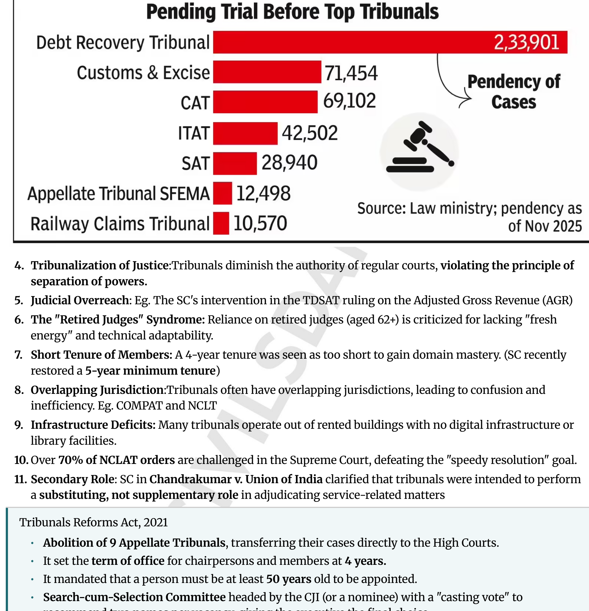

# Tribunals (Art 323A & 323B), Alternative Dispute Resolution (Mediation Act 2023), Lok Adalats, Gram Nyayalayas & NALSA — Smash Mains Notes (Ch09_Sub02_Tribunals_ADR_Lok_Adalats_Gram_Nyayalayas_Legal_Aid)

---

### [Smash Mains Source Page 189](../../pages/mains/mains_page_189.pdf)

  - **a.** Central Administrative Tribunal (CAT)

  - **b.** State Administrative Tribunals (SATs)

  - **c.** Joint Administrative Tribunal (JAT)

- **2.** Other Tribunals

  - **a.** National Green Tribunal

  - **b.** Armed Forces Tribunals

  - **c.** Foreigner Tribunals - determine whether a person is or is not a foreigner under Foreigner's Act 1946.

  - **d.** National Company Law Tribunal (NCLT) - established under the Companies Act 2013

  - **e.** Telecom Disputes Settlement and Appellate Tribunal (TDSAT)

- SC has directed the Union Government to establish the National Tribunal Commission (NTC) to oversee all tribunals.

- In major tribunals like the NCLT, nearly 88% of the staff (382 out of 434) were working on a temporary/contractual basis.

- The Armed Forces Tribunal (AFT) recorded over 21,000 pending cases

### Significance

- **1.** Specialized Technical Expertise: Benches consist of both Judicial and "Technical Members" (experts) to handle complex domain-specific issues.

- **2.** Reduction of Court Burden: Eg. ITAT (Income Tax Appellate Tribunal) resolves the majority of tax disputes, preventing the HCs from being overwhelmed.

- **3.** Speedy Dispute Resolution: Eg. The NCLT is mandated to resolve corporate insolvency cases within a strict 180-270 day window.

- **4.** Cost-Effective Justice: Lower court fees and simplified filing make them accessible for individuals and small businesses.

- **5.** Accessibility: Eg. The NGT has five zonal benches (Bhopal, Pune, Kolkata, Chennai, and Delhi) to ensure regional coverage.

- **6.** Flexibility and Informality: They follow the "Principles of Natural Justice" rather than the rigid Evidence Act, ensuring fairness.

- **7.** Alternative to Writ Jurisdiction: They act as the "court of first instance" for specialized matters, as per the L. Chandra Kumar (1997) ruling.

- **8.** Sector-Specific Regulation: They help in the smooth functioning of core sectors like Telecom, Electricity, and Real Estate.

- **9.** Insolvency & Bankruptcy Success: Tribunals have revolutionized debt recovery through the IBC 2016 framework. Eg. Recoveries through NCLT have surpassed ₹3 lakh crore.

### Issues

- **1.** Lack of Independence: Tribunals are under the administrative control of the Line Ministry

- **2.** High Pendency Rates:tribunals have over 5 lakh cases pending

- **3.** High Vacancy Rates due to prolonged delays in appointing members

---

### [Smash Mains Source Page 190](../../pages/mains/mains_page_190.pdf)

*Diagram Screenshot: [Justice Jammed: Pending Trials Before Top Tribunals in India](../../diagrams/mains_diag_tribunals_pendency_p190.png) · [Full Source Page 190](../../pages/mains/mains_page_190.pdf)*

- **4.** Tribunalization of Justice:Tribunals diminish the authority of regular courts, violating the principle of separation of powers.

- **5.** Judicial Overreach: Eg. The SC's intervention in the TDSAT ruling on the Adjusted Gross Revenue (AGR)

- **6.** The "Retired Judges" Syndrome: Reliance on retired judges (aged 62+) is criticized for lacking "fresh energy" and technical adaptability.

- **7.** Short Tenure of Members: A 4-year tenure was seen as too short to gain domain mastery. (SC recently restored a 5-year minimum tenure)

- **8.** Overlapping Jurisdiction:Tribunals often have overlapping jurisdictions, leading to confusion and inefficiency. Eg. COMPAT and NCLT

- **9.** Infrastructure Deficits: Many tribunals operate out of rented buildings with no digital infrastructure or library facilities.

- **10.** Over 70% of NCLAT orders are challenged in the Supreme Court, defeating the "speedy resolution" goal.

- **11.** Secondary Role: SC in Chandrakumar v. Union of India clarified that tribunals were intended to perform a substituting, not supplementary role in adjudicating service-related matters Tribunals Reforms Act, 2021

- Abolition of 9 Appellate Tribunals, transferring their cases directly to the High Courts.

- It set the term of office for chairpersons and members at 4 years.

- It mandated that a person must be at least 50 years old to be appointed.

- Search-cum-Selection Committee headed by the CJI (or a nominee) with a "casting vote" to recommend two names per vacancy, giving the executive the final choice.

- Mandated appointments within three months of the committee's recommendation.

### Major SC Judgments on Tribunals

- **1.** Tribunal Reforms Act Case (Nov 2025): The SC struck down several sections of the 2021 Act as unconstitutional. It struck down

  - **a.** Minimum age requirement of 50 years

---

### [Smash Mains Source Page 191](../../pages/mains/mains_page_191.pdf)

  - **b.** 4 year tenure (SC mandated minimum 5)

  - **c.** Search cum selection committee to recommend 2 names for each vacancy (SC mandated only 1 name recommendation)

  - **d.** Service conditions equivalent to civil servants (SC mandated equal to HC judge)

- **2.** Madras Bar Association v. Union of India (2021): Selection committees must have "judicial dominance" to protect Separation of Powers

- **3.** L. Chandra Kumar v. Union of India (1997): Established that tribunals are not substitutes for High Courts & decisions are subject to the writ jurisdiction of High Courts (Article 226/227).

### Way Forward

- **1.** Impartial Member Selection: Implementing recommendations from the 272nd Law Commission of India to reduce government involvement.

- **2.** Timely Filing of Vacancies

- **3.** Create the National Tribunal Commission as an independent umbrella body for all tribunals.

- **4.** Financial Autonomy: Funding should be charged on the Consolidated Fund of India

- **5.** Zonal Benches: Establish regional benches for all major tribunals to ensure "Access to Justice".

- **6.** Mandatory Training: 3-month judicial training program for new technical members

- **7.** Enact a "Tribunals Procedure Act" to bring uniformity across all adjudicatory bodies.

- **8.** Adopt the UK First-tier and Upper Tribunal model, which has a unified administrative structure and clear career paths for members.

- **9.** Fully digitalize tribunal processes through an e-Tribunals initiative

### Contempt of Court

Contempt of court refers to any act that disrespects or challenges the authority, integrity, or dignity of a court. It includes defying court orders, witness tampering, withdrawing evidence, or non-compliance with judicial requests.

### Key Facts and Provisions

- **1.** Article 129 empowers the Supreme Court as a Court of Record with the authority to punish for contempt; Article 215 grants similar powers to High Courts.

- **2.** Article 19(2): Includes "Contempt of Court" as a reasonable restriction.

- **3.** Contempt of Courts Act, 1971: Provides the statutory framework, defining types of contempt, procedures, and punishments.

- **4.** Contempt of Court (Amendment) Act, 2006: Introduced "Truth" as a valid defense if it is in the public interest and made bona fide.

- **5.** Civil Contempt - Willful disobedience of a court's judgment, decree, order, or direction, or breach of an undertaking given to the court.

- **6.** Criminal Contempt - Includes publications or acts that:

  - **a.** Scandalize the court or lower its authority.

  - **b.** Interfere with judicial proceedings or obstruct justice.

  - **c.** Obstructs the administration of justice in any other manner.

- **7.** Punishment - Up to six months of simple imprisonment, or a fine up to ₹2,000, or both.

---

### [Smash Mains Source Page 192](../../pages/mains/mains_page_192.pdf)

### Court Cases

- **1.** Prashant Bhushan Case(2020): The SC held that tweets criticizing the CJI "scandalized the court" and undermined the dignity of the institution

- **2.** Shanmugam @ Lakshminarayanan v. Madras HC (2025): contempt powers are meant to protect the administration of justice, not to shield judges from individual criticism

- **3.** Justice C.S. Karnan Case (2017): The first time a sitting High Court judge was sentenced to imprisonment for contempt

- **4.** M.V. Jayarajan vs. High Court of Kerala (2015) - the SC held that using abusive language in public speeches while criticizing a court amounts to criminal contempt.

### Need

- **1.** Ensuring Compliance: ensures court orders are not ignored by the executive or powerful private entities. Eg. Civil contempt is used to enforce maintenance payments in matrimonial disputes.

- **2.** Deterrence Against Perjury: Discourages parties from filing false affidavits or fabricated evidence. Eg. criminal contempt for submitting forged land records in property suits.

- **3.** Protecting Witnesses: Contempt powers are used to punish those who threaten witnesses in high-profile criminal trials like the Lakhimpur Kheri case.

- **4.** Maintaining Courtroom Decorum: Allows judges to manage disruptive behavior during hearings to ensure an orderly trial process.

- **5.** Curbing "Media Trials": Prevents sensationalist reporting from prejudicing the mind of the judge or the public during active trials.

- **6.** Safeguarding Judicial Independence: Protects judges from malicious political attacks intended to influence their decision-making process.

- **7.** Preventing Procedural Obstruction: Punishes officers who intentionally delay implementation of time-bound judicial directives. Eg. Contempt petitions against Chief Secretaries

- **8.** Upholding Public Confidence: Eg. in Arundhati Roy case, the SC found her in contempt for statements that were perceived to erode public confidence in the judiciary

- **9.** Protection of Subordinate Courts - the Act empowers High Courts to punish contempt of subordinate courts, ensuring the smooth functioning of lower judiciary

### Criticism

- **1.** Chilling Effect on Speech: Fear of contempt leads to self-censorship among journalists, activists, and legal academics.

- **2.** Against Right to dissent under Article 19 and 21.

- **3.** Vague Definition: The term "scandalizing the court" is highly subjective and depends on the judge's individual sensitivity.

- **4.** Conflict of Interest: judiciary acts as the accuser, prosecutor, and the judge simultaneously violating the fundamental principle of Natural Justice

- **5.** Lack of Accountability: The judiciary's power to punish for contempt without adequate checks can lead to arbitrary decisions..

- **6.** Colonial Anachronism: The concept was abolished in the UK in 2013, yet India continues to use this "monarchical" tool.

- **7.** Inconsistent Punishment: The lack of a standardized sentencing policy leads to disparities in penalties for similar offenses.

- **8.** Obsolete "Majesty" Concept: In a modern democracy, institutional respect should be earned through performance, not enforced by fear.

---

### [Smash Mains Source Page 193](../../pages/mains/mains_page_193.pdf)

- **9.** Subjective "Truth" Defense: Even with the 2006 Amendment, the burden of proving "bona fide intent" remains prohibitively difficult for whistleblowers.

### Way Forward

- **1.** Abolish "Scandalizing the Court": Follow the UK's Crime and Courts Act 2013 and limit criminal contempt to "obstruction of justice" only.

- **2.** The "Clear and Present Danger" Test: Adopt the US standard, where contempt is only invoked if the speech poses an immediate threat to a fair trial.

- **3.** Codifying "Fair Criticism": Explicitly define what constitutes academic, journalistic, or legal critique to provide a "Safe Harbor" for citizens.

- **4.** Ensure that contempt cases are resolved within 6 months.

- **5.** Mandatory Mediation before punitive action for Civil Contempt

- **6.** Create an independent committee to assist the Attorney General in deciding contempt permissions to ensure non-partisanship.

- **7.** Strengthening the Judicial Standards and Accountability framework can reduce the need for "defensive" contempt laws.

### Sealed cover jurisprudence

It refers to the practice where the executive (government) submits sensitive information to the judiciary in a sealed envelope, accessible only to the judges and not to the opposing party.

### Recent News

- **1.** Following the full implementation of the MediaOne guidelines, courts have replaced "Sealed Covers" with Public Interest Immunity (PII) claims, where a redacted summary of the evidence must be shared with the petitioner.

- **2.** The Apex Court recently reprimanded the Enforcement Directorate for "routinely" handing over case diaries in sealed covers during bail hearings, calling it a violation of Article 21.

### Major Cases

- **1.** Pegasus Spyware Case (2021): The SC refused to accept a "limited affidavit" in a sealed cover from the Centre

- **2.** Rafale Fighter Jet Deal: accepted pricing details in sealed cover citing the Official Secrets Act.

- **3.** Bhima Koregaon Case accepted evidence in sealed covers to deny bail to activists.

- **4.** BCCI Reforms Case: The Mudgal Committee submitted names of cricketers suspected of match-fixing in a sealed cover to protect their reputations during the probe.

- **5.** INX Media Case (2019): The SC criticized the Delhi High Court for denying bail to P. Chidambaram based solely on documents produced by the ED in a sealed cover.

### Justification of Sealed Cover Jurisprudence

- **1.** Protecting National Security: Safeguards classified military or intelligence data

- **2.** Investigation Integrity: Prevents the "tipping off" of suspects or the destruction of evidence

- **3.** Privacy of Individuals: Protects the reputation and dignity of persons

- **4.** Protecting Identity of Informants

- **5.** Diplomatic Sensitivity: Eg. Terms of sovereign guarantees in international defense contracts

- **6.** Economic Stability: Eg. Data regarding distressed assets in major banks

- **7.** Protection of Victims in sensitive cases like POCSO

---

### [Smash Mains Source Page 194](../../pages/mains/mains_page_194.pdf)

- **8.** Complying with Official Secrets Act & Section 123 of the Evidence Act

### Criticism of Sealed Cover Jurisprudence

- **1.** Violation of Natural Justice: Violates the "Right to be Heard" (Audi Alteram Partem)

- **2.** Lack of Transparency: violates "justice must be seen to be done" principle

- **3.** There is no codified law for its use, leaving it to the "ad-hoc" discretion of individual judges.

- **4.** Erosion of Judicial Reasoning

- **5.** The 2025 Media Freedom Index cited sealed covers as a major threat to independent journalism in India.

- **6.** Interference with Fair Trial: withholding of evidence from the accused.

- **7.** Undermining Accountability of executive. Eg. pegasus case

- **8.** Democratic Decay

### Way Forward

- **1.** Appointment of Amicus Curiae: appoint an independent lawyer to "see" the sealed cover and argue on behalf of the absent party.

- **2.** Redacted Disclosures: Mandate the state to provide "Redacted Summaries" that remove sensitive names but keep the "gist" of the allegations clear.

- **3.** Amend the Supreme Court Rules, 2013 to define strict, narrow categories where sealed covers are permissible.

- **4.** The Proportionality Test: Apply the Puttaswamy (2017) test to ensure that "secrecy" is the least restrictive measure possible to achieve the goal.

- **5.** In-Camera Hearings

### Judicial Recusal in India

In Delhi Liquor Policy Case a recusal plea was raised against Justice Swarna Kanta Sharma citing perceived ideological bias. Judicial Recusal is the act of a judge voluntarily abstaining from participating in a legal proceeding because of a conflict of interest or a reasonable apprehension that they cannot remain impartial. It flows from two foundational maxims of law:

- **1.** Nemo judex in causa sua - "No one shall be a judge in their own cause"

- **2.** Justice must not only be done but must also be seen to be done

### Provisions and Procedures in India

- **1.** No Codified Law: Unlike the US (28 U.S. Code § 455), India has no statutory law governing recusal. It is governed by judicial conventions and precedents.

- **2.** Restatement of Values of Judicial Life - forbids a judge from deciding a case where they hold a pecuniary interest, unless the concerned parties have no objections. It is non-binding.

- **3.** Constitutional Oath: Derived from the Third Schedule, where a judge swears to perform duties "without fear or favour, affection or ill-will."

- **4.** Two Types:

  - **a.** Automatic (Sua Sponte): The judge withdraws voluntarily upon identifying a conflict.

  - **b.** Requested: A litigant files a plea for recusal. Final decision rests with the judge.

- **5.** Reassignment: Once a judge recuses, the case is sent to the Chief Justice (Master of Roster) for assignment to a different bench.

---

### [Smash Mains Source Page 195](../../pages/mains/mains_page_195.pdf)

- **6.** The Doctrine of Necessity is an exception. It says that a judge may still hear a matter despite a potential conflict if there is no alternative forum or judge available

### Grounds for Recusal

- **1.** Personal or prior professional association with a party

- **2.** Earlier involvement as lawyer or judge in the same matter

- **3.** Financial interest in the case outcome

- **4.** Engagement in ex parte (private) communications related to the case

### Justification of Recusal

- **1.** Preservation of Public Confidence in impartiality of Judiciary

- **2.** Preventing Prejudgment - Prior Advocacy Conflict - Eg. Justice U.U. Lalit recused from the Ram Janmabhoomi dispute as he had previously appeared as an advocate in a related matter

- **3.** Protection Institutional Integrity in Politically Sensitive Cases - Eg. CJI Sanjiv Khanna and CJI Surya Kant both recused from petitions challenging the CEC appointment law

- **4.** Upholding Due Process: Article 21's "Right to a Fair Trial" implicitly requires an impartial adjudicator for every citizen.

- **5.** Upholds judge's oath to act "without fear or favour, affection or ill-will" under Schedule III

- **6.** Aligns India with international norms like Bangalore Principles of Judicial Conduct (2002).

- **7.** A judge who has pre-judged a legal or factual issue must not decide the same matter again.

### Limitations and Challenges in Recusal

- **1.** No Codified Law - based on the conscience of judges, leading to opacity.

- **2.** Bench Hunting/Forum Shopping: Litigants can request recusal of "tough" judges to get a more favorable bench assigned.

- **3.** Master of Roster Paradox - A recused CJI cannot adjudicate the case but retains roster control to decide who hears it

- **4.** Lack of Transparency: Most judges recuse without providing written reasons

- **5.** Sudden recusal after a few hearings forces a "de-novo" (fresh) hearing, wasting judicial time.

- **6.** Subjectivity of "Conscience": Since it's a personal decision, two judges may treat the same conflict differently, causing inconsistency.

- **7.** Strategic use of recusal petitions by litigants to stall execution of orders or final hearings.

- **8.** Absence of Review Mechanism: There is no legal way to challenge a judge's refusal to recuse except via a review petition later.

### Major SC Judgments

- **1.** Manak Lal v. Dr. Prem Chand (1957): Established the "Real Likelihood of Bias" test.

- **2.** Ranjit Thakur v. Union of India (1987): Held that the test is the "Reasonableness of apprehension" in the mind of the party. (not actual bias)

- **3.** Supreme Court Advocates-on-Record Association (2015): Clarified that pecuniary interest makes recusal automatic.

- **4.** Indore Development Authority Case (2019): Ruled that a judge is not disqualified from a larger bench just for passing an earlier smaller-bench order.

### Way Forward

- **1.** Mandatory Disclosure: Judges should provide a written reason for recusal to ensure transparency

- **2.** Codify Recusal Standards Under Article 145 or by Statute

---

### [Smash Mains Source Page 196](../../pages/mains/mains_page_196.pdf)

- **3.** Pre-Hearing Disclosure: Conflicts should be disclosed at the "admission stage" to prevent delays during final hearings.

- **4.** Adopting the UK's "Fair-minded and Informed Observer" test (Porter v. Magill) for a more objective standard.

- **5.** Review by a Larger Bench: In sensitive cases, a recusal request could be decided by a 3-judge bench instead of the concerned judge alone.

- **6.** Penalty for using recusal as a tool for "bench hunting."

### Post-retirement appointments of judges

- **1.** In 2024, hours after resigning as a judge of the Calcutta HC, joined a political party and contested 2024 LS elections.

- **2.** Justice B.R. Gavai publicly pledged to refuse any post-retirement appointment from the government, arguing it is essential to maintain public confidence.

- Since 1950, over 40 CJIs have accepted post-retirement positions in various capacities.

- Vidhi Centre for Legal Policy found that nearly 72% of retired SC judges take up official assignments (Tribunals, Commissions, or Governorships) within 2 years of retirement.

- Over 40 Central Acts specifically require a retired SC or HC judge to head bodies like the NHRC, NGT, and NCDRC.

### Constitutional Provisions

- **1.** Article 124(7): Former Supreme Court judges cannot practice law in any Indian court or authority.

- **2.** Article 220: Retired High Court judges are prohibited from acting in any court except the Supreme Court and other High Courts.

### Benefits of Post-Retirement Appointments

- **1.** Utilization of Expertise - as per Former CJI D.Y. Chandrachud, the "vast experience" of judges is a valuable national resource that shouldn't be entirely discarded.

- **2.** Statutory Compliance: Eg. Protection of Human Rights Act requires a former CJI or SC judge to lead the NHRC.

- **3.** Judicial Continuity in Tribunals: Judges are better equipped than bureaucrats to handle "judicial functions" like cross-examination and evidence.

- **4.** Retired judges act as neutral and "trusted" members for heading sensitive inquiry commissions. Eg. Justice J.S. Verma Committee after the Nirbhaya case.

- **5.** Institutional Memory: Long-serving judges help maintain consistency in how specialized laws (like the IBC) are interpreted across the country.

- **6.** Standardizing Quasi-Judicial Work: Judges bring a "standardized template" for writing judgments to administrative bodies that might otherwise be arbitrary.

- **7.** Filling Vacancy Gaps: They serve as a ready pool of "ad-hoc" members for temporary commissions, saving the time required for fresh recruitments. Eg. Delimitation Commissions

### Criticism

- **1.** Erosion of Judicial Independence: The "hope" for a future job may subconsciously influence a judge's rulings in favor of the government.

- **2.** Public Perception Crisis: Eg. nomination of a former CJI to the Rajya Sabha (2020)
