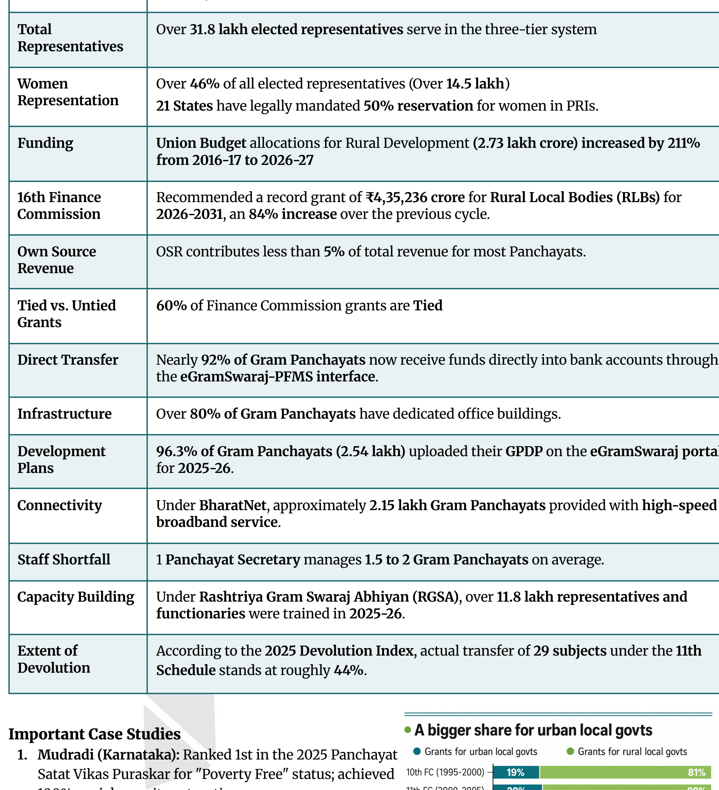
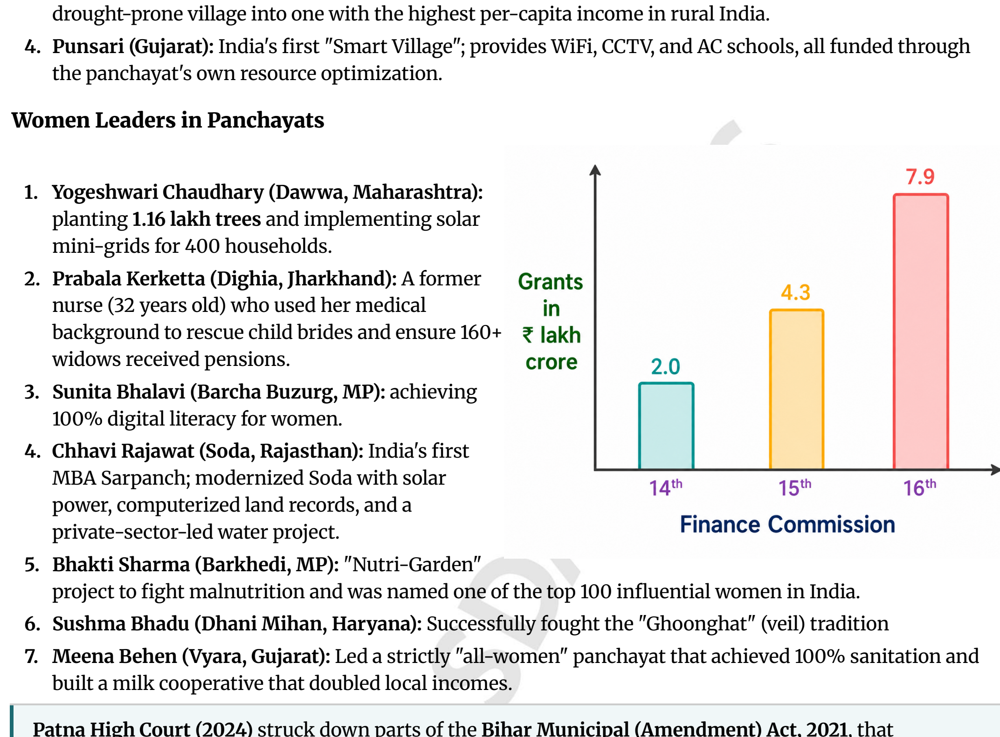
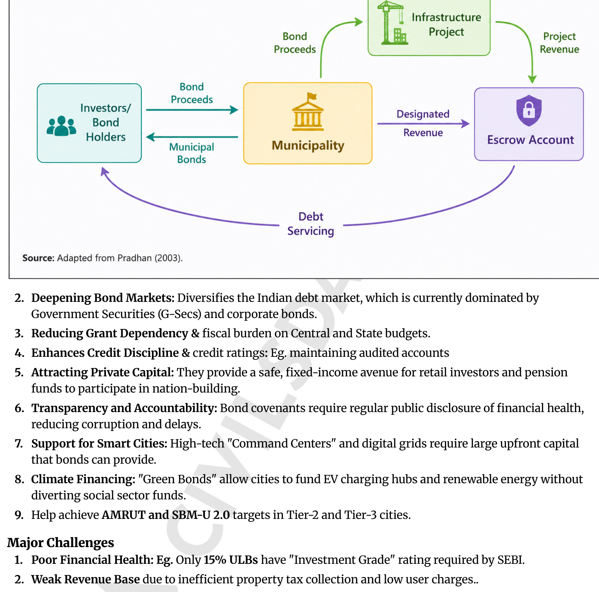

# Local Government: Panchayati Raj Institutions (73rd Amendment), Municipalities (74th Amendment) & PESA — Smash Mains Notes (X-Factor Mains'27)

---

### [Smash Mains Source Page 203](pages/mains/mains_page_203.pdf)

## Chapter 13
Local Government

### PYQs

- **[2026]** “Women as a class neither belong to a minority group nor are they regarded as forming a backward
class.” In the light of this statement, discuss the evolution of women's reservation from local bodies to
Parliament. (10)

- **[2024]** Analyse the role of local bodies in providing good governance at local level and bring out the pros
and cons of merging the rural local bodies with the urban local bodies. (10)

- **[2023]** "The states in India seem reluctant to empower urban local bodies both functionally as well as
financially." Comment. 10

- **[2022]** To what extent, in your opinion, has the decentralisation of power in India changed the governance
landscape at the grassroots? (10)

- **[2020]** The strength of local institutions in India has shifted from their formative phase of 'Functions,
Functionaries and Funds' to the contemporary stage of 'Functionality'. Highlight the critical challenges
faced by local institutions in terms of their functionality in recent times. (15)

- **[2019]** "The reservation of seats for women in the institutions of local self- government has had a limited
impact on the patriarchal character of the Indian Political Process." Comment. (15)

- **[2018]** Assess the importance of the Panchayat system in India as a part of local government. Apart from
government grants, what sources can the Panchayats look out for financing developmental projects? (15)
Panchayati Raj
"The success of democracy in India depends on the success of democracy at the grassroots through
Panchayati Raj." - Rajiv Gandhi
"Panchayati Raj embodies the spirit of participatory democracy, enabling citizens to have a direct say in their
governance."
They are inspired by Gandhiji's concept of "Oceanic Circles of Power" and "Swaraj"
To realise the vision of "Gram Uday se Bharat Uday", India needs second-generation Panchayati Raj
reforms focused on subsidiarity, fiscal autonomy, and participatory democracy.
Subsidiarity principle - decision-making authority is best placed
- Where responsibility for outcomes will occur
- In the closest appropriate proximity to where the actions will be taken
205

#### Structured Tables on Page 203

| PYQs |
| --- |
| [2026] “Women as a class neither belong to a minority group nor are they regarded as forming a backward class.” In the light of this statement, discuss the evolution of women's reservation from local bodies to Parliament. (10) [2024] Analyse the role of local bodies in providing good governance at local level and bring out the pros and cons of merging the rural local bodies with the urban local bodies. (10) [2023] "The states in India seem reluctant to empower urban local bodies both functionally as well as financially." Comment. 10 [2022] To what extent, in your opinion, has the decentralisation of power in India changed the governance landscape at the grassroots? (10) [2020] The strength of local institutions in India has shifted from their formative phase of 'Functions, Functionaries and Funds' to the contemporary stage of 'Functionality'. Highlight the critical challenges faced by local institutions in terms of their functionality in recent times. (15) [2019] "The reservation of seats for women in the institutions of local self- government has had a limited impact on the patriarchal character of the Indian Political Process." Comment. (15) [2018] Assess the importance of the Panchayat system in India as a part of local government. Apart from government grants, what sources can the Panchayats look out for financing developmental projects? (15) |

---

### [Smash Mains Source Page 204](pages/mains/mains_page_204.pdf)

*Diagram Screenshot: [A Bigger Share for Urban Local Governments (Finance Commission Grants)](diagrams/mains_diag_ulb_grants_share_p204.png) | [Full Source Page 204](pages/mains/mains_page_204.pdf)*

Data on PRIs
Category Data
Total PRIs Approximately 2.64 lakh Gram Panchayats, 6,792 Block Panchayats, and 670 Zila
Panchayats across India.
Total
Representatives
Over 31.8 lakh elected representatives serve in the three-tier system
Women
Representation
Over 46% of all elected representatives (Over 14.5 lakh)
21 States have legally mandated 50% reservation for women in PRIs.
Funding Union Budget allocations for Rural Development (2.73 lakh crore) increased by 211%
from 2016-17 to 2026-27
16th Finance
Commission
Recommended a record grant of ₹4,35,236 crore for Rural Local Bodies (RLBs) for
2026-2031, an 84% increase over the previous cycle.
Own Source
Revenue
OSR contributes less than 5% of total revenue for most Panchayats.
Tied vs. Untied
Grants
60% of Finance Commission grants are Tied
Direct Transfer Nearly 92% of Gram Panchayats now receive funds directly into bank accounts through
the eGramSwaraj-PFMS interface.
Infrastructure Over 80% of Gram Panchayats have dedicated office buildings.
Development
Plans
96.3% of Gram Panchayats (2.54 lakh) uploaded their GPDP on the eGramSwaraj portal
for 2025-26.
Connectivity Under BharatNet, approximately 2.15 lakh Gram Panchayats provided with high-speed
broadband service.
Staff Shortfall 1 Panchayat Secretary manages 1.5 to 2 Gram Panchayats on average.
Capacity Building Under Rashtriya Gram Swaraj Abhiyan (RGSA), over 11.8 lakh representatives and
functionaries were trained in 2025-26.
Extent of
Devolution
According to the 2025 Devolution Index, actual transfer of 29 subjects under the 11th
Schedule stands at roughly 44%.
Important Case Studies
1. Mudradi (Karnataka): Ranked 1st in the 2025 Panchayat
Satat Vikas Puraskar for "Poverty Free" status; achieved
100% social security saturation.
2. Madamakki (Karnataka): achieved 100% Functional
Household Tap Connections (FHTC) and integrated
greywater management.
206

#### Structured Tables on Page 204

| Category | Data |
| --- | --- |
| Total PRIs | Approximately 2.64 lakh Gram Panchayats, 6,792 Block Panchayats, and 670 Zila Panchayats across India. |
| Total Representatives | Over 31.8 lakh elected representatives serve in the three-tier system |
| Women Representation | Over 46% of all elected representatives (Over 14.5 lakh) 21 States have legally mandated 50% reservation for women in PRIs. |
| Funding | Union Budget allocations for Rural Development (2.73 lakh crore) increased by 211% from 2016-17 to 2026-27 |
| 16th Finance Commission | Recommended a record grant of ₹4,35,236 crore for Rural Local Bodies (RLBs) for 2026-2031, an 84% increase over the previous cycle. |
| Own Source Revenue | OSR contributes less than 5% of total revenue for most Panchayats. |
| Tied vs. Untied Grants | 60% of Finance Commission grants are Tied |
| Direct Transfer | Nearly 92% of Gram Panchayats now receive funds directly into bank accounts through the eGramSwaraj-PFMS interface. |
| Infrastructure | Over 80% of Gram Panchayats have dedicated office buildings. |
| Development Plans | 96.3% of Gram Panchayats (2.54 lakh) uploaded their GPDP on the eGramSwaraj portal for 2025-26. |
| Connectivity | Under BharatNet, approximately 2.15 lakh Gram Panchayats provided with high-speed broadband service. |
| Staff Shortfall | 1 Panchayat Secretary manages 1.5 to 2 Gram Panchayats on average. |
| Capacity Building | Under Rashtriya Gram Swaraj Abhiyan (RGSA), over 11.8 lakh representatives and functionaries were trained in 2025-26. |
| Extent of Devolution | According to the 2025 Devolution Index, actual transfer of 29 subjects under the 11th Schedule stands at roughly 44%. |

---

### [Smash Mains Source Page 205](pages/mains/mains_page_205.pdf)

*Diagram Screenshot: [Finance Commission Grants to Local Bodies (11th to 15th FC in Rs Lakh Crore)](diagrams/mains_diag_fc_grants_local_bodies_p205.png) | [Full Source Page 205](pages/mains/mains_page_205.pdf)*

3. Hiware Bazar (Maharashtra): The gold standard for water harvesting. Transformed from a
drought-prone village into one with the highest per-capita income in rural India.
4. Punsari (Gujarat): India's first "Smart Village"; provides WiFi, CCTV, and AC schools, all funded through
the panchayat's own resource optimization.
Women Leaders in Panchayats
1. Yogeshwari Chaudhary (Dawwa, Maharashtra):
planting 1.16 lakh trees and implementing solar
mini-grids for 400 households.
2. Prabala Kerketta (Dighia, Jharkhand): A former
nurse (32 years old) who used her medical
background to rescue child brides and ensure 160+
widows received pensions.
3. Sunita Bhalavi (Barcha Buzurg, MP): achieving
100% digital literacy for women.
4. Chhavi Rajawat (Soda, Rajasthan): India's first
MBA Sarpanch; modernized Soda with solar
power, computerized land records, and a
private-sector-led water project.
5. Bhakti Sharma (Barkhedi, MP): "Nutri-Garden"
project to fight malnutrition and was named one of the top 100 influential women in India.
6. Sushma Bhadu (Dhani Mihan, Haryana): Successfully fought the "Ghoonghat" (veil) tradition
7. Meena Behen (Vyara, Gujarat): Led a strictly "all-women" panchayat that achieved 100% sanitation and
built a milk cooperative that doubled local incomes.
Patna High Court (2024) struck down parts of the Bihar Municipal (Amendment) Act, 2021, that
transferred the powers of appointment of Grade C and D employees of municipalities from the Empowered
Standing Committee of the municipality to the State government-controlled Directorate of Municipal
Administration.
The court held that such recentralisation of power was "incompatible with the idea, intent, and design" of
the constitutional amendment, reaffirming urban local autonomy.
Significance of Local Bodies
Rajni Kothari - Described local bodies as "schools of democracy" where political awareness and participation
are cultivated at the grassroots level.
1. Normative Foundation: It rests on two core values - efficiency in public service delivery and deepening
of democracy through proximity to citizens.
2. Democratic Decentralization - Eg. Kerala's People's Plan Campaign grants local bodies control over
40% of the state's plan budget.
3. Principle of Subsidiarity: decisions closer to the people. Eg. selection of beneficiaries under PM-Awas
Yojana
4. Inclusivity and social justice: representation to Scheduled Castes, and Scheduled Tribes.
5. Implementation of Schemes, ensuring that benefits reach the grassroots. Eg. MGNREGA.
6. Gender Empowerment: Over 14.5 lakh Elected Women Representatives, with 21 states providing 50%
reservation.
207

---

### [Smash Mains Source Page 206](pages/mains/mains_page_206.pdf)

7. Efficient Service Delivery: Local bodies manage essential life-services like water, sanitation, and
primary health more responsively than distant bureaucracies.
8. Localized Planning through Gram Panchayat Development Plans (GPDP)
9. Crisis Management: Local bodies acted as the "first responders".
10. Resource Mobilization: They act as agencies for collecting property taxes and user charges
Major Issues faced by PRIs
"PRIs exist as over-structured but underpowered organisations." They act merely as administrative
vehicles of state governments, rather than as autonomous institutions of self-governance. (2nd ARC)
Funds
1. Dependence on higher tiers: Around 95% of Panchayat funds come from Central/State transfers.
2. Irregular flow of grants: Delays in fund release under Finance Commissions and CSS schemes.
3. Although direct transfers to panchayats rose from ₹1.45 lakh crore (13th FC) to ₹4.35 lakh crore (16th
FC), 60% are tied grants
4. Limited own-source revenue: Poor tax collection efficiency (>1% own tax).
5. Weak financial management: corruption, audit delays. (No decentralisation of power, rather
decentralisation of corruption - Mani Shankar Iyer Committee)
6. Rising Finance Commission allocations has reduced motivation for OSR mobilisation
7. Barriers to Local Taxation: fear of losing popularity discourages local taxation.
Functions
1. Incomplete devolution: Less than 10 States have transferred all 29 subjects under 11th Schedule. (overall
Panchayat Devolution Index is only 44%)
2. Centralised Welfare via Cash Transfers (DBT), bypassing panchayats. Eg. Schemes like PM-KISAN
exclude them from beneficiary selection
3. Role Ambiguity: Lack of clear "Activity Mapping" leads to overlaps between the three tiers (Gram, Block,
and Zila).
4. Lack of planning autonomy: District Planning Committees largely dysfunctional or symbolic.
5. Conditionalities under CSS leaves little scope for local prioritisation.
Functionaries
1. Shortage of staff: Average 0.67 Panchayat Secretaries per Gram Panchayat, as low as 0.33 in Uttar
Pradesh.
2. Dual control: Local staff often answer to line departments, not Panchayats.
3. Absence of dedicated cadre for Panchayats in majority of states
4. Representatives lack technical training to use digital portals like eGramSwaraj or AuditOnline.
5. The "Sarpanch-Pati" Culture: male relatives exercising real power.
6. Inadequate Infrastructure: Approximately 20% of Panchayats still lack dedicated office buildings
(Panchayat Bhawans) or stable internet.
Functionality
1. Weak Gram Sabhas: Low participation, elite domination, and token meetings.
2. Poor digital and administrative capacity: Limited use of e-Gram Swaraj and GIS-based planning.
3. Accountability issues: Weak social audit mechanisms and poor grievance redressal.
4. Urbanisation Shift in Policy Focus as the rural population fell from 75% (1990) to about 60%.
5. Lack of real-time data on village assets makes evidence-based planning difficult.
208

---

### [Smash Mains Source Page 207](pages/mains/mains_page_207.pdf)

Government Initiatives
1. Revamped Rashtriya Gram Swaraj Abhiyan (RGSA) - Capacity building and training of over 31 lakh
elected representatives and PRI functionaries.
a. Training on 9 thematic areas such as "Healthy Village," "Water Sufficient Village," and "Women
Friendly Village."
b. Infrastructure: Funding for the construction of Gram Panchayat Bhawans and co-location of
Common Service Centres (CSCs).
c. In 2025-26, a specialized module for Women Elected Representatives (WER) was launched to reduce
"Sarpanch-Pati" culture.
2. SVAMITVA Scheme
a. Survey of Villages and Mapping with Improvised Technology in Village Areas.
b. Drone surveys have been completed in 3.29 lakh villages out of the 3.44 lakh target.
c. Over 2.65 crore Property Cards have been distributed
d. States like MP and Karnataka have mandated co-ownership of women in these cards
3. e-Panchayat Mission Mode Project (MMP)
a. e-GramSwaraj Portal: A unified platform for planning, accounting, and monitoring. In FY 2025-26,
2.54 lakh Gram Panchayats uploaded their Development Plans.
b. AuditOnline: Mandates online auditing of Panchayat accounts.
c. SabhaSaar: An AI-enabled platform that provides real-time voice-to-text summarization of Gram
Sabha meetings.
4. Panchayat Advancement Index - ranking system to measure the performance of PRIs across the 9 LSDG
themes. It serves as the primary criteria for the National Panchayat Awards.
5. People's Plan Campaign (Sabki Yojana, Sabka Vikas) - preparation of evidence-based, holistic and
inclusive Development Plans at the grassroots level
6. Meri Panchayat App for citizens to track PRI's budget, ongoing works, and expenditure
7. Finance Commission Grants (15th & 16th FC)
8. Accountability and Monitoring - Social Audit under MGNREGA and RGSA
9. "Panchayat NIRNAY" portal to make the GS meetings more participatory, transparent and vibrant. Deals
with scheduling meetings, notifying citizens and recording panchayat decisions
Way Forward
1. Launch a new decentralisation drive (Panchayati Raj 2.0) to revive local governance momentum.
2. Second Administrative Reforms Commission (ARC) - 6th Report on Local Governance (2007)
a. Activity Mapping: Clearly define and notify the functions of each tier of PRIs based on the principle
of subsidiarity.
b. Strengthen District Planning Committees (DPCs): Make them functional with genuine planning
power and integration across rural-urban lines.
c. Capacity Building: Establish State Institutes of Rural Development (SIRDs) as nodal agencies for PRI
training.
d. Performance Audits: Institute independent performance audits of PRIs regularly.
e. Social Audit: Institutionalize social audits in all developmental schemes implemented through PRIs.
f. Smaller, unviable Panchayats should be merged for better administrative efficiency.
3. Mani Shankar Aiyar Committee (2013)
a. No project should be implemented without prior informed consent of Gram Sabha
b. Called for the abolition or integration of state-run parastatals (like Water Boards)
c. Establish National Commission for Panchayati Raj.
209

---

### [Smash Mains Source Page 208](pages/mains/mains_page_208.pdf)

d. Create Panchayat Ombudsman for grievance redressal.
e. Set up a separate cadre of Panchayat bureaucracy with a code of conduct.
f. Adopt activity mapping for clear delineation of 3Fs - Funds, Functions, Functionaries.
4. Sumit Bose Committee (2017)
a. Every Gram Panchayat must have a full-time Secretary and a Technical Assistant (engineer) for
infrastructure oversight.
b. Scale Rashtriya Gram Swaraj Abhiyan to include "Specialized Management Training" at institutes
like IIMs.
5. Punchhi Commission on Centre-State Relations (2010)
a. Strengthen State Finance Commissions with mandatory action on their recommendations
b. Create a model legislation to provide uniform devolution framework across states
6. B.K. Chaturvedi Committee - Flexible Funding Norms that allow PRIs to prioritize local needs
7. Prof. T.M. Thomas Isaac (former Kerala Finance Minister) - Recommends building local cadre of
professionals to assist PRIs in technical and planning aspects.
8. Nyaya Panchayats for a cluster of villages to resolve petty disputes.(L.M. Singhvi Committee)
9. State level practices
a. Kerala People's Plan: devolve 40% of the state budget directly to local bodies.
b. Karnataka (Panchatantra 2.0): GIS-based asset management system where every public asset
(borewell, streetlight) is digitally tagged and monitored.
District Planning Committees
1. The Union Budget 2026-27 proposed mapping "City Economic Regions" (CERs), where DPCs will play a
nodal role in coordinating between ULBs and surrounding rural Panchayats.
2. The Ministry of Panchayati Raj issued guidelines for DPCs to incorporate "District Climate Resilience
Plans" into the annual draft development plans.
Constitutional Provisions
1. Article 243ZD: Inserted by the 74th Constitutional Amendment Act, 1992.
2. Composition: The State Legislature determines the composition.
a. At least four-fifths (80%) of the members must be elected by and from amongst the elected
members of the district's Panchayats and Municipalities.
b. The ratio of members from rural and urban areas must be in proportion to the population ratio of the
district.
Key Functions
1. Consolidation of Plans: Merging individual Gram Panchayat Development Plans (GPDP) and Urban
Local Body (ULB) plans into one cohesive document.
2. Draft Development Plan: Preparing a comprehensive blueprint for the entire district's social and
economic development.
3. Helps in prioritizing and recommending allocation of financial resources for different sectors based on
local needs.
4. Spatial Planning: Addressing the physical layout of the district, including zoning and land-use patterns
across rural-urban borders.
5. Resource Mapping: Assessing available financial and natural resources (water, minerals, forests) for
optimal allocation.
6. Infrastructure Integration: Planning common infrastructure like district highways, solid waste plants,
and water pipelines that serve both towns and villages.
210

---

### [Smash Mains Source Page 209](pages/mains/mains_page_209.pdf)

7. Submission to State: The Chairperson forwards the finalized plan to the State Government for inclusion
in the State Plan.
8. Promoting bottom-up planning by reflecting the priorities and aspirations of local people.
9. Acts as a coordination mechanism between Panchayati Raj Institutions and Municipalities.
10. Ensures that the district plan aligns with state-level policies and objectives
Major Issues in Functioning
1. Lack of uniformity - States have discretion in operationalizing DPCs, leading to variation in structure,
powers, and roles across states.
2. Bureaucratic Hegemony: Dominated by the District Collector or state-appointed officials.
3. Non-binding Nature of Recommendations
4. DPCs have no independent budget or "taxing power" to execute them.
5. Lack of Technical Staff: lack of town planners, or economists to create "scientific" plans.
6. Parastatal bodies (like Water Boards) execute projects without consulting the DPC.
7. Rural-Urban Disconnect: limited "integrated" planning for peri-urban areas (Rurban clusters).
8. Irregular Meetings
9. Sidelining the Gram Sabha during the "consolidation" phase at the district level.
10. MPs and MLAs dominate discussions, suppressing voices of ward councillor
Way Forward:
1. Independent Secretariat: Every DPC must have a permanent office with professional town planners and
economists (Sumit Bose Committee).
2. Financial Devolution: A dedicated "District Planning Fund" should be created, with a share of the State
GST being directly credited to DPCs.
3. Mandatory Social Audit: The draft plans must be placed in the public domain for 30 days for citizen
feedback before finalization.
4. Regular Meetings, mandatory quorum, and proper documentation.
PESA Act
PESA Act, 1996 is a landmark legislation that aims to extend the 73rd Amendment to the Fifth Schedule
Areas of India. It is called a "Constitution within the Constitution" for tribal people.
Key Objectives
1. Self-Rule through traditional Gram Sabhas for people living in Scheduled Areas.
2. To recognize and safeguard the traditions, customs, and cultural identity of tribals.
3. Resource Control: ownership of minor forest produce and control over local resources.
4. Prevent Exploitation: protect from land alienation, moneylending, and intoxicant abuse.
5. Participatory Democracy: make the Gram Sabha the nucleus of all developmental activities.
6. To recognize traditional community-based dispute resolution mechanisms.
7. Bottom-up Planning: To ensure that every development project is approved by GS.
Adi Karmayogi Abhiyan - national movement to build a decentralized tribal leadership and governance
ecosystem.
211

---

### [Smash Mains Source Page 210](pages/mains/mains_page_210.pdf)

Objectives
- Train 20 Lakh tribal changemakers across 1 Lakh villages in 550 tribal-dominated districts
- Promote last-mile convergence & effective service delivery
- Facilitate Village Vision 2030 Planning & Development Action Plan
Key Provisions of PESA Act
1. Every village shall have a Gram Sabha consisting of persons whose names are included in the electoral
rolls.
2. Every Panchayat must obtain a "Certificate of Utilization" from the Gram Sabha for funds used for
development plans.
3. Reservation of Seats:
a. Reservation for STs shall not be less than 50% of the total number of seats.
b. All Chairpersons at all levels of Panchayats must be from the Scheduled Tribes.
4. Land & Water Control:
a. Gram Sabha must be consulted before land acquisition for development projects and before
resettling affected persons.
b. Gram Sabhas are empowered to prevent land alienation and restore unlawfully alienated tribal land.
5. The recommendation of the Gram Sabha is mandatory for granting prospective licenses or mining
leases for minor minerals in Scheduled Areas.
6. Power to regulate or restrict the sale and consumption of any intoxicant, ownership of minor forest
produce, and control over money-lending to STs.
Major Issues with PESA Act
1. PESA applies only to Scheduled Areas under the Fifth Schedule, leaving out tribal populations in
non-scheduled areas, limiting its scope and impact.
2. Rule Notification Lags: Eg. Jharkhand notified rules only in 2026, while Odisha's rules remain in draft
form.
3. "Consultation" vs. "Consent": Lack of "prior informed consent." Eg. In the Hasdeo Arand case, Gram
Sabha resolutions against mining were bypassed by the administration.
4. Conflict with Central Acts: Laws like the Mines and Minerals Act and Land Acquisition Act often
override PESA's protective provisions.
5. Bureaucratic Resistance: Eg. Forest officials in several states continue to harass tribal gatherers despite
PESA's ownership clause for MFP.
6. Local elites or non-tribal middlemen often manipulate Gram Sabha meetings to secure fraudulent
resolutions for industrial projects.
7. Overlapping Jurisdiction: Confusion between the Forest Rights Act (FRA) 2006 and PESA creates legal
stalemates over the definition of "community forest."
8. Limited Technical Capacity: Gram Sabhas lack the staff or expertise to manage complex mining lease
recommendations or large budgets.
9. Official Panchayat structures sometimes conflict with traditional tribal headmen (Eg. Manjhi-Pargana
system), causing internal friction.
10. Absence of Judicial Recourse: There is no dedicated fast-track tribunal to address PESA violations,
forcing tribes into long, expensive litigations.
212

---

### [Smash Mains Source Page 211](pages/mains/mains_page_211.pdf)

Way Forward
1. Xaxa Committee (2014):
a. Legal harmonization between PESA and all state subject laws.
b. Empowering Gram Sabhas to cancel illegal land transfers directly.
2. The Center should release a unified Central Model Rule template to prevent states from diluting the Act's
intent.
3. Every Gram Sabha should have its own building and independent Secretariats.
4. Amending state laws to align with PESA requirements. Eg. Mining, Forest, Excise laws
5. Codify Niyamgiri principles of free, prior, and informed consent through statutory amendment or
binding executive guidelines.
6. Institutionalize Social Audits and use the PESA-GPDP portal to track the ground-level impact of Gram
Sabha decisions
Case Studies
1. Mendha-Lekha (Maharashtra): The first village in India to win the right to sell Tendu leaves (MFP),
becoming a million-rupee economy managed by the Gram Sabha.
2. Niyamgiri (Odisha): In the famous Vedanta Case, 12 Gram Sabhas unanimously voted against bauxite
mining, leading the SC to uphold tribal religious rights.
3. Dhar (Madhya Pradesh): Implemented a "Panchayat-plus" model where Gram Sabhas successfully
regulated local markets to stop the exploitation of tribal artisans.
Women Reservation
Constitutional and Legal Provisions
1. Article 243-D (3): Mandates one-third (33%) reservation.
2. Article 243-D (4): Mandates one-third (33%) reservation for Chairpersons.
3. Within the seats reserved for SC and ST, one-third must be reserved for women.
4. 21 states have legally increased reservation to 50%
Globally, only 18 out of 146 countries have achieved over 40% representation of women in local governance.
Benefits of Women Reservation
1. Social Infrastructure: Women leaders invest more in "soft" infrastructure like drinking water and
sanitation.
2. Community Mobilization against social evils like child marriage.
3. Economic Empowerment by integration of SHGs with PRIs. Eg. Kudumbashree model in Kerala.
4. Public presence of women in authority challenges deep-seated patriarchal norms and aspirational
barriers.
5. Accountability in Welfare: Women-led PRIs show higher transparency in implementation of welfare
schemes..
6. Environmental Stewardship: Women are key stakeholders in forest and water conservation, leading to
better resource management.
7. Inclusive Gram Sabhas: encourages more rural women to attend and speak in GSs
8. Political Pipeline: PRIs acts as a training ground for women to enter state and national politics
9. Role Models: Eg. Increased female school enrollment and aspirations due to visible female leaders.
213

---

### [Smash Mains Source Page 212](pages/mains/mains_page_212.pdf)

Limitations and Challenges
1. Sarpanch-Pati Culture: reduces the elected woman to a "proxy" leader.
2. Rotational reservation prevents women from contesting the same seat twice, breaking governance
continuity.
3. Low Digital Literacy: Rapid digitalization of PRI accounting poses a hurdle for semi-literate women
representatives.
4. Inadequate Training: Generic training modules often fail to address the specific administrative needs of
first-time women leaders.
5. Double Burden: Balancing intense administrative duties with traditional household chores limits the
time available for governance.
6. Financial Dependence: Lack of independent funds (OSR) makes women leaders dependent on
state-appointed male officials (Secretaries).
7. Caste-Gender Intersections: Dalit and Tribal women face "double discrimination" from both
upper-caste men and patriarchal structures.
8. Bureaucratic Apathy: State-level officials often treat women leaders with less respect than their male
counterparts.
9. Information Gap: Limited access to mainstream news and legal updates keeps many EWRs unaware of
new schemes.
Way Forward
1. Creating a dedicated cadre of Panchayat Secretaries to assist women leaders with technical tasks.
2. Abolish Rotation: Move toward a system where seats are reserved for two consecutive terms (10 years)
to allow women to build political capital.
3. Incentivize Performance: The 16th Finance Commission should provide extra grants to Panchayats that
show high scores on the "Gender Governance Index."
4. Enact a "Protection of Local Representatives Act" to penalize those who harass or obstruct women
leaders in their official duties.
5. Recommendations by panel constituted by the Ministry of Panchayati Raj
a. 'exemplary penalties' for proven cases of "pradhan pati"
b. Gender-exclusive quotas in panchayat and ward committees (Kerala's model)
c. 'Anti-Pradhan Pati' awards
d. Virtual reality (VR) simulation training to enhance governance skills
Aspirational Block Program
1. The ABP is modeled on the highly successful Aspirational Districts Programme (ADP) launched in 2018.
2. It was launched by PM in 2023, during the 2nd National Conference of Chief Secretaries
3. Initially covering 500 blocks, the program was expanded in 2025 to 513 blocks across 329 districts in 27
States and 4 Union Territories.
4. It represents a shift from district-level monitoring to more granular, block-level governance.
Key Features of the Program
1. The 3Cs Strategy: Operates on the pillars of Convergence (of schemes), Collaboration (between
Central/State/Local officials), and Competition (Delta rankings).
2. Selection Criteria: Blocks were selected based on a composite index using data from Mission Antyodaya
and the Socio-Economic Caste Census (SECC).
214

---

### [Smash Mains Source Page 213](pages/mains/mains_page_213.pdf)

3. Thematic Areas & Weightage:
a. Health & Nutrition (30%)
b. Education (30%)
c. Agriculture & Allied Services (20%)
d. Basic Infrastructure (15%)
e. Social Development (5%)
4. Progress is tracked via 40 Key Performance Indicators on a real-time digital dashboard.
Key Achievements
1. Sampoornata Abhiyan Success: In 2024, NITI Aayog launched a 3-month campaign to achieve 100%
saturation in 6 specific KPIs in all aspirational blocks.
2. Sampoornata Abhiyan 2.0 was launched in January 2026 (ending April 14, 2026) to sustain the gains and
saturate indicators like bovine vaccination and girl-child toilets.
3. Over 4,500 Block Development Officers (BDOs) have been trained as "Leaders of Change" to improve
grassroots administrative efficiency.
4. Uses Central Ministry databases for real-time tracking.
5. Over 90% of blocks now have 100% Functional Household Tap Connections (FHTC) under the Jal Jeevan
Mission convergence.
6. Financial Inclusion: PMJJBY and PMSBY enrollment moving closer to 100% saturation among eligible
beneficiaries in target blocks.
7. Health Coverage: Substantial improvement in TB notification and treatment success rates.
Major Challenges
1. Financial Resource Gaps: The program relies on convergence of existing funds.
2. Human Resource Shortfall: high vacancy rates for doctors, teachers, and technical staff in remote areas.
3. Data Discrepancies: the quality of data at the "last mile" (village-to-block entry) remains prone to
manual errors or over-reporting.
4. Many blocks are in LWE-affected (Left-Wing Extremism) or high-altitude regions, making physical
infrastructure delivery slow and costly.
5. One-Size-Fits-All Metrics: Some KPIs (like bovine vaccination) may not be as relevant for urbanized
aspirational blocks compared to rural ones.
Way Forward
1. Move from general KPIs to SWOT-based (Strengths, Weaknesses, Opportunities, Threats) strategies
unique to each block's geography.
2. Provide additional allowances or career incentives for officers serving in aspirational blocks.
3. Introduce a "Block Innovation Fund" to allow BDOs to solve hyper-local problems.
4. Increase the role of SHGs and NGOs in social audits to ensure the benefits of saturation reach the poorest
households.
5. Launch public-facing apps like "Mera Block" to allow citizens to track progress and report service
delivery gaps in real-time.
Urban Local Bodies
Urban local bodies (ULBs) in India are governed by Part IX-A of the Constitution, introduced by the 74th
Amendment Act, 1992, which aims to strengthen urban governance through decentralization.
215

---

### [Smash Mains Source Page 214](pages/mains/mains_page_214.pdf)

Data
Category Data / Details
Total ULBs Over 4,900 ULBs in India, including 269 Municipal Corporations (up from 205 in
2021).
Total Representatives Over 75,000 elected ward councillors/corporators across India.
Women Representation Women currently hold over 42% of all elected urban seats nationally.
At least 18 States have increased reservation for women to 50%
Devolution of Functions Out of 18 subjects mentioned in 12th schedule, Brihanmumbai Municipal
Corporation (BMC) has power related with only 9 subjects and Municipal
Corporation of Delhi (MCD) has power related with 4 subjects only.
Praja's Urban Governance Index (2024) highlights that only Kerala gives Mayors
the power to write the "Annual Confidential Report" (ACR) of Commissioners.
World Bank India needs to invest $840 billion over the next 15 years-or an average of $55
billion per annum-into urban infrastructure.
16th Finance
Commission Allocation
Recommended nearly ₹8 trillion for local bodies over 5 years, with about 41%
earmarked for cities.
Property Tax
Dependence
Property Tax is the primary source of Own Source Revenue, but collection
efficiency is only 35-40% across Tier-2 and Tier-3 cities.
Property tax revenue as a share of GDP in India is 0.15%, while in OECD countries
it is around 1%.
Own Source Revenue
(OSR)
OSR accounts for less than 30% of total municipal expenditure on average.
(USA-63%, Brazil-45%)
For municipal corporations - 50%
Municipal Bonds Only about 12-15 major corporations (like Indore, Pune, and Ahmedabad) have
successfully tapped into the bond market.
Municipal Revenue to
GDP
Municipal revenue has hovered between 0.7% and 1.1% of GDP, compared to
Brazil (~7%) and South Africa (~6%).
Solid Waste
Management
98% of urban wards have achieved 100% door-to-door solid waste collection,
though scientific processing remains at approximately 76%.
Urban Housing
(PMAY-U)
Over 122 lakh houses sanctioned, with nearly 96 lakh completed and delivered.
Economic Survey 2026 estimates India requires 144 million new homes by 2070.
Metro / RRTS Network 1,036 km operational across 24 cities.
216

#### Structured Tables on Page 214

| Category | Data / Details |
| --- | --- |
| Total ULBs | Over 4,900 ULBs in India, including 269 Municipal Corporations (up from 205 in 2021). |
| Total Representatives | Over 75,000 elected ward councillors/corporators across India. |
| Women Representation | Women currently hold over 42% of all elected urban seats nationally. At least 18 States have increased reservation for women to 50% |
| Devolution of Functions | Out of 18 subjects mentioned in 12th schedule, Brihanmumbai Municipal Corporation (BMC) has power related with only 9 subjects and Municipal Corporation of Delhi (MCD) has power related with 4 subjects only. Praja's Urban Governance Index (2024) highlights that only Kerala gives Mayors the power to write the "Annual Confidential Report" (ACR) of Commissioners. |
| World Bank | India needs to invest $840 billion over the next 15 years-or an average of $55 billion per annum-into urban infrastructure. |
| 16th Finance Commission Allocation | Recommended nearly ₹8 trillion for local bodies over 5 years, with about 41% earmarked for cities. |
| Property Tax Dependence | Property Tax is the primary source of Own Source Revenue, but collection efficiency is only 35-40% across Tier-2 and Tier-3 cities. Property tax revenue as a share of GDP in India is 0.15%, while in OECD countries it is around 1%. |
| Own Source Revenue (OSR) | OSR accounts for less than 30% of total municipal expenditure on average. (USA-63%, Brazil-45%) For municipal corporations - 50% |
| Municipal Bonds | Only about 12-15 major corporations (like Indore, Pune, and Ahmedabad) have successfully tapped into the bond market. |
| Municipal Revenue to GDP | Municipal revenue has hovered between 0.7% and 1.1% of GDP, compared to Brazil (~7%) and South Africa (~6%). |
| Solid Waste Management | 98% of urban wards have achieved 100% door-to-door solid waste collection, though scientific processing remains at approximately 76%. |
| Urban Housing (PMAY-U) | Over 122 lakh houses sanctioned, with nearly 96 lakh completed and delivered. Economic Survey 2026 estimates India requires 144 million new homes by 2070. |
| Metro / RRTS Network | 1,036 km operational across 24 cities. |

---

### [Smash Mains Source Page 215](pages/mains/mains_page_215.pdf)

Category Data / Details
Urban Water Loss Nearly 40% of urban water in major cities is non-revenue water (lost due to
leaks or theft).
Staff Vacancy Vacancy rates for urban planners and engineers exceed 40% in several states.
India has only 1 town planner per 100,000 people, compared to 28 in the UK and
45 in the US.
Case Studies
1. Indore Municipal Corp (MP): 7-time winner of Swachh Survekshan; successfully issued India's first
Green Municipal Bond for a 60MW solar plant.
2. Ahmedabad (AMC): A pioneer in Land Monetization; appropriated 4.5 sq km for affordable housing
using the "Town Planning Scheme" model.
3. Surat (SMC): Achieved 100% sewage water recycling
4. Ambikapur (Chhattisgarh): "Garbage Clinics" - 100% waste segregation through women's SHG model.
5. Bengaluru has implemented strict municipal bylaws requiring large residential complexes to treat and
reuse 100% of their greywater
Performance Analysis
Positive Role of Urban Local Bodies
1. ULBs prepare master plans, regulate land use, and guide sustainable urban growth through
infrastructure and policy planning.
2. Promote grassroots democracy through ward committees, public consultations,
3. Provision of Basic Services:
a. Cities like Indore and Surat have set benchmarks in solid waste management with 100%
door-to-door collection and waste segregation.
b. Puri became the first Indian city to provide 24x7 "drink-from-tap" water to all households.
c. Surat improved urban mobility with BRTS and smart road infrastructure, reflected in its high Ease of
Living scores.
4. Social Inclusion and Empowerment: Reservation for women, SCs, and STs (74th Amendment)
5. Economic Development: Manages local economic activities, marketplaces, and property taxes,
contributing to the economic vitality and growth of urban areas.
6. Disaster and Crisis Management: Eg. BMC led COVID-19 management and Mumbai flood response.
7. Improved Urban Livability in Tier-2 Cities - Eg. Shimla, Bhubaneswar, and Kakinada ranked among
top cities in the Ease of Living Index 2020 (population < 1 million).
Limitations of Urban Local Bodies
1. Funding Challenges
a. "Fiscal infantilism" - Own revenue of Indian ULBs is less than 1% of GDP, compared to 6-7% in
Brazil and South Africa.
b. Property Tax Inefficiency: Collection efficiency remains low at 35-40%
c. Post-GST revenue loss: Subsumption of Octroi, sales tax, and entertainment tax reduced ULB
income. Eg. BMC lost ₹7,000 crore (~35%) of revenue post-GST.
d. Weak SFC implementation reduces fiscal predictability.
e. Most Tier-II cities lack the credit rating required to access private capital markets effectively.
217

#### Structured Tables on Page 215

| Category | Data / Details |
| --- | --- |
| Urban Water Loss | Nearly 40% of urban water in major cities is non-revenue water (lost due to leaks or theft). |
| Staff Vacancy | Vacancy rates for urban planners and engineers exceed 40% in several states. India has only 1 town planner per 100,000 people, compared to 28 in the UK and 45 in the US. |

---

### [Smash Mains Source Page 216](pages/mains/mains_page_216.pdf)

f. User Charge Gap: Minimal charges for water and waste result in poor Operation & Maintenance
(O&M) cost recovery.
2. Functional Challenges
a. Parastatal bodies control key functions like water, and transport leading to "responsibility without
power" syndrome for ULBs. Eg. Delhi Jal Board
b. Schemes like JNNURM (2005) and Smart Cities Mission (2015) implemented via SPVs. SPVs, led by
bureaucrats, indicate "procedural distrust" of local democracy.
c. Incomplete devolution: Most States haven't transferred all 18 functions under the 12th Schedule.
d. Inactive District Planning Committees (DPCs): Non-functional in 9 States.
e. Urban planning remains reactive and fragmented rather than long-term and integrated with
transit.
f. 65% of Indian cities still operate without updated Master Plans. (NITI Aayog)
3. Functionary Challenges
a. Election delays: Eg. BBMP (Bengaluru) vacant since 2020.
b. Proxy representation: "Corporator Pati" syndrome weakens women's empowerment.
c. State-appointed Municipal Commissioners overshadow elected mayors.
d. Staff shortage: 42% of posts vacant (2022), leading to poor service delivery.
e. Absence of a dedicated Municipal Administrative Service in many states.
4. Functionality Challenges
a. Neo-liberal urban policy bias: Focus on "competitive cities" and investment-driven growth has
sidelined democratic decentralisation. (RBI)
b. Weak Citizen Participation Structures - Ward committees and area sabhas are non-functional or
absent in most states. Only 5 out of 35 states have legally mandated participatory bodies.
c. Rapid urbanisation strains water, housing, and sanitation systems. Eg. Bengaluru floods (2022) and
Mumbai water shortages show planning failures.
d. 17% of urban households live in slums; 11 million homes vacant (ORF, 2023).
e. Ceremonial Mayors: In most Indian cities, the Mayor has no executive power, which instead rests
with the state-appointed Commissioner.
f. Audit Lags: Delayed and non-transparent audits lead to poor financial credibility and loss of
performance grants.
g. Legal Constraints: ULBs lack the freedom to set their own tax rates or borrow without stringent
state approvals.
Greater Bengaluru Governance Bill (2024):
- Creates Greater Bengaluru Authority (GBA) headed by the Chief Minister and Chief Commissioner
(bureaucrat).
- Empowers GBA to alter ULB boundaries and override elected councils.
- This effectively removes even the symbolic layer of decentralisation.
Government Schemes
16th Finance Commission (2026–2031)
1. ₹3.56 lakh crore has been allocated specifically for Urban Local Bodies (ULBs).
2. ₹58,000 crore is tied to performance, requiring ULBs to show a 5% annual growth in their Own Source
Revenue (OSR) and 100% digital auditing of accounts.
218

---

### [Smash Mains Source Page 217](pages/mains/mains_page_217.pdf)

3. Urbanization Premium: A new ₹10,000 crore fund to reward states with rapid but well-planned urban
transitions.
Urban Challenge Fund (UCF)
1. ₹1,00,000 crore Central Assistance aimed at catalyzing a total investment of ₹4 lakh crore over five
years.
2. The Centre provides 25% of project costs only if the ULB raises 50% from the market (bonds/loans) and
the remaining 25% from State/Local funds.
3. Small ULBs (population <1 lakh) are supported with a 70% central guarantee for loans up to ₹7 crore,
helping them build credit history.
City Economic Regions (CER) – Budget 2026-27
1. It links a core city with its satellite towns and industrial hubs into a single labor market (Eg.
Pune-Pimpri-Chinchwad belt).
2. ₹5,000 crore per region for 14 identified CERs to develop common regional infrastructure like rapid
transit and high-speed logistics.
AMRUT 2.0 (Atal Mission for Rejuvenation and Urban Transformation)
1. Aims for 100% water tap coverage in all 4,800+ ULBs and 100% sewerage coverage in 500 major cities.
2. Pey Jal Survekshan: "water survey" to rank cities based on water quality, recycling, and conservation
efforts.
3. Mandatory rejuvenation of at least one water body in every city.
Swachh Bharat Mission-Urban (SBM-U) 2.0
1. Focus on the "Garbage Free City" (GFC) star rating and circular economy.
2. A dedicated drive to remediate all 2,400+ legacy dumpsites in India by 2027.
3. Mandatory setting up of Material Recovery Facilities (MRF) and Waste-to-Energy plants in all cities with
a population over 5 lakh.
4. Ensuring that no untreated sewage is discharged into open drains or water bodies.
Urban Infrastructure Development Fund (UIDF)
1. Managed by the National Housing Bank, this fund focuses on Tier-2 and Tier-3 cities.
2. It provides low-interest loans to ULBs for basic infrastructure like water supply, sanitation, and
storm-water drainage.
Smart Cities Mission (Post-2025 Transition)
1. The official Smart Cities Mission concluded on March 31, 2025, but its legacy continues through the
Integrated Command and Control Centres (ICCCs).
2. All 100 Smart Cities have operational ICCCs which now act as "City Brains" for traffic, emergency
response, and healthcare monitoring.
3. The India Urban Data Exchange (IUDX) and Smart Cities Open Data Portal are now being scaled to 500
additional cities.
Way Forward
1. Move toward a "Mayor in council" system with executive powers and a fixed 5-year tenure (similar to
London or New York).
2. Financial Autonomy: Implement the FC recommendation of 5% annual OSR growth and leverage the ₹1
lakh crore Urban Challenge Fund for market borrowing.
3. Institutionalizing "Value Capture Financing" (VCF) to monetize public infrastructure investments. Eg.
Betterment Levies or higher FSI charges on lands adjacent to Metro line
4. Create a Dedicated Urban Planning Cadre (as suggested by the HPEC on Urban Infrastructure) to
professionalize municipal administration.
219

---

### [Smash Mains Source Page 218](pages/mains/mains_page_218.pdf)

5. Integrated Planning (CER): Utilize the City Economic Region framework to coordinate growth across
rural-urban boundaries, preventing unplanned peri-urban sprawl.
6. Complete GIS-based property mapping for 100% of cities by 2030 to double OSR and ensure equitable
service delivery.
7. Sustainability: Adopting "Sponge City" Frameworks
8. Strengthening "Metropolitan Planning Committees" (MPCs) with binding powers to regulate growth of
Urban Sprawls
9. Enacting "Right to Services Act" for Municipalities with clear timelines and grievance redressal
mechanisms for services like birth certificates, water connections etc.
Kerala's People's Plan Model allocates 40% of the State's plan budget directly to local bodies.
Municipal Bonds
Municipal Bonds are debt instruments issued by Urban Local Bodies or municipal corporations to raise
funds from the open market for specific infrastructure projects.
Recent News
- Budget 2026-27: ₹100 crore incentive for any single municipal bond issuance exceeding ₹1,000 crore.
This aims to encourage large-scale "City Economic Region" projects.
- RBI Repo Guideline (Oct 2025): allowed municipal bonds to be used as collateral for repo transactions.
- Urban Challenge Fund (UCF): requires cities to raise at least 50% of project costs via municipal bonds
or private loans.
Key Data Points
- Market Size: Total outstanding municipal debt reached ₹13,500 crore by March 2025, with FY26
issuances projected to hit ₹2,000 crore.
- Credit Quality: Nearly 32 major Indian cities now hold "Investment Grade" ratings.
- The U.S. muni market is 14% of its GDP, while India's remains at 0.06% of GDP in 2026.
Success Case Studies
1. Indore: Raised ₹244 crore (oversubscribed 6x) to fund a 60MW solar power plant.
2. Pimpri-Chinchwad: Leveraged its AA+ rating to raise funds for smart-city digital infrastructure and
fiber-grid networks.
Need for Municipal Bonds in India
1. Non-inflationary capital - Urban India requires $840 billion in infrastructure investment by 2036. NITI
Aayog notes that grants cover less than 30% of needed urban capex in 2026.
220

---

### [Smash Mains Source Page 219](pages/mains/mains_page_219.pdf)

*Diagram Screenshot: [Chart III.2: Municipal Bond Financing Architecture for an Urban Local Body (ULB)](diagrams/mains_diag_ulb_bond_financing_p219.png) | [Full Source Page 219](pages/mains/mains_page_219.pdf)*

2. Deepening Bond Markets: Diversifies the Indian debt market, which is currently dominated by
Government Securities (G-Secs) and corporate bonds.
3. Reducing Grant Dependency & fiscal burden on Central and State budgets.
4. Enhances Credit Discipline & credit ratings: Eg. maintaining audited accounts
5. Attracting Private Capital: They provide a safe, fixed-income avenue for retail investors and pension
funds to participate in nation-building.
6. Transparency and Accountability: Bond covenants require regular public disclosure of financial health,
reducing corruption and delays.
7. Support for Smart Cities: High-tech "Command Centers" and digital grids require large upfront capital
that bonds can provide.
8. Climate Financing: "Green Bonds" allow cities to fund EV charging hubs and renewable energy without
diverting social sector funds.
9. Help achieve AMRUT and SBM-U 2.0 targets in Tier-2 and Tier-3 cities.
Major Challenges
1. Poor Financial Health: Eg. Only 15% ULBs have "Investment Grade" rating required by SEBI.
2. Weak Revenue Base due to inefficient property tax collection and low user charges..
3. Low Secondary Liquidity: Once issued, municipal bonds are rarely traded, making it difficult for
investors to exit early.
4. Opaque Accounting Standards: Lack of standardized, digitized, and timely audited financial statements
deters high-value institutional investors.
5. Administrative Inefficiency: Most ULBs lack a dedicated "Finance Cell" or experts capable of managing
complex bond documentation.
6. Populist measures like "waiving user charges" jeopardize the dedicated revenue streams promised to
bondholders.
7. High Transaction Costs of credit rating, underwriting, and legal compliance makes small issuances
(<₹50cr) economically unviable.
221

---

### [Smash Mains Source Page 220](pages/mains/mains_page_220.pdf)

8. Strict State Controls: ULBs need multiple state-level clearances to borrow, leading to delays.
9. Absence of Default Framework: There is no clear legal mechanism or "Insolvency Code" for municipal
defaults in India.
Steps Taken by Government
1. AMRUT: Centre provides an incentive of ₹13 crore for every ₹100 crore raised via bonds.
2. Credit Repayment Guarantee Fund (CRGSS)
3. SEBI has simplified the "Listing of Municipal Debt Securities" norms and introduced a "Municipal
Bond Information Repository."
4. GST Compensation Integration: Allowing states to use a portion of GST compensation as a "Sinking
Fund" to guarantee bond repayments.
Way Forward
1. Municipal Recovery Fund to act as a backstop in case of temporary repayment delays (Global Practice:
USA's Bond Insurance).
2. Scale up Pooled Finance Development Fund (PFDF) model where several small ULBs "pool" their
requirements to issue a single, large-value bond.
3. Complete 100% GIS-based property tax mapping to double municipal revenue (recommendation of
HPEC on Urban Infrastructure).
4. Create a specialized "Municipal Administrative Service" to provide professional financial managers to
ULBs.
5. Grant "Tax-Free" status to bonds used for water and sanitation projects to attract retail investors.
Direct Election of Mayor
The 74th Constitutional Amendment Act (1992) provides for urban local bodies but does not prescribe the
mode of election of mayors. Hence, the method of mayoral election is decided by State legislatures under
Article 243R of the Constitution.
1. Active Direct Election: Haryana, Uttar Pradesh, Bihar, Chhattisgarh, Jharkhand, Madhya Pradesh,
Odisha, Telangana, and Uttarakhand.
2. Fluctuating Systems: States like Rajasthan and Tamil Nadu have frequently switched between direct
and indirect systems depending on the political party in power.
Benefits of Direct Election of Mayor
1. Fixed Tenure and Stability
2. Direct Accountability to Citizens
3. City-Wide Vision: Directly elected mayors represent the entire city, not just a single ward, reducing
"parochial" ward-level politics.
4. Stronger Mandate for Reform: Popular support provides the political capital needed to implement tough
reforms like increased property taxes.
5. Checks on Bureaucracy
6. Reduced Horse-Trading: Eliminates the "resort politics" seen during indirect elections
7. Faster Decision Making
8. Professionalization of Politics: Attracts high-profile candidates who can run a city like a CEO.
9. Enhanced City Branding: helps in attracting global investments and sister-city partnerships.
10. Improved Crisis Management: a single point of command during disasters ensures
222

---

### [Smash Mains Source Page 221](pages/mains/mains_page_221.pdf)

Major Issues/Challenges
1. Executive-Legislative Deadlock
2. Ceremonial Nature of Post: In many states, even directly elected mayors lack actual "executive powers,"
which remain with the Commissioner.
3. Conflict with State Government in funds
4. Tussle with MPs and MLAs: Directly elected can be seen as political rivals to local legislators, leading to
administrative friction.
5. Risk of Autocratic Behavior without strong "Mayor-in-Council" checks.
6. Increased Election Costs
7. Populist Bias
Way Forward
1. Strong Mayor-in-Council Model - Eg. Kolkata
2. 2nd ARC Recommendation: Mayor should be Executive Head of the city with a fixed tenure.
3. Global Best Practice (London/New York): "Executive Mayor" system where the Mayor proposes the
budget and the Council performs the audit/veto function.
4. Dedicated Municipal Cadre, independent of state-level transfers.
5. Introduce a "Right to Recall" to ensure the Mayor remains responsive throughout the term.
6. Direct a fixed percentage of State GST (S-GST) to the Mayor's office to ensure financial autonomy from
the state.
7. Form a "City Coordination Committee" chaired by the Mayor, including local MPs/MLAs, to prevent
jurisdictional friction.
Delays in elections of local bodies
After nearly four years of delay, elections for the Brihanmumbai Municipal Corporation (BMC) and other
major cities were finally held in January 2026.
- The average delay in municipal elections across major Indian states stands at 22 to 24 months after the
expiry of the previous council's term.
- Over 30% of urban residents in India are currently governed by state-appointed administrators
Constitutional Provisions
1. Article 243-E (Panchayats) & 243-U (Municipalities): Mandate a fixed term of five years. Elections must
be completed before the expiry of this term.
2. Six-Month Rule: In case of dissolution, elections must be held within six months from the date of such
dissolution.
3. Article 243-K & 243-ZA: Empower the State Election Commission with the "superintendence, direction,
and control" of conduct of all local body elections.
Reasons Behind Delays
1. OBC Reservation Litigation: States struggle to fulfill the SC-mandated "Triple Test" (Commission,
Empirical Data, 50% Ceiling) for backward class quotas.
2. Delimitation Exercises: State governments use the redrawing of ward boundaries as a tactical tool to
postpone polls.
223

---

### [Smash Mains Source Page 222](pages/mains/mains_page_222.pdf)

3. Census 2021 Postponement: States like Rajasthan cited "incomplete population data" as a primary
reason for the April 2026 poll delay.
4. States prefer "Administrators" over elected heads for easier control over local funds
5. State Election Commissions lack independent funding and personnel.
6. Legal Challenges to Rotation: Court cases regarding the rotation of "Reserved Seats" (Women/SC/ST)
frequently stop the election notification process.
Way Forward
1. Strict Adherence to "Kishan Singh Tomar" Case: Enforcement of the SC ruling that administrative
excuses like delimitation are not valid for delaying polls.
2. Permanent OBC Commission to avoid last-minute "Triple Test" hurdles before every election.
3. Financial Independence of SECs
4. Explore the possibility of "One Nation, One Election" extending down to the local level.
5. The Finance Commission should strictly bar any "Untied Grants" to states where local body elections
are overdue by more than six months.
Reasons behind reluctance of states in empowering local bodies in India
- Preservation of Political Patronage: States fear that empowering local bodies will create a parallel
center of power.
- Rivalry with Emerging Leadership: State-level politicians (MLAs/MPs) view strong local leaders as
potential political competitors for their own legislative seats.
- States use "grant dependency" as a tool to keep local bodies politically aligned; independent local
revenue would break this leverage.
- Bureaucratic Comfort with Centralization: The state bureaucracy (IAS/PCS) prefers reporting to a
single State Minister rather than being accountable to a decentralized "Mayor-in-Council."
- Unitary Bias in Governance Philosophy: Many state leaders still view "extreme localism" as a threat to
state-level administrative unity and unified policy implementation.
Fear of Fractionalization: States argue that local bodies are "caste-ridden" or "inefficient," using these
social complexities as a pretext to deny them real power.
6th schedule areas
Recent news
1. The Kargil Democratic Alliance (KDA) and Leh Apex Body (LAB) recently rejected a Union proposal for
a "Territorial Council," reiterating their demand for full Sixth Schedule status and Statehood for Ladakh
to protect its fragile ecology and 97% tribal population.
2. Several ADCs in Meghalaya and Mizoram passed formal resolutions opposing the Uniform Civil Code,
arguing it infringes upon the "Customary Laws" protected under Sixth Schedule
3. There is a renewed push for the passage of the 125th Constitutional Amendment Bill, which seeks to
increase the financial autonomy of ADCs and introduce Village-level councils.
Key Data Points
1. States Covered: 4 States (Assam, Meghalaya, Tripura, Mizoram).
2. 10 Autonomous District Councils (3 each in Assam, Meghalaya, and Mizoram; 1 in Tripura).
3. Council Composition: Maximum 30 members (26 elected and 4 nominated by Governor).
224

---

### [Smash Mains Source Page 223](pages/mains/mains_page_223.pdf)

4. Term: 5 years (Nominated members hold office at the pleasure of the Governor).
5. Central and State laws do not automatically apply to these areas; they require a notification by the
Governor (for Assam) or the President (for others) with specific modifications.
Constitutional Provisions
1. Article 244(2): Specifically provides that the provisions of the Sixth Schedule shall apply to the
administration of the tribal areas in the four North-Eastern states.
2. Article 275(1): Mandates special Grants-in-aid from the Consolidated Fund of India to these areas for
development and administration.
3. Governor's Role: The Governor has the power to create, reorganize, or change the names/boundaries of
autonomous districts.
Benefits of the Sixth Schedule
1. Cultural Preservation: Protects the unique "civilizational" identity of North-Eastern tribes
2. Prevents the alienation of tribal land by prohibiting its transfer to non-tribals.
3. Recognizes traditional dispute resolution systems for tribal disputes.
4. Legislative Self-Rule: Empowers councils to make laws on subjects like shifting cultivation,
watercourses, and local social customs.
5. Fiscal Empowerment: collect land revenue and taxes on professions, vehicles, and trades.
6. Resource Management: Allows tribal communities to manage community forests (excluding reserved
forests) and local water resources.
7. Protection from Exploitation: Regulates money-lending and trading by non-tribals to prevent debt
traps and economic marginalization.
8. Political Representation: Ensures that minority tribal groups within a state have a dedicated platform
for political expression.
9. Countering Insurgency: Eg. The creation of the Bodoland Territorial Region (BTR) ended decades of
militancy through constitutional accommodation.
10. Customary Law Recognition: Safeguards the traditional social fabric by making Governor's assent
mandatory for laws affecting tribal customs.
Major Issues in Sixth Schedule Areas
1. Overlapping jurisdictions lead to frequent power struggles between the state legislature and the
councils.
2. No mandatory reservation for women. Women's representation in most ADCs below 5%
3. Absence of Anti-Defection Law, leading to instability and "horse-trading."
4. Financial Dependency: Despite taxing powers, most councils remain heavily dependent on
discretionary state grants, limiting actual autonomy.
5. Bureaucratic Hegemony: Eg. In Assam, the "Principal Secretary" to the council is an IAS officer
reporting to the state.
6. Incomplete Power Transfer: Eg. Departments like PWD and Irrigation in Tripura's ADC often remain
under state control in practice.
7. Power is often concentrated among a few "Tribal Elites."
8. Corruption cases in the Chakma Council (2025) highlighted the misappropriation of funds by
high-ranking members.
9. Non-tribal residents lack basic voting rights and land ownership, causing social friction.
10.There is no strict constitutional time limit for holding fresh elections if a council is dissolved.
225

---

### [Smash Mains Source Page 224](pages/mains/mains_page_224.pdf)

Way Forward
1. 125th Amendment Bill: Fast-track this bill to introduce Village Councils (similar to Gram Sabhas) and
make the Anti-Defection law applicable to ADCs.
2. Mandate the Central Finance Commission to directly allocate funds to ADCs, bypassing state discretion
(as per the B.K. Chaturvedi Committee).
3. Amend the Schedule to provide at least 33% reservation for women.
4. Activity Mapping: Clearly delineate functions between the State, District, and Village levels
226