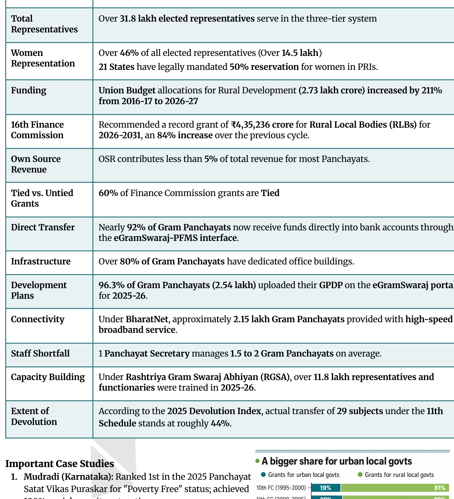

### [Smash Mains Source Page 204](../../pages/mains/mains_page_204.pdf)

### [Smash Mains Source Page 204](../../pages/mains/mains_page_204.pdf)

*Diagram Screenshot: [A Bigger Share for Urban Local Governments (Finance Commission Grants)](../../diagrams/mains_diag_ulb_grants_share_p204.png) · [Full Source Page 204](../../pages/mains/mains_page_204.pdf)*

### Data on PRIs

| Category | Data |
| --- | --- |
| Total PRIs | Approximately 2.64 lakh Gram Panchayats, 6,792 Block Panchayats, and 670 Zila Panchayats across India. |
| Total Representatives | Over 31.8 lakh elected representatives serve in the three-tier system |
| Women Representation | Over 46% of all elected representatives (Over 14.5 lakh) 21 States have legally mandated 50% reservation for women in PRIs. |
| Funding | Union Budget allocations for Rural Development (2.73 lakh crore) increased by 211% from 2016-17 to 2026-27 |
| 16th Finance Commission | Recommended a record grant of ₹4,35,236 crore for Rural Local Bodies (RLBs) for 2026-2031, an 84% increase over the previous cycle. |
| Own Source Revenue | OSR contributes less than 5% of total revenue for most Panchayats. |
| Tied vs. Untied Grants | 60% of Finance Commission grants are Tied |
| Direct Transfer | Nearly 92% of Gram Panchayats now receive funds directly into bank accounts through the eGramSwaraj-PFMS interface. |
| Infrastructure | Over 80% of Gram Panchayats have dedicated office buildings. |
| Development Plans | 96.3% of Gram Panchayats (2.54 lakh) uploaded their GPDP on the eGramSwaraj portal for 2025-26. |
| Connectivity | Under BharatNet, approximately 2.15 lakh Gram Panchayats provided with high-speed broadband service. |
| Staff Shortfall | 1 Panchayat Secretary manages 1.5 to 2 Gram Panchayats on average. |
| Capacity Building | Under Rashtriya Gram Swaraj Abhiyan (RGSA), over 11.8 lakh representatives and functionaries were trained in 2025-26. |
| Extent of Devolution | According to the 2025 Devolution Index, actual transfer of 29 subjects under the 11th Schedule stands at roughly 44%. |

### Important Case Studies

- **1.** Mudradi (Karnataka): Ranked 1st in the 2025 Panchayat Satat Vikas Puraskar for "Poverty Free" status; achieved 100% social security saturation.

- **2.** Madamakki (Karnataka): achieved 100% Functional Household Tap Connections (FHTC) and integrated greywater management.
