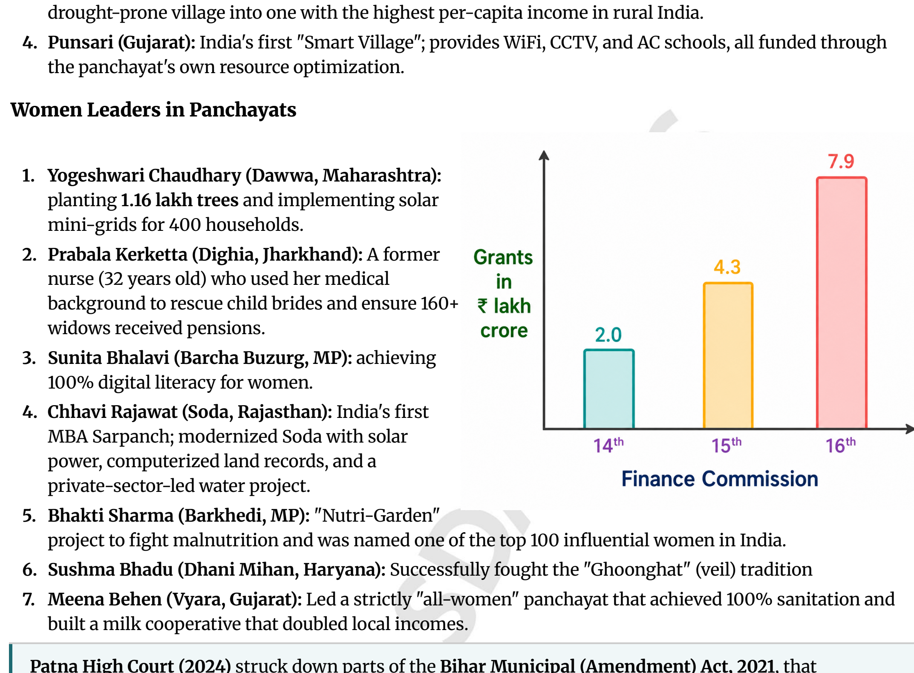

### [Smash Mains Source Page 205](../../pages/mains/mains_page_205.pdf)

### [Smash Mains Source Page 205](../../pages/mains/mains_page_205.pdf)

*Diagram Screenshot: [Finance Commission Grants to Local Bodies (11th to 15th FC in Rs Lakh Crore)](../../diagrams/mains_diag_fc_grants_local_bodies_p205.png) · [Full Source Page 205](../../pages/mains/mains_page_205.pdf)*

- **3.** Hiware Bazar (Maharashtra): The gold standard for water harvesting. Transformed from a drought-prone village into one with the highest per-capita income in rural India.

- **4.** Punsari (Gujarat): India's first "Smart Village"; provides WiFi, CCTV, and AC schools, all funded through the panchayat's own resource optimization.

### Women Leaders in Panchayats

- **1.** Yogeshwari Chaudhary (Dawwa, Maharashtra): planting 1.16 lakh trees and implementing solar mini-grids for 400 households.

- **2.** Prabala Kerketta (Dighia, Jharkhand): A former nurse (32 years old) who used her medical background to rescue child brides and ensure 160+ widows received pensions.

- **3.** Sunita Bhalavi (Barcha Buzurg, MP): achieving 100% digital literacy for women.

- **4.** Chhavi Rajawat (Soda, Rajasthan): India's first MBA Sarpanch; modernized Soda with solar power, computerized land records, and a private-sector-led water project.

- **5.** Bhakti Sharma (Barkhedi, MP): "Nutri-Garden" project to fight malnutrition and was named one of the top 100 influential women in India.

- **6.** Sushma Bhadu (Dhani Mihan, Haryana): Successfully fought the "Ghoonghat" (veil) tradition

- **7.** Meena Behen (Vyara, Gujarat): Led a strictly "all-women" panchayat that achieved 100% sanitation and built a milk cooperative that doubled local incomes. Patna High Court (2024) struck down parts of the Bihar Municipal (Amendment) Act, 2021, that transferred the powers of appointment of Grade C and D employees of municipalities from the Empowered Standing Committee of the municipality to the State government-controlled Directorate of Municipal Administration. The court held that such recentralisation of power was "incompatible with the idea, intent, and design" of the constitutional amendment, reaffirming urban local autonomy.

### Significance of Local Bodies

Rajni Kothari - Described local bodies as "schools of democracy" where political awareness and participation are cultivated at the grassroots level.

- **1.** Normative Foundation: It rests on two core values - efficiency in public service delivery and deepening of democracy through proximity to citizens.

- **2.** Democratic Decentralization - Eg. Kerala's People's Plan Campaign grants local bodies control over 40% of the state's plan budget.

- **3.** Principle of Subsidiarity: decisions closer to the people. Eg. selection of beneficiaries under PM-Awas Yojana

- **4.** Inclusivity and social justice: representation to Scheduled Castes, and Scheduled Tribes.

- **5.** Implementation of Schemes, ensuring that benefits reach the grassroots. Eg. MGNREGA.

- **6.** Gender Empowerment: Over 14.5 lakh Elected Women Representatives, with 21 states providing 50% reservation.
