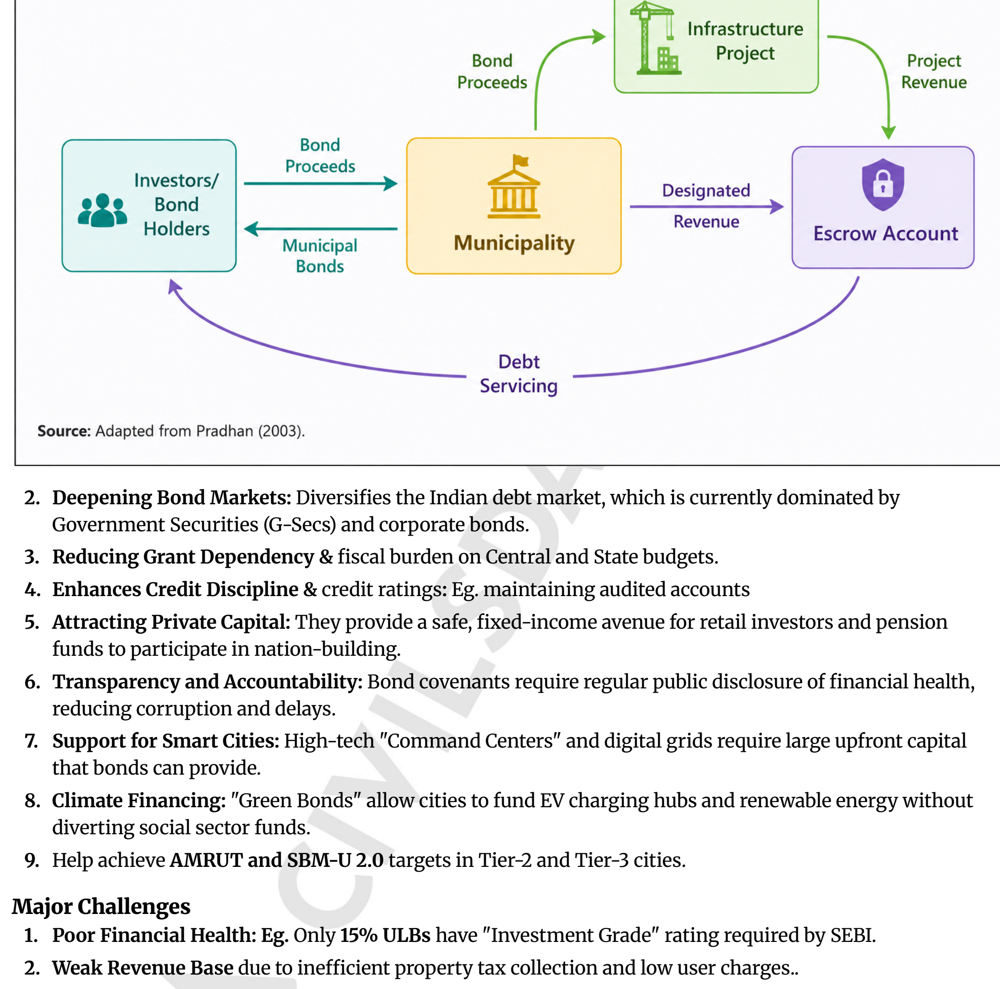

### [Smash Mains Source Page 219](../../pages/mains/mains_page_219.pdf)

### [Smash Mains Source Page 219](../../pages/mains/mains_page_219.pdf)

*Diagram Screenshot: [Chart III.2: Municipal Bond Financing Architecture for an Urban Local Body (ULB)](../../diagrams/mains_diag_ulb_bond_financing_p219.png) · [Full Source Page 219](../../pages/mains/mains_page_219.pdf)*

- **2.** Deepening Bond Markets: Diversifies the Indian debt market, which is currently dominated by Government Securities (G-Secs) and corporate bonds.

- **3.** Reducing Grant Dependency & fiscal burden on Central and State budgets.

- **4.** Enhances Credit Discipline & credit ratings: Eg. maintaining audited accounts

- **5.** Attracting Private Capital: They provide a safe, fixed-income avenue for retail investors and pension funds to participate in nation-building.

- **6.** Transparency and Accountability: Bond covenants require regular public disclosure of financial health, reducing corruption and delays.

- **7.** Support for Smart Cities: High-tech "Command Centers" and digital grids require large upfront capital that bonds can provide.

- **8.** Climate Financing: "Green Bonds" allow cities to fund EV charging hubs and renewable energy without diverting social sector funds.

- **9.** Help achieve AMRUT and SBM-U 2.0 targets in Tier-2 and Tier-3 cities.

### Major Challenges

- **1.** Poor Financial Health: Eg. Only 15% ULBs have "Investment Grade" rating required by SEBI.

- **2.** Weak Revenue Base due to inefficient property tax collection and low user charges..

- **3.** Low Secondary Liquidity: Once issued, municipal bonds are rarely traded, making it difficult for investors to exit early.

- **4.** Opaque Accounting Standards: Lack of standardized, digitized, and timely audited financial statements deters high-value institutional investors.

- **5.** Administrative Inefficiency: Most ULBs lack a dedicated "Finance Cell" or experts capable of managing complex bond documentation.

- **6.** Populist measures like "waiving user charges" jeopardize the dedicated revenue streams promised to bondholders.

- **7.** High Transaction Costs of credit rating, underwriting, and legal compliance makes small issuances (<₹50cr) economically unviable.
