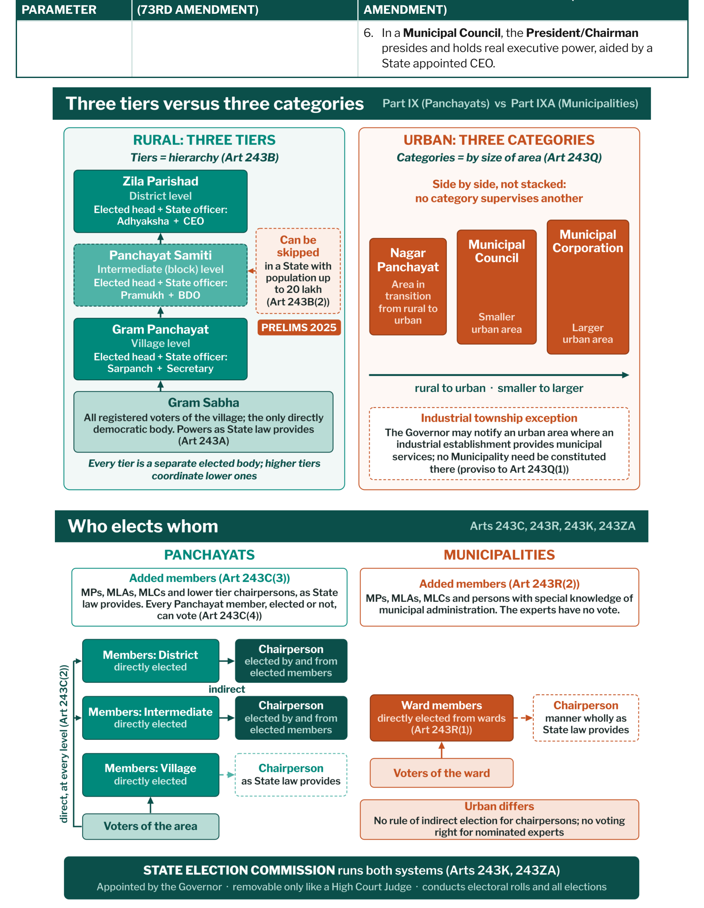

### [Prelims Source Page 142](../../pages/prelims/prelims_page_142.pdf)

### [Prelims Source Page 142](../../pages/prelims/prelims_page_142.pdf)

*Diagram Screenshot: [Panchayati Raj & Municipalities: Three Tiers vs Three Categories & Who Elects Whom](../../diagrams/pre_diag_pri_tiers_elections_p142.png) · [Full Source Page 142](../../pages/prelims/prelims_page_142.pdf)*

| FEATURE / PARAMETER | RURAL LOCAL SELF GOVERNMENT (73RD AMENDMENT) | URBAN LOCAL SELF GOVERNMENT (74TH AMENDMENT) |
| --- | --- | --- |
| **Executive machinery (State law, non-constitutional)** *(Contd.)* | — | **6.** In a Municipal Council, the President/Chairman presides and holds real executive power, aided by a State appointed CEO. |
