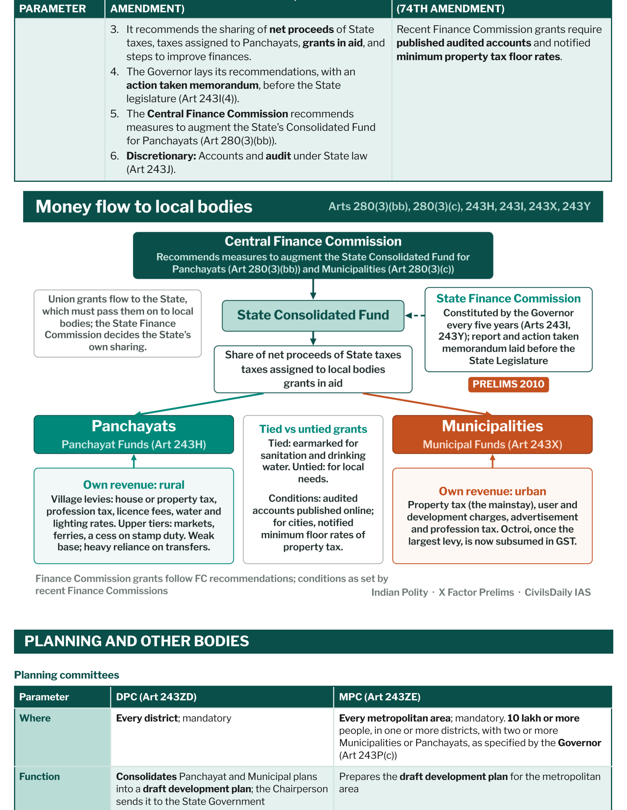

### [Prelims Source Page 145](../../pages/prelims/prelims_page_145.pdf)

### [Prelims Source Page 145](../../pages/prelims/prelims_page_145.pdf)

*Diagram Screenshot: [Money Flow to Local Bodies: Central & State Finance Commissions](../../diagrams/pre_diag_local_bodies_money_flow_p145.png) · [Full Source Page 145](../../pages/prelims/prelims_page_145.pdf)*

| FEATURE / PARAMETER | RURAL LOCAL SELF GOVERNMENT (73RD AMENDMENT) | URBAN LOCAL SELF GOVERNMENT (74TH AMENDMENT) |
| --- | --- | --- |
| **Finance Commissions, accounts and audit** *(Contd.)* | **3.** It recommends the sharing of net proceeds of State taxes, taxes assigned to Panchayats, grants in aid, and steps to improve finances. **4.** The Governor lays its recommendations, with an action taken memorandum, before the State legislature (Art 243I(4)). **5.** The Central Finance Commission recommends measures to augment the State’s Consolidated Fund for Panchayats (Art 280(3)(bb)). **6.** Discretionary: Accounts and audit under State law (Art 243J). | Recent Finance Commission grants require published audited accounts and notified minimum property tax floor rates. |

### PLANNING AND OTHER BODIES

Planning committees

| Parameter | DPC (Art 243ZD) | MPC (Art 243ZE) |
| --- | --- | --- |
| Where | Every district; mandatory | Every metropolitan area; mandatory. 10 lakh or more people, in one or more districts, with two or more Municipalities or Panchayats, as specified by the Governor (Art 243P(c)) |
| Function | Consolidates Panchayat and Municipal plans into a draft development plan; the Chairperson sends it to the State Government | Prepares the draft development plan for the metropolitan area |
